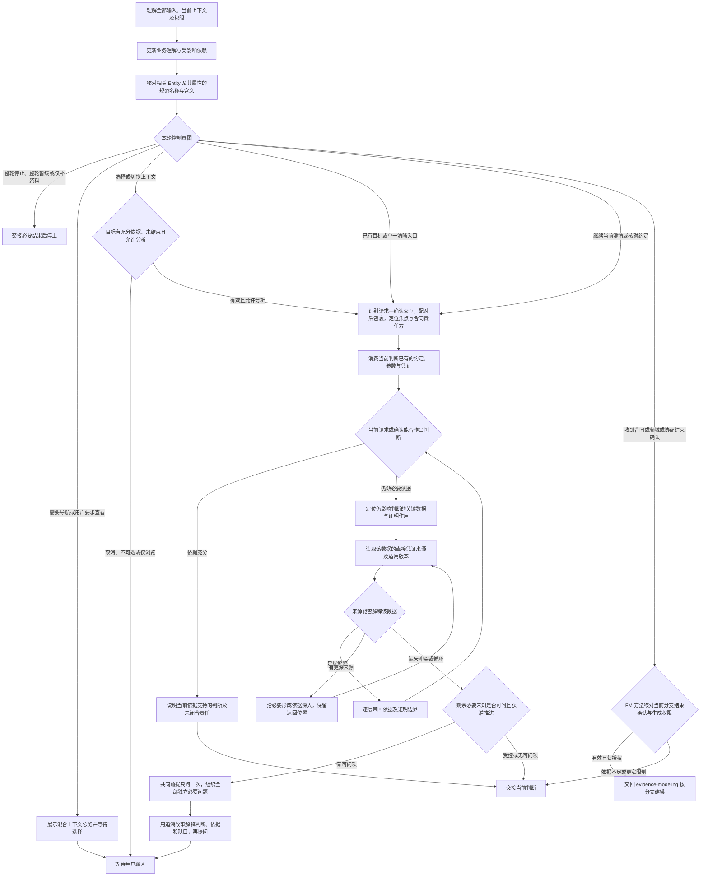

# 访谈协议：沿凭证追溯推进

每轮只推进一个业务焦点：先说明当前请求凭什么成立、结果凭什么满足约定，再沿关键数据找到凭证来源，取得依据后逐层回到原判断。对话使用自然语言，按现金权责与目标—实际对比找到约定与责任双方；问题成组提出后等待真人；回答、责任与未决项随授权写入 `.evidence/traces/interview-trace.json` 和当前模型。



## 1. 承接目标、业务依据与控制意图

### 首次进入或恢复

材料已提供就直接读取。按 FM 方法从收入流与成本结构找到实际约定与责任双方，直接识别双方主要请求—确认交互，配对后包裹为履约，用它们检验理解；主要责任梳理与交互识别是一件事，不先列抽象清单。恢复时从提供的材料和交接定位合同、履约项、请求或确认、原问题、各凭证责任人、深层位置及停止／暂缓状态，未包裹交互恢复到合同及已知凭证，不要求或虚构履约 ID。上下文不足时说明限制。完成时：必要方法已加载，原问题与控制意图可定位。

### 连续问答

同任务、授权未变、必要方法仍在上下文且未变化时复用。吸收本轮全部输入，先核对受影响依赖，再核对受影响 Entity 及其属性的名称与定义；焦点外的更正也及时处理。已答项立即吸收，未答项不视为默认同意；任一写入失败就停止并交接真实结果。完成时：本轮事实、受影响判断与控制状态一致。

### 最小读取范围与新鲜度

从当前节点、各凭证当前位置与责任人、关键数据来源、原问题与控制状态开始，读取必要材料片段及适用版本，按完整双语名称、中文或英文部分、别名、上下文、Entity ID 与属性名定位实际文件中的对应 FM 目标。先复用已有规范映射；业务含义明确时直接翻译英文，不等待人类提供英文。缺失依据、冲突或关联更正影响判断时沿依赖继续追读；影响范围不能确定时扩大读取。写入前由 FM 核对本批依据与编辑授权。完成时：读取范围足以支撑当前判断，或缺口与限制明确。

### 按事件扩大核对

| 事件           | 核对范围                                                 |
| -------------- | -------------------------------------------------------- |
| 切换上下文     | 目标类型、实际边界、当前对象或合同双方、原问题与控制状态 |
| 领域／协商结束 | 当前范围、规则或方案、关联责任、反例核对及分支结束确认   |
| 新增异常义务   | 新义务、所属责任链与受影响确认                           |
| 更正业务依据   | 被更正对象、依赖结论及确认失效影响                       |
| 单合同澄清结束 | 完整责任图、全部终点、推演、结束确认及生成权限           |
| 全部追责结束   | 范围内完整责任图、全部终点、推演及全局明确确认           |
| 方法或材料变化 | 变化及依赖影响，重新核对确认适用性；旧确认随之失效       |
| 上下文压缩     | 从提供的交接重新定位必要依据与方法                       |

## 2. 从履约判断沿数据找凭证，再返回判断

1. **履约判断。** 明确要判断的要求或结果，区分请求依据与结果证明，不从点击行为推定履约完成。沿业务全生命周期（索取提案、提案、签约、履约请求、履约确认）定位当前所处阶段；在缺少正式合同时，从已知业务凭证逆推必要权责与潜在约定。
2. **关键数据。** 只定位影响这个判断的数据及含义；约定标准与实际结果可以来自不同凭证。
3. **凭证来源。** 说明哪项数据由哪份凭证支持、适用哪项约定或版本、证明到什么程度；请求与确认本身也是凭证。
4. **深入追溯。** 直接来源不足以解释数据时，沿其形成依据深入，保留所属合同、位置、合同责任方与返回位置；遇到循环引用或版本冲突就定位尚缺的独立依据。将易变规则抽象为角色，不强行作为硬编码逻辑。
5. **返回判断。** 取得依据后先返回直接消费该数据的凭证，再逐层回到原请求或确认，说明现在能判断什么、还不能判断什么。

以当前判断为带共享节点的依赖图，依赖前沿是前置已经具备、不需要猜测其他答案就能澄清的判断。主动核对相关请求、确认与支撑凭证，寻找全部独立必要问题，不在找到第一题后结束分析。独立意味着一个答案不会改变另一题的前提、对象或问法；共同前提与其他独立问题同轮提出，只把依赖它的具体问题留到回答之后。收到部分回答后重算前沿，不等待整组答完。没有影响当前判断的业务缺口就交接，不为补齐字段额外提问。

合同属性、双方接受的标准与实际结果可以来自不同凭证。正常和争议单据推演只说明当时已有的凭证、适用约定与实际结果；未执行保持未执行。第三条来源链、外部凭证或新增第三方不自动切换焦点，也不自动产生新合同；只追当前判断所需的证明与采信条件，支撑合同内部未决项继续保留。

## 3. 当轮核对模型语言

直接读取相关 Entity 及其属性，名称取 `label`，定义归 Entity 或属性拥有者；专业词汇与双语规范由 `domain-language.md` 维护。尚无模型时承接已明确材料，直接翻译缺少的英文，不为保存术语创建占位 Entity，也不为定义另建文件。已建模概念发生更正且已有模型编辑授权时交给 FM 增量维护；不把单独访谈授权当成编辑授权。只聊不落盘或仅保存资料时以对话承接，不写模型 JSON。完成时：本轮表达与定义拥有者一致，共同理解与已保存模型分开。

## 4. 只展示当前进度

### 混合上下文总览与选择

多个独立入口需要确定优先级，或用户要求查看或切换时，展示当前已知上下文及关联；明确指定目标或只有一个清晰入口时直接承接。各项用编号、业务名称、类型、目的、责任或规则边界、关联及结束状态说明。总览不展示“待追溯”一栏；未决问题继续保留在当前理解及获授权交接中。总览和日常问答不展示资料来源信息，也不附方法出处、参考资料段或内部检查报告；内部仍保留依据及版本。没有可定位入口时不输出空导航，只说明当前收支或内部目标及必要未知。只看总览保持原控制状态，不必先找齐全局所有合同。

只问“先分析哪个上下文？”，选择轮只收集导航选择，不同时问业务问题。选择只决定分析焦点，不确认约定或排除责任。取消保留原焦点和原问题。

### 合同上下文总览与选择

合同项展示名称、双方、实际约定、主要责任、关联及结束状态，用“谁与谁达成什么约定，双方分别承担什么责任”表达。结束状态须有人类明确确认，并覆盖当前合同的责任、未决项及适用业务版本；已澄清结束的合同仍展示，仅供查看；可选择项限于未结束合同。单合同结束与全局追责结束分别核对。只问“先分析哪个合同上下文？”。选择后承接已知双方和主履约，定位一个请求或确认，其他义务与暂缓问题继续保留。

### 领域与协商的单轮澄清及结束

领域问题优先复用成熟方案，围绕当前业务连接点寻找可同时澄清的独立内容，不默认展开内部规则；协商围绕真实邀请、方案、回应与接受依据展开。展示用 `领域上下文 → 当前对象` 或 `协商上下文 → 当前对象`。沿用已知事实复用、共同前提优先、独立问题成组与部分回答重算规则，但不套用履约请求—确认，不虚构凭证责任人。分支结束确认单独一轮，展示完整分析范围、规则与依据、反例核对及剩余缺口，请人类明确确认；有效确认且具生成权限时交回建模入口。新增事实影响边界时局部核对，不因划入领域而删除合同责任。

### 用追溯解释当前履约判断

已包裹时位置精确到 `合同名称 → 履约项名称 → 请求或确认`，未包裹时说明另一端尚待澄清，不虚构履约名称或 ID。责任人就是所属合同的一方，写在对当前请求或确认负责的合同责任方后；实际主体未知写“实际主体待明确”，不能判断是哪一方时写“合同责任方待明确”。经办人、上传人与证明提供方不自动等于责任人，其办理作用另行说明。

正文用普通语言说明同一个判断：请求依据说明要求凭什么成立，结果证明说明实际结果凭什么符合要求；关键数据已有哪项凭证、现有材料能证明什么、下一步为何深入或回到原判断。箭头表示为了作出判断去找依据，不表示操作先后。日常对话只保留定位与问题：不附资料出处、文章名、页码或方法说明，内部依据按权限保留。

```text
当前位置：〈合同中文（英文）〉 → 〈履约中文（英文）〉 → 〈当前请求或确认中文（英文）〉〔凭证类型〕
责任人：〈所属合同一方的规范名称及已明确实际主体；未知则说明〉

〈当前判断、关键数据、已有凭证的证明作用与必要未知。〉

Q1：〈仍影响判断、前置充分的一项必要未知〉
Q2：〈同轮可独立澄清的另一项必要未知；没有就不增加〉
```

每题只澄清一个仍影响当前判断的业务问题，多题用 Q1、Q2 分别编号；单题可自然接问。必要条件不明时保留问题，不推荐未知业务事实作为默认答案。

涉及金额、期限、数量或时间差时，问题要同时问提供方与算法，回答要能写成「输入凭证／合同参数 → 规则 → 结果」。只问到数值而没有来源的，不算澄清完成。

## 5. 组织本轮问题并等待

每轮一个业务焦点，主动寻找并同轮提出全部可同时澄清的独立必要问题，问后等待真人。事实可查则自行查找，业务决定由用户作出；材料与业务事实充分时直接复用，已知事实足以推导时说明推导与适用条件。只有用户要求逐问或确实只有一个可问项时才单问。

每题单独编号；已有问题沿用原问题标识及缺口关联，未答、暂缓、更正或改写措辞不因切换凭证重编号。展示编号只用于关联本轮回答，无编号的自然语言也吸收全部事实。

单合同结束确认单独一轮，展示全部主履约、各层异常、责任终点与推演，等待人类明确确认；不与问题组混问，不把暂缓或普通“全部同意”当作结束。全局结束确认单独一轮，展示实际完整范围、责任图、终点及推演。人类确认写入 `userInput.confirmedFacts`，单合同范围写 `范围结束确认：<contextRef>`，全局范围写 `全局追责结束确认：<contextRef>`；没有这条记录，下游门禁不会打开。

每轮澄清问答结束并确认事实后，把焦点凭证 `focus.evidenceRef`、追溯故事 `narrative`、提出的问题 `qa`、用户原话 `userInput.rawText`、确认事实与来源绑定 `targetBindings` 增量写入 `.evidence/traces/interview-trace.json`，结构按 `interview-trace.schema.json`。写入后立即校验：

```bash
python3 "$DISCOVERY_SKILL_DIR/scripts/check_interview_trace.py" "$TRACE_FILE" \
  --schema "<evidence-fm>/schemas/interview-trace.schema.json" \
  --fm-root "$FM_ROOT"
```

退出码非 0 时按报告修正后再交付；引用必须指向已建模的 Entity 及其属性，否则先把凭证交 FM 落地。

回答涉及金额、期限、数量或时间差时，`userInput.confirmedFacts` 写成「输入 → 规则 → 结果」，`targetBindings` 绑到派生属性或提供该值的属性；只有数值没有来源的，保留为缺口，等 FM 台账给出提供方结论后再写入。完成时：问题组已交付或交接已说明，追溯日志通过校验。

## 6. 更正、停止与跨会话承接

部分回答时已答项立即吸收并核对是否解决原缺口，已经收到的回答用于业务理解；未答项不视为默认同意，要求继续其他独立问题才推进。暂缓指定题时保留原问题标识与未决依据。整轮停止或整轮暂缓时处理获授权内容后结束本轮；停止后仅吸收补充资料，继续问答需要明确意图。事实与控制意图同时到达时，吸收全部事实并遵守更窄权限。

更正沿依赖核对受影响结论及确认适用性；新增义务或约定更正后重新核对受影响分支与整体确认，恢复访谈由用户决定。获授权资料保存失败后先核对真实文件结果，再决定后续。

## 7. 交接后停止

简述当前判断、必要未决项、控制意图与模型定义的待改影响；合同级结束、全局追责结束与编辑授权分别说明。有生成权限的单合同结束或领域／协商分支结束信号交回 `evidence-modeling` 自动接续，传递未澄清上下文的类型、边界、关联、原问题、暂缓项与恢复位置；其他下一步由用户选择。每批已知内容与更正按现有授权交给 FM 渐进表达并检查一致性，模型变化不自动接续 API。完成时：已保存、已检查与未执行事项分别可定位，然后停止。
