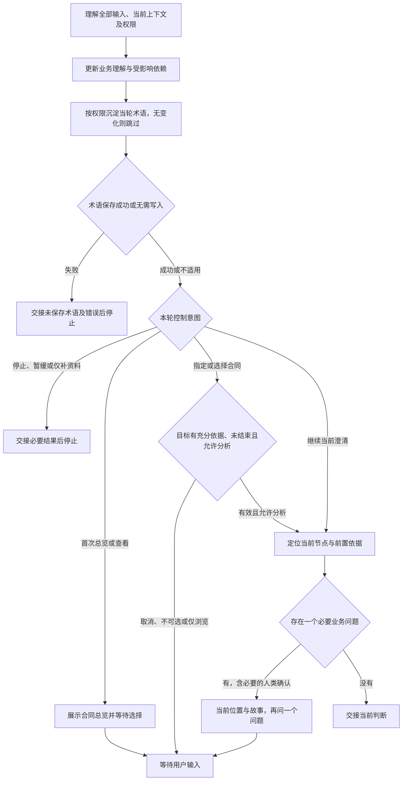

# 访谈协议：围绕当前业务判断推进

普通对话是完整交互路径。围绕本轮目标、实际材料与当前理解开展澄清，吸收回答后更新分析，再选择一个必要问题并等待真人。

专业分析读取 FM 的 `references/business-analysis.md`，逐枝追责与结束核对读取 `references/responsibility-closure.md`，当轮术语读取 `references/domain-language.md`。

## 单轮执行路径

## 1. 承接目标、业务依据与控制意图

消化本轮全部事实、更正与控制意图。材料已提供就直接读取必要依据；可查事实自行查找，真正未知的业务决定交给人类。

### 首次进入或恢复

加载当前分支必要方法，从提供的材料和交接定位当前合同、履约项、请求或确认、原问题及停止／暂缓状态。已有有效焦点时直接承接；关键上下文不足时明示限制，澄清必要缺口。

### 连续问答

同任务、授权未变、必要方法仍在上下文且未变化时复用。理解本轮全部输入，增量核对当前节点与受影响依赖，再按授权维护受影响术语；焦点外的更正也及时处理。

每轮只问一个核心问题；没有必要问题则交接。任一写入失败就停止，说明术语实际保存结果。只聊不落盘、仅补资料、暂缓与停止等更窄要求优先。

### 最小读取范围与新鲜度

从当前节点、原问题及控制状态开始，核对相关请求／确认、必要材料片段及适用版本、受影响术语及对应 FM 目标。新增概念先检索名称、别名、上下文和目标，再读取命中条目。

当前展示是读取起点。缺失依据、冲突或关联更正影响判断时沿依赖继续追读；影响范围不能确定时扩大读取。必要上下文丢失时重新定位依据并加载必要方法；术语写入前核对实际文件中的目标条目，保留其他改动。

### 按事件扩大核对

| 事件           | 核对范围                                           |
| -------------- | -------------------------------------------------- |
| 切换合同       | 目标合同、已知双方、全部主履约、结束依据及必要依赖 |
| 新增异常义务   | 新义务、所属责任链与受影响确认                     |
| 更正业务依据   | 被更正对象、依赖结论及确认失效影响                 |
| 全部追责结束   | 人类范围内完整责任图、全部终点、推演及全局明确确认 |
| 方法或材料变化 | 变化及依赖影响，重新核对确认适用性                 |
| 上下文压缩     | 从提供的交接重新定位必要依据与方法                 |
| 术语保存中断   | 实际词汇条目及本轮授权内尚未保存内容               |

## 2. 沿业务依赖更新理解

按 FM 方法理解经营依据、合同边界、全部主履约、请求—确认骨架、关键数据追溯、异常责任、参与者、单据推演及变化点。区分明确事实、确定性推导、候选解释与未知。

把当前判断看作依赖树：答案明确一项判断后，重新计算哪些后续判断的前置依据已经具备，从中选择一个必要问题。依赖另一个未知时先追溯该依据；已知事实直接复用或推导。当前分支追到终点后回到兄弟分支，同时承接其他责任与暂缓问题。

关键值追溯说明业务含义：金额依据哪项约定、完成由什么凭证证明、期限如何确定。请求与确认本身就是凭证；凭证存在与证明充分分别核对。

## 3. 当轮术语沉淀

按授权使用 FM 领域语言方法维护唯一词汇入口 `.evidence/glossary.json`。未建模概念写 standalone，已建模概念引用当前 FM；明确术语当轮沉淀，含义仍模糊则继续澄清。

已建模概念发生更正时，说明目标定位、当前含义与待改影响，按本轮权限处理。只聊不落盘或仅保存资料时以对话承接；专业方法缺失时明示待沉淀项。

术语写入失败立即停止，交接实际错误及未保存内容；恢复先核对实际条目，再补齐授权内缺失内容。已收到的事实直接复用。

## 4. 只展示当前进度

### 合同上下文总览与选择

首次消化资料并直接识别合同上下文后展示总览；用户要求查看／切换或通过界面表达相同意图时再次展示。有效焦点恢复直接承接，明确指定合同则核对目标；只看总览保持原控制状态。

总览只列经营依据与独立边界充分的合同上下文：序号、名称、经营主线、具体目的、双方、责任边界、待追溯事项及澄清是否结束。主线为“现金权责”或“目标与实际”，现金方向注明观察主体。用“谁与谁签订什么合同，以实现什么具体经营目的”表达，口头约定用“达成约定”。展示专注于业务内容。

参数与证明缺口归对应合同；经营依据或独立边界不足的线索保持待查。识别依据由 Agent 分析材料，用户选择分析焦点。

结束状态须有人类明确确认，并覆盖当前合同的责任、未决项及适用业务版本。已澄清结束的合同仍展示，仅供查看；可选择项限于未结束合同。单合同结束与全局追责结束分别核对，更正导致确认失效时说明影响并等待处理。

用编号列表展示，只问“先分析哪个合同上下文？”。同名或过期选择先定位目标；未识别到合同则说明具体材料缺口，全部结束时展示后返回。

选择轮只收集导航选择。取消保留原焦点和原问题，等待用户；选择后先重新核对目标有充分依据且未结束，再承接已知双方和全部主履约，定位一个请求／确认进入单点澄清。选择只决定分析焦点，其他责任与暂缓问题继续保留。

### 单点澄清

每轮聚焦一个业务节点，履约位置精确到 `合同名称 → 履约项名称 → 请求或确认`。展示时优先使用凭证的业务名称，类型只作辅助标签；名称未知时保留请求／确认端点。异常新义务同样定位到所属合同及当前端点。

进度是信息来源追到了哪里。依据当前理解生成一段简短追溯故事：从凭证哪项信息出发，已找到什么业务依据、它能证明什么，接下来追向哪里。引用支撑凭证时说明证明作用，已知则复用或推导，只有必要未知才接问题。

日常对话用“当前位置：”保留位置，正文自然叙述，只讲当前节点有依据的内容。问题另起一段，自然提出一个仍影响当前判断的业务问题。未知明确为未知，假设明确为假设；具体表达见 [单点一轮](../examples/focused-turn.md)。

尚无履约时只展示已知合同，位置未明则标为待定位。协商用 `协商上下文 → 当前对象`，领域用 `领域上下文 → 当前对象`。切换后用新节点重建故事；普通对话与可选 UI 保持同一份当前进度。

正常和争议单据推演说明当时可见凭证、适用约定与实际结果；未执行保持未执行。全部责任、暂缓及冲突持续参与业务判断，日常展示聚焦当前节点，范围或全局确认时展示完整理解。

## 5. 决定是否提出一个问题

| 当前情况                       | 动作                                       |
| ------------------------------ | ------------------------------------------ |
| 材料与业务事实充分             | 直接复用                                   |
| 已知事实足以确定性推导         | 说明推导与适用条件                         |
| 必要事实缺失或冲突             | 选择一个前置依据已具备的问题               |
| 专业方法或工具缺失             | 明示资源限制                               |
| 仅缺技术表达或实现选择         | 交接对应缺口                               |
| 所有责任已核对且终点有人类确认 | 展示完整范围，等待人类明确确认全部追责结束 |
| 本轮停止、暂缓或仅补资料       | 按更窄权限处理后结束本轮                   |

每轮只问一个核心问题并等待真人。事实可查则自行查找，业务决定由用户作出；选题依据当前骨架、追溯或责任分支的必要依赖。可选交互需要标识时沿用当前问题标识，措辞或通道变化仍关联同一缺口。

## 6. 更正、停止与跨会话承接

直接理解自然语言。暂缓保留原问题与未决依据，停止后仅吸收补充资料；继续问答须有明确意图，继续其他话题仍保留暂缓题。事实与控制意图同时到达时，吸收全部事实并遵守更窄权限。

界面不可用时通过普通对话继续同一问题，已经收到的回答用于业务理解；取消时保留焦点等待。术语写入失败后先处理保存问题，再按用户授权决定后续。

更正沿依赖核对受影响结论及确认适用性。跨会话承接提供的材料、当前理解与控制状态；必要上下文不足时说明限制，澄清关键缺口。

停止或暂缓与追责结束分别判断。单条终点与全局结束分别核对；全局确认须覆盖实际范围、完整责任图、终点及推演。新增义务或约定更正后重新核对受影响分支与整体确认，恢复访谈由用户决定。

## 7. 交接后停止

简述当前判断、必要未决项、控制意图和术语实际保存结果。人类追责结束、编辑授权与业务批准分别说明，下一步由用户选择。
