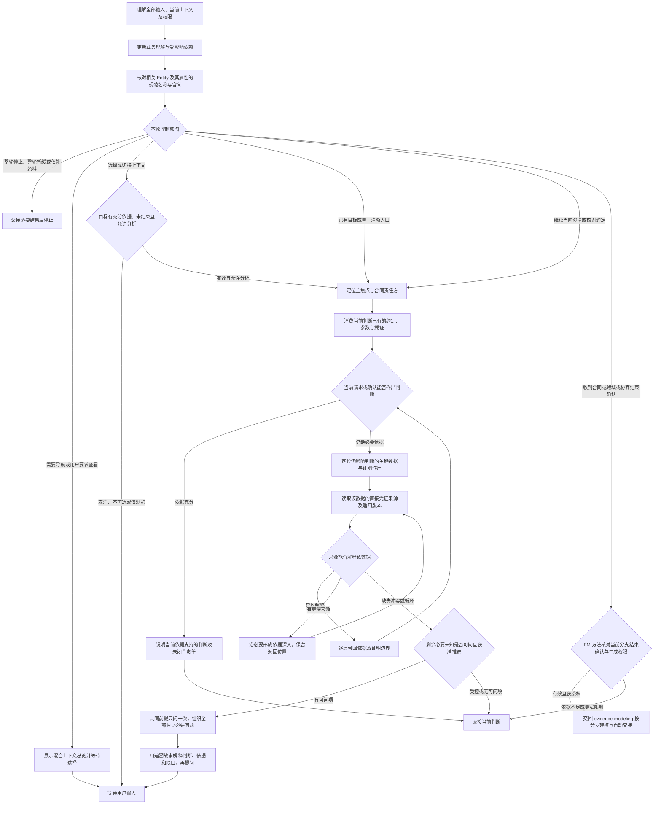

# 访谈协议：把凭证追溯讲成故事

普通对话沿同一条主线推进：**履约判断 → 关键数据 → 凭证来源 → 深入追溯 → 返回判断**。先说明当前请求凭什么成立，或确认结果凭什么满足约定，再沿必要数据寻找依据；不是按操作先后询问“接下来发生什么”。每轮吸收全部输入，主动找出相关请求、确认和支撑凭证中全部可同时澄清的独立必要问题，一起提出后等待真人。责任归所属合同的一方，业务含义明确的名称直接翻译英文。用户要求一次一问时只选一题。

专业分析读取 FM 的 `references/business-analysis.md`，逐枝追责与结束核对读取 `references/responsibility-closure.md`，模型语言读取 `references/domain-language.md`。

## 单轮执行路径



## 1. 承接目标、业务依据与控制意图

消化本轮全部事实、更正与控制意图。材料已提供就直接读取必要依据；可查事实自行查找，真正未知的业务决定交给人类。

### 首次进入或恢复

加载当前分支必要方法，按 FM 从收入流与成本结构出发，以现金权责、目标—实际对比发现实际约定与责任双方，再列出已知主要履约检验理解。已有经营依据直接复用；没有对外合同时核对内部绩效，领域或工具按真实范围进入各自分支，不制造现金往来或 KPI。明确指定目标或只有一个清晰入口时直接承接，不先展示总览；恢复时从提供的材料和交接定位合同、履约项、请求或确认，承接原问题、各凭证责任人、深层位置、回溯关系及停止／暂缓状态，不重新发现已解释的约定。收支或绩效约定仍不清楚时，定位收入对应的义务、支出取得的权利或内部目标与实际产出，以及谁向谁承担责任；成组澄清当前独立必要前提，不让用户选择合同标签。关键上下文不足时明示限制。

### 连续问答

同任务、授权未变、必要方法仍在上下文且未变化时复用。理解本轮全部输入，增量核对当前节点与受影响依赖，再核对受影响 Entity 及其属性的名称与定义；焦点外的更正也及时处理。

每轮从已知依据重新计算当前节点的依赖前沿，不沿用固定问卷。已答项立即吸收，未答项不视为默认同意；只暂缓指定题且允许继续时，其他独立问题仍可推进。没有影响当前判断的业务缺口则交接，不为补齐字段或流程额外提问。建模入口授权的访谈由 FM 随已知内容渐进维护唯一模型，每批检查一致性，不等追责结束；单独 Discovery 不自动获得模型编辑权限。凭证连同责任角色与所属上下文落地，角色未知不写凭证，实际主体未知不造 Participant。获授权保存时任一写入失败就停止并交接真实结果。只聊不落盘、仅补资料、暂缓与停止等更窄要求优先。

### 最小读取范围与新鲜度

从主焦点的当前节点、各凭证当前位置与各自责任人、各关键数据项的来源及回溯位置、原问题与控制状态开始，核对相关请求／确认、必要材料片段及适用版本、受影响概念及对应 FM 目标。直接按完整双语名称、中文部分、英文部分、别名、上下文、Entity ID 与属性名定位模型，读取相关 Entity 及其属性；尚无模型时承接实际材料，不创建占位对象。先复用已有规范映射；业务含义明确且缺英文时直接翻译，不等待人类提供英文。含义不明才保留业务问题。

当前展示是读取起点。缺失依据、冲突或关联更正影响判断时沿依赖继续追读；影响范围不能确定时扩大读取。必要上下文丢失时重新定位依据并加载必要方法；核对实际文件中的相关 Entity 及其属性，保留其他改动；写入前由 FM 核对本批依据与编辑授权，范围交付另核对完整性及人类结束确认。

### 按事件扩大核对

| 事件           | 核对范围                                                                   |
| -------------- | -------------------------------------------------------------------------- |
| 切换上下文     | 目标类型、实际边界、当前对象或合同双方及已知主履约、原问题、控制与结束依据 |
| 领域／协商结束 | 当前完整范围、规则或方案、关联责任、反例核对及人类分支结束确认             |
| 新增异常义务   | 新义务、所属责任链与受影响确认                                             |
| 更正业务依据   | 被更正对象、依赖结论及确认失效影响                                         |
| 单合同澄清结束 | 当前合同完整责任图、全部终点、推演、结束确认及生成权限                     |
| 全部追责结束   | 人类范围内完整责任图、全部终点、推演及全局明确确认                         |
| 方法或材料变化 | 变化及依赖影响，重新核对确认适用性                                         |
| 上下文压缩     | 从提供的交接重新定位必要依据与方法                                         |

## 2. 从履约判断沿数据找凭证，再返回判断

先定位当前请求是否有权提出，或当前确认是否足以证明结果满足约定，消费已有约定、参数与凭证，再按 FM 的 `references/provenance.md` 核对必要依据。业务发现用于解释尚不明确的经营权责，不把它重复施加给已经明确的合约；未取得某笔实例也不妨碍有依据的类型分析。实际参与方、同一性及代表关系按已有依据复用，主履约清单与 FM 随发现补全，范围结束前再核对完整责任。

按以下关系组织分析和对话，不将它们变成逐项询问的字段清单：

1. **履约判断。** 明确要判断的要求或结果，例如是否按约交付；先区分请求依据与结果证明，不从“谁点击了按钮”推定履约完成。
2. **关键数据。** 只定位影响这个判断的数据及含义，例如约定规格和实测结果。合同属性、双方接受的标准与实际结果可以来自不同凭证，不默认同一来源足以证明全部内容。
3. **凭证来源。** 复用已经找到的记录，说明哪项数据由它支持、适用哪项约定或版本、证明到什么程度；请求与确认本身也是凭证。没有记录名称时先澄清实际依据，不先造一张单据再问用户补齐。
4. **深入追溯。** 直接来源还不能解释数据时，沿它的形成依据继续深入。每条链保留所属合同、位置、合同责任方及返回位置；已解释的来源不重开问题。遇到循环引用或版本冲突就定位尚缺的独立依据或适用关系，不在相同引用间无限递归，也不将相互引用当作相互证实。
5. **返回判断。** 取得依据后先返回直接消费该数据的凭证，再逐层回到原请求或确认，说明现在能判断什么、还有什么不能判断；不以“找到了文件”代替证明充分，也不因一条数据查清宣告履约或追责结束。

这条主线限定当前必要追溯，不要求先扫完全部凭证，也不替领域／协商分支补造履约端点。

把当前判断看作带共享节点的依赖图；依赖前沿是前置依据已经具备、现在不需要猜测其他答案就能澄清的判断。已知事实直接复用或推导；问题来自剩余的真实业务缺口，不来自属性表、时间字段或操作步骤尚未逐项解释。主动核对相关请求、确认及支撑凭证，寻找全部独立必要问题，不在找到第一题后结束分析；没有必要问题就交接当前结论，不为凑成问题组扩大分析。收到部分回答后重算前沿，不等待整组答完，同时保留其他责任与暂缓问题。

独立意味着一个答案不会改变另一题的前提、对象或问法。把共同前提与其他独立问题同轮提出：共享约定、版本或匹配未知时，只替换依赖它的具体问题为共同前提，其他来源、证明及责任中可独立澄清的内容仍加入本轮问题组。不因局部依赖不明而整轮逐问；先分析依赖并寻找不受它影响的内容，不猜测依赖答案。只有用户要求一次一问，或完成这项查找后确实只有一个可问项，才单问。更正推翻共同前提时，核对受影响的问题、回答结论和人类确认，保留未受影响事实，重新组织问题组。

一个业务焦点可以并行追溯多个凭证。每条来源链深度优先，不要求全局只推进一条链；同一凭证也可以有多条来源链。共同业务依据只问一次，不逐字段重复提问；各链当前可问的内容一起澄清，再依据回答分别深入和回溯，不把深度优先解释为整轮串行，也不把并行改成全局广度问卷。

共同前提暂缓或尚未明确时，依赖它的分支保留原问题与回溯位置；其他已判独立的分支在用户允许继续时推进。只暂缓一条来源链不转成全部凭证暂缓，不因切换凭证重编号或恢复暂缓题；整轮停止仍优先。支撑凭证跨上下文时只追当前判断需要的证明及形成依据，不是展开其全部合同责任，也不等于切换合同分析焦点。

沿外部凭证发现另一组双方的独立约定时，增量补充合同及其证明关联，不必先找齐全局所有合同，也不自动切换主焦点。第三方出现不自动产生新合同；只追当前判断所需的责任、形成依据与采信条件，支撑合同内部未决项继续保留。新增事实影响边界时局部核对，拆分领域能力不能删除原合同责任，也不要求每轮完成全局分类。

关键值追溯说明业务含义：金额依据哪项约定、完成由什么凭证证明、期限如何确定。请求与确认本身就是凭证；凭证存在与证明充分分别核对。

## 3. 当轮核对模型语言

按 FM 领域语言方法直接读取相关 Entity 及其属性，名称取 `label`，定义归 Entity 或属性拥有者；协议层不复制字段定义。尚无模型时承接已明确材料，直接翻译缺少的英文，不为保存名称创建 Entity 或额外定义文件。

已建模概念发生更正时，说明目标定位、当前含义与影响；已有模型编辑授权时交给 FM 增量维护，否则只交接，不把单独访谈授权当成编辑授权。只聊不落盘或仅保存资料时以对话承接；专业方法缺失时明示限制。已收到的事实直接复用，故事、问题与交接使用同一规范名称。

## 4. 只展示当前进度

### 混合上下文总览与选择

多个独立入口需要确定优先级，或用户要求查看或切换时，展示当前已知上下文及关联。明确指定目标或只有一个清晰入口时直接承接；有效焦点恢复不重复导航。总览不是全局发现的完成关卡，后续发现可增量补充。没有可定位入口时不输出空导航，只说明当前收支或内部目标及必要未知；允许澄清时一起提出当前独立必要前提，不要求用户选类型。

各项用编号、业务名称、类型、目的、责任或规则边界、关联及结束状态说明。合同说明实际收支权责或内部绩效中谁与谁达成什么约定及主要责任；领域说明对象、能力和规则，协商说明方案、回应及拟形成的约定。功能名称和合约章节不直接变成上下文，未知责任不因划入领域而消失，不为领域或工具补造收费或 KPI。

总览不展示“待追溯”一栏；未决问题继续保留在当前理解及获授权交接中。总览和日常问答不展示资料来源信息，也不附方法出处、参考资料段或内部检查报告。内部仍保留依据及版本，获授权交接可引用实际产物；业务凭证及其证明作用仍须讲清。

只问“先分析哪个上下文？”，选择轮只收集导航选择，不同时问业务问题。选择只决定分析焦点，不确认约定、排除责任或批准业务。查看总览不解除停止／暂缓，取消保留原焦点和原问题；已澄清结束项只供查看。选择有歧义时只定位目标，不猜第一项。

选择领域定位 `领域上下文 → 当前对象或规则`，选择协商定位 `协商上下文 → 当前邀请、方案或回应`；选择合同承接约定与责任双方及已知主履约，再用具体履约继续验证。切换保留原问题、未决依赖、控制意图及确认覆盖，不恢复暂缓题。交互见 [上下文导航](../examples/navigation.md)。

### 合同上下文总览与选择

仅查看合同或混合总览中的合同项时使用本节。只看总览保持原控制状态；合同明确且目标已指定时直接进入履约，不重复问合同存在或交易如何成立。

合同项展示名称、双方、实际约定、主要责任、关联及结束状态，用“谁与谁达成什么约定，双方分别承担什么责任”表达。现金权责或内部绩效依据、独立约定和责任关系不明的内容不作为合同选项；参数、完成证明或其他履约尚未查清时保留对应问题，已知收支或目标不重复询问，也不要求先找齐全部合同。

结束状态须有人类明确确认，并覆盖当前合同的责任、未决项及适用业务版本。已澄清结束的合同仍展示，仅供查看；可选择项限于未结束合同。单合同结束与全局追责结束分别核对。有效结束信号且获生成授权时交回 `evidence-modeling`；仅访谈或不生成时只交接依据。更正导致确认失效时说明影响并等待处理。

用编号列表展示，只问“先分析哪个合同上下文？”。同名或过期选择先定位目标，全部结束时展示后返回。选择后承接已知双方和主履约，定位一个请求／确认；其他义务与暂缓问题继续保留，主履约清单随发现补全，结束确认时必须覆盖完整合同。

### 领域与协商的单轮澄清及结束

按 FM 对应分支加载必要方法。领域问题读取 `references/domain-modeling.md`，优先复用成熟方案，围绕当前业务连接点主动寻找可同时澄清的独立内容，不默认展开内部规则；已知采用方式直接承接，不重复问选型或通用原理，满足 FM 的深入条件后才分析必要的对象身份、关系或特有规则；协商围绕真实邀请、方案、回应与接受依据展开。沿用已知事实复用、共同前提优先、独立问题成组、部分回答重算及逐项暂缓规则，但不套用履约请求—确认，也不虚构凭证责任人。展示当前位置、已知主体或规则拥有者（未知就说明）、简短依据故事及必要问题；只有实际凭证才标注凭证责任。

分支结束确认单独一轮：展示当前领域或协商的完整分析范围、对象或方案、规则与依据、跨上下文关联、正常／边界／反例核对结果及剩余缺口。领域默认以复用连接范围为确认对象，区分仅消费的能力与获授权深入的内部规则；未展开且不影响当前判断的内部机制不是待办，不要求全领域重建才结束；按 FM `references/responsibility-closure.md` 的分支准入核对，不用“没有合同”自动豁免。请求人类明确确认该范围澄清结束，以及本范围没有适用履约责任、无需继续追责。必要规则或责任依据未明时不提出可放行的结束确认；已知合同责任继续归原合同，不因领域结束而闭合。

有效确认且有建模入口生成权限时交回 `evidence-modeling` 的领域／协商自动接续；仅访谈、只读或不生成时只交接依据，不写正式模型。结束后不自动切换其他上下文，也不宣布全局追责结束。发现新的适用履约责任时保留关联，回到合同责任核对；受影响确认须重新取得，不将领域分支作为合同缺口的绕行路径。

### 用追溯解释当前履约判断

每轮以一个业务节点的判断为主焦点，履约位置精确到 `合同名称 → 履约项名称 → 请求或确认`。展示时优先使用凭证的中文（英文）业务名称，凭证类型只作辅助标签；名称未知时保留请求／确认端点。异常新义务同样定位到所属合同及当前端点。

责任人就是所属合同的一方。位置紧接“责任人：”，写明对当前请求或确认负责的合同责任方及已明确实际主体；直接复用已知双方，按约定判断是哪一方负责，不另寻合同双方之外的凭证责任角色。合同责任方已知而实际主体未知时写“实际主体待明确”；确实不能判断是哪一方时写“合同责任方待明确”，只澄清责任归属。经办人、上传人、填写人及证明提供方不自动等于责任人；他们的办理或证明作用另行说明，不替换合同责任方。

进入支撑凭证时，以支撑凭证所属合同的一方定位责任人；它不会自动成为主焦点的责任人。切换数据来源不改变主焦点责任。多凭证同时展开时，各凭证当前位置及各自责任人都要可区分。业务角色和概念按明确含义直接翻译为双语名称；实际人名、法定机构名称、原文引用及外部协议名称保留原名。

进度是信息来源追到了哪里，不是履约进度。紧接位置和责任，用普通语言解释同一个判断：眼下要判断什么，哪些关键数据已有依据，哪些还不能解释，现有凭证能证明什么，下一步为什么要深入或回到原判断。请求依据说明要求凭什么成立，结果证明说明实际结果凭什么符合要求；两侧都使用已经找到的材料，不把它们固化成每轮两道题。

故事围绕证明关系，不按“下单—发货—收货—点击确认”的操作时间线展开，也不先问一遍参与人、规则、例外和字段再寻找凭证。每条问题应能顺着故事找到它所澄清的关键数据、直接来源或证明边界；没有这种关联就不属于当前必要问题。共同依据只说明、追问一次；多个独立来源可以用短段同时讲清，各凭证的所属合同、位置与责任方嵌入相应段落，不另列分析字段报告。

需要画关系时可用短来源链，如“当前确认 → 实际结果凭证 → 形成依据”。箭头表示为了作出判断去寻找依据，不表示操作先后；取得证据后沿相反方向逐层解释，返回当前判断。业务目标已知就融入开头一句，不要求用户故事模板，也不用用户故事或流程故事替代这条追溯关系。

对话只保留定位与必要问题的轻量结构，中间是自然叙述，不强制段数或题数：

```text
当前位置：〈合同中文（英文）〉 → 〈履约中文（英文）〉 → 〈当前请求或确认的业务名称中文（英文）〉〔凭证类型〕
责任人：〈所属合同一方的规范名称中文（英文）及已明确实际主体；未知则说明〉

〈解释当前履约判断、相关关键数据、已经追到的凭证及证明作用。
直接来源不足时，讲清还需深入哪里；依据已充分时，带回原判断。
多条独立来源自然分段，保留各自所属合同、位置与合同责任方。〉

Q1：〈故事中仍影响判断、前置充分的一项必要未知〉
Q2：〈同一判断下可独立澄清的另一项必要未知；没有就不增加〉
```

查明共同前提后，再按新依据决定依赖项能否提问；不能一边询问共同前提，一边假定答案追问其分支。部分回答后即时更新故事与问题，不要求整组回答；暂缓项只在影响当前判断时简短说明，不重问、不换号、不因深入另一凭证自动恢复。没有必要未知时直接说明当前判断及边界，不为凑成对话追加问题。

日常对话用“当前位置：”保留位置，正文自然叙述，只讲当前节点有依据的内容。描述不附资料出处、文章名、作者、页码或方法说明；业务凭证及其证明作用仍需讲清，内部依据引用按权限保留。问题另起一段，每题只澄清一个仍影响当前判断的业务问题；多题用 Q1、Q2 等分别编号，单题可自然接问。故事中不夹带问题，不用全局问卷或机械缺口表替代故事。未知明确为未知，假设明确为假设；同凭证的成组问题、部分回答及多凭证深入与回溯见 [追溯问答](../examples/tracing.md)，停止与术语结果交接见 [控制与恢复](../examples/control-and-recovery.md)。

尚无履约时只展示已知合同，位置未明则标为待定位。协商用 `协商上下文 → 当前对象`，领域用 `领域上下文 → 当前对象`。切换后用新节点重建故事；位置、故事及本轮问题保持同一份当前进度。

正常和争议单据推演说明当时可见凭证、适用约定与实际结果；未执行保持未执行。全部责任、暂缓及冲突持续参与业务判断，日常展示聚焦当前节点，范围或全局确认时展示完整理解。

## 5. 选择本轮问题并等待

| 当前情况                           | 动作                                               |
| ---------------------------------- | -------------------------------------------------- |
| 材料与业务事实充分                 | 直接复用                                           |
| 已知事实足以确定性推导             | 说明推导与适用条件                                 |
| 必要事实缺失、冲突或循环引用       | 沿当前数据来源选择前置充分且独立的必要问题         |
| 某些问题依赖未知前提               | 共同前提与其他独立问题一起问，依赖项待回答后重算   |
| 用户要求一次一问                   | 只问一题，仍吸收回答中的全部事实                   |
| 专业方法或工具缺失                 | 明示资源限制                                       |
| 仅缺技术表达或实现选择             | 交接对应缺口                                       |
| 当前合同责任已核对且终点有人类确认 | 展示当前合同完整理解，等待单合同结束确认           |
| 单合同结束确认有效且获生成授权     | 交回 evidence-modeling，建模后由入口保存未澄清部分 |
| 所有责任已核对且终点有人类确认     | 展示完整范围，等待人类明确确认全部追责结束         |
| 整轮停止、暂缓或仅补资料           | 按更窄权限处理后结束本轮                           |

每轮一个业务焦点，主动寻找并同轮提出全部可同时澄清的独立必要问题，问后等待真人。沿相关请求、确认和支撑凭证分析，不能只盯一项字段，也不为凑题展开无关合同；单问须符合逐问偏好或确实只有一个可问项。问题数量由当前业务依赖决定，不预排整份问卷。事实可查则自行查找，业务决定由用户作出；不推荐未知业务事实作为默认答案。若另获新业务设计授权，建议标为建议，不作为现行约定。

每题单独编号；已有问题沿用原问题标识及缺口关联，未答、暂缓、更正或改写措辞不靠换号绕过控制。展示编号只用于关联本轮回答，不替代已有标识；无编号的自然语言也吸收全部事实，含义有歧义时先定位，不猜测它解决了哪题。问题组用于本轮交互，不建立隐藏状态或第二份问题记录。

单合同结束确认单独一轮，展示当前合同全部主履约、各层异常、责任终点、必要外部证明与实际推演，等待人类明确确认；不与问题组或合同导航混问，不把暂缓或普通“全部同意”当作结束。合同级与全局准入的专业判断由 FM 方法维护，Discovery 不代替 FM 编辑模型，也不以 Context Role 隐藏缺口。

没有可问问题不等于全部追责结束：前沿也可能被暂缓、缺材料或依赖阻塞。全局结束确认单独一轮，展示实际完整范围、责任图、终点及推演，等待人类明确确认；不与业务问题组混问，用户的“全部同意”也不自动解释为全局确认。

## 6. 更正、停止与跨会话承接

直接理解自然语言。部分回答时，已答项立即吸收并核对是否解决原缺口，未答项不视为默认同意，不知道仍是未决；不要求用户重填已知内容。收到部分答案也先重算依赖，再决定是否还有可问项。

暂缓指定题时保留原问题标识与未决依据，只有用户允许继续时才推进其他独立问题；整轮停止或整轮暂缓时处理获授权内容后结束本轮。停止后仅吸收补充资料；继续问答须有明确意图，继续其他话题仍保留暂缓题。事实与控制意图同时到达时，吸收全部事实并遵守更窄权限。

已经收到的回答用于业务理解；取消时保留焦点和未答问题等待，不默认同意或立即重问。获授权资料保存失败后先核对真实文件结果，再按用户授权决定后续。

更正沿依赖核对受影响结论及确认适用性。跨会话承接提供的材料、当前理解与控制状态；必要上下文不足时说明限制，澄清关键缺口。

停止或暂缓与追责结束分别判断。单条终点与全局结束分别核对；全局确认须覆盖实际范围、完整责任图、终点及推演。新增义务或约定更正后重新核对受影响分支与整体确认，恢复访谈由用户决定。

## 7. 交接后停止

简述当前判断、必要未决项、控制意图和模型定义的待改影响。合同级结束、全局追责结束、编辑授权与业务批准分别说明。有生成权限的单合同结束信号或领域／协商分支结束信号交回 Modeling 自动接续，传递全部未澄清上下文的类型、边界、关联、原问题、暂缓项与恢复位置；其他交接下一步由用户选择。每批已知内容与更正按现有授权交给 FM 渐进表达并检查一致性，模型变化不自动接续 API。建模与持久 Handoff 由入口委派，不在访谈中维护第二份问题状态，也不自动开始下一个合同。
