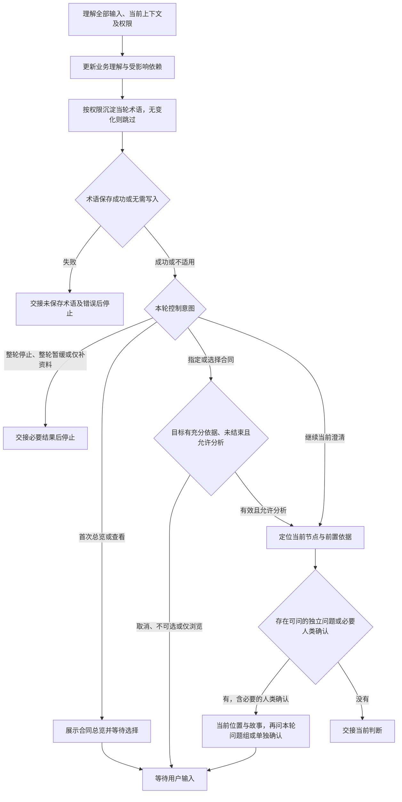

# 访谈协议：围绕当前业务判断推进

普通对话是完整交互路径。围绕本轮目标、实际材料与当前理解开展澄清，吸收回答后更新分析，以同一业务节点的判断为主焦点，把相关凭证中前置依据已具备、彼此独立的必要问题成组提出，再等待真人。用户要求一次一问时只选一题。

专业分析读取 FM 的 `references/business-analysis.md`，逐枝追责与结束核对读取 `references/responsibility-closure.md`，当轮术语读取 `references/domain-language.md`。

## 单轮执行路径



## 1. 承接目标、业务依据与控制意图

消化本轮全部事实、更正与控制意图。材料已提供就直接读取必要依据；可查事实自行查找，真正未知的业务决定交给人类。

### 首次进入或恢复

加载当前分支必要方法，从提供的材料和交接定位主焦点的合同、履约项、请求或确认，以及各凭证当前位置、责任人、来源链回溯位置、原问题及停止／暂缓状态。已有有效焦点时直接承接；关键上下文不足时明示限制，澄清必要缺口。

### 连续问答

同任务、授权未变、必要方法仍在上下文且未变化时复用。理解本轮全部输入，增量核对当前节点与受影响依赖，再按授权维护受影响术语；焦点外的更正也及时处理。

每轮重新计算当前节点的依赖前沿，不沿用固定问卷。已答项立即吸收，未答项不视为默认同意；只暂缓指定题且允许继续时，其他独立问题仍可推进。没有必要问题则交接。任一写入失败就停止，说明术语实际保存结果。只聊不落盘、仅补资料、暂缓与停止等更窄要求优先。

### 最小读取范围与新鲜度

从主焦点的当前节点、各凭证当前位置与各自责任人、各关键数据项的来源及回溯位置、原问题与控制状态开始，核对相关请求／确认、必要材料片段及适用版本、受影响术语及对应 FM 目标。新增概念先检索完整双语名称、中文部分、英文部分、别名、上下文和目标，再读取命中条目。名称有缺口时保留已知叫法，不猜译。

当前展示是读取起点。缺失依据、冲突或关联更正影响判断时沿依赖继续追读；影响范围不能确定时扩大读取。必要上下文丢失时重新定位依据并加载必要方法；术语写入前核对实际文件中的目标条目，保留其他改动。

### 按事件扩大核对

| 事件           | 核对范围                                           |
| -------------- | -------------------------------------------------- |
| 切换合同       | 目标合同、已知双方、全部主履约、结束依据及必要依赖 |
| 新增异常义务   | 新义务、所属责任链与受影响确认                     |
| 更正业务依据   | 被更正对象、依赖结论及确认失效影响                 |
| 全部追责结束   | 人类范围内完整责任图、全部终点、推演及全局明确确认 |
| 方法或材料变化 | 变化及依赖影响，重新核对确认适用性                 |
| 上下文压缩     | 从提供的交接重新定位必要依据与方法                 |
| 术语保存中断   | 实际词汇条目及本轮授权内尚未保存内容               |

## 2. 沿业务依赖更新理解

按 FM 方法理解经营依据、合同边界、全部主履约、请求—确认骨架、关键数据追溯、异常责任、参与者、单据推演及变化点。区分明确事实、确定性推导、候选解释与未知。

把当前判断看作带共享节点的依赖图；每条来源链的深入与回溯按 FM 方法执行：依赖前沿是前置依据已经具备、现在不需要猜测其他答案就能澄清的判断。每轮从主焦点相关各凭证的依赖前沿中选择彼此独立的必要问题；依赖另一个未知时先追溯该依据，依赖问题留到后续轮次。已知事实直接复用或推导。收到全部输入后重算前沿，在各条来源链中推进现在可判断的分支，不等待整组答完，也不必追完一个字段才处理下一个；同时承接其他责任与暂缓问题。

独立意味着一个答案不会改变另一题的前提、对象或问法；同属一张凭证不自动证明独立。共享约定、版本或证明种类仍未知时，先问该共同前提；依赖关系不确定时退回逐问。更正推翻共同前提时，核对受影响的问题、回答结论和人类确认，保留未受影响事实，不机械继续旧问题组。

一个业务焦点可以并行追溯多个凭证。每条来源链深度优先，不要求全局只推进一条链；同一凭证也可以有多条来源链，分别承接各关键数据分支。先问影响多个凭证或数据项的共同业务依据，不逐字段重复提问，不把“并行”改成先扫完一层凭证的广度问卷。

共同前提暂缓或尚未明确时，依赖它的分支保留原问题与回溯位置；其他已判独立的分支在用户允许继续时推进。只暂缓一条来源链不转成全部凭证暂缓，不因切换凭证重编号或恢复暂缓题；整轮停止与写入失败仍优先。支撑凭证跨上下文时只追当前判断需要的证明及形成依据，不是展开其全部合同责任，也不等于切换合同分析焦点。

关键值追溯说明业务含义：金额依据哪项约定、完成由什么凭证证明、期限如何确定。请求与确认本身就是凭证；凭证存在与证明充分分别核对。

## 3. 当轮术语沉淀

按授权使用 FM 领域语言方法维护唯一词汇入口 `.evidence/glossary.json`。未建模概念写 standalone，已建模概念引用当前 FM；明确术语当轮沉淀，含义仍模糊则继续澄清。

已建模概念发生更正时，说明目标定位、当前含义与待改影响，按本轮权限处理。只聊不落盘或仅保存资料时以对话承接；专业方法缺失时明示待沉淀项。

术语写入失败立即停止，交接实际错误及未保存内容；恢复先核对实际条目，再补齐授权内缺失内容。已收到的事实直接复用。

## 4. 只展示当前进度

### 合同上下文总览与选择

首次消化资料并直接识别合同上下文后展示总览；用户要求查看／切换时再次展示。有效焦点恢复直接承接，明确指定合同则核对目标；只看总览保持原控制状态。

总览只列经营依据与独立边界充分的合同上下文：序号、名称、经营主线、具体目的、双方、责任边界、待追溯事项及澄清是否结束。主线为“现金权责”或“目标与实际”，现金方向注明观察主体。用“谁与谁签订什么合同，以实现什么具体经营目的”表达，口头约定用“达成约定”。展示专注于业务内容。

参数与证明缺口归对应合同；经营依据或独立边界不足的线索保持待查。识别依据由 Agent 分析材料，用户选择分析焦点。

结束状态须有人类明确确认，并覆盖当前合同的责任、未决项及适用业务版本。已澄清结束的合同仍展示，仅供查看；可选择项限于未结束合同。单合同结束与全局追责结束分别核对，更正导致确认失效时说明影响并等待处理。

用编号列表展示，只问“先分析哪个合同上下文？”。同名或过期选择先定位目标；未识别到合同则说明具体材料缺口，全部结束时展示后返回。

选择轮只收集导航选择，不与业务问题组混问。取消保留原焦点和原问题，等待用户；选择后先重新核对目标有充分依据且未结束，再承接已知双方和全部主履约，定位一个请求／确认进入单点澄清。选择只决定分析焦点，其他责任与暂缓问题继续保留。

### 单点澄清

每轮以一个业务节点的判断为主焦点，履约位置精确到 `合同名称 → 履约项名称 → 请求或确认`。展示时优先使用凭证的中文（英文）业务名称，凭证类型只作辅助标签；名称未知时保留请求／确认端点。异常新义务同样定位到所属合同及当前端点。

位置紧接“责任人：”，说明当前凭证的责任角色与已明确实际主体。实际人名或法定机构名保留原名，不猜译；角色名称使用双语规范名称。角色已知而主体未知时写“实际主体待明确”，责任尚不清楚时写“责任人待明确”。不能从合同一方、经办人、上传人、填写人、证明提供方或受益角色推断责任；这些身份不自动等于责任人。切换支撑数据不改变主焦点凭证责任；进入支撑凭证时分别定位它的责任人，支撑凭证责任人不会自动成为主焦点的责任人。多凭证同时展开时，各凭证当前位置及各自责任人都要可区分，不把上层角色复制给所有节点。

进度是信息来源追到了哪里，不是履约进度。每轮的凭证依据说明用简短追溯故事讲清：主焦点的哪些关键数据已找到什么业务依据，相关凭证的来源链分别追到了哪里、能证明什么，共同前提影响哪些分支，接下来向深层依据推进还是回到上层判断。引用支撑凭证时说明证明作用，已知则复用或推导，只有必要未知才接问题。多项可以分成短句，不用逐字段表格代替故事。

业务目标在首次进入主焦点或业务目标变化时展示，不必每轮重复；深入另一张支撑凭证不自动产生新目标。可用一条用户故事表达“作为〈业务角色〉，我希望〈已知业务目标〉，以便〈有依据的经营目的〉”；不补造未知结果、默认权限或系统功能。依据信息不足就直接说明已知目的，不凑齐模板。用户故事解释为什么关心该凭证，凭证依据说明解释现在依据什么能判断，两者不能互相替代。用户故事的 Confirmation 是交付验收，不是 FM 履约确认；关系复杂时可附一条短来源链，规则明确后用 Given / When / Then 推演，未执行不说通过。

建议结构如下，业务目标只在必要时显示，未明确名称按 FM 语言方法保留缺口：

```text
主焦点：〈当前需要作出的业务判断〉
当前位置：〈合同中文（英文）〉 → 〈履约中文（英文）〉 → 〈主焦点凭证中文（英文）〉〔凭证类型〕
责任人：〈责任角色中文（英文）〉；实际主体：〈已明确主体或待明确〉

业务目标：〈有依据的用户故事或简短目的，仅在必要时显示〉
并行追溯：
- 〈支撑凭证 A 的所属合同／上下文、履约及当前位置〉；关键项：〈中文（英文）〉；责任人：〈该凭证责任角色及已知主体或待明确〉
- 〈支撑凭证 B 的所属合同／上下文、履约及当前位置〉；关键项：〈中文（英文）〉；责任人：〈该凭证责任角色及已知主体或待明确〉
当前追溯：〈各链深入位置、共同依据、证明边界与回溯关系的简短故事〉

Q1：〈共同前提或某凭证当前前置充分的独立问题〉
Q2：〈另一条来源链当前可问的独立问题；没有则不凑题〉
```

只有单凭证时省略并行追溯列表，位置与责任仍保留；多凭证列表只定位本轮活跃或直接受控制影响的前沿，不列全局凭证清单，也不代替追溯故事。问题能对应到具体凭证、关键数据及原问题标识，相关关系已清楚时不反复列技术路径。

日常对话用“当前位置：”保留位置，正文自然叙述，只讲当前节点有依据的内容。描述不附资料出处、文章名、作者、页码或方法说明；业务凭证及其证明作用仍需讲清，内部依据引用按权限保留。问题另起一段，每题只澄清一个仍影响当前判断的业务问题；多题用 Q1、Q2 等分别编号，单题可自然接问。故事中不夹带问题，不用全局问卷或机械缺口表替代故事。未知明确为未知，假设明确为假设；单题见 [单点一轮](../examples/focused-turn.md)，成组、部分回答及依赖变化见 [成组一轮](../examples/grouped-turn.md)，同凭证并行来源与责任定位见 [多来源一轮](../examples/parallel-turn.md)，多凭证深入及回溯见 [多凭证一轮](../examples/multi-evidence-turn.md)。

尚无履约时只展示已知合同，位置未明则标为待定位。协商用 `协商上下文 → 当前对象`，领域用 `领域上下文 → 当前对象`。切换后用新节点重建故事；位置、故事及本轮问题保持同一份当前进度。

正常和争议单据推演说明当时可见凭证、适用约定与实际结果；未执行保持未执行。全部责任、暂缓及冲突持续参与业务判断，日常展示聚焦当前节点，范围或全局确认时展示完整理解。

## 5. 选择本轮问题并等待

| 当前情况                       | 动作                                           |
| ------------------------------ | ---------------------------------------------- |
| 材料与业务事实充分             | 直接复用                                       |
| 已知事实足以确定性推导         | 说明推导与适用条件                             |
| 必要事实缺失或冲突             | 主焦点相关各凭证前沿中选择前置充分且独立的问题 |
| 问题依赖另一未知或独立性不明   | 先问必要前提，后续问题留待重算                 |
| 用户要求一次一问               | 只问一题，仍吸收回答中的全部事实               |
| 专业方法或工具缺失             | 明示资源限制                                   |
| 仅缺技术表达或实现选择         | 交接对应缺口                                   |
| 所有责任已核对且终点有人类确认 | 展示完整范围，等待人类明确确认全部追责结束     |
| 整轮停止、暂缓或仅补资料       | 按更窄权限处理后结束本轮                       |

每轮一个业务焦点，可问多个独立问题，问后等待真人。只选影响当前判断的必要未知，可沿多个相关凭证向深层依据追溯，但不为凑题展开无关合同、履约项或请求／确认端点；有多少可问项由真实依赖决定，不预排整份问卷。事实可查则自行查找，业务决定由用户作出；不推荐未知业务事实作为默认答案。若另获新业务设计授权，建议标为建议，不作为现行约定。

每题单独编号；已有问题沿用原问题标识及缺口关联，未答、暂缓、更正或改写措辞不靠换号绕过控制。展示编号只用于关联本轮回答，不替代已有标识；无编号的自然语言也吸收全部事实，含义有歧义时先定位，不猜测它解决了哪题。问题组用于本轮交互，不建立隐藏状态或第二份问题记录。

没有可问问题不等于全部追责结束：前沿也可能被暂缓、缺材料或依赖阻塞。全局结束确认单独一轮，展示实际完整范围、责任图、终点及推演，等待人类明确确认；不与业务问题组混问，用户的“全部同意”也不自动解释为全局确认。

## 6. 更正、停止与跨会话承接

直接理解自然语言。部分回答时，已答项立即吸收并核对是否解决原缺口，未答项不视为默认同意，不知道仍是未决；不要求用户重填已知内容。收到部分答案也先重算依赖，再决定是否还有可问项。

暂缓指定题时保留原问题标识与未决依据，只有用户允许继续时才推进其他独立问题；整轮停止或整轮暂缓时处理获授权内容后结束本轮。停止后仅吸收补充资料；继续问答须有明确意图，继续其他话题仍保留暂缓题。事实与控制意图同时到达时，吸收全部事实并遵守更窄权限。

已经收到的回答用于业务理解；取消时保留焦点和未答问题等待，不默认同意或立即重问。术语写入失败后先处理保存问题，再按用户授权决定后续。

更正沿依赖核对受影响结论及确认适用性。跨会话承接提供的材料、当前理解与控制状态；必要上下文不足时说明限制，澄清关键缺口。

停止或暂缓与追责结束分别判断。单条终点与全局结束分别核对；全局确认须覆盖实际范围、完整责任图、终点及推演。新增义务或约定更正后重新核对受影响分支与整体确认，恢复访谈由用户决定。

## 7. 交接后停止

简述当前判断、必要未决项、控制意图和术语实际保存结果。人类追责结束、编辑授权与业务批准分别说明，下一步由用户选择。
