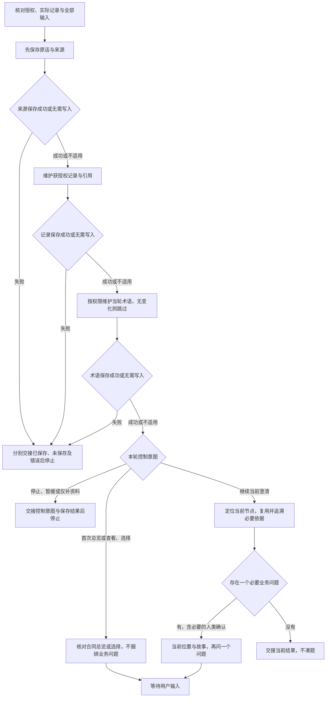

# 访谈协议：围绕当前业务判断推进

普通对话是完整交互路径，不以界面扩展为前提。本页只维护选题、等待、记录和恢复；展示方式不改变权限、保存顺序或业务判断。专业分析读取 FM 的 `references/business-analysis.md`，逐枝追责和正式建模准入读取 `references/responsibility-closure.md`，当轮术语读取 `references/domain-language.md`；不在访谈包复制专业方法。

## 单轮执行路径

图只固定保存、控制与等待顺序，不规定业务题目。图中的写入均受本轮权限限制：只聊不落盘跳过写入并明示未保存，仅保存资料跳过术语；版本不符停止结构写入。任何实际写入失败进入失败出口，不转成下一业务问题。专业依赖和扩大读取仍按下文及 FM 方法判断。

| 检查点           | 前馈                               | 可观察反馈与转向                                         |
| ---------------- | ---------------------------------- | -------------------------------------------------------- |
| 输入与读取       | 本轮全部事实、授权、焦点及控制状态 | 从实际文件定位；外部变化按影响重读，不能靠旧摘要覆盖     |
| 来源、记录、术语 | 来源先保存，定义归属用 FM 方法     | 各次写入分别有结果；任一失败停止，两处文件不冒充原子事务 |
| 导航             | 材料充分的合同及真实结束依据       | 选择只决定焦点；只读查看、取消或不可选目标不改变记录     |
| 当前判断         | 当前端点及必要业务依赖             | 已知复用或推导，必要未知才问一个问题；无问题交接         |
| 等待或停止       | 用户控制意图、原问题与保存结果     | 不自答、不自动恢复、不进入正式模型或下游                 |

需要表达或异常分支样板时，从 [行为基线](../examples/README.md) 只读取当前一组；具体业务判断不由样例裁决。

## 1. 承接目标、来源与控制意图

消化本轮全部事实、更正与控制意图，不把摘要遗漏当作没有事实。读取按下述节奏进行；材料已提供就直接读取必要依据，不能为了流程让用户重述。

### 首次进入或恢复

加载当前分支的必要方法，从实际文件核对记录版本、授权及停止／暂缓状态。已有记录沿 `focusRef`、`focusPoint`、原问题、`viewRefs` 和来源引用定位当前节点及其必要依赖；首次无记录时分析已提供材料，按 FM 方法识别合同与全部主履约。已有有效焦点时不重复总览，不重问已知事实。不预加载 API、正式生成参考或无关工程指南；方法缺失按资源限制处理。

### 连续问答

同任务、授权未变、必要方法仍在上下文且未变化时，不重新装配入口或全文重读方法。先理解用户本轮全部输入，再按授权保存原话与来源、更新受影响记录、维护受影响术语，最后核对当前节点的必要依赖，生成故事并决定下一问。焦点之外的新增事实也及时保存；缩小分析范围不等于丢弃其他事实或责任。

每轮只问一个核心问题；没有必要问题则交接。任一写入失败就停止，分别说明来源和术语的保存结果。停止、暂缓、只读及仅保存资料等更窄要求优先；保持先保存来源再维护术语的顺序，不将续问解释成正式编辑授权。

### 最小读取范围与新鲜度

普通续问从当前节点、原问题及控制状态开始，读取相关请求／确认和追溯记录、支撑判断的来源片段及适用版本、受影响术语及其对应 FM 目标。新增概念先检索现有名称、别名、上下文和目标以避免重复定义，再读取命中条目；不机械加载完整词汇表和全部模型正文。

`viewRefs` 是定位入口，不是读取白名单；它不保证全部依据已覆盖。缺失引用、冲突、新增义务或关联更正影响判断时沿依赖继续追读。影响范围不能确定时扩大读取，不凭局部材料猜结论，也不因读取预算丢弃必要依据。

写入前核对实际文件中的目标内容及版本，可用摘要或定点读取判断是否变化；发现外部修改时重读受影响内容并重新核对，避免旧副本覆盖他人改动。不能确认新鲜度时重新读取必要内容。`digestedSources` 只记录曾读取的来源定位，不证明当前内容未变；聊天摘要、旧读取标记及故事均不替代原始依据。复用只限仍可用且未变化的方法或已核对来源；不建立隐藏状态、持久缓存或第二份事实摘要，不为增量读取迁移记录格式。

### 按事件扩大核对

| 事件           | 核对范围                                                                                             |
| -------------- | ---------------------------------------------------------------------------------------------------- |
| 切换合同       | 目标合同、已知双方、全部主履约、结束依据与必要依赖；用户要求总览时核对可展示合同，不重问交易如何成立 |
| 新增异常义务   | 新义务、所属责任链及受影响的原确认，不重新分析无关合同                                               |
| 更正业务依据   | 被更正对象、引用它的记录、依赖结论及确认失效影响；保留原话和历史依据                                 |
| 全部追责结束   | 人类确认范围内完整责任图、全部终点、推演依据和全局原话；局部充分不能放行                             |
| 方法或文件变化 | 变化内容及其依赖影响；旧确认失效时不能继续沿用，范围不明则扩大                                       |
| 上下文压缩     | 必要方法或来源内容不可用时按恢复读取实际记录与必要方法，不依靠摘要宣称已核对                         |
| 保存中断       | 先核对两处文件的实际内容与各自保存结果，只补齐获授权未保存部分，不重复原话或术语                     |

扩大业务核对不等于重新加载全部方法。边界切换和更正不解除停止／暂缓状态；准入仍按 FM 方法完整核对，不因增量处理缩小责任范围。

## 本轮权限与专业边界

按 FM 的 `references/business-analysis.md` 定位当前分析对象及其依赖。业务路线和专业判断只在该方法维护；本协议处理何时记录、展示、提问和等待。已有事实立即吸收，不因当前焦点不同延迟保存。

本轮明确只聊不落盘、仅保存资料、只记录冲突或停止时，先按更窄授权处理，不进入提问或模型编辑。用户未纠正不是确认，展示工作理解不是生成模型 JSON。

## 2. 先保存来源，再更新一个可引用的业务结构

按 [记录模板](../assets/discovery-template.json) 维护 `schemaVersion: "2.0"` 的发现记录，默认 `.evidence/discovery.json`。模板是键语义说明，不是要逐项填满的问卷；无内容的集合和可选字段省略，不把占位文本保存成事实。全局 `business.operatingBasis` 只说明经营目标并引用约定记录；每个 `agreements[].operatingBasis` 是按 FM 方法解释本约定经营依据、来源与边界理由的可选说明，不新增金额／KPI 枚举。既有 2.0 记录缺少该说明不视为格式错误，不自动补写或迁移；恢复时核对实际来源，将尚未定位的依据保留为原对象缺口。依据不足的条款与责任线索保存在 `sources` 的原话、定位及 `workingNote`，不新建候选约定。既有记录中的约定也须按实际来源核对后才能进入总览，不因已有 ID 就视为识别充分，不删除原记录或自动迁移。

| 记录位置                                          | 唯一职责                                                               |
| ------------------------------------------------- | ---------------------------------------------------------------------- |
| `sources`                                         | 原话、材料定位与版本；先保存原话与来源，再维护结论引用                 |
| `business.agreements`                             | 各约定的经营依据与边界解释、双方、标的及已明确参数，不混入实际履约结果 |
| `business.responsibilities`                       | 全部主履约和异常新义务；每项唯一维护请求、确认、异常及追溯引用         |
| `business.evidenceTraces`                         | 从原请求／确认关键数据定位到依据、证明、计算和时间约束                 |
| `business.walkthroughs`                           | 正常和争议单据推演的依据、当时可见证据与实际结果                       |
| `business.participants`                           | 主体同一性、角色和代表依据；不写正式 `plays_role`                      |
| `business.variations`                             | 有真实实例的变化点与本次支撑边界                                       |
| `business.domainObjects`／`business.negotiations` | 非履约主线的有来源工作理解，不强造合同                                 |
| `business.responsibilityClosure`                  | 全局范围、主履约、全部分支、人类终点及结束原话的引用                   |
| `questions` 或 `questionsFile`                    | 真正提出的问题及回答，一个问题只维护一处                               |
| `handoff`                                         | 当前焦点、控制意图、来源与保存结果，不维护另一套业务事实               |

记录 ID 在本文件唯一且稳定；记录之间通过 ID 引用，字段锚点可在 ID 后补充定位；来源用 sourceId 或材料版本与位置引用。`focusRef` 指向当前对象；履约焦点用可选 `focusPoint` 定位 `request` 或 `confirmation`，两者组合确定当前请求或确认，不复制正文。当前问题只保存问题 ID，暂缓项也只引用原 ID。发现记录中的 ID 不是正式 FM ID，不为术语或工作理解编造 Entity ID。

视图从记录引用生成：`viewRefs` 列明本轮展示所用对象，交接不另存视图正文或当前请求／确认的副本。骨架、追溯与责任图都是工作理解，不是正式 FM；名称和含义仍按词汇入口或已有模型的唯一拥有者读取。

只维护本次授权的文件，不自动迁移或重编号既有记录。遇到不是当前 `schemaVersion` 的记录，停止结构写入，说明版本限制并交接原文件；格式转换须另有明确授权，不猜测映射，不因模板升级删除历史来源、问题或人类确认。无写入权限给可复制内容并明确未保存。

## 3. 当轮术语保存

来源已经保存后，按 FM 领域语言方法当轮更新 `.evidence/glossary.json`。未建模概念写 standalone，已建模概念只引用 FM 并读取名称和含义；不等待所有问题解决，不建立第二份词典。模糊概念用明确标为假设的案例检验，不把建议当事实。

已建模概念的更正没有模型编辑授权时，只保存原话、目标引用与受影响记录，不在词汇表覆盖定义，也不建立同义 standalone。仅记录或只聊不落盘时不更新词汇表；缺少 FM 方法保留待沉淀项并明示限制。

发现记录与词汇表不是原子事务；任一写入失败就停止。分别列出真实保存结果，不能在失败后提出下一问。恢复先核对两处文件的实际内容，只补齐本次授权且尚未保存的内容，不重复原话和术语。

## 4. 只展示当前进度

### 合同上下文总览与选择

总览是独立导航动作，不是每轮进度栏。首次消化资料并依据材料直接识别合同上下文后，在进入逐项澄清前展示一次；用户要求“有哪些合同”“查看上下文”“切换合同”或通过界面表达相同意图时重新展示。已有有效焦点的普通恢复不重复总览；用户明确指定某合同则直接核对该目标，不强制再选一次。停止、仅保存资料等更窄授权优先；只看总览不自动恢复问答。

按 FM 业务分析方法，从 `business.agreements` 及其实际来源核对识别结果，只将依据充分的合同上下文投影为列表：序号、名称、双方、责任边界摘要、待追溯事项、澄清是否已结束。不展示候选／已确认分类，不要求用户确认合同是否存在；识别由 Agent 分析材料完成，用户只选择分析哪一个。参数与证明缺口保留在对应合同中，依据不足的线索不混入列表；没有未决项也不代表追责结束。列表不是另一份事实源，不持久化总览正文或选择菜单。

澄清结束依据保存在原约定的可选 `clarificationCompletionSourceRefs`，引用人类明确确认该合同澄清结束的原话及覆盖版本；只有按 FM 方法核对该合同责任与未决项后才能引用，不因暂缓、停止或暂无问题写入。它不是全局全部追责结束依据。**已澄清结束的合同仍展示，但不可选择或切换进入**，自然语言指定也同样拒绝，不提供重新开启入口。已有记录未包含该字段时从实际来源核对，不自动补写或迁移。来源更正使结束依据失效时保留原依据和失效影响，交接冲突，不借导航自动重新开启。

Agent 根据记录及结束依据确定哪些合同可选，不能将判断交给界面。当前焦点在履约上时沿 `agreementRef` 找所属约定。全部结束时仅供查看并返回，不自动生成模型。

用编号列表展示上述内容，只问“先分析哪个合同上下文？”，接受未结束项的编号、唯一名称或稳定 ID。编号只对应本次展示；同名、过期或不在列表中的选择不猜测，先定位目标。未识别到合同时说明材料尚不足以识别合同上下文，不造占位列表，按实际领域／协商分支或必要材料缺口处理。

选择轮只收集一个导航选择，不分配业务 Q-ID 或 gapKey，不同时提出履约问题。取消保留原焦点和原问题，不自动挑选第一项；不可用不伪造选择。选择后先重新核对目标存在且未结束，再按权限保存选择原话或工具结果来源，更新 `handoff.focusRef` 到该约定，清除不再适用的 `focusPoint` 和 `currentQuestion`，但保留原问题记录、状态及暂缓引用。`viewRefs` 随展示引用更新，不复制事实。只读查看或仅浏览不写焦点。保存失败停止；保存成功后先承接已知双方和全部主履约，再按当前约定的原问题及必要依赖定位一个请求／确认，进入单点澄清，不再泛问交易如何成立，不重复已回答问题，不恢复其他暂缓问题。选择只决定分析焦点，不是合同存在或边界的确认，不排除其他责任，也不解除已有停止状态。

### 单点澄清

每轮聚焦一个业务节点，内部履约位置仍精确到 `合同名称 → 履约项名称 → 请求或确认`，与 `focusRef` 和 `focusPoint` 对齐。展示时优先使用该请求或确认凭证的业务名称，类型只作辅助标签；未知名称时保留请求／确认端点，不编造名称。凭证追溯、金额计算、异常检查和单据推演不代替业务位置。异常新义务同样定位到所属合同、当前异常履约项及其请求或确认。

进度不是问题清单，而是信息来源追到了哪里。从 `viewRefs` 引用的当前节点、`evidenceTraces` 和必要支撑记录生成一段简短追溯故事：从凭证中的哪项信息出发，已找到什么业务来源，它能说明什么，接下来还需要往哪里追。已知即复用或推导，只有必要来源仍未知时才自然接一个问题；不逐字段询问。请求与确认本身就是凭证，不为名称或展示另造包装凭证；引用其他凭证时在故事中说清其依据或证明作用，必要的输入与计算规则仍按 FM 来源追溯方法核对。

日常对话以“当前位置：”保留位置，正文使用自然叙述，不在回答末尾附方法文章、作者、章节或参考链接。参照 [单点一轮](../examples/focused-turn.md) 的输入、记录增量、期望展示与反例：退款约定未知才问，明确全额退还后按依据确定金额，纯领域身份不补造合同。样例仅锚定表达，不提供当前项目事实。

不要把故事拆成“已明确：／正在澄清：／尚缺依据：”字段。故事不是虚构业务实例：不得补造金额、主体、凭证、规则或时间，不把工作假设、可能的来源写成已找到的事实，也不宣称某笔业务已经实际完成。追溯目标是业务信息来源，不是让用户选择数据库表、接口字段或谁手工填写派生值。业务事实的来源与版本继续保存在发现记录；故事可以讲业务凭证来源，不展示文件来源列表。不要展开其他合同、其他履约、全局责任图、百分比、整体准入提醒或重复的“不自动批准／不生成”说明。没有必要问题时交接当前结果，不为展示或调用界面凑题。

尚在识别合同而没有履约时，只展示已知合同名称；合同也未定位时明示“待定位”，不编造合同或履约补齐路径。合同前协商用 `协商上下文 → 当前对象`，领域主线用 `领域上下文 → 当前对象`，不套履约链；故事讲当前约定或对象的理解及依据，不强造凭证。切换焦点只简述必要的依赖原因，并用新节点重建进度，不携带前一个节点的无关内容。请求／确认凭证自身名称未知时，先讲要求或完成结果及证明作用，不要求用户填写技术分类。

展示名称指向当前请求或确认，不是任意支撑凭证的名称；追到其他凭证时将它写入故事并保留当前责任端点。故事只含当前节点的有依据叙述，不夹带问题；随后自然另起一段，提出一个仍影响当前判断的业务问题，不加字段标题。标识用于记录关联，不作为展示标题。无论普通对话还是可选 UI，选择动作和输入回答时都保留同一份当前进度。故事是临时投影，不保存到 handoff，不建立第二份来源链；跨会话从 `focusRef`、`focusPoint`、原问题及 `viewRefs` 引用的追溯记录重建。

全部约定、主履约、异常、暂缓及冲突仍在完整发现记录中维护，不因当前展示缩窄而丢失。人类范围、责任终点及全部追责结束确认按 FM 方法作为独立业务核对动作处理，需要时展示所确认的完整版本，不把它们变成日常进度栏。正常和争议单据推演记录实际结果；未执行不声称推演通过，不创建 validation 或用自动测试替代真人判断。

## 5. 决定是否提出一个问题

| 当前情况                       | 动作                                           |
| ------------------------------ | ---------------------------------------------- |
| 来源与业务事实充分             | 直接引用，不索取重复确认                       |
| 已知事实足以确定性推导         | 保存推导与适用条件，不让用户重答               |
| 必要业务事实缺失或冲突         | 定位原对象、已有依据和判断影响，选一个问题     |
| 专业方法或工具缺失             | 明示资源限制，不用业务问题弥补                 |
| 仅缺技术表达或实现选择         | 交给对应任务，不让业务方填写技术槽位           |
| 所有责任已核对且终点有人类依据 | 展示当前完整版本，等待人类明确确认全部追责结束 |
| 本轮停止、暂缓或仅补资料       | 保存获授权内容后停止，不继续提问               |

选题前核对当前凭证信息追到了哪里、已有依据能解释什么、哪段业务来源仍阻止判断；在追溯故事后自然接一个必要问题，不另加缺口、影响和方法说明栏。说不清不凑题。选题由当前骨架、追溯或责任分支的必要依据决定，不逐字段问卷，不预排题库。每次吸收回答后增量核对当前节点及受影响依赖，只从前置依据已具备的未决问题中选一个；若判断依赖另一个未知，先追溯该依据，不猜答案来跳过依赖。材料可查的事实自行读取，代码只证明当前实现，不能替代业务约定；现行业务未知不附推荐答案诱导确认。

每轮只问一个核心问题并等待真人，不捆绑子问题、不自答。只为实际提出的问题分配 Q-ID 与 gapKey；同一缺口沿用原标识，跳过或措辞变化不创建新问题。

## 6. 更正、停止与跨会话恢复

直接理解用户自然语言，不要求先选按钮或填写状态枚举。“这题先放一下”表示暂缓当前问题，“今天到这里”表示停止本轮，“看看其他合同”进入独立导航；控制对象含糊时只澄清必要含义。同一输入包含事实和控制意图时，先吸收全部事实，再遵守更窄权限。取消不等于停止或暂缓，不解决原问题、不自动重问，保留原焦点等待用户下一次输入。

交互方式切换不产生新业务状态。界面不可用且尚未收到回答时，以普通对话继续同一问题，沿用原标识及焦点；已经收到的回答先按保存顺序处理，不让用户重新回答。跨会话仅从实际文件恢复，不能补造未收到的回答；若回答已返回但保存失败，交接其未保存原文与各文件结果，不因改用文本就继续提问。技术不可用不是用户取消、停止或业务完成。

更正保留旧原话、版本、受影响记录及问题解决依据的失效影响；不静默择一，也不删除冲突来制造闭合。隐私材料只按授权脱敏保留必要内容。

停止先处理新增事实和获授权术语，然后记录控制意图，不再提问。暂缓保留问题与未决依据，不改成范围排除。停止后补充只吸收资料，不自动恢复问答；明确仅保存资料时不更新词汇表。继续其他话题不等于恢复暂缓问题，恢复该题须有明确意图。

跨会话从来源、`focusRef`、`focusPoint`、原问题和记录引用恢复，不依赖旧聊天。已有记录缺少 `focusPoint` 时从原问题和节点判断当前请求或确认；不能判断则明示待定位，不为补字段自动迁移记录。FM 返回缺口不自动解除停止或暂缓状态，模型任务也不接管提问。

停止或暂缓不等于追责结束。人类终点决定不等于全局结束；全局回答须覆盖实际范围、完整责任图及推演版本，存在冲突或未决责任仍不放行。新增主履约、异常或约定更正后保存旧确认的覆盖版本与失效影响，重新核对，是否恢复访谈仍由人类决定。

## 7. 交接后停止

只交接当前焦点及对象引用、来源版本、全局责任覆盖、人类终点与追责结束依据、原问题和控制意图、术语条目及各文件保存结果。未保存与未执行明确说明，不重抄模型、定义或案例正文。

访谈及术语写入不授权模型 JSON、关系、规则、验证场景、API 或实现。追责结束只提供建模准入依据，不提供编辑授权或业务批准；完成本轮不自动启动下游任务。
