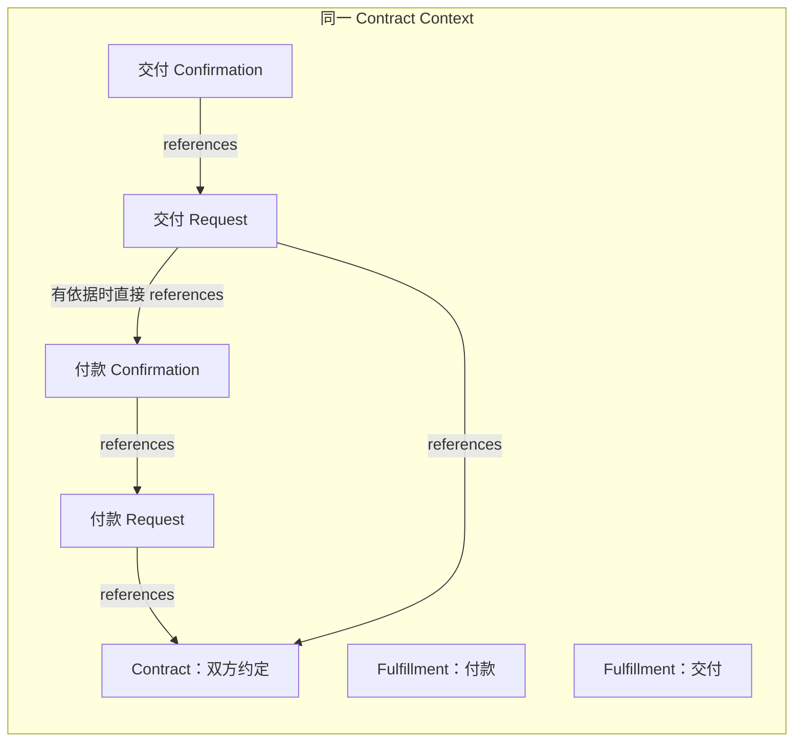
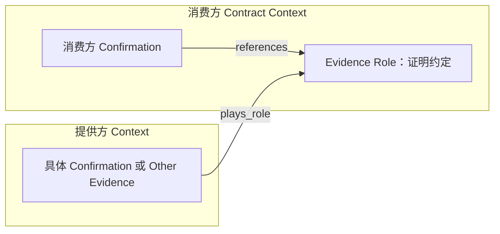

# 结构对照：对象归属与消费方向

以下图只锚定结构。对象及其关系仍须有实际业务依据；履约分组、页面位置或目录都不自动形成新上下文。

## 1. 同合同中的不同履约

付款与交付只表示合同内履约归属，成员以 fulfillmentRef 声明归属；两个履约不变成两个 Context，仍复用根合同的责任双方。图中引用由消费方指向依据，不是资金流或类型时间先后。

**正例**：交付要求确实依赖同合同付款结果时，交付请求直接 references 付款确认；按实际实例、可见性与时间核对。

**反例**：因为属于不同履约就创建支付证明 Role，让同合同确认扮演它。分组不是跨上下文变化点，不应强加证明中转。

## 2. 跨上下文的开放证明

消费方需要可替换证明约定时，Evidence Role 表达采信要求，实际结果保留提供方的形成上下文、责任与时间。角色自身没有责任人、凭证形成时间或可签发实例；规则解析实际玩家实例，不接受字段相同的任意记录。

**正例**：商品采购中用外部支付确认扮演采购侧支付证明，采购确认引用证明约定；外部付款责任不因此归采购方。

**反例**：迁移外部确认到消费合同、签发一个 Role 实例、用 Request 扮演确定结果。这些都会改变真实归属或误用角色。

没有可替换证明需要时，可直接 references 外部确定结果，不机械增加 Evidence Role；跨上下文不等于必需角色化。

## 3. 类型、实例与实现分开

| 层次                       | 可以说明                     | 不能说明                           |
| -------------------------- | ---------------------------- | ---------------------------------- |
| 类型对象与 references      | 什么依据和证明可被引用       | 某笔凭证已存在、现实业务已完成     |
| 实例 basedOn、时间与可见性 | 本次判断消费哪些已形成证据   | 新的业务权限、合同终点或批准       |
| API 契约与静态消费者流程   | 如何表示、导航和接续已有能力 | 服务、数据库、鉴权或外部集成已运行 |

维护时运行对应样例的结构与实例检查，必要时复制到临时目录制造反例。结构直接读取 [Schema 入口](../references/format.md#结构契约)，跨对象含义与检查实现见 [语义](../references/semantics.md)；图不新增 Schema 或第二份依赖清单。
