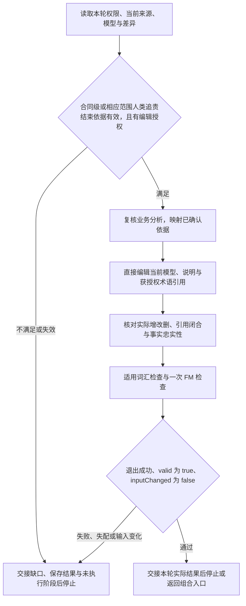

# 正式编辑执行路径

本页固定编辑与检查的顺序，不主持访谈，不保存第二套准入状态。实际业务判断由对应专业方法维护；合同级准入覆盖当前合同的完整责任，不能以其中某项履约的编辑切片替代。仅讨论、术语沉淀和只读校验不进入本图的 FM 编辑路径，按入口对应分支执行。

## 路径与出口

图中的技术表达错误只在当前授权内修正并复验，不能改业务预期来通过。新责任或来源冲突交回依据拥有者，不自动解除访谈停止／暂缓；保存失败保留各文件实际结果，不自动回滚。

## 每步前馈与反馈

| 步骤    | 必要前馈                                                                                                      | 可观察反馈与转向                                                                                |
| ------- | ------------------------------------------------------------------------------------------------------------- | ----------------------------------------------------------------------------------------------- |
| 准入    | [全部追责结束](responsibility-closure.md)规定的合同级或相应范围、完整责任图、人类终点及结束确认，当前编辑授权 | 依据覆盖当前版本；任何必要分支未闭合即停止，纯领域也按该方法判断                                |
| 映射    | [批次评估](batch-assessment.md)与业务分析，当前正式对象及来源                                                 | 对象、属性、关系、规则、场景和稳定 ID 可定位；未澄清合同使用 Context Role，不以假凭证补齐       |
| 编辑    | [语义](semantics.md)、[格式](format.md)及当次所需时间、CEL、场景方法                                          | 只维护授权对象；删除清理引用，术语保留 term ID 并改为 FM 引用，定义归目标唯一维护               |
| 差异    | 已有 Git 改动、未跟踪新文件与本轮目标                                                                         | 已有与本轮变化分开，支撑引用闭合，实际 JSON 忠实于已确认事实，不手改 generated                  |
| FM 检查 | [检查纪律](validation.md)，当前词汇、完整模型和适用场景                                                       | 退出码与内容均有效，modelDigest 匹配；未执行场景的 simulationPassed 为 null，输入变化使结果无效 |
| 交接    | 当前差异、各文件结果、实际检查与未覆盖能力                                                                    | 来源映射、增改删、命令、输入摘要及未执行限制可定位；独立调用不自动生成页面或下游                |

## 选择表达样例

从 [正式表达基线](../examples/README.md) 只读当前判断需要的样例：订阅付款用于关键值与时间，领域档案用于无合同对象，结构对照用于上下文和证明。整体 API 样例由 `evidence-api` 维护。样例只固定表达模式，不能提供当前业务事实、期限、权限或人类确认。

取得准入依据不等于批准生成后模型；编辑授权不是业务批准。交接完整模型根、差异与有效 FM 结果，供独立 API Skill 通过 `--fm-check` 消费，不重复 FM 检查或模拟。来自组合入口时交回已获授权后续阶段及合同级未澄清项，由入口委派 API 与 Handoff；独立调用只交付 FM 后停止。后续阶段失败不撤销已保存 FM，也不宣称完整交付。
