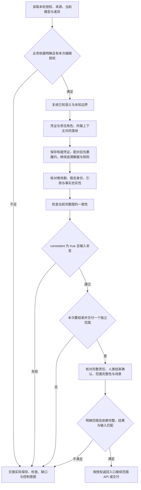

# 渐进编辑与范围交付

本页固定保存与检查顺序，不主持访谈，不保存第二套业务状态。FM 始终只有 `.evidence/fm/` 一份源，不设置草稿／正式两份模型或 Entity 审批状态。

## 每步前馈与反馈

- **授权与映射**：当前事实支持的内容可维护，不等追责结束；纯讨论、只读、只聊不落盘、停止及仅记录要求优先。已有相同编辑授权不逐轮重复申请。具体最小单元与责任方法见 [责任范围结束](responsibility-closure.md)。
- **共同落地**：普通凭证有责任角色，合同有双方责任角色，履约请求连同指向所属根合同的直接依据关系保存，已有角色及合同复用；实际主体未知不造 Participant，责任角色未知不保存该凭证。先准备完整批次再写；多文件不保证事务，失败立即交接实际部分保存，不自动回滚。
- **渐进编辑**：直接识别主要请求—确认交互，配对后包裹履约；不先列责任清单再转换，不先保存空履约。只有一端时按[最小保存单元](responsibility-closure.md)保存：请求已有直接合同关联和责任，确认已有依据和责任，不虚构另一端；未包裹位置通过已有记录和交接恢复，不另建候选模型。按 [批次评估](batch-assessment.md)、[语义](semantics.md)和 [格式](format.md)共同演进。未知类型、必填性、关系、规则或时间参数不写猜测值；不以恒真规则或占位引用制造完整。定义直接归 Entity/属性，稳定 ID 不随标签变化。
- **差异与一致性**：保留已有改动，核对实际增改删，不手改 generated。每批运行 [检查](validation.md)，引用、归属、CEL、依赖环、已表达内容冲突、凭证责任缺失及请求缺少直接合同关联均为错误，不因模型未完整豁免。
- **范围结束**：`--scope` 选择独立合同或领域／协商 Context，包含子阶段和必要依赖，不允许同合同履约切片。完整责任图、各层异常、终点、人类确认按责任方法核对；`complete` 与场景实际结果分别交接。必要缺口阻塞范围交付，不阻止其他有依据内容保存。
- **下游交接**：仅在范围检查有效、人类结束确认和下游权限具备时，交接模型根、明确范围、必要依赖、差异与同一次有效检查。API 通过 `--fm-check` 消费且核对摘要，不重复 FM 检查。增量保存不自动触发 API；独立 FM 调用只交付 FM 后停止。

从 [表达样例](../examples/README.md) 只读当前需要的模式。样例不是事实、权限或结束确认。技术错误在授权内修正复验；业务冲突保留来源与未决项，不倒改规则来通过。后续阶段失败不撤销已保存 FM，也不宣称联合交付完成。
