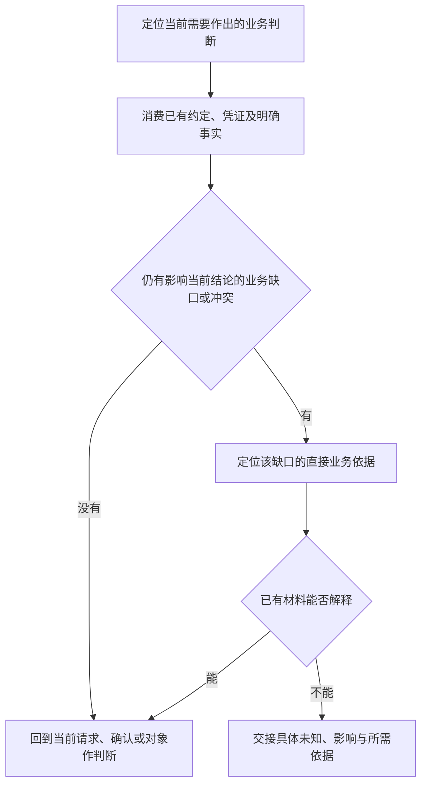

# 从当前判断追溯业务依据

本页维护追溯的进入、深入与返回条件；[业务分析](business-analysis.md)确定经营权责、约定与履约骨架。问题选择与问答由使用方发现的 Discovery 访谈协议维护；本包只交接具体业务缺口，不依赖其安装路径。

## 1. 先消费输入，再决定是否回溯

追溯服务于一个当前判断：请求依据是否充分、某项结果能否证明完成、规则是否适用，或领域对象的某项结论能否成立。先复用已提供的约定、角色、参数、版本与凭证，再判断什么还影响该结论。不是先列全部字段、替每个字段制造问题，然后等待人类补齐。

每一步的输入是当前结论及其依据，输出是可解释的判断或具体缺口。查清依据不表示凭证已经形成、履约完成或责任结束；返回后仍按该请求的匹配、数量、时间及完成规则判断。

### 按输入选择起点

| 当前输入                                                                 | 分析起点                                                         |
| ------------------------------------------------------------------------ | ---------------------------------------------------------------- |
| 已明确双方接受的合约、订单或口头约定                                     | 直接消费约定，进入其主要履约；合约本身承担双方达成一致的证明作用 |
| 某一形成事实或版本接受情况存在争议，且改变当前义务、金额、期限或采信结果 | 只追该争议需要的签署、方案或回应依据，再返回当前判断             |
| 只有通用条款、平台协议或未接受的方案                                     | 按材料证明范围分析责任类型或协商，不声称某笔具体买卖已经签订     |

类型分析与实例事实分开：可以依据明确材料分析合约及履约类型，而不要求先提供一笔真实签约实例；已知有合约，也不能替缺失材料补造某笔签署、付款或交付的实际结果。

合约前上下文承接真实邀请、方案与回应，不是合约分析的必经前置阶段。已有合约只消费最终约定及当前判断真正需要的形成依据；回溯一项接受争议不等于自动展开完整询报价、谈判或签约流程。

## 2. 沿直接依据深入，再返回消费点

从当前请求或确认的金额、数量、身份、版本、业务时间等关键值，定位直接提供它的约定或凭证，核对证明作用、形成责任、适用范围及当时可见性。一次判断可以有多条来源链：例如退款金额依赖退款约定，实付金额依赖支付凭证，两者共用订单匹配。每条链深入到足以解释当前值的依据，再回到消费点；共享依据复用，循环引用不能自证。

| 依据的实际情况                     | 表达与处理                                               |
| ---------------------------------- | -------------------------------------------------------- |
| 直接记录或逐次约定                 | 保留该记录或约定的提供方、内容与适用关系，不强造计算公式 |
| 引用已有值                         | 保留原凭证或对象属性及版本，不把复制字段当成独立来源     |
| 按规则计算                         | 追到输入和适用规则，依据充分就表达确定性派生             |
| 当前判断必需，但材料不足或相互冲突 | 说明哪项结论不能作出及缺少什么，不先任选一种解释         |

责任定位沿用 [业务分析](business-analysis.md)：凭证保留其所属约定、合同责任方及已知实际主体，经办人与证明提供方不替代责任方。跨上下文只追当前消费的结果及采信依据，不因第三方出现展开其全部内部责任；角色不是完成证明。

并行来源链的问题选择、共同前提、部分回答及暂缓由访谈协议组织。FM 交接每项真实缺口的对象与影响，不另建来源链状态或第二份问题台账。

## 3. 区分时间定义、规则与实例

[格式](format.md)唯一维护六类凭证的时间属性及类型要求；本页只判断业务时间是否足以支撑当前结论。

- **类型含义**：`signed_at` 表达签约时间，`confirmed_at` 表达确认时间；定义这些属性不要求调查界面操作、索取实际日期或再造一张证明签约的凭证。
- **适用规则**：判断付款是否逾期，需要请求起止与结果时间的业务口径。已有“签约后24小时截止”等约定就直接使用；缺少的起算、工作日、截止是否包含等口径，只有影响当前判断时才形成具体问题。
- **实例值**：运行具体单据场景时才需要确定的 RFC 3339 时间；实际值或有依据的派生规则按 [实例执行](traceability-and-simulation.md)提供。未知值不以占位日期、自由参数或虚构公式补齐。

三层不可互相替代：类型字段存在不证明业务规则充分，缺实例日期不等于类型分析必须停止，技术回调或入库时间也不自动等于业务事件时间。

## 4. 保存与检查对齐实际依据

在已有编辑授权内，将有依据的概念、属性、关系与规则渐进映射到当前 FM，按 [最小保存单元](responsibility-closure.md)共同维护凭证、角色与上下文。来源与范围允许保存什么，就维护什么；未明确的类型、必填性或完成规则保持缺失。

每项准备提出的问题或保存的业务缺口，都应能指出它影响的当前结论，以及已有材料为什么不能解释。Agent 为补齐格式、展开操作步骤或延长流程而产生的疑问，不是业务事实，不写入 Entity 的定义或说明充当必要责任缺口。

检查保存差异是否忠实复用已知依据，是否引入未经提供的事件、条件或签约前流程。Schema、CEL 与 lineage 只检查已表达内容，不能证明业务来源充分；范围结束时另按责任方法核对全部主履约、异常、终点、必要证明与人类确认。
