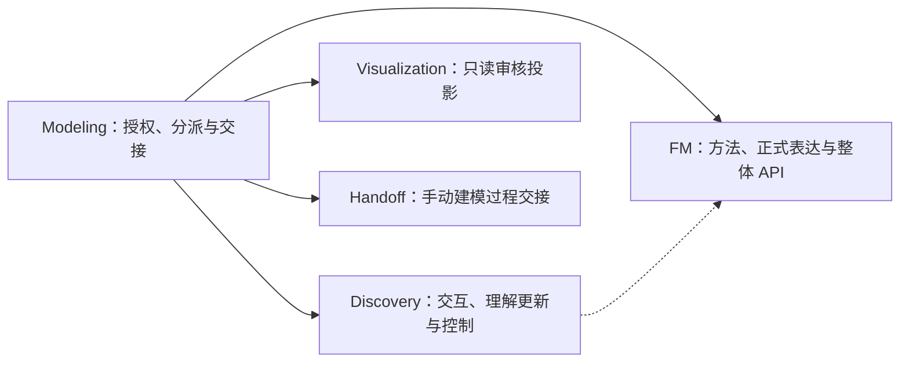
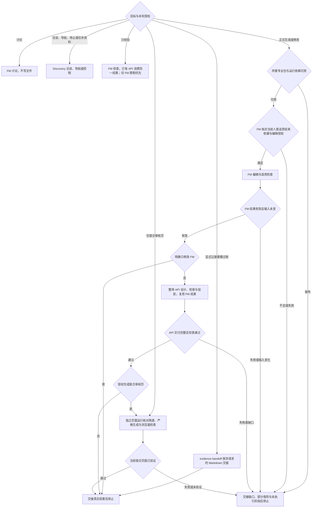

# 文件交接与恢复

本页维护分派、阶段接续与恢复契约。业务事实、专业判断和准入依据归对应拥有者；入口只传递授权并核对实际交付。

## 职责与依赖

箭头表示入口委派，虚线表示 Discovery 消费 FM 方法；不是重新安装 Skill 的路径，也不是业务事实复制。各专业包通过资源发现定位，均可独立运行。

## 分派与阶段路径

先裁剪授权，再走对应路径。完整生成才预检完整依赖；只读不要求编辑准入。图中的失败由对应拥有者报告，技术修正在原授权内处理；业务缺口不自动转成访谈。连续回答沿已选 Discovery 分支，不重新走分派图。

| 检查点    | 前馈                                    | 反馈与出口                                        |
| --------- | --------------------------------------- | ------------------------------------------------- |
| 分派      | 当前目标、允许文件与停止条件            | 执行者与写入范围明确；授权缩窄优先                |
| 准入与 FM | 当前责任依据、编辑授权、源版本          | FM 返回实际差异与有效结果；缺口停止，不局部放行   |
| API       | 同一次有效 FM 检查、整体模型与 API 权限 | 核对摘要、整体契约与交付；失配返回 FM，不隐式重查 |
| 联合审核  | 当前两源与页面授权                      | 独立核对、严格联合生成及浏览器证据；旧页不顶替    |
| 交接      | 各阶段实际文件与检查结果                | 部分保存分别说明，不自动回滚、批准或进入下游      |

按当前分派或交接动作读取 [基线样例](../examples/README.md)，样例不替代专业方法与实际检查。

## 文件归属

默认路径相对项目根；沿用指定位置，不自动迁移。目录存在不扩大本轮写入权限。

| 产物                       | 位置                                                 | 拥有者                              |
| -------------------------- | ---------------------------------------------------- | ----------------------------------- |
| 用户显式要求的建模过程交接 | `.evidence/handoffs/<主题>.md` 或指定路径            | evidence-handoff                    |
| 唯一词汇入口               | `.evidence/glossary.json`                            | FM 领域语言方法；访谈按授权当轮维护 |
| 正式模型、说明与场景       | `.evidence/fm/`                                      | FM                                  |
| API 设计与完整投影         | `.evidence/api/api.json`、`.evidence/api/generated/` | FM 包的 API 阶段                    |
| 只读审核投影               | `.evidence/views/index.html`                         | Visualization                       |
| 获授权留存的紧凑检查记录   | `.evidence/checks/fm/`、`.evidence/checks/api/`      | 对应检查执行者                      |

访谈提供共同业务理解；词汇定义归 standalone 或其引用的 FM 对象唯一拥有，交接传递当前判断与必要依据。

## 分支进入与连续承接

- **首次进入或目标改变**：选择执行者，传递当前目标、授权、实际来源与停止条件。显式记录建模过程时委派 evidence-handoff，保存范围以该请求为准。
- **连续问答**：保持 Discovery 分支，增量读取与事件核对由其访谈协议维护。仍在上下文且未变化的方法直接复用，入口不重做专业分析。

完成时，当前执行者和输入版本明确；实际记录提供事实，聊天摘要只帮助定位。

## 恢复一个分支

本节用于跨会话、必要上下文丢失或保存中断，不是每轮回答后的必经步骤。只恢复当前分支所需内容，访谈的最小读取范围、新鲜度和扩大条件归 Discovery 协议。

1. **核对权限与控制。** 读取当前目标、允许文件、已有 Git 差异和停止／暂缓状态。完成时，本轮可执行动作明确。
2. **定位恢复点。** 读取分支输入及适用版本；访谈承接合同、履约项、请求或确认、原问题及控制意图。完成时，恢复点有材料或交接支撑，关键上下文不足则说明限制。
3. **处理保存中断。** 核对各文件实际内容，只补齐授权内尚未保存部分。界面消失时沿原问题继续普通对话，取消时等待；具体输入处理归 Discovery。完成时，实际保存与未保存内容可区分。
4. **复核正式编辑准入。** FM 按 `references/responsibility-closure.md` 核对当前范围及人类追责结束依据。完成时，确认仍覆盖当前版本；变化导致失效则交接缺口。
5. **接续完整生成。** 分别检查 FM/API 差异与新鲜度，已完成且未变的源复验后接续。完成时，待执行阶段和有效检查明确，旧页面只保留为旧产物。

模型任务不自动解除访谈停止状态。不能定位当前输入、授权或恢复点时，停止并列明缺口。

## FM → API → 联合审核

### 1. FM

写入前先确认所需 Skill 和运行环境可用。FM 消费人类准入依据、本轮编辑授权及来源，完成映射、源编辑、术语引用与适用场景检查。

交给同包 API 阶段的是当前完整模型根、实际差异及本次 JSON 检查结果；检查须有 `modelDigest`、`valid: true` 且 `inputChanged: false`。结果放在模型目录之外的临时文件；只读分支使用项目外临时目录，不写项目报告。FM 失败或准入不足不进入 API，也不生成新审核页。业务分析和 JSON 映射的具体动作只由 FM 维护。

### 2. API

FM 包在模型检查通过后自动接续本包的 API 阶段，设计或更新 api.json、check、project。三个 API 命令均以 `--fm-check` 消费同一结果，只核对摘要，不重复执行 FM 检查、编译校验或模拟。inspect 只是可选索引，不是再次准入。无需第二次请求已获授权的 API 生成；不重复业务确认。摘要失配返回 FM 阶段，API 不隐式重查或反向修改 FM。

接口与消费者覆盖、契约、实际差异和交付路径分别可定位才交给下一阶段。技术错误在 API 授权内修正；身份、权限、数量或来源缺口不反向修改 FM。失败保留已有审核页，明确 API 未完成及旧页不代表当前有效结果。

### 3. 联合审核

两源通过且有页面授权时，按 Visualization 入口的命令执行严格联合模式 `--require-api`；运行路径均为实际绝对路径，生成与浏览器验证方法由该包维护。

这次独立页面运行检查 FM，将同一结果传给 API 自身校验并核对两源新鲜度；页面内的 API 阶段不再检查 FM。临时投影保持正式 generated 不变，缺 API 不降级，失败保留已有审核页。完成时，最终 HTML、截图与实际检查可定位；缺浏览器环境报告未验证，不声称完整联合交付。

阶段之间不是原子事务；后续失败不自动回滚已保存源，不删除历史证据。更窄授权只执行获授权阶段。

## 只读与单独投影

- 只校验请求不写任何项目文件：运行一次 FM 检查并将结果交给已有 API 的 check（inspect 可选），不执行 project 或生成器。两源分别报告；API 缺失则联合检查未完成，明确仅 FM 时不查 API。
- 单独联合审核仅授权更新 HTML，不编辑两源或正式 API generated；仍要求当前 API 和双源检查。
- 独立 FM 可视化由 Visualization 执行，不将它称为联合审核，不通过隐藏或删除已有 API 绕过检查。

## 最小交接

每个执行者按 [交接模板](../assets/handoff-template.md) 返回实际授权、输入与恢复引用、各文件保存结果、检查及剩余工作，入口不重做专业分析。未执行场景的 `simulationPassed` 为 null；不抄事实正文、定义或案例，不增加第二份状态。

人类追责结束、编辑授权、保存、机器检查及业务批准是不同结论。完成本次链路或受阻后停止，不自动启动需求、规划、实施、批准或 Git 操作。
