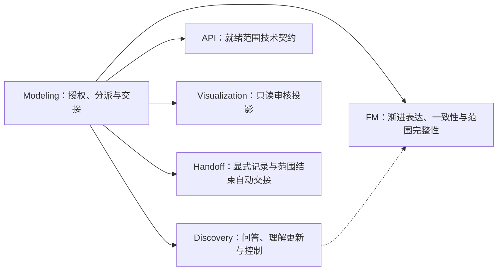
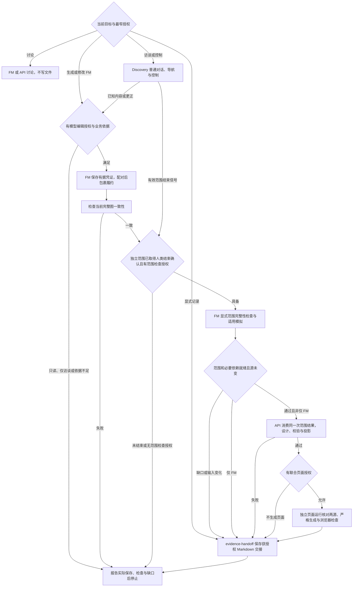

# 文件交接与恢复

本页维护分派、授权、阶段接续与恢复；业务事实与专业判断归对应拥有者，不复制事实或建立私有状态，不重做专业分析。FM 只有一份持续生长的源，不按草稿／正式分库。

## 职责与依赖

通过资源发现或指定路径定位专业包，各包独立运行，不耦合宿主专有工具。完整交付前核对实际需要的资源；增量 FM 保存不因无关 API／页面资源缺失而阻塞。

## 分派与阶段路径

图中 Handoff 仅在显式记录或范围结束自动交接且允许保存时执行，禁止保存则直接报告未保存内容。只校验与单独页面请求按下文执行，不获得两源编辑权限。连续问答保持原 Discovery 焦点，不每轮重走分派、申请同一授权或重读未变方法。

## 渐进访谈与模型维护

本入口建模访谈默认包含 FM 增量维护授权：Discovery 吸收全部输入，围绕履约判断沿关键数据开展凭证追溯、深入后返回判断，再组织独立问题并控制暂停／停止，FM 负责实际模型编辑及检查，Modeling 传递允许文件与限制。单独 Discovery 只负责问答，不自动获得模型编辑授权。纯方法讨论也不授权模型 JSON。

每批直接识别双方主要请求—确认交互，配对后包裹为履约；主要责任梳理与交互识别合为同一动作，不先列抽象责任清单再转换。只知一端时按 FM 最小保存单元保存有据凭证，请求连同直接合同关联及责任共同落地，不创建空履约，恢复时不要求履约 ID。依据当前事实共同演进对象、属性、关系、规则、履约和上下文。凭证与责任角色及所属上下文共同落地，合同连同双方责任角色；角色未知暂不保存凭证，实际主体未知不虚构 Participant。FM 细则由 `references/responsibility-closure.md` 与编辑流程唯一维护。

每批只检查当前完整图的一致性，空上下文、空履约、缺请求或结果端及请求缺少直接合同关联均为错误；未包裹交互的配对与履约归属、时间和完成规则等完整性缺口与已知错误分开报告；不等全部澄清结束才首次写 FM。未知不写默认参数、假凭证或恒真规则。更正先说明受影响权责及旧结论失效，再按已有权限更新模型；没有写入权限就只交接影响，不绕过权限另存定义。模型变化不自动触发 API、规划或联合审核。

只聊不落盘、只读、仅访谈、不生成模型、仅补资料或停止等更窄要求优先；不把补资料当成恢复问答。模型保存失败立即停止，核对各文件真实结果，不自动回滚，不声称多文件原子事务。

## 范围结束与下游接续

1. **接收结束依据。** Discovery 按 FM 方法核对合同全部主履约、各层异常、终点、必要外部证明、完整责任图与推演，单独等待人类确认；领域／协商按复用连接范围或获授权深入范围，核对关联责任、规则／方案、正常反例及无适用履约责任的确认；不生成成熟方案的内部模型或 API，除非该范围明确获授权。结束确认绑定范围和业务版本，不是每个 Entity 的审批状态，也不表示全局结束。
2. **检查整个范围。** FM 以独立 Context ID 运行 `check_fm.py "$FM_ROOT" --scope "$CONTEXT_ID"`，可重复 `--scope` 指定必要合同组。包含子阶段及真实依赖，不把同合同付款和退款切开交付。未澄清外部边界按真实语义使用 Context Role，不能隐藏当前责任或证明缺口。独立范围不等待无关合同完整。
3. **按授权接续 API。** 仅当当前范围完整、适用模拟通过或确实不适用、人类结束确认有效及下游授权具备时，委派 `evidence-api`。交接当前完整模型根、实际差异、明确范围与必要依赖及同一次 JSON 检查结果。API 整体覆盖这个明确范围，不默默过滤其中不完整对象，也不自动删除其他已交付范围。仅 FM 等限制裁剪阶段，不重复请求已获授权的下游权限。
4. **核对联合审核。** 两源通过且允许页面时，Visualization 的独立页面运行用相同显式 `--scope` 检查 FM，再将同一结果传给 API 自身校验；API 不再检查 FM。使用 `--require-api`，缺 API 不降级；临时投影不改正式 generated，失败保留旧页。实际 HTML、截图与浏览器验证可定位；缺浏览器环境明确未验证，不称完整联合交付。
5. **自动交接并停止。** 范围结束链路成功或阻塞后，委派 `evidence-handoff` 保存全部未澄清上下文、类型、边界与关联、真实 Context Role ID、必要依据、原问题、未决依赖、暂缓／停止意图、确认覆盖与各阶段实际文件和结果。沿用已有记录，不建第二套问题台账；返回真实路径后停止，不自动切换其他合同。没有剩余项如实记录为空，全局确认仍单独处理。

范围结束后的自动接续包括合同与独立领域／协商分支；普通回答、单条终点、导航选择、停止或全局结束确认不触发下游。仅访谈、只读、不生成或不保存交接等限制优先。必要确认或完整性不足不阻止已有已知模型继续保存，但不得交付受影响下游。

## 检查结果与阶段交接

- `consistent: true` 只证明当前表达未发现一致性错误，`complete: null` 表示未检查指定范围完整性，不能由 `valid: true` 推断可交付。
- 下游消费 `checkVersion: 5`、`consistent: true`、`complete: true`、明确 `scopeRefs/contextRefs`、空错误与缺口、`inputChanged: false` 且 `modelDigest` 匹配的结果；适用模拟必须实际通过，无适用场景的 `simulationPassed` 保持 null 并说明原因。
- `FM_CHECK_FILE` 放在模型目录之外；只读请求使用项目外临时目录，不保存项目报告。API 的 inspect/check/project 使用 `--fm-check`，只核对摘要与范围，不重复执行 FM 检查、编译校验或模拟。API 自身错误由 API 修正，不反向修改 FM 补权限或规则。
- FM、场景、来源或依赖更正使受影响旧检查、人类确认及下游结果失效；实际源摘要变化须重检。历史结果保留，旧页面不是当前证据。阶段不是原子事务，后续失败不回滚已保存源。

## 双层循环的验证与退出

外层 PDCA 管授权范围和阶段交接，内层 Guides → Action → Sensors → Steer 管单次专业交付，不建立第二份业务状态。

- **Plan**：确定目标、权限、实际来源、允许文件及停止条件；不以全局分类或完整合同清单作为进入访谈或模型生长的条件。
- **Do**：FM 维护业务分析与唯一模型，Discovery 从主要履约沿凭证增量发现协作、每轮主动成组澄清；边界疑问局部复核，范围结束才接续下游。
- **Check**：经营依据、责任双方、各凭证归属、关键数据、未决项和控制意图都参与判断；保存、一致性、范围完整性、模拟、人类确认及业务批准分别报告。
- **Act**：表达错误在授权内修正；业务冲突交回拥有者，不自动解除停止。缺口只阻塞受影响范围；不自动修改 Skill、放宽责任方法或补造事实制造通过。

对外由 Discovery 按访谈协议把凭证追溯讲成故事：当前判断需要哪些数据、已追到的凭证能证明什么、为什么深入以及取得依据后返回哪里。不用流程问卷或分析字段表替代证明关系；领域／协商仍按各自对象说明依据。不展示资料出处或内部检查过程；内部仍保留依据与版本，凭证和证明作用不省略。

## 文件归属与恢复

| 产物                   | 位置                                                 | 拥有者        |
| ---------------------- | ---------------------------------------------------- | ------------- |
| 唯一模型、说明与场景   | `.evidence/fm/`                                      | FM            |
| API 设计与派生投影     | `.evidence/api/api.json`、`.evidence/api/generated/` | API           |
| 显式或范围结束自动交接 | `.evidence/handoffs/<主题>.md` 或指定路径            | Handoff       |
| 只读审核页             | `.evidence/views/index.html`                         | Visualization |
| 获授权检查记录         | `.evidence/checks/fm/`、`.evidence/checks/api/`      | 检查执行者    |

### 恢复一个分支

跨会话或中断恢复不是每轮回答后的必经步骤。先核对实际文件、来源版本、Git 差异、原授权和停止状态，再读取主焦点的合同、履约、请求或确认、各凭证责任人对应的所属合同责任方与已知实际主体、各关键数据项的来源和上下层回溯位置、原问题及控制意图、未决依赖；保留已判独立且可同时澄清的问题组，不将恢复位置当成只能单问的限制。领域／协商按实际对象或规则／方案恢复，不强套合同结构。已有记录帮助定位，不以聊天记忆替代业务源。

只补齐授权内未保存或未完成阶段，不重新生成未变产物。恢复问答须有明确意图；只校验请求不写任何项目文件，已有 API 的检查仍需当前明确范围。单独页面只授权 HTML，不编辑两源或正式 generated；无 API 的 FM 页面可展示渐进模型及缺口，不称联合交付。

按 [基线样例](../examples/README.md) 和 [交接模板](../assets/handoff-template.md) 返回实际授权、输入、范围、各文件结果、检查、未执行项及恢复位置，不复制定义。合同级结束、领域／协商结束、全局追责结束、保存、机器通过和业务批准互不替代。不自动批准，不进入需求、规划、实施或 Git 操作。
