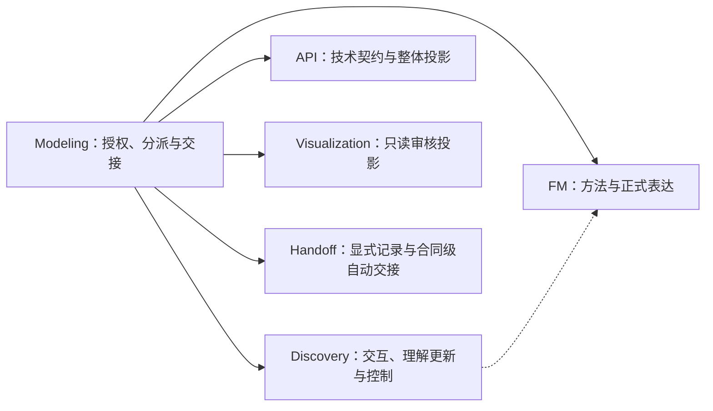
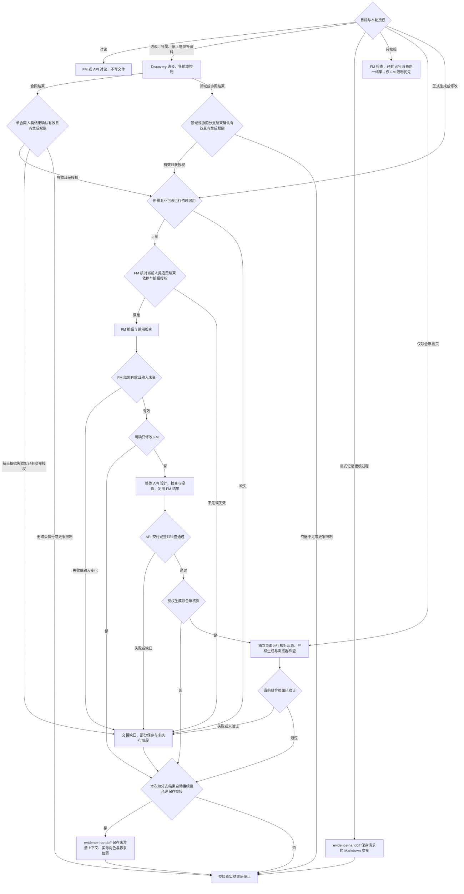

# 文件交接与恢复

本页维护分派、阶段接续与恢复契约。业务事实、专业判断和准入依据归对应拥有者；入口只传递授权并核对实际交付。

## 职责与依赖

箭头表示入口委派，虚线表示 Discovery 消费 FM 方法；不是重新安装 Skill 的路径，也不是业务事实复制。各专业包通过资源发现定位，均可独立运行。

## 分派与阶段路径

先裁剪授权，再走对应路径。完整生成才预检完整依赖；只读不要求编辑准入。图中的失败由对应拥有者报告，技术修正在原授权内处理；业务缺口不自动转成访谈。连续回答沿已选 Discovery 分支，不重新走分派图；收到有效单合同或领域／协商分支结束信号时，进入对应自动接续。

| 检查点    | 前馈                                    | 反馈与出口                                              |
| --------- | --------------------------------------- | ------------------------------------------------------- |
| 分派      | 当前目标、允许文件与停止条件            | 执行者与写入范围明确；授权缩窄优先                      |
| 准入与 FM | 当前责任依据、编辑授权、源版本          | FM 核对合同级完整责任，返回差异与有效结果；必要缺口阻塞 |
| API       | 同一次有效 FM 检查、整体模型与 API 权限 | 核对摘要、整体契约与交付；失配返回 FM，不隐式重查       |
| 联合审核  | 当前两源与页面授权                      | 独立核对、严格联合生成及浏览器证据；旧页不顶替          |
| 交接      | 各阶段实际文件与检查结果                | 部分保存分别说明，不自动回滚、批准或进入下游            |

按当前分派或交接动作读取 [基线样例](../examples/README.md)，样例不替代专业方法与实际检查。

## 双层循环的验证与退出

外层 PDCA 管本次授权范围和阶段交接，内层 Guides → Action → Sensors → Steer 管每次专业分析与交付；不建立第二份业务状态或额外审批关卡。

- **Plan**：确定目标、允许写入、阶段产物与验收边界。初步识别以分类依据及责任保留为标准，不以选项数量为标准；生成仍以适用的人类结束确认和专业准入为前提。
- **Do**：委派专业拥有者执行内层循环。FM 维护分类判断与验证方法，Discovery 在总览展示前调用，并在后续边界变化时复核；发现错误先 Steer，不把未验证结果交给用户选择。正式生成沿既有 FM → API → 联合审核检查链执行，不把前期分类通过当作机器校验或责任闭合。
- **Check**：在识别交给导航、分支交给正式生成及最终交付时，核对专业结果和覆盖范围：上下文边界是否有依据、责任是否遗漏或重复、关联与未决项是否保留、当前人类结束确认是否有效、实际保存与检查是否齐备。消费本次有效结果，不重复专业分析，也不要求无关合同先闭合。
- **Act**：局部分类或表达错误退回专业拥有者修正后复核；业务未知交回澄清且不自动解除停止；范围或依赖变化重新选择获授权分支。反复出现的方法缺陷可提出维护建议，但不自动修改 Skill、放宽准入或生成业务事实。

对外展示业务结果、必要问题与真实交付限制，不展示资料出处或内部检查过程；内部依据与版本仍保留，业务凭证及证明作用不省略。识别通过、用户选择、分支结束、机器检查与业务批准互不替代。

## 文件归属

默认路径相对项目根；沿用指定位置，不自动迁移。目录存在不扩大本轮写入权限。

| 产物                     | 位置                                                 | 拥有者                              |
| ------------------------ | ---------------------------------------------------- | ----------------------------------- |
| 显式请求或合同级自动交接 | `.evidence/handoffs/<主题>.md` 或指定路径            | evidence-handoff                    |
| 唯一词汇入口             | `.evidence/glossary.json`                            | FM 领域语言方法；访谈按授权当轮维护 |
| 正式模型、说明与场景     | `.evidence/fm/`                                      | FM                                  |
| API 设计与完整投影       | `.evidence/api/api.json`、`.evidence/api/generated/` | evidence-api                        |
| 只读审核投影             | `.evidence/views/index.html`                         | Visualization                       |
| 获授权留存的紧凑检查记录 | `.evidence/checks/fm/`、`.evidence/checks/api/`      | 对应检查执行者                      |

访谈提供共同业务理解；词汇定义归 standalone 或其引用的 FM 对象唯一拥有，交接传递当前判断与必要依据。

## 单合同澄清结束后的自动接续

本入口的建模访谈默认包含合同级生成与自动交接授权。只聊不落盘、只读、仅访谈、不生成模型或不保存交接等明确限制优先；单独 Discovery 访谈未获此授权时只返回结束依据，不自行升级权限。普通回答、单条终点或停止信号不触发本路径。

1. **接收结束依据。** Discovery 按 FM 方法核对当前合同的全部主履约、各层异常、责任终点、必要外部证明与实际推演，单独取得人类合同结束确认；传递覆盖范围、业务版本、生成权限及剩余合同，不用本轮显示范围代替责任边界。确认不足或失效时不编辑；已有本次自动交接或显式保存权限时，仍交给 Handoff 保存真实缺口。
2. **调用建模 Skill。** 进入本入口正式生成分支，委派 `evidence-fm` 复核合同级准入后编辑当前模型。相关未澄清合同使用 Context Role，语义、玩家及证明关系由 FM 方法维护；不为无关合同创建角色。默认接续整体 API 与联合审核；仅 FM 等限制裁剪这些阶段，API 只覆盖当前正式模型，不设计未澄清合同的内部能力。
3. **调用 Handoff Skill。** 建模链路成功或阻塞后，委派 `evidence-handoff` 保存未澄清部分到 `.evidence/handoffs/<主题>.md` 或指定路径。传递所有未澄清上下文（包括剩余合同、领域及协商）、类型与关联、实际 Context Role ID 与所代表边界、已知依据、原问题和未决依赖、暂缓／停止意图、合同级确认覆盖及实际文件和检查结果。已有记录只引用或按授权更新，不新建第二份问题状态。
4. **核对保存后停止。** 返回模型与交接的实际路径、各阶段结果及未执行项，不自动切换或恢复其他合同访谈，不宣称全局追责结束。没有剩余上下文时如实记录未澄清部分为空，不补造待办；全局确认仍单独处理。

写入前定位本分支所需 FM、API、Visualization 与 Handoff 等实际资源；更窄仅 FM 分支不要求 API／页面资源，但仍核对获授权的 Handoff。建模阶段失败也记录真实部分结果；Handoff 不可用或保存失败时列明未保存内容并停止，不自动回滚已保存模型，不声称两步都已完成。中断恢复先核对实际模型和交接，再只补齐授权内未完成阶段，不重新生成未变化的已交付合同。

## 领域与协商结束后的自动接续

建模入口访谈默认也包含独立领域／协商的分支生成与自动交接；仅访谈、只读、不生成、不保存交接等更窄限制优先。Discovery 单独调用不获得此默认授权。普通回答、导航选择、停止或全局确认不触发生成。

1. 接收 Discovery 的分支类型、完整范围、业务版本、人类结束确认及关联责任依据，委派 FM 按 `references/responsibility-closure.md` 的领域／协商准入复核；必要依据不足时不编辑、不接续 API 或页面，已有交接授权则保存真实缺口。
2. 准入与资源就绪后进入上图共用的 FM → API → 联合审核链路，按更窄授权裁剪。只表达已澄清范围，不为领域或协商补造合同，不展开未澄清上下文的内部能力；角色与依赖按 FM 语义选择，不将所有外部边界一律写成 Context Role。领域默认传递并表达复用连接范围，只维护获授权的消费边界或必要对象引用，不生成成熟方案的内部模型或 API；确需深入的部分由已确认范围限定，不能因分支自动接续扩大到整个领域。
3. 成功或阻塞后委派 Handoff 保存未澄清上下文的类型、边界、关联、原问题、暂缓意图、恢复位置及实际产物；合同级与领域／协商确认分别保留。保存失败报告已保存与未保存内容，不自动回滚。
4. 核对实际路径和结果后停止，不自动切换其他上下文，不声称关联合同或全局追责结束。恢复只补授权内未完成阶段，不重新生成未变产物。

## 分支进入与连续承接

- **首次进入或目标改变**：选择执行者，传递当前目标、授权、实际来源与停止条件。显式记录建模过程时委派 evidence-handoff，保存范围以该请求为准。
- **连续问答**：保持 Discovery 分支，增量读取与事件核对由其访谈协议维护。仍在上下文且未变化的方法直接复用，入口不重做专业分析；有效合同或领域／协商结束信号按对应章节接续，普通回答不重新分派。

完成时，当前执行者和输入版本明确；实际记录提供事实，聊天摘要只帮助定位。

## 恢复一个分支

本节用于跨会话、必要上下文丢失或保存中断，不是每轮回答后的必经步骤。只恢复当前分支所需内容，访谈的最小读取范围、新鲜度和扩大条件归 Discovery 协议。

1. **核对权限与控制。** 读取当前目标、允许文件、已有 Git 差异和停止／暂缓状态。完成时，本轮可执行动作明确。
2. **定位恢复点。** 读取分支输入及适用版本；访谈先核对上下文类型，领域／协商承接当前对象或规则／方案、关联责任与依据；合同承接主焦点的合同、履约项、请求或确认、各凭证责任人、各关键数据项的来源与依赖、当前深层位置及上层回溯位置、原问题及控制意图。完成时，恢复点有材料或交接支撑，关键上下文不足则说明限制。
3. **处理保存中断。** 核对各文件实际内容，只补齐授权内尚未保存部分。访谈承接原问题及各题的已答、未答和暂缓情况，取消时等待；具体输入处理归 Discovery。完成时，实际保存与未保存内容可区分。
4. **复核正式编辑准入。** FM 按 `references/responsibility-closure.md` 核对合同级或相应范围及人类追责结束依据，保留未澄清合同和 Context Role 的恢复引用。完成时，确认仍覆盖当前版本；变化导致失效则交接缺口。
5. **接续完整生成。** 分别检查 FM/API 差异与新鲜度，已完成且未变的源复验后接续。完成时，待执行阶段和有效检查明确，旧页面只保留为旧产物。

模型任务不自动解除访谈停止状态。不能定位当前输入、授权或恢复点时，停止并列明缺口。

## FM → API → 联合审核

### 1. FM

写入前先确认所需 Skill 和运行环境可用。FM 消费人类准入依据、本轮编辑授权及来源，完成映射、源编辑、术语引用与适用场景检查。

由入口交给独立 `evidence-api` 的是当前完整模型根、实际差异及本次 JSON 检查结果；检查须有 `modelDigest`、`valid: true` 且 `inputChanged: false`。结果放在模型目录之外的临时文件；只读分支使用项目外临时目录，不写项目报告。FM 失败或准入不足不进入 API，也不生成新审核页。业务分析和 JSON 映射的具体动作只由 FM 维护。

### 2. API

入口在模型检查通过后委派独立 `evidence-api`，设计或更新 api.json、check、project；独立 FM 调用只交付 FM 后停止。API 工具位于 API 包，以 `--fm-skill` 指定 FM 包的实际路径，两包无需相邻。API 的 inspect/check/project 均以 `--fm-check` 消费同一结果，只核对摘要，不重复执行 FM 检查、编译校验或模拟。inspect 只是可选索引，不是再次准入。无需第二次请求已获授权的 API 生成；不重复业务确认。摘要失配返回 FM 阶段，API 不隐式重查或反向修改 FM。

接口与消费者覆盖、契约、实际差异和交付路径分别可定位才交给下一阶段。技术错误在 API 授权内修正；身份、权限、数量或来源缺口不反向修改 FM。失败保留已有审核页，明确 API 未完成及旧页不代表当前有效结果。

### 3. 联合审核

两源通过且有页面授权时，按 Visualization 入口的命令执行严格联合模式 `--require-api`；运行路径均为实际绝对路径，生成与浏览器验证方法由该包维护。

这次独立页面运行检查 FM，将同一结果传给 API 自身校验并核对两源新鲜度；页面内的 API 阶段不再检查 FM。临时投影保持正式 generated 不变，缺 API 不降级，失败保留已有审核页。完成时，最终 HTML、截图与实际检查可定位；缺浏览器环境报告未验证，不声称完整联合交付。

阶段之间不是原子事务；后续失败不自动回滚已保存源，不删除历史证据。更窄授权只执行获授权阶段。

## 只读与单独投影

- 只校验请求不写任何项目文件：运行一次 FM 检查并将结果交给已有 API 的 check（inspect 可选），不执行 project 或生成器。两源分别报告；API 缺失则联合检查未完成，明确仅 FM 时不查 API。
- 单独联合审核仅授权更新 HTML，不编辑两源或正式 API generated；仍要求当前 API 和双源检查。
- 独立 FM 可视化由 Visualization 执行，不将它称为联合审核，不通过隐藏或删除已有 API 绕过检查。

## 最小交接

每个执行者按 [交接模板](../assets/handoff-template.md) 返回实际授权、输入与恢复引用、各文件保存结果、检查及剩余工作，入口不重做专业分析。未执行场景的 `simulationPassed` 为 null；不抄事实正文、定义或案例，不增加第二份状态。

合同级结束、全局追责结束、编辑授权、保存、机器检查及业务批准是不同结论。合同级自动接续另核对 Handoff 实际保存，不用临时报告代替持久交接。完成本次链路或受阻后停止，不自动启动需求、规划、实施、批准或 Git 操作。
