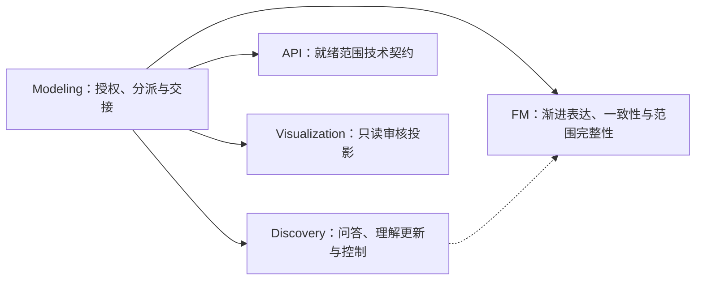
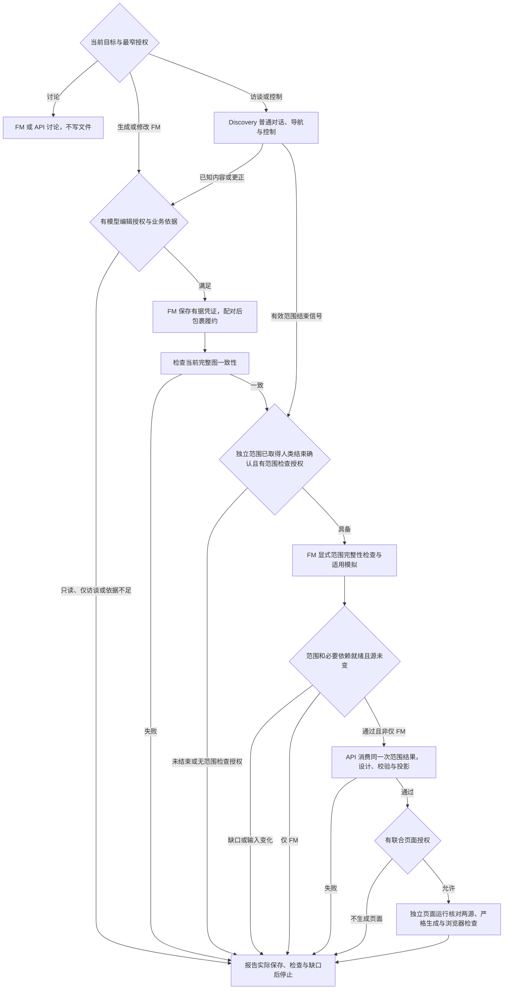

# 阶段接续与恢复

本页只维护分派、授权、门禁与恢复；业务事实与专业方法归对应拥有者，不复制事实或建立私有状态，不重做专业分析。FM 只有一份持续生长的源。接续资格由证据决定，不由措辞判断。

## 职责与依赖



通过资源发现或指定路径定位专业包，各包独立运行，不耦合宿主专有工具。完整交付前核对实际需要的资源；增量 FM 保存不因无关 API／页面资源缺失而阻塞。

## 分派与阶段路径



图中报告节点只说明实际保存、检查与缺口，不写业务源。连续问答保持原 Discovery 焦点，不每轮重走分派或重读未变方法。只校验与单独页面请求按各自范围执行，不获得两源编辑权限。

## 授权与模型维护

本入口建模访谈默认包含 FM 渐进维护授权；单独 Discovery 不自动获得编辑授权，纯方法讨论也不授权模型 JSON。只聊不落盘、只读、仅访谈、不生成模型、仅补资料或停止等更窄要求按其范围执行。

模型如何表达由 FM 的 `references/responsibility-closure.md` 与编辑流程唯一维护，本页不复制字段规则。需要记住的交接事实只有三件：未包裹交互按原问题保留；恢复时不要求履约 ID；模型变化不自动触发 API、规划或联合审核。每批修改由 FM 检查当前完整图一致性，保存失败立即停止并核对各文件真实结果。

## 范围结束与下游接续

1. **接收结束依据。** Discovery 核对完整责任后单独等待人类确认，并把确认写成 `范围结束确认：<contextRef>` 或 `全局追责结束确认：<contextRef>`。领域／协商按复用连接范围或获授权深入范围核对，不生成成熟方案的内部模型或 API，除非该范围明确获授权。
2. **检查整个范围。** FM 以独立 Context ID 运行 `check_fm.py "$FM_ROOT" --scope "$CONTEXT_ID"`，可重复 `--scope` 指定合同组，stdout 存到模型目录之外的 `FM_CHECK_FILE`；同时运行 `audit_key_data.py` 生成关键数据台账，`needsDecision` 逐项给出提供方结论，无法结论的项按缺口处理。
3. **审查业务变化点与复用模式。** 核对固定契约与易变策略（计价、分发、结算分润），确保易变部分已隔离为规则或能力提供者。
4. **按授权接续 API。** 委派前执行门禁：

```bash
python3 "$MODELING_SKILL_DIR/scripts/check_stage_gate.py" \
  --target api \
  --fm-check "$FM_CHECK_FILE" \
  --trace "$TRACE_FILE" \
  --scope "$CONTEXT_ID"
```

门禁读取已保存的检查报告与追溯日志，核对 `checkVersion: 5`、`consistent`、`complete`、`valid`、`inputChanged`、错误与缺口、范围覆盖，以及该范围的人类结束确认记录；台账结论与派生图另行核对，存在未结论的金额、期限、数量或时间差时不委派。退出码非 0 时按报告停止并说明缺口，不把普通回答、单条终点、导航选择或“全部同意”当作结束；通过后委派 `evidence-api`，交接模型根、实际差异、明确范围与同一次 JSON 检查结果。5. **核对联合审核。** 两源通过且允许页面时，Visualization 用相同显式 `--scope` 检查 FM 并把同一结果传给 API；API 不再检查 FM。使用 `--require-api`，缺 API 不降级；临时投影不改正式 generated，失败保留旧页。6. **报告并停止。** 说明各阶段实际文件、检查与实际结果，以及未澄清上下文与 Context Role 的类型、边界与关联、原问题、未决依赖、暂缓／停止意图、未保存部分与确认覆盖；内容留在同一份 FM 与会话中，不另建第二套问题台账。返回后停止，不自动切换其他合同。

范围结束后的自动接续只包括合同与独立领域／协商分支；仅访谈、只读或不生成等限制优先。必要确认或完整性不足不阻止已有模型继续保存，但不得交付受影响下游。

## 检查结果与阶段交接

- `consistent: true` 只证明未发现一致性错误；`complete: null` 表示未检查指定范围完整性，不能由 `valid: true` 推断可交付。
- 下游只消费 `checkVersion: 5`、`consistent: true`、`complete: true`、明确 `scopeRefs/contextRefs`、空错误与缺口、`inputChanged: false` 且 `modelDigest` 匹配的结果。
- `FM_CHECK_FILE` 放在模型目录之外。API 的 `--fm-check` 只核对摘要与范围，不重复执行 FM 检查，也不反向修改 FM 补权限。
- `audit_key_data.py` 的台账不是错误清单：`needsDecision` 逐项有结论才能交付；分类与派生来源只证明已表达内容，不证明业务来源充分。
- 来源或依赖更正使旧检查、人类确认及下游结果失效；历史结果保留，旧页面不是当前证据。阶段不是原子事务，后续失败不回滚已保存源。

## 双层循环的验证与退出

外层 PDCA 管授权范围和阶段交接，内层 Guides → Action → Sensors → Steer 管单次专业交付。

- **Plan**：确定目标、权限、来源、允许文件与停止条件。
- **Do**：Discovery 沿凭证追溯并每轮成组澄清，FM 维护唯一模型。
- **Check**：保存、一致性、范围完整性、模拟与人类结束确认分别报告。
- **Act**：表达错误在授权内修正；业务冲突交回拥有者。缺口只阻塞受影响范围；不自动修改 Skill 或补造事实制造通过。

## 文件归属与恢复

| 产物                 | 位置                                                 | 拥有者        |
| -------------------- | ---------------------------------------------------- | ------------- |
| 唯一模型、说明与场景 | `.evidence/fm/`                                      | FM            |
| 追溯问答与来源日志   | `.evidence/traces/interview-trace.json`              | Discovery     |
| API 设计与派生投影   | `.evidence/api/api.json`、`.evidence/api/generated/` | API           |
| 只读审核页           | `.evidence/views/index.html`                         | Visualization |

### 恢复一个分支

跨会话或中断恢复不是每轮回答后的必经步骤。先核对实际文件、来源版本、Git 差异、原授权和停止状态，再读取焦点、原问题、控制意图与未决依赖；保留已判独立且可同时澄清的问题组。领域／协商按实际对象或规则／方案恢复，不强套合同结构。

只补齐授权内未保存或未完成阶段，不重新生成未变产物。恢复问答须有明确意图；只校验请求不写任何项目文件。单独页面只授权 HTML，不编辑两源或正式 generated。

返回实际授权、输入、范围、文件结果、检查、未执行项及恢复位置，不引用历史基线样例自证。合同级结束、领域／协商结束、全局追责结束、保存与人类结束确认分别记录；不进入 Git 操作。

### 维护提示词与技能

`SKILL.md` 与 `references/` 是业务入口的提示词层，不读取也不链接 `tests/fixtures/` 的合成样例。技能行为的改动按 [评测与提示词进化](../evals/README.md) 判断：改动前后各跑一次用例，退化先回退；模型或运行时升级后重跑全部用例，再决定保留、抽象或退役。测试只防止已有行为退化，不是提示词取舍的依据。
