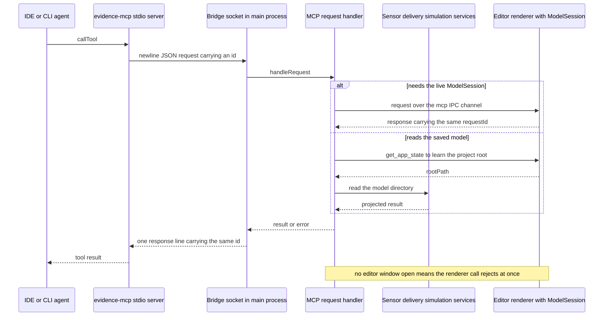

# MCP server and desktop bridge

The desktop app models one project at a time, and `libs/evidence-mcp` exposes that
open model to agents that live outside the app — Cursor, Claude Desktop, a terminal
Pi session. The integration is deliberately split in two: a **tool surface** that
knows what an agent may ask, and a **transport** that never touches the model
itself. Every call ends in one of two places: the renderer that holds the live
`ModelSession`, or a main-process service that reads the saved model off disk. An
external edit therefore lands in the same undo history as a modeler's keystroke,
while the projection and simulation reads plan against the model that was actually
saved.

## Topology

The packaged executable is both the app and the MCP server, and the stdio side is
thin:

- `main.ts` checks `process.argv` for `--mcp-stdio` before anything else runs. In
  that mode it opens no window, reads no project store and synchronizes no client
  configuration; it resolves an endpoint and runs the stdio server
  (`repo://apps/desktop/src/main/main.ts#L31-L56`,
  `repo://apps/desktop/src/main/main.ts#L133-L138`). A failure to start is written
  to stderr and exits the process with code 1
  (`repo://apps/desktop/src/main/main.ts#L48-L56`).
- `runEvidenceMcpStdio` starts an `McpServer` over `StdioServerTransport` with a
  `createEvidenceMcpBridgeClient` as its `EvidenceMcpAppClient`, then returns when
  stdin ends (`repo://libs/evidence-mcp/src/cli.ts#L10-L28`).
- `createEvidenceMcpServer` registers each tool from `createEvidenceTools` and wraps
  a thrown error into an error result, so a bridge failure reaches the agent as tool
  output rather than a protocol error
  (`repo://libs/evidence-mcp/src/server/mcpServer.ts#L32-L79`).

One tool call, from the agent's stdio pipe through the local socket and the
main-process handler, with the renderer consulted either for the live session or
just to name the active project.

## Tool surface

`createEvidenceTools(client)` returns the whole surface as plain objects
(`name`, `title`, `description`, `inputSchema`, `annotations`, `run`), so the
behaviour is testable without a transport
(`repo://libs/evidence-mcp/src/server/toolset.ts#L36-L43`,
`repo://libs/evidence-mcp/src/server/toolset.ts#L136-L140`). Fourteen tools are
registered, and each is answered by a specific owner:

| Tool | Kind | Answered by |
| --- | --- | --- |
| `get_app_state` | read | renderer — active project, revision, selection, sensor summary |
| `get_domain_model` | read | renderer — the live document, optionally filtered by context and rules |
| `get_selected_entity` | read | renderer — selected object, context, relations, derivation rules, fulfillment pair |
| `get_key_data_audit` | read | main — sensor service, cached sensors engine for the project root |
| `get_canvas_screenshot` | read | main — `capturePage`, with the rectangle measured by the renderer |
| `apply_model_patch` | write | renderer — decoded and dispatched into the live `ModelSession` |
| `introduce_fulfillment_pair` | write (operator) | stdio client builds the commands, renderer applies them |
| `add_breach_compensation` | write (operator) | stdio client builds the commands, renderer applies them |
| `roleify_and_invert_dependency` | write (operator) | stdio client builds the commands, renderer applies them |
| `get_delivery_topology` | read | main — delivery service, saved sources |
| `export_openapi_contract` | read | main — delivery service, saved sources |
| `run_scenario_replay` | read | main — simulation service, saved sources |
| `audit_production_drift` | read | main — simulation service, saved sources |
| `run_stage_gate` | read | main — sensor service, cached sensors engine for the project root |

The read/write split is not descriptive prose: two annotation constants mark every
tool, and only the four write tools carry `readOnlyHint: false` and
`destructiveHint: true`
(`repo://libs/evidence-mcp/src/server/toolset.ts#L12-L24`,
`repo://libs/evidence-mcp/src/server/toolset.ts#L232-L360`). The toolset spec pins
both the fourteen names and the fact that the writer list is exactly the patch tool
plus the three operators
(`repo://libs/evidence-mcp/src/server/toolset.spec.ts#L191-L237`), and the SDK-level
spec asserts that the advertised tool list is fourteen entries with
`readOnlyHint: false` on `apply_model_patch`
(`repo://libs/evidence-mcp/src/server/mcpServer.spec.ts#L112-L131`).

Two stale descriptions survive in the repository and should not be trusted: the doc
comment above `createEvidenceTools` still calls this "the seven tools"
(`repo://libs/evidence-mcp/src/server/toolset.ts#L129-L135`), and the package README
table still lists seven tools and calls `apply_model_patch` the only write tool — the
three operators are separate write tools that funnel through it
(`repo://libs/evidence-mcp/README.md#L17-L32`). `TOOL_NAMES` and the returned array
contain fourteen (`repo://libs/evidence-mcp/src/server/toolset.ts#L45-L60`).

The server also ships an instruction block that tells the agent the intended order —
read `get_app_state` first, then the selection or the model, prefer the operators
over hand-written commands, and otherwise patch — and explicitly forbids writing
`.evidence/fm` files directly. It also routes the later questions: delivery topology
and the OpenAPI contract for "what does this model become", scenario replay for "does
it still hold", and drift audit for "does production match", where a blocking drift is
a service-side defect rather than a reason to edit the model
(`repo://libs/evidence-mcp/src/server/toolset.ts#L449-L450`).

## The only write path

`apply_model_patch` is the only place the model is mutated. The three operators are
not a second write path, and they are not main-process work either: each one runs in
the stdio process, reads the current document with
`getDomainModel({ includeRules: true })`, builds an `OperatorPatch` locally with the
model-core builders, then submits `patch.commands` and the generated `rationale`
through the same `applyModelPatch` call
(`repo://libs/evidence-mcp/src/server/toolset.ts#L96-L127`). Because the builders
throw on a dangling reference, an operator refusal is returned as an error result and
no patch is sent at all — the toolset spec asserts both halves of that behaviour
(`repo://libs/evidence-mcp/src/server/toolset.spec.ts#L239-L261`,
`repo://libs/evidence-mcp/src/server/toolset.spec.ts#L324-L388`).

This is what keeps external agents inside the framework's non-negotiable rules:
they cannot bypass the command guards, because the commands are decoded and
dispatched by the same `ModelSession` the UI uses.

## Transport and local trust boundary

The endpoint is derived, not configured:

- `getEvidenceMcpBridgeEndpoint` hashes the Electron `userData` path, keeps 12
  hex characters and builds `evidence-mcp-<digest>.sock` under the OS temp
  directory, or `\\.\pipe\evidence-mcp-<digest>` on Windows. Two user profiles or
  two checkouts therefore never share a socket
  (`repo://libs/evidence-mcp/src/bridge/endpoint.ts#L13-L33`).
- On Unix the server unlinks a stale path before listening, then `chmodSync`s the
  socket to `0600` after `listen` succeeds, and removes it on close. Named pipes
  are exempt because there is no file to remove
  (`repo://libs/evidence-mcp/src/bridge/server.ts#L59-L63`,
  `repo://libs/evidence-mcp/src/bridge/server.ts#L145-L176`).
- The protocol is one newline-delimited JSON request and one response per
  connection, correlated by a caller-supplied `id`. A JSON parse failure, a missing
  id, an oversized buffer or a socket error all end the connection with a
  structured error (`repo://libs/evidence-mcp/src/bridge/server.ts#L78-L142`).

Message size and latency are bounded on both sides: `MAX_MESSAGE_BYTES` is 64 MiB
(`repo://libs/evidence-mcp/src/bridge/client.ts#L13-L14`), the stdio client times
out after 10 s, and the desktop runtime times out a renderer round trip after 15 s
(`repo://libs/evidence-mcp/src/bridge/client.ts#L44-L152`,
`repo://apps/desktop/src/main/mcpBridgeRuntime.ts#L46-L60`). The client's clock is
the shorter one, so a renderer that never answers reaches the agent as
`RENDERER_UNAVAILABLE` before the desktop's own timeout fires.

The security model is filesystem permission, not authentication: there is no
token in the protocol and no network port is opened. Any process running as the
same OS user can connect to the socket — the guarantee is isolation between local
users and profiles, not between programs of one user.

## Request routing inside the main process

`createMcpRequestHandler` takes five dependencies — a renderer channel, the sensor
service, the delivery service, the simulation service and the capture function —
plus an `onCall` callback that counts served calls; `main.ts` assembles them and
hands the handler to the bridge runtime
(`repo://apps/desktop/src/main/mcpRequestHandler.ts#L44-L79`,
`repo://apps/desktop/src/main/main.ts#L89-L119`). The switch itself is small
(`repo://apps/desktop/src/main/mcpRequestHandler.ts#L94-L126`):

| Request method | Route |
| --- | --- |
| `get_app_state`, `get_domain_model`, `get_selected_entity` | forwarded verbatim to the renderer |
| `apply_model_patch` | the `patch` payload forwarded to the renderer |
| `get_key_data_audit`, `run_stage_gate` | main-process sensor service |
| `get_delivery_topology`, `export_openapi_contract` | main-process delivery service |
| `run_scenario_replay`, `audit_production_drift` | main-process simulation service |
| `get_canvas_screenshot` | renderer measures the rect, main captures the page |

Two consequences are easy to miss:

- **Every route needs a window and a project.** The main-process routes are not
  window-free: `activeRoot` first sends `get_app_state` to the renderer and throws
  `NO_ACTIVE_PROJECT` when the answer has no active project. Sensor, delivery and
  simulation calls therefore travel through the renderer before they touch disk
  (`repo://apps/desktop/src/main/mcpRequestHandler.ts#L58-L72`,
  `repo://apps/desktop/src/main/mcpRequestHandler.ts#L101-L122`).
- **One window answers, and it is the first one.** The bridge is constructed with a
  `getActiveContents` callback that takes the first entry of `listEditorWindows()`
  and returns its `webContents`, and `listEditorWindows` returns the `Map` values in
  insertion order, not focus order. With several editor windows open, MCP traffic —
  including the capture rectangle — belongs to the oldest editor window
  (`repo://apps/desktop/src/main/main.ts#L89-L95`,
  `repo://apps/desktop/src/main/windows.ts#L96-L99`). Because the rectangle and the
  model reads come from the same `WebContents`, a screenshot can never depict a
  different project than the one the agent just read.

Renderer-bound calls are correlated twice. The bridge runtime creates a UUID per
call, stores `{resolve, reject, timer}` in a `pending` map and sends
`evidence:mcp:request`; the renderer answers with the same `requestId`, and a
timeout rejects the call so a closed editor window cannot hang an agent
(`repo://apps/desktop/src/main/mcpBridgeRuntime.ts#L83-L110`,
`repo://apps/desktop/src/main/mcpBridgeRuntime.ts#L136-L155`,
`repo://apps/desktop/src/shared/mcpIpc.ts#L1-L40`). The IPC registrar accepts
responses and serves the status call
(`repo://apps/desktop/src/main/mcpIpcHandlers.ts#L20-L40`).

Screenshots travel through a dedicated path: the renderer computes a capture
rectangle (whole visible stage, or one `data-node-id` node clipped to what is
actually visible), the main process sends `capture-mode` to hide selection rings and
zoom controls, calls `contents.capturePage(rect)`, and encodes PNG rather than JPEG
because thin diagram lines and small text would blur
(`repo://apps/desktop/src/renderer/state/mcpCapture.ts#L38-L78`,
`repo://apps/desktop/src/main/mcpBridgeRuntime.ts#L112-L135`,
`repo://apps/desktop/src/main/mcpCapture.ts#L3-L19`). A rectangle of `null` — no
stage, or a node scrolled out of view — becomes `SCREENSHOT_FAILED` instead of an
empty image (`repo://apps/desktop/src/main/mcpRequestHandler.ts#L129-L158`).

## Delivery and simulation reads

The four projection tools answer from the saved model, not from the canvas, and they
say so in their descriptions: an agent asking what the model becomes is planning
against what was written to disk, even if the modeler has unsaved edits in front of
them.

- `createMcpDeliveryService` resolves the model root from the project root and reads
  it with the same `readDelivery` the delivery hub uses (`loadFm` plus
  `buildProjection`, which throws when the index has diagnostics or the projection
  has errors). `topology` copies services, links and limitations and counts the
  routes each service answers; `openapi` returns the OpenAPI document, its path count
  and the same limitations list
  (`repo://apps/desktop/src/main/mcpDeliveryService.ts#L31-L74`,
  `repo://apps/desktop/src/main/deliveryProjection.ts#L107-L118`).
- `createSimulationService` loads the model sources once and calls
  `replayValidationSuite`; `passed` requires both the suite's own verdict and an
  empty error list, frames are returned only for the scenario that was named, and a
  model with no scenarios reports an explicit "this replay proves nothing" error.
  `auditDrift` runs `runNativeDriftAudit` over the caller's exported trace and keeps
  the finding list, severities and remediation text
  (`repo://apps/desktop/src/main/mcpSimulationService.ts#L103-L157`).

Their failure handling differs on purpose. The delivery reads let the read error
propagate, so the agent sees an `INTERNAL_ERROR` tool result carrying the projection
diagnostics. The simulation reads convert a read failure into a result —
`passed: false` with the error message in `errors` — so a broken model directory
reads as a failed replay rather than a transport failure
(`repo://apps/desktop/src/main/mcpSimulationService.ts#L79-L101`).

One path detail is worth knowing before blaming the sensors: the sensor service
passes the project root straight through `modelSourceOf`, while the delivery and
simulation services first reduce a bundle project root to its containing directory.
Native sensors refuse a `*.evidence.json` bundle path, so for a bundle project the
ledger reports `producedBy: 'unavailable'` and the stage gate closes, while delivery
and simulation reads still work
(`repo://apps/desktop/src/main/mcpSensorService.ts#L62-L90`,
`repo://apps/desktop/src/main/modelSource.ts#L15-L24`,
`repo://libs/evidence-agent/src/sensors/native/modelSources.ts#L46-L52`).

The audit projection also drops one field the native report carries: `derived` is
always an empty array in the MCP ledger, although `KeyDataAuditReport` defines it as
the derived items and the attributes each derivation reads
(`repo://apps/desktop/src/main/mcpSensorService.ts#L20-L29`,
`repo://libs/evidence-agent/src/sensors/sensorReport.ts#L116-L129`).

## Patch semantics in the renderer

The renderer's answer to `apply_model_patch` is where the undo guarantee lives:

1. Decode the wire commands with `decodeModelPatch`.
2. Call `session.dispatchAll(decoded, 'mcp-patch')` once, so a multi-command patch
   is one history entry.
3. Run `session.validate()` and return the issues as `severity: 'block'`
   diagnostics, together with `revision`, `appliedCommands` and `undoable`.

If decoding or a command guard throws, the result is `success: false`, no commands
are recorded, and the error code from the guard is surfaced as the diagnostic code
(`repo://apps/desktop/src/renderer/state/useMcpBridge.ts#L302-L352`). The renderer
spec proves the surrounding promise: the same session can undo an external patch
back to the pre-patch document, and a guard rejection is reported rather than thrown
(`repo://apps/desktop/src/renderer/state/useMcpBridge.spec.tsx#L138-L200`).

Two consequences deserve to be stated plainly, because the library README
overstates one of them:

- Guards run *during* dispatch. A red-line violation that a command guard enforces
  rejects the whole batch atomically — the "破坏红线即整体拒绝" behaviour in
  `libs/evidence-mcp/README.md` refers to this.
- `session.validate()` runs *after* dispatch and its findings are reported, not
  used to roll back. A patch that guards accept but strict FM validation dislikes
  stays applied and returns blocking diagnostics. The modeler, not the bridge,
  decides whether to undo it.

## Registration and the status surface

On startup the main process derives the endpoint, synchronizes client configs, and
then starts the bridge with `registeredClients` from the sync result
(`repo://apps/desktop/src/main/main.ts#L79-L119`). Registration is conservative:

- It targets `~/.cursor/mcp.json` always, plus Claude Desktop's
  `claude_desktop_config.json` on macOS and Windows; Linux has no known Claude path
  and is skipped (`repo://apps/desktop/src/main/mcpRegistration.ts#L21-L52`).
- A client is touched only if its config *directory* already exists, so the app
  never creates a `.cursor` folder for someone who does not use Cursor
  (`repo://apps/desktop/src/main/mcpRegistration.ts#L119-L150`).
- The written entry is the same executable with `--mcp-stdio` and
  `EVIDENCE_MCP_ENDPOINT` in the environment
  (`repo://apps/desktop/src/main/mcpRegistration.ts#L95-L107`).
- The merge spreads the existing config and existing `mcpServers`, replacing only
  the `evidence-desktop` key, so other servers and settings survive; a config that
  cannot be parsed is reported as a failure and left untouched
  (`repo://apps/desktop/src/main/mcpRegistration.ts#L119-L174`).

Only clients in `updated` reach `registeredClients`, so a skipped or failed config
never appears in the header.

`McpStatus` is the whole status vocabulary: `listening`, `endpoint`,
`connections`, `calls`, `registeredClients` and the last `error`
(`repo://apps/desktop/src/shared/mcpIpc.ts#L41-L56`). The runtime republishes it on
every connection change and every served call, and on any handler failure it records
the message in `error` before rethrowing; `main.ts` pushes each status to every live
window, while the registrar also answers a pull
(`repo://apps/desktop/src/main/mcpBridgeRuntime.ts#L157-L175`,
`repo://apps/desktop/src/main/mcpIpcHandlers.ts#L20-L40`,
`repo://apps/desktop/src/main/main.ts#L104-L113`). The pull matters because a window
that opens after the bridge started would otherwise show "not started" until some
other event fired.

`McpStatusPill` turns that into three states — not started (no status yet, or
`listening: false`), standby, and connected with the registered client names — and
shows the socket path and served call count in its tooltip
(`repo://apps/desktop/src/renderer/components/McpStatusPill.tsx#L5-L68`). Its spec
pins the standby, connected and never-started labels
(`repo://apps/desktop/src/renderer/components/McpStatusPill.spec.tsx#L18-L56`).

Two details of that surface mislead if read naively:

- `connections` counts sockets that are open right now, and the client opens one
  socket per request and destroys it when the answer arrives. The pill is therefore
  green only while a call is in flight; `registeredClients` is what tells you an IDE
  is configured (`repo://libs/evidence-mcp/src/bridge/server.ts#L67-L77`,
  `repo://libs/evidence-mcp/src/bridge/client.ts#L44-L152`).
- The `mcp` counters inside `get_app_state` are a fixed
  `{ connections: 1, calls: 0 }` produced by the renderer, not the live counters;
  the status surface is the only honest source for connections and calls
  (`repo://apps/desktop/src/renderer/state/useMcpBridge.ts#L56-L77`).

## Failure behaviour

The bridge is written so that "no answer" is never mistaken for "empty model":

| Situation | Result |
| --- | --- |
| desktop app not running | the connection fails and the client reports `APP_NOT_RUNNING`; `get_app_state` alone converts that into an offline state with `isRunning: false`, every other method throws (`repo://libs/evidence-mcp/src/bridge/client.ts#L158-L205`) |
| app running, no editor window | every method fails at the first renderer hop — including the sensor, delivery and simulation routes — with "桌面端没有打开的模型窗口", surfaced to the client as `INTERNAL_ERROR`; `get_app_state` does *not* degrade to `isRunning: false` here (`repo://apps/desktop/src/main/mcpBridgeRuntime.ts#L83-L110`, `repo://libs/evidence-mcp/src/bridge/server.ts#L34-L49`) |
| no project open | sensor, delivery and simulation routes throw `NO_ACTIVE_PROJECT` before reading anything (`repo://apps/desktop/src/main/mcpRequestHandler.ts#L58-L72`) |
| renderer stops answering | 15 s timeout in main, but the stdio client's 10 s timeout usually fires first with `RENDERER_UNAVAILABLE` (`repo://apps/desktop/src/main/mcpBridgeRuntime.ts#L46-L60`, `repo://libs/evidence-mcp/src/bridge/client.ts#L13-L14`) |
| no selection | `get_selected_entity` answers `NO_SELECTION` from the renderer (`repo://apps/desktop/src/renderer/state/useMcpBridge.ts#L237-L254`) |
| canvas not laid out or node off-screen | `get_capture_rect` returns `null`, which becomes `SCREENSHOT_FAILED` (`repo://apps/desktop/src/main/mcpRequestHandler.ts#L129-L158`) |
| model unreadable | ledger reports `producedBy: 'unavailable'`, gate reports `passed: false` with exit code 1 (`repo://apps/desktop/src/main/mcpSensorService.ts#L20-L29`, `repo://apps/desktop/src/main/mcpSensorService.ts#L92-L103`) |
| bundle project root | sensors refuse the bundle path, so the ledger reads unavailable and the gate closes, while delivery and simulation reads still answer (`repo://apps/desktop/src/main/modelSource.ts#L15-L24`, `repo://libs/evidence-agent/src/sensors/native/modelSources.ts#L46-L52`) |
| delivery projection fails | the read error propagates as an `INTERNAL_ERROR` tool result (`repo://apps/desktop/src/main/deliveryProjection.ts#L107-L118`) |
| replay or drift cannot read the model | result is `passed: false` with the message in `errors`, not a throw (`repo://apps/desktop/src/main/mcpSimulationService.ts#L79-L101`) |
| bridge cannot start | main writes the failure to stderr, returns `null`, and the app continues without MCP (`repo://apps/desktop/src/main/main.ts#L117-L129`) |

## Tests that protect this contract

- `libs/evidence-mcp/src/bridge/bridge.spec.ts` round-trips a request over a real
  Unix socket, asserts the socket mode is `0o600`, checks that an unanswered call
  times out with `RENDERER_UNAVAILABLE`, and proves the endpoint can be reused
  after `close` (`repo://libs/evidence-mcp/src/bridge/bridge.spec.ts#L78-L113`,
  `repo://libs/evidence-mcp/src/bridge/bridge.spec.ts#L220-L240`).
- `libs/evidence-mcp/src/server/toolset.spec.ts` uses a fake
  `EvidenceMcpAppClient` to assert the fourteen tool names, that only the four
  writers are marked destructive, that the screenshot comes back as text metadata
  plus a PNG attachment, that operators submit their generated commands through
  `applyModelPatch` while a builder refusal sends nothing, and that replay and drift
  arguments pass through unchanged
  (`repo://libs/evidence-mcp/src/server/toolset.spec.ts#L191-L237`,
  `repo://libs/evidence-mcp/src/server/toolset.spec.ts#L324-L416`).
- `libs/evidence-mcp/src/server/mcpServer.spec.ts` connects a real SDK client over an
  in-memory transport and checks the advertised annotations, the error result for a
  failed desktop call, and the projected payload of a read
  (`repo://libs/evidence-mcp/src/server/mcpServer.spec.ts#L112-L174`).
- `apps/desktop/src/main/mcpRequestHandler.spec.ts` pins the routing split: renderer
  calls forwarded verbatim, sensors and the new delivery/simulation routes run
  against the active project root, sensor work is refused when no project is open,
  the measured rect is what gets captured, and served calls are counted
  (`repo://apps/desktop/src/main/mcpRequestHandler.spec.ts#L110-L240`).
- `apps/desktop/src/main/mcpBridgeRuntime.spec.ts` drives a real socket through the
  runtime: round trip and call counter, a renderer error surfacing as a rejection and
  as `status().error`, `capture-mode` toggled on and off around `capturePage`, and a
  refusal when no editor window exists
  (`repo://apps/desktop/src/main/mcpBridgeRuntime.spec.ts#L86-L115`,
  `repo://apps/desktop/src/main/mcpBridgeRuntime.spec.ts#L202-L305`).
- `apps/desktop/src/main/mcpSensorService.spec.ts` pins the native projection, the
  unavailable ledger, the gate exit codes and the per-root engine cache;
  `mcpDeliveryService.spec.ts` pins the route counting and the OpenAPI projection;
  `mcpSimulationService.spec.ts` mounts a real fixture project and checks summaries,
  requested frames, an unknown scenario, and unreadable directories
  (`repo://apps/desktop/src/main/mcpSensorService.spec.ts#L38-L108`,
  `repo://apps/desktop/src/main/mcpDeliveryService.spec.ts#L111-L131`,
  `repo://apps/desktop/src/main/mcpSimulationService.spec.ts#L80-L131`).
- `apps/desktop/src/main/mcpRegistration.spec.ts` asserts the per-platform client
  list, the server entry shape, idempotent merges, the skip for a missing directory,
  and that a broken config is reported rather than overwritten
  (`repo://apps/desktop/src/main/mcpRegistration.spec.ts#L16-L140`).
- `apps/desktop/src/renderer/state/mcpCapture.spec.ts` covers the geometry rules:
  overlap, touching rectangles, the ruler inset, node clipping and the scrolled-out
  case (`repo://apps/desktop/src/renderer/state/mcpCapture.spec.ts#L11-L82`).

## Related pages

- [The Pi agent harness and its tools](./pi-harness.md) — the in-app agent that uses
  the same operators and sensors without a socket.
- [Sensors, stage gate and the dependency frontier](./sensor-orchestration.md) — what
  `get_key_data_audit` and `run_stage_gate` actually evaluate, and why an unavailable
  sensor blocks.
- [Desktop app shell and IPC surface](../desktop/app-shell.md) — window ownership,
  preload bridge and startup order.
- [Commands, guards and the model session](../model/commands-and-session.md) — the
  transition layer that `apply_model_patch` reaches.
- [API contract projection](../contracts/api-projection.md) — the projection the
  delivery service reuses for topology and OpenAPI.
- [The native check and simulation pipeline](../model/checks-and-simulation.md) —
  where the replay verdict and the gate input come from.
