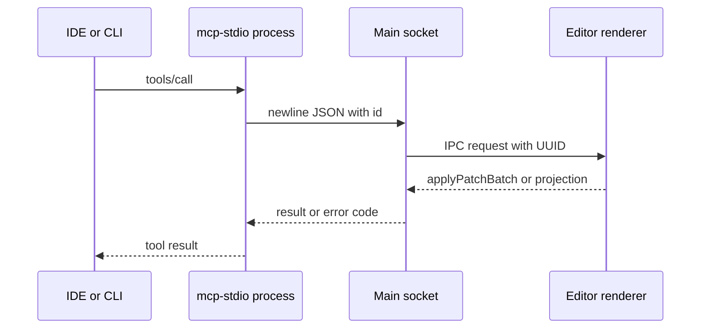

# MCP 外部工具与桌面桥

`@evidence-poc/evidence-mcp` 把三件事分开：stdio 进程只负责协议与工具定义，桌面主进程托管本地 socket 并做路由，渲染进程持有实时 `ModelSession`。因此外部 Agent 的读写都落在内存模型上，而传感器、交付和漂移审计读的是磁盘上已保存的源——没保存的编辑不能算“已通过检查”。

`evidence-mcp` 的依赖只有 `evidence-tools` 与 `evidence-schema`：它不包含建模 Agent 运行时，也不含可视化层。传感器引擎和漂移审计由桌面宿主注入（`createMcpSensorService`、`createDriftService`），两边只在桌面主进程相遇。

## 进程形态与启动顺序

桌面正常启动时按固定顺序拉起桥：

1. 用 `getEvidenceMcpBridgeEndpoint({ platform, userDataPath: app.getPath('userData') })` 算出端点；
2. `synchronizeEvidenceMcpRegistration` 合并外部客户端配置；
3. `startMcpBridgeRuntime` 监听 socket，`getActiveContents` 取 `listEditorWindows()` 返回的第一个窗口；
4. `registerMcpIpc({ runtime })` 接通 renderer 的请求/响应与状态 IPC，`before-quit` 时先 `ipc.dispose()` 再 `runtime.dispose()`。

桥启动失败不是致命错误：`startMcpBridgeRuntime` 的 rejection 被捕获，主进程向 stderr 写 `MCP bridge 未启动：…` 并返回 `null`，随后跳过 `registerMcpIpc`，桌面照常打开 dashboard。

`--mcp-stdio` 走另一条分支：`main.ts` 检测到该参数后，`app.whenReady()` 里只执行 `runEvidenceMcpStdio`，不建窗口、不创建 `createProjectStore`、不写任何客户端配置。端点优先取环境变量 `EVIDENCE_MCP_ENDPOINT`，缺失时用同一 userData 哈希自行推导（所以无窗口进程也能连上已运行的宿主）。启动抛错写 stderr 后 `app.exit(1)`；`runEvidenceMcpStdio` 在 `process.stdin` 结束后关闭 server，客户端退出即进程退出。

## 工具面：14 个工具

`TOOL_NAMES`（`server/toolset.ts`）是唯一清单，`createEvidenceTools` 按它装配 14 个工具；`mcpServer.spec.ts` 用真实 MCP transport 断言 `tools` 长度为 14。

| 归属 | 工具 |
| --- | --- |
| renderer 实时会话 | `get_app_state`、`get_domain_model`、`get_selected_entity`、`apply_model_patch` |
| 主进程传感器 | `get_key_data_audit`、`run_stage_gate` |
| 主进程交付服务 | `get_delivery_topology`、`export_openapi_contract` |
| 主进程漂移服务 | `audit_production_drift` |
| 截图协作 | `get_canvas_screenshot` |
| 领域算子 | `introduce_fulfillment_pair`、`add_breach_compensation`、`roleify_and_invert_dependency`、`isolate_domain_calculator` |

其中 9 个标 `READ_ONLY`（`readOnlyHint: true`、`idempotentHint: true`、`openWorldHint: false`）；其余 5 个是写工具——`apply_model_patch` 加上 4 个领域算子，它们的 name 与注解直接来自 `evidence-tools` 的 `MODEL_TOOL_NAMES` 和 `MODEL_WRITE_ANNOTATIONS`（`readOnlyHint: false`、`destructiveHint: true`、`idempotentHint: false`）。`toolset.spec.ts` 断言“被标为非只读的工具”恰好是这 5 个，`mcpServer.spec.ts` 在协议层复核 `apply_model_patch` 的 `readOnlyHint` 是 false。

每个工具的 `run` 都先解析输入再碰端口（`toolset.ts` 的 `defineTool` 或 `evidence-tools` 的 `define` 各自 `parse`）：畸形或未知字段不会到达任何模型访问。非算子工具使用 `.strict()` 对象，多传一个键就是失败；算子输入复用与 Pi 工具共享的 `FulfillmentPairIntentSchema` 等 schema。`mcpServer.spec.ts` 通过真实 transport 提交非法 operator 参数，验证 `getDomainModel`/`applyModelPatch` 完全没被调用；空 `patches`、非法 `target` 同理在本地被拒绝，不会退化成空执行。

`SERVER_INSTRUCTIONS` 规定使用顺序：先 `get_app_state`，再读选区或模型；优先用领域算子，其余变更走 `{ rationale, patches }`（RFC 6902 操作 + RFC 6901 字符串指针，不是数组路径或 typed command）；批量位置编辑前先 `test` 预期对象 ID 以拒绝过期快照；改完复查 `get_key_data_audit` 与 `run_stage_gate`；阻塞型生产漂移要修后端而不是改模型；禁止直接写 `.evidence/fm`。

`run_scenario_replay` 已从请求联合类型和工具面移除。旧方法抵达 handler 时落入默认分支，抛出 `UNSUPPORTED_METHOD`（消息说明 legacy scenario replay 已移除），不会伪造空成功。验收用例住在实体的 `examples[].test`，导出为 Step CI/Hurl 执行，而不是内存回放。

`createEvidenceMcpServer` 只做协议装配：逐个 `registerTool` 并包一层 try/catch，异常转成 `isError` 的 `CallToolResult`（`content` 里是 `{ error: { message } }`），所以单个工具失败不会断开 MCP 会话；stdio 传输由 `startEvidenceMcpStdioServer` 接上，桌面主进程也可以直接用同一批 handler 在进程内调用。

## 单一事务写通道

4 个领域算子走同一条路径（`evidence-tools` 的 `createModelTools`）：

1. `loadDocument` → `client.getDomainModel({ includeRules: true })`，每次重读实时文档；
2. 在本地用 `createModelPatch(document, mutator)` 跑 guarded mutator，构造失败（引用不存在、结构不合法）时返回 `isError` 文本“算子未执行：…”，**不调用** `applyModelPatch`；
3. 成功则把生成的标准 JSON Patch 交给 `applyModelPatch({ rationale, patches })`，rejection 转成 `isError` 并附错误原因。

renderer 侧的 `useMcpBridge` 用 `ModelPatchRequestSchema.parse(payload)` 复核载荷，然后一次 `session.applyPatchBatch(patches, \`mcp:${rationale}\`)`：整批要么全提交、要么不提交，成功时只形成一个撤销步骤，标注为 `mcp:<rationale>`。随后调用 `session.validate()` 收集诊断，严格 FM 诊断作为 `severity: 'block'` 的 diagnostics 返回；渐进式会话不会因诊断回滚已接受的补丁，所以“写成功”不等于“门禁通过”。

返回体是 `McpPatchResult`：`success`、`appliedCommands`（按 op 名称列表）、`revision`、`undoable`、`diagnostics`。revision 只在文档引用真的变化时加一（`context.revision + Number(before !== session.getDocument())`）；解析或提交抛错时返回 `success: false`、`revision` 保持原值、diagnostics 带 `PATCH_REJECTED` 与消息。桥在每次调用时读当前 session，因此连续调用不需要等 React 重渲染。

写工具**非幂等**（注解 `idempotentHint: false`）：重试可能重复创建履约项。授权、守卫、原子应用和撤销全部由宿主拥有，主进程不做 per-tool 权限判断，renderer 也保留拒绝权——它可以把任何补丁判为失败。

详见[模型会话与命令](../model/commands-and-session.md)和[资料摄取与补丁审查](../desktop/ingestion-and-patch-review.md)。

## 本地传输与信任边界

端点是对 userData 路径做 SHA-1 后取前 12 位：Unix 为 `tmpdir()/evidence-mcp-<digest>.sock`，Windows 为 `\\.\pipe\evidence-mcp-<digest>`。隔离单位是 userData，不是操作系统账号身份。

- Unix 启动前 `rm` 旧 socket（避免上次崩溃留下的残留），`listen` 成功后 `chmod 0600`，`close` 后再删除文件；命名管道跳过这三步。
- 每连接一问一答：换行分隔 JSON，用 `id` 关联，服务器答复后立即 `end()`，客户端收到答复即销毁 socket。没有流式、没有重试，挂死的客户端不能长期占住文件描述符。
- 双向 `MAX_MESSAGE_BYTES = 64 MiB`。超限、JSON 解析失败、缺 `id`、socket 错误都返回结构化失败响应（`oversized`、`invalid-request`、`socket-error` 等合成 id）；客户端校验响应 id，不匹配同样是 `INTERNAL_ERROR`。
- 没有 token、没有 TCP 端口：同一 OS 用户的其他进程仍可连接。端点路径通过客户端配置的 `env.EVIDENCE_MCP_ENDPOINT` 传播，不是秘密。

时序上两端各有一段超时：`--mcp-stdio` 客户端默认 10 秒（`DEFAULT_TIMEOUT_MS`），主进程为每次 renderer 往返分配 UUID 并挂 15 秒定时器。因此无响应通常先在客户端表现为 `RENDERER_UNAVAILABLE`；若主进程更早发现窗口已销毁或超时，它以普通 `Error` 抛出，序列化后客户端看到 `INTERNAL_ERROR`。

一次工具调用的往返：client 每次新建 socket，主进程再经 IPC 找 renderer，答复沿原路返回。

## 主进程路由

`createMcpRequestHandler` 是唯一的交换机：

- `get_app_state`、`get_domain_model`、`get_selected_entity` 原样转发 renderer；
- `apply_model_patch` 只把 `request.patch` 转发（renderer 自己解析 schema）；
- `get_key_data_audit`、`run_stage_gate`、`get_delivery_topology`、`export_openapi_contract`、`audit_production_drift` 先经 `activeRoot(renderer)` 取项目根；
- `get_canvas_screenshot` 走 `get_capture_rect` → `capture` 两段式。

`activeRoot` 复用 `get_app_state`，`activeProject === null` 时抛 `NO_ACTIVE_PROJECT`，所以只读审计不会拿空根去读磁盘。选择窗口的依据是 `listEditorWindows()` 的 Map 插入顺序（第一个仍打开的编辑器窗口），不是当前焦点窗口；截图矩形和模型读取因此来自同一个 `WebContents`，不会出现“截的不是刚读的模型”。

`onCall` 在每个请求进入时触发一次，主进程据此累加 `calls` 并发布状态。

主进程与 renderer 之间只用四个 IPC 通道（`EVIDENCE_MCP_IPC_CHANNELS`，定义在 `libs/desktop/contracts/src/mcpIpc.ts`）：`request`、`response`、`capture-mode`、`status`。方向固定——主进程 `send` 请求、renderer `send` 同 id 的响应；`registerMcpIpc` 只挂 `ipcMain.on(response)` 与 `ipcMain.handle(status)`，preload 暴露成 `window.evidenceAPI.mcp`（`getStatus`、`onStatus`、`onRequest`、`respond`、`onCaptureMode`）。renderer 可回答的方法被收窄成 `McpRendererMethod` 五元组：`get_app_state`、`get_domain_model`、`get_selected_entity`、`apply_model_patch`，加上只提供几何的 `get_capture_rect`；收到未知方法时 `useMcpBridge` 回 `INTERNAL_ERROR`。

## 三个只读后端与截图

- **传感器**（`mcpSensorService.ts`）：按 project root 缓存一个 `createSensorsEngine()` 实例，台账取 `runFullSensors({ modelRoot: modelSourceOf(rootPath) })` 的 `keyData`。读不出来时返回 `producedBy: 'unavailable'`、计数为 0、note 说明不可用，而不是空台账冒充干净模型；门禁同理，`checkStageGate` 抛错时返回 `passed: false`、`exitCode: 1`、`blockingReasons` 带原因。MCP 台账的 `derived` 当前固定为空数组，不能当完整派生明细。
- **交付**（`mcpDeliveryService.ts`）：复用 `readDelivery`（`loadFm` + `buildProjection`），按 `serviceId` 统计路由数，返回服务/链接/`limitations` 以及 OpenAPI 3.1 文档和 `pathCount`。读取或投影失败直接抛成工具错误，不退化成部分契约。
- **漂移**（`mcpDriftService.ts`）：把调用者提供的 OTLP/JSON `document` 交给 `runNativeDriftAudit({ modelRoot, document })`，映射成计数、`findings`（kind、severity、evidenceRef、contextRef、remediation）和 `passed`；读取失败返回 `passed: false` 与 `errors` 中的原因。
- **截图**：renderer 的 `resolveCaptureRect` 用 `getBoundingClientRect` 量画布视口与目标节点，目标可能比窗口大，所以取与可见视口的交集；无布局、无节点在可见区、或节点完全在屏外时返回 `null`，主进程据此抛 `SCREENSHOT_FAILED`（“画布暂无可截取的区域”）。有效截图前后各发一次 capture-mode 消息，`document.body.dataset.evidenceCapture` 切换以隐藏选框与控制条，然后 `capturePage(rect)`，`imageToPng` 编码成 base64 PNG——细线和小字在 JPEG 下会糊掉。

路径解析有个容易踩的差异：三个后端都用 `modelSourceOf`，但入参不同。传感器和漂移拿到的是 `modelSourceOf(rootPath)`，若项目本身是 `*.evidence.json` bundle，传下去的就是 bundle 文件，而原生传感器明确拒绝以 `.evidence.json` 结尾的 root（`loadModelSources` 抛 `ModelSourceError`），于是台账变 unavailable、门禁变失败。交付先 `projectDirectoryOf(rootPath)` 再 `modelSourceOf(...)`，bundle 项目因此落到它旁边的 `.evidence/fm` 目录。不要把“交付和仿真总能读 Bundle”当成保证。

## 状态与客户端注册

`McpStatus`（`libs/desktop/contracts/src/mcpIpc.ts`）是 `{ listening, endpoint, connections, calls, registeredClients, error }`。连接数变化、每次服务调用、以及请求失败时都会重新发布：主进程遍历 `BrowserWindow.getAllWindows()` 推给所有存活窗口，同时 `ipcMain.handle(status)` 支持拉取——后开的窗口否则会一直显示“未启动”。`error` 保存最后一次失败消息，供状态面解释“桥在但不可用”。

`connections` 只在短连接调用进行期间非零（连接建立加一、`close` 减一），所以它衡量“此刻有没有客户端在调用”，不是历史累计；`calls` 才是累计调用数。`registeredClients` 只含配置写回成功的客户端名（`registration.updated`），跳过的、失败的都不出现。

`McpStatusPill`（`TopHeader` 中渲染）把状态折成三种文案：`null` 或 `!listening` 为“MCP 未启动”，`connections > 0` 为“MCP 已连接（Cursor / Claude Desktop）”，否则“MCP 待命”；tooltip 显示 `本地桥接：<endpoint>` 与 `已服务调用：<calls>`。注意 `get_app_state` 里的 `mcp: { connections: 1, calls: 0 }` 是 renderer 写死的占位值，不是实时计数——实时数字只能从 `McpStatus` 读。

注册逻辑（`mcpRegistration.ts`）只碰已经存在的客户端目录：Cursor 的 `~/.cursor/mcp.json` 恒在候选内，Claude Desktop 仅在 macOS（`~/Library/Application Support/Claude/claude_desktop_config.json`）和 Windows（`%APPDATA%\Claude\...`）加入，Linux 不做猜测。写入是把 `evidence-desktop` 这一项合并进 `mcpServers`，其余键和服务器原样保留，因此重复运行幂等；已安装但 JSON 损坏时该客户端只进入 `failed`，配置不被覆盖。条目内容是 `{ command: process.execPath, args: ['--mcp-stdio'], env: { EVIDENCE_MCP_ENDPOINT: endpoint } }`。

## 失败语义

| 情况 | 对外行为 |
| --- | --- |
| 桌面未运行 | 连接失败即得 `APP_NOT_RUNNING`；只有 `get_app_state` 降级为 `{ isRunning: false }` |
| 桌面在运行但无编辑器窗口 | renderer 通道立即拒绝，错误消息经 `INTERNAL_ERROR` 返回，不降级成离线 |
| 无活动项目 | `NO_ACTIVE_PROJECT`（中文消息提示先打开 `.evidence/fm` 项目） |
| 无选区 | `NO_SELECTION` |
| 补丁被守卫拒绝 | `success: false` + `PATCH_REJECTED` 诊断，revision 不变 |
| 画布不可截取 | `SCREENSHOT_FAILED` |
| 遗留 replay 方法 | `UNSUPPORTED_METHOD` |
| 桥启动失败 | stderr 记录 `MCP bridge 未启动`，桌面继续运行但没有 MCP |
| 模型/门禁不可读 | 显式 `unavailable` / `passed: false`；漂移在 `errors` 中说明 |

`EvidenceMcpErrorCode` 枚举了稳定错误码（含 `NODE_NOT_FOUND`、`RENDERER_UNAVAILABLE`、`INTERNAL_ERROR`）；`McpRequestError` 让主进程服务用同一套字符串 code 抛错，不属于枚举的 code（如 `UNSUPPORTED_METHOD`）照样能透传到客户端。

## 验证入口

- `bridge/bridge.spec.ts`（库）：端点推导与 per-user 差异、真实 socket 往返、Unix socket `0600`、关闭后端点可复用、离线 `isRunning: false` 与其余方法的 `APP_NOT_RUNNING`、handler 错误码透传、超时→`RENDERER_UNAVAILABLE`。
- `server/toolset.spec.ts` + `mcpServer.spec.ts`：输入先验拒绝（含真实 transport 的畸形算子参数）、14 工具与 5 个写工具的注解、算子“先读后写/拒绝即不写”、PNG 文本+图像双载荷、门禁 target 透传、漂移 document 原样转发、工具异常转错误结果。
- `main/mcpBridgeRuntime.spec.ts`：renderer 往返与状态计数、renderer 错误转 rejection、截图前后 capture-mode 恢复、无编辑器窗口时拒绝模型调用。
- `main/mcpRequestHandler.spec.ts`：转发保真、active root 用于台账、`NO_ACTIVE_PROJECT`、按 renderer 量出的矩形截图、空画布、移除 replay 后的 `UNSUPPORTED_METHOD`、调用计数。
- `main/mcpSensorService.spec.ts`、`mcpDeliveryService.spec.ts`、`mcpDriftService.spec.ts`、`mcpRegistration.spec.ts`：引擎按 root 复用与不可用投影、路由计数与 OpenAPI 投影、真实 fixture 上的漂移审计、配置合并与跳过/失败分支。
- renderer 侧 `useMcpBridge.spec.tsx`、`mcpCapture.spec.ts`、`McpStatusPill.spec.tsx`：状态投影与 revision、上下文过滤、选区与履约对、补丁经 session 提交后可撤销、矩形裁剪、三种状态文案。

## 相关页面

- [Pi 建模 Agent 与受控工具](./pi-harness.md)
- [原生传感器与治理闭环](./sensor-orchestration.md)
- [模型会话与命令](../model/commands-and-session.md)
- [资料摄取与补丁审查](../desktop/ingestion-and-patch-review.md)
- [renderer 状态](../desktop/renderer-state.md)
- [交付路由与漂移](../contracts/delivery-routes-and-diff.md)
- [API 投影](../contracts/api-projection.md)
