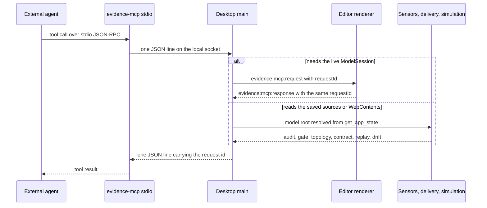

# External agents over MCP

The desktop app models one project at a time, and `libs/evidence-mcp` exposes that
open model to agents that live outside the app — Cursor, Claude Desktop, a terminal
Pi session. The integration is deliberately split in two: a **tool surface** that
knows what an agent may ask, and a **transport** that never touches the model
itself. Every mutation ultimately runs inside the window that already holds the
`ModelSession`, so an external edit lands in the same undo history as a modeler's
keystroke.

## Topology

```text
external agent ──stdio JSON-RPC──> evidence-mcp stdio server (same binary, --mcp-stdio)
                                          │
                                          │ newline JSON over a local socket
                                          ▼
                                  desktop main process
                                          │  Electron IPC (correlated request/response)
                                          ▼
                                  editor renderer: ModelSession
```

Two facts make the picture concrete:

- The packaged executable is both the app and the MCP server. `main.ts` checks
  `process.argv` for `--mcp-stdio` before `app.whenReady()` does anything else; in
  that mode it opens no window, reads no project store and synchronizes no client
  configuration. It only resolves an endpoint and runs the stdio server
  (`repo://apps/desktop/src/main/main.ts#L40-L58`,
  `repo://apps/desktop/src/main/main.ts#L145-L146`).
- The stdio side is intentionally thin. `runEvidenceMcpStdio` starts an
  `McpServer` over `StdioServerTransport` with a `createEvidenceMcpBridgeClient`
  as its `EvidenceMcpAppClient`, and returns when stdin ends
  (`repo://libs/evidence-mcp/src/cli.ts#L13-L28`,
  `repo://libs/evidence-mcp/src/server/mcpServer.ts#L80-L92`).

## Tool surface

`createEvidenceTools` returns the whole surface as plain objects, so it can be
tested without a transport; `createEvidenceMcpServer` is the only place the MCP
SDK is bound to it, registering each tool and wrapping thrown failures into an
error result (`repo://libs/evidence-mcp/src/server/toolset.ts#L136-L144`,
`repo://libs/evidence-mcp/src/server/mcpServer.ts#L47-L77`).

`TOOL_NAMES` is the authoritative list and holds fourteen entries
(`repo://libs/evidence-mcp/src/server/toolset.ts#L45-L60`):

| Tool | Class | What it answers |
| --- | --- | --- |
| `get_app_state` | read | active project, revision, selection, sensor summary, bridge counters |
| `get_domain_model` | read | full `DomainModelDocument`, optionally filtered by context and rules |
| `get_selected_entity` | read | selected object, its context, relations, derivation rules, fulfillment pair |
| `get_key_data_audit` | read | key-data ledger and its `needsDecision` list |
| `get_canvas_screenshot` | read | PNG of the canvas or one node, without editor chrome |
| `run_stage_gate` | read | gate verdict for `api` or `visualization` |
| `get_delivery_topology` | read | services, boundary links and limitations projected from the saved model |
| `export_openapi_contract` | read | the OpenAPI 3.1 document the saved model implies, plus a path count |
| `run_scenario_replay` | read | the model's own scenarios, step by step, or their summaries |
| `audit_production_drift` | read | one exported OTLP/JSON trace compared with the saved model |
| `apply_model_patch` | write | a `ModelCommand[]` batch, one undo step |
| `introduce_fulfillment_pair` | write (operator) | request + confirmation + optional proof |
| `add_breach_compensation` | write (operator) | breach condition + compensating pair |
| `roleify_and_invert_dependency` | write (operator) | capability role + supporting contract context |

The read/write split is not descriptive prose: two annotation constants mark every
tool, and only the four write tools carry `readOnlyHint: false`,
`destructiveHint: true` and `idempotentHint: false`; every tool declares
`openWorldHint: false` because the only source of truth is the local model
(`repo://libs/evidence-mcp/src/server/toolset.ts#L12-L24`,
`repo://libs/evidence-mcp/src/server/toolset.ts#L45-L56`). Both the in-process
spec and an SDK client connected over an in-memory transport assert that count and
that `apply_model_patch` is the annotated writer
(`repo://libs/evidence-mcp/src/server/toolset.spec.ts#L191-L237`,
`repo://libs/evidence-mcp/src/server/mcpServer.spec.ts#L112-L136`).

Documentation lags the code here: the doc comment above `createEvidenceTools`
still says "The seven tools the desktop exposes to external agents", and the
package README still tables seven rows, because the three operators and then the
four delivery/simulation reads were added later
(`repo://libs/evidence-mcp/src/server/toolset.ts#L129-L135`,
`repo://libs/evidence-mcp/README.md#L18-L28`).

### The instruction block is part of the handshake

`SERVER_INSTRUCTIONS` is passed to the `McpServer` constructor as `instructions`,
so a client receives the intended call order as soon as it connects, before it
lists a single tool (`repo://libs/evidence-mcp/src/server/mcpServer.ts#L47-L55`,
`repo://libs/evidence-mcp/src/server/toolset.ts#L449-L450`). It states the order
directly:

1. `get_app_state` first, then `get_selected_entity` or `get_domain_model` before
   proposing changes.
2. Prefer the operators over hand-written commands — `introduce_fulfillment_pair`
   for a request plus the confirmation that closes it, `add_breach_compensation`
   for a missed deadline, `roleify_and_invert_dependency` when a capability moves
   behind its own contract.
3. Anything else goes through `apply_model_patch`, and `.evidence/fm` files are
   never written directly.
4. After a patch, check `get_key_data_audit` and `run_stage_gate` before claiming
   the work is done.
5. For "what does the model become", read `get_delivery_topology` and
   `export_openapi_contract` instead of inventing a service split; for "does it
   still hold", run `run_scenario_replay`; for "does production match it", run
   `audit_production_drift` — and treat a blocking drift as a service-side defect,
   not a reason to edit the model.

## The only write path

`apply_model_patch` is the sole tool that mutates the model. The three operators
are not a second write path: each one reads the current document with
`getDomainModel({ includeRules: true })`, builds an `OperatorPatch` locally, then
submits `patch.commands` through the same `applyModelPatch` call
(`repo://libs/evidence-mcp/src/server/toolset.ts#L96-L124`). Because the builders
throw on a dangling reference, an operator refusal is returned as an error result
and no patch is sent at all — the toolset spec asserts both halves of that
behaviour (`repo://libs/evidence-mcp/src/server/toolset.spec.ts#L324-L357`,
`repo://libs/evidence-mcp/src/server/toolset.spec.ts#L359-L388`).

This is what keeps external agents inside the framework's non-negotiable rules:
they cannot bypass the command guards, because the commands are decoded and
dispatched by the same `ModelSession` the UI uses.

## Request routing inside the desktop

The main process answers one `EvidenceMcpAppRequest` with a deliberate split
between calls that need the live session and calls that read the saved sources
(`repo://apps/desktop/src/main/mcpRequestHandler.ts#L88-L120`):

| Method | Handled by | Why |
| --- | --- | --- |
| `get_app_state`, `get_domain_model`, `get_selected_entity` | renderer | they read the live `ModelSession` and its graph |
| `apply_model_patch` | renderer | it must dispatch on the live session to be undoable |
| `get_capture_rect` | renderer | only the renderer knows the current layout geometry |
| `get_key_data_audit`, `run_stage_gate` | main process, sensors service | they are the same in-process sensors the app runs |
| `get_delivery_topology`, `export_openapi_contract` | main process, delivery service | they project the saved sources like the delivery hub |
| `run_scenario_replay`, `audit_production_drift` | main process, simulation service | they replay and audit the saved sources |
| `get_canvas_screenshot` | main process | `capturePage` belongs to `WebContents`, after a renderer-measured rect |

Every main-process read still starts with one renderer round trip: `activeRoot`
calls `get_app_state` to learn the active project root, and throws
`NO_ACTIVE_PROJECT` when nothing is open, so sensors, delivery and simulation are
refused before they touch the filesystem
(`repo://apps/desktop/src/main/mcpRequestHandler.ts#L58-L72`).



One tool call, showing where the two routing classes diverge.

## Reads that come from the saved model

The four newest reads answer two different questions and share a discipline: they
read what is on disk, not the unsaved canvas, so an agent reasons about the model
that would be handed off.

- **Delivery.** `createMcpDeliveryService` builds a `DeliveryBundle` through the
  very `readDelivery` the delivery hub IPC uses, which loads the FM sources,
  runs the projection and throws on load or projection errors; the MCP side then
  reduces it to a topology (per-service `routeCount`, links with their `mode`, and
  `limitations`) or to the OpenAPI document with a `pathCount`
  (`repo://apps/desktop/src/main/mcpDeliveryService.ts#L25-L75`,
  `repo://apps/desktop/src/main/deliveryProjection.ts#L101-L113`). Returning
  `limitations` is the point: an agent sees which capabilities are not yet closed,
  and neither tool writes a contract into the user's repository.
- **Simulation.** `createSimulationService` loads the sources and calls
  `replayValidationSuite` from model-core, so `run_scenario_replay` returns
  summaries for every scenario but per-frame detail only for the scenario that was
  named; source issues, suite errors and a "no scenarios to replay" note are
  folded into `errors`, and `passed` requires both the suite verdict and an empty
  error list (`repo://apps/desktop/src/main/mcpSimulationService.ts#L103-L152`).
  `audit_production_drift` hands the caller's OTLP/JSON document to
  `runNativeDriftAudit` and maps each finding to a severity, remediation and
  evidence reference (`repo://apps/desktop/src/main/mcpSimulationService.ts#L62-L77`).

Both services degrade instead of throwing: an unreadable model directory produces
`passed: false` with the read error in `errors`, which the specs pin as expected
behaviour rather than a crash (`repo://apps/desktop/src/main/mcpSimulationService.ts#L79-L101`,
`repo://apps/desktop/src/main/mcpSimulationService.spec.ts#L122-L136`).

## Transport and local trust boundary

The endpoint is derived, not configured:

- `getEvidenceMcpBridgeEndpoint` hashes the Electron `userData` path, keeps 12
  hex characters and builds `evidence-mcp-<digest>.sock` under the OS temp
  directory, or `\\.\pipe\evidence-mcp-<digest>` on Windows. Two user profiles or
  two checkouts therefore never share a socket
  (`repo://libs/evidence-mcp/src/bridge/endpoint.ts#L13-L33`).
- On Unix the server unlinks a stale path before listening, then `chmodSync`s the
  socket to `0600` after `listen` succeeds, and removes it on close. Named pipes
  are exempt because there is no file to remove
  (`repo://libs/evidence-mcp/src/bridge/server.ts#L59-L63`,
  `repo://libs/evidence-mcp/src/bridge/server.ts#L145-L176`).
- The protocol is one newline-delimited JSON request and one response per
  connection, correlated by a caller-supplied `id`. A JSON parse failure, a missing
  id, an oversized buffer or a socket error all end the connection with a
  structured error (`repo://libs/evidence-mcp/src/bridge/server.ts#L78-L142`).

Message size and latency are bounded on both sides: `MAX_MESSAGE_BYTES` is 64 MiB
(`repo://libs/evidence-mcp/src/bridge/client.ts#L13-L14`), the stdio client times
out after 10 s, and the desktop runtime times out a renderer round trip after 15 s
(`repo://libs/evidence-mcp/src/bridge/client.ts#L158-L187`,
`repo://apps/desktop/src/main/mcpBridgeRuntime.ts#L46-L60`).

The security model is filesystem permission, not authentication: there is no
token in the protocol and no network port is opened. Any process running as the
same OS user can connect to the socket — the guarantee is isolation between local
users and profiles, not between programs of one user.

## Patch semantics in the renderer

The renderer's answer to `apply_model_patch` is where the undo guarantee lives:

1. Decode the wire commands with `decodeModelPatch`.
2. Call `session.dispatchAll(decoded, 'mcp-patch')` once, so a multi-command patch
   is one history entry.
3. Run `session.validate()` and return the issues as `severity: 'block'`
   diagnostics, together with `revision`, `appliedCommands` and `undoable`.

If decoding or a command guard throws, the result is `success: false`, no commands
are recorded, and the error code from the guard is surfaced as the diagnostic code
(`repo://apps/desktop/src/renderer/state/useMcpBridge.ts#L296-L346`).

Two consequences deserve to be stated plainly, because the library README
overstates one of them:

- Guards run *during* dispatch. A red-line violation that a command guard enforces
  rejects the whole batch atomically — the README's "破坏红线即整体拒绝" behaviour
  refers to this (`repo://libs/evidence-mcp/README.md#L30-L34`).
- `session.validate()` runs *after* dispatch and its findings are reported, not
  used to roll back. A patch that guards accept but strict FM validation dislikes
  stays applied and returns blocking diagnostics. The modeler, not the bridge,
  decides whether to undo it.

Renderer-bound calls are correlated twice. The bridge runtime creates a UUID per
call, stores `{resolve, reject, timer}` in a `pending` map and sends
`evidence:mcp:request`; the renderer answers with the same `requestId`, and a
timeout rejects the call so a closed editor window cannot hang an agent
(`repo://apps/desktop/src/main/mcpBridgeRuntime.ts#L90-L110`,
`repo://apps/desktop/src/main/mcpBridgeRuntime.ts#L136-L145`,
`repo://apps/desktop/src/shared/mcpIpc.ts#L1-L38`). The IPC registrar accepts
responses and serves the status call; status is both pushed and pullable so a
window opened later does not show "not running" until some other event fires
(`repo://apps/desktop/src/main/mcpIpcHandlers.ts#L8-L40`).

Screenshots travel through a dedicated path: the renderer computes a capture
rectangle (whole viewport or one `data-node-id` node), the main process sends
`capture-mode` to hide selection rings and zoom controls, calls
`contents.capturePage(rect)`, and encodes PNG rather than JPEG because thin diagram
lines and small text would blur (`repo://apps/desktop/src/renderer/state/useMcpBridge.ts#L157-L185`,
`repo://apps/desktop/src/main/mcpBridgeRuntime.ts#L112-L134`,
`repo://apps/desktop/src/main/mcpCapture.ts#L3-L19`).

One projection detail matters to anyone consuming `get_app_state`: the renderer
fills its `mcp` block with placeholder counters (`connections: 1, calls: 0`), so
that field is informational only. The real connection and call counts live in the
`McpStatus` the main process publishes
(`repo://apps/desktop/src/renderer/state/useMcpBridge.ts#L51-L71`,
`repo://apps/desktop/src/shared/mcpIpc.ts#L38-L50`).

## Client registration and headless mode

On startup the main process derives the endpoint, synchronizes client configs, and
then starts the bridge with the clients it actually updated
(`repo://apps/desktop/src/main/main.ts#L83-L119`). Registration is conservative:

- It targets `~/.cursor/mcp.json` always, plus Claude Desktop's
  `claude_desktop_config.json` on macOS and Windows; Linux has no known Claude path
  and is skipped (`repo://apps/desktop/src/main/mcpRegistration.ts#L21-L48`).
- A client is touched only if its config *directory* already exists, so the app
  never creates a `.cursor` folder for someone who does not use Cursor
  (`repo://apps/desktop/src/main/mcpRegistration.ts#L134-L142`).
- The written entry is the same executable with `--mcp-stdio` and
  `EVIDENCE_MCP_ENDPOINT` in the environment
  (`repo://apps/desktop/src/main/mcpRegistration.ts#L95-L105`).
- The merge spreads the existing config and existing `mcpServers`, replacing only
  the `evidence-desktop` key, so other servers and settings survive
  (`repo://apps/desktop/src/main/mcpRegistration.ts#L144-L162`).

`--mcp-stdio` then runs the mirror image of that config: it prefers
`EVIDENCE_MCP_ENDPOINT` and only re-derives the endpoint from `userData` when the
variable is absent, which is why a hand-written config can point at a running app
without copying the digest (`repo://apps/desktop/src/main/main.ts#L40-L45`). The
header's `McpStatusPill` distinguishes three states — not started, standby, and
connected with the registered client names — and shows the socket path and served
call count in its tooltip
(`repo://apps/desktop/src/renderer/components/McpStatusPill.tsx#L5-L17`,
`repo://apps/desktop/src/renderer/components/McpStatusPill.tsx#L27-L68`).

## Failure behaviour

The bridge is written so that "no answer" is never mistaken for "empty model":

| Situation | Result |
| --- | --- |
| desktop app not running | `get_app_state` returns `isRunning: false` and an empty project; every other method throws `APP_NOT_RUNNING` (`repo://libs/evidence-mcp/src/bridge/client.ts#L152-L187`) |
| no editor window | the runtime rejects before sending any IPC, so the agent gets a tool error carrying the "no model window" message; a plain error is normalized as `INTERNAL_ERROR` when it crosses the socket (`repo://apps/desktop/src/main/mcpBridgeRuntime.ts#L79-L99`, `repo://libs/evidence-mcp/src/bridge/server.ts#L27-L43`) |
| no project open | sensors, delivery and simulation throw `NO_ACTIVE_PROJECT` before reading anything (`repo://apps/desktop/src/main/mcpRequestHandler.ts#L58-L72`) |
| renderer stops answering | the 10 s stdio-client timeout fires first and reports `RENDERER_UNAVAILABLE`; the desktop's 15 s timeout is the backstop (`repo://apps/desktop/src/main/mcpBridgeRuntime.ts#L46-L60`, `repo://libs/evidence-mcp/src/bridge/client.ts#L13-L14`) |
| no selection | `get_selected_entity` answers `NO_SELECTION` rather than a null object (`repo://apps/desktop/src/renderer/state/useMcpBridge.ts#L217-L252`) |
| model unreadable | ledger reports `producedBy: 'unavailable'`, gate reports `passed: false` with exit code 1, replay and drift report `passed: false` with the read error in `errors` (`repo://apps/desktop/src/main/mcpSensorService.ts#L21-L33`, `repo://apps/desktop/src/main/mcpSensorService.ts#L73-L105`, `repo://apps/desktop/src/main/mcpSimulationService.ts#L79-L101`) |
| canvas has no capturable region | `SCREENSHOT_FAILED` instead of an empty image (`repo://apps/desktop/src/main/mcpRequestHandler.ts#L129-L157`) |
| bridge cannot start | main writes the failure to stderr, returns `null`, and the app continues without MCP (`repo://apps/desktop/src/main/main.ts#L113-L119`) |

## Tests that protect this contract

- `libs/evidence-mcp/src/bridge/bridge.spec.ts` round-trips a request over a real
  Unix socket, asserts the socket mode is `0o600`, checks that an unanswered call
  times out with `RENDERER_UNAVAILABLE`, and proves the endpoint can be reused
  after `close` (`repo://libs/evidence-mcp/src/bridge/bridge.spec.ts#L78-L113`,
  `repo://libs/evidence-mcp/src/bridge/bridge.spec.ts#L220-L240`). Its
  "forwards every method" spec still enumerates six methods, so a newly added
  client method is not covered there (`repo://libs/evidence-mcp/src/bridge/bridge.spec.ts#L180-L218`).
- `libs/evidence-mcp/src/server/toolset.spec.ts` uses a fake `EvidenceMcpAppClient`
  to assert the fourteen tool names, that only writers are marked destructive, that
  the screenshot comes back as text metadata plus a PNG attachment, and that
  operators submit their generated commands through `applyModelPatch`
  (`repo://libs/evidence-mcp/src/server/toolset.spec.ts#L191-L237`,
  `repo://libs/evidence-mcp/src/server/toolset.spec.ts#L324-L357`).
  `mcpServer.spec.ts` repeats the count through a real SDK client and checks that a
  failing desktop call becomes a tool error (`repo://libs/evidence-mcp/src/server/mcpServer.spec.ts#L112-L160`).
- `apps/desktop/src/main/mcpRequestHandler.spec.ts` pins the routing split: renderer
  calls are forwarded verbatim, sensors run against the active project root, sensor
  work is refused when no project is open, the rendered rect is what gets captured,
  and the replay and drift calls reach the simulation service
  (`repo://apps/desktop/src/main/mcpRequestHandler.spec.ts#L111-L198`,
  `repo://apps/desktop/src/main/mcpRequestHandler.spec.ts#L233-L265`).
- `mcpSensorService.spec.ts` pins `producedBy: 'unavailable'` for an unreadable
  model, the `passed/exitCode` mapping, and one engine per project root
  (`repo://apps/desktop/src/main/mcpSensorService.spec.ts#L49-L60`,
  `repo://apps/desktop/src/main/mcpSensorService.spec.ts#L62-L106`);
  `mcpDeliveryService.spec.ts` feeds a fake bundle and checks route counting and the
  limitation list (`repo://apps/desktop/src/main/mcpDeliveryService.spec.ts#L112-L131`);
  `mcpSimulationService.spec.ts` mounts a golden model as `<root>/.evidence/fm` and
  exercises replay frames, an unknown scenario and a missing model directory
  (`repo://apps/desktop/src/main/mcpSimulationService.spec.ts#L70-L136`).
- `apps/desktop/src/main/mcpRegistration.spec.ts` asserts the per-platform client
  list, the server entry shape, and that merging preserves unrelated servers
  (`repo://apps/desktop/src/main/mcpRegistration.spec.ts#L15-L100`).

## Related pages

- [The Pi agent harness and its tools](./pi-harness.md) — the in-app agent that uses
  the same operators and sensors without a socket.
- [Sensors, stage gate and the dependency frontier](./sensor-orchestration.md) — what
  `get_key_data_audit` and `run_stage_gate` actually evaluate.
- [API projection and the delivery hand-off](../contracts/api-projection.md) — the
  projection behind `get_delivery_topology` and `export_openapi_contract`.
- [Checks and simulation](../model/checks-and-simulation.md) — the replay and drift
  audit that the simulation service wraps.
- [Desktop app shell and IPC surface](../desktop/app-shell.md) — window ownership,
  preload bridge and startup order.
- [Commands, guards and the model session](../model/commands-and-session.md) — the
  transition layer that `apply_model_patch` reaches.
