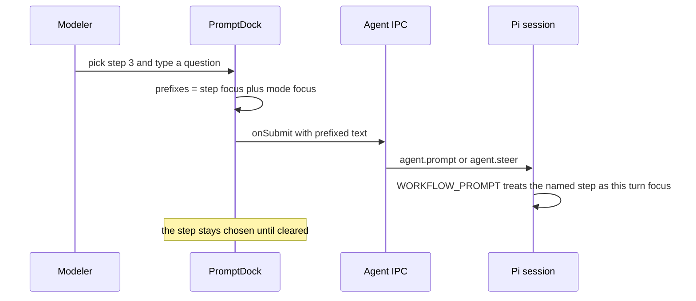

# The modeling method as code

The method a modeling session follows is not a document anyone maintains by hand.
It lives in two places that must stay in step:

| Layer | Artifact | Owns |
| --- | --- | --- |
| vocabulary | `WORKSHOP_STEPS`, `REVERSE_CONTRACT_MODE` in `libs/evidence-schema/src/ast/workshop.ts` | the canonical step ids, labels, hints and the prefix strings |
| instructions | `ROLE_PROMPT`, `MODELING_PROMPT`, `OPERATOR_PROMPT`, `WORKFLOW_PROMPT`, `GOVERNANCE_PROMPT` in `libs/evidence-agent-core/src/prompts/` | what the agent is told about being in the room, what a finished model must look like, which operator answers which intent, and how a turn runs |

The desktop composer is the seam between them: it prints the steps as chips and
turns the chosen one into a line of text prefixed to the next message
(`repo://apps/desktop/src/renderer/components/agent/PromptDock.tsx#L38-L49`).
Nothing anywhere — not the model files, not the session, not Pi — stores "the
current step" (`repo://libs/evidence-schema/src/ast/workshop.ts#L1-L15`).

## Seven steps, one order

`WORKSHOP_STEPS` is a `as const` tuple of seven `{id, label, hint}` records
(`repo://libs/evidence-schema/src/ast/workshop.ts#L16-L52`). The order is
deliberate and documented at the declaration: a contract before its obligations,
obligations before the things they trade in, things before the computations over
them, and the happy path before its failures. Key data comes after the breach
path because most amounts only become decidable once the compensation route is
known.

| Rank | `id` | Label | A turn on this step establishes |
| --- | --- | --- | --- |
| 1 | `anchor-contract` | 锚定合约与双方 | which single agreement binds the two sides, and who each side is |
| 2 | `pair-fulfillment` | 成对挖掘履约项 | each claim as a request (a period) answered by a confirmation (a moment) |
| 3 | `name-things` | 补上标的物与领域组件 | the traded objects belong to the domain; pricing and judgment become calculators or checkers |
| 4 | `invert-dependency` | 反转易变依赖 | a substitutable capability becomes a role plus a supporting contract context |
| 5 | `close-breach` | 给违约一条补偿路径 | timeout, non-supply and refusal each trigger a new fulfillment pair |
| 6 | `trace-key-data` | 让每个数字有来源 | every amount, deadline, quantity and time difference names its provider |
| 7 | `connect-flow` | 串起业务宏流程 | channel, root contract and addenda are joined into one business spine |

The rest of the module is the small API the surfaces share
(`repo://libs/evidence-schema/src/ast/workshop.ts#L54-L83`):

- `WORKSHOP_STEP_IDS` is derived from the tuple, and `isWorkshopStepId` guards an
  unknown string;
- `workshopStepRank(id)` returns the one-based position, so the interface can
  print "第 3 步";
- `workshopStepFocus(id)` renders `【第 N 步 · label】`, and returns an empty
  string for an id the vocabulary does not know — a stale id yields no prefix
  rather than a malformed one.

The rank, the exact prefix string and the rejection of unknown ids are pinned by
`workshop.spec.ts` (`repo://libs/evidence-schema/src/ast/workshop.spec.ts#L13-L39`).

## No step state: the prefix protocol

`PromptDock` holds three pieces of local state: the draft text, the selected
`WorkshopStepId | null`, and a `reverse` boolean
(`repo://apps/desktop/src/renderer/components/agent/PromptDock.tsx#L60-L66`).
On send it builds prefixes from those two selections, drops the empty ones, and
puts them on their own lines ahead of the message
(`repo://apps/desktop/src/renderer/components/agent/PromptDock.tsx#L101-L117`):

```text
【第 3 步 · 补上标的物与领域组件】
会员等级怎么算出来的？
```

With both a step and the reverse mode chosen, the message carries two prefix
lines; with neither, `onSubmit` receives the trimmed text unchanged. The prefix
format is exactly the string `workshopStepFocus` produced, and the test asserts
it verbatim for the third step
(`repo://apps/desktop/src/renderer/components/agent/PromptDock.spec.tsx#L222-L242`).



The diagram shows the whole channel for a step: there is no side-channel.

The step survives turns because the chip stays pressed, not because the session
remembers anything: clicking the chip again, or the `×` button labelled 清除当前步骤,
clears it and the next message goes out bare
(`repo://apps/desktop/src/renderer/components/agent/PromptDock.tsx#L124-L165`,
`repo://apps/desktop/src/renderer/components/agent/PromptDock.spec.tsx#L243-L272`).
Because the selection is component state, remounting the dock — switching project
or screen — loses it; the transcript still shows which step earlier turns named.

The submitted text is forwarded by `useAgentSession.submit` as the `text` of
`agent.prompt` when idle and `agent.steer` while a run streams, so a step can also
steer a live turn rather than only open a new one
(`repo://apps/desktop/src/renderer/state/useAgentSession.ts#L117-L160`). What
makes this work on the agent side is instruction, not machinery: `WORKFLOW_PROMPT`
says a turn advances exactly one of the seven steps, that a step the user names
becomes the focus of that turn, and that otherwise the agent continues from the
frontmost gap in the current model
(`repo://libs/evidence-agent-core/src/prompts/workflow.ts#L13-L23`). `ROLE_PROMPT`
adds the authority boundary in the same words: when the user says "按第 N 步来",
treat that step as this turn's focus and leave the others as they are
(`repo://libs/evidence-agent-core/src/prompts/role.ts#L38-L44`). A named step is a
focus, never a permission.

## Opening from production: the reverse mode

Some businesses have no agreement to read — only receipts, approvals and the
argument that happens when something arrives late. `REVERSE_CONTRACT_MODE` names
that situation once, so the modeler does not have to re-explain it every turn
(`repo://libs/evidence-schema/src/ast/workshop.ts#L85-L100`):

| Field | Value |
| --- | --- |
| `id` | `reverse-contract` |
| `label` | 无合同逆推 |
| `hint` | 手头没有合约：从必须留存的凭证与违约追责反向推导合约与履约边界 |
| `focus` | 【无合同逆推 · 从凭证与追责推导合约】 |

It is an opening mode with its own toggle (the second chip group, labelled 访谈方式),
not a replacement for the seven steps: the seven moves still run, they just read
their material in the opposite order
(`repo://apps/desktop/src/renderer/components/agent/PromptDock.tsx#L165-L199`).
`WORKFLOW_PROMPT` carries the three questions
under 没有合约时：从凭证逆推 (`repo://libs/evidence-agent-core/src/prompts/workflow.ts#L64-L72`):

1. **Which receipts must be kept and traceable?** Documents, acknowledgements and
   confirmations whose loss makes the business unable to say who did what to whom.
   Anything that splits into a period (application, declaration) and a moment
   (confirmation, signature) is already a fulfillment pair.
2. **Whose obligation does each receipt claim?** Who issues it, who signs for it,
   who reconciles it. The issuer is the obligor, the claimant the right holder. A
   demand that cannot name its receipt is registered as a gap, not modelled.
3. **On what do you pursue a claim when it fails?** For a timeout, a refusal or a
   non-supply: who does the harmed side pursue, on the strength of which
   agreement. The bilateral consent those answers converge on is the root
   contract; the quotations before it belong to the pre-contract context.

Only after all three does the turn write: root contract, the two roles, the first
pair, then the normal `run_sensors` pass — and the rationale must say which of the
three answers and which receipts the derivation rests on, not claim a text it never
read. The prompts spec asserts the section and two of its three questions stay
present (`repo://libs/evidence-agent-core/src/prompts/prompts.spec.ts#L80-L89`),
and the mode's label, hint and focus are pinned in the language spec
(`repo://libs/evidence-schema/src/ast/workshop.spec.ts#L41-L47`).

## The prompt sections a session reads

`EVIDENCE_INSTRUCTIONS` is an ordered array — role, modeling red lines, operator
selection, workflow — and `EVIDENCE_SYSTEM_PROMPT` is the same four sections joined
with a blank line (`repo://libs/evidence-agent-core/src/prompts/index.ts#L13-L35`).
The order matters: the red lines are read after the role that gives them a tone,
and the loop is read after the tools it references.

| Section | File | What it fixes |
| --- | --- | --- |
| role | `role.ts` | a workshop facilitator, not an interrogator; authority and boundaries |
| red lines | `modeling.ts` | what a finished model may not contain |
| operators | `operators.ts` | read before write; which operator answers which intent |
| workflow | `workflow.ts` | one step per turn, question grouping, writing, validation, stage handoff |
| governance | `governance.ts` | the alternative loop for a turn that starts from a production trace |

The role section states the three-way division of labour (business facts belong to
the business, the model and expressions to the agent, display to the interface, the
checks to the sensors), requires rough drafts to be allowed, forbids inventing
defaults, forbids writing files directly (all writes go through
`apply_model_patch` and the operators), forbids maintaining a separate glossary
because Entities are the ubiquitous language, and defines the stop conditions —
unanswered questions are not agreement, and the next stage is only suggested after
checks pass and the modeler explicitly closes
(`repo://libs/evidence-agent-core/src/prompts/role.ts#L14-L44`).

The red lines are six non-negotiables plus a ledger and a semantic review
(`repo://libs/evidence-agent-core/src/prompts/modeling.ts#L9-L38`): key data must
have a provider (contract parameter, upstream evidence attribute, domain attribute
or a recorded result fact — no fourth kind); a value computable from modeled input
must be a derivation rule, not an instance value or free parameter; stair prices,
discounts, levels, validity and eligibility move into a domain calculator or
checker; derivations read modeled attributes only; a fulfillment request references
its root contract directly, one request and one result end per pair, and a
single-ended document leaves a gap instead of an empty fulfillment; evidence,
responsible role and owning context are saved together. The semantic review then
checks what automation cannot: cash obligation anchoring, main-fulfillment pairing,
request/confirmation duality, a closed breach ladder that reaches a nameable
responsible endpoint, and isolation of volatile policy.

The operator section establishes read-before-write: with contract text use
`annotate_contract_clauses`, with only a process table use `read_service_blueprint`,
with neither ask the business instead of drawing
(`repo://libs/evidence-agent-core/src/prompts/operators.ts#L12-L28`). It then maps
intents onto `introduce_fulfillment_pair`, `add_breach_compensation`,
`roleify_and_invert_dependency`, `isolate_domain_calculator` and
`apply_model_patch`, states that every operator enters the same patch channel and
therefore the same undo history, and prescribes a four-question rehearsal (boundary,
obligation, change point, compliance) before each write.

The workflow section is the longest: read the canvas selection, treat the model
files as the source of truth, group independent questions in one turn, ask what
happened before asking for the receipt and only then for the computation, write one
minimal complete batch per turn, run `run_sensors` immediately, answer API contract
questions through `get_api_diff`, and triage the three severity levels of a report
(blocking consistency failures stop hand-off, ledger decision-owed items must be
closed or registered, informational output stays quiet). Stage hand-off to an API
contract review is gated on a passing check, an empty ledger and an explicit
confirmation
(`repo://libs/evidence-agent-core/src/prompts/workflow.ts#L54-L62`,
`repo://libs/evidence-agent-core/src/prompts/workflow.ts#L74-L80`).

### The governance alternative

`GOVERNANCE_INSTRUCTIONS` keeps the role, red lines and operators and swaps the
workflow for `GOVERNANCE_PROMPT`, because a repair writes the same model a workshop
does; what changes is the loop
(`repo://libs/evidence-agent-core/src/prompts/index.ts#L44-L51`). That prompt starts
from the trace (`audit_production_drift`, `run_scenario_replay`), separates
`block` from `warn`, and classifies each drift as model lagging behind production,
production overreach, or unclassifiable — refusing in the second case to change the
model to match a service that writes derived fields or into someone else's context
(`repo://libs/evidence-agent-core/src/prompts/governance.ts#L12-L28`). The spec pins
both halves: governance keeps the shared sections and never mentions a workshop
step, so an auditor cannot fall back into asking a business what the trace already
answers (`repo://libs/evidence-agent-core/src/prompts/prompts.spec.ts#L91-L117`).

The desktop runtime today does not select it: `createAgentRuntime` passes extension
factories and no `instructions` override, so the session default
(`EVIDENCE_INSTRUCTIONS`) is what a conversation carries, and the runtime spec
asserts the created session has no `instructions` key
(`repo://apps/desktop/src/main/agentRuntime.ts#L151-L190`,
`repo://apps/desktop/src/main/agentRuntime.spec.ts#L181-L198`). The same package also
ships a third, non-conversational artifact — `INGESTION_PROMPT`, a JSON-only reader
with its own five readings — used as the sole system prompt by the ingestion model
reader; see [Ingestion and agent patch review](../desktop/ingestion-and-patch-review.md).

## Instructions are code, not a skill tree

The sections are ordinary TypeScript strings, so a packaged app ships them inside
the bundle. The session hands them to Pi as `instructions`, and the adapter builds
the resource loader with `noSkills: true` plus an `appendSystemPromptOverride` that
appends them after Pi's own system prompt
(`repo://libs/evidence-agent-core/src/session/evidenceAgentSession.ts#L99-L108`,
`repo://libs/evidence-agent-core/src/session/evidenceAgentSession.ts#L153-L184`).
The consequence is stated at the construction site and enforced by tests: nothing
is discovered from the working copy or from `~/.pi/agent`, so the method a project
runs is the method the install shipped.

Two drift guards hold the pairing together, both in `prompts.spec.ts`
(`repo://libs/evidence-agent-core/src/prompts/prompts.spec.ts#L16-L78`):

- the system prompt names tools the desktop registers (`apply_model_patch`,
  `run_sensors`, `get_canvas_selection`, `introduce_fulfillment_pair`,
  `add_breach_compensation`, `roleify_and_invert_dependency`,
  `annotate_contract_clauses`, `read_service_blueprint`,
  `isolate_domain_calculator`) and contains none of `SKILL.md`, `.agents`,
  `references/`, `npx ` or `$`, so the model cannot be sent looking for something
  the product does not ship;
- the seven step labels appear inside `WORKFLOW_PROMPT` in the same order as the
  tuple. That check is necessary because the prompt is a literal string rather
  than a template built from `WORKSHOP_STEPS`: the chip row and the instructions
  cannot be made to drift silently by editing one of them.

The same spec also fixes the "read before write" ordering inside the operator
section, the facilitator-not-interrogator wording of the role section, and the
presence of the reverse-mode section.

## Failure modes and invariants

| Situation | Behaviour |
| --- | --- |
| no step chosen | the message is submitted unchanged (`repo://apps/desktop/src/renderer/components/agent/PromptDock.spec.tsx#L273-L291`) |
| an unknown or removed step id | `workshopStepFocus` returns `''`, so the prefix is dropped instead of printed half-formed |
| step and reverse mode both chosen | two prefix lines, joined by newlines, ahead of the text |
| the modeler wants the plain turn back | toggle the chip or press 清除当前步骤, or toggle the reverse chip off; both are `aria-pressed` switches |
| dock remounted (project or screen switch) | the selection is lost; the session holds nothing to resume, and the transcript still records earlier prefixes |
| the modeler never names a step | the agent chooses, continuing from the frontmost gap in the model |
| a turn names a step but the business needs another | the named step is this turn's focus only; other steps stay as they were |

## Tests that protect this contract

- `workshop.spec.ts` — seven steps with labels and hints, unique ids, one-based
  rank, the exact prefix string, unknown-id rejection, and the reverse mode's
  label/hint/focus (`repo://libs/evidence-schema/src/ast/workshop.spec.ts#L13-L47`).
- `prompts.spec.ts` — the two instruction arrays and their joined forms, the tool
  names, the banned relics, step order in the workflow, read-before-write, the
  facilitator stance, the reverse path, and the governance set
  (`repo://libs/evidence-agent-core/src/prompts/prompts.spec.ts#L16-L117`).
- `PromptDock.spec.tsx` — the seven chips with their hints, the prefix attached and
  kept for the next turn, clearing, plain-text sends, and the reverse toggle
  (`repo://apps/desktop/src/renderer/components/agent/PromptDock.spec.tsx#L203-L321`).
- `evidenceAgentSession.spec.ts` — the loader is configured once with
  `EVIDENCE_INSTRUCTIONS` and no discovered skill tree
  (`repo://libs/evidence-agent-core/src/session/evidenceAgentSession.spec.ts#L178-L205`).

## Related pages

- [The Pi agent harness and its tools](./pi-harness.md) — where these instructions
  are appended, and which tools the prompt is allowed to name.
- [Sensors, stage gate and the dependency frontier](./sensor-orchestration.md) — what
  `run_sensors` reports, and the hand-off rule the workflow cites.
- [Commands, guards and the model session](../model/commands-and-session.md) — the
  red lines as executable guards, and the operator batches the prompt selects.
- [Key data, business time and provenance](../language/key-data-and-provenance.md) —
  step 6 in machinery rather than prose.
- [The FM DSL](../language/fm-dsl.md) — the evidence kinds the steps talk about.
- [Ingestion and agent patch review](../desktop/ingestion-and-patch-review.md) — the
  non-conversational reader prompt and the review of agent patches.
