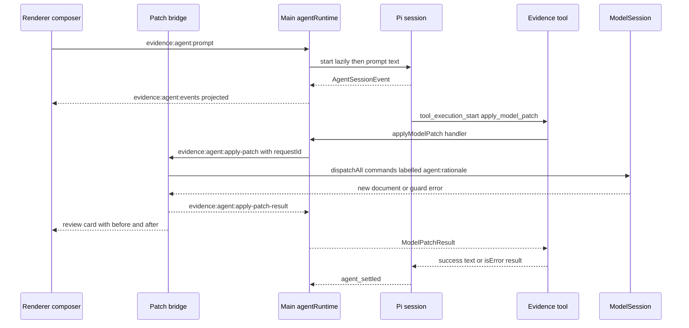

# The Pi agent harness, its tools and the desktop runtime

Evidence has no separate agent service. A conversation runs inside the desktop's
main process on top of `@earendil-works/pi-coding-agent`, and the only way an edit
reaches the *live* model is a tool call the desktop registers. The harness, the
tool definitions, the prompt text, the sensor engine, the governance policy and
the production-trace reader all live in one package, `@evidence-poc/evidence-agent`
(`libs/evidence-agent`), which exports a process entry point (`.`) and a
`./browser` entry that keeps the Node-only session harness out of the renderer
bundle while still exposing the sensor, drift and trace contracts
(`repo://libs/evidence-agent/package.json#L18-L22`,
`repo://libs/evidence-agent/src/index.ts#L1-L67`,
`repo://libs/evidence-agent/src/browser.ts#L1-L41`). Before the consolidation this
work was split across `libs/evidence-agent-core` (SDK adaptation, prompts, event
projection, fork) and `libs/evidence-modeling-orchestrator` (tool registration,
patch routing, sensor wiring); both names are gone and everything below is
referenced against the single package.

| Concern | Where it lives now | Owns |
| --- | --- | --- |
| session harness | `libs/evidence-agent/src/session` | SDK adaptation, stream projection, transcript fork |
| instructions | `libs/evidence-agent/src/prompts` | the text a session starts with, plus the ingestion prompt |
| tools | `libs/evidence-agent/src/tools` | the eleven Pi tools and their handler contract |
| runtime ownership | `apps/desktop/src/main` | one runtime per project root, IPC, patch round trip, debounce |

## The SDK is narrowed, not wrapped

`PiSdkPort` declares five entry points and nothing else: resolve the agent
directory, build a resource loader, create a session manager, open a persisted
transcript, and create the session
(`repo://libs/evidence-agent/src/session/evidenceAgentSession.ts#L13-L33`).
`loadPiSdkPort` imports the real SDK dynamically — so importing the package never
pulls in credentials, a configured model or a terminal — and adapts it to that
interface (`repo://libs/evidence-agent/src/session/evidenceAgentSession.ts#L82-L130`).
`createEvidenceAgentSession` uses `options.sdk` when supplied and falls back to
the dynamic loader otherwise
(`repo://libs/evidence-agent/src/session/evidenceAgentSession.ts#L158-L170`), which
is how the session spec exercises the whole harness without a model; the desktop
specs sit one seam higher and inject `sessionFactory` instead
(`repo://apps/desktop/src/main/agentRuntime.spec.ts#L145-L158`).

The loader is built with `noSkills: true` and an `appendSystemPromptOverride`
that appends the instruction sections to Pi's own prompt, so Pi never scans the
project or the user's agent directory for `SKILL.md`
(`repo://libs/evidence-agent/src/session/evidenceAgentSession.ts#L96-L112`). The
reason is stated at the construction site: a skill tree would widen the prompt
with files the install never reviewed and send the model looking for a capability
the product does not ship.

Session options pass straight through: `customTools`, `tools`, `noTools`,
`sessionDirectory`, and `sessionFile`
(`repo://libs/evidence-agent/src/session/evidenceAgentSession.ts#L161-L188`).
`sessionDirectory` and `sessionFile` are alternatives: when `sessionFile` is set
the session opens that transcript instead of creating a new one, so a branch can
own its own lineage
(`repo://libs/evidence-agent/src/session/evidenceAgentSession.ts#L176-L180`,
`repo://libs/evidence-agent/src/session/evidenceAgentSession.spec.ts#L231-L258`).

## Session lifecycle

`createEvidenceAgentSession` is lazy and single-flight:

- Nothing starts until `start`, `prompt` or `steer`; every entry point awaits one
  module-scoped `starting` promise, so concurrent callers share one
  initialization, and a failed start resets that promise so the next call retries
  (`repo://libs/evidence-agent/src/session/evidenceAgentSession.ts#L142-L198`).
- `prompt` and `steer` go through `requireSession`, which starts on demand and
  throws `Pi agent session failed to start.` if startup left no session
  (`repo://libs/evidence-agent/src/session/evidenceAgentSession.ts#L200-L226`).
- `steer` returns Pi's own disposition (`'handled'` or `'queued'`) rather than
  restarting a run; `abort` is a no-op before a session exists
  (`repo://libs/evidence-agent/src/session/evidenceAgentSession.ts#L215-L232`).
- `getSessionFile` reports the transcript Pi writes, or `null` before startup
  (`repo://libs/evidence-agent/src/session/evidenceAgentSession.spec.ts#L259-L271`).
- `dispose` unsubscribes from Pi, disposes the SDK session, clears the session,
  the start promise and every listener
  (`repo://libs/evidence-agent/src/session/evidenceAgentSession.ts#L233-L241`).

Retry-after-failure is a protected behaviour, not an accident: the spec makes
`createAgentSession` reject once and then succeed, and asserts two attempts
(`repo://libs/evidence-agent/src/session/evidenceAgentSession.spec.ts#L340-L364`).

A second consumer reuses the same factory for a different job.
`createModelIngestionReader` runs one tool-less turn in a scratch temporary
directory — `instructions: [systemPrompt]`, `noTools: 'all'` — assembles the
streamed text into a single reply, enforces a 120 s timeout, converts a streamed
`agent-error` into a thrown failure after the turn, and disposes the session in a
`finally` block (`repo://apps/desktop/src/main/ingestionModelReader.ts#L22-L92`).
The reader exists because ingestion happens before a project exists, and a reading
turn must not grow `.evidence/` files
(`repo://apps/desktop/src/main/ingestionModelReader.spec.ts#L83-L93`).

## Instructions are code, not a skill tree

`EVIDENCE_INSTRUCTIONS` is four authored sections joined for the system prompt:
role, modeling red lines, operator selection and the turn workflow
(`repo://libs/evidence-agent/src/prompts/index.ts#L13-L18`). They are ordinary
TypeScript strings shipped in the bundle, so a packaged app carries its own
instructions and a project only needs model files.

Two invariants are asserted rather than assumed:

- The prompt names only tools the desktop registers — the spec checks
  `apply_model_patch`, `run_sensors`, `get_canvas_selection`,
  `introduce_fulfillment_pair`, `add_breach_compensation`,
  `roleify_and_invert_dependency`, `annotate_contract_clauses`,
  `read_service_blueprint` and `isolate_domain_calculator` — and contains no
  `SKILL.md`, `.agents`, `references/`, `npx ` or `$` relic
  (`repo://libs/evidence-agent/src/prompts/prompts.spec.ts#L26-L46`).
- The desktop runtime hands the session one extension factory and no
  `instructions` or `skillDirectories` override, and publishes no
  `EVIDENCE_SKILLS_ROOT`/`FM_SKILL_DIR` environment variable for a shell to read
  (`repo://apps/desktop/src/main/agentRuntime.spec.ts#L231-L245`).

The workflow section also pins the intended loop: read the selection, ask in
groups, submit one minimal complete batch through an operator or
`apply_model_patch`, then `run_sensors` before moving on
(`repo://libs/evidence-agent/src/prompts/workflow.ts#L36-L56`). It deliberately
names `get_api_diff`, `sync_api_projection`, the two readings and the four
operators, which is why the tool table below is the authoritative list of what the
model can actually do.

A second instruction set exists for a different surface.
`GOVERNANCE_INSTRUCTIONS` swaps the workflow section for `GOVERNANCE_PROMPT`,
which names the MCP tools `audit_production_drift` and `run_scenario_replay`
instead of the workshop steps
(`repo://libs/evidence-agent/src/prompts/index.ts#L44-L51`,
`repo://libs/evidence-agent/src/prompts/governance.ts#L10-L35`,
`repo://libs/evidence-agent/src/prompts/prompts.spec.ts#L100-L117`). The desktop
runtime does not pass it — the runtime spec asserts the session options carry no
`instructions` override — so the governance pair is shipped for a host that drives
an audit turn, not for the current in-app conversation
(`repo://apps/desktop/src/main/agentRuntime.spec.ts#L231-L245`).

## What the renderer is allowed to see

Pi's event vocabulary does not cross the IPC boundary. `projectSessionEvent` maps
exactly five plain shapes and drops everything else — thinking deltas, retries,
compaction, `turn_start`, `agent_start`
(`repo://libs/evidence-agent/src/session/streamEvents.ts#L9-L80`):

| Desktop event | Fields | Produced from |
| --- | --- | --- |
| `text-delta` | `delta` | `message_update` with `text_delta` |
| `tool-call-started` | `toolCallId`, `toolName`, `input` | `tool_execution_start` |
| `tool-call-completed` | `toolCallId`, `toolName`, `output`, `isError` | `tool_execution_end` |
| `agent-settled` | `aborted` | `agent_settled` |
| `agent-error` | `message` | `message_end` on an assistant message whose `stopReason` is `error` |

Because the values are plain data they can be sent over Electron IPC unchanged and
asserted in tests without a live model
(`repo://libs/evidence-agent/src/session/evidenceAgentSession.spec.ts#L96-L190`).

`useAgentSession` folds that stream into one conversation state: transcript text
is capped at the last 8,000 characters, tool calls become an activity list with
`running`/`completed`/`failed`, and the active tool name drives the status line
(`repo://apps/desktop/src/renderer/state/useAgentSession.ts#L32-L96`). `submit`
decides from its own `running` flag whether the composer's text becomes a prompt
or a steer, and a failed call lands in `error` instead of a stuck spinner
(`repo://apps/desktop/src/renderer/state/useAgentSession.ts#L118-L172`).

The rail (`AgentCopilot`) and the over-canvas card (`InlinePatchCopilot`) are two
views over that one controller: ⌘/Ctrl+Enter sends, and while a run is streaming
the same composer becomes an interjection field, with Escape stopping the live run
(`repo://apps/desktop/src/renderer/components/agent/AgentCopilot.tsx#L250-L266`,
`repo://apps/desktop/src/renderer/components/agent/InlinePatchCopilot.tsx#L170-L190`).
The rail prefixes a prompt with the chosen workshop step, and the over-canvas card
prefixes it with the selected entity, because the session keeps no step or
selection state of its own
(`repo://apps/desktop/src/renderer/components/agent/AgentCopilot.tsx#L107-L120`,
`repo://apps/desktop/src/renderer/components/agent/InlinePatchCopilot.tsx#L79-L86`).
What the tools read as the canvas selection is published separately by the editor
screen whenever the selection changes
(`repo://apps/desktop/src/renderer/screens/EditorScreen.tsx#L617-L645`).

## The tool surface

`createEvidenceToolsExtension` is a Pi extension factory driven by
`EvidenceToolsHandlers`, an interface that keeps the extension free of Electron
and of the filesystem: `runSensors`, `applyModelPatch`, `getCanvasContext`,
`loadDocument`, optional `loadBaseDocument`/`refreshApi`, and a `modelRoot`
string (`repo://libs/evidence-agent/src/tools/evidenceTools.ts#L26-L72`). It
registers eleven tools, in this order
(`repo://libs/evidence-agent/src/tools/evidenceTools.ts#L114-L116`,
`repo://libs/evidence-agent/src/tools/evidenceTools.spec.ts#L270-L288`):

| Tool | Kind | What the handler chain does |
| --- | --- | --- |
| `get_api_diff` | read | reads the current document, applies optional `proposedCommands` in memory, compares against the session baseline or the current document, renders the API diff |
| `sync_api_projection` | read (refresh) | calls `refreshApi`, then reports the API check summary; writes nothing |
| `run_sensors` | read | `runSensors({modelRoot, scope?, signal?})` and projects the report |
| `apply_model_patch` | write | validates command shapes, then `applyModelPatch({rationale, commands})` |
| `get_canvas_selection` | read | `getCanvasContext()` as JSON |
| `annotate_contract_clauses` | read | classifies agreement text into business, domain and legal clauses |
| `read_service_blueprint` | read | parses a stage/activity/receipt table into a draft summary |
| `introduce_fulfillment_pair` | write (operator) | `loadDocument()` then `introduceFulfillmentPair` |
| `add_breach_compensation` | write (operator) | `loadDocument()` then `addBreachCompensation` |
| `roleify_and_invert_dependency` | write (operator) | `loadDocument()` then `roleifyAndInvertDependency` |
| `isolate_domain_calculator` | write (operator) | `loadDocument()` then `isolateDomainCalculator` |

The name table and the handler contract are declared together
(`repo://libs/evidence-agent/src/tools/evidenceTools.ts#L75-L87`).
`run_sensors` answers with a compact projection of the full report — `passed`,
`isStageGateReady`, `blockCount`, `warnCount`, `decisionOwed` and the issue list —
because that is what a model needs in order to act, while the full `SensorReport`
stays in `details`
(`repo://libs/evidence-agent/src/tools/evidenceTools.ts#L167-L202`,
`repo://libs/evidence-agent/src/tools/evidenceTools.spec.ts#L291-L310`).

The two API tools are read-only by construction: `get_api_diff` decodes the
proposed commands and applies them to a copy, so previewing never dispatches a
patch, and malformed hypothetical commands are rejected without touching the
model (`repo://libs/evidence-agent/src/tools/evidenceTools.spec.ts#L211-L268`).
`sync_api_projection` is wired in the runtime to a sensor run and returns the
resulting summary, which is why the prompt describes it as refreshing diagnostics
rather than publishing a baseline
(`repo://libs/evidence-agent/src/tools/evidenceTools.ts#L147-L166`,
`repo://apps/desktop/src/main/agentRuntime.ts#L184-L192`).

`apply_model_patch` is the only generic write path, and it separates two kinds of
rejection. A command that is not an object with a string `type` throws before the
handler is called — `commands[i] 缺少字符串 type 字段。` — so a malformed batch
never reaches the session
(`repo://libs/evidence-agent/src/tools/evidenceTools.ts#L94-L104`,
`repo://libs/evidence-agent/src/tools/evidenceTools.spec.ts#L361-L373`). A batch
the renderer refuses comes back as an `isError` tool result whose text is
`补丁被拒绝：<error>`, not as a thrown exception, so Pi can read the guard message
and try again (`repo://libs/evidence-agent/src/tools/evidenceTools.ts#L204-L239`,
`repo://libs/evidence-agent/src/tools/evidenceTools.spec.ts#L340-L358`). Success
names the applied command types back to the model
(`repo://libs/evidence-agent/src/tools/evidenceTools.spec.ts#L312-L338`).

The four operators share one `runOperator` helper: it calls
`handlers.loadDocument()` so the ids an operator writes are resolved against the
current tree, lets a builder refusal become a readable `算子未执行：…` tool error
with no patch sent, and otherwise submits `patch.commands` through the same
`applyModelPatch` channel, reporting the created ids on success
(`repo://libs/evidence-agent/src/tools/evidenceTools.ts#L383-L411`). The tool set
is therefore not a second command language: it is a thin, schema-described front
end over the command layer described in
[Commands, guards and the model session](../model/commands-and-session.md). The
tests pin the three properties that matter — one pair intent becomes one
`create-fulfillment-pair` patch, the model is read before a reference is resolved,
and a refused operator returns an error instead of an empty batch
(`repo://libs/evidence-agent/src/tools/evidenceTools.spec.ts#L386-L482`).

## The patch round trip

Only the renderer holds the live `ModelSession`, so no tool can write the model
directly. Every agent edit is a correlated round trip:

One full loop: the renderer asks, the main-process runtime starts the Pi session if
needed, the model calls `apply_model_patch`, the tool reaches the renderer, the
renderer dispatches through `ModelSession`, the verdict travels back into the tool,
and the renderer keeps the before/after pair for review.

1. The tool calls `handlers.applyModelPatch`, which is the runtime's
   `transport.requestPatch` (`repo://apps/desktop/src/main/agentRuntime.ts#L190`).
2. `registerAgentIpc` refuses immediately if the owning window is gone
   (`编辑器窗口已关闭。`), otherwise allocates a UUID, registers a 15 s timer, and
   sends `evidence:agent:apply-patch` with `{requestId, patch}`
   (`repo://apps/desktop/src/main/agentIpcHandlers.ts#L25-L28`,
   `repo://apps/desktop/src/main/agentIpcHandlers.ts#L90-L110`).
3. The renderer's bridge snapshots `session.getDocument()`, decodes the commands,
   calls `session.dispatchAll(commands, 'agent:<rationale>')` exactly once, and
   answers with the applied command types
   (`repo://apps/desktop/src/renderer/state/useAgentPatchBridge.ts#L31-L72`).
4. A decode or guard failure answers `success: false` with the guard's message,
   which the tool turns into an `isError` result; a destroyed window or an
   elapsed timer also resolves a failure instead of hanging the turn
   (`repo://apps/desktop/src/renderer/state/useAgentPatchBridge.ts#L58-L71`,
   `repo://apps/desktop/src/main/agentIpcHandlers.ts#L95-L108`).
5. The reply arrives on `evidence:agent:apply-patch-result` (an `ipcMain.on`
   handler, not a request) and resolves the pending promise
   (`repo://apps/desktop/src/main/agentIpcHandlers.ts#L233-L247`).
6. The bridge then hands both snapshots to `usePatchReview.record`, which diffs
   them, builds a canvas overlay, and offers a one-step revert only while the
   patched document is still the one on screen
   (`repo://apps/desktop/src/renderer/state/usePatchReview.ts#L50-L114`,
   `repo://apps/desktop/src/renderer/screens/EditorScreen.tsx#L262-L265`).

Three consequences define the agent's authority:

- One agent patch is one undo step, labelled `agent:<rationale>`, so it is
  indistinguishable in history from a human multi-command edit that carried the
  same rationale
  (`repo://apps/desktop/src/renderer/state/useAgentPatchBridge.ts#L42-L46`,
  `repo://apps/desktop/src/renderer/state/useAgentPatchBridge.spec.tsx#L31-L72`).
- A model edit cannot bypass the renderer: the only path into the live model is a
  decoded command batch dispatched by the session, so the same guards that reject a
  human edit reject it
  (`repo://apps/desktop/src/renderer/state/useAgentPatchBridge.spec.tsx#L74-L101`).
- A patch that succeeds is not necessarily a valid model. Validation is a separate
  sensor run, which is why the instructions require `run_sensors` after a write.

## Runtime ownership

`createAgentRuntime` resolves the model root and project directory from the
project's source form — a bundle project keeps the model next to the file — and
builds one sensor engine per project
(`repo://apps/desktop/src/main/agentRuntime.ts#L92-L101`). It reads the model for
the tools from a live mirror when the renderer has published one and otherwise
from disk, so headless callers still work
(`repo://apps/desktop/src/main/agentRuntime.ts#L149-L155`).

The session is created on the first prompt with `customTools: []` and exactly one
extension factory, wired to the sensor runner, the patch transport, the canvas
context, `loadBaseDocument` and `loadDocument`
(`repo://apps/desktop/src/main/agentRuntime.ts#L157-L196`). That one-factory shape
is deliberate: the agent's capabilities are auditable in a single place instead of
being assembled from ambient SDK defaults. `ensureSession` single-flights the
creation the same way the library session does
(`repo://apps/desktop/src/main/agentRuntime.ts#L157-L166`).

One boundary is worth stating precisely: the desktop passes `customTools: []` but
never `tools` or `noTools`, and the library only forwards those when defined, so
Pi's built-in tool set stays on. The extension list is what the product adds, not
an allowlist, which is why the authority that matters is the patch round trip
below rather than which tools the model can call
(`repo://apps/desktop/src/main/agentRuntime.ts#L168-L196`,
`repo://libs/evidence-agent/src/session/evidenceAgentSession.ts#L181-L188`).
Keeping the model out of direct file writes is therefore a matter of the
instructions and of the reviewable patch path, not of a sandbox.

The runtime also owns ambient checks and the mirrored document:

- `notifyModelChanged` validates the delivery, rejects a payload from another
  project root, ignores a revision that is not newer than the one it holds, keeps
  the first baseline across revisions, clears the cached verdict, and re-arms a
  debounced run — 800 ms by default, so a burst of edits produces one verdict
  (`repo://apps/desktop/src/main/agentRuntime.ts#L225-L241`,
  `repo://apps/desktop/src/main/sensorRuntime.ts#L22-L59`,
  `repo://apps/desktop/src/main/agentRuntime.spec.ts#L303-L325`).
- `runSensors` tags the report with the mirrored revision and only publishes when
  it is still the newest run against the newest document, so a slow obsolete run
  cannot overwrite a fresher verdict
  (`repo://apps/desktop/src/main/agentRuntime.ts#L111-L147`,
  `repo://apps/desktop/src/main/agentRuntime.spec.ts#L163-L201`).
- `dispose` marks the runtime disposed, bumps the run sequence so late results are
  dropped, clears the mirror, cancels the debounce and disposes the session
  (`repo://apps/desktop/src/main/agentRuntime.ts#L244-L256`).

`registerAgentIpc` keeps one runtime per project root and a single-flight map for
creation, so a second window asking for the same project joins the existing
conversation rather than starting a second one — and that conversation keeps
publishing to the window that created it
(`repo://apps/desktop/src/main/agentIpcHandlers.ts#L59-L88`). Every runtime is
bound to the `WebContents` that first asked for it, publishes events and reports
only while that window is alive, and is disposed on `destroyed`
(`repo://apps/desktop/src/main/agentIpcHandlers.ts#L113-L148`). The IPC surface
is a single channel table with one shared shape per call: `prompt`, `steer`,
`abort`, `triggerSensors`, `latestReport`, `modelChanged`, `canvasContext`, the
two patch channels, plus the `events` and `report` push channels
(`repo://apps/desktop/src/shared/agentIpc.ts#L14-L30`). Every payload carries
`rootPath` so the main process can key its runtimes
(`repo://apps/desktop/src/shared/agentIpc.ts#L35-L40`).

The runtime accepts a `sessionFile` to continue a persisted transcript, and the
library session opens it instead of creating a new one
(`repo://apps/desktop/src/main/agentRuntime.ts#L45-L58`,
`repo://libs/evidence-agent/src/session/evidenceAgentSession.spec.ts#L231-L258`).
Today no IPC path supplies one, so a desktop conversation persists to Pi's own
session directory.

## Transcript lineage

A Pi transcript is a tree written as JSONL: a `session` header plus entries
carrying `id`/`parentId`. `forkSessionLines` is a pure function over those lines.
It keeps only the ancestor chain of a chosen entry (or every entry when no fork
point is given), rewrites the header with a new `id`, the requested timestamp and
a `parentSession` pointer, and returns the new lines plus the leaf entry to resume
from and the number of dropped sibling entries
(`repo://libs/evidence-agent/src/session/sessionFork.ts#L57-L166`).

Refusals are typed rather than silently empty: `MISSING_HEADER`, `INVALID_LINE`
and `ENTRY_NOT_FOUND` are raised as `SessionForkError`, and the ancestor walk
stops on a cyclic parent chain instead of looping
(`repo://libs/evidence-agent/src/session/sessionFork.ts#L23-L38`,
`repo://libs/evidence-agent/src/session/sessionFork.ts#L127-L151`). The source
lines are never mutated, and the spec covers ancestry, lineage, whole-transcript
copies, missing fork points, missing headers, unparsable lines, cycles and source
immutability (`repo://libs/evidence-agent/src/session/sessionFork.spec.ts#L24-L123`).
The branch workflow that consumes a fork is described in
<!-- openwiki: broken internal link [../desktop/branches-and-lineage.md] file "../desktop/branches-and-lineage.md" does not exist. Fix the href or restore the target, then delete this comment. -->
[Interview branches and lineage](../desktop/branches-and-lineage.md).

## Production trace and the governance decision

The same package reads production as Evidence commits.
`readProductionTrace` accepts an OTLP/JSON export — the shape a collector or a
`curl` of the tracing backend already produces — and turns each span that names
`fm.evidence.ref` into a commit with its service, operation, instant, context,
`fm.value.*` attributes and optional fulfillment claim
(`repo://libs/evidence-agent/src/telemetry/productionTrace.ts#L30-L50`,
`repo://libs/evidence-agent/src/telemetry/productionTrace.ts#L203-L293`).
A span without that attribute is treated as context and skipped silently; a span
that names Evidence but carries no `traceId`/`spanId` is reported as an error
instead of being guessed at, and shape problems come back as `path: message`
strings alongside `spanCount` so a summary can say how much it actually read
(`repo://libs/evidence-agent/src/telemetry/productionTrace.ts#L30-L40`,
`repo://libs/evidence-agent/src/telemetry/productionTrace.ts#L247-L258`). The
audit that consumes it reads the saved model rather than the canvas, and merges
its own source problems into the answer so an audit that could not see the whole
model never reads like a clean comparison
(`repo://libs/evidence-agent/src/sensors/native/nativeDriftAudit.ts#L1-L30`).

`decideGovernance` turns drift findings plus an optional replay result into one
verdict and the actions the next turn may take. Each finding kind maps to one
action and the tool that would perform it (for example
`BREACH_WITHOUT_FOLLOW_UP` → `add_breach_compensation`), a failing replay appends
a `repair_model` action and closes the patch path, and the verdict is ranked
`production_overreach` > `needs_repair` > `model_lagging` > `healthy`
(`repo://libs/evidence-agent/src/governance/governanceLoop.ts#L62-L208`).
`canPatchModel` is deliberately narrow: no blocking drift, a replay that was
actually run and passed, and a `model_lagging` verdict
(`repo://libs/evidence-agent/src/governance/governanceLoop.ts#L200-L208`). A
`healthy` verdict therefore means "nothing to do", not "allowed to edit". The
desktop spec proves the whole loop on one saved model: a matching trace yields a
healthy decision with no patch licence, a service writing a derived value yields
`production_overreach` with a blocking ticket, and a breach with no follow-up
yields `model_lagging` with `add_breach_compensation`
(`repo://apps/desktop/src/main/governanceLoop.spec.ts#L119-L217`).

## Failure surfaces

| Failure | Behaviour |
| --- | --- |
| `steer` before any session exists | throws `还没有正在进行的访谈，无法插话。` instead of starting one (`repo://apps/desktop/src/main/agentRuntime.ts#L210-L215`) |
| session initialization throws | the shared start promise is reset and the next call retries (`repo://libs/evidence-agent/src/session/evidenceAgentSession.spec.ts#L340-L364`) |
| assistant message ends with `stopReason: 'error'` | projected as `agent-error` and shown without killing the session (`repo://libs/evidence-agent/src/session/streamEvents.ts#L69-L80`) |
| command without a string `type` | the tool throws before `applyModelPatch`; the session is untouched (`repo://libs/evidence-agent/src/tools/evidenceTools.ts#L94-L104`) |
| patch rejected by a guard | tool result `isError: true` carrying the rejection text (`repo://libs/evidence-agent/src/tools/evidenceTools.spec.ts#L340-L358`) |
| patch never reaches the renderer | 15 s timeout resolves `success: false` with a retry hint (`repo://apps/desktop/src/main/agentIpcHandlers.ts#L95-L108`) |
| renderer window already destroyed | immediate `编辑器窗口已关闭。` failure instead of a pending promise (`repo://apps/desktop/src/main/agentIpcHandlers.ts#L91-L94`) |
| operator names a missing reference | builder throws before any patch is sent, reported as `算子未执行` (`repo://libs/evidence-agent/src/tools/evidenceTools.spec.ts#L454-L482`) |
| blueprint table cannot be read | `read_service_blueprint` answers `isError` with `蓝图读不出来`, not an empty draft (`repo://libs/evidence-agent/src/tools/evidenceTools.spec.ts#L583-L594`) |
| trace export is not OTLP/JSON | `readProductionTrace` returns empty commits with an error string instead of throwing (`repo://libs/evidence-agent/src/telemetry/productionTrace.ts#L205-L220`) |

## Tests that protect this contract

- `evidenceAgentSession.spec.ts` drives a fake SDK: one loader configuration with
  the built-in instructions, one start for repeated calls, pass-through of custom
  tools and session directory, transcript resumption, `getSessionFile`, event
  projection, dispose, and retry after a failed start
  (`repo://libs/evidence-agent/src/session/evidenceAgentSession.spec.ts#L194-L364`).
- `sessionFork.spec.ts` covers ancestry, lineage, full copies, every refusal code,
  cyclic chains and source immutability
  (`repo://libs/evidence-agent/src/session/sessionFork.spec.ts#L24-L123`).
- `evidenceTools.spec.ts` asserts the eleven registered names, sensor wiring and
  its projection, patch feedback in both directions, selection reads, the readings
  and every operator path (`repo://libs/evidence-agent/src/tools/evidenceTools.spec.ts#L270-L643`).
- `agentRuntime.spec.ts` asserts lazy start, one start for many prompts, stream
  forwarding, steer/abort, sensor publication, debounce, canvas context, dispose,
  the single extension factory, the patch verdict returning into the tool, and an
  operator reading the project tree before naming the root contract
  (`repo://apps/desktop/src/main/agentRuntime.spec.ts#L231-L488`).
- `useAgentPatchBridge.spec.tsx` asserts the dispatch, the ack, undo, guard
  rejection, malformed-command rejection and the before/after hand-off for review
  (`repo://apps/desktop/src/renderer/state/useAgentPatchBridge.spec.tsx#L31-L172`).
- `governanceLoop.spec.ts` puts simulation, drift audit and policy on one model to
  prove the three agree (`repo://apps/desktop/src/main/governanceLoop.spec.ts#L85-L217`).

## Related pages

- [External agents over MCP](./mcp-integration.md) — the same operators and audits
  exposed to out-of-process clients, and the tools the governance prompt names.
- [Sensors, stage gate and the dependency frontier](./sensor-orchestration.md) — what
  `run_sensors` returns and how a verdict is built.
<!-- openwiki: broken internal link [../desktop/branches-and-lineage.md] file "../desktop/branches-and-lineage.md" does not exist. Fix the href or restore the target, then delete this comment. -->
- [Interview branches and lineage](../desktop/branches-and-lineage.md) — per-branch
  transcripts, forks and stored verdicts.
- [The agent rail, patch review and ingestion](../desktop/ingestion-and-patch-review.md) —
  the renderer surface that hosts this runtime.
- [Commands, guards and the model session](../model/commands-and-session.md) — the
  dispatch path every patch enters.
