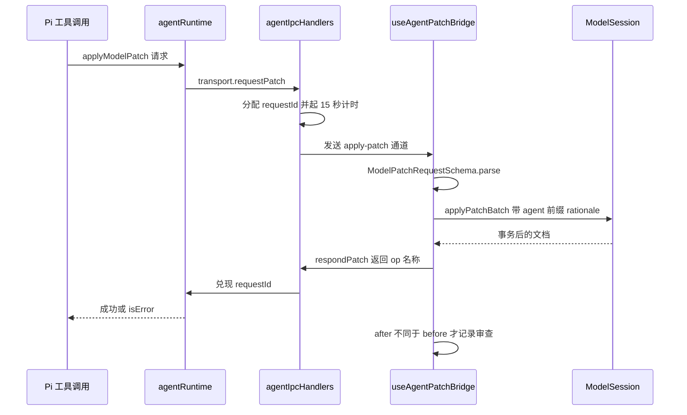

# 内置 Pi Agent 与工具扩展

`@evidence-poc/evidence-agent` 是唯一持有 Pi SDK 边界的地方：会话适配、随包提示词、工具注册、传感器与治理共用这个包。`.` 是 Node 进程入口，`./browser` 只导出类型与传感器报告 DTO，外加 trace/drift 的纯审计函数与 story DTO 类型，Node 会话运行时留在进程入口，这样 renderer 能读报告类型而不会把会话运行时打进打包产物。

桌面侧分三层，职责不重叠：main 的 `agentRuntime` 组装一个会话、一个传感器引擎和一份模型源树；main 的 `agentIpcHandlers` 拥有 runtime 注册表与补丁往返；`libs/desktop/feature-agent` 拥有界面（`AgentCopilot`、`InlinePatchCopilot`、思考块、工具活动）和三个 hook（`useAgentSession`、`useAgentPatchBridge`、`usePatchReview`）。通道名与跨进程数据类型在 `libs/desktop/contracts/src/agentIpc.ts` 里单独定义，主进程与 renderer 都只依赖这份契约。

## 会话适配：注入端口、随包提示词与生命周期

`createEvidenceAgentSession` 把 SDK 收窄成可注入的 `PiSdkPort`（`getAgentDir`、`createResourceLoader`、`createSessionManager`、`openSessionManager`、`createAgentSession`）。`loadPiSdkPort` 动态 `import('@earendil-works/pi-coding-agent')`，所以包在测试里加载不需要模型凭据、终端或已配置的模型。工厂是懒启动的：`start()` 只在第一次 prompt 时真正创建会话，`starting` promise 做 single-flight，两个并发调用只创建一次；若初始化抛错就清掉 `starting`，下一次调用可以重试。`prompt`/`steer` 会先等启动完成，`abort` 在会话尚不存在时是空操作，`dispose` 取消 Pi 订阅、释放会话、清空监听器。

资源加载器设置 `noSkills: true`，再用 `appendSystemPromptOverride` 把随包指令追加在 Pi 自带系统提示词之后。这是产品决定而非省事：打包应用自己拥有指令，若让 Pi 扫描项目与用户 agent 目录里的 `SKILL.md`，提示词会被安装时未审阅的文件撑大，还会让模型去找一个本产品并不提供的 skill。`customTools`、`tools`、`noTools`、`sessionDirectory` 按需透传；`sessionFile` 存在时走 `openSessionManager` 续接既有 transcript，`sessionDirectory` 被忽略，因为一个分支只能读自己的谱系；`getSessionFile()` 在 Pi 真正落盘之前返回 `null`。

桌面传入 `customTools: []` 加一个 extension factory，但**没有**设置 `noTools`——因此这不是沙箱，Pi 的内置工具仍然可用。禁止直接写 `.evidence/fm` 靠的是指令与受审查的补丁通道，而不是工具白名单。

`sessionFork` 处理同一份 transcript 的另一件事：在指定入口处分叉。它只保留该入口的 `id`/`parentId` 祖先链，重写成新的 `lines`，把 session id、timestamp 与 `parentSession` 写进新 header，并报告叶节点 `leafEntryId` 与被丢弃的兄弟分支数；不给 fork 点就整份复制、只换身份。`MISSING_HEADER`、`INVALID_LINE`、`ENTRY_NOT_FOUND` 明确拒绝，循环父链会终止，源行永不被修改——被放弃的兄弟结论留在原文件里，新分支不能悄悄继承一个它没有得出的结论。

同一个工厂还被摄取 reader 复用：它在临时目录起一个 tool-less 单轮（`noTools: 'all'`、`instructions: [systemPrompt]`），把流式文本拼成整段回复，120 秒超时，`agent-error` 记为失败并在本轮结束后抛出，`finally` 里退订、dispose 并删除临时目录——项目尚不存在时不该长出 `.evidence/` 文件。细节见[资料摄取与补丁审查](../desktop/ingestion-and-patch-review.md)。

## 随包提示词

`EVIDENCE_INSTRUCTIONS` 是四段普通 TS 字符串：`ROLE_PROMPT`、`MODELING_PROMPT`、`OPERATOR_PROMPT`、`WORKFLOW_PROMPT`，`EVIDENCE_SYSTEM_PROMPT` 只是用空行拼成的一整段，供需要整体替换系统提示词的宿主使用。提示词测试把几条硬约束钉住：文本里点名的 9 个工具必须真实注册；不能出现 `SKILL.md`、`.agents`、`references/`、`npx`、`$` 这类会引模型去找不存在之物的遗物；七步工坊的锚点按看板顺序出现；`annotate_contract_clauses` 必须排在 `introduce_fulfillment_pair` 之前（先读再写）；没有合约时给出“从凭证逆推”的替代路径，让空白画布也能开场。

`GOVERNANCE_INSTRUCTIONS` 是另一个宿主指令集：角色、建模红线、算子三段保持相同（修补写的仍是同一个模型），只把 `WORKFLOW_PROMPT` 换成 `GOVERNANCE_PROMPT`。它从 trace 出发，要求 `audit_production_drift` 与真实 HTTP 验收，明确不出现工坊锚点，也不调用旧的 replay 工具。

## 事件投影：五种纯数据

`projectSessionEvent` 把 Pi 事件压成 `AgentStreamEvent` 的五个成员：`text-delta`、`tool-call-started`、`tool-call-completed`、`agent-settled`、`agent-error`。`message_update` 只有 `text_delta` 被保留；`tool_execution_start`/`tool_execution_end` 带上 `toolCallId`、工具名与入参/结果、`isError`；`agent_settled` 带 `aborted`；只有 `message_end` 且 `role === 'assistant'`、`stopReason === 'error'` 时才有 `agent-error` 并携带错误消息。其余一切（思考 delta、重试、上下文压缩、未知类型）在这里丢弃，SDK 的事件词汇不会漏到 renderer，投影结果也因此能在没有真实模型时被断言。

推论：**推理文本不进事件流**。界面上的思考块是从同一条 transcript 字符串里解析出来的，见下文。

## 十一个工具、Zod 权威与共享算子

`TOOL_NAMES` 是唯一清单，共 11 个键，注册顺序被 `evidenceTools.spec.ts` 精确断言：

- 投影与诊断：`get_api_diff`、`sync_api_projection`、`run_sensors`。
- 读取：`get_canvas_selection`、`annotate_contract_clauses`、`read_service_blueprint`。
- 写入：`apply_model_patch` 与 4 个领域算子 `introduce_fulfillment_pair`、`add_breach_compensation`、`roleify_and_invert_dependency`、`isolate_domain_calculator`。

4 个算子是写工具，它们与 `apply_model_patch` 一起来自共享的 `@evidence-poc/evidence-tools`：`createModelTools` 定义 `MODEL_TOOL_NAMES` 五条（名字、中文 label、描述、Zod 参数、写注解），Pi 扩展与 MCP 服务端复用同一个注册表，`registerModelTool` 在 Pi 侧只负责按名取出并接到 `registerZodTool`。这条共享边界意味着算子语义只有一处实现，两个宿主只在端口上分叉。

- **算子路径**：`runOperator` 每次重新 `loadDocument()`，用 `createModelPatch(document, mutator)` 执行 guarded mutator 拿到 RFC 6902 批次，再交给宿主的 `applyModelPatch`。mutator 抛错时返回 `算子未执行：<原因>` 且 `isError: true`，一个补丁都不发送；宿主拒绝时返回 `补丁被拒绝：<错误>`；成功文本列出 `createdIds`。
- **补丁路径**：`apply_model_patch` 用共享 `ModelPatchRequestSchema` 校验 `{ rationale, patches }`，成功时列出每个 `op`，让模型知道自己写了哪几类操作；renderer 拒绝则转成 `isError`，下一轮可以据此自我修正。
- **只读路径**：`get_api_diff` 在副本上 `applyModelPatches` 后比较，绝不提交，也不发布新基线；`sync_api_projection` 只刷新诊断，不写盘、不接受新基线；`annotate_contract_clauses` 把协议分成业务/领域/纯法务并指出可抽成计算器的条款；`read_service_blueprint` 把表格解析成草稿摘要，读不出来时返回 `isError` 与失败摘要，而不是一个看起来成功的空草稿。
- **传感器路径**：`run_sensors` 把 `passed`、`isStageGateReady`、`blockCount`、`warnCount`、`decisionOwed`、`issues` 编成紧凑文本，完整 `SensorReport` 放在 `details` 里。

`registerZodTool` 只把 Zod 转成 `$refStrategy: 'none'` 的 JSON Schema 交给 Pi 1.5.2 ABI，执行前仍 `schema.parse(input)`——Zod 是运行时权威，JSON Schema 表达不出的 refinement 不会因为跨过 SDK 就丢失。TypeBox 只作为类型推断标记出现，没有 TypeBox 运行时。

## main：runtime transport 与传感器调度

`createAgentRuntime({ rootPath, transport, sensors, sessionFactory, sessionDirectory, sessionFile, sensorDelayMs })` 不 import Electron，它对外只说 `transport` 的三句话：`publishEvent`、`publishReport`、`requestPatch`。模型根由 `modelSourceOf`/`projectDirectoryOf` 解析，bundle 与目录项目都能落到同一个 `.evidence/fm`。

会话在第一次 prompt 时才创建，注入一个 extension factory，其中的 handlers 分别绑到 runtime 的各个能力上：`runSensors`（带 scope 与 abort signal）、`loadDocument`（优先 renderer 已发布的未保存镜像，否则读盘）、`loadBaseDocument`（取首个镜像的基线）、`refreshApi`（触发一次传感器）、`applyModelPatch`（直接转 `transport.requestPatch`）、`getCanvasContext`。`steer` 在会话不存在时抛“还没有正在进行的访谈，无法插话。”——桌面比 SDK 更严格，不去猜一个还没开始的访谈该把纠偏排进哪个队列。

传感器调度有两处闸门。`runSensors` 先取 `runSequence` 并捕获当时的 `live` 镜像，跑完后只有“未 dispose、sequence 仍是当前值、捕获的镜像仍是当前镜像”三个条件同时成立才写 `latestReport` 并 `publishReport`，报告带 `documentRevision`，所以慢的旧结果不会覆盖新结果。`notifyModelChanged` 先 `validateLiveDeliveryInput`，再拒绝不同 project root、忽略 `revision` 不递增的输入，首次基线跨修订保留，并清掉 `latestReport`，最后交给默认 800ms 的 debounce；后台跑传感器的错误被吞掉，不会变成 unhandled rejection。`dispose` 递增 sequence、清镜像、取消 timer、释放会话，使晚到的报告失效。

## IPC：通道、UUID 与 15 秒超时

`registerAgentIpc` 按 project root 维护 `runtimes` 与 `starting` 两张表：同一 root 的第二窗口复用已有 runtime，但事件与报告只发给创建它的 `WebContents`（`transport.publishEvent`/`publishReport` 前检查 `isDestroyed()`），窗口销毁时 dispose 并从两张表里移除。每个请求都带 `rootPath`，主进程据此选 runtime。

补丁是唯一由主进程反向请求 renderer 回答的通道：`ownsPatch` 若发现 sender 已销毁就立刻返回“编辑器窗口已关闭。”，否则分配 `randomUUID()` 的 `requestId`、起 15 秒计时（`PATCH_TIMEOUT_MS`），存入 `pending` 后 `send` 给 renderer。renderer 的 `applyPatchResult` 只能兑现一次（取出即删、清 timer），超时返回“画布没有在时限内应用补丁，请重试或手动编辑。”，绝不悬挂。`dispose` 清所有 timer 与 runtime。

一次 agent 补丁的完整往返：模型在主进程里决定，事务在 renderer 里提交，结果回到同一个 tool call。

## renderer：只读事件、把补丁交回事务

`useAgentSession(api, rootPath)` 是纯投影的消费端：`reduce` 处理五种事件——`text-delta` 累积文本并保留末尾 8000 字符（`MAX_TRANSCRIPT`），`tool-call-started` 以 `toolCallId` 为 id 追加一条 `running` 活动并设置 `activeToolName`，`tool-call-completed` 就地改成 `completed`/`failed` 并清掉同名活动状态，`agent-settled`/`agent-error` 落到 `running: false`，后者带错误消息。`submit` 会 trim，空文本直接返回；开跑时清空上一轮 transcript 与活动；**运行中再提交就变成 `steer`**，因为主进程的 invoke 要等整轮 settle 才返回，hook 仍认为正在跑。`stop` 调 `abort` 并立即置 idle。hook 只读事件，prompt/steer/abort 都是主进程调用，所以模型在本地还是远端对界面无差别。

`useAgentPatchBridge(api, session, onApplied)` 在 layout effect 里订阅 `onApplyPatch`：先取 `session.getDocument()` 作为 before，`ModelPatchRequestSchema.parse` 之后再 `applyPatchBatch(parsed.patches, agent:<rationale>)`，一次原子提交，语法检查与 `ModelSession` 配置的静态守卫都由会话承担；成功后回 `appliedCommands`（op 名称列表），失败回错误字符串。只有 `after !== before` 时才把 `{ rationale, commands, before, after }` 交给 `onApplied`，因此“成功的 test-only 补丁”不会弹出一张审查卡。

这段安排的原因在所有权上：renderer 是唯一持有 `ModelSession` 的地方，agent 编辑必须落到与人类编辑同一条撤销历史里。Agent 从不直接写 `.evidence/fm`。

`usePatchReview(session, document)` 把已应用的补丁变成可拒绝的审查：`diffDomainModels(before, after)` 得出新增/修改/删除的 id 列表与 canvas `overlay` 标记；`revertable` 的定义是“屏幕上的文档仍然等于 `pending.after`”，`revert` 只在 `session.getDocument() === patched` 时 `session.undo()`，否则只关闭——后来的编辑不该被一次撤销带走。

## 界面：一列流、行内补丁、思考块与工具活动

`AgentCopilot` 是侧栏：一列里依次是推理块、回答、工具活动、待处理的补丁卡，模型师在一个地方从提问读到补丁。composer 是单槽：工坊阶段是粘性的，发送时把 `workshopStepFocus(selection)`（或 `REVERSE_CONTRACT_MODE.focus`）作为前缀拼进提示词，因为会话本身不保存阶段状态；焦点胶囊来自 editor 单独发布的选择，会话不存私有选区。⌘/Ctrl+Enter 发送、运行中 Escape 停止，`focusToken` 变化（⌘K）把光标移进输入框，`prefill` 只消费一次并追加到未完成草稿之后。

`InlinePatchCopilot` 是画布上的浮卡：没有选择就只显示提示而不发问，有选择时把问题写成 `关于 <label>（<kind>）：<正文>`，补丁在同一张卡里复核；没有待处理补丁时 Escape 在 capture 阶段关闭卡片并 `stopPropagation`，免得同时清掉被讨论的选区。

思考块由 `parseStreamedTranscript` 驱动：它从同一条 transcript 里取出第一个 `<thought>` 或 `<thinking>` 块，`thinkingActive` 表示开标签已到、闭标签未到；块未闭合时只露出尾部 80 字符，展开后显示全文。`ThinkingBlock` 在没有推理且不活跃时不渲染。`ToolActivityItem` 用中文标题（未知名称回退原名），同时保留原始工具名——活动流也是调用审计，藏掉标识会让它无法与协议日志对齐。`InlinePatchCard` 显示 rationale、变更计数与可点击定位的对象胶囊（被删除的对象只划线、不提供定位），`revertable` 时才给“撤销补丁”，否则提示用 ⌘Z 逐步回退。

相关页面：[MCP 集成](./mcp-integration.md) 复用同一份算子注册表；[传感器编排](./sensor-orchestration.md) 讲报告与门禁内容；[模型命令与会话](../model/commands-and-session.md) 讲 `applyPatchBatch` 与撤销栈；[工作区与活动栏](../desktop/workspace-surfaces.md) 讲 copilot rail、浮卡与 Escape 的仲裁优先级；[renderer 状态](../desktop/renderer-state.md) 讲选择与实时镜像的所有权。

## 验证入口

`evidenceAgentSession.spec.ts` 用假 `PiSdkPort` 覆盖投影映射、启动 single-flight、会话恢复、transcript 路径、订阅与释放；`sessionFork.spec.ts` 覆盖谱系复制、header 重写、缺失 header/坏行/不存在入口的拒绝、循环链终止以及源行不被修改。`evidenceTools.spec.ts` 断言 11 个工具的注册顺序、`get_api_diff` 的试算不落补丁、算子先读模型、被拒算子不发命令、蓝图不可读返回 `isError`；`registerZodTool.spec.ts` 覆盖 refinement 在宿主不校验时仍然生效。`agentRuntime.spec.ts` 覆盖懒启动、只注册一个 extension factory 且没有 skill 目录、事件转发、未启动时拒绝 steer、传感器 root 与 debounce、canvas 上下文，以及 renderer 的拒绝结论原样回到工具。`libs/desktop/feature-agent` 的 specs 覆盖 `useAgentSession` 的 prompt→steer 切换、`useAgentPatchBridge` 的撤销联动与 test-only 不产生审查、`usePatchReview` 的一步撤销条件，以及 Copilot 的快捷键、阶段前缀、思考折叠与补丁卡；hook 与组件测试通过 `@evidence-poc/desktop-testing` 的 `agentMock` 脚本化事件，不要求真实模型。
