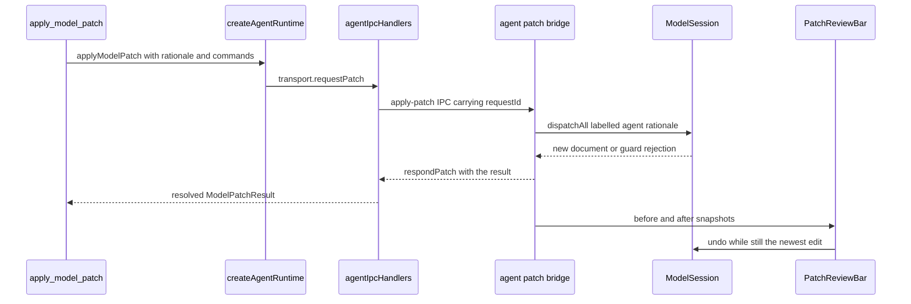

# The Pi agent harness and its tools

Evidence has no separate agent service. A modeling conversation runs inside the
desktop's main process, on top of `@earendil-works/pi-coding-agent`, and the
agent reaches the model only through the eleven tools one extension factory
registers — every write is a command batch the renderer still has to dispatch.
Three packages divide the work:

| Layer | Package | Owns |
| --- | --- | --- |
| session harness | `libs/evidence-agent-core` | SDK adaptation, instruction text, stream projection |
| tool + sensor wiring | `libs/evidence-modeling-orchestrator` | tool registration, patch routing contract, sensor engine |
| runtime ownership | `apps/desktop/src/main` | one runtime per project root, IPC, patch round trip, debounce |

## One project root, one session, one engine

`createAgentRuntime` resolves everything relative to the project's source form.
A directory project keeps its model in `.evidence/fm`; a bundle project is one
`*.evidence.json` file, so the model source is that file and the project directory
is the folder holding `.evidence/`. The model root, project directory and the
document an operator reads therefore come from `modelSourceOf` /
`projectDirectoryOf` rather than being assumed
(`repo://apps/desktop/src/main/agentRuntime.ts#L79-L100`,
`repo://apps/desktop/src/main/modelSource.ts#L9-L26`). The engine is created
once per runtime — `createSensorsEngine()` carries its own checks and schemas, so
a project needs no install directory — and is injectable for tests.

The runtime owns no live document. Instead `loadDocument` reads either the bundle
file or the model directory on each call, which is what lets an operator resolve a
reference against the tree that exists now rather than a snapshot taken at session
start (`repo://apps/desktop/src/main/agentRuntime.ts#L133-L136`).

The session is built on the first prompt, never at construction:

- `customTools: []` and exactly **one** entry in `extensionFactories` — the
  evidence tools extension wired to the engine, `transport.requestPatch`, the
  canvas context and `loadDocument` (`repo://apps/desktop/src/main/agentRuntime.ts#L151-L182`).
  The runtime sets no `tools` allowlist and no `noTools`, so capability is
  narrowed by what that one factory registers rather than by a second list.
- The created session is subscribed to `transport.publishEvent` and then started;
  `ensureSession` memoizes the in-flight start promise so two concurrent prompts
  share one initialization (`repo://apps/desktop/src/main/agentRuntime.ts#L140-L149`).
- `sessionFile` and `sessionDirectory` are accepted so a session can continue a
  persisted transcript, but `registerAgentIpc` supplies neither: an in-app turn
  always opens a fresh Pi transcript in Pi's default session directory
  (`repo://apps/desktop/src/main/agentRuntime.ts#L44-L50`,
  `repo://apps/desktop/src/main/agentIpcHandlers.ts#L111-L129`).

`steer` refuses before a session exists instead of starting one, `abort` is a
no-op in that state, and `dispose` cancels the debounced checker, disposes the
session and clears both memoized handles
(`repo://apps/desktop/src/main/agentRuntime.ts#L193-L224`).

## The SDK is narrowed, not wrapped

`PiSdkPort` declares only the five entry points the desktop needs: resolve the
agent directory, build a resource loader, create or open a session manager, and
create a session (`repo://libs/evidence-agent-core/src/session/evidenceAgentSession.ts#L13-L33`).
`loadPiSdkPort` imports the real SDK dynamically and implements the port
(`repo://libs/evidence-agent-core/src/session/evidenceAgentSession.ts#L88-L132`).
Because the dependency is a port, tests inject a fake and never need credentials,
a model or a terminal; `createEvidenceAgentSession` accepts it as `options.sdk`
and falls back to the dynamic loader only when none is given.

`createEvidenceAgentSession` is lazy and single-flight:

- Nothing starts until the first `prompt`, `steer` or `start`.
- A module-scoped `starting` promise means two concurrent callers share one
  initialization; the loader is reloaded once, and a failed start resets the
  promise so a retry is possible.
- `dispose` unsubscribes from Pi, disposes the SDK session and clears listeners
  (`repo://libs/evidence-agent-core/src/session/evidenceAgentSession.ts#L136-L190`,
  `repo://libs/evidence-agent-core/src/session/evidenceAgentSession.ts#L233-L240`).

## Instructions ship as code, not as a skill tree

`EVIDENCE_INSTRUCTIONS` is four authored sections — role and authority, modeling
red lines, operator selection, and the turn workflow — concatenated into one
system prompt with a blank line between sections
(`repo://libs/evidence-agent-core/src/prompts/index.ts#L13-L20`). They are
ordinary TypeScript strings, so a packaged app ships them inside the bundle. The
same module also exports a governance variant that swaps the workshop loop for a
trace-driven one, but the desktop runtime passes no `instructions` override, so
an in-app turn always gets the workshop set.

The resource loader is constructed with `noSkills: true` and an
`appendSystemPromptOverride` that appends those sections to Pi's own prompt
(`repo://libs/evidence-agent-core/src/session/evidenceAgentSession.ts#L93-L109`).
The reason is stated at the construction site: Pi would otherwise scan the project
and the user's agent directory for `SKILL.md`, widening the prompt with files the
install never reviewed and sending the model after a skill the product does not
ship.

Two invariants follow, and both are asserted:

- The prompt names only tools the desktop registers — `apply_model_patch`,
  `run_sensors`, `get_canvas_selection`, the three fulfillment operators,
  `annotate_contract_clauses`, `read_service_blueprint` and
  `isolate_domain_calculator` — and contains no `SKILL.md`, `.agents`,
  `references/`, `npx ` or shell sigil
  (`repo://libs/evidence-agent-core/src/prompts/prompts.spec.ts#L26-L46`).
- The runtime hands the session one extension factory and no `skillDirectories`
  or `instructions` option, and sets no `EVIDENCE_SKILLS_ROOT` / `FM_SKILL_DIR`
  environment variable (`repo://apps/desktop/src/main/agentRuntime.spec.ts#L181-L198`).

The workflow section is the method's reading order: one of seven steps per turn,
pair a request with its confirmation, extract computed values into a calculator,
invert a volatile dependency, give a breach a compensating pair, trace every
number to a source, then stitch the macro flow. It also fixes the order of the
first turn — read with `get_canvas_selection`, `annotate_contract_clauses` or
`read_service_blueprint` before writing anything, and submit one minimal complete
batch through `apply_model_patch`, then `run_sensors`
(`repo://libs/evidence-agent-core/src/prompts/workflow.ts#L13-L45`). The spec pins
both the reading-before-writing order and the three-question reverse mode used
when there is no agreement to read
(`repo://libs/evidence-agent-core/src/prompts/prompts.spec.ts#L64-L88`).

## Streaming transport: what the renderer may see

Pi's event vocabulary does not cross the IPC boundary. `projectSessionEvent` maps
exactly five shapes — assistant text deltas, tool start, tool end, agent settled,
assistant error — and drops thinking deltas, retries and compaction updates
(`repo://libs/evidence-agent-core/src/session/streamEvents.ts#L9-L80`). The
projected values are plain data, so the main process can forward them over
`evidence:agent:events` unchanged, and tests can assert them without a model.

The renderer reduces that stream into one conversation state: transcript text is
capped at 8,000 characters, tool calls become an activity list with
`running`/`completed`/`failed`, and the active tool name drives the dock's status
line (`repo://apps/desktop/src/renderer/state/useAgentSession.ts#L32-L100`).
`useAgentSession.submit` decides from its own `running` flag whether to call
`agent.prompt` or `agent.steer`, which is how a second send becomes a correction
of the live run instead of a second run
(`repo://apps/desktop/src/renderer/state/useAgentSession.ts#L117-L176`).
`PromptDock` renders that as one composer: ⌘/Ctrl+Enter sends, Escape stops a
streaming run, and the workshop-step and reverse-mode chips prefix the next
message (`repo://apps/desktop/src/renderer/components/agent/PromptDock.tsx#L50-L120`).
`AgentPanel` shows the resulting tool-call list, the streamed text and a
dismissible error — the tool history doubles as the honest record of what the
agent did (`repo://apps/desktop/src/renderer/components/agent/AgentPanel.tsx#L24-L80`).

## The eleven tools

`createEvidenceToolsExtension` is a Pi extension factory. It registers eleven
tools against `EvidenceToolsHandlers`, an interface that keeps the extension free
of Electron and of the filesystem (`repo://libs/evidence-modeling-orchestrator/src/tools/evidenceTools.ts#L51-L72`).
`TOOL_NAMES` is the authoritative list and holds eleven entries
(`repo://libs/evidence-modeling-orchestrator/src/tools/evidenceTools.ts#L75-L87`);
the desktop re-exports it as `EXPECTED_TOOL_NAMES`
(`repo://apps/desktop/src/main/agentRuntime.ts#L225-L225`).

| Tool | Class | What it does |
| --- | --- | --- |
| `get_api_diff` | read | compares the current document with the session baseline, optionally evaluating hypothetical commands |
| `sync_api_projection` | read | re-projects the model and refreshes API diagnostics; writes nothing |
| `run_sensors` | read | runs the sensors and returns a compact verdict |
| `apply_model_patch` | write | submits a `ModelCommand[]` batch through the patch channel |
| `get_canvas_selection` | read | returns the canvas context and current selection |
| `annotate_contract_clauses` | read | splits agreement text into business, domain and boilerplate clauses |
| `read_service_blueprint` | read | parses a blueprint table into contexts, evidences, pairs and things |
| `introduce_fulfillment_pair` | write (operator) | request + confirmation + optional proof |
| `add_breach_compensation` | write (operator) | breach condition + the compensating pair |
| `roleify_and_invert_dependency` | write (operator) | capability role + supporting contract context |
| `isolate_domain_calculator` | write (operator) | calculator or checker plus the derived rule that reads it |

Four groups behave differently:

- **API readings.** `get_api_diff` loads the document, decodes any
  `proposedCommands` into hypothetical applications, and runs the native API
  sensor against the session baseline; `sync_api_projection` calls the refresh
  hook first. Neither publishes a baseline, accepts a breaking change, or sends a
  patch — the spec asserts that refresh leaves the document byte-identical and
  the patch list empty, and that a malformed hypothetical command throws instead
  of touching the model
  (`repo://libs/evidence-modeling-orchestrator/src/tools/evidenceTools.ts#L117-L166`,
  `repo://libs/evidence-modeling-orchestrator/src/tools/evidenceTools.spec.ts#L211-L235`).
  The desktop fills only five handler slots — model root, sensors, patch channel,
  canvas context and `loadDocument` — and leaves the optional `loadBaseDocument`
  and `refreshApi` unset, so in-app `get_api_diff` answers that no baseline exists
  and `sync_api_projection` degrades to re-running the current-document check
  (`repo://apps/desktop/src/main/agentRuntime.ts#L151-L177`).
- **Sensor and patch tools.** `run_sensors` returns only what a model can act on
  — `passed`, `isStageGateReady`, block and warn counts, `decisionOwed` and the
  issue list (`repo://libs/evidence-modeling-orchestrator/src/tools/evidenceTools.ts#L167-L203`).
  `apply_model_patch` first checks that every command carries a string `type`,
  then returns either a success naming the applied command types or an `isError`
  result carrying the rejection
  (`repo://libs/evidence-modeling-orchestrator/src/tools/evidenceTools.ts#L204-L239`).
- **Workshop readings.** `annotate_contract_clauses` classifies pasted agreement
  text into business, domain and boilerplate clauses and names the component a
  computing clause describes; `read_service_blueprint` parses a markdown or CSV
  blueprint into a draft summary of contexts, evidences, pairs and things. Both
  are pure reads — the spec asserts no patch is emitted — and an unparseable
  blueprint answers `isError` with the reason instead of an empty draft
  (`repo://libs/evidence-modeling-orchestrator/src/tools/evidenceTools.ts#L253-L360`,
  `repo://libs/evidence-modeling-orchestrator/src/tools/evidenceTools.spec.ts#L498-L571`).
- **Operators.** All four share one `runOperator` helper. It calls
  `handlers.loadDocument()` so ids written by the operator are resolved against
  the current tree, builds an `OperatorPatch`, and submits `patch.commands`
  through the same `applyModelPatch` handler. A builder refusal becomes a
  readable tool error and no patch is sent; a rejected patch comes back as
  `isError` rather than a silent success
  (`repo://libs/evidence-modeling-orchestrator/src/tools/evidenceTools.ts#L383-L412`).

The tool set is therefore not a second command language. Every write path — plain
patch, fulfillment pair, breach compensation, dependency inversion, domain
calculator — emits `ModelCommand` batches into the same dispatch layer described
in [Commands, guards and the model session](../model/commands-and-session.md); a
calculator request, for instance, becomes two `create-entity` commands, an
`add-attribute` and a `bind-derived-rule`
(`repo://libs/evidence-modeling-orchestrator/src/tools/evidenceTools.spec.ts#L573-L620`).

## Second transport: sensor reports

Streaming events carry the conversation; they do not carry verdicts. Sensor
reports travel on their own path, and both are main-process work the renderer
only subscribes to:

| Concern | Channel | Renderer consumer |
| --- | --- | --- |
| streamed activity | `evidence:agent:events` | `useAgentSession` reducer → panel, dock status |
| sensor verdict | `evidence:sensor:report` | `useSensorsState` → status bar, diagnostics drawer |
| explicit run | `evidence:sensor:trigger` | `sensors.refresh()` request/response |
| last known verdict | `evidence:sensor:latest` | first paint after opening a project |

`publishEvent` and `publishReport` both check `sender.isDestroyed()` before
sending, so a window that closed mid-run stops receiving rather than throwing
(`repo://apps/desktop/src/main/agentIpcHandlers.ts#L111-L129`). A sensor run
happens either on demand (`runSensors` awaits the engine, stores the report and
publishes it) or in the background: `notifyModelChanged` re-arms a debounced
runtime whose default delay is 800 ms, so a burst of edits produces one verdict
(`repo://apps/desktop/src/main/agentRuntime.ts#L103-L128`,
`repo://apps/desktop/src/main/sensorRuntime.ts#L20-L59`). The debouncer exposes
`schedule`, `flush`, `cancel` and `isPending`, and routes a failed run to
`onError` so a background check never surfaces as an unhandled rejection.

The renderer drives this from the editor: it publishes the canvas context
(selection, model id, reduced selected entity) whenever the selection or graph
changes, and calls `notifyModelChanged` whenever the document is dirty
(`repo://apps/desktop/src/renderer/screens/EditorScreen.tsx#L316-L360`). The
runtime keeps the last registration as its canvas context and serves it straight
back to `get_canvas_selection`, which is why "what am I looking at" questions
track the UI without a round trip to the model
(`repo://apps/desktop/src/main/agentRuntime.ts#L205-L213`). On open,
`useSensorsState` asks for `latestReport` and only triggers a fresh run when there
is none, and the editor refreshes it after every save
(`repo://apps/desktop/src/renderer/state/useSensorsState.ts#L33-L84`,
`repo://apps/desktop/src/renderer/screens/EditorScreen.tsx#L160-L166`).
The tool's own `run_sensors` call publishes the full report too, so a report
produced inside a conversation reaches the same status bar.

## The patch round trip

Patches cannot be applied in the main process, because only the renderer holds the
live `ModelSession`. The path is a correlated round trip:

The patch request/response cycle between the tool, the main process and the
renderer's live `ModelSession`.

1. The tool calls `applyModelPatch`, which reaches `transport.requestPatch`.
2. `registerAgentIpc` allocates a UUID, registers a pending entry, sends
   `evidence:agent:apply-patch` to the window that owns the conversation, and
   starts a 15 s timer (`PATCH_TIMEOUT_MS`, overridable through
   `patchTimeoutMs` in tests)
   (`repo://apps/desktop/src/main/agentIpcHandlers.ts#L24-L26`,
   `repo://apps/desktop/src/main/agentIpcHandlers.ts#L89-L117`).
3. The bridge decodes the commands and calls
   `session.dispatchAll(commands, 'agent:<rationale>')` exactly once, replies with
   the applied command types, and hands both the before and after document to the
   review hook (`repo://apps/desktop/src/renderer/state/useAgentPatchBridge.ts#L30-L72`).
4. `evidence:agent:apply-patch-result` clears the timer and resolves the pending
   entry; a response for an unknown `requestId` is ignored, and `dispose` clears
   every remaining timer (`repo://apps/desktop/src/main/agentIpcHandlers.ts#L224-L256`).

That answer is what the model sees inside the tool call, so the review is
deliberately *after* the fact: `usePatchReview` diffs the two snapshots, names the
added, removed and modified ids, and rings the changed nodes on the canvas
(`repo://apps/desktop/src/renderer/state/usePatchReview.ts#L65-L112`).
`PatchReviewBar` sits above the dock and offers 保留 or 撤销补丁
(`repo://apps/desktop/src/renderer/components/agent/PatchReviewBar.tsx#L19-L74`).
Revert only fires `session.undo()` while the patched document is still the one on
screen; a later human edit or a newer patch makes the review non-revertable and
the bar says so instead of discarding work.

Three consequences define the agent's authority:

- Agent edits are one undo step each, indistinguishable in history from a human
  multi-command edit, because they go through the same `dispatchAll` call.
- The agent cannot write `.evidence/fm`; it can only propose commands the
  renderer dispatches.
- A patch that succeeds is *not* necessarily a valid model. Validation is a
  separate sensor run, which is why the instructions require `run_sensors` after a
  write.

## Failure surfaces

| Failure | Behaviour |
| --- | --- |
| no session yet, `steer` called | throws `还没有正在进行的访谈，无法插话。` instead of starting one (`repo://apps/desktop/src/main/agentRuntime.ts#L193-L200`) |
| session initialization throws | `starting` is reset so the next prompt retries (`repo://libs/evidence-agent-core/src/session/evidenceAgentSession.spec.ts#L349-L364`) |
| assistant message ends with `stopReason: 'error'` | projected as `agent-error`; the renderer shows it and stays usable (`repo://libs/evidence-agent-core/src/session/streamEvents.ts#L69-L80`) |
| patch rejected by a guard | tool result `isError: true`, message includes the rejection (`repo://libs/evidence-modeling-orchestrator/src/tools/evidenceTools.spec.ts#L317-L337`) |
| owning window already destroyed | resolves `success: false` with `编辑器窗口已关闭。` before sending (`repo://apps/desktop/src/main/agentIpcHandlers.ts#L89-L95`) |
| patch never reaches the renderer | the 15 s timer resolves `success: false` with a retry hint and drops the pending entry (`repo://apps/desktop/src/main/agentIpcHandlers.ts#L96-L106`) |
| bridge unmounted between send and reply | the listener is gone, so no `respondPatch` is sent and the turn times out (`repo://apps/desktop/src/renderer/state/useAgentPatchBridge.spec.tsx#L155-L172`) |
| operator names a missing reference | the builder throws before any patch is sent; the tool answers with the message (`repo://libs/evidence-modeling-orchestrator/src/tools/evidenceTools.spec.ts#L431-L451`) |

## Tests that protect this contract

- `evidenceAgentSession.spec.ts` drives a fake SDK: one loader configuration with
  the built-in instructions, one start and one reload for repeated calls,
  pass-through of custom tools and session directory, resuming a persisted
  transcript, `getSessionFile`, event projection to subscribers, dispose
  behaviour and retry after a failed start
  (`repo://libs/evidence-agent-core/src/session/evidenceAgentSession.spec.ts#L176-L205`).
- `prompts.spec.ts` pins the four instruction sections, the tool names present,
  the absence of skill or shell relics, the seven-step order, reading before
  writing, the reverse-contract mode, and the governance variant
  (`repo://libs/evidence-agent-core/src/prompts/prompts.spec.ts#L16-L110`).
- `evidenceTools.spec.ts` asserts the eleven registered names in order, sensor
  wiring and projection, patch feedback, command-shape rejection, selection
  reads, blueprint and clause readings, and that operators both read the model
  and refuse cleanly
  (`repo://libs/evidence-modeling-orchestrator/src/tools/evidenceTools.spec.ts#L247-L266`).
- `agentRuntime.spec.ts` asserts lazy start, one start for many prompts, no skill
  directory, streaming, steer/abort, sensor publication, debounce, canvas context,
  dispose, the renderer's patch verdict returning to the tool, and an operator
  reading the project tree before naming the root contract
  (`repo://apps/desktop/src/main/agentRuntime.spec.ts#L165-L198`,
  `repo://apps/desktop/src/main/agentRuntime.spec.ts#L312-L437`).
- `sensorRuntime.spec.ts` covers one run per burst, immediate flush, cancel and
  error routing (`repo://apps/desktop/src/main/sensorRuntime.spec.ts#L20-L64`).
- `useAgentPatchBridge.spec.tsx` proves undo still covers an agent patch, that a
  guard rejection is reported as a failed result, that a malformed patch leaves
  the document untouched, and that both snapshots reach the review hook.
- `useAgentSession.spec.tsx` and `usePatchReview.spec.tsx` drive the renderer
  halves: prompt versus steer, streamed errors, stop, and accept/revert behaviour
  when a newer edit lands on top.

## Related pages

- [External agents over MCP](./mcp-integration.md) — the same operators and
  sensors exposed to out-of-process clients.
- [Sensors, stage gate and the dependency frontier](./sensor-orchestration.md) — what
  `run_sensors` returns and how a verdict is assembled.
- [The modeling method](./modeling-method.md) — the seven steps the instructions
  encode and the operators implement.
- [Ingestion and patch review](../desktop/ingestion-and-patch-review.md) — the review
  surface an agent patch lands in.
- [Commands, guards and the model session](../model/commands-and-session.md) — the
  dispatch path every patch enters.
