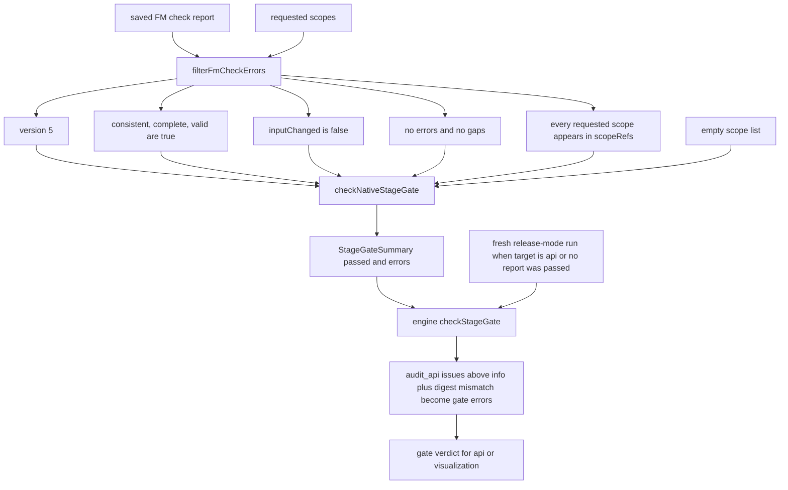
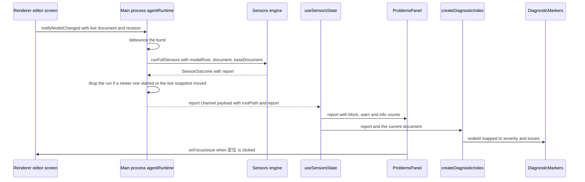

# Sensors, stage gates and governance

`libs/evidence-agent` owns the question the model cannot answer about itself:
*does this model still hold, and may it move on?* Nothing in the package writes
files. It reads a model tree (or an unsaved document handed to it), runs the
native sensors, folds every finding into one `SensorReport`, and — separately —
compares a production trace with the model to decide what the next turn may do.

Four pieces matter here:

| Module | Answers |
| --- | --- |
| `sensors/sensorReport.ts` | what one finding is, what one verdict is |
| `sensors/native/*` | consistency, key data, API coverage, production drift |
| `sensors/native/nativeStageGate.ts` + `sensors/sensorsEngine.ts` | may this scope be handed to API or review-page generation |
| `governance/governanceLoop.ts` | given drift and a replay, should the model move or the service |

The desktop never re-implements any of it: the renderer asks the main process,
the main process runs the engine, and the resulting `SensorReport` feeds the
status bar, the problems panel and the canvas markers, while the agent's
`run_sensors` tool and the MCP sensor routes read the same engine and the same
report shape
(`repo://apps/desktop/src/main/agentRuntime.ts#L107-L131`,
`repo://libs/evidence-agent/src/index.ts#L78-L113`).

## The shape every sensor folds into

A finding is a `SensorIssue`, and its identity is a string, not a pointer:

```text
issueId = `${source}:${code}:${message}`
```

`source` is one of `audit_api` | `check_fm` | `audit_key_data` | `audit_drift` |
`stage_gate`; `code` is a stable machine-readable kind such as
`FM_INCONSISTENT`. `message` is the human sentence and appears verbatim in the
problems panel and in MCP results. `targetNodeId` is an entity id or
`entity#attribute`, `contextRef` a context id, and `suggestion` the remedy the
sensor already knows (`repo://libs/evidence-agent/src/sensors/sensorReport.ts#L1-L23`,
`repo://libs/evidence-agent/src/sensors/sensorReport.ts#L82-L97`).

Because `message` is part of the identity, re-wording a finding makes it a new
finding. That is deliberate: the panel and the reviewers read messages, and a
reworded message is a different claim about the model.

A report is a `SensorReport`
(`repo://libs/evidence-agent/src/sensors/sensorReport.ts#L59-L80`):

| Field | Meaning |
| --- | --- |
| `issues` | de-duplicated by `issueId`, in the order the sources produced them |
| `blockCount`, `warnCount`, `infoCount` | recounted from the unique list, never accumulated |
| `passed` | `blockCount === 0` and nothing else |
| `canPreviewApi` | the same condition; draft preview is independent of release readiness |
| `keyDataSummary` | `totalItems`, `resolvedCount`, `decisionOwedCount`, `unresolvedItems` |
| `stageGate` | present only when a gate summary was merged in |
| `apiSummary` | projection counts, coverage, breaking changes, `hasBaseline`, `modelDigest` |
| `unavailableSensors` | checks the run could not complete |
| `documentRevision` | stamped by the desktop runtime, not by the sensors |

`finalizeSensorReport` is the only place counters and `passed` are computed, so
a caller that appends findings of its own must go through it rather than editing
a report by hand
(`repo://libs/evidence-agent/src/sensors/sensorReport.ts#L317-L368`). Two
invariants follow:

- De-duplication keeps the first issue for each `issueId`
  (`repo://libs/evidence-agent/src/sensors/sensorReport.ts#L335-L339`).
- At most 40 unresolved key-data items become findings (`MAX_KEY_DATA`), while
  `keyDataSummary` still counts the full ledger
  (`repo://libs/evidence-agent/src/sensors/sensorReport.ts#L158-L160`,
  `repo://libs/evidence-agent/src/sensors/sensorReport.ts#L256-L303`). A model
  with 200 open decisions therefore shows 40 rows and the true count.

`isStageGateReady` is the conjunction of four independent things — a supplied
stage gate that passed, zero owed decisions, zero blocking findings, and (when
an API summary exists) full coverage with no breaking change
(`repo://libs/evidence-agent/src/sensors/sensorReport.ts#L352-L360`). Because of
the first term, a report built without a gate summary is never gate-ready:
`runNativeSensors` and the review preview both call `buildSensorReport` without
one, so a plain sensor run always says `isStageGateReady: false`
(`repo://libs/evidence-agent/src/sensors/native/nativeSensors.ts#L80-L88`,
`repo://apps/desktop/src/main/reviewPreview.ts#L58-L72`). Gate readiness is read
from `engine.checkStageGate`, or from a report a caller explicitly finalized with
a gate — not from the boolean on a fresh run. The status bar inherits this: its
"门禁：可交下游" label is reachable only from a report that carries a passing
gate summary, so a live run normally renders "门禁：等待台账决议" or the API
variant (`repo://apps/desktop/src/renderer/components/BottomStatusBar.tsx#L42-L56`).

## One read, one digest

`loadModelSources` reads a `.evidence/fm` tree exactly once and returns the
document, the validation suite, the problems found while reading, a
`sha256:…` digest of every file, and a `rereadDigest` closure
(`repo://libs/evidence-agent/src/sensors/native/modelSources.ts#L43-L76`). That
single read is what makes `inputChanged` honest: `runNativeFmCheck` re-reads the
digest before checking, and a file edited mid-check invalidates its own result
instead of producing a report about two versions
(`repo://libs/evidence-agent/src/sensors/native/modelSources.ts#L111-L131`).

Two boundaries matter:

- A `*.evidence.json` bundle path is refused with a `ModelSourceError`; native
  sensors read a directory, and the desktop resolves a bundle project to the
  directory beside it before calling (`repo://libs/evidence-agent/src/sensors/native/modelSources.ts#L47-L51`).
- When the caller passes a live `document` instead of a root,
  `modelSourcesFromDocument` digests the in-memory JSON and its `rereadDigest`
  returns the same value — so `FM_INPUT_CHANGED` is structurally impossible for
  an unsaved canvas snapshot, and the run describes exactly the bytes the
  renderer sent (`repo://libs/evidence-agent/src/sensors/native/modelSources.ts#L78-L89`,
  `repo://libs/evidence-agent/src/sensors/native/nativeSensors.ts#L68-L72`).

The engine's `RunSensorsInput` does not expose `detectInputChange`, so a run
through `runFullSensors` always performs the second read; skipping it is only
possible by calling `runNativeSensors`/`runNativeFmCheck` directly with
`detectInputChange: false`, which the tests do
(`repo://libs/evidence-agent/src/sensors/native/modelSources.ts#L85-L97`,
`repo://libs/evidence-agent/src/sensors/native/nativeSensors.spec.ts#L56-L70`).

## The native sensors

`runNativeSensors` composes three of them over one read: FM check, key-data
audit, then the API sensor, with the API pass deliberately isolated so a broken
projection cannot erase the FM verdict
(`repo://libs/evidence-agent/src/sensors/native/nativeSensors.ts#L65-L129`).

| Sensor | Question | Inputs | Blocking codes |
| --- | --- | --- | --- |
| `check_fm` | is the model statically consistent, complete for the asked scopes, and does its own suite still simulate | `ModelSources` (model, suite, digest, source issues) | `FM_INCONSISTENT` |
| `audit_key_data` | does every key data item have a provider decision | model + the traceability document the FM check just computed | none — owed decisions are warnings |
| `audit_api` | does the model still project to the delivered API surface | live document, optional published baseline, `draft` or `release` | `SENSOR_UNAVAILABLE`, snapshot diagnostics at error severity, `API_BREAKING_CHANGE` in release mode |
| `audit_drift` | does production commit what the model declares | saved model root + one parsed OTLP/JSON trace | `UNMODELED_EVIDENCE_COMMITTED`, `DERIVED_VALUE_SUPPLIED` |

### `check_fm` — consistency first

`fmCheckIssues` maps the check report onto the severity vocabulary the modelling
skills already use (`repo://libs/evidence-agent/src/sensors/sensorReport.ts#L201-L254`):

| Condition | Severity | Code |
| --- | --- | --- |
| `errors` (static inconsistency) | `block` | `FM_INCONSISTENT` |
| `gaps` (scope not closed) | `warn` | `FM_SCOPE_GAP` |
| `inputChanged` | `warn` | `FM_INPUT_CHANGED` |
| `executedScenarioCount === 0` | `info` | `FM_NO_SCENARIO` |
| each `advisories[]` entry | `warn` | the advisory's own code, pointing at `entityId` |

Inconsistency blocks because a downstream contract must not be derived from a
model that does not close. A scope gap is only a warning here: consistency and
scope completeness are different questions, and the gate closes on gaps later,
once a scope is actually requested. What the FM report *contains* is documented
in [The native check and simulation pipeline](../model/checks-and-simulation.md).

### `audit_key_data` — owed decisions are warnings, not errors

`runNativeKeyDataAudit` classifies the ledger, attaches the derivation sources
the traceability graph already computed, and returns the report shape the badge
in the attribute table and this sensor share
(`repo://libs/evidence-agent/src/sensors/native/nativeKeyDataAudit.ts#L16-L67`).
`keyDataSummaryOf` then turns it into a summary plus findings
(`repo://libs/evidence-agent/src/sensors/sensorReport.ts#L256-L303`):

- every item still in `needsDecision` becomes one `warn` / `KEY_DATA_DECISION_OWED`
  with `targetNodeId = entity#attribute` and the ledger's `meaning` in the message;
- a ledger with nothing owed becomes a single `info` / `KEY_DATA_RESOLVED`
  ("N 项关键数据都有提供方结论"), including for an empty ledger;
- `resolvedCount = totalItems - decisionOwedCount`, clamped at zero.

The report's own note states the intent the severity encodes: the decision list
is not an error list. It is still enough to keep the stage gate shut, which is
what stops a model with orphan amounts from reaching API design.

### `audit_api` — draft preview is not release readiness

`checkNativeApiSensor` is read-only analysis: it projects the document with
`buildDelivery`, diffs against an optional baseline, and never acknowledges or
repairs a contract (`repo://libs/evidence-agent/src/sensors/native/nativeApiSensor.ts#L23-L112`).

- Coverage is measured only over entities of category `evidence`; roles and
  participants are not automatically public CRUD resources. Each uncovered
  entity is a `warn` / `API_COVERAGE_GAP` pointing at the entity.
- Snapshot diagnostics become findings at their own weight (`error` → `block`,
  otherwise `warn`).
- `API_BREAKING_CHANGE` is a `warn` in `draft` mode and a `block` in `release`
  mode — that single flag is the difference between inspecting a draft and
  authorising a release.
- A field that shifted `to_derived` is `info` / `API_DERIVATION_DRIFT`; a clean
  projection still emits one `info` / `API_ALIGNED`, worded so it cannot be read
  as an approval.

The summary carries `totalRoutes`, `coverageRatio`, `uncoveredEntities`,
`breakingChangeCount`, `hasBaseline` and `snapshot.digests.model`, and
`finalizeSensorReport` reads `uncoveredEntities`/`breakingChangeCount` when it
computes `isStageGateReady`.

Failure is isolated and explicit: if the API pass throws, `runNativeSensors`
keeps the FM and ledger report, appends a blocking `SENSOR_UNAVAILABLE` naming
`audit_api`, and records the source in `unavailableSensors`
(`repo://libs/evidence-agent/src/sensors/native/nativeSensors.ts#L89-L127`).

### `audit_drift` — production versus the model

The drift audit answers a different question from the three above, and it is
**not part of `runFullSensors`**. `runNativeDriftAudit` re-reads the saved model
root (not the session document, because an audit is about what was deployed) and
compares it with one exported trace; source-read problems are merged into the
audit's `errors` so an audit that could not see the whole model never reads like
a clean comparison (`repo://libs/evidence-agent/src/sensors/native/nativeDriftAudit.ts#L19-L30`).

Five kinds exist, and only two block
(`repo://libs/evidence-agent/src/sensors/native/driftSensor.ts#L17-L30`,
`repo://libs/evidence-agent/src/sensors/native/driftSensor.ts#L108-L113`):

| Kind | Severity | Meaning |
| --- | --- | --- |
| `UNMODELED_EVIDENCE_COMMITTED` | `block` | a service committed Evidence no modelled type covers |
| `DERIVED_VALUE_SUPPLIED` | `block` | a service wrote a value the model derives from other input |
| `UNMODELED_ATTRIBUTE_WRITTEN` | `warn` | a field the entity never declares |
| `CROSS_CONTEXT_WRITE` | `warn` | Evidence written into a context the model does not assign it to |
| `BREACH_WITHOUT_FOLLOW_UP` | `warn` | a breached request with no follow-up commit in the same context |

Each finding carries the commit (`traceId`, `spanId`, `serviceName`,
`operation`, `at`), `evidenceRef`, `contextRef`, a `modelExpectation` block and a
`remediation`. The remediation travels instead of a repair instruction because
production disagreeing with the model is not a model error: the report says what
the service did, and a person decides which side moves.

Drift findings can be folded into the same report shape — `driftIssues` maps each
finding to its own severity with `targetNodeId = evidenceRef` and
`suggestion = remediation`, and turns trace-read errors into `warn` /
`DRIFT_TRACE_UNREADABLE` with the OTLP/JSON hint
(`repo://libs/evidence-agent/src/sensors/sensorReport.ts#L161-L193`). No
production caller passes `drift` to `buildSensorReport` today: the operator sees
these findings in the simulation hub's drift tab, which shows the pass/fail
badge, the finding list and the remedy, and external agents see them through the
MCP drift route (`repo://apps/desktop/src/renderer/components/simulation/SimulationSandbox.tsx#L341-L411`,
`repo://apps/desktop/src/main/mcpRequestHandler.ts#L108-L124`).

## The stage gate

The gate is the moment a scope stops being under discussion and becomes
something a contract may be derived from, so it consumes a **saved** FM check
report rather than re-deriving the model; the doc comment states it refuses any
report that is not contract version 5
(`repo://libs/evidence-agent/src/sensors/native/nativeStageGate.ts#L5-L10`).



The diagram shows how a saved report and the requested scopes become one gate
summary, and where the engine adds the API recheck that a saved report cannot
cover. The governance loop is deliberately absent from it: drift and replay are
its only inputs, never a gate summary.

Each refusal is checked separately so a reviewer sees every reason at once,
which is why the errors are a list rather than a first failure
(`repo://libs/evidence-agent/src/sensors/native/nativeStageGate.ts#L35-L93`).
The gate refuses an empty scope list with "downstream never consumes an
unbounded model" and passes only when the error list is empty
(`repo://libs/evidence-agent/src/sensors/native/nativeStageGate.ts#L106-L124`).
`isGateReadyReport` is the same predicate without the scope-list check, for
callers that already know what they are asking about.

`engine.checkStageGate` is the operational wrapper
(`repo://libs/evidence-agent/src/sensors/sensorsEngine.ts#L70-L118`):

- it runs a fresh `runFullSensors` pass when the target is `api`, or when no
  saved report was supplied — an API hand-off always rechecks, because coverage
  and breaking changes depend on the current document, not on a saved FM report;
- it feeds `checkNativeStageGate` either the saved report or the fresh one, with
  `scopeRefs ?? []` as the scope list;
- only for `api`, it appends every `audit_api` issue above `info` as
  `CODE: message`, and refuses a saved report whose `modelDigest` differs from
  the fresh one (`FM 检查与当前模型摘要不一致，请重新检查。`), then re-derives
  `passed` from the combined error list.

A `visualization` gate stays FM-only by design: API coverage gaps must not close
the visualization hand-off, and the engine spec pins that asymmetry
(`repo://libs/evidence-agent/src/sensors/sensorsEngine.spec.ts#L71-L91`).

What the gate proves is scope completeness over a fresh, consistent, unchanged
report — plus, for an API hand-off, that the projection has no open coverage gap
and no breaking change. It says nothing about downstream authorization or
business approval; the surfaces that show its output say so in words ("机器检查
不等于业务批准") rather than implying a signature
(`repo://apps/desktop/src/renderer/components/console/ProblemsPanel.tsx#L135-L145`,
`repo://apps/desktop/src/main/reviewPreview.ts#L103-L121`).

The MCP bridge projects the same summary as `{passed, exitCode, driftDetected,
blockingReasons}` and closes on a thrown error instead of answering `passed:
true`, so `exitCode` is 0 only for a real pass
(`repo://apps/desktop/src/main/mcpSensorService.ts#L73-L103`).

## Governance: proceed, repair, or refuse

`decideGovernance` is a pure function of two signal groups — drift findings and
one replay summary — and produces a verdict, a rationale and the actions the
next turn is licensed to take
(`repo://libs/evidence-agent/src/governance/governanceLoop.ts#L142-L208`). It
imports nothing from the desktop, so the orchestrator's audit and the desktop can
feed it without either package depending on the other.

Every finding kind maps to exactly one action, and the mapping is the policy
(`repo://libs/evidence-agent/src/governance/governanceLoop.ts#L68-L138`):

| Drift kind | Action | Licensed tool | Verdict it implies |
| --- | --- | --- | --- |
| `UNMODELED_EVIDENCE_COMMITTED` | adopt the production change | `roleify_and_invert_dependency` | `model_lagging` |
| `UNMODELED_ATTRIBUTE_WRITTEN` | adopt the production change | `apply_model_patch` | `model_lagging` |
| `BREACH_WITHOUT_FOLLOW_UP` | close the compensation gap | `add_breach_compensation` | `model_lagging` |
| `CROSS_CONTEXT_WRITE` | move the write to its owner | `apply_model_patch` | `production_overreach` |
| `DERIVED_VALUE_SUPPLIED` | raise a blocking ticket | `null` — a person's decision | `production_overreach` |
| anything else | raise a blocking ticket | `null` | `production_overreach` |

The split is the point: some findings mean the model fell behind a change the
business already made, and the model moves; others mean a service wrote what
nobody agreed to, and the model must not move. An unknown kind is never guessed —
it becomes a ticket naming the kind, because inventing a remedy is worse than
asking.

The verdict is ranked, not additive: any `production_overreach` action wins, then
a failed replay or a `needs_repair` action, then `model_lagging`, otherwise
`healthy`. A replay where `passedCount < scenarioCount` also appends a
`repair_model` action pointing back at `run_sensors`
(`repo://libs/evidence-agent/src/governance/governanceLoop.ts#L176-L203`).

`canPatchModel` is the strictest of the outputs: it requires no blocking drift,
a green replay, **and** a `model_lagging` verdict. So a healthy model licenses no
edit, a production overreach licenses none, a missing replay licenses none
("没有回放结果：本轮不确认模型仍然成立。"), and a model that only lags behind on
a warning-severity finding is the one case that may absorb a change — and only
after the replay is green, so a repair is never built on a broken baseline
(`repo://libs/evidence-agent/src/governance/governanceLoop.ts#L200-L207`).

The governance prompt is written for that division of labour: read the trace with
`audit_production_drift`, confirm the model's own scenarios still replay, then
decide whose side moves, and report what was adopted, what was refused and what
was left for a person
(`repo://libs/evidence-agent/src/prompts/governance.ts#L12-L34`). At present the
policy has no production caller in the desktop: it is exported from the library
and exercised by unit tests plus one end-to-end test that walks simulation →
drift → decision on a single saved model
(`repo://apps/desktop/src/main/governanceLoop.spec.ts#L87-L218`).

## How issues reach the desktop

The renderer never runs a check; it holds a `SensorReport` it received and turns
it into two views — a docked list and canvas markers.



The sequence starts at the edit, shows the debounced run and the revision guard,
and ends at the two views that read the same report.

**Debounce.** `createDebouncedSensorRuntime` re-arms an 800 ms timer on every
edit, so only the last change in a burst runs; `flush`, `cancel` and `isPending`
cover save-time and dispose-time paths, and `run` rejections go to an injected
`onError` (which the runtime wires to a no-op) rather than surfacing as an
unhandled rejection
(`repo://apps/desktop/src/main/sensorRuntime.ts#L22-L58`,
`repo://apps/desktop/src/main/agentRuntime.ts#L134-L142`).

**Publication.** `runSensors` takes a sequence number and captures the current
`LiveDeliveryInput`; when the run resolves it publishes only if no newer run
started and the captured snapshot is still `live`. It stamps
`documentRevision` from that snapshot, so a report always names the revision it
describes, and an obsolete run is discarded instead of overwriting a newer
verdict (`repo://apps/desktop/src/main/agentRuntime.ts#L107-L131`,
`repo://apps/desktop/src/main/agentRuntime.spec.ts#L158-L212`).

**Delivery.** `latestReport` answers a late subscriber, and `report` is pushed on
every published verdict; both carry `rootPath` so a window showing another
project ignores it (`repo://apps/desktop/src/shared/agentIpc.ts#L20-L30`,
`repo://apps/desktop/src/main/agentIpcHandlers.ts#L189-L205`).

**Consumption.** `useSensorsState` asks for the latest report first and only
triggers a fresh run when there is none, then keeps updating from the pushed
channel. `refresh()` is the explicit "run now, ignore the debounce" path the
panel's 重新检查 button and the save effect use
(`repo://apps/desktop/src/renderer/state/useSensorsState.ts#L29-L86`).

**Index projection.** `createDiagnosticIndex` maps findings onto nodes:

- take `targetNodeId`, split at `#`, and accept the node only if it is a real
  entity or relationship id in the current document;
- otherwise fall back to `contextRef` **only** when that id is a context entity;
- otherwise drop the finding — a message that happens to mention an id is not an
  attachment;
- de-duplicate by `issueId` and keep the highest severity for a node, with
  `block > warn > info`.

That index is what `DiagnosticMarkers` colours on the canvas
(`repo://libs/desktop/feature-canvas/src/diagnosticIndex.ts#L14-L56`).

**Staleness.** Findings must describe the revision on screen, so the editor
hands the canvas `null` instead of a report whenever the report is missing, the
sensor state is loading or errored, the live bridge errored, or
`report.documentRevision` differs from the live revision — and it re-runs the
sensors after every save (`repo://apps/desktop/src/renderer/screens/EditorScreen.tsx#L228-L244`).

**Problems panel.** The panel is a docked strip, not a console: severity tabs with
the report's own counts, an explicit "结果已过期" marker, a row per finding with
severity label, message, `code`, target and suggestion, and a 定位 button per
row. Filtering lives in `filterIssues` outside the component so the rule ("a tab
shows exactly that severity; 全部 keeps the report's order") can be tested without
a DOM (`repo://apps/desktop/src/renderer/components/console/problemFilters.ts#L10-L19`,
`repo://apps/desktop/src/renderer/components/console/ProblemsPanel.tsx#L45-L188`).

**Focus.** 定位 runs `focusIssue`, which splits `entity#attribute` targets to
select the attribute row and pans to the node, and falls back to a context group
or a relationship edge when the target is not a node. The panel marks the row the
modeler was sent to via `activeIssueId`, set by `openProblemsWithIssue`
(`repo://apps/desktop/src/renderer/screens/EditorScreen.tsx#L349-L391`,
`repo://apps/desktop/src/renderer/state/useWorkspaceLayoutState.ts#L122-L126`).

The review preview reuses the same shape rather than defining its own: it builds
a report from an unsaved document's FM check and key-data ledger, then appends
`strictValidateDomainModel` issues with a `validation:` prefix so the review hub
and the problems panel can render and locate them with the same code
(`repo://apps/desktop/src/main/reviewPreview.ts#L58-L85`).

## Failure behaviour

| Situation | Result |
| --- | --- |
| model root unreadable | `loadModelSources` throws; a caller that must answer anyway reports the sensor in `unavailableSensors`, which produces a blocking `SENSOR_UNAVAILABLE` |
| bundle path passed to the sensors | explicit `ModelSourceError` — native sensors read a directory (`repo://libs/evidence-agent/src/sensors/native/modelSources.ts#L47-L51`) |
| source files changed during the check | `warn` / `FM_INPUT_CHANGED`, "结论已过期" (`repo://libs/evidence-agent/src/sensors/sensorReport.ts#L216-L228`) |
| scenarios unavailable for the asked scope | `info` / `FM_NO_SCENARIO`, never a pass |
| API projection throws | FM and ledger keep their verdict, `audit_api` is listed unavailable and blocks (`repo://libs/evidence-agent/src/sensors/native/nativeSensors.ts#L89-L112`) |
| no scopes asked of the gate | gate closed: downstream never consumes an unbounded model (`repo://libs/evidence-agent/src/sensors/native/nativeStageGate.ts#L106-L112`) |
| saved report is stale or not version 5 | gate closed with one error per failed condition (`repo://libs/evidence-agent/src/sensors/native/nativeStageGate.ts#L35-L93`) |
| saved report digest differs from the current model | gate closed with `FM 检查与当前模型摘要不一致，请重新检查。` (`repo://libs/evidence-agent/src/sensors/sensorsEngine.ts#L101-L110`) |
| trace is not parseable OTLP/JSON | drift audit returns `errors`; folded as `warn` / `DRIFT_TRACE_UNREADABLE`, not a crash |
| no replay result | `decideGovernance` refuses to patch and says the model was not confirmed this round (`repo://libs/evidence-agent/src/governance/governanceLoop.ts#L176-L183`) |

## Tests that protect this contract

- `sensorReport.spec.ts` pins the severity mapping (including advisory findings
  pointing at their entity), the key-data summary arithmetic, the
  "consistent but gated shut" case, the unavailable-sensor block, de-duplication
  and recounting, and the closed-gate defaults of `stageGateSummaryOf`
  (`repo://libs/evidence-agent/src/sensors/sensorReport.spec.ts#L9-L275`).
- `nativeSensors.spec.ts` asserts that one read yields model, suite and a stable
  digest, that a bundle is refused, that the golden fixture produces 14 key-data
  items and 3 scenarios with one owed decision, that the gate opens only for a
  covered scope, and that an unbounded or unversioned report is refused
  (`repo://libs/evidence-agent/src/sensors/native/nativeSensors.spec.ts#L17-L193`).
- `sensorsEngine.spec.ts` proves the engine needs no interpreter, that a draft
  refresh or an obsolete saved report cannot authorise a release, and that API
  coverage gaps stay out of the visualization gate
  (`repo://libs/evidence-agent/src/sensors/sensorsEngine.spec.ts#L18-L92`).
- `nativeApiSensor.spec.ts` pins draft-versus-release severity for breaking
  changes, the "analyse an unsaved document without reading the root" path, the
  evidence-only coverage rule, `canPreviewApi` without gate readiness, and API
  failure isolation (`repo://libs/evidence-agent/src/sensors/native/nativeApiSensor.spec.ts#L17-L188`).
- `driftSensor.spec.ts` pins all five kinds and their severities, from an
  exactly-matching trace through unmodeled evidence, derived values, cross-context
  writes and a breach with no follow-up
  (`repo://libs/evidence-agent/src/sensors/native/driftSensor.spec.ts#L80-L260`).
- `governanceLoop.spec.ts` pins the action table, the ranking of
  `production_overreach` above a broken replay, the refusal to patch without a
  replay, and the unknown-kind ticket
  (`repo://libs/evidence-agent/src/governance/governanceLoop.spec.ts#L9-L133`).
- `diagnosticIndex.spec.tsx` and `ProblemsPanel.spec.tsx` pin the index rules
  (dedupe, severity ranking, no references invented from messages, context and
  edge targets) and the panel's tabs, stale marker, active row and locate action
  (`repo://libs/desktop/feature-canvas/src/diagnosticIndex.spec.tsx#L37-L89`,
  `repo://apps/desktop/src/renderer/components/console/ProblemsPanel.spec.tsx#L69-L136`).

## Related pages

- [The native check and simulation pipeline](../model/checks-and-simulation.md) —
  what the FM report contains before it is folded, and how scenarios replay.
- [Key data and provenance](../language/key-data-and-provenance.md) — the ledger
  classification this sensor summarises.
- [The Pi agent harness and its tools](./pi-harness.md) — `run_sensors` and how
  the report reaches the model.
- [External agents over MCP](./mcp-integration.md) — `get_key_data_audit`,
  `run_stage_gate` and `audit_production_drift` over the bridge.
- [Canvas and inspector](../desktop/canvas-and-inspector.md) — where
  `DiagnosticMarkers` draws the index.
