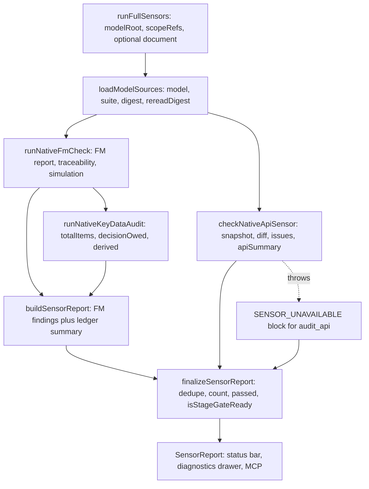
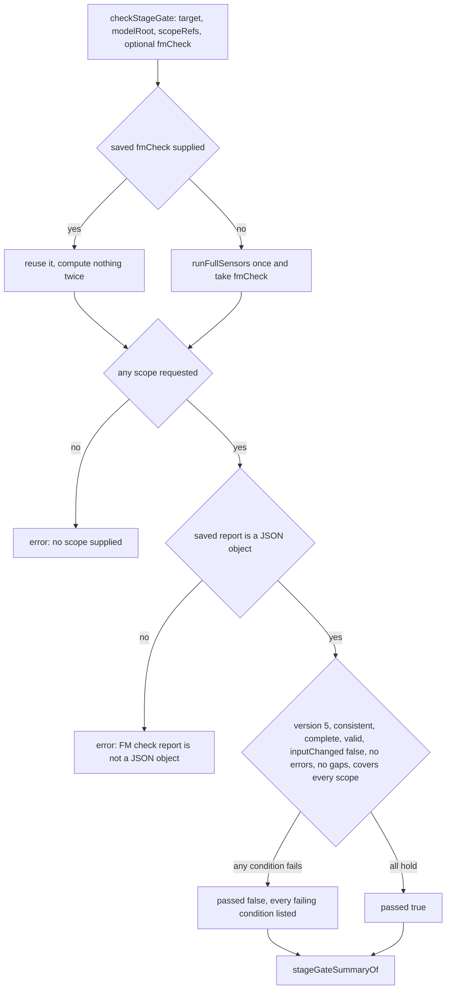

# Sensors, severity folding and the stage gate

The sensor layer of `libs/evidence-modeling-orchestrator` answers one question for
the agent, the desktop and external MCP clients alike: *may this model move on?*
It never owns the model and never writes files. One implementation runs in-process —
there is no mode to select and no interpreter to locate — reads the model tree
once, runs the checks that already live in `evidence-model-core` and
`evidence-api`, and folds the results into a single `SensorReport`.

| Module | Answers |
| --- | --- |
| `sensors/sensorReport.ts` | what the finding vocabulary is, how findings are de-duplicated and counted, and whether the model passed |
| `sensors/native/modelSources.ts` | what the one read of `.evidence/fm` produced, and whether it changed under the check |
| `sensors/native/nativeSensors.ts` | the whole native set in one pass: FM check, key data ledger, native API sensor |
| `sensors/native/nativeApiSensor.ts` | is every business entity reachable through a route, what would break, what moved to a derived field |
| `sensors/native/driftSensor.ts` | does production still match the model |
| `sensors/native/nativeStageGate.ts` | may this checked scope be handed to API or review-page generation |

The native set describes the model and nothing else: "the model is the only input:
there is no interview record to reconcile, so a verdict describes what the sources
say and nothing else"
(`repo://libs/evidence-modeling-orchestrator/src/sensors/native/nativeSensors.ts#L55-L60`).

## One read, one report

`loadModelSources` reads the document, the validation suite and the raw bytes
together, computes a `sha256` digest, and keeps a `rereadDigest` closure
(`repo://libs/evidence-modeling-orchestrator/src/sensors/native/modelSources.ts#L42-L72`).
That single read is what makes `inputChanged` meaningful: the FM check compares the
digest it started with against a second read, so a file edited mid-check invalidates
its own result instead of producing a report about two versions.

Two properties of that read matter:

- A `*.evidence.json` bundle path is refused outright with a `ModelSourceError` —
  native sensors read a directory
  (`repo://libs/evidence-modeling-orchestrator/src/sensors/native/modelSources.ts#L45-L49`).
- `modelSourcesFromDocument` wraps a caller-supplied document, hashes it for the
  digest, and returns that same digest from `rereadDigest`, so a run over an
  unsaved document can never report a change under the check
  (`repo://libs/evidence-modeling-orchestrator/src/sensors/native/modelSources.ts#L74-L86`).
  This is how the API sensor can analyse a canvas document without reading disk
  (`repo://libs/evidence-modeling-orchestrator/src/sensors/native/nativeApiSensor.spec.ts#L21-L31`).

`runNativeFmCheck` computes the traceability document once and returns it beside
the FM report, because the key data audit reads the same lineage: computing it
twice would let the two disagree
(`repo://libs/evidence-modeling-orchestrator/src/sensors/native/modelSources.ts#L103-L132`).

`runNativeSensors` is the composition point. It runs the FM check (report,
traceability, simulation), feeds the traceability into `runNativeKeyDataAudit`,
builds the base report, and then folds the API sensor into it through
`finalizeSensorReport`
(`repo://libs/evidence-modeling-orchestrator/src/sensors/native/nativeSensors.ts#L62-L129`).
The API fold is isolated in a `try`: a failing API analysis becomes a blocking
`SENSOR_UNAVAILABLE` finding plus an `unavailableSensors` entry for `audit_api`,
so the FM and ledger verdict survives it
(`repo://libs/evidence-modeling-orchestrator/src/sensors/native/nativeSensors.ts#L86-L114`).



One read, three folds, one verdict. The API branch is the only one that can fail
without taking the rest of the report with it.

## How findings become severity

`buildSensorReport` maps every source onto the same three-level vocabulary the
skills use
(`repo://libs/evidence-modeling-orchestrator/src/sensors/sensorReport.ts#L167-L260`,
`repo://libs/evidence-modeling-orchestrator/src/sensors/sensorReport.ts#L261-L301`,
`repo://libs/evidence-modeling-orchestrator/src/sensors/sensorReport.ts#L368-L409`):

| Source condition | Severity | Code |
| --- | --- | --- |
| FM `errors` | `block` | `FM_INCONSISTENT` |
| FM `gaps` | `warn` | `FM_SCOPE_GAP` |
| FM `inputChanged` | `warn` | `FM_INPUT_CHANGED` |
| zero executed scenarios | `info` | `FM_NO_SCENARIO` |
| an FM advisory (e.g. naming advice) | `warn` | the advisory's own code |
| key data still owed | `warn` | `KEY_DATA_DECISION_OWED` |
| every key data item resolved | `info` | `KEY_DATA_RESOLVED` |
| API coverage gap | `warn` | `API_COVERAGE_GAP` |
| API snapshot diagnostic | `block` if `error`, else `warn` | the diagnostic's code |
| breaking API change | `block` in release mode, `warn` in draft | `API_BREAKING_CHANGE` |
| field shifted to server-side derivation | `info` | `API_DERIVATION_DRIFT` |
| no API finding at all | `info` | `API_ALIGNED` |
| blocking drift finding | `block` | the drift kind |
| other drift finding | `warn` | the drift kind |
| unreadable production trace | `warn` | `DRIFT_TRACE_UNREADABLE` |
| a sensor could not run | `block` | `SENSOR_UNAVAILABLE` |

A scope gap stays a warning on purpose: consistency and completeness are different
questions, and a model may be consistent while a scope it has not yet asked for is
incomplete. The gate closes on gaps later, once a scope is actually requested.

Three counting rules are easy to miss:

- Every issue carries an `issueId` built from source, code and message (API issues
  add the route or entity id). `finalizeSensorReport` de-duplicates by that id and
  recounts severities from the unique list, so a caller that appends findings of
  its own cannot double-count a finding it already saw
  (`repo://libs/evidence-modeling-orchestrator/src/sensors/sensorReport.ts#L318-L340`).
- `MAX_KEY_DATA = 40` caps both the reported owed findings and
  `unresolvedItems`, while `decisionOwedCount` counts the whole list. A ledger with
  sixty owed decisions yields forty warnings and `decisionOwedCount: 60`
  (`repo://libs/evidence-modeling-orchestrator/src/sensors/sensorReport.ts#L158-L158`,
  `repo://libs/evidence-modeling-orchestrator/src/sensors/sensorReport.ts#L261-L300`).
- A fully resolved ledger still emits one informational `KEY_DATA_RESOLVED`,
  including for an empty ledger, and a clean API projection still emits one
  informational `API_ALIGNED` that says explicitly that it does not mean release
  review passed.

## The two booleans

`SensorReport` carries two different questions, and they are not nested
(`repo://libs/evidence-modeling-orchestrator/src/sensors/sensorReport.ts#L58-L77`):

```text
passed          = blockCount === 0
canPreviewApi   = blockCount === 0
isStageGateReady = stageGate?.passed === true
                && keyDataSummary.decisionOwedCount === 0
                && blockCount === 0
                && (apiSummary === undefined
                    || (apiSummary.uncoveredEntities.length === 0
                        && apiSummary.breakingChangeCount === 0))
```

`passed` is the static answer: no blocking finding from any folded source. The type
comment still describes it as "static FM consistency", but after the API fold the
same flag also counts API projection errors and, when a drift audit is supplied,
blocking drift. A model can therefore be `consistent: true` and `passed: false` in
the same report. `canPreviewApi` is deliberately the same expression: draft preview
eligibility is independent of release readiness
(`repo://libs/evidence-modeling-orchestrator/src/sensors/sensorReport.ts#L324-L357`).

`isStageGateReady` is the stronger, downstream answer, and it has a trap worth
stating plainly. Beyond a clean report it needs a merged gate summary that says
`passed` and zero owed key data decisions. Neither production
caller of `buildSensorReport` — `runNativeSensors` and the review-page preview
(`repo://apps/desktop/src/main/reviewPreview.ts#L55-L78`) — supplies a `stageGate`,
so every report the desktop or MCP surface receives from a plain run has
`isStageGateReady: false`, even when the model is consistent, complete and fully
resolved (`repo://libs/evidence-modeling-orchestrator/src/sensors/sensorReport.ts#L344-L356`,
`repo://libs/evidence-modeling-orchestrator/src/sensors/native/nativeSensors.ts#L80-L100`).
Gate readiness is obtained by asking the gate and reading its summary, not by
reading the boolean off a fresh sensor run.

The API terms are the second trap: even with a gate summary merged in, a report with
an uncovered evidence entity or a breaking change keeps release readiness false while
`canPreviewApi` stays true. `finalizeSensorReport` takes the issue list, a key data
summary and optionally a gate summary and an API summary, and recomputes the
counters rather than trusting whatever a caller already had
(`repo://libs/evidence-modeling-orchestrator/src/sensors/sensorReport.ts#L318-L357`).

## The native API sensor

`checkNativeApiSensor` is read-only analysis: "reprojection never acknowledges or
repairs a contract"
(`repo://libs/evidence-modeling-orchestrator/src/sensors/native/nativeApiSensor.ts#L22-L33`).
It always builds a delivery snapshot from the current document and only diffs when a
base document exists.

- **Coverage.** The expected set is every entity with `category === 'evidence'`;
  roles and participants are not automatically public CRUD resources. Each evidence
  entity without a projected route becomes a `warn` `API_COVERAGE_GAP` pointing at
  the entity, with the suggestion that re-projecting will not invent a business
  interface
  (`repo://libs/evidence-modeling-orchestrator/src/sensors/native/nativeApiSensor.ts#L34-L51`).
- **Snapshot diagnostics.** Projection diagnostics become findings with the
  diagnostic's own code, `error` mapped to `block` and anything else to `warn`
  (`repo://libs/evidence-modeling-orchestrator/src/sensors/native/nativeApiSensor.ts#L52-L60`).
- **Breaking changes.** `API_BREAKING_CHANGE` is `warn` in draft mode and `block` in
  release mode, carrying the remediation hint as the suggestion and pointing at the
  route's entity. Draft and release runs produce the same diff; only the severity
  differs
  (`repo://libs/evidence-modeling-orchestrator/src/sensors/native/nativeApiSensor.ts#L61-L72`).
  Breaking changes require a baseline: `runNativeSensors` passes no `baseDocument`
  and no `apiMode`, so a desktop sensor run is always a draft analysis with
  `hasBaseline: false` and `breakingChangeCount: 0`. Only the agent's projection
  refresh tool and direct callers supply a base document.
- **Derivation drift.** A field whose diff is `shifted === 'to_derived'` becomes an
  informational `API_DERIVATION_DRIFT` on `entity#attribute` — the model now expects
  the service to compute it (`repo://libs/evidence-modeling-orchestrator/src/sensors/native/nativeApiSensor.ts#L73-L84`).
- **Summary.** `ApiCoverageSummary` records `totalRoutes`, `coverageRatio` (`1` when
  there are no evidence entities), the sorted `uncoveredEntities`,
  `breakingChangeCount`, `hasBaseline` and the snapshot's `modelDigest`
  (`repo://libs/evidence-modeling-orchestrator/src/sensors/native/nativeApiSensor.ts#L94-L110`).

The severity split by mode is the whole reason the sensor takes a `mode`: the same
deleted confirmation is a review remark while designing and a release blocker when
the contract is being cut. `nativeApiSensor.spec.ts` pins both
(`repo://libs/evidence-modeling-orchestrator/src/sensors/native/nativeApiSensor.spec.ts#L34-L68`).

## Drift findings

Drift is a fold the sensor run does not perform. `driftIssues` turns a
`DriftAuditReport` into findings that keep the audit's own severity, map
`evidenceRef` to `targetNodeId`, keep the `contextRef`, and carry the audit's
remediation as the suggestion. A trace that could not be read becomes a `warn`
`DRIFT_TRACE_UNREADABLE` instead of an empty clean audit, because the audit's errors
are part of the answer
(`repo://libs/evidence-modeling-orchestrator/src/sensors/sensorReport.ts#L161-L190`).

In the audit itself, `UNMODELED_EVIDENCE_COMMITTED` and `DERIVED_VALUE_SUPPLIED`
are blocking; `UNMODELED_ATTRIBUTE_WRITTEN`, `CROSS_CONTEXT_WRITE` and
`BREACH_WITHOUT_FOLLOW_UP` are warnings. That split is a statement about repair
direction: production committing an object the model does not have is not a reason to
edit the model (`repo://libs/evidence-modeling-orchestrator/src/sensors/native/driftSensor.ts#L97-L106`).

`buildSensorReport` accepts the drift report and folds it, and `sensorReport.spec.ts`
pins that a blocking drift makes the report fail. No production sensor run passes
one: `runNativeDriftAudit` reads the saved model plus an OTLP/JSON export and is
reached through the MCP `audit_production_drift` tool, so drift findings reach a
user as an audit result with the same vocabulary rather than as part of the
status-bar report
(`repo://libs/evidence-modeling-orchestrator/src/sensors/native/nativeDriftAudit.ts#L19-L30`).

## The stage gate

`checkNativeStageGate` consumes a *saved* FM check report, not the live model:
the gate is the moment a scope stops being under discussion and becomes something a
contract can be derived from, and it refuses any report that is not contract version
5 (`repo://libs/evidence-modeling-orchestrator/src/sensors/native/nativeStageGate.ts#L1-L13`).

It refuses unless all of the following hold
(`repo://libs/evidence-modeling-orchestrator/src/sensors/native/nativeStageGate.ts#L36-L103`):

- at least one scope is supplied — downstream never consumes an unbounded model;
- `checkVersion === 5`;
- `consistent === true`;
- `complete === true` for the requested scope;
- `valid === true`;
- `inputChanged === false` — otherwise the evidence is stale;
- no `errors` and no `gaps` in the saved report;
- every requested scope appears in the report's `scopeRefs`.

Each condition is checked separately and appended, with no early return, so a
reviewer sees every reason at once instead of fixing one and discovering the next;
the error list is de-duplicated and `passed` is simply `errors.length === 0`
(`repo://libs/evidence-modeling-orchestrator/src/sensors/native/nativeStageGate.ts#L106-L124`).
A report that is not a JSON object collapses to a single error rather than crashing,
which is also what an absent report becomes.

What the gate proves is narrow, and the code says so: report shape, freshness and
scope coverage. It does not inspect the interview record for a closure marker, and
it does not look at API coverage or breaking changes at all — those live in
`isStageGateReady`'s API terms and in the API sensor, not in the gate. The gate also
collects an `evidence` block of `checkVersion`, `consistent`, `complete`, `valid`,
`inputChanged`, `errors` and the sorted `scopeRefs`, but `StageGateReport` has no
field for it, so that evidence never leaves the call; the returned report carries
`passed`, `target`, `scopeRefs` and `errors`.

`isGateReadyReport` is the boolean-only helper for callers that already hold a
report and only need the verdict
(`repo://libs/evidence-modeling-orchestrator/src/sensors/native/nativeStageGate.ts#L126-L130`).



The gate lists all failing conditions at once and defaults an incomplete summary to
closed.

### The engine around it

`createSensorsEngine` exposes exactly two operations: `runFullSensors`, which runs
the native set with an injected clock so a report's timestamp is reproducible, and
`checkStageGate`, which reuses the FM report a caller already has or runs one full
pass to obtain it, then normalises the result through `stageGateSummaryOf`
(`repo://libs/evidence-modeling-orchestrator/src/sensors/sensorsEngine.ts#L51-L99`).
Normalisation is defensive: a gate report missing `passed` becomes a closed gate and
a missing `target` becomes `api`
(`repo://libs/evidence-modeling-orchestrator/src/sensors/sensorReport.ts#L303-L316`).

Two consequences follow. The fresh-pass path only forwards `modelRoot` and
`scopeRefs`, so a gate decision always evaluates a draft-mode API analysis with no
baseline. And if the model root cannot be read, `runFullSensors` rejects, so the gate
promise rejects too rather than inventing a verdict; the MCP service turns that
rejection into a closed gate carrying the error message.

## Two consumers of one report

The same `SensorReport` is consumed by the desktop, by the agent tools, and by
external MCP clients. None of them recompute severities.

### Desktop surfaces

`useSensorsState` reads the verdict the main process publishes: it asks for
`latestReport` for the project root, runs the sensors once when there is none (so an
opened project never shows a blank gate), subscribes to `onReport` filtered by
`rootPath`, and exposes `refresh` which triggers a run immediately instead of waiting
for the debounce (`repo://apps/desktop/src/renderer/state/useSensorsState.ts#L20-L90`).
The main process publishes through `AgentRuntime.runSensors`, which stores
`latestReport` and pushes the report to the renderer
(`repo://apps/desktop/src/main/agentRuntime.ts#L100-L125`). The editor re-runs the
sensors after every save.

- **Status bar.** `BottomStatusBar` prints `阻塞 N`, `警告 N`, `提示 N` from the three
  counters, colours the dot red on any block, and turns the two booleans into one
  label: `检查器不可用` when `unavailableSensors` is non-empty, `门禁：不闭合` when
  `passed` is false, otherwise `门禁：可交下游` or `门禁：等待台账决议` depending on
  `isStageGateReady` (`repo://apps/desktop/src/renderer/components/BottomStatusBar.tsx#L35-L45`,
  `repo://apps/desktop/src/renderer/components/BottomStatusBar.tsx#L95-L117`). Because
  a plain run never merges a gate summary, the fallback label is what a passing model
  shows.
- **Diagnostics drawer.** `DiagnosticsDrawer` repeats the counts in its header, lists
  every finding with severity, message, `source · code · targetNodeId` and the
  suggestion, sorts currently selected issues first, and appends the owed-ledger
  section: `关键数据待决 N 项，阶段门禁保持关闭。` with each unresolved path and its
  meaning. A finding without a target stays clickable but inert — showing the message
  is honest, pretending it points somewhere is not
  (`repo://apps/desktop/src/renderer/components/sensors/DiagnosticsDrawer.tsx#L26-L131`).
- **Issue-to-node lookup.** `createDiagnosticIndex` maps findings onto canvas objects
  by explicit reference only: the entity part of `targetNodeId`, or a `contextRef`
  that names a context. Anything else is dropped, so a message that merely mentions
  an id does not create a marker. Duplicate `issueId`s are collapsed and the marker
  takes the highest severity seen (`block` > `warn` > `info`)
  (`repo://apps/desktop/src/renderer/state/diagnosticIndex.ts#L14-L56`).
  `EditorScreen` blanks the index whenever findings are stale — unsaved edits,
  an external change, a run in progress, a run error, or a report older than the last
  save — and marks the drawer stale instead of painting old findings as current
  (`repo://apps/desktop/src/renderer/screens/EditorScreen.tsx#L144-L159`).
  Clicking a finding selects the `entity#attribute` row when the target exists,
  otherwise pans to the owning context group or relationship geometry
  (`repo://apps/desktop/src/renderer/screens/EditorScreen.tsx#L228-L267`).

### MCP sensor service

`createMcpSensorService` is the second consumer and it does *not* read the desktop's
cached report: it builds one sensors engine per project root and runs the checks
itself, so an external agent always sees the model on disk
(`repo://apps/desktop/src/main/mcpSensorService.ts#L37-L60`).

- `get_key_data_audit` runs a full sensor pass and projects its key data report as
  `producedBy: 'native'`, or as `producedBy: 'unavailable'` with an explanatory note
  when the model cannot be read — never as an empty ledger that reads like a clean
  model. The derived list is dropped from that projection
  (`repo://apps/desktop/src/main/mcpSensorService.ts#L20-L29`,
  `repo://apps/desktop/src/main/mcpSensorService.ts#L62-L73`).
- `run_stage_gate` returns `passed`, `exitCode` `0` or `1`, `driftDetected: false`
  and the gate's own error strings as `blockingReasons`; a throw becomes a closed gate
  with the error message, so a crashed gate never reads as approval
  (`repo://apps/desktop/src/main/mcpSensorService.ts#L74-L104`).
- `mcpRequestHandler` routes `get_key_data_audit` and `run_stage_gate` to that
  service instead of to the renderer, resolving the project root from
  `get_app_state`'s `activeProject` and failing with `NO_ACTIVE_PROJECT` when no
  project is open
  (`repo://apps/desktop/src/main/mcpRequestHandler.ts#L61-L107`).

The same report also surfaces the other way round: the renderer publishes
`sensorsSummary` — `blockCount`, `warnCount`, `decisionOwedCount`,
`isStageGateReady` — inside `get_app_state`, so an agent can see the verdict the human
is looking at without running anything
(`repo://apps/desktop/src/renderer/state/useMcpBridge.ts#L51-L71`). The Pi harness
uses the third surface: its `run_sensors` tool returns `passed`, `isStageGateReady`,
the three counts, `decisionOwed` and the full issue list
(`repo://libs/evidence-modeling-orchestrator/src/tools/evidenceTools.ts#L170-L196`).

Design rule of thumb: the status bar and drawer read the published report; the two
MCP audit calls run their own engine; nothing re-implements severity mapping.

## Failure behaviour

| Situation | Result |
| --- | --- |
| model root unreadable during a run | `loadModelSources` throws and the run rejects; `useSensorsState` surfaces the error (`无法运行检查器。` for an explicit refresh, `无法读取检查结果。` for the initial load). `buildSensorReport` can still express an unavailable sensor as a blocking `SENSOR_UNAVAILABLE` for callers that must answer anyway (`repo://libs/evidence-modeling-orchestrator/src/sensors/sensorReport.ts#L380-L401`, `repo://apps/desktop/src/renderer/state/useSensorsState.ts#L29-L84`) |
| bundle path passed to sensors | explicit `ModelSourceError` — native sensors read a directory (`repo://libs/evidence-modeling-orchestrator/src/sensors/native/modelSources.ts#L45-L49`) |
| API analysis throws | blocking `SENSOR_UNAVAILABLE` for `audit_api`; FM and ledger findings intact (`repo://libs/evidence-modeling-orchestrator/src/sensors/native/nativeSensors.ts#L86-L114`) |
| model root unreadable during a gate check | the gate promise rejects; the MCP service reports a closed gate with the message |
| no saved FM report | `FM check report is not a JSON object` — a closed gate, not a pass |
| saved report is not version 5 | `FM check contract is not version 5: <value>` |
| report changed under the check | `FM inputs changed after the check; the evidence is stale` |
| no scope requested | `no scope supplied; downstream never consumes an unbounded model` |
| requested scope not in `scopeRefs` | `FM check does not cover scope '<scope>'` |
| more than 40 owed key data decisions | only the first 40 become findings, `decisionOwedCount` keeps the full count |

## Tests that protect this contract

- `sensorReport.spec.ts` pins the severity mapping (including an advisory pointing at
  its entity), key data counting and the resolved case, the "consistent but gated
  shut" report with an owed decision and a passing gate summary, unavailable sensors
  blocking, the empty ledger default, de-duplication and recounting,
  `stageGateSummaryOf` defaulting to closed, and drift findings folding into the one
  verdict (`repo://libs/evidence-modeling-orchestrator/src/sensors/sensorReport.spec.ts#L10-L230`,
  `repo://libs/evidence-modeling-orchestrator/src/sensors/sensorReport.spec.ts#L231-L295`).
- `nativeSensors.spec.ts` asserts one read yields the model, suite and a stable
  digest; that a bundle is refused; that the golden `valid-traceable-subscription`
  fixture folds to a passing verdict with 14 key data items and 3 scenarios; that the
  gate opens for a checked scope the saved report covers and stays shut with the
  exact error for a scope it does not; and that an empty scope list plus a version 4
  report produce both errors at once
  (`repo://libs/evidence-modeling-orchestrator/src/sensors/native/nativeSensors.spec.ts#L19-L99`,
  `repo://libs/evidence-modeling-orchestrator/src/sensors/native/nativeSensors.spec.ts#L109-L193`).
- `nativeApiSensor.spec.ts` pins analysis of an unsaved document without reading
  `modelRoot`, breaking changes escalating from `warn` to `block` by mode, coverage
  gaps limited to evidence entities, draft preview allowed while release readiness is
  withheld, and a failed API analysis isolated from the FM result
  (`repo://libs/evidence-modeling-orchestrator/src/sensors/native/nativeApiSensor.spec.ts#L21-L134`).
- `sensorsEngine.spec.ts` pins the injected clock and a gate decision taken from the
  same report the sensors produce
  (`repo://libs/evidence-modeling-orchestrator/src/sensors/sensorsEngine.spec.ts#L17-L43`).
- On the desktop, `mcpSensorService.spec.ts` pins native-versus-unavailable
  projection, exit codes and one cached engine per project root
  (`repo://apps/desktop/src/main/mcpSensorService.spec.ts#L27-L108`),
  `diagnosticIndex.spec.tsx` pins the "no reference invented from a message" rule and
  severity ranking (`repo://apps/desktop/src/renderer/state/diagnosticIndex.spec.tsx#L38-L88`),
  and `agentRuntime.spec.ts` pins that an explicit run uses the project model root,
  publishes the report and stores it as `latestReport`
  (`repo://apps/desktop/src/main/agentRuntime.spec.ts#L234-L252`).

## Related pages

- [The native check and simulation pipeline](../model/checks-and-simulation.md) —
  what the FM report contains before it is folded.
- [API contract projection](../contracts/api-projection.md) — what the delivery
  snapshot and the model diff are before the API sensor ranks them.
- [The Pi agent harness and its tools](./pi-harness.md) — `run_sensors` and how the
  report reaches the model.
- [External agents over MCP](./mcp-integration.md) — `get_key_data_audit`,
  `run_stage_gate` and `audit_production_drift` over the bridge.
- [Desktop app shell](../desktop/app-shell.md) — where the status bar and diagnostics
  drawer sit in the editor.
- [Verification strategy](../testing/verification-strategy.md) — how these sensor
  contracts are covered by tests.
