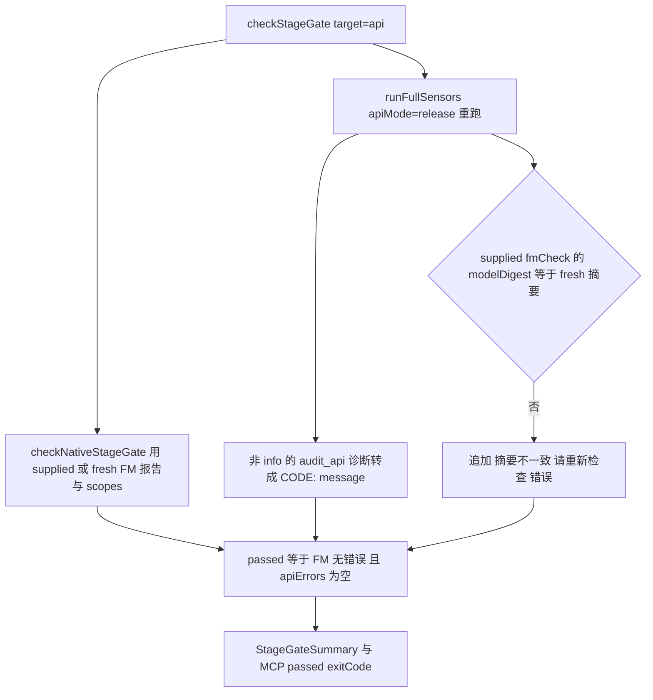

# 传感器、门禁与生产漂移

`libs/evidence-agent/src/sensors` 负责三件事：native 传感器计算事实，`sensorReport` 把事实折叠成一份报告，`sensorsEngine` 决定这份报告能否打开下游门禁。它们只分析、不写模型：静态通过既不是 HTTP 后端验收，也不是业务批准。

## 只有一种引擎实现

`createSensorsEngine` 的契约写在代码注释里：**一种进程内实现**，每次检查读一次模型树并只从这次读取作结论；没有可选的模式、没有需要解析的解释器、没有需要定位的安装目录——检查逻辑与 schema 就是代码本身。它只对外暴露 `runFullSensors` 与 `checkStageGate`。

桌面主进程按需构造这个引擎：`agentRuntime` 为每个项目建一个，`mcpSensorService` 按 project root 缓存实例，因此画布状态栏与 MCP 工具拿到的是同一份判定，而不是两套检查器。`sensorsEngine.spec.ts` 直接对 golden 模型断言"读模型、不需要解释器"。

代码里仍残留少量 "pinned interpreter" 旧措辞（`sensorRuntime.ts` 的文件注释与 `sensorReport.spec.ts` 的一个测试名）。那是历史遗留，不代表存在可选解释器或安装目录。

## 一次读取，一份报告

磁盘来源经 `loadModelSources` 一次性读入模型、`sourceIssues`、`sha256` 摘要与 `rereadDigest`；各传感器共享同一次读取，所以 digest、document 与内联 examples 描述的是同一批字节——这正是 `inputChanged` 可信的前提。直接的 `*.evidence.json` bundle 路径会被拒绝（`ModelSourceError`），native sensors 只认模型目录。内存 document 走 `modelSourcesFromDocument`：JSON 摘要固定、`rereadDigest` 恒等，因此不会产生磁盘式的 `FM_INPUT_CHANGED`。

`runNativeFmCheck` 只算一次 `analyzeTraceability`，把 traceability 文档与 FM 报告一起返回，台账审计复用同一份血缘，避免两套追溯互相矛盾。默认会二次读摘要检测检查期间的变化；`detectInputChange: false` 可跳过这次重读，但引擎的 `RunSensorsInput` 不暴露该开关，只有直接调用 native 层的测试会用到。

`SensorIssue` 的身份是 `source:code:message`，携带 `block`/`warn`/`info` 严重性、五类 source（`check_fm`、`audit_key_data`、`audit_api`、`audit_drift`、`stage_gate`）以及可选的 `targetNodeId`、`contextRef`、`suggestion`；改写消息等于产生新身份。`finalizeSensorReport` 用 `Map` 按 issueId 去重（后值覆盖、保留键顺序）后重算计数，`passed` 与 `canPreviewApi` 都只表示 `blockCount === 0`。无法执行的传感器必须留下阻塞级 `SENSOR_UNAVAILABLE`，不能静默略过。

各传感器的判定：

- **FM**：`errors` → block `FM_INCONSISTENT`；`gaps` → warn `FM_SCOPE_GAP`；`inputChanged` → warn `FM_INPUT_CHANGED`；`advisories` 保留自身 code，以 warn 呈现并定位到 `entityId`。
- **台账**：待决项 → warn `KEY_DATA_DECISION_OWED`，定位 `entity#attribute`；最多输出 40 条，summary 仍统计全量；没有待决项时输出一条 info `KEY_DATA_RESOLVED`（空台账同样如此）；`resolvedCount = max(0, total - owed)`。
- **API**：`buildDelivery` 投影当前与基线文档，用 oasdiff 比较。覆盖率只统计 evidence 实体（参与方与角色不是公共 CRUD）；未覆盖为 warn `API_COVERAGE_GAP`，snapshot 的 error 级诊断为 block，其余为 warn；兼容性变化 `level >= 2` 在 draft 是 warn、在 release 是 block；无任何问题时给 info `API_ALIGNED`，明确"不代表已通过发布审查"。
- **API 故障隔离**：API 分析抛错时保留 FM 与台账结论，只追加一条阻塞级 `audit_api SENSOR_UNAVAILABLE`，并把 `audit_api` 记入 `unavailableSensors`。

## block、warn 与"能不能交下游"是四件事

同一份报告里有四个不同的判定，不能互相替代：

| 字段 | 含义 | 谁读它 |
| --- | --- | --- |
| `passed` | 本次运行没有 block | 状态栏、问题面板 |
| `canPreviewApi` | 草稿预览可用性，与发布就绪无关 | API 预览 |
| `isStageGateReady` | 报告自带的"可交下游"结论 | 状态栏标签 |
| `StageGateSummary.passed` / MCP `passed` | 门禁本身是否放行 | MCP 工具与调用方 |

`isStageGateReady` 的条件很严格：必须**附带一个 `passed === true` 的 stageGate**，且待决台账为 0、无 block，并且在存在 `apiSummary` 时无未覆盖实体、无破坏变更。普通 sensor run 从不传 stageGate，所以一份实时报告的 `isStageGateReady` 永远是 false——这个 false 不代表新增故障，也不能读成"模型有问题"。

因此状态栏的标签是逐级降级的：`unavailableSensors` 非空 → "检查器不可用"；`!passed` → "门禁：不闭合"；有 API 缺口或破坏变更 → "门禁：等待 API 契约审查"；否则才是 `isStageGateReady ? "门禁：可交下游" : "门禁：等待台账决议"`。实时运行只会落到前几档与"等待台账决议"，"可交下游"标签只能由携带 stageGate 的报告点亮。

反过来，待决台账**是 warn**，却让 `isStageGateReady` 变红：待决金额或期限不是静态语法错误，但"没有提供方结论"的模型不该被推给下游。这也是 pending 不能变绿的具体含义。

## Version 6 阶段门禁

`nativeStageGate` 消费一份 FM 报告而不重建模型：要求 `checkVersion === 6`、`consistent`/`complete`/`valid` 均为 `true`、`inputChanged === false`、无 `errors`、无 `gaps`，且每个被请求的 scope 都出现在报告的 `scopeRefs` 里。空 scope 被明确拒绝——"下游不消费无边界模型"。每个条件单独判定，所有拒绝原因**累积**返回，让审查者一次看全，而不是修一个再发现下一个；`isGateReadyReport` 是去掉空 scope 检查的同一谓词。

版本号是硬门槛：v5 或更早的报告直接拒绝。草稿模式的宽松结论也无法打开门禁——门禁侧永远以 `apiMode: 'release'` 重跑一次完整扫描，破坏变更在那一轮是 block。

引擎的 `checkStageGate` 不接收内存 document，只读 `modelRoot`：门禁永远针对磁盘上已保存的模型。即使调用方提供了保存过的 `fmCheck`，引擎仍会 fresh 重跑，并用 `modelDigest` 比对——摘要不同就追加"FM 检查与当前模型摘要不一致"并拒绝，旧报告无法冒充当前模型。

API 侧的错误来自所有 severity 不为 `info` 的 `audit_api` 诊断，逐条格式化为 `CODE: message`。注意这包括 warn：`API_COVERAGE_GAP` 是警告，却同样让 API 门禁关闭（`sensorsEngine.spec.ts` 断言 golden 模型的 API 门禁因两条覆盖缺口而失败）。因此"报告 passed 为真"和"门禁放行"经常同时不成立。

MCP 侧只做投影：`run_stage_gate` 返回 `passed`、`exitCode`（`0`/`1`）、`driftDetected`（当前恒为 `false`）与 `blockingReasons`；门禁抛错时返回 `passed: false`、`exitCode: 1` 并把错误文本放进 `blockingReasons`，绝不伪造 `0`。`get_key_data_audit` 同理：模型读不出来时把状态标成 `unavailable` 并给出说明，而不是返回一份看起来干净的空台账。

台账口径与门禁口径并不重叠：`nativeStageGate` 不看关键数据台账，所以 MCP 的 `passed` 可以是 true，而同一模型的报告 `isStageGateReady` 仍是 false。"能交下游"的判断需要两者同时成立。

## 生产漂移：一次导出的只读审计

漂移不属于 `runFullSensors`。它有两个入口，都针对**已保存**的模型：

- 桌面：`driftIpc` 打开文件对话框选一份 OTLP/JSON，读完 JSON 交给 `createDriftService().auditDrift`；
- MCP：`audit_production_drift` 由调用方内联传 `document`。

两条入口最终都走 `runNativeDriftAudit`：用 `loadModelSources(modelRoot)` 重新读盘，用 `readProductionTrace` 解析 trace，再跑 `auditProductionDrift`。模型是为这次调用重新读的，因为"生产在跑什么"与"画布上还没保存的编辑"是两件事。

trace 读取把 OTLP/JSON 当作事实来源：只有带 `fm.evidence.ref` 的 span 才成为业务凭证提交，`service.name` 来自 resource（span 上的同名属性可以覆盖），`fm.value.*` 变成写入值，`fm.fulfillment.*` 变成履约声明；OTLP 用字符串编码的整数会被转回数字，否则数字永远匹配不上模型；畸形 span 只记入 `errors` 并被跳过，绝不猜测。

| kind | 默认严重性 | 这条发现在说什么 |
| --- | --- | --- |
| `UNMODELED_EVIDENCE_COMMITTED` | block | 生产提交了模型里没有的凭证 |
| `DERIVED_VALUE_SUPPLIED` | block | 模型规定由规则算出的字段被当成入参写入 |
| `UNMODELED_ATTRIBUTE_WRITTEN` | warn | 写了模型没声明的字段 |
| `CROSS_CONTEXT_WRITE` | warn | 凭证被写进了非所属上下文 |
| `BREACH_WITHOUT_FOLLOW_UP` | warn | 违约之后 trace 里没有任何后续履约 |

每条 finding 带 `commit`、`evidenceRef`、`contextRef`、`modelExpectation` 与 `remediation`。`passed` 只表示没有 block；warn 级发现仍然要人做决定，所以"通过"不等于"没有漂移"。源读取问题会并进审计的 `errors`，一次看不全模型的审计不会读起来像一次干净的比对。

桌面展示层是 `libs/desktop/feature-drift` 里的 `DriftRadar`（不是已删除的 SimulationSandbox）：选文件、显示读了几个 span 与几个业务凭证、列出 trace 解析错误、逐条渲染严重性中文标签、kind 中文标签、`evidenceRef`、消息与补救方向，顶部徽标区分"没有阻塞漂移"与"存在阻塞漂移"；取消选择文件会保留上一次结果，`embedded` 时以 region 停靠在控制台而不是弹 dialog。

这里的边界需要说清：漂移检测是**按需、只读**的。没有轮询、没有自动比对、没有把漂移写回模型、没有自动打补丁。`sensorReport.driftIssues` 与 `buildSensorReport({ drift })` 提供了把 finding 折叠为 `SensorIssue`（沿用严重性、把 `evidenceRef` 映射 target、`remediation` 映射 suggestion）的能力，但当前 `runFullSensors` 不喂漂移，所以漂移既不改变报告计数，也不影响任何门禁结论。把它当成"生产与模型已经实时双向闭环"是错的。

## governanceLoop：把漂移与验收合成一个决策

`decideGovernance({ drift, acceptance })` 是纯函数：它只读传感器报上来的东西，既不重跑检查也不改写模型。每种 finding kind 对应一个行动与一个宏工具：

| kind | action | tool |
| --- | --- | --- |
| `UNMODELED_EVIDENCE_COMMITTED` | `adopt_production_change` | `roleify_and_invert_dependency` |
| `UNMODELED_ATTRIBUTE_WRITTEN` | `adopt_production_change` | `apply_model_patch` |
| `BREACH_WITHOUT_FOLLOW_UP` | `close_compensation_gap` | `add_breach_compensation` |
| `CROSS_CONTEXT_WRITE` | `move_write_to_owner` | `apply_model_patch` |
| `DERIVED_VALUE_SUPPLIED` | `raise_blocking_ticket` | 无（服务端缺陷不能靠改模型迁就） |
| 未知 kind | `raise_blocking_ticket` | 无（交人工，不猜补救） |

验收门槛按"缺失即不确定"处理：没有 `acceptance` 就写明"本轮不确认实现符合模型"；`testCount`/`passedCount` 非整数、`testCount < 1`、未全通过或有 `errors`，都会追加 `repair_implementation` 并压住修补路径——空跑或畸形的 runner 摘要永远不会被当成绿灯。

verdict 优先级是 `production_overreach` > `needs_repair` > `model_lagging` > `healthy`；`canPatchModel` 只在"无 blocking 漂移 + 提供了验收且全绿 + verdict 为 `model_lagging`"时为真。也就是说：生产越权写入要先交人工，即使验收全绿也不能让模型吸收它。

今天这套策略只被测试驱动：库侧 spec 覆盖每种 kind、未知类型与验收失败；`apps/desktop/src/main/governanceLoop.spec.ts` 用真实的 drift service 加 golden 模型跑通"一份模型 → 一份决策"。桌面没有把它接到按钮或自动补丁调度器上，所以"策略给出 `canPatchModel`"与"生产里真的自动改了模型"是两回事。

## live revision 与 debounce：旧报告不能冒充当前模型

主进程用两层机制防止过期结论污染界面：

1. **debounce**：`createDebouncedSensorRuntime` 把一串编辑折叠成一次运行（默认 800ms），提供 `schedule`/`flush`/`cancel`/`isPending`，并把运行异常交给注入的 `onError`，避免后台运行变成未处理的 rejection。
2. **revision 与运行序号**：`notifyModelChanged` 校验来源与 revision，revision 不高于当前 live 快照时整条输入被忽略（连重跑都不排）；接受新输入时清空 `latestReport`，并把最初那份 `baseDocument` 固定下来作为基线。`runSensors` 在开始时自增 `runSequence` 并捕获当时的 live 快照，只有在"未 dispose、序号仍是最新、捕获的快照仍是当前"时才发布报告，并把捕获的 `revision` 写成 `documentRevision`。

渲染层不自己造结论：`useSensorsState` 先取主进程已发布的 `latestReport`，没有才触发一次 fresh run，之后按 `rootPath` 过滤订阅推送；`refresh` 忽略 debounce 立即重查，保存成功后也会重查。

编辑器的门槛更直白：只要 live bridge 出错、`report.documentRevision !== liveModel.revision`、或传感器处于 loading/error，`diagnosticsStale` 为真，`createDiagnosticIndex` 收到 `null`——画布不显示任何节点徽标，状态栏与问题面板打上"结果已过期"。同一份 stale 标记同时驱动两处，避免一个地方说"最新"、另一个地方说"过期"。

问题面板把发现项渲染成停靠在画布下方的条带：严重性 tab 的计数直接取自报告、显式的过期标记、每行显示严重性/消息/code/target/建议、可高亮当前行并"定位"；过滤规则放在组件外的 `filterIssues` 里，便于无 DOM 测试；空状态明确写出"机器检查不等于业务批准"。定位只接受显式引用：`createDiagnosticIndex` 会把 `targetNodeId` 在 `#` 处切开并要求 id 存在于当前文档，否则只在 `contextRef` 真是 context 时才挂载，消息里提到的 id 不会形成挂载。

这条链上的 stale 标记只影响展示，不改变报告内容与门禁结论：过期报告仍是过期报告，`passed`/`isStageGateReady` 不会因为界面刷新而变。

## 验证要点

- `sensorReport.spec.ts`：FM 严重性、无 simulation 发现、advisories 定位、台账上限与 `KEY_DATA_RESOLVED`、去重与计数、`stageGateSummaryOf` 的保守默认值。
- `nativeSensors.spec.ts`：一次读取、拒绝 bundle、golden 的 v6 报告、台账分类、scope 覆盖与空 scope、`inputChanged` 拒绝。
- `sensorsEngine.spec.ts`：不需要解释器、release 模式破坏变更挡住门禁、旧摘要被拒、API 覆盖缺口让门禁失败。
- `nativeApiSensor.spec.ts`：draft/release 的严重性升级、基线不被改写、参与方不要求 CRUD、API 故障隔离、草稿可预览但不能发布。
- `driftSensor.spec.ts` / `productionTrace.spec.ts`：五种漂移、派生值定位到规则、跨上下文与未声明字段为 warn、otlp 属性解码。
- `governanceLoop.spec.ts`（库与桌面各一份）：行动映射、verdict 优先级、验收门槛，以及"一份模型 → 一份决策"。
- `agentRuntime.spec.ts` / `sensorRuntime.spec.ts`：`documentRevision` 标记、旧运行被丢弃、burst 只跑一次、异常走 `onError`。
- `DriftRadar.spec.tsx`：findings 与补救方向渲染、取消保留上次结果、embedded 为 region。

参见[静态检查与模拟](../model/checks-and-simulation.md)、[关键数据与来源](../language/key-data-and-provenance.md)、[HTTP 验收](../workflows/http-acceptance.md)、[桌面工作区](../desktop/workspace-surfaces.md)、[Pi 工具](./pi-harness.md)。
