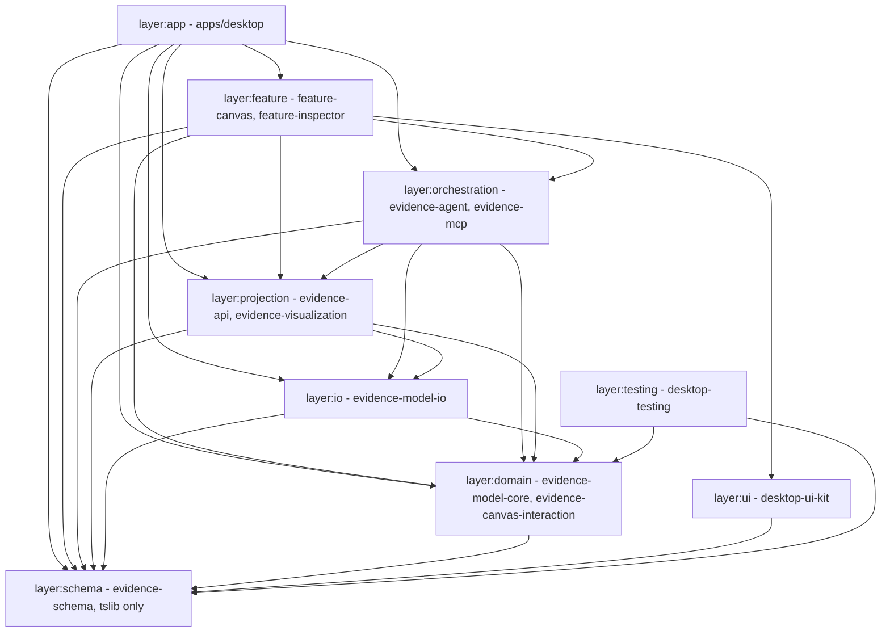
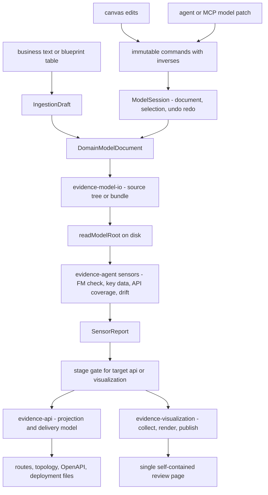

# System map and dependency direction

Evidence is one pnpm workspace holding one runnable application and twelve
library projects. The shape is deliberate: the language and its static checks sit
at the bottom, the projection and orchestration packages sit above them, the
desktop feature libraries sit beside those, and the Electron shell sits on top.
A library never imports the app, and no ring may reach upward.

This page is the index to that shape. Behaviour belongs to the owning pages,
linked at the end.

## The package map

The map below comes from the manifests, not from prose: `pnpm-workspace.yaml`
selects `apps/*`, `libs/*` and `libs/desktop/*`
(`repo://pnpm-workspace.yaml#L1-L3`), and each project's `nx.tags` and
`dependencies` block is its entry.

| Project (`nx.name`) | Path | Ring and platform tags | Workspace dependencies |
| --- | --- | --- | --- |
| `evidence-schema` | `libs/evidence-schema` | `layer:schema`, `platform:universal`, `scope:shared` | none (`tslib` only) |
| `evidence-model-core` | `libs/evidence-model-core` | `layer:domain`, `platform:universal`, `scope:model` | schema |
| `evidence-canvas-interaction` | `libs/evidence-canvas-interaction` | `layer:domain`, `platform:universal`, `scope:model` | model-core, schema |
| `evidence-model-io` | `libs/evidence-model-io` | `layer:io`, `platform:node`, `scope:model` | model-core, schema |
| `evidence-api` | `libs/evidence-api` | `layer:projection`, `platform:node`, `surface:browser-safe`, `scope:api` | model-core, model-io, schema |
| `evidence-visualization` | `libs/evidence-visualization` | `layer:projection`, `platform:node`, `scope:visualization` | api, canvas-interaction, model-core, model-io, schema |
| `evidence-agent` | `libs/evidence-agent` | `layer:orchestration`, `platform:node`, `surface:browser-safe`, `scope:agent` | api, model-core, model-io, schema |
| `evidence-mcp` | `libs/evidence-mcp` | `layer:orchestration`, `platform:node`, `scope:mcp` | model-core, schema |
| `desktop-ui-kit` | `libs/desktop/ui-kit` | `layer:ui`, `platform:browser`, `scope:desktop` | none |
| `desktop-feature-canvas` | `libs/desktop/feature-canvas` | `layer:feature`, `platform:browser`, `scope:desktop` | agent, api, canvas-interaction, model-core, schema |
| `desktop-feature-inspector` | `libs/desktop/feature-inspector` | `layer:feature`, `platform:browser`, `scope:desktop` | ui-kit, api, model-core, schema |
| `desktop-testing` | `libs/desktop/testing` | `layer:testing`, `platform:browser`, `scope:desktop` | schema |
| `desktop` | `apps/desktop` | `type:app`, `layer:app`, `platform:node`, `scope:desktop` | every evidence library plus ui-kit, feature-canvas, feature-inspector (`desktop-testing` is a dev dependency) |

Two notes on names, both visible only by comparing the manifests with the repo
docs:

- **`evidence-agent-core` and `evidence-modeling-orchestrator` no longer exist.**
  `libs/evidence-agent` replaced both: it holds the session harness, the sensor
  engine and stage gate, the governance loop, the tool surface and the telemetry
  readers (`repo://libs/evidence-agent/package.json#L24-L42`,
  `repo://libs/evidence-agent/README.md#L1-L33`). `docs/workspace-layout.md` and
  `ENVIRONMENT.md` still describe the old pair, and the tag vocabulary those
  pages mention (`scope:evidence`) is not what the manifests carry — the scopes
  in use are `shared`, `model`, `api`, `visualization`, `agent`, `mcp` and
  `desktop`.
- **Only one project is an application.** `evidence-model-io`, `evidence-api`
  and `evidence-visualization` each declare a `bin` (`evidence-model`,
  `evidence-api`, `evidence-workbench`) and stay libraries; the modeling CLI is
  a library entry point, not a second app
  (`repo://libs/evidence-model-io/package.json#L12-L41`,
  `repo://libs/evidence-api/package.json#L9-L53`).

## The dependency ladder

The rings are not a convention that `tsc` would catch: TypeScript resolves every
path, so only a lint rule notices a schema importing a projection. The diagram
shows the edges the tags allow.



An arrow runs from the depending ring to the ring below it; nothing may point
back up, and the app is pointed at but never from.

Three properties of the ladder matter more than the exact edges:

- **The base has no workspace edges.** `evidence-schema` depends on `tslib` alone
  and never mutates its input
  (`repo://libs/evidence-schema/package.json#L9-L29`,
  `repo://libs/evidence-schema/README.md#L6-L16`). Every other package can take
  it without dragging a runtime along.
- **Projection is a one-way pair.** `evidence-visualization` composes
  `evidence-api`; the API package is forbidden to depend on the visualization
  package, which is what keeps the contract the source and the review page the
  compiled artifact (`repo://libs/evidence-visualization/package.json#L38-L44`,
  `repo://eslint.config.mjs#L146-L193`).
- **The two orchestration packages stay apart.** `evidence-agent` may use
  `evidence-api`, but `scope:agent` is forbidden to depend on `scope:mcp` or
  `scope:visualization`, and neither orchestration manifest lists the other — so
  the Pi harness and the MCP surface meet only inside the desktop shell
  (`repo://libs/evidence-mcp/package.json#L22-L38`,
  `repo://eslint.config.mjs#L146-L193`).

The type system reflects the same shape: the root `tsconfig.json` lists twelve
project references and no reference to `apps/desktop`, because the app is
type-checked by its own Forge-owned targets
(`repo://tsconfig.json#L5-L42`, `repo://apps/desktop/project.json#L4-L6`).

## How imports resolve: the `@evidence-poc/source` condition

Workspace packages are consumed from `src`, never from a `dist` that has to be
built first. Four pieces have to agree:

1. Every library exports its entry twice, once per condition, with the source
   condition first:

   ```json
   ".": {
     "@evidence-poc/source": "./src/index.ts",
     "types": "./dist/index.d.ts",
     "import": "./dist/index.js",
     "default": "./dist/index.js"
   }
   ```

2. `tsconfig.base.json` sets `customConditions: ["@evidence-poc/source"]`, so the
   type checker reads `src` and no `paths` table is needed
   (`repo://tsconfig.base.json#L2-L20`).
3. Every bundler and test runner repeats the condition: the desktop's
   `vite.main.config.mjs` / `vite.preload.config.mjs` /
   `vite.renderer.config.mjs` and its `vitest.config.mts`, plus each library's
   own Vitest config
   (`repo://apps/desktop/vite.main.config.mjs#L10-L20`,
   `repo://apps/desktop/vitest.config.mts#L13-L24`).
4. Each consuming `tsconfig.*.json` references only the libraries it imports;
   the root list exists so `tsc --build` and `typecheck` stay incremental.

The failure mode is worth knowing because it does not look like a resolution
problem: a config that omits the condition silently falls back to `dist`, so the
symptom is a missing module in a library that was never built
(`repo://AGENTS.md#L8-L16`). A second entry per package follows the same rule —
`./browser` on `evidence-agent` and `evidence-api`, `./cli` on the three
`bin`-carrying libraries, `./testing` on `evidence-model-core` — so the renderer
can import pure data contracts without pulling a Node module into the Vite
browser build (`repo://libs/evidence-agent/package.json#L17-L22`,
`repo://libs/evidence-agent/README.md#L1-L33`).

## How the rings are enforced

`@nx/enforce-module-boundaries` in `eslint.config.mjs` turns the tags into
errors (`repo://eslint.config.mjs#L23-L194`). Three families of constraint:

| Constraint | Tags | Effect |
| --- | --- | --- |
| Kind | `type:app` → `type:lib`; `type:lib` → `type:lib` | the app composes libraries, a library never reaches into an app |
| Ring | `layer:schema` depends on nothing; `layer:domain` on schema and domain; `layer:io` on domain and schema; `layer:ui` on ui and schema; `layer:projection` on projection, domain, io and schema; `layer:orchestration` on orchestration and every ring below; `layer:feature` on feature, ui, orchestration, projection, domain, schema and testing; `layer:testing` on domain, ui and schema; `layer:app` on anything | dependency direction follows the layer tags in each `package.json` |
| Platform | `platform:universal` on universal only; `platform:node` on node, universal and browser; `platform:browser` on browser, universal and any `surface:browser-safe` package | a universal library cannot lean on either runtime, and the renderer reaches a Node package only through its published browser surface |

The browser rule also bans three imports outright — `electron`,
`@modelcontextprotocol/sdk` and `@earendil-works/pi-coding-agent` — so a
renderer-side library cannot smuggle a process API in through a dependency
(`repo://eslint.config.mjs#L113-L144`). The `scope:*` tags then catch the wrong
edges two libraries in the same layer could otherwise share: `scope:api` may not
depend on `scope:visualization`, and no evidence package may depend on
`scope:desktop` or on `layer:testing`.

## One document, two source forms

`DomainModelDocument` from `evidence-schema` is the only model representation.
The canvas edits it through immutable commands inside a `ModelSession`, and the
sensors, the projection, the workbench and the CLI all read that same document
rather than a second copy: there is nothing to keep in sync
(`repo://libs/evidence-model-core/README.md#L1-L14`).

Two source forms carry it, both first class, and both live in
`evidence-model-io`:

- `.evidence/fm/` — a Git-friendly tree; `readModelRoot` walks the model sources
  plus `validation/` and ignores `generated/`, caches and dot directories, and
  the same read yields the model digest the artifacts record
  (`repo://libs/evidence-model-io/src/adapters/modelRoot.ts#L18-L45`).
- `*.evidence.json` — one portable bundle, packed and unpacked by the
  `evidence-model` command without rewriting files whose objects already match.

`evidence-model-io` is `platform:node`, which is why only the main process, the
sensors and the CLIs import it while the renderer stays on the in-memory core
(`repo://libs/evidence-model-io/src/index.ts#L1-L15`).

## End-to-end flow

The two paths below are the ones a change travels: prose and edits in, artifacts
out; and an agent or MCP client editing the same live session a human does.



Checkpoints that hold the flow together, with the page that owns each detail:

1. **The document is the only source of truth.** Canvas, sensors, projection and
   workbench read the same `DomainModelDocument`; the CLI reads the same one off
   disk. See [Source tree and bundle adapters](../model/source-formats.md).
2. **The gate reads saved evidence.** A scope may only move on to a contract or a
   page with a saved FM check report that is contract version 5, consistent,
   complete, valid, unchanged since it was produced, free of errors and gaps, and
   whose `scopeRefs` cover every requested scope; the API target re-derives a
   fresh report and additionally fails when a supplied report's model digest no
   longer matches the model
   (`repo://libs/evidence-agent/src/sensors/native/nativeStageGate.ts#L1-L120`,
   `repo://libs/evidence-agent/src/sensors/sensorsEngine.ts#L65-L110`).
   See [Sensors, stage gate and the dependency frontier](../agents/sensor-orchestration.md).
3. **A downstream artifact names its inputs.** The API projection carries model,
   design and check-report digests and turns a mismatched check report into a
   visible diagnostic; the workbench re-fingerprints before publishing and
   refuses to write if the inputs moved meanwhile
   (`repo://libs/evidence-api/src/types.ts#L17-L30`,
   `repo://libs/evidence-visualization/src/generate/generateWorkbench.ts#L20-L91`).
4. **Agent edits are human edits.** Both the Pi harness and the MCP bridge pass
   patches through the renderer's `ModelSession`, so an agent change lands in the
   same undo history and the same sensor run as a canvas edit
   (`repo://apps/desktop/src/main/agentRuntime.ts#L145-L200`,
   `repo://apps/desktop/src/main/mcpRequestHandler.ts#L71-L110`).

## The shell as composition root

`apps/desktop` is where the rings meet and the only place they are wired to a
process:

- **Main** registers the project, ingestion, review, simulation and delivery IPC
  handlers, starts the agent runtime and the local MCP bridge, and registers the
  app with local MCP clients. Invoked as `--mcp-stdio` the same binary runs
  headless and only forwards tool calls to the running app over the local socket
  — it opens no window and reads no project store
  (`repo://apps/desktop/src/main/main.ts#L30-L95`).
- **Preload** publishes one typed surface, `EvidenceDesktopApi`, over
  `contextBridge`; the renderer never sees `ipcRenderer`, `fs` or any Node module
  (`repo://apps/desktop/src/shared/ipc.ts#L68-L156`,
  `repo://apps/desktop/src/preload/index.ts#L1-L45`).
- **Renderer** owns the live `ModelSession` and every screen drawn from it. It
  imports across the bottom rings directly — schema document types, the
  browser-safe sensor contracts from `evidence-agent/browser`, canvas geometry,
  the feature libraries — which is what makes `EditorScreen` the integration
  point rather than a fourth layer of logic
  (`repo://apps/desktop/src/renderer/screens/EditorScreen.tsx#L13-L66`,
  `repo://apps/desktop/src/renderer/state/useEditorSession.ts#L79-L89`).

Review export is the clearest example of the split: the page is generated in the
main process from the sources on disk, so a review always describes what was
saved rather than what the canvas shows
(`repo://apps/desktop/src/main/reviewIpc.ts#L1-L31`).

## One toolchain

There is no second runtime: the checks, the derived documents, the contract and
the review page are TypeScript commands in `libs/`, and the app runs the same
code, so a terminal and a window cannot disagree
(`repo://AGENTS.md#L1-L6`). The entry points are `evidence-model`,
`evidence-api`, `evidence-workbench` and the desktop binary, which doubles as the
MCP stdio server. Root scripts are thin wrappers over `nx run-many`
(`repo://package.json#L6-L18`).

## Where to go next

- [Quickstart](../quickstart.md) — install, run the desktop, pack and inspect a
  model.
- [The Fulfillment Modeling DSL (FM v5)](../language/fm-dsl.md) — the language all
  of this operates on.
- [Commands and the model session](../model/commands-and-session.md) — the only
  sanctioned way to change a document.
- [Source tree and bundle adapters](../model/source-formats.md) — the two source
  forms and their round-trip rules.
- [Checks and simulation](../model/checks-and-simulation.md) — strict validation,
  scope, CEL and scenario replay.
- [Desktop app shell and IPC surface](../desktop/app-shell.md) — process layout,
  channels and windows.
- [Canvas and inspector](../desktop/canvas-and-inspector.md) — the two feature
  libraries and the geometry ring under them.
- [Ingestion and patch review](../desktop/ingestion-and-patch-review.md) — prose
  and blueprints in, reviewed draft out.
- [Pi agent harness](../agents/pi-harness.md) — session, prompts, event
  projection, forks.
- [Sensors, stage gate and drift](../agents/sensor-orchestration.md) — how one
  verdict is composed and what opens the gate.
- [MCP integration](../agents/mcp-integration.md) — tool surface, bridge and the
  stdio mode.
- [API projection and delivery contract](../contracts/api-projection.md) — routes,
  hypermedia, OpenAPI and digests.
- [Offline workbench](../contracts/offline-workbench.md) — collection,
  fingerprinting, CSP and atomic publish.
- [Workspace, build and packaging](../operations/build-and-package.md) — the Nx,
  pnpm and Forge mechanics behind the map above.
- [Verification strategy](../testing/verification-strategy.md) — what the tests
  hold down.
