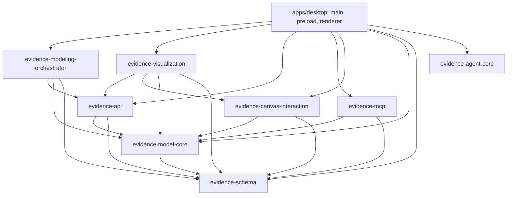
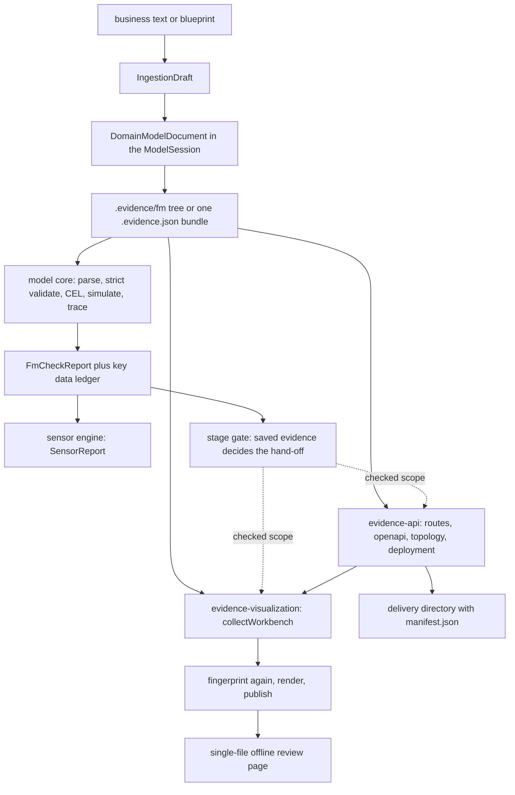
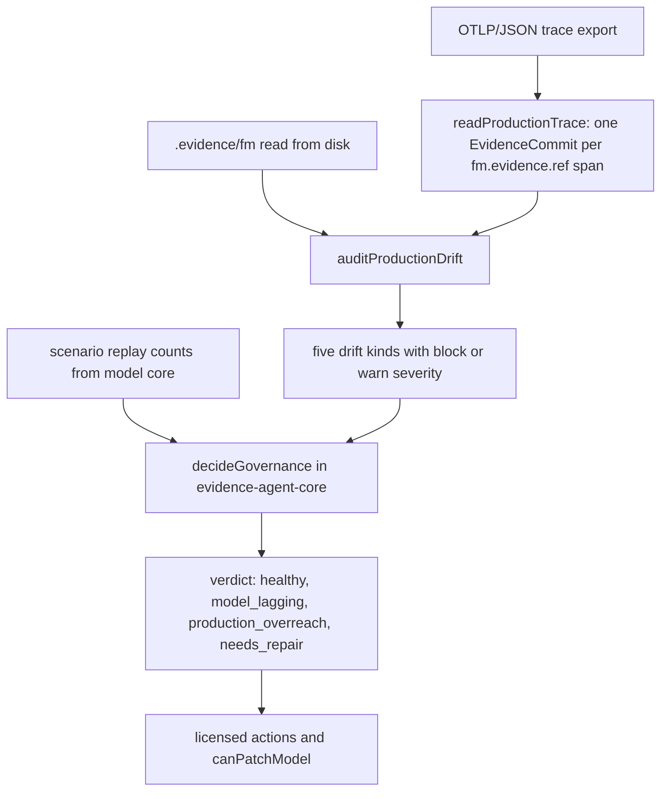

# System map and dependency direction

Evidence is one pnpm workspace with one runnable app and eight libraries. The shape
is deliberate: the language and its static checks sit at the bottom, the read model
and its layout maths above them, the sensors and contract generators above that, and
the Electron shell on top. A library never imports the app, the graph has no cycle,
and no package keeps a second copy of the model.

## One workspace, one source condition

- `apps/` holds runnable entry points and `libs/` the packages the app composes. The
  modeling CLI and the MCP server are libraries with a `bin`/`cli` entry rather than
  separate applications, so the workspace has exactly one app
  (`repo://docs/workspace-layout.md#L1-L15`).
- A runtime dependency is declared in the `package.json` of the project that imports
  it, uses the `workspace:*` protocol for internal packages, and is policed in both
  directions by `@nx/dependency-checks`: an import without a declaration and a
  declaration without an import both fail `nx lint`
  (`repo://docs/workspace-layout.md#L15-L28`).
- Packages are consumed from source, never from `dist`. Each `libs/*/package.json`
  exports its entry under the `@evidence-poc/source` condition, `tsconfig.base.json`
  sets `customConditions: ["@evidence-poc/source"]`, and every bundler and test
  config repeats the condition — one that omits it silently falls back to `dist` and
  looks like a missing module (`repo://tsconfig.base.json#L1-L21`,
  `repo://docs/workspace-layout.md#L56-L82`).
- The root `tsconfig.json` references the eight libraries and no app: `apps/desktop`
  is type-checked by its own Forge-owned targets (`repo://tsconfig.json#L1-L31`).
- There is no interpreter, no virtualenv and no skill tree. The agent's prompt lives
  in `evidence-agent-core/src/prompts/`, the JSON Schemas live beside the code that
  validates with them, the page templates live in `evidence-visualization/assets/`,
  and the session asks Pi for `noSkills: true`
  (`repo://ENVIRONMENT.md#L23-L38`).

## The dependency graph

Every edge below is a `dependencies` entry in the importing package's
`package.json`, and each one has a matching import in source.

One app at the top, one shared vocabulary at the bottom, and no edge pointing back
up. `evidence-agent-core` is the only package with no workspace dependency at all.

## The dependency ladder

Each package's `dependencies` block is the authoritative edge list:

| Package | Depends on | Owns |
| --- | --- | --- |
| `evidence-schema` | `tslib` only | FM v5 AST and guards, identifier grammars, strict static validation, inspector metadata |
| `evidence-model-core` | schema, `fast-sha256` | graph, commands, session, adapters, diff, CEL, checks, key data, ingestion |
| `evidence-canvas-interaction` | core, schema | layout, swimlanes, viewport and zoom maths, ruler and selection geometry |
| `evidence-agent-core` | Pi SDK | session harness, instruction text, event projection, transcript fork, governance policy |
| `evidence-modeling-orchestrator` | core, schema, **api**, Pi SDK, typebox | sensors, stage gate, drift audit, agent tools |
| `evidence-api` | core, schema, ajv | model-derived delivery routes, overlay design, OpenAPI, topology, deployment, contract diff |
| `evidence-mcp` | core, schema, MCP SDK, zod | tool surface, stdio server, local request/response bridge |
| `evidence-visualization` | api, **canvas-interaction**, core, schema | workbench projection, renderer, atomic publisher |

Four properties of this ladder matter:

- `evidence-schema` has no workspace dependency and never mutates its input, so every
  other package can depend on it without dragging a runtime along
  (`repo://libs/evidence-schema/package.json#L1-L25`,
  `repo://libs/evidence-schema/README.md#L1-L16`).
- `evidence-api` is a shared contract layer, not a leaf: the orchestrator reads it
  for the API sensor and the `renderApiDiff` tool, the visualization reads it for
  projection and the delivery view, and the desktop main process reads it for
  delivery preview/export and review preview. `evidence-mcp` deliberately declares
  no dependency on it — its tool results are its own wire types
  (`repo://libs/evidence-api/package.json#L33-L41`,
  `repo://libs/evidence-mcp/package.json#L29-L35`).
- `evidence-visualization` depends on `evidence-canvas-interaction` because the page
  carries the placement the canvas computed, from the same document the check
  accepted (`repo://libs/evidence-visualization/src/projection/workbenchLayout.ts#L1-L10`).
- `evidence-agent-core` depends only on the Pi SDK. Its governance policy is a pure
  function over plain data, which is why the orchestrator's drift audit and the
  desktop's closed-loop test can feed it without either side depending on the other
  (`repo://libs/evidence-agent-core/src/governance/governanceLoop.ts#L1-L12`).

## What each layer actually does

### Language and static contract

`evidence-schema` is the executable form of the shipped JSON Schemas: AST types and
their narrow guards, identifier patterns, the key-data vocabulary,
`strictValidateDomainModel` for static FM checks, and declarative inspector metadata
(`repo://libs/evidence-schema/README.md#L1-L14`). It does not evaluate CEL, resolve
scopes or audit providers — those are later passes in other packages.

### Read model, edits and checks

`evidence-model-core` turns a `.evidence/fm` tree or a `*.evidence.json` bundle into
one `DomainModelDocument`, then offers the only sanctioned way to change it:
immutable commands with inverses, a session with undo/redo, and adapters that write
back without churn (`repo://libs/evidence-model-core/README.md#L1-L30`). It also owns
the check pipeline — strict validation, scope selection, CEL evaluation, scenario
simulation, timeline and traceability — plus the key-data ledger the orchestrator
audits and the `sha256` model digest every downstream artifact quotes.

Its export surface is split by environment: `.` and `./browser` expose the graph,
commands, session, diff, ingestion, CEL and key data without Node built-ins, while
`./cli` exposes the `evidence-model` command. That split is why the renderer imports
`@evidence-poc/evidence-model-core/browser` and never touches `node:fs`.

### Geometry without state

`evidence-canvas-interaction` is pure maths over the document: `createGraphLayout`
places Contexts, nodes and fulfillment bands, `createLifecycleSwimlaneLayout` builds
the swimlane view, and the viewport, zoom, ruler and hit-testing helpers turn a
world rectangle into a screen one (`repo://libs/evidence-canvas-interaction/src/index.ts#L1-L96`).
It imports `evidence-model-core` only for the `DomainGraph` it reads; it stores
nothing, so the renderer remains the owner of viewport state.

### Sensors and agent tools

`evidence-modeling-orchestrator` composes core checks into one verdict, decides the
downstream stage gate, reads OTLP traces for drift, and exposes the tools an agent may
call. One implementation runs in-process: there is no mode to select and no
interpreter to locate (`repo://libs/evidence-modeling-orchestrator/src/sensors/sensorsEngine.ts#L13-L47`).
It knows about Pi only for tool registration (`repo://ENVIRONMENT.md#L12-L21`), and it
reaches into `evidence-api` for two things: the API sensor that projects a document
and diffs it against a baseline, and `renderApiDiff` for the tool that explains a
breaking change.

### API delivery

`evidence-api` reads a model — and, optionally, a `.evidence/api/api.json` design —
and produces one `EvidenceApiSnapshot`. The order of authority is the important part:

1. **The model decides the contract.** `buildModelDelivery` composes routes from the
   modeled fulfillment pairs and evidence objects (`buildDeliveryRoutes`), a service
   topology from the Contexts (`buildDeliveryTopology`), hypermedia links
   (`weaveHypermedia`), an OpenAPI document (`buildDeliveryContract`) and a compose
   sketch (`buildDeliveryDeployment`). Nothing invents an endpoint: every path points
   at one modeled object, and the `x-evidence-*` extensions keep the linkage readable
   (`repo://libs/evidence-api/src/delivery/modelDelivery.ts#L1-L20`).
2. **The design may adjust, never fabricate.** `buildProjection` applies the overlay: a
   route override may change a path only while preserving its parameters, with no empty
   segment or unbalanced brace, and a declared journey must name an existing route
   whose allowed Party Roles include the declared caller. An override of a missing
   route, a duplicate `method path` pair, or a journey step pointing at a nonexistent
   successor becomes an error diagnostic instead of a guess
   (`repo://libs/evidence-api/src/projector.ts#L38-L185`). When the design declares no
   journeys, they are derived from the routes instead of being left empty.
3. **The snapshot states what it is.** The result is labelled `mode: 'draft'`, carries
   diagnostics normalized into a stable order, and records digests of the model, the
   design and the supplied check report. `isComplete` means no findings at all — it
   never means release authorization
   (`repo://libs/evidence-api/src/types.ts#L10-L31`,
   `repo://libs/evidence-api/src/projector.ts#L186-L204`).

The CLI is one verb per question — `inspect`, `check`, `project`, `deliver`, `diff` —
and a `deliver` run writes `openapi.json`, `topology.json`, `routes.json`,
`deployment.compose.json`, `projection.json`, `http-journeys.json`, a
`limitations.md` when the model leaves gaps, and a `manifest.json` holding the
`sha256` of every file plus the input digests. The directory is replaced atomically,
because a new `projection.json` beside a stale `openapi.json` is worse than the
previous version staying in place
(`repo://libs/evidence-api/src/delivery/files.ts#L1-L62`,
`repo://libs/evidence-api/src/renderer/outputRenderer.ts#L36-L90`).

### The review page

`evidence-visualization` takes the checked model and rebuilds the API projection
itself, then emits one self-contained page. `collectWorkbench` is the guard:
fingerprint, check, project, fingerprint again. It refuses when the FM report is not
`valid` or the input changed under the check, refuses a joint review without explicit
`scopeRefs` (a consistency result may not stand in for scope completeness), refuses
when the projection's recorded model digest differs from the digest the check proved
(`FM 在投影期间变化`), and refuses to publish if the fingerprint moved during
generation (`repo://libs/evidence-visualization/src/generate/collectWorkbench.ts#L246-L401`,
`repo://libs/evidence-visualization/src/generate/generateWorkbench.ts#L55-L91`).

### The MCP surface

`evidence-mcp` owns the protocol edge: a named-pipe/socket endpoint, a
request/response-only bridge client, an app-side bridge server, the evidence tool
definitions with zod input schemas, and the stdio server. It forwards calls to the
running app instead of reading the model itself, which is why it depends on
`evidence-model-core` for types but on nothing that renders artifacts. The desktop
binary *is* the stdio server: `--mcp-stdio` starts a headless process that opens no
window, reads no project store and only relays calls to the already running app
(`repo://apps/desktop/src/main/main.ts#L30-L57`).

### The shell

`apps/desktop` is the composition root, and it is the only place where all eight
libraries meet. The main process owns filesystem access, the project store and model
watcher, sensor runs, the agent runtime, the MCP bridge, delivery export and review
export; the preload script exposes a typed, narrow `EvidenceDesktopApi` so the
renderer never sees `ipcRenderer` or `fs`
(`repo://apps/desktop/src/preload/index.ts#L33-L40`). The renderer owns the live
`ModelSession` and everything drawn from it: `useEditorSession` creates the session
from `evidence-model-core/browser`, keeps the graph, layout, selection and validation
snapshot in step, and routes every edit through `session.dispatch`
(`repo://apps/desktop/src/renderer/state/useEditorSession.ts#L1-L20`). `EditorScreen`
is the integration point rather than a fourth layer of logic: it imports the canvas
scope helper, the browser-safe sensor types and the schema document type, and it never
imports `evidence-api` or `evidence-visualization`
(`repo://apps/desktop/src/renderer/screens/EditorScreen.tsx#L1-L28`).

## End-to-end: model to artifact

The same document feeds the sensors, the delivery projection and the page. Each
downstream artifact records the digest it was built from instead of trusting the
previous step, and the page generator re-reads the sources rather than accepting a
projection handed to it.

Three checkpoints hold this flow together:

1. **The document is the only source of truth.** The canvas, the CLI, the sensors, the
   delivery export and the page generator all read the same `DomainModelDocument`;
   there is no second representation to keep in sync.
2. **The hand-off reads saved evidence.** `checkNativeStageGate` takes a target and a
   saved report and requires contract version 5, `consistent`, `complete`, `valid`,
   `inputChanged === false`, no errors, no gaps and a covered scope. The report itself
   records `humanConfirmation: 'not-asserted-by-machine'`, so a passing gate is never a
   business approval — see [Sensors, stage gate and the dependency
   frontier](../agents/sensor-orchestration.md)
   (`repo://libs/evidence-modeling-orchestrator/src/sensors/native/nativeStageGate.ts#L28-L124`,
   `repo://libs/evidence-model-core/src/validation/fmCheck.ts#L260-L290`).
3. **A downstream artifact names its inputs.** The API snapshot records model, design
   and check digests, and the generated delivery directory carries a `manifest.json`
   with a `sha256` per output; the workbench re-fingerprints the model tree and the API
   design before publishing. Neither can silently mix two versions of the model.

## End-to-end: production trace to governance

The second flow runs the other way, from what services actually did back to the model.
It crosses three packages and adds no cycle.

`readProductionTrace` treats a span as a commit only when it names the Evidence it
wrote via `fm.evidence.ref`; everything else is context, and a malformed span is
skipped and reported rather than guessed
(`repo://libs/evidence-modeling-orchestrator/src/telemetry/productionTrace.ts#L1-L45`).
`auditProductionDrift` compares those commits with the model **as saved on disk** —
never a session with unsaved edits — and classifies each disagreement as an unmodeled
Evidence, an unmodeled attribute, a derived value supplied by the caller, a
cross-context write, or a breach with no follow-up
(`repo://libs/evidence-modeling-orchestrator/src/sensors/native/nativeDriftAudit.ts#L1-L30`,
`repo://libs/evidence-modeling-orchestrator/src/sensors/native/driftSensor.ts#L1-L80`).
`decideGovernance` then maps each finding to the action it licenses and folds the
findings plus the replay counts into one verdict; `canPatchModel` is true only when
nothing blocks, the replay is green, and the verdict is `model_lagging`
(`repo://libs/evidence-agent-core/src/governance/governanceLoop.ts#L142-L205`).
The desktop proves the loop end to end on one fixture: a sandbox replay, an OTLP export
and a governance decision all describing the same business
(`repo://apps/desktop/src/main/governanceLoop.spec.ts#L1-L15`).

## One toolchain

There is no second runtime. Every check, derived document and generator is a
TypeScript command; the app runs the same code, so a terminal and a window cannot
disagree (`repo://ENVIRONMENT.md#L1-L6`,
`repo://ENVIRONMENT.md#L42-L52`). The commands are `evidence-model`,
`evidence-api`, `evidence-workbench`, and the desktop binary itself, which doubles as
the MCP stdio server.

## Where to go next

- [The Fulfillment Modeling DSL (FM v5)](../language/fm-dsl.md) — the language all of
  this operates on.
- [Checks, simulation and reporting](../model/checks-and-simulation.md) — what the
  check pipeline proves before anything downstream runs.
- [API contract projection](../contracts/api-projection.md) — the delivery snapshot in
  detail.
- [The offline review workbench](../contracts/offline-workbench.md) — fingerprinting,
  CSP and atomic publishing.
- [Desktop app shell and IPC surface](../desktop/app-shell.md) — how the shell is
  wired.
- [Workspace, build and packaging](../operations/build-and-package.md) — the Nx, pnpm
  and Forge mechanics behind the map above.
