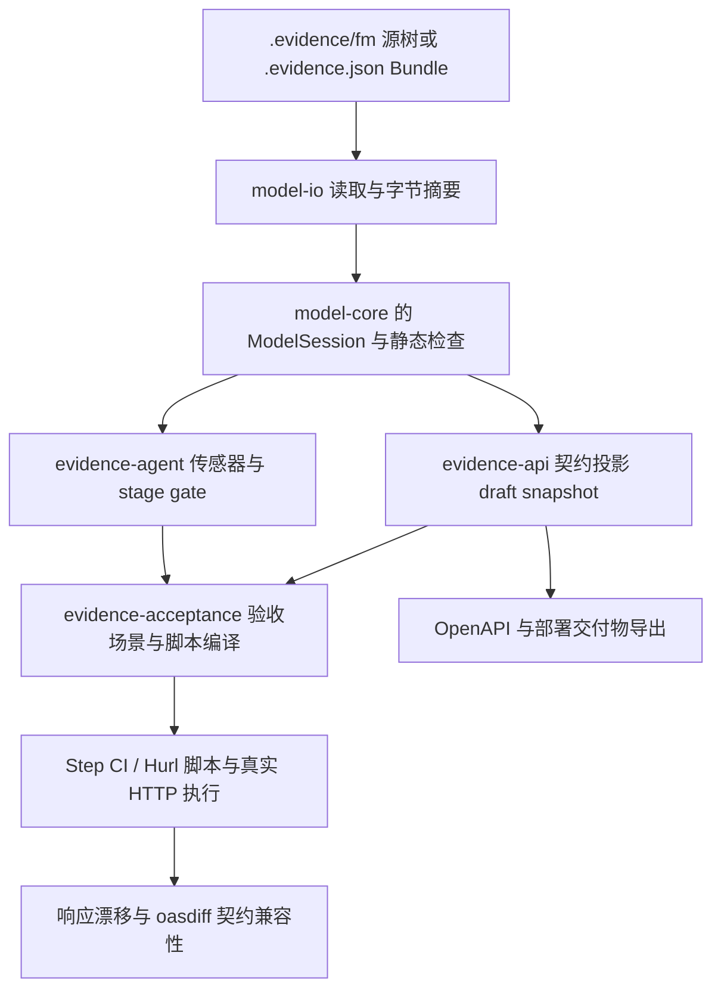
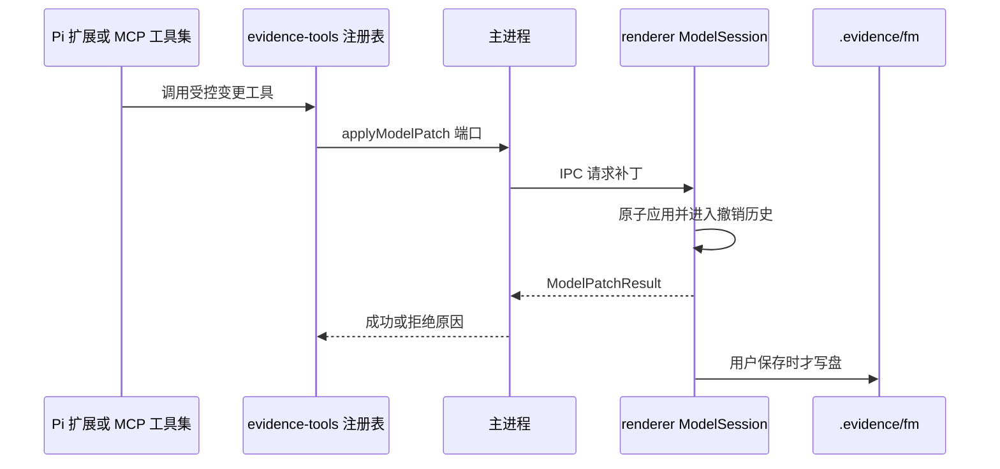

# 系统架构与依赖边界

真相源仍是 `DomainModelDocument`：manifest、entities、relationships、rules。桌面实时模型与磁盘模型是同一契约的不同时间快照，不是两套领域语言。

当前 workspace 是**两个应用 + 十八个库**：

- `apps/desktop`（Electron 工作台）与 `apps/cli`（统一 `evidence` 命令）负责组合，不复制领域规则；`pnpm-workspace.yaml` 的 `apps/*`、`libs/*`、`libs/desktop/*` 三段各自回答不同问题。
- `libs/evidence-*` 九个：schema、model-core、canvas-interaction、tools、model-io、api、acceptance、agent、mcp。
- `libs/desktop/*` 九个：contracts、ui-kit、feature-agent、feature-canvas、feature-delivery、feature-drift、feature-inspector、feature-story、testing。

旧的 `evidence-visualization` 库已不存在；审查/工作台生成器也不再是仓库中的代码路径。旧说明里的“只有一个应用、八个库、`reviewIpc` 导出”已过时。

## 分层表：谁拥有什么

标签取自各 `package.json` / `project.json` 的 `nx.tags`，导出取自 `exports`。

| 项目（标签） | 职责 | 公开出口 |
| --- | --- | --- |
| `evidence-schema` `layer:schema` `platform:universal` `scope:shared` | Zod 定义的 FM v5 AST、语法与语义 refinement、稳定诊断、canonical JSON；不依赖任何工作区库 | `.` |
| `evidence-model-core` `layer:domain` `platform:universal` `scope:model` | 图、guarded mutations、Immer 会话与撤销/重做、RFC 6902、原生 `cel-js`、追溯与静态 FM 检查；哈希用 noble，磁盘 I/O 不在此 | `.`、`/testing` |
| `evidence-canvas-interaction` `layer:domain` `platform:universal` `scope:model` | headless 的异步 ELK 布局、模型/ELK 适配、可序列化布局与作用域；不持 DOM 或 React Flow 视口 | `.` |
| `evidence-tools` `layer:domain` `platform:universal` `scope:model` | Pi 与 MCP 共用的受控变更注册表：五个写工具、宿主端口、非幂等注解；不 import Pi、MCP、Node 或 renderer | `.` |
| `evidence-model-io` `layer:io` `platform:node` `scope:model` | 源树/Bundle 发现、字节摘要、读写、pack/unpack 及共享模型命令；旧 validation 场景文件已撤除 | `.`、`/commands`、`/cli` |
| `evidence-api` `layer:projection` `platform:node` `surface:browser-safe` `scope:api` | 模型 + 可选设计 overlay → 路由、超媒体、服务、OpenAPI、部署、内联样例验收；draft snapshot 携带摘要与排序诊断 | `.`、`/delivery`、`/testing` |
| `evidence-acceptance` `layer:orchestration` `platform:node` `surface:browser-safe` `scope:acceptance` | 验收脚本编译、HTTP 执行、漂移检查、原生 `oasdiff` 契约比较；持有 legacy `evidence-api` bin | `.`、`/projection`、`/runner`、`/commands`、`/cli` |
| `evidence-agent` `layer:orchestration` `platform:node` `surface:browser-safe` `scope:agent` | Pi 会话、提示词、工具扩展、传感器引擎、stage gate、治理与 trace 读取 | `.`、`/browser` |
| `evidence-mcp` `layer:orchestration` `platform:node` `scope:mcp` | MCP 服务器与工具集、本地 socket 桥、stdio 无窗口代理；不依赖 agent | `.`、`/cli` |
| `desktop-contracts` `layer:contract` `platform:node` `surface:browser-safe` `scope:desktop` | 桌面 IPC channel 常量与 DTO；对 Node 库的依赖仅类型，运行时是常量 | `/ipc`、`/projects`、`/mcpIpc`、`/drift`、`/delivery`、`/agentIpc`、`/story`、`/ingestion` |
| `desktop-ui-kit` `layer:ui` `platform:browser` `scope:desktop` | 无状态展示控件（Radix、CodeMirror、cmdk 等）；不组装 feature | `.` |
| `desktop-feature-canvas` / `-inspector` / `-story` / `-delivery` / `-drift` / `-agent` `layer:feature` `platform:browser` `scope:desktop` | 各自拥有 UI、hooks 与同置测试，通过窄 API 端口取数据；跨 feature 协调留在 shell | `.` |
| `desktop-testing` `layer:testing` `platform:browser` `scope:desktop` | renderer fixture 与渲染工具，只读；生产行为不得住在这里 | `.` |

依赖方向的经验事实：`evidence-api` 可消费 `model-io`，`evidence-acceptance` 可消费 `evidence-api`，`evidence-canvas-interaction` 可消费 `model-core`，`desktop-contracts` 可消费投影与编排层——反向一律禁止。旧 `evidence-agent-core` / `modeling-orchestrator` 已合并进 `evidence-agent`。

## 标签如何变成边界

`eslint.config.mjs` 的 `@nx/enforce-module-boundaries` 把标签翻译成四条互相独立的约束：

1. **类型**：`type:app` 只能依赖 `type:lib`，`type:lib` 只能依赖 `type:lib`。库永远不进 app，这也是唯一挡住“某个包 import Electron 主进程”的规则。
2. **分层环**（外环在下）：`layer:schema` 不依赖任何库；`layer:domain` 依赖 schema/domain；`layer:io` 依赖 domain/schema；`layer:ui` 依赖 ui/schema；`layer:projection` 依赖 projection/domain/io/schema；`layer:orchestration` 再叠 projection；`layer:contract` 依赖 schema/domain/projection/orchestration；`layer:feature` 依赖 feature/contract/ui/orchestration/projection/domain/schema/testing；`layer:testing` 依赖 domain/contract/ui/schema；`layer:app` 可依赖一切，但无人可依赖它。
3. **平台**：`platform:universal` 只能依赖 universal；`platform:node` 可依赖 node/universal 与 browser（Electron 外壳要渲染 UI）；`platform:browser` 只能依赖 browser/universal 与显式标记 `surface:browser-safe` 的包，并禁止直接 import `electron`、`@modelcontextprotocol/sdk`、`@earendil-works/pi-coding-agent`。
4. **业务上下文**：`scope:shared` / `scope:model` / `scope:api` / `scope:mcp` 不得依赖 `scope:desktop` 或 `layer:testing`；`scope:acceptance` 额外不得依赖 `scope:agent`、`scope:mcp`；`scope:agent` 不得依赖 `scope:mcp`。验收组合契约，契约不反过来组合验收。

`surface:browser-safe` 是“这个 Node 包对外发了一块纯数据表面”的声明，不是权限豁免：`evidence-api` 的 `/delivery`、`evidence-agent` 的 `/browser`、`evidence-acceptance` 的 `/projection` 都刻意不含磁盘、HTTP 或原生进程调用。项目级标签看不见子路径，所以 `tools/eslint/browser-platform.mjs` 额外做两件事：对浏览器项目禁掉 `node:*`、`fs`、`path`、`child_process`、`os`、`stream`，并把上面三个 Node 包的**包根**列为受限 import，要求改走浏览器安全子路径。`@nx/enforce-module-boundaries` 既管不到 Node 内建模块，也管不到子路径，这段配置补的正是这个缺口。

**边界靠 `pnpm boundaries:drill` 证明，不靠 lint 通过。** `tools/workspace-rules/boundary-drill.mjs` 逐个写入一条“必须被拒绝”的 import 探针、以 `--skip-nx-cache` 跑该项目的 lint target、断言失败消息里出现预期片段，最后 `finally` 删除探针。七个案例覆盖：`evidence-api` 反向依赖 acceptance、浏览器 feature import acceptance 包根、`evidence-tools` 依赖 agent、domain 库依赖投影子入口、浏览器库依赖 `evidence-mcp`、ui-kit 引 `node:fs`、`evidence-agent` 读 `evidence-mcp`。lint 全绿而规则被改名或约束被删，drill 会失败——这是“规则仍在生效”与“项目刚好没触发”之间的区别。

## `@evidence-poc/source`：从源码而非 dist 解析

每个库的 `exports` 把同一入口写两遍，`@evidence-poc/source` 条件排在最前并指向 `./src`；`tsconfig.base.json` 的 `customConditions: ["@evidence-poc/source"]` 让类型检查器直接读源码、不需要 `paths` 表；`apps/desktop/vite.*.config.mjs`、`apps/desktop/vitest.config.mts` 与各库的 Vitest 配置在 `resolve.conditions` 里重复同一条件。任何新消费者配置漏掉它都会静默退回 `dist`——症状是“模块找不到”，而不是“条件缺失”。

根 `tsconfig.json` 引用 **19 个项目**：`apps/cli` 加全部十八个库；`apps/desktop` 不在其中，它由自己的 `tsconfig.app.json`/`tsconfig.spec.json` 和 Electron Forge target 检查。库的 `tsconfig.lib.json` 只引用真正 import 的库，`tsc --build` 因此保持增量。

同样的原因让安装器不能当守卫：`pnpm-workspace.yaml` 用 `nodeLinker: hoisted`（Forge 的 `flora-colossus` 不跟随 pnpm 符号链接），未声明的 import 在本地照样解析得到。真正把关的是 `@nx/dependency-checks`：JSON manifest 上“用了没声明”和“声明了没用”都让 `nx lint` 失败。运行时依赖写在真正的 importer 里，工作区边用 `workspace:*`，根 `package.json` 只留开发工具与 `packageManager` 锁。

## 三条本轮关键拆分

- **`evidence-api` 只做契约投影。** 它把模型（加可选 overlay）变成 draft snapshot，带 model/design/check-report 摘要、排序诊断和 limitations；它不依赖 acceptance，不加载 Step CI，也不 spawn `oasdiff`。固定检查报告失效或摘要过期会变成显式 gap 诊断，不会抹掉草稿可见性。
- **`evidence-acceptance` 拥有验收、漂移和 `oasdiff`。** 它依赖 `evidence-api`，负责场景投影与脚本编译、HTTP 执行、响应漂移检查和原生契约比较；`renderDeliverables`、renderer、契约比较与旧 API 命令适配器都已从这里导出，`evidence-api` 的 legacy bin 也归它。浏览器端只用 `/projection`，Node 调用方用根、`/runner` 或 `/commands`。
- **`evidence-tools` 是 Pi 与 MCP 共用的受控变更注册表。** 它只声明五个工具（`apply_model_patch`、`introduce_fulfillment_pair`、`add_breach_compensation`、`roleify_and_invert_dependency`、`isolate_domain_calculator`）、宿主端口 `loadDocument` / `applyModelPatch` 和写安全注解。这些工具**不幂等**，注解里 `readOnlyHint: false`、`destructiveHint: true`、`idempotentHint: false`。原子应用、静态守卫与 undo 仍归宿主：补丁最终回到 renderer 的 `ModelSession`。传输相关的读/传感器工具留在各自适配器——Pi 侧在 `evidence-agent/src/tools/evidenceTools.ts`，MCP 侧在 `evidence-mcp/src/server/toolset.ts`，两边都调 `createModelTools`。

## 从模型源到投影、验收与 Agent/MCP

一条模型修订在仓库里的实际走向：源经 model-io 读成同一文档 → renderer 用 `mutate(recipe)` 或 `applyPatchBatch` 原子变更并维护撤销历史 → 传感器给出 FM check v6（Zod strict + 语义、CEL、scoped completeness，内联样例只作 CEL 编译期 oracle，不代表真实 HTTP 成功）→ stage gate 消费**已保存**的 v6 报告，要求 `checkVersion: 6`、`consistent`/`complete`/`valid`、`inputChanged: false`、无 errors/gaps、且覆盖请求的每个 scope；API 目标还会以 release 模式重跑传感器，比对给定报告与当前模型的 `modelDigest`，不一致即显式失败。门禁之前的草稿可见，但不授权交付。

投影之后，`evidence-acceptance` 把同一 snapshot 编译成验收脚本，CLI 导出 OpenAPI + Step CI/Hurl 再对真实后端执行 HTTP，并用固定原生 `oasdiff` 做契约比较。`pnpm api:setup` 是显式准备步骤（不用 Go，也不用 Docker），契约比较和它的测试在 `pnpm install` 之后需要它。

## 两个宿主与进程边界

**`apps/desktop` 是组合根，不是一层逻辑。** 主进程跑所有 Node 侧工作：项目存储、摄取、story、交付导出（`buildDelivery` + 写文件）、漂移、agent runtime 与 MCP 桥；renderer 拥有实时 `ModelSession`、异步布局与 UI，只通过 preload 暴露的 typed `EvidenceDesktopApi` 说话——没有 `fs`，没有 `ipcRenderer`。IPC channel 常量与 DTO 全在 `desktop-contracts`：`evidence:project:*`、`evidence:ingestion:*`，以及 MCP、drift、delivery、story、agent 各自的子入口；只有 shell 读 `window.evidenceAPI`。

**`apps/cli` 是终端入口。** `evidence` bin 由 `apps/cli` 拥有，用 `cac` 注册 `check`、`story`、`test`、`export`、`diff`、`pack/unpack/compile/inspect/lineage` 与兼容的 `api` 子命令，每个命令都调用库里的共享逻辑（`evidence-model-io/commands`、`evidence-acceptance/commands`），所以终端与窗口不会给出不同结论。`evidence-model` 与 `evidence-api` 两个旧库 bin 作为弃用 shim 保留，执行库内逻辑，不反向依赖 cli app。

**MCP 的第三个入口是同一可执行文件的另一种模式。** `main.ts` 检查 `process.argv` 里的 `--mcp-stdio`：命中时不起窗口、不读项目存储、不注册 IPC，只把工具调用经本地 socket 转发给已运行的桌面端（端点来自 `EVIDENCE_MCP_ENDPOINT` 或 `getEvidenceMcpBridgeEndpoint`），失败时写 stderr 并 `app.exit(1)`。正常运行路径则注册 project / ingestion / story / delivery / drift / agent IPC，启动 MCP bridge runtime（每个调用是带超时的 correlated request/response 对，避免关掉的编辑器窗口挂住 agent），并同步 MCP 客户端注册。

Agent 与 MCP 写入都落在这条路径上：`agentRuntime` 的 `transport.requestPatch` 与 `mcpRequestHandler` 的 `apply_model_patch` 都把补丁交回 renderer 会话，因此机器编辑与人工编辑共用同一份 undo 历史；主进程只负责传感器、交付、漂移和截图。正式交付描述已保存来源，未保存的 live preview 明确标成草稿。

## 常见失败模式

- 漏掉 `@evidence-poc/source` 条件 → 静默退回 `dist`，报“模块找不到”，先构建库又“修好了”。
- hoisted linker 下少写一条依赖 → 本地能跑、CI 或打包才炸；`@nx/dependency-checks` 是唯一会说话的地方。
- 向上依赖（schema → 投影、api → acceptance、agent → mcp、evidence → desktop/testing）→ `tsc` 照样解析得到路径，只有 `enforce-module-boundaries` 会报错。
- 浏览器项目 import Node 包根或 `node:fs` → 标签规则看不见，由 `browser-platform.mjs` 拦住；改走 `/delivery`、`/browser`、`/projection`。
- 用编辑中的模型跑门禁 → FM 检查摘要比对失败；门禁只认已保存的 v6 报告与当前模型摘要一致。
- 手工维护第二份项目引用图 → Nx 的 TypeScript sync generator 才是引用作者，`nx sync:check` 会揭穿手写版本。

## 深入入口

- [应用外壳与进程边界](../desktop/app-shell.md) · [模型源格式](../model/source-formats.md)
- [API 契约投影](../contracts/api-projection.md) · [HTTP 验收](../workflows/http-acceptance.md)
- [构建与打包](../operations/build-and-package.md) · [验证策略](../testing/verification-strategy.md)
