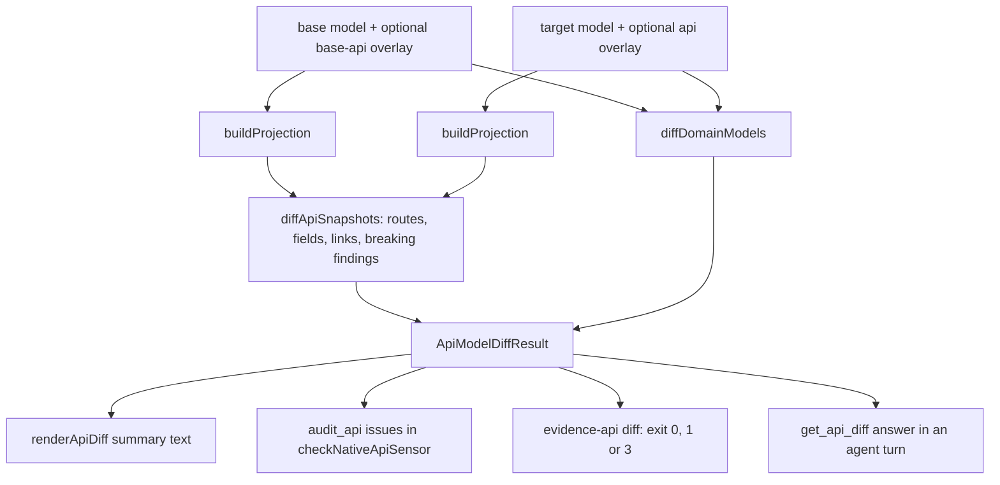
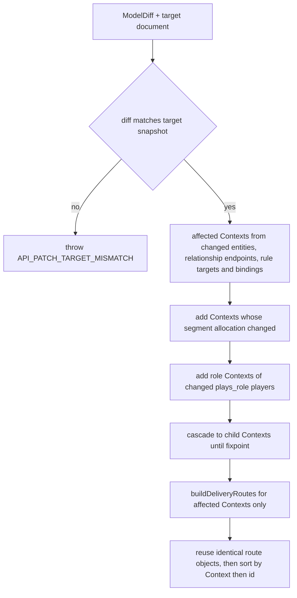

# Contract diff and evolution

A contract diff answers one question: *if I publish this model instead of the one
callers already hold, what breaks?* `libs/evidence-api/src/diff` answers it by
comparing two **projected snapshots** — routes, fields, responses, rules and HAL
links — never by translating model edits into guessed endpoints. The header of
`diffApiSnapshots` states the rule: compare the final snapshots, including
overlays, rather than guessing what a model edit implies
(`repo://libs/evidence-api/src/diff/apiDiff.ts#L220-L221`).

The output is a review artifact, not a verdict. It names each breaking change and
its remediation, and it is deliberately possible to read a diff that says "this
will break three clients" without anything being repaired, acknowledged or
published on the reader's behalf.

## What is actually compared

There are two entry points, and the difference between them is only where the
snapshots come from.

- **`diffApiSnapshots(before, after)`** takes two `EvidenceApiSnapshot`s. It
  refuses to compare snapshots of different models: a `modelId` mismatch throws
  `API_MODEL_MISMATCH` (`repo://libs/evidence-api/src/diff/apiDiff.ts#L221-L228`).
- **`diffModelToApi(before, after, { baseDesign?, targetDesign? })`** runs
  `buildProjection` on each document with its own optional design overlay, then
  delegates to `diffApiSnapshots` and attaches `modelChanges`
  (`repo://libs/evidence-api/src/diff/apiDiff.ts#L339-L356`). Because the overlay
  is per side, a design-only edit shows up as a route change with no model change
  at all — and confirming that is exactly what a reviewer needs when the contract
  was cut by hand. A `targetDesign` overlay that moves one route's `path` is
  enough to produce a `PATH_CHANGED` finding against an otherwise identical model
  (`repo://libs/evidence-api/src/diff/apiDiff.spec.ts#L171-L183`).

`modelChanges` is the structural model diff produced by `diffDomainModels` from
`evidence-model-core`: Contexts, entities, relationships, rules and key-data
provider decisions, each object marked `added`, `removed`, `modified` or
`unchanged` (`repo://libs/evidence-model-core/src/diff/modelDiff.ts#L424-L476`).
It travels inside `ApiModelDiffResult`, so one artifact answers both "what did
the model say differently" and "what does the HTTP surface do differently".



Two projections become one diff, which then reaches three different surfaces.

## Order does not count

Before anything is compared, each route is normalized: `fields`, `derived`,
`stamped` and `outputFields` are sorted by name, `allowedPartyRoleRefs` and
`responses` are sorted, and `rules` are sorted by id. Equality is then canonical
JSON (`repo://libs/evidence-api/src/diff/apiDiff.ts#L100-L109`). Declaration order
is a modelling preference, not a contract change, so reversing every entity,
relationship, rule and attribute in a document yields an empty route diff — a
property `apiDiff.spec.ts` asserts directly
(`repo://libs/evidence-api/src/diff/apiDiff.spec.ts#L162-L170`).

Only changed routes are emitted. A route appears in `ApiModelDiffResult.routes`
when it exists on one side only, when its normalized form differs, or when one of
its hypermedia links changed. Each `RouteDiff` carries `before`/`after` snapshots,
`previousPath` when the address moved, `fieldDiffs`, and its own `breaking` flag
with the list of findings. The summary counts additions, removals and
modifications; `breakingChangeCount` counts **findings**, not routes, so one
route can contribute several (`repo://libs/evidence-api/src/diff/apiDiff.ts#L263-L338`).

Both sides' projection diagnostics ride along in `diagnostics.base` and
`diagnostics.target`. They are printed with the diff because a design that
projects with errors has no business being read as a contract change.

## Field diffs, including the caller↔derived shift

`FieldDiff` compares the union of both sides' `outputFields` by name and drops
every field that is canonically identical. For each surviving field it records:

- `changeType` — `added`, `removed` or `modified`;
- `beforeReason` / `afterReason` — the `DeliveryFieldReason`, i.e. `caller`,
  `derived` or `service-time`;
- `shifted` — `to_derived` or `to_caller` when the reason changed in that
  direction, and nothing for a shift to or from `service-time`;
- `requiredChanged` — the attribute's requirement flipped;
- the full `before` and `after` `DeliveryField`, so the reviewer sees label,
  `valueType`, `meaning` and, for derived fields, the rule that computes it.

(`repo://libs/evidence-api/src/diff/apiDiff.ts#L111-L148`.)

The `shifted` marker is the load-bearing one. A field that moves from `caller` to
`derived` stops being an accepted input while remaining in the response: the
model now expects the service to compute it. In the request diff that same
transition is a removed input, so it is both a breaking change and a derivation
drift, and the sensor reports the drift separately as informational
(`repo://libs/evidence-api/src/diff/apiDiff.spec.ts#L93-L109`).

## The breaking-change vocabulary

`BreakingChangeKind` is a closed union of thirteen values. Each finding carries
the **base** route's `path` and `method`, a description, and a remediation hint
("确认调用方迁移方案后再发布；需要时保留旧契约适配层。") — the base coordinates
matter, because a client is calling the address that used to exist
(`repo://libs/evidence-api/src/diff/apiDiff.ts#L20-L41`).

| Kind | Triggered when | Caller-visible consequence |
| --- | --- | --- |
| `ROUTE_REMOVED` | the route exists only on the base side | the endpoint is gone; every existing caller fails |
| `PATH_CHANGED` | `path` or `itemPath` differs | the same operation answers at a new URL; hard-coded paths and bookmarks break |
| `METHOD_CHANGED` | the HTTP verb differs | clients send the wrong method and get 405 |
| `REQUIRED_FIELD_ADDED` | a route with `POST` on either side requires a request field that was not required before | existing payloads are rejected as incomplete |
| `INPUT_FIELD_REMOVED` | a route with `POST` on either side no longer accepts a field the caller used to send | the value is dropped or refused, depending on strictness |
| `FIELD_REMOVED_FROM_RESPONSE` | an output field exists only on the base side | readers of that field lose the value |
| `FIELD_TYPE_CHANGED` | an output field's `valueType` differs | deserializers and generated types break |
| `RESPONSE_FIELD_OPTIONAL` | an output field was required and no longer is | readers must now handle absence |
| `CALLER_ROLE_RESTRICTED` | a base `allowedPartyRoleRefs` entry is missing on the target | some callers lose authorization they had |
| `STATUS_CODE_CHANGED` | the sorted list of 2xx responses differs | success handling keyed on 201 versus 200/202 no longer matches |
| `OPERATION_ID_CHANGED` | `operationId` differs | generated SDK methods and client handlers no longer line up |
| `NAVIGATION_LINK_REMOVED` | a non-`self` hypermedia relation present on a route that exists on both sides is gone | a client journey loses a step it could follow |
| `RULE_CHANGED` | a base rule object differs, or a new rule that is not of kind `derivation` appears | a business precondition, validation or computation changed and caller expectations need review |

The union is produced by `breakingFor` for a route that exists on the base side.
A removed route therefore yields exactly one finding, `ROUTE_REMOVED`, and an
added route yields none — adding surface is never a break
(`repo://libs/evidence-api/src/diff/apiDiff.ts#L149-L163`). The three
response-side kinds come from comparing `outputFields` by name and reading the
first fully qualifying condition
(`repo://libs/evidence-api/src/diff/apiDiff.ts#L206-L218`).

Three of the triggers are narrower than they look:

- Request-body rules (`REQUIRED_FIELD_ADDED`, `INPUT_FIELD_REMOVED`) are only
  evaluated when the base or target method is `POST`; a `GET` has no body to
  judge (`repo://libs/evidence-api/src/diff/apiDiff.ts#L196-L204`).
- `STATUS_CODE_CHANGED` compares only 2xx statuses. Adding a `409` or `422` is new
  information for a client, not a break
  (`repo://libs/evidence-api/src/diff/apiDiff.ts#L176-L182`).
- A rule that is new *and* of kind `derivation` is not breaking. It is how a field
  becomes service-computed, which already surfaces as a `shifted` field diff
  (`repo://libs/evidence-api/src/diff/apiDiff.ts#L184-L195`).

## What is deliberately not a breaking change

Symmetry is a design decision, and the diff only escalates what changes an
existing caller's behaviour:

- reordering anything (see above);
- adding routes, fields on the request side that stay optional, or new error
  status codes;
- tightening a response field from optional to required — the diff does not flag
  it, because a client that already handled absence is unaffected;
- changing only a hypermedia link's `href`: link identity is
  `sourceRouteId + rel + targetRouteId`, so a moved target is a `modified` link,
  not a removal. If the target's own address changed, `PATH_CHANGED` on that
  route is the finding the reviewer acts on.

## Hypermedia link diffs

Links are diffed separately, by that three-part key, and reported in
`hypermediaLinks` with the source route, `rel`, target `href`, `changeType` and
the `before`/`after` link objects
(`repo://libs/evidence-api/src/diff/apiDiff.ts#L229-L262`). Link diffs then feed
back into the route list: a route whose links changed is included even when its
own fields did not move, and a removal is promoted to a `NAVIGATION_LINK_REMOVED`
finding unless the relation is `self` or the route itself disappeared
(`repo://libs/evidence-api/src/diff/apiDiff.ts#L263-L291`).

The spec pins the intent by moving one dependency: the old `next:request.delivery`
link disappears from the signing route, a new one appears on the payment
confirmation route, and nothing invents an execution order out of it
(`repo://libs/evidence-api/src/diff/apiDiff.spec.ts#L212-L233`).

## The summary renderer

`renderApiDiff(diff, color)` turns a diff into the text a human or an agent reads
(`repo://libs/evidence-api/src/diff/renderApiDiff.ts#L3-L37`):

```text
API <baseModelId>: +1 -0 ~2
Breaking changes: 2
+ POST /procurement/rfps
~ GET /contracts/{contractId} [BREAKING]
    modified total (to_derived)
    ! PATH_CHANGED: 资源或凭证地址发生变化
! target gap DESIGN_REF_NOT_FOUND: ...
```

- The header carries the base model id and the added/removed/modified counts.
- Each route prints `+`, `-` or `~`, its method padded to four characters, its
  path, and `[BREAKING]` when any finding is attached.
- Field diffs print indented with their `changeType` and, when set, the `shifted`
  marker in parentheses — the cheapest way to see that an input became derived.
- Each finding prints as `! KIND: description`, followed by both sides'
  diagnostics as `! <side> <severity> <code>: <message>`.
- `No API changes.` is emitted when the route list is empty.

Colour is opt-in and applied per route only: `31` for breaking, `32` for added,
`33` for anything else. The CLI enables it only when stdout is a TTY and
`NO_COLOR` is unset (`repo://libs/evidence-api/src/cli.ts#L254-L262`).

The renderer covers routes, fields and breaking findings; `hypermediaLinks` are
**not** printed as their own section. A link-only change shows up as a modified
route line, and a removed navigation appears through its
`NAVIGATION_LINK_REMOVED` finding. Consumers that need the full link picture read
the JSON form.

## Incremental rebuild: `patchDeliveryRoutes`

`patchDeliveryRoutes(currentRoutes, diff, targetDocument)` is the incremental
counterpart of a full `buildDeliveryRoutes(targetDocument)`. It exists because a
contract preview re-renders on every edit, and rebuilding every route would
discard object identity for Contexts nobody touched.

**Validation first.** Before computing anything it checks that the diff really
describes the target snapshot: `diff.targetModelId` must equal the document's
manifest id, `diff.baseModelId` must equal `diff.targetModelId` (a revision diff
of one model, not a cross-model diff), and the union of the diff's Contexts and
entities, its relationships and its rules must match the target document's
objects by id under canonical JSON. Any mismatch throws
`API_PATCH_TARGET_MISMATCH: 模型差异与目标快照不一致`
(`repo://libs/evidence-api/src/diff/patchDeliveryRoutes.ts#L15-L37`). A stale diff
is refused rather than used to patch the wrong tree.

**Then the affected Context set is expanded** — over-approximating on purpose,
because the cost of rebuilding one extra Context is a slower render and the cost of
missing one is a wrong contract
(`repo://libs/evidence-api/src/diff/patchDeliveryRoutes.ts#L38-L105`):



- A changed entity adds its own Context, or the Context it belongs to.
- A changed relationship touches both endpoints' Contexts on both sides.
- A changed rule adds its own Context, the Context of its target entity, and the
  Context of every binding reference.
- **Segment allocation is global.** A new sibling id can rename a route in a
  Context nobody edited, so the allocator is rebuilt over the base ids (taken from
  the diff) and over the target document's ids, and every entity whose segment
  moved is re-touched (`repo://libs/evidence-api/src/delivery/segments.ts#L44-L67`,
  `repo://libs/evidence-api/src/diff/patchDeliveryRoutes.ts#L71-L83`).
  `apiDiff.spec.ts` pins this with a `request.aaa.payment` collision against an
  unrelated `request.payment`
  (`repo://libs/evidence-api/src/diff/apiDiff.spec.ts#L235-L265`).
- A changed `plays_role` player changes the contextual role it plays, so the
  role's Context is touched.
- Child Contexts inherit their parent Contract's role boundary, so affected
  Contexts cascade to children until the set stops growing.

**Then the rebuild keeps identity.** `buildDeliveryRoutes(targetDocument, affected)`
rebuilds only the affected Contexts; each rebuilt route is compared with the
current route of the same id and the *existing object* is returned when the
canonical JSON is identical. Routes from untouched Contexts are carried over
as-is, and the merged list is sorted with `compareRoutes` — Context first, then id
(`repo://libs/evidence-api/src/diff/patchDeliveryRoutes.ts#L106-L117`). The spec
asserts identity with `toBe`, not just deep equality.

The function is exported from the package index
(`repo://libs/evidence-api/src/index.ts#L13`), but no production caller uses it
today: only `apiDiff.spec.ts` and `evolution.spec.ts` drive it. It is the intended
path for incremental preview, not yet the path the preview takes.

## Three surfaces, one diff

| Surface | Form | What it is allowed to do |
| --- | --- | --- |
| `evidence-api diff` | JSON or rendered summary, exit status | read two snapshots and report; write nothing |
| `checkNativeApiSensor` | `audit_api` issues plus `apiSummary` | warn while designing, block in release mode; never repair |
| `get_api_diff` / `sync_api_projection` | tool text plus `details` in an agent turn | read, optionally evaluate hypothetical commands; never patch or accept a baseline |

### In the CLI

```text
evidence-api diff --base DIR_OR_BUNDLE --target DIR_OR_BUNDLE \
  [--base-api FILE] [--api FILE] [--format json|summary]
```

Both sides accept a model directory or a serialized bundle. Every path must be
absolute; the only accepted flags are `base`, `target`, `base-api`, `api` and
`format`, so `--out` is refused as an unexpected argument, and a repeated flag is
refused as a duplicate (`repo://libs/evidence-api/src/cli.ts#L131-L180`).

The run loads both models, refuses (exit `1`) if either index failed to build or if
either overlay has errors — printing the offending diagnostics instead of a diff —
projects each side with its own overlay, and then composes the result itself:
`diffApiSnapshots(before, after)` plus `modelChanges: diffDomainModels(...)`
(`repo://libs/evidence-api/src/cli.ts#L192-L246`). This is the same composition as
`diffModelToApi`, done here because the two projections already exist.

Exit status is the review verdict:

| Status | Meaning |
| --- | --- |
| `0` | no breaking changes and no open gaps |
| `1` | a projection error on either side, an invalid overlay, unreadable model, or a thrown diff error |
| `3` | the diff is readable but not acceptable: breaking changes exist, or gaps remain |

Exit `3` is shared with `check` and `project` on purpose: an open question is not a
crash. A thrown diff error — for example `API_MODEL_MISMATCH` when the two sides
are different models — is caught and reported as `API_DIFF_INVALID` with exit `1`
(`repo://libs/evidence-api/src/cli.ts#L248-L273`).

`--format json` prints the whole `ApiModelDiffResult`, including `before`/`after`
route objects and both sides' diagnostics. `--format summary` prints
`renderApiDiff` text.

### In the API sensor

`checkNativeApiSensor` always builds a snapshot of the current document and diffs
only when a `baseDocument` exists
(`repo://libs/evidence-modeling-orchestrator/src/sensors/native/nativeApiSensor.ts#L24-L33`).
It folds the diff into `audit_api` findings:

- one `API_BREAKING_CHANGE` per finding, carrying the finding's message and its
  remediation as the suggestion, pointing at the route's `entityRef`. Severity is
  `warn` in draft mode and `block` in release mode — the diff is identical in both,
  only the consequence differs
  (`repo://libs/evidence-modeling-orchestrator/src/sensors/native/nativeApiSensor.ts#L61-L72`);
- one informational `API_DERIVATION_DRIFT` per field whose diff is
  `shifted === 'to_derived'`, targeted at `entity#attribute`
  (`repo://libs/evidence-modeling-orchestrator/src/sensors/native/nativeApiSensor.ts#L73-L84`).

The summary carries `breakingChangeCount` and `hasBaseline`, and that count is part
of release readiness: `finalizeSensorReport` sets `isStageGateReady` false while
any breaking change or uncovered entity is present
(`repo://libs/evidence-modeling-orchestrator/src/sensors/sensorReport.ts#L347-L355`).
So the diff does not merely print — in release mode it becomes a blocker, and with
a gate summary merged in it withholds the hand-off.

Only callers that supply a baseline get breaking-change findings. The sensor engine
accepts `baseDocument` and `apiMode`, but the desktop's sensor runs pass only
`modelRoot` and optional `scopeRefs`
(`repo://apps/desktop/src/main/agentRuntime.ts#L104-L111`), so an app-driven report
has `hasBaseline: false` and `breakingChangeCount: 0`. If the API sensor throws at
all, the report is not degraded silently: the run records a blocking
`SENSOR_UNAVAILABLE` finding and lists `audit_api` in `unavailableSensors`
(`repo://libs/evidence-modeling-orchestrator/src/sensors/native/nativeSensors.ts#L86-L118`).

### In an agent turn

The two API tools read; neither writes
(`repo://libs/evidence-modeling-orchestrator/src/tools/evidenceTools.ts#L116-L166`).

- **`get_api_diff`** loads the current document, applies any `proposedCommands`
  hypothetically through `decodeModelPatch`, and then runs the API sensor — with
  the session baseline as base, or, when a hypothetical patch was supplied, with
  the *current* document as base so the answer describes just that patch. The text
  is `renderApiDiff(outcome.diff)`; with no baseline it answers that only the
  current API check is available. A malformed hypothetical command throws instead
  of touching the model.
- **`sync_api_projection`** calls the `refreshApi` handler first, then runs the same
  sensor and returns the summary next to the caller's rationale.

The spec pins the read-only contract: a refresh plus two diff calls leave the
document deep-equal to where it started and emit zero patches
(`repo://libs/evidence-modeling-orchestrator/src/tools/evidenceTools.spec.ts#L211-L233`).
The desktop fills only five handler slots and leaves `loadBaseDocument` and
`refreshApi` unset, so in-app `get_api_diff` reports that no baseline exists.

The modelling workflow prompt turns that into conduct: after changing a fulfilment
structure, field or rule, check routes, caller roles and inputs with
`get_api_diff` and explain the real derivation result; treat a CEL-derived field as
never being a caller input while still reporting that a caller→derived shift breaks
existing clients; and, when a route is deleted, a role narrowed or a required input
added, state the impact and wait for the user — never accept a new baseline to hide
the difference (`repo://libs/evidence-agent-core/src/prompts/workflow.ts#L47-L52`).

## Failure behaviour

| Situation | Result |
| --- | --- |
| two snapshots from different models | `API_MODEL_MISMATCH` thrown; the CLI reports `API_DIFF_INVALID` and exits `1` |
| diff that does not describe the target document | `API_PATCH_TARGET_MISMATCH` thrown, no routes patched |
| overlay with errors | exit `1` with `{valid: false, diagnostics}`, no diff |
| base or target model unreadable / invalid | exit `1` with that model's diagnostics |
| relative path, unknown flag, duplicate flag, `--format yaml` | exit `1`, message on stderr, nothing on stdout |
| breaking changes or open gaps | exit `3`: reviewable, not acceptable |
| API sensor throws inside a sensor run | blocking `SENSOR_UNAVAILABLE`, `unavailableSensors: ['audit_api']` |

## Tests that protect this

- `apiDiff.spec.ts` pins the whole vocabulary: input→derived shifts and the
  reverse `REQUIRED_FIELD_ADDED`, removed routes, changed cardinality, type and
  caller roles, method/status/operationId/response-field findings, link removals
  when a dependency moves, overlay-only path changes, the `API_MODEL_MISMATCH`
  refusal, and patch identity plus the collision and mismatch cases
  (`repo://libs/evidence-api/src/diff/apiDiff.spec.ts#L41-L265`).
- `evolution.spec.ts` is the equivalence proof for the incremental path: for five
  mutations — removing a confirmation, removing every `plays_role` edge, deleting a
  parent Context, moving a request to another Context, and changing a dependency's
  cardinality — patching must equal a full rebuild, must not mutate the route array
  it was given, and must be reversible
  (`repo://libs/evidence-api/src/diff/evolution.spec.ts#L43-L72`).
- `cliDiff.spec.ts` compares a directory against a bundle of the same model (zero
  changes, exit `0`, `No API changes.`), proves an overlay-only path change exits
  `3`, proves the input file is byte-identical afterwards, exercises the
  model-id-mismatch and unparseable-file exits, and refuses every malformed
  argument form (`repo://libs/evidence-api/src/diff/cliDiff.spec.ts#L13-L70`).
- `nativeApiSensor.spec.ts` pins the severity split: the same deletion is `warn`
  in draft, `block` in release, both producing an identical diff, and a baseline
  equal to the current model reports zero removed routes
  (`repo://libs/evidence-modeling-orchestrator/src/sensors/native/nativeApiSensor.spec.ts#L34-L68`).

## Related pages

- [API contract projection](./api-projection.md) — what produces the snapshots
  being compared, and the schema-level constraints a diff inherits.
- [The offline review workbench](./offline-workbench.md) — the read-only page built
  from a projection.
- [The Pi harness and the agent surface](../agents/pi-harness.md) — where
  `get_api_diff` and `sync_api_projection` sit among the eleven tools.
- [Sensor orchestration](../agents/sensor-orchestration.md) — how `audit_api`
  findings are folded, de-duplicated and counted into release readiness.
- [The review hub](../desktop/review-hub.md) — the desktop surface where a reviewer
  reads a change set.
- [Delivery hand-off](../workflows/delivery-handoff.md) — what may cross the
  boundary once a diff is accepted.
- [Verification strategy and fixtures](../testing/verification-strategy.md) — the
  `full-lifecycle` fixture every diff test mutates.
