# API projection and OpenAPI

`libs/evidence-api` is the first downstream consumer of a model. It reads one
`DomainModelDocument` — a `.evidence/fm` source tree or a packed
`*.evidence.json` bundle — plus an optional JSON overlay, and produces one
`EvidenceApiSnapshot`: the routes the model implies, the hypermedia links
between them, the service topology and deployment sketch, the journeys, the
diagnostics, and the OpenAPI 3.1 document built from those routes.

The design rule is that nothing is invented and nothing is approved here:

- every path is derived from a modeled object, so there is no endpoint without a
  business moment behind it;
- the overlay may rename a path or a summary, never add an interface;
- the snapshot is `schemaVersion: '5.1'` and always `mode: 'draft'` — "a
  projection is an authoring artifact, never a claim of release readiness"
  (`repo://libs/evidence-api/src/types.ts#L17-L31`).

Release authorization lives elsewhere: the agent's stage gate consumes a *saved*
FM check report, while this package records a report as evidence and projects
anyway. See [Sensors, stage gate and the dependency frontier](../agents/sensor-orchestration.md).
Route derivation, topology and API diffing have their own page:
[Routes, topology and delivery diff](./delivery-routes-and-diff.md).

## Inputs: a model, an optional report, an optional overlay

`loadFm` reads the model twice and digests every source file. If the second read
does not match the first, the result is `SOURCE_CHANGED` and there is no index at
all, so a half-changed tree can never become a contract
(`repo://libs/evidence-api/src/adapter/fmAdapter.ts#L211-L245`).

A saved check report is optional, and this is the deliberate difference from a
gate. `checkReportProblem` requires `checkVersion: 5`, `consistent`, `complete`,
`valid`, `inputChanged: false`, `modelValidated: true`, an empty `errors` array
and a string `modelDigest`
(`repo://libs/evidence-api/src/adapter/fmAdapter.ts#L84-L101`). Anything else
becomes a **gap**, not an error:

- `FM_CHECK_INVALID` (gap, key `fm.check.invalid`) — the supplied report does
  not prove a delivered scope; the report is still kept on `index.check` so a
  reader can see what was supplied;
- `FM_CHECK_STALE` (gap, key `fm.check.stale`) — the report's `modelDigest`
  differs from the current one: "FM 已变化，投影使用当前模型；旧检查结果不证明当前模型已通过校验";
- no report at all — `index.check` is `null`, which means *nothing supplied*,
  never "passed".

The overlay is a separate, small document. The CLI reads it from `--api FILE`
only; nothing is read by default. Programmatic callers pass the same shape, and
`buildProjection` re-validates it through the same loader, named `overlay.json`,
so an in-memory overlay cannot skip a check
(`repo://libs/evidence-api/src/projector.ts#L66-L70`).

## The overlay is small on purpose

`schemas/api.schema.json` allows exactly four keys: `schemaVersion` (const
`5.0`), `id`, `routes` (`id`, optional `path`, optional `summary`) and
`journeys` (`id`, `roleRef`, `routeId`, optional `nextPossibleSteps`), with
`additionalProperties: false` on every object
(`repo://libs/evidence-api/src/schemas/apiSchema.ts#L1-L47`). An obsolete full
design that still carries `resources`, `bindings` or `capabilities` is refused
rather than silently ignored — `apiLoader.spec.ts` pins that
(`repo://libs/evidence-api/src/apiLoader.spec.ts#L79-L92`).

`loadDesign` is stricter than `JSON.parse`:

| Input | Result |
| --- | --- |
| `.yaml` / `.yml` | `DESIGN_INVALID`: "API 设计必须使用 .json 文件，不再接受 YAML" |
| duplicate key, including escaped or nested | `DESIGN_INVALID`: "设计包含重复 JSON key: …" from a raw-token scan |
| `NaN`, `Infinity` | `DESIGN_INVALID`: "设计不是合法 JSON" |
| not a single object | `DESIGN_INVALID`: "设计必须是单个 JSON 对象" |
| schema violation | `DESIGN_INVALID` per error, located as `$["routes"][0]["id"]` |
| duplicate id inside `routes` or `journeys` | `DUPLICATE_ID` |

Defaults (`schemaVersion: '5.0'`, `id: 'default-api'`, empty arrays) are applied
only after validation, so malformed supplied fields are reported instead of being
replaced (`repo://libs/evidence-api/src/loader/apiLoader.ts#L118-L239`).

The two embedded schema texts are also required to be byte-identical to the
shipped `schemas/*.json`, because the manifest publishes a digest of the
contract, not of a parsed copy
(`repo://libs/evidence-api/src/apiLoader.spec.ts#L25-L46`).

## Projection order

`buildProjection` is a fixed pipeline. The baseline is model-derived; the overlay
is applied afterwards under guards; the OpenAPI document is built last, from the
final route list, so the contract can never describe a path the snapshot does not
name (`repo://libs/evidence-api/src/projector.ts#L48-L190`).

```mermaid
flowchart TD
  fm["model source tree or bundle"] --> load["loadFm - read twice, digest, index"]
  report["optional saved FM check report"] --> reportCheck["checkReportProblem and digest compare"]
  reportCheck -->|invalid| gapInvalid["FM_CHECK_INVALID gap"]
  reportCheck -->|digest differs| gapStale["FM_CHECK_STALE gap"]
  gapInvalid --> load
  gapStale --> load
  load -->|bytes changed mid-read| sourceChanged["SOURCE_CHANGED error, index is null"]
  load --> strict["strictValidateDomainModel on the four document parts"]
  strict -->|issues| fmInvalid["FM_INVALID error"]
  load --> baseline["buildModelDelivery - routes, services, links, deployment"]
  overlay["overlay JSON - route paths and journey steps"] --> loader["loadDesign - schema, duplicate keys, section ids"]
  loader -->|refused| designInvalid["DESIGN_INVALID or DUPLICATE_ID error, overlay dropped"]
  loader -->|accepted| apply["apply route overrides keyed by route id"]
  baseline --> apply
  apply --> pathGuard{"parameter names kept, no empty segment, no collision"}
  pathGuard -->|violated| routeErrors["API_ROUTE_NOT_FOUND, API_PATH_INVALID, API_ROUTE_COLLISION"]
  pathGuard --> journeys["journey actor checked against the route's party roles"]
  journeys -->|violated| journeyErrors["API_ROLE_INVALID, API_JOURNEY_STEP_NOT_FOUND"]
  journeys --> weave["weaveHypermedia, then deriveJourneys when no overlay steps"]
  weave --> openapi["buildDeliveryContract - OpenAPI 3.1.0 with x-evidence extensions"]
  openapi --> snapshot["EvidenceApiSnapshot - schemaVersion 5.1, mode draft, digests"]
  fmInvalid --> snapshot
  designInvalid --> snapshot
  routeErrors --> snapshot
  journeyErrors --> snapshot
  snapshot --> outputCheck{"validateProjection against api-projection.schema.json"}
  outputCheck -->|violated| projectionInvalid["PROJECTION_INVALID error"]
  outputCheck --> gate{"hasErrors"}
  gate -->|yes| refuse["exit 1, existing output untouched"]
  gate -->|no| write["renderOutputs - six files, optional limitations.md, manifest.json"]
```

The gating diagnostics, in the order the pipeline can raise them:

| Code | Severity | Raised by |
| --- | --- | --- |
| `FM_CHECK_INVALID` | gap | supplied report fails one of the seven conditions |
| `FM_CHECK_STALE` | gap | supplied report's digest is not the current model digest |
| `SOURCE_CHANGED` | error | the tree moved between the two reads; no index |
| `FM_INVALID` | error | `strictValidateDomainModel` inside `buildProjection` |
| `DESIGN_INVALID`, `DUPLICATE_ID` | error | the overlay loader |
| `API_ROUTE_NOT_FOUND` | error | overlay names a route id or journey route that does not exist |
| `API_PATH_INVALID` | error | override changed the path parameters, left an empty segment or unbalanced braces |
| `API_ROUTE_COLLISION` | error | two routes now answer the same `method` + path pattern |
| `API_ROLE_INVALID` | error | overlay journey actor is not a Party Role the route allows |
| `API_JOURNEY_STEP_NOT_FOUND` | error | overlay journey names a next step that does not exist |
| `PROJECTION_INVALID` | error | the finished snapshot fails its own schema |

**A projection built on a failing model is not a contract.** `buildProjection`
re-runs the static FM v5 checks — document shape, identifier grammar,
category/kind contracts, reference resolution, context ownership, relationship
endpoints, derivation symmetry — and turns each issue into an `FM_INVALID`
error, including for in-memory documents that never touched disk
(`repo://libs/evidence-api/src/projector.ts#L54-L65`). The snapshot is still
returned so a preview can show the damage, but `hasErrors` then stops both
writing and any claim of completeness.

One subtlety worth knowing when reading the code: if the overlay produces *any*
diagnostic, the whole overlay is dropped and the projection falls back to the
model baseline — the errors are reported, not partially applied
(`repo://libs/evidence-api/src/projector.ts#L66-L70`).

Diagnostics are deduplicated by their full JSON identity and sorted by severity,
code, `targetRef`, message and finally identity, so two runs that found the same
things print them identically — which is what makes `projection.json` comparable
between runs (`repo://libs/evidence-api/src/diagnostics.ts#L96-L131`).

## Hypermedia and journeys

`weaveHypermedia` adds one `self` link per route pointing at its `itemPath`, then
follows `references` relationships between two Evidence entities: every route of
the prerequisite gets a `next:<entityRef>` link to every `POST` route of the
dependent. Links are deduplicated and sorted by source, rel and target, and a
templated `href` is flagged rather than resolved
(`repo://libs/evidence-api/src/http/hateoasWeaver.ts#L14-L64`).

Navigation is a graph of possibilities, never an invented sequence:

- each operation publishes its outgoing links as `x-evidence-link-templates`
  inside the HAL response, keyed by relation;
- if the overlay declares no journeys, `deriveJourneys` builds one step per
  `POST` route × `allowedPartyRoleRefs` and connects steps through the non-`self`
  links;
- `http-journeys.json` is written with `runtimeValidated: false`, because the
  file describes reachability, not a validated execution order
  (`repo://libs/evidence-api/src/delivery/files.ts#L28-L45`).

An overlay journey is checked before it is accepted: the actor must exist, be a
`role`/`party` entity and appear in that route's `allowedPartyRoleRefs`
(`API_ROLE_INVALID`), and every `nextPossibleSteps` entry must resolve
(`API_JOURNEY_STEP_NOT_FOUND`)
(`repo://libs/evidence-api/src/projector.ts#L118-L160`).

## The OpenAPI document

`buildDeliveryContract` emits OpenAPI `3.1.0`: `info` from the model manifest,
`x-evidence-model` for the model id, one `paths[path][method]` entry per route,
one `components.schemas` entry per object the contract reads or writes, and
`x-evidence-services` taken from the topology that the deployment file also uses
so the two cannot disagree
(`repo://libs/evidence-api/src/delivery/modelDelivery.ts#L254-L310`).

Per operation the document keeps the linkage readable instead of inferrable:
`operationId`, `summary`, `tags: ['context:<ref>']`, and
`x-evidence-purpose`, `-context`, `-entity`, `-service`, `-allowed-party-roles`,
`-exposure`, `-contract`, `-fulfillment-request`, `-fulfillment-confirmation`,
`-derived` and `-stamped` (`repo://libs/evidence-api/src/delivery/modelDelivery.ts#L165-L250`).
Those extensions are the answer to "where did this endpoint come from": a
reviewer walks path → entity → Context → fulfillment pair → rule.

Payload rules follow the model rather than convenience:

| Part | Rule |
| --- | --- |
| request body | `POST` only, `application/json`, `additionalProperties: false`, and only fields classified `caller` |
| component schema | caller fields writable; derived values `readOnly` with `x-evidence-rule` / `x-evidence-derived-by-rule`; a stamped business time `readOnly` |
| `_links` | required in every component schema, `href` plus optional `templated` / `method` |
| `201` | carries a `Location` header whose `x-evidence-uri-template` is the route's `itemPath` |
| any `2xx` with an entity | body is `application/hal+json` referencing the component schema, with the route's link templates |
| path parameters | one required string parameter per `{name}` in the path |

`tests/support/openapi.ts` restates the constraints the OpenAPI meta-schema
cannot prove — only local `#/components/schemas/...` references that actually
resolve, unique `operationId`, path parameters that match the path exactly and
are required, and no request body on `GET`
(`repo://libs/evidence-api/tests/support/openapi.ts#L1-L50`).

Two model questions that no contract can answer are printed instead of guessed:
a fulfillment pair with no confirmation, and a derived attribute that needs a
server-side rule runtime. Both become entries in `limitations`, which are also
written to `limitations.md` when non-empty
(`repo://libs/evidence-api/src/delivery/modelDelivery.ts#L384-L407`).

## Coverage, in both directions

**Model objects without endpoints.** The projection does not grade coverage
itself: it derives routes for the fulfillment structure and reports the
diagnostics above. Coverage is measured one level up, by the agent's `audit_api`
sensor, over every entity of category `evidence`: each uncovered entity is a
`warn` / `API_COVERAGE_GAP` pointing at the entity, and the summary carries
`coverageRatio` and `uncoveredEntities`
(`repo://libs/evidence-agent/src/sensors/native/nativeApiSensor.ts#L23-L52`,
`repo://libs/evidence-agent/src/sensors/native/nativeApiSensor.ts#L98-L111`).
Roles, Participants and Things are not automatically public CRUD resources, so
they are deliberately outside that ratio.

What the CLI gives a reader for this direction is inventory, not a verdict:
`inspect` prints the model summary, every Role with the Party Roles an actual
`participant.party` plays, `unplayedPartyRoles`, `resourceClues` (all Evidence and
Participant entries), Contexts, scenarios and the per-file digests — and never
proposes a route
(`repo://libs/evidence-api/src/inspect.ts#L1-L92`). Every verb's summary then adds
`modelId`, `mode`, `routeCount`, `serviceCount`, `gapCount`, `valid`, `complete`
and the normalized diagnostics.

**Endpoints without model backing.** This direction is closed structurally rather
than checked:

- routes are generated from model objects, so the baseline cannot contain a path
  with no entity behind it;
- the overlay can only address an existing route id — an unknown id is
  `API_ROUTE_NOT_FOUND`, and an override cannot add a route;
- a path override must keep the original parameter names, which is what stops a
  caller from being handed an address the model does not key on;
- each operation keeps `x-evidence-entity` / `-context` / `-service`, and the
  snapshot keeps `requestRef` / `confirmationRef` / `contractRef` per route, so
  the walk back from a path to the model is mechanical.

The one place a route can exist without a caller is `exposure: 'internal'`: a
route whose Context binds no Party Role that a Party actually plays keeps its
place in the snapshot and in the OpenAPI paths, labelled with
`x-evidence-exposure`, instead of disappearing
(`repo://libs/evidence-api/src/delivery/addressing.ts#L38-L73`,
`repo://libs/evidence-api/src/delivery/modelDelivery.ts#L165-L250`).

## What the CLI writes

Verbs: `inspect`, `check`, `project`, `deliver` (and `diff`, which belongs to the
delivery page). `project` and `deliver` behave identically here: both run the
same projection, the same guards and the same writer.

Path guards run before anything is read. Every supplied path must be absolute;
`--fm-check` and `--api` must live outside the FM root; `--out` must be inside
the project root and must not overlap the model, the report or the overlay —
including through symlinks, because ancestors are resolved with `realpath`
(`repo://libs/evidence-api/src/cli.ts#L55-L132`). Refusals are
`PATH_NOT_ABSOLUTE`, `PROJECT_ROOT_INVALID`, `FM_CHECK_INPUT_CONFLICT`,
`API_INPUT_CONFLICT`, `OUTPUT_OUTSIDE_PROJECT` and `OUTPUT_INPUT_CONFLICT`.

Exit status is a three-way answer
(`repo://libs/evidence-api/src/cli.ts#L274-L356`):

| Status | Meaning |
| --- | --- |
| `0` | projection produced, no errors, no gaps, snapshot schema clean |
| `1` | any `error` diagnostic, or a refused invocation — nothing written |
| `3` | only `gap`s remain — the files are still written, so a draft with open questions stays reviewable |

The write gate is errors only. `hasErrors` returns the summary and stops; gaps
write the tree and exit 3, which is exactly the behaviour the CLI test pins for a
stale check report (`repo://libs/evidence-api/src/projection.spec.ts#L292-L325`).
`complete` in the summary is stricter than "writable": it is true only when the
snapshot has no findings at all and passes its own schema
(`repo://libs/evidence-api/src/projector.ts#L201-L204`).

`renderOutputs` serializes one snapshot into these files, in this order
(`repo://libs/evidence-api/src/delivery/files.ts#L18-L60`):

- `openapi.json` — the contract above;
- `topology.json` — services, links, limitations;
- `routes.json`, `deployment.compose.json`;
- `projection.json` — the whole snapshot;
- `http-journeys.json` — journeys plus hypermedia, `runtimeValidated: false`;
- `limitations.md` — only when `limitations` is non-empty;
- `manifest.json` — tool name and version, digests of both schemas, Node and
  `ajv` versions, `inputs` = the snapshot digests, and a `{sha256, bytes}` entry
  per output (`repo://libs/evidence-api/src/renderer/outputRenderer.ts#L31-L92`).

The default output directory is `.evidence/api/generated` under the project root.
Writing is all-or-nothing: files are staged in a sibling temp directory, the
previous tree is renamed aside, and a failed final rename restores it — a consumer
never reads a new `projection.json` next to a stale `openapi.json`
(`repo://libs/evidence-api/src/renderer/outputRenderer.ts#L112-L170`). Only direct
file names are allowed, so a generated path cannot escape the directory.

Digest forms matter when comparing artifacts: the model digest is prefixed
(`sha256:<hex>`) — `modelDigestOf` over the source files for a tree or a bundle,
or a hash of the canonical JSON of the compiled document plus its validation
suite for an in-memory document — while the overlay and check-report digests are
bare hex over their canonical JSON
(`repo://libs/evidence-api/src/projector.ts#L177-L182`,
`repo://libs/evidence-api/src/adapter/fmAdapter.ts#L110-L131`).

## Consumers

`buildDelivery(document)` is the synchronous in-memory entry point the desktop and
the sensors use: it indexes the document with `loadFmFromDocument` and then runs
the same `buildProjection`, so both entry points yield the same snapshot for the
same input document (`repo://libs/evidence-api/src/projector.ts#L194-L200`). The renderer
imports the separate `./delivery` entry, which re-exports only the field origin
contract so a browser bundle never pulls `node:fs` through the package root
(`repo://libs/evidence-api/src/delivery.ts#L1-L9`). The review page consumes the
same snapshot — see [The offline review workbench](./offline-workbench.md).

## Tests that protect this contract

- `projection.spec.ts` proves that an overlay override keeps producing the same
  route while the model gains six new routes, that a single override changes one
  route and one OpenAPI operation without touching the model, that dangling ids,
  altered identity parameters and collisions are refused, that journey overrides
  are reference-checked, that a duplicated entity yields `FM_INVALID`, and that
  all four verbs run without an offline report or design
  (`repo://libs/evidence-api/src/projection.spec.ts#L50-L236`).
- The CLI block of the same file covers the stale-report gap that still writes,
  the malformed-overlay refusal that leaves the previous export intact, and the
  path guards including symlinked outputs
  (`repo://libs/evidence-api/src/projection.spec.ts#L237-L457`).
- `openapi/openapi.spec.ts` validates every lifecycle stage and the saved fixture
  against the OpenAPI 3.1 meta-schema, mutates the document to prove
  `contractProblems` catches a broken `$ref`, a duplicate `operationId`, an
  optional path parameter and a `GET` body, then generates consumer types with
  `openapi-typescript` and compiles them under `strict` with no `any`/`unknown`
  escape and no way to forge a derived value into a request body
  (`repo://libs/evidence-api/src/openapi/openapi.spec.ts#L47-L172`).
- `outputRenderer.spec.ts` re-renders every stage, reverses entity, relationship
  and rule order, round-trips a serialized bundle, and requires identical bytes
  and a manifest whose `sha256`/`bytes` entries match — while flagging altered,
  missing and unmanifested files
  (`repo://libs/evidence-api/src/renderer/outputRenderer.spec.ts#L38-L112`).
- `fmAdapter.spec.ts` pins the digest form, the seven-condition matrix, that a
  stale or invalid report keeps the model with only a gap, that a mid-read change
  is refused, that only Party Roles an actual Party plays count as callers, and
  the `inspect` inventory (`repo://libs/evidence-api/src/fmAdapter.spec.ts#L49-L240`).
- `apiLoader.spec.ts` holds the embedded schema bytes to the shipped files and
  covers the overlay accept/reject matrix, including nested and escaped duplicate
  keys and diagnostic ordering (`repo://libs/evidence-api/src/apiLoader.spec.ts#L25-L210`).
- `delivery/*.spec.ts` and `hateoasWeaver.spec.ts` cover routes, field origin,
  topology, contract/topology agreement and the "reversing a relationship changes
  navigation" case (`repo://libs/evidence-api/src/http/hateoasWeaver.spec.ts#L10-L70`).

## Related pages

- [System map and dependency direction](../architecture/overview.md) — where
  `layer:projection` sits and what it may import.
- [Checks and simulation](../model/checks-and-simulation.md) — the report this
  stage records as evidence.
- [Routes, topology and delivery diff](./delivery-routes-and-diff.md) — how the
  model becomes routes and services, and what a diff calls breaking.
- [The offline review workbench](./offline-workbench.md) — the HTML artifact built
  from the same snapshot.
- [The Fulfillment Modeling DSL (FM v5)](../language/fm-dsl.md) — the objects being
  projected.
- [Verification strategy](../testing/verification-strategy.md) — the fixtures and
  test layers behind the tables above.
