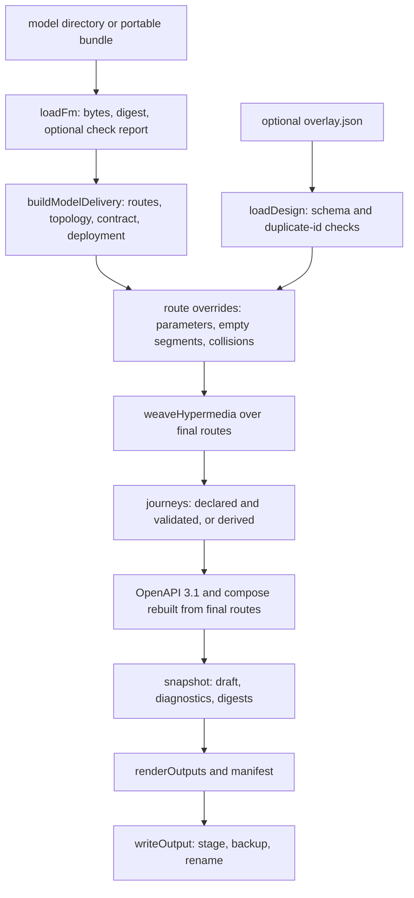

# Model-derived API delivery projection

`libs/evidence-api` is the step between a saved Fulfillment Model and a callable
contract. It reads an indexed `FmIndex` (built by the adapter from a model
directory or a portable bundle) plus an optional design overlay, and produces one
`EvidenceApiSnapshot`: a `5.1` document in `mode: 'draft'` that carries the route
list, the service topology and cross-service links, hypermedia links, journeys,
the OpenAPI 3.1 document, the deployment sketch, the recorded limitations, the
normalized diagnostics and the input digests
(`repo://libs/evidence-api/src/types.ts#L9-L31`,
`repo://libs/evidence-api/src/projector.ts#L48-L193`).

The design rule is that nothing is invented. Every path points at one modeled
object, and the `x-evidence-*` extensions keep that linkage readable, so a
reviewer can walk from a path to its Context, its fulfillment pair and the rule
that computes a value instead of guessing from the schema
(`repo://libs/evidence-api/src/delivery/modelDelivery.ts#L15-L25`). There is no
separate capability or coverage document: the route list *is* the contract, and
each route carries the model references it came from.



One projection is one pass. Only the final step writes anything; everything before
it is a pure function of the model, the overlay and the supplied report.

## Preconditions: the report is evidence, not a gate on reading

`loadFm` reads a directory or a bundle, snapshots each file's digest, parses the
model, and reads the tree a second time. If anything moved during the read the
result is a `SOURCE_CHANGED` error and no index, rather than a mixed-version
projection (`repo://libs/evidence-api/src/adapter/fmAdapter.ts#L208-L267`).
Unparseable or unreadable input is `FM_INVALID`, which also blocks the projection.

The check report is optional, and that is deliberate — a missing report means "no
report was supplied", not "the check passed". `index.check` stays `null` and
nothing in the projection claims a passing check
(`repo://libs/evidence-api/src/adapter/fmAdapter.ts#L34-L60`,
`repo://libs/evidence-api/src/adapter/fmAdapter.ts#L102-L155`). A report that *is*
supplied is validated strictly: `checkVersion` 5, `consistent`, `complete`,
`valid`, `inputChanged === false`, `modelValidated === true`, an empty `errors`
array and a `modelDigest` string. Anything short of that is an `FM_CHECK_INVALID`
**gap** — the projection still runs, and the finding stays visible
(`repo://libs/evidence-api/src/adapter/fmAdapter.ts#L82-L145`).

The digest is then compared with the current model. A mismatch is
`FM_CHECK_STALE`, again a gap: the projection uses the current model and states
that the old report does not prove it
(`repo://libs/evidence-api/src/adapter/fmAdapter.ts#L131-L144`). The CLI reports
`valid: true, complete: false`, writes the draft, and exits 3
(`repo://libs/evidence-api/src/projection.spec.ts#L251-L280`). Verification errors
inside the inline validation suite are different: they are
`FM_VALIDATION_INPUT_INVALID` errors and block delivery.

The digest form depends on the source. Reading from disk hashes the model files
through `modelDigestOf`; building from an in-memory document hashes the canonical
JSON of the compiled model plus its sorted validation suite, prefixed with
`sha256:` — and the document is `structuredClone`d first so later caller edits
cannot silently change an already-built index
(`repo://libs/evidence-api/src/adapter/fmAdapter.ts#L100-L125`,
`repo://libs/evidence-api/src/fmAdapter.spec.ts#L138-L172`).

## Routes come from the model's own vocabulary

`buildDeliveryRoutes` walks the model's Contexts in id order and emits the routes
each Context kind implies. A fulfillment pair is already shaped like a route pair —
a request is the caller's intent, a confirmation closes it — so the projection maps
them one to one and no endpoint exists that does not correspond to a business
moment (`repo://libs/evidence-api/src/delivery/routes.ts#L188-L575`):

| Context kind | Routes emitted |
| --- | --- |
| `contract` | `POST /<lane>/<contractSegment>` to sign; `GET …/{contractId}` to read the agreement; per fulfillment pair a `POST …/<requestSegment>/request` and a `GET` ledger; one `POST …/request/confirmation` per confirmation |
| `pre_contract` | `POST /<lane>/<rfpSegment>` to open an enquiry, `GET …/{rfpId}` to read it, and one `POST` per proposal — nested under the enquiry it `references`, otherwise left at the lane root with a summary that says the model declares no enquiry |
| `domain` | one `GET` per `participant.thing`: a Domain Context is read, never written |

Route ids are stable and descriptive (`route.sign.<contract>`,
`route.request.<request>`, `route.confirm.<confirmation>`, `route.read.<object>`,
`route.open.<rfp>`, `route.propose.<proposal>`); the final sort is by `contextRef`
then route id, so two projections of the same model diff cleanly
(`repo://libs/evidence-api/src/delivery/routes.ts#L575-L576`).

The URL vocabulary is derived too. `rawSegmentOf` folds the last dotted part of a
business id into a path-safe segment, and `createSegmentAllocator` guarantees that
two ids never answer to one path — a clash inside one id category gets a suffix
rather than a silent overwrite. `serviceIdOf` maps a Context to
`service.<context-name>` and `operationIdFor` produces an OpenAPI-safe operation id
(`repo://libs/evidence-api/src/delivery/segments.ts#L1-L85`).

### What a caller may send

Every attribute is classified once, in declaration order
(`repo://libs/evidence-api/src/delivery/routes.ts#L106-L186`):

- **`caller`** — an ordinary attribute; it appears in the request body and is
  editable.
- **`derived`** — the model has a derivation rule (or a `derivedByRuleRef`), so the
  service computes it. The rule id and expression travel with the field.
- **`service-time`** — the attribute name belongs to the model's business-time
  vocabulary, so the service stamps it when the moment actually happens. A caller
  cannot backdate one.

Only `caller` fields reach the request body, and the body is
`additionalProperties: false`, so a derived value or a business time cannot be
smuggled in. In responses the same attributes are `readOnly` and carry
`x-evidence-origin`, `x-evidence-caller-input` and, for derived values,
`x-evidence-rule` / `x-evidence-derived-by-rule`
(`repo://libs/evidence-api/src/delivery/modelDelivery.ts#L74-L166`,
`repo://libs/evidence-api/src/delivery/fieldContract.spec.ts#L8-L68`).

### Addressing, shape and callers

A route has a `path` (the collection address) and an `itemPath` (the address of one
credential). Which one a child hangs under comes from the model's cardinality, read
from the `references` relationship in either direction: **singleton only when every
declared maximum is 1**, and collection when the quantity is unknown, absent or
contradictory — an unknown number never implies uniqueness
(`repo://libs/evidence-api/src/delivery/addressing.ts#L8-L36`). A request route is
therefore `/…/request` for a singleton and `/…/request/{requestId}` for a
collection, and a confirmation hangs under the request's item path, gaining a
segment and an id only when more than one confirmation exists.

Callers are computed, not declared. `callerRoles` takes the contract's `roleRefs`
(or the parent contract's, for a pre-contract Context), narrows them to the
evidence object's `responsibleRoleRef` when it has one, and keeps only Party Roles
that an actual `participant.party` plays through `plays_role`. A route with no
such caller is `exposure: 'internal'`; the rest are external
(`repo://libs/evidence-api/src/delivery/addressing.ts#L38-L75`). This is not an
authorization grant — it is the set of roles the contract names
(`repo://libs/evidence-api/src/adapter/fmAdapter.ts#L189-L207`).

## Topology and the deployment sketch

`buildDeliveryTopology` splits the model by Context, not by noun: one Context
becomes exactly one service, because splitting by table would put a promise and its
answer in two services and make every close a distributed transaction
(`repo://libs/evidence-api/src/delivery/topology.ts#L10-L40`,
`repo://libs/evidence-api/src/delivery/topology.ts#L200-L302`). Four kinds cover the
model:

- `channel` — a pre-contract Context: high churn, no legal force yet.
- `fulfillment` — a Contract Context: the only place a fulfillment pair closes.
- `domain` — a Context that only answers calculations and checks, read by others.
- `capability` — a Context that supplies an evidence-role socket another Context
  depends on, so a payment channel or carrier can be replaced without touching the
  agreement that needs it.

Links follow the same derivation. An evidence `role` played by a participant of
another Context yields a `capability` link, `mode: 'async'`, from supplier to
consumer. A rule binding or `references` edge into a Domain Context yields a
`reads` link, `mode: 'sync'`. A pre-contract Context with a `parentContextRef`
yields a `signs` link to the contract it hands over to
(`repo://libs/evidence-api/src/delivery/topology.ts#L60-L199`).

`buildDeliveryDeployment` renders the same services and links as a compose file:
one container per service keyed by its id without the `service.` prefix, image
`evidence/<lane>:latest`, `EVIDENCE_MODEL` / `EVIDENCE_CONTEXT` /
`EVIDENCE_SERVICE_KIND` / `EVIDENCE_BASE_PATH` environment, `dependsOn` from the
outgoing links, and `expose` from the first path segment of the routes that service
serves. Images and ports are placeholders; the boundaries and dependency direction
are the projected ones (`repo://libs/evidence-api/src/delivery/modelDelivery.ts#L313-L372`).

## The design file is an overlay, not a second model

The optional design document is a small JSON overlay validated against the embedded
`api.schema.json`: an `id`, a `routes` array of `{id, path?, summary?}` and a
`journeys` array of `{id, roleRef, routeId, nextPossibleSteps?}`,
`additionalProperties: false`
(`repo://libs/evidence-api/src/schemas/apiSchema.ts#L1-L48`). It can only rename
paths, retitle summaries and declare journeys; it cannot add a route or change what
a route does. An older full design is refused as `DESIGN_INVALID` rather than
having its unknown sections silently ignored
(`repo://libs/evidence-api/src/apiLoader.spec.ts#L84-L106`).

The output is validated against a second embedded schema,
`api-projection.schema.json` — what this engine is allowed to produce — so the
renderer cannot emit a shape no consumer can read. Both schemas are compiled once
and cached, and their exact bytes are what the manifest records
(`repo://libs/evidence-api/src/loader/apiLoader.ts#L1-L60`,
`repo://libs/evidence-api/src/apiLoader.spec.ts#L30-L56`).

`buildProjection` re-reads the design through `loadDesign('overlay.json',
canonicalJson(design))`, so an overlay supplied programmatically by the desktop or
the workbench is checked exactly like a file
(`repo://libs/evidence-api/src/projector.ts#L64-L70`). That loader is stricter than
`JSON.parse`: YAML is refused by extension, duplicate keys are found by a raw-text
scan because `JSON.parse` would keep the last one, a non-JSON literal such as `NaN`
is rejected, a non-object document is rejected, and a duplicated `id` inside
`routes` or `journeys` is reported before anything resolves an id to the wrong
record (`repo://libs/evidence-api/src/loader/apiLoader.ts#L101-L345`).

Applying the overlay is a validated merge, and a refusal keeps the model-derived
value rather than dropping the route (`repo://libs/evidence-api/src/projector.ts#L71-L117`):

| Problem | Diagnostic | Effect |
| --- | --- | --- |
| overlay names a route the model does not imply | `API_ROUTE_NOT_FOUND` | override ignored |
| renamed path drops or adds a path parameter, contains `//`, or has unbalanced braces | `API_PATH_INVALID` | original path kept |
| two routes end up on the same method and path template | `API_ROUTE_COLLISION` | both reported |
| a journey names a missing route | `API_ROUTE_NOT_FOUND` | step dropped |
| a journey's caller is not a Party Role in that route's `allowedPartyRoleRefs` | `API_ROLE_INVALID` | step dropped |
| a journey names a successor step that is not declared | `API_JOURNEY_STEP_NOT_FOUND` | step kept, finding reported |

Hypermedia is woven from the *final* routes, and the OpenAPI document and compose
sketch are rebuilt from them, so an accepted override cannot leave the contract,
the link templates and the route list disagreeing. The model document itself is
never mutated — a test asserts the input is byte-identical afterwards
(`repo://libs/evidence-api/src/projector.ts#L98-L193`,
`repo://libs/evidence-api/src/projection.spec.ts#L76-L108`).

## Hypermedia and journeys describe navigation only

`weaveHypermedia` gives every route a `self` link to its `itemPath` (templated when
the address contains braces) and then, for each `references` edge between two
Evidence objects, a `next:<dependent>` link from the prerequisite's routes to every
`POST` route of the dependent object. A model with no such edges produces only
`self` links — the weaver never fabricates a sequence
(`repo://libs/evidence-api/src/http/hateoasWeaver.ts#L15-L64`). These links state
possible navigation, never runtime readiness or permission — a point the link type
and the weaver both say explicitly.

The links are published inside the contract: `halLinksFor` turns a route's links
into `x-evidence-link-templates` on its `2xx` `application/hal+json` response, and
a `201` declares a `Location` header whose `x-evidence-uri-template` is the route's
`itemPath` (`repo://libs/evidence-api/src/delivery/modelDelivery.ts#L168-L232`).

A journey is a step graph, not an invented happy path. When the overlay declares
journeys they are validated and enriched with the resolved `method`, `path` and
`purpose`; when it declares none, `deriveJourneys` creates one step per `POST` route
× allowed Party Role and connects steps through the non-`self` links
(`repo://libs/evidence-api/src/http/hateoasWeaver.ts#L84-L115`,
`repo://libs/evidence-api/src/projector.ts#L118-L176`). Branches and cycles stay a
graph.

## OpenAPI 3.1 with evidence extensions

`buildDeliveryContract` emits OpenAPI `3.1.0`. The model's own vocabulary is kept
readable through extensions rather than being flattened away
(`repo://libs/evidence-api/src/delivery/modelDelivery.ts#L243-L305`):

| Where | Extension | Meaning |
| --- | --- | --- |
| document | `x-evidence-model` | the model id |
| document | `x-evidence-services` | `{id, kind, contextRef, basePath}` per service |
| operation | `x-evidence-purpose`, `-context`, `-entity`, `-service` | which business moment, Context and object the path acts on |
| operation | `x-evidence-allowed-party-roles`, `-exposure` | the computed callers, and whether the route is external |
| operation | `x-evidence-contract`, `-fulfillment-request`, `-fulfillment-confirmation` | the fulfillment pair the route closes |
| operation | `x-evidence-derived`, `-stamped` | fields the service computes, and fields it stamps |
| schema property | `x-evidence-origin`, `-caller-input`, `-rule`, `-derived-by-rule` | how the field is owned: caller, derived or service-time |
| `201` header | `x-evidence-uri-template` | where the new credential lives |
| `2xx` content | `x-evidence-link-templates` | the HAL links that response carries |

Component schemas are named by folding dots to underscores, always declare
`_links` as required, and are `additionalProperties: false`. The services list is
passed into the contract builder rather than recomputed, so the OpenAPI document
and the topology name the same services by construction
(`repo://libs/evidence-api/src/delivery/modelDelivery.ts#L254-L305`,
`repo://libs/evidence-api/src/delivery/delivery.spec.ts#L31-L108`).

## The snapshot, its digests and what "complete" means

The snapshot is `schemaVersion: '5.1'` with `mode: 'draft'` (a constant in the
projection schema), `apiId` from the overlay or `default-api`, and digests for the
model (`sha256:`-prefixed), the design and the check report (bare hex, each present
only when that input exists) (`repo://libs/evidence-api/src/types.ts#L9-L31`,
`repo://libs/evidence-api/src/schemas/apiProjectionSchema.ts#L1-L176`).

Diagnostics carry three severities and one stable order: deduplicated by identity,
then sorted by severity, code, `targetRef` and message. The order is part of the
contract, because `projection.json` is compared with a saved copy
(`repo://libs/evidence-api/src/diagnostics.ts#L1-L132`).

`isComplete` means *no errors and no findings at all*, and the CLI additionally
requires the rendered snapshot to pass the projection schema. The source comment
is the policy: complete here means no API findings, it never means release
authorization (`repo://libs/evidence-api/src/projector.ts#L202-L204`,
`repo://libs/evidence-api/src/cli.ts#L318-L336`). Every projection says
`mode: 'draft'` regardless.

## The delivered file set and its manifest

`deliveryFilesOf` serializes one snapshot into the files a hand-off writes, all as
canonical JSON (sorted keys, trailing newline)
(`repo://libs/evidence-api/src/delivery/files.ts#L17-L62`):

| File | Content |
| --- | --- |
| `openapi.json` | the OpenAPI 3.1 contract |
| `topology.json` | schema version, model identity, services, links, limitations |
| `routes.json` | the full route list |
| `deployment.compose.json` | the compose sketch |
| `projection.json` | the whole snapshot, diagnostics included |
| `http-journeys.json` | `{runtimeValidated: false, journeys, hypermedia}` |
| `limitations.md` | only when there is something to report |
| `manifest.json` | tool identity, runtime, input digests, per-output digests |

The manifest is what makes a bundle auditable
(`repo://libs/evidence-api/src/renderer/outputRenderer.ts#L26-L90`):

```json
{
  "schemaVersion": "5.1",
  "apiId": "default-api",
  "tool": { "name": "evidence-api", "version": "5.1.0", "schemas": { "api.schema.json": "<sha256>", "api-projection.schema.json": "<sha256>" } },
  "runtime": { "node": "<version>", "dependencies": { "ajv": "<version>" } },
  "inputs": { "model": "sha256:<hex>", "design": "<hex>", "checkReport": "<hex>" },
  "outputs": { "openapi.json": { "sha256": "<hex>", "bytes": 1234 } }
}
```

Keys appear only for the inputs that exist: a projection with no overlay and no
report records just the model digest. `http-journeys.json` states
`runtimeValidated: false` because the journeys are a static navigation graph;
nothing has been executed against them.

Writing is all-or-nothing, because a half-replaced directory would let a consumer
read a new `projection.json` beside a stale `openapi.json`
(`repo://libs/evidence-api/src/renderer/outputRenderer.ts#L92-L170`). The files are
written into a sibling staging directory created with `mkdtempSync`, each with an
exclusive `wx` create; an existing output is renamed to a backup sibling, the stage
is renamed into place, and a failed rename restores the previous tree. Output names
must be bare file names — anything with a path separator throws
`OUTPUT_NAME_INVALID`. The default destination is
`<project>/.evidence/api/generated`.

## CLI verbs, path rules and exit codes

`evidence-api` exposes `inspect`, `check`, `project`, `deliver` and `diff`
(`repo://libs/evidence-api/src/cli.ts#L18-L52`). The first four share one load and
one projection:

| Verb | Output |
| --- | --- |
| `inspect` | the read-only inventory (roles, played and unplayed Party Roles, resource clues, contexts, scenarios, input file digests) plus the projection summary; it proposes no routes |
| `check` | the same summary plus the full snapshot, so a reviewer can read the projection without writing |
| `project`, `deliver` | the same summary plus `out`, the written file names and the limitations |

`deliver` is an alias for `project`: both go through the same path validation and
the same `renderOutputs` + `writeOutput` call
(`repo://libs/evidence-api/src/cli.ts#L337-L362`). `diff` is a separate code path
covered in [contract diff and evolution](./api-diff-and-evolution.md).

Exit codes follow severity: `0` when there are no findings, `1` on any `error`
(including path refusals, unreadable inputs and a projection that fails its own
schema), and `3` when only `gap`s remain
(`repo://libs/evidence-api/src/cli.ts#L318-L326`). Writing is gated on errors, not
on gaps: a draft with an open question is written and exits 3, while an error
writes nothing and leaves any previous export untouched
(`repo://libs/evidence-api/src/projection.spec.ts#L251-L326`).

Path validation happens before any read and is deliberately paranoid
(`repo://libs/evidence-api/src/cli.ts#L62-L130`):

| Refusal | Rule |
| --- | --- |
| `PATH_NOT_ABSOLUTE` | every supplied path must be absolute |
| `PROJECT_ROOT_INVALID` | `--project-root` must be an existing directory |
| `FM_CHECK_INPUT_CONFLICT` | `--fm-check` must live outside the model root |
| `API_INPUT_CONFLICT` | `--api` must live outside the model root |
| `OUTPUT_OUTSIDE_PROJECT` | `--out` (default `<root>/.evidence/api/generated`) must stay inside the project |
| `OUTPUT_INPUT_CONFLICT` | the output may not overlap the model, the overlay or the report, in either direction |

`canonicalPath` resolves the nearest existing ancestor with `realpathSync`, so an
output cannot hide behind a symlink into the model tree or outside the project
(`repo://libs/evidence-api/src/cli.ts#L64-L85`,
`repo://libs/evidence-api/src/projection.spec.ts#L342-L406`). A malformed overlay
exits 1 with its diagnostics and does not replace a previous export; an unreadable
`--fm-check` is refused as `FM_CHECK_INVALID` instead of throwing.

## Limitations the sketch admits

Two things are recorded rather than guessed, and both end up in `projection.json`,
`topology.json` and — when non-empty — a prose `limitations.md`
(`repo://libs/evidence-api/src/delivery/modelDelivery.ts#L382-L408`):

- a fulfillment pair with no confirmation has no confirmation callback, so the
  pair is reported as unclosed;
- derived attributes need a rule runtime on the server; the contract only declares
  where the value comes from.

That is why the compose file and the manifest are a sketch plus an integrity
record, not a release.

## Who consumes a projection

The projection is a library value, so the preview a human reads and the files a
hand-off writes come from the same bundle. The desktop's delivery hub builds it
in-process (`buildProjection`) and refuses to preview when it contains errors
(`repo://apps/desktop/src/main/deliveryProjection.ts#L94-L117`). The review
workbench does the same with the project's overlay, and additionally refuses when
the freshly computed model digest no longer matches the check report it is about to
cite, or when the projection contains any error
(`repo://libs/evidence-visualization/src/generate/collectWorkbench.ts#L294-L330`).
Those two guards are the practical reason a stale report is a visible gap rather
than a silent one.

## Tests that protect this contract

- `projection.spec.ts` proves the in-memory entry point (`buildDelivery`), the
  indexed projection and the exported files agree, that the manifest's output
  digests match the bytes it wrote, that the snapshot passes its own schema, that a
  route override neither adds nor drops routes and leaves the model untouched, that
  dangling overrides, altered identity parameters and collisions are refused, that
  declared journeys are validated, and that every CLI verb runs without an offline
  report while exercising every path refusal and symlink escape
  (`repo://libs/evidence-api/src/projection.spec.ts#L45-L416`).
- `delivery.spec.ts` pins operation ids, tags and the `x-evidence-*` operation
  fields, refuses a derived value or a business time in a request body, keeps a
  `409` for a closed window, publishes the service base paths, checks the
  deployment's `dependsOn`, the base file order (`limitations.md` joins only when
  there is something to say), and the claim that a capability provider can be
  swapped without moving a core contract path
  (`repo://libs/evidence-api/src/delivery/delivery.spec.ts#L31-L306`).
- `routes.spec.ts` covers request/ledger/confirm paths, singleton versus collection
  addressing from both relationship directions, nesting a proposal under the
  enquiry it answers, internal exposure for a role nobody plays, and the exclusion
  of derived and stamped fields from caller input
  (`repo://libs/evidence-api/src/delivery/routes.spec.ts#L15-L160`).
- `topology.spec.ts` and `fieldContract.spec.ts` pin the four service kinds, the
  `signs` / `reads` / `capability` links, the read-only marking of server-owned
  fields, the `Location` template on `201`, and that component schemas do not depend
  on route order (`repo://libs/evidence-api/src/delivery/topology.spec.ts#L15-L70`,
  `repo://libs/evidence-api/src/delivery/fieldContract.spec.ts#L8-L68`).
- `hateoasWeaver.spec.ts` moves a `next:` link when the referencing relationship
  changes, shows that an overlay path reaches the link template, and proves an empty
  graph yields only `self` links
  (`repo://libs/evidence-api/src/http/hateoasWeaver.spec.ts#L6-L82`).
- `apiLoader.spec.ts` asserts the embedded schemas match the shipped bytes,
  refuses YAML, duplicate keys, `NaN`, non-objects and duplicated ids, rejects an
  obsolete full design, and keeps defaults out of malformed input
  (`repo://libs/evidence-api/src/apiLoader.spec.ts#L28-L171`).
- `fmAdapter.spec.ts` pins the digest form, report acceptance and refusal, the
  stale-report behaviour, the `SOURCE_CHANGED` guard, and that only Party Roles an
  actual participant plays count as callers
  (`repo://libs/evidence-api/src/fmAdapter.spec.ts#L46-L222`).

## Related pages

- [The native check and simulation pipeline](../model/checks-and-simulation.md) —
  what produces the report this stage treats as evidence.
- [Contract diff and evolution](./api-diff-and-evolution.md) — how two projections
  become a reviewable breaking-change report.
- [The offline review workbench](./offline-workbench.md) — the page that renders
  this projection for a human.
- [The Fulfillment Modeling DSL (FM v5)](../language/fm-dsl.md) — the objects being
  projected.
- [Key data, business time and provenance](../language/key-data-and-provenance.md) —
  why derived and stamped values are server-owned.
- [Verification strategy and fixtures](../testing/verification-strategy.md) — the
  shared model and overlay fixtures these tests use.
