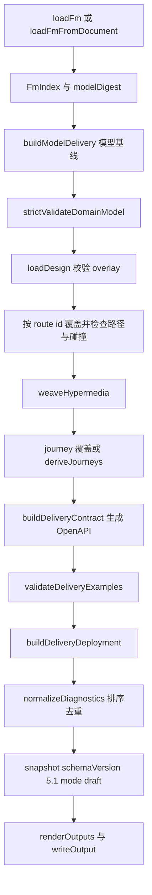

# API 契约投影与 OpenAPI

`evidence-api`（包名 `@evidence-poc/evidence-api`，Nx 项目 `evidence-api`）把 FM 模型——目录树或 `.evidence.json` Bundle——加上可选的 JSON overlay，投影成 `EvidenceApiSnapshot`：routes、services 与 links、hypermedia、journeys、OpenAPI 3.1、deployment 草图、limitations、diagnostics 和 digests。快照固定 `schemaVersion: '5.1'`、`mode: 'draft'`；它描述模型蕴含的 HTTP 表面，不宣称发布就绪，也不证明后端已经实现或验收已经通过。

职责边界写在本库自己身上：投影读模型、生成契约、把无法回答的问题留成 limitations 或 gap；HTTP 验收执行、Step CI/Hurl suite 导出、`oasdiff` 兼容比较都不在这里。`commands.ts`、`runner/`、`renderDeliverables` 已随这些能力迁到 `evidence-acceptance`，旧的 `evidence-api` 二进制与 `/commands`、`/cli`、`/runner` 入口不再存在，统一 CLI 的用户命令与退出码保持不变。Nx 的 `layer:projection` 规则只允许依赖 projection/domain/io/schema，`tools/workspace-rules/boundary-drill.mjs` 还特意往本库写一行 `@evidence-poc/evidence-acceptance` 导入，要求 lint 以 “Circular dependency between evidence-api and evidence-acceptance” 失败——规则被改名或放宽时 drill 会红。

## 输入、索引与 digest 证据链

`loadFm` 接受模型目录或打包文件：读前读后各取一次 path→sha256(bytes) 快照并比较，读取期间变化即 `SOURCE_CHANGED`（index=null）；解析失败或无法读取是 `FM_INVALID` error，同样不产出索引，不修补源字节。`loadFmFromDocument` 是同一入口的内存形态，磁盘路径只是把 bytes、files 与模型摘要交给它。它拒绝旧的 `validation` envelope（旧 scenarios/instances 不能借兼容复活），用 `structuredClone` 固定输入，并建立实体、关系、规则与 context 成员索引。

- 没有 check 报告意味着“没提供”，不是“通过”：`index.check` 为 null。
- 提供的报告必须 `checkVersion=6`、`consistent/complete/valid/modelValidated=true`、`inputChanged=false`、`errors` 为空、`modelDigest` 为字符串，否则记为 `FM_CHECK_INVALID` gap。
- 结构合格但摘要与当前模型不符，降级为 `FM_CHECK_STALE` gap：投影用当前模型继续，草稿仍可预览，但旧检查结果不证明当前模型已通过。
- 摘要：磁盘模型的 `digests.model` 是排序后 path→sha256(bytes) 映射的 sha256，内存模型取自 canonical compiled document，两者都带 `sha256:` 前缀；overlay 与 check 报告各自的摘要是对 canonical JSON 求 sha256 的裸 hex，缺失时整个键省略而不是填占位值。manifest 原样复制这三个摘要，产物因此能回指具体输入。

`inspect` 是只读库存：模型、roles、真实 `participant.party` 扮演的 Party Roles、未扮演角色、evidence/participant resource clues、contexts、带 `examples[].test` 的清单、文件摘要。它不发明路由，也不再输出旧 scenarios。

## Overlay 是严格 JSON，且只改既有路由

Overlay 形状固定：`schemaVersion=5.0`、`id`、`routes`（id/path/summary）、`journeys`（id/roleRef/routeId/nextPossibleSteps）。YAML、重复键（含嵌套与转义写法）、非 JSON 常量、非对象、同一 section 内重复 ID、旧的 `resources`/`bindings`/`capabilities` 都产生 `DESIGN_INVALID` error；默认值只在校验通过后补齐，畸形输入绝不静默替换为默认。程序化 overlay 走同一 loader：`buildProjection` 用 `canonicalJson` 把 design 作为 `overlay.json` 的内容交给 `loadDesign`，因此内存输入和磁盘文件受同一套规则约束。

## 投影顺序

一次投影的固定顺序：模型基线在前，overlay 只能改既有路由，OpenAPI 最后从最终 routes 生成。

1. `buildModelDelivery` 从模型生成基线 routes、services、links、deployment、limitations。
2. 对 manifest/entities/relationships/rules 重跑 `strictValidateDomainModel`，问题记为 `FM_INVALID` error；草稿快照仍会返回，是否写出由发布命令决定。
3. `loadDesign` 校验 overlay；只要 loader 有诊断就整体放弃 overlay，不做部分接受。
4. 按 `route.id` 覆盖 path/summary：未知 ID 是 `API_ROUTE_NOT_FOUND`；改变路径参数集合、出现空段或未配对花括号是 `API_PATH_INVALID`；与另一路由 method+path 模板重复是 `API_ROUTE_COLLISION`。overlay 不能新增业务接口。
5. 编织 hypermedia 后处理 journey：route 必须存在（`API_ROUTE_NOT_FOUND`），roleRef 必须是 role/party 且在该 route 的 `allowedPartyRoleRefs` 内（`API_ROLE_INVALID`），每个 `nextPossibleSteps` 必须解析到已声明 step（`API_JOURNEY_STEP_NOT_FOUND`）；未声明 journeys 时从 routes 与 hypermedia 推导。
6. 从最终 routes 生成 OpenAPI 与 deployment，并用最终 component schema 校验 examples（`API_EXAMPLE_INVALID`），保证 snapshot 与 contract 不会指向不同路径。
7. `normalizeDiagnostics` 去重排序；发布命令再用 `api-projection.schema.json` 校验整个 snapshot，错误记为 `PROJECTION_INVALID`。

`buildDelivery(document)` 是同步、无需路径参数的创作入口（桌面预览与 agent sensor 使用），等价于对内存文档做 `loadFmFromDocument` + `buildProjection`。`isComplete` 只在快照零 findings 时为 true——这比“没有 error”更严格，也仍然不是发布授权。

## 路由与服务的形状

路由一一对应模型里的业务时刻：contract 的 sign POST/read GET、fulfillment 的 request POST/ledger GET/confirm POST、pre_contract 的 rfp open/read 与 proposal、domain context 的只读 thing。没有 enquiry 引用的 proposal 留在 lane root 并写明“模型未声明所属征询”，不猜父资源；domain context 只读，因为那里回答的是问题而不是让调用方写入。

`itemPath` 是实例地址：GET 等于 path，POST 由 `childShape` 决定 singleton 还是补 `{requestId}`/`{confirmationId}`/`{proposalId}`，而 `childShape` 只看已声明 cardinality 的 max——未知或矛盾的基数绝不推断唯一。`callerRoles` 从根合同 roleRefs 按 `responsibleRoleRef` 收窄，再只保留真实 `participant.party` 扮演的 `role.party`；集合为空时路由、OpenAPI 与 topology 都保留，只是 `exposure=internal`，不悄悄消失。

服务边界是 Context 而不是表：每个 Context 一个 service，回答其他 Context evidence-role socket 的成为 `capability`，否则 pre_contract→`channel`、domain→`domain`、其余→`fulfillment`。links 分 `signs`/`capability`（async 回调）/`reads`（sync），`deployment.compose.json` 与 `x-evidence-services` 复用同一 topology。细节见[交付路由与差异](./delivery-routes-and-diff.md)。

## 超媒体不是虚构执行顺序

每条 route 有指向 `itemPath` 的 self link；Evidence 之间的 `references` 让先决对象的路由指向依赖者的 POST 路由，形成 `next:<entityRef>`；链接去重后按 source/rel/target 排序，含模板的 href 只标 `templated` 而不提前展开。默认 journey 是“每个 POST × 允许的 party role 一个 step”，按非 self 链接连成图；分支和环保留为图，不排成一条被发明的顺序。`http-journeys.json` 固定写 `runtimeValidated=false`，导航关系不等于运行时授权，也不等于验收已执行。

## OpenAPI 3.1 与字段纪律

`buildDeliveryContract` 输出 OpenAPI 3.1.0：manifest → `info`，route → operation，每个读写对象 → component schema，topology services → `x-evidence-services`（basePath 与拓扑一致，不能各写一套边界）。operation 携带 `x-evidence-purpose/context/entity/service/contract/fulfillment-request/fulfillment-confirmation/allowed-party-roles/exposure/derived/stamped`，让审阅者能从路径走回对象、合同、履约对与规则。

- POST 请求体只包含 caller 字段且 `additionalProperties=false`；派生值与业务时间不是客户端输入，不能回填。
- 响应中 derived/stamped 标 `readOnly`、`x-evidence-origin`、`x-evidence-caller-input=false`，派生字段带规则引用；对象 component 要求 HAL `_links`。
- 201 响应带 `Location`，其 `x-evidence-uri-template` 就是 route 的 `itemPath`；2xx 实体响应是 `application/hal+json` 并保留 link templates。
- path 参数逐一对应模板且 `required` string；GET 没有 request body。
- 字段类型映射把 `int`/`uint` 描述为“安全整数或十进制字符串”的 `anyOf`，`timestamp`/`date`/`bytes` 分别用 `date-time`/`date`/`byte`。这只是契约侧对 CEL JSON 边界的表述，服务端是否真的按此拒绝与求值由后端和验收负责。

模型答不出的东西进 limitations 而不是被编成闭环：没有履约确认的请求对、依赖服务端规则运行时的派生属性都会列出，`limitations.md` 只在非空时生成。evidence-only 覆盖率由 agent 的 `audit_api` sensor 统计，缺路由只给 warn；投影本身不伪造覆盖评分。

## 内联 examples 的投影与验收边界

实体的 `examples` 是具名完整事实，不是 workflow step。投影把它们同时放进 request、response 与 component examples：request 示例只保留 caller 拥有的字段，response 与 component 示例补一个空 `_links`。`validateDeliveryExamples` 用最终 component schema 逐个校验示例值，缺字段、类型错或多余字段都成为 `API_EXAMPLE_INVALID` error，从而在导出前拒绝，而不是降级成“能通过”的用例。

`examples[].test` 里的 flow、actingRoleRef、asOf、basedOn/路径参数与期望属于验收编译，由 `evidence-acceptance/projection` 的 `projectAcceptanceTests` 读取；本库不执行 CEL、不排依赖、不生成 Step CI/Hurl、也不连后端。投影与运行时因此共享同一份模型事实，又保持单向依赖。

## 交付树、确定性与发布

`deliveryFilesOf` 按固定顺序给出 `openapi.json`、`topology.json`、`routes.json`、`deployment.compose.json`、`projection.json`、`http-journeys.json`，非空时追加 `limitations.md`；`renderOutputs` 再补 `manifest.json`，记录工具名/版本、两份 schema 的摘要、Node 与 ajv 版本、snapshot 的输入摘要，以及每个输出的 sha256 与字节数。所有 JSON 经 `canonicalJson` 序列化（键逐层排序、末尾换行），因此同一模型即使实体/关系顺序被打乱，产物字节也不变。

写盘是全有或全无：只接受直接文件名，先在输出目录同级建临时目录写入，再把旧树 rename 成 backup，最后 rename 到位；最终移动失败时恢复旧树，避免出现新 `projection.json` 配旧 `openapi.json` 的半新半旧状态。默认目录是 `.evidence/api/generated`。

发布动作现在由 `evidence-acceptance` 的命令层完成：写出前先 `assertOpenApiContract` 校验 OpenAPI 3.1 元模型，再 `renderOutputs`/`writeOutput`；退出码 0 表示无 findings、1 表示有 error 因此不写、3 表示只有 gap 但仍写出可审查草稿，`complete` 比“可写”更严格，要求零 findings。路径纪律（绝对路径、out 位于项目内、不与模型/overlay/报告双向重叠、realpath 解析既有祖先）也在那里的命令层。门禁语义与 CI 用法见 [CLI 双门禁](../workflows/cli-governance.md)。

## 入口：Node 根、browser-safe `/delivery`、`/testing`

- 根入口是 Node 投影与发布 API：`loadFm`/`loadFmFromDocument`、`buildProjection`/`buildDelivery`、`renderOutputs`/`writeOutput`、`validateProjection`、`assertOpenApiContract` 等。
- `/delivery` 是浏览器安全面：只导出 `buildDeliveryRoutes`、`fieldFor`、`buildDeliveryContract`、`componentName`、`compareText` 与相关类型，注释明确它不带 loader、runner 或文件系统。桌面 renderer 的 `ScenarioStudioModal`（`buildDeliveryRoutes`）、inspector 的 `ApiFieldBadge`（`fieldFor`）、`feature-canvas` 的 `LiveApiContext`（`DeliveryField` 类型）以及 `evidence-acceptance` 的 browser-safe `scenarioProjector` 都从这里取字段与契约，浏览器包因此不拖入 Node I/O。
- `/testing` 是跨库共享 fixture 入口：`API_FIXTURES`、`fullLifecycle`/`fullLifecycleIndex`、`procurementEvolution`、`createAcceptanceModel` 等。`fullLifecycleIndex` 用 `buildFmCheckReport` 生成真实 v6 报告再 `loadFm`，测试不手写 check 结果；`evidence-acceptance` 的投影、diff、导出与 runner specs 都从这里取同一批模型，避免各自维护平行契约。
- 项目标签含 `surface:browser-safe`，`platform:browser` 库只能通过该 surface 触达这个 Node 项目；反方向的 api → acceptance 依赖由 layer 规则拒绝。

## 验证

- `projection.spec.ts`：overlay 与新模型分支共存、内存投影与 indexed 投影逐字节一致、未知/改参数/碰撞门禁、journey 覆盖与引用校验、`FM_INVALID` 时仍返回草稿、manifest inputs 与 snapshot digests 对齐。
- `openapi.spec.ts`：各生命周期阶段通过 OpenAPI 3.1 元模型、`contractProblems` 语义检查、示例投影与三类非法事实拒绝、`openapi-typescript` 生成的消费者类型严格编译且无 any/unknown 逃逸（负向断言禁止伪造 `total_amount`）。
- `delivery.spec.ts`、`routes.spec.ts`、`topology.spec.ts`、`fieldContract.spec.ts`、`fieldOrigin.spec.ts`：寻址与形状、角色收窄与 internal exposure、operationId/basePath、字段来源、`_links` 必需与 201 Location、capability 替换不改 core paths。
- `outputRenderer.spec.ts`：重复渲染、重排等价、Bundle roundtrip 字节稳定，manifest 能发现被改、缺失与未登记的额外文件。
- `apiLoader.spec.ts` 与 `fmAdapter.spec.ts`：嵌入 schema 文本与随包文件逐字节相同、重复键/YAML/旧字段拒绝、`PROJECTION_INVALID`、诊断排序；check 失效/过期、并发源变化、旧 envelope 拒绝，且内存加载不伪造 check。
- 验收执行、suite 导出与 `oasdiff` 的测试属于 `evidence-acceptance`；本库测试不需要 `pnpm api:setup`，边界规则用 `pnpm boundaries:drill` 验证仍然拒绝越界导入。

<!-- openwiki: broken internal link [./offline-workbench.md] file "./offline-workbench.md" does not exist. Fix the href or restore the target, then delete this comment. -->
相关：[交付路由与差异](./delivery-routes-and-diff.md) · [离线审查](./offline-workbench.md) · [CLI 双门禁](../workflows/cli-governance.md) · [验证策略](../testing/verification-strategy.md)
