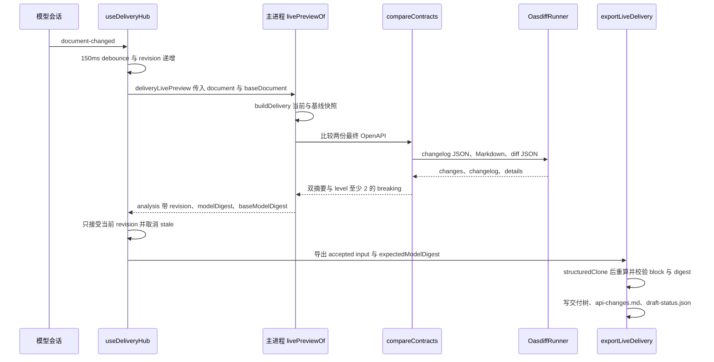

# 交付拓扑、字段契约与契约演进比较

路由与拓扑来自 `libs/evidence-api/src/delivery`，契约比较来自 `libs/evidence-acceptance/src/diff`。没有“补丁路由自动修好”的隐藏路径：`buildDelivery(document)` 与 `loadFm` + `buildProjection` 得到同一形状的 `EvidenceApiSnapshot`（`mode: 'draft'`），比较针对这个最终结果。

## 交付预览由什么组成

一次投影产出的是可审阅的预览，不是发布授权：

- **服务与链接**：每个 Context 一个 service，跨边界的 `signs` / `reads` / `capability` 链接说明谁调用谁、同步还是异步回调。
- **路由与字段来源**：每个业务时刻一条路由；请求体只列 caller 字段，derived 与 service-time 字段只出现在响应与 schema 标注里。
- **契约与部署草图**：OpenAPI 3.1、`deployment.compose`、`http-journeys`（固定 `runtimeValidated: false`）。
- **限制**：模型答不出的部分写成 `limitations`，例如没有确认的履约请求、需要服务端规则运行时的派生属性。
- **摘要**：`digests.model` 标识这次投影；桌面 live 预览用它对齐导出，saved 路径把它写进 `projection.json`。

`isComplete` 只在零 findings 时为真，但它和“能导出草稿”都**不是**发布授权。草稿预览展示的是模型蕴含的 HTTP 表面，正式交接仍由 export 写文件。

## Context → 服务与跨边界调用

`buildDeliveryTopology` 每个 Context 一个 service，而非每表一个服务，避免把一组请求/确认拆成分布式事务。serviceId 是 `service.<去掉 context. 前缀的 ID>`，lane 取点分 ID 末段，services 按 Context ID 排序，links 按 ID 去重排序，所以两次投影给出同一组边界。

分类顺序是：回答其他 Context 的 evidence-role socket → `capability`；否则 `pre_contract` → `channel`、`domain` → `domain`、其余 `fulfillment`。

- `channel` 承载询价/报价，签约向 core 单向推进，不回写渠道。
- `fulfillment` 持有合同履约账；`domain` 只回答计算/检查，不持履约账。
- `capability` 用独立合同支持支付/物流等可替换能力。

跨 context 的 `plays_role` 关系就是 capability socket 的声明：扮演方所在 Context 成为供应方，`supplies`/`consumes` 自动补齐，并生成 `mode: 'async'` 的 link，因为确认在供应方自己的时钟形成回调。Domain 被规则 binding/ref 或 `references` 读取时为 `reads`/`sync`；pre_contract 到 parent contract 为 `signs`/`sync`，`viaRef` 指向父 Context 的根合同。

部署 compose 是占位草图：image/port 非发布配置，但 `EVIDENCE_MODEL`/`EVIDENCE_CONTEXT`/`EVIDENCE_SERVICE_KIND`/`EVIDENCE_BASE_PATH`、`dependsOn` 和 `expose` 来自同一 topology；OpenAPI 的 `x-evidence-services` 复用它，不能各写一套边界。替换能力提供方不应改变 core paths。

## HTTP 寻址、形状与角色

routes 按 Context/对象 ID 稳定生成：contract sign POST/read GET、fulfillment request POST/ledger GET/confirm POST、pre-contract rfp open/read/proposal、domain thing read。没有 enquiry 引用的 proposal 留在 lane root 并写明“模型未声明所属征询”，不猜父资源；没有根合同的请求不嵌在虚构合同之下。

segment allocator 在 ID 类别内分配末段，冲突才加类别/序号；operationId 是稳定 camelCase。`childShape` 不依赖 references 箭头方向，读取 child endpoint 的 cardinality；只有所有已发现 max=1 才 singleton，未知或矛盾不推断唯一。最终寻址区分 `/request` 与 `/requests`，并只为 collection 添加实例参数；多个 confirmation 另加区分段。

`callerRoles` 从根合同 roleRefs 按 responsibleRoleRef 收窄，再保留 `participant.party` 真正 plays 的 `role.party`。空集合仍保留路由、OpenAPI 与 topology，但 `exposure=internal`；模型角色线索不是运行时授权实现。

## 字段来源就是 payload 合同

`fieldFor` 优先 derived（可解析规则或已声明 `derivedByRuleRef`），其次 service-time（`EVIDENCE_TIME_ATTRIBUTE_NAMES` 里的业务时间），最后 caller。悬空 derived rule 也不能把字段降成客户端输入。

POST 仅 caller，`additionalProperties=false`；derived/stamped 在响应 component 标 `readOnly`、`x-evidence-origin`、`x-evidence-caller-input=false` 及规则引用。契约能声明“不接受回填时间”，实际后端仍须执行拒绝；生成类型/静态检查并非 HTTP 防护已实施。

## 交付树、限制与正式 export

`deliveryFilesOf` 的固定顺序是 `openapi.json`、`topology.json`、`routes.json`、`deployment.compose.json`、`projection.json`、`http-journeys.json`，`limitations` 非空时才追加 `limitations.md`。限制内容由模型缺口产生：没有履约确认的请求不生成虚假回调，派生属性只声明来源、需要服务端规则运行时。

三条写出路径要分清：

- **桌面 live 草稿导出**在交付树后追加 `api-changes.md` 与 `draft-status.json`（`mode: 'draft'`、`releaseAuthorized: false`、双摘要、issues），不写 manifest。
- **桌面 saved 导出**只写 `deliveryFilesOf` 的文件，从磁盘重新投影。
- **正式 export**（`evidence project|deliver`）先 `assertOpenApiContract`，再由 `renderOutputs`/`writeOutput` 整树原子写出，并补 `manifest.json`：工具与 schema 摘要、Node/ajv 版本、`digests` 输入、每个输出的 sha256 与字节数。

正式 export 的退出码 0/1/3 表示零 findings、有 error 不写、仅有 gap 仍写出；它与 diff 的 0/1/2 是两套语义，不能混用。无论哪条路径，写出的都是模型草稿产物，不是发布许可。

## 桌面：live revision 与 saved sources

`EditorScreen` 把编辑器打开时的 `initialDocument` 作为 `baseDocument`，把当前 `session.getDocument()` 作为 `document` 交给 `useDeliveryHub`；保存不重置基线。live 预览完全不读磁盘：`livePreviewOf` 只分析 renderer 传入的两份文档。



图：一次 live 预览到草稿导出的摘要握手。

`livePreviewOf` 先校验传输信封（绝对 `rootPath`、非负安全整数 `revision`、模型文档数组），再调用 `checkNativeApiSensor`：`buildDelivery` 当前与基线、`compareContracts`、API 覆盖率与 issues，返回 `revision`、`modelDigest`、`baseModelDigest`、`preview`、`openapi`、`diff`、`changeLog`、`apiSummary`、`issues`、`bindings`、`canExportDraft`。API error diagnostics 是 block，breaking change 在 draft 模式是 warn、release 模式是 block，因此草稿可以带警示导出，但 UI 始终标“未授权发布”。

`useDeliveryHub` 是编辑器生命周期内的一条订阅，不是弹窗生命周期：只对 `document-changed` 触发，选择变化不发请求；150 ms debounce 后带 `revision` 请求，旧 revision 的回复即使在下一次 debounce 期间返回也被丢弃，revision 不匹配即报“API 预览版本不匹配”。重算期间 `stale=true` 且旧预览不可导出；只有当前 accepted analysis 连同它的 `expectedModelDigest` 才能导出。hook 只接收 `deliveryLivePreview` 与 `exportLiveDelivery` 两个 IPC 方法，不碰全局、磁盘或原生 diff 工具。

`exportLiveDelivery` 在异步目录选择器之前完成校验、`structuredClone` 和重算：先拒绝 `canExportDraft=false`（“API 存在阻塞项”），再拒绝 `modelDigest !== expectedModelDigest`（“预览已过期”），然后 `buildDelivery` 并写文件。选择目录期间再改画布不会改变输出；取消返回 `cancelled` 而不是失败，异常返回 `failed`。

saved 路径把 `modelRoot` 交给 `readDelivery`；索引为空或有 error diagnostics 就拒绝，否则 `previewOf` 统计每个服务的 route 数并列出 links/routes/limitations。saved 导出只写 `deliveryFilesOf`，没有 live 的摘要握手，因此预览后保存的模型会按导出时的磁盘内容写出。两种导出都在用户取消时一个字节也不写。

## DeliveryHub 与增量 diff 面板

`DeliveryHub` 分“契约全览”和“本次增量变更”两个 tab，breaking 时增量 tab 带 ⚠。状态行明确写着会话基线是打开编辑器时的模型、保存不会重置差异；`stale` 时提示旧预览不可导出，否则提示当前为内存草稿、未授权发布。

- 全览：服务表（名称、类型、上下文、路由数、说明）、跨边界调用表（from/to/label/mode）、`analysis.bindings` 的路由与 `internal`/角色、`limitations` 列表。导出按钮在 `busy`、`stale` 或 `canExportDraft=false` 时禁用。`embedded` 时作为 console 的 region，否则是 blocking dialog。
- 增量：显示双摘要短码、change 总数与 level>=2 计数、原生 changes（`ERR`/`WARN`/`INFO` + id + text）、可用的“定位模型”跳转、可折叠的完整 diff JSON、覆盖率与除 `API_ALIGNED` 外的 issues。复制 Markdown changelog 在 stale 时禁用；剪贴板失败如实报错。面板同时提醒 OpenAPI 兼容性不代表业务规则、角色权限或履约语义兼容。

`LiveApiProvider` 让画布复用同一份 `analysis.bindings`（实体 → 路由/角色/暴露/字段），`ApiFieldBadge` 通过浏览器安全的 `fieldFor` 入口显示 `Input` / `CEL Derived` / `Service Timestamp`。MCP 的 `get_delivery_topology` 与 `export_openapi_contract` 则由 `createMcpDeliveryService` 从 saved `readDelivery` 投影同样的边界和 OpenAPI，只读、不写模型。

## oasdiff 是兼容性权威

`compareContracts` 接收两份 `EvidenceApiSnapshot`，比较的是**最终** OpenAPI（含已校验的 route overlay）。它在调用进程前拒绝三类输入：`modelId` 不同（`API_MODEL_MISMATCH`）、任一侧存在 error diagnostics、OpenAPI 不是合法 3.1 契约。通过后返回 oasdiff 原生结果加上 `baseModelDigest`/`targetModelDigest`。

原生等级 INFO=1、WARN=2、ERR=3，**level>=2 即 breaking**。`changes` 是结构化的 changelog 条目，`changelog` 是原生 Markdown，`details` 是完整 diff，包含文档与扩展字段的改动。因此“完整 diff 有变化”与“HTTP breaking changelog 有变化”要分别理解：`breakingScenarios.spec.ts` 特意证明只改 CEL 表达式时 `changes` 为空而双摘要不同——OpenAPI 未变不证明业务语义未变。不要再依赖 `ROUTE_REMOVED`、`RULE_CHANGED`、field shifted 等旧私有枚举。

## OasdiffRunner 与 `pnpm api:setup`

`OasdiffRunner` 固定 `OASDIFF_VERSION = '1.38.0'`。binary 解析顺序是显式 `options.binary` → `EVIDENCE_OASDIFF_BIN` → 从模块位置逐级上溯 `node_modules/.cache/evidence/oasdiff/1.38.0/<platform>-<arch>/oasdiff(.exe)` → PATH 上的 `oasdiff`。`compare` 绝不联网下载。

安装是显式动作：`pnpm api:setup` 运行 `tools/oasdiff/setup.mjs`。

- 按 `process.platform-process.arch` 选择归档；不支持的平台直接抛错。
- 下载对应 GitHub release，用内置 sha256 校验归档；随后 `tar` 只解出二进制与 LICENSE、`chmod`、执行 `--version`，必须精确等于 `oasdiff version 1.38.0`。
- 下载失败、校验和不符、解包失败或版本不符全部抛错，不会留下“差不多能用”的缓存；成功后把目录写进 `GITHUB_PATH`（CI）。

`compare` 在临时目录写空 `config.yaml`、canonical 的 `base.json`/`target.json`，用 `execFile` 无 shell 执行 `--version`、`changelog --format json`、`changelog --format markdown`、`diff --format json`；参数含 `--allow-external-refs=false`，默认 30 秒超时、16 MiB buffer，`finally` 清理临时目录。changelog 必须是 `{id,text,level:1|2|3,operation?,operationId?,path?}` 数组，details 必须是对象；输出畸形、外部 `$ref`、进程失败（ENOENT、超时、buffer 溢出、无效 spec）都抛 `OasdiffError` 并保留 stdout/stderr。缺失或版本不符时失败关闭，不退化成自制比较器。

## `evidence diff` 的输入、输出与退出码

```bash
pnpm api:setup
pnpm evidence diff baseline.evidence.json current.evidence.json --format markdown
pnpm evidence api diff --base baseline.evidence.json --target current.evidence.json --format json
```

- 输入：base/target 可以是模型目录或 `.evidence.json` bundle；可选 `--base-api`/`--api` overlay 先经 `buildProjection`，未知路由、改路径参数或碰撞会以 exit 2 拒绝。
- 输出：默认 Markdown changelog，`--format json` 输出完整比较对象。比较只读，不接受 `--out`，也不修改 base/target 输入（测试比对文件字节）。
- 库层 `runDiff` 退出码：**0 无 breaking、1 有 breaking、2 输入或工具失败**（缺参数/相对路径、加载失败、overlay error、模型不一致、`OasdiffError`）。`evidence api diff` 直接返回这套码。
- 一等命令 `evidence diff <base> <target>` 把非 0 收敛为 1，只提供“兼容 / 不通过”的二元信号；错误信息仍在 stderr/`--json` 输出里。旧写法 `evidence diff api ...` 走同一命令但默认 JSON。

## 验证

- `delivery.spec.ts`、`routes.spec.ts`、`topology.spec.ts`、`fieldContract.spec.ts`、`fieldOrigin.spec.ts`：一 Context 一服务与 lane、capability 异步回调、signs/reads、request/request 形状、无引用 proposal 留在 lane root、未扮演角色 internal、字段来源与 readOnly/禁止额外字段。
- `compareContracts`/`oasdiffRunner`/`breakingScenarios`/`evolution`/`cliDiff` specs：端点删除与 required input 变更为 breaking、兼容新增不误报、最终 overlay 路径被比较、外部 ref 被阻断、版本/输出/进程失败关闭且清理临时目录、库层退出码 0/1/2。
- `deliveryProjection.spec.ts`：目录与 bundle 导出同一 snapshot；非法输入拒绝。`deliveryIpc.spec.ts`：saved 预览不选目录、保存写全文件、取消不写。`liveDeliveryIpc.spec.ts`：live 预览不调用磁盘 builder、冻结跨目录对话框、过期 digest/非法输入在选择器和写盘前失败、`projection.json` 的 `digests.model` 等于预览摘要。
- `useDeliveryHub.spec.tsx`：150 ms debounce、baseline 在 undo/redo/保存后不变、过期回复被丢弃、导出只带 accepted 快照与 `expectedModelDigest`、失败清空预览、卸载取消计时器。`DeliveryHub.spec.tsx`/`IncrementalDiffPanel.spec.tsx`：tab 切换、draft/stale 文案、禁用导出、原生命中文本与定位、复制失败如实报告。

相关：[API 投影](./api-projection.md) · [工作区界面](../desktop/workspace-surfaces.md) · [统一 CLI 与门禁](../workflows/cli-governance.md) · [HTTP 验收](../workflows/http-acceptance.md) · [MCP 集成](../agents/mcp-integration.md)
