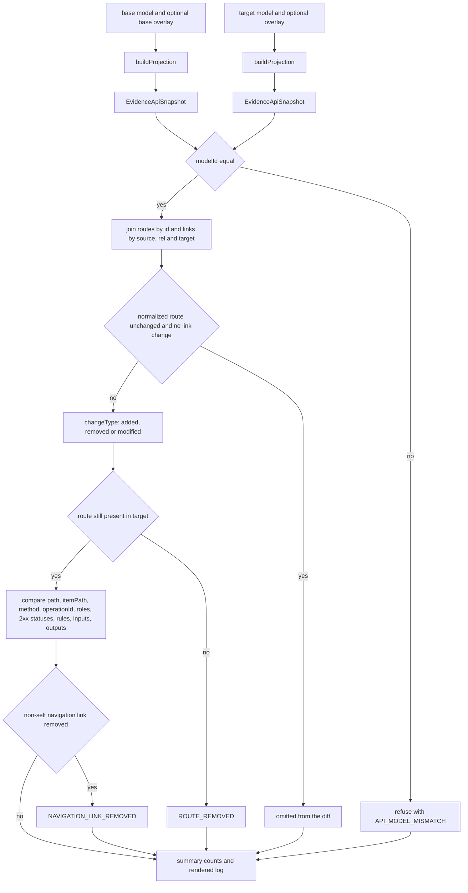

# Delivery topology, routes and API diff

The delivery projection is the answer to "what does this model become": one
service per Contract Context, one HTTP route per modeled business moment, and a
diff that says which of those promises a client would lose. It lives in
`libs/evidence-api/src/delivery/**` and `libs/evidence-api/src/diff/**`, is
composed by `buildModelDelivery`
(`repo://libs/evidence-api/src/delivery/modelDelivery.ts#L410-L444`), and is
reached through two entry points: `buildDelivery(document)` for in-memory
documents, and `buildProjection({ index, design })` for loaded sources plus an
overlay — see [API projection and OpenAPI](./api-projection.md) for the overlay,
diagnostics and CLI that wrap it.

Two rules govern everything below:

- **nothing is invented** — a route exists because a modeled object exists, and
  a service exists because a Context exists;
- **the contract states what a caller may send**, and a value the model computes
  or the service stamps is not the caller's to provide.

## From Contract Context to service topology

`buildDeliveryTopology` turns each Context into exactly one service
(`repo://libs/evidence-api/src/delivery/topology.ts#L213-L290`). The boundary is
the Context, not the noun: splitting by table would put one agreement's request
and its confirmation in two services and make every close a distributed
transaction. What crosses a boundary is a document — a signed contract, an
external confirmation, a domain answer — never a row.

A service's identity is derived, not assigned by hand, so two runs name the same
services: `serviceIdOf('context.product-procurement')` is
`service.product-procurement`, and the URL lane is the last dotted part of the
Context id (`repo://libs/evidence-api/src/delivery/segments.ts#L79-L83`).

### The four service kinds

| Kind | What it is | Why it is separate |
| --- | --- | --- |
| `channel` | the pre-contract Context: enquiry and quote | high churn, high concurrency, no legal force until the contract is signed; signing fires the core one-way and never writes channel state back |
| `fulfillment` | the Contract Context | strict and auditable, and the only place a fulfillment pair is closed |
| `domain` | where a calculation or a check lives | answers questions, holds no fulfillment ledger, reused by several contract Contexts |
| `capability` | a Contract Context that answers a socket another contract depends on | lets a payment channel or carrier be replaced without touching the agreement that needs it |

The classification order is: answers a socket → `capability`; otherwise
`pre_contract` → `channel`, `domain` → `domain`, everything else →
`fulfillment`. Each service also carries `rootRefs`, `evidenceRefs`, `supplies`,
`consumes` and a fixed `notes` sentence per kind, which is the text the delivery
hub shows beside the row.

### How a link is derived from `plays_role`

Nothing declares a capability link twice. The model already says it: a `role`
entity of kind `evidence` is the socket, and an entity from another Context that
`plays_role` it is the supplier
(`repo://libs/evidence-api/src/delivery/topology.ts#L94-L134`).

- the playing entity's Context, when it differs from the socket's Context, gains
  the socket in `supplies`;
- the consumer Context lists the socket in `consumes` (an `evidence`-kind role
  in the Context that this Context does not answer for someone else);
- a `link.capability.<supplier>.<socket>` link is emitted supplier → consumer
  with `mode: 'async'`, because the confirmation is produced on the supplier's
  own clock and arrives as a callback — making it synchronous would reintroduce
  the coupling the socket removed.

Two more link kinds come from the graph, not from declarations:

- `reads`, `sync` — emitted for every Domain Context that a Context's rules bind
  by `ref`, or that one of its entities reaches by a `references` relationship;
- `signs`, `sync` — emitted from a `pre_contract` Context to its
  `parentContextRef`, labelled with that Context's root contract.

Links are deduplicated by id and sorted, services are sorted by Context id.
`topology.spec.ts` pins the four-service fixture and the single async capability
link; `delivery.spec.ts` pins the consequences — replacing `wechat` with `alipay`
changes the service list but leaves every core contract path byte-identical
(`repo://libs/evidence-api/src/delivery/topology.spec.ts#L14-L70`,
`repo://libs/evidence-api/src/delivery/delivery.spec.ts#L271-L301`).

<!-- openwiki: mermaid parse failed and this diagram was converted to a text fence so it does not break rendering. Fix the diagram source and restore the mermaid fence. Parser error: Parse error on line 2: ...ModelDocument"] -> graph["createDomainG Expecting 'AMP', 'COLON', 'PIPE', 'TESTSTR', 'DOWN', 'DEFAULT', 'NUM', 'COMMA', 'NODE_STRING', 'BRKT', 'MINUS', 'MULT', 'UNICODE_TEXT', got 'GRAPH' -->
```text
flowchart TD
  doc["DomainModelDocument"] --> graph["createDomainGraph"]
  graph --> contexts["Contexts sorted by id"]
  contexts --> socket{"answers an evidence-kind role in another Context"}
  socket -->|yes| capability["kind capability"]
  socket -->|no| kind{"context.kind"}
  kind -->|pre_contract| channel["kind channel"]
  kind -->|domain| domainKind["kind domain"]
  kind -->|contract| fulfillment["kind fulfillment"]
  capability --> service["DeliveryService: id, lane, rootRefs, supplies, consumes"]
  channel --> service
  domainKind --> service
  fulfillment --> service
  service --> links["links: capability async, reads sync, signs sync"]
  contexts --> routes["buildDeliveryRoutes"]
  routes --> families["sign, read, request, ledger, confirm, open, propose"]
  families --> address["segment allocator, itemPath, shape, exposure"]
  address --> route["DeliveryRoute: fields, derived, stamped, rules, outputFields"]
```

One Context becomes one service, and the Context kind plus the sockets it answers decide its
delivery kind and its outgoing links.

### The deployment sketch

`buildDeliveryDeployment` writes a compose-shaped document with one container
per Context (`repo://libs/evidence-api/src/delivery/modelDelivery.ts#L313-L380`).
It is a sketch, not a release: images and ports are placeholders, but
`EVIDENCE_MODEL`, `EVIDENCE_CONTEXT`, `EVIDENCE_SERVICE_KIND` and
`EVIDENCE_BASE_PATH` are the projected values, `dependsOn` is exactly the links
leaving that service, and `expose` lists the route lanes the service actually
serves. The same topology is published inside the OpenAPI document as
`x-evidence-services` (`id`, `kind`, `contextRef`, `basePath`), so the contract
and the deployment cannot disagree about which Context serves a path.

## The HTTP surface a fulfillment implies

`buildDeliveryRoutes` projects every route one model implies, in an order
derived from the model — Contexts sorted by id, objects sorted by id — so two
runs diff cleanly and a reviewer can match a line to an object
(`repo://libs/evidence-api/src/delivery/routes.ts#L154-L170`,
`repo://libs/evidence-api/src/delivery/routes.ts#L541-L542`). It optionally takes
a set of Context refs to rebuild only part of the surface, which is what the
incremental patcher uses.

| Purpose | Method | Path shape | Emitted for |
| --- | --- | --- | --- |
| `sign` | POST | `/{lane}/{contractSegment}` | a contract Context's root contract; `201`, `422` when terms or party roles do not hold |
| `read` | GET | `/{lane}/{contractSegment}/{contractId}` | the same contract; `200`, `404` |
| `request` | POST | `/{lane}/{contractSegment}/{contractId}/{requestSegment}/request` | each fulfillment request; `201`, `409` when an unclosed request of the same kind exists |
| `read` (ledger) | GET | `.../{requestSegment}` | the request/confirmation ledger; `200`, `404` |
| `confirm` | POST | `.../request/confirmation` | each confirmation that closes a request; `201`, `409`, `422`; a second confirmation on one request adds `/{confirmationSegment}` |
| `open` | POST | `/{lane}/{rfpSegment}` | an enquiry in a pre-contract Context; `201` |
| `read` | GET | `/{lane}/{rfpSegment}/{rfpId}` | that enquiry and its proposals; `200`, `404` |
| `propose` | POST | `/{lane}/{rfpSegment}/{rfpId}/{proposalSegment}` | a proposal that a `references` relationship ties to an enquiry; `201`, `409` |
| `read` | GET | `/{lane}/{thingSegment}` | each `participant`/`thing` of a Domain Context — a domain is asked, never written |

A proposal the model does not tie to any enquiry still has a business moment: it
sits at the lane root with a summary saying the model declared no enquiry, rather
than being nested under a guess
(`repo://libs/evidence-api/src/delivery/routes.ts#L300-L345`). A Contract Context
with no root contract produces request routes straight under the lane instead of
under a contract that does not exist.

### Addressing: lanes, segments and item paths

- `rawSegmentOf` folds the last dotted part of an id into a path-safe word
  (`request.payment` → `payment`);
- `createSegmentAllocator` gives one segment per id *inside each id category*, so
  `request.payment` and `confirmation.payment` may both be `payment` under
  different parents; only a clash inside one category gets a suffix, first
  `-<category>` then `-<category>-<n>`
  (`repo://libs/evidence-api/src/delivery/segments.ts#L37-L75`);
- `operationIdFor` builds the camel-cased `signContractProductProcurement` form
  OpenAPI can key on;
- `itemPath` is the address of one instance. It is the route path for a `GET`,
  and gains a named parameter for a `POST`: `{contractId}`, `{requestId}`,
  `{confirmationId}`, `{rfpId}`, `{proposalId}` or the generic `{evidenceId}`.

A route's `shape` — `singleton` or `collection` — is decided by
`childShape`, which reads the `references` relationship between parent and child
**regardless of arrow direction**, takes the cardinality at that endpoint, and
answers `singleton` only when every quantity it found is exactly `1`. Unknown or
contradictory quantities never imply uniqueness
(`repo://libs/evidence-api/src/delivery/addressing.ts#L12-L36`). A singleton
request therefore keeps `itemPath === path` with no `{requestId}`, which is what
`evolution.spec.ts` pins for two independent fulfillment branches.

### Who may call, and when a route is internal

`callerRoles` narrows the Context's root-contract `roleRefs` twice: by the
entity's `responsibleRoleRef` when the acting object is Evidence, and then to the
roles that are `role`/`party` **and** are actually played by a
`participant`/`party` through `plays_role`
(`repo://libs/evidence-api/src/delivery/addressing.ts#L38-L75`). If nothing
survives, the route is `exposure: 'internal'`: it keeps its place in the snapshot
and in the OpenAPI paths, labelled, instead of disappearing. `routes.spec.ts`
shows both halves — a payment request narrowed to `role.seller` is external,
while a request in an unbound Context is internal with no caller roles — and that
reversing relationship direction does not change the answer
(`repo://libs/evidence-api/src/delivery/routes.spec.ts#L95-L148`).

## Field origin is the request-body contract

`fieldsOf` classifies every attribute of the acting object once, in declaration
order, and that classification *is* the payload rule
(`repo://libs/evidence-api/src/delivery/routes.ts#L104-L122`,
`repo://libs/evidence-api/src/delivery/fieldOrigin.ts#L10-L35`):

| `reason` | Meaning | Where it appears |
| --- | --- | --- |
| `caller` | the model does not compute it and the service does not stamp it | request body of a `POST`, writable in the component schema |
| `derived` | a derivation rule produces it; `ruleRef` / `ruleExpression` name that rule | response only, `readOnly`, `x-evidence-origin: derived`, `x-evidence-rule` |
| `service-time` | a business clock attribute — `started_at`, `expired_at`, `signed_at`, `confirmed_at`, `created_at` | response only, `readOnly`, `x-evidence-origin: service-time` |

Precedence is derived first, then service time, then caller. A dangling
`derivedByRuleRef` therefore still classifies as `derived` — a value whose rule
went missing never silently becomes caller input
(`repo://libs/evidence-api/src/delivery/fieldOrigin.spec.ts#L1-L39`). The same
five clock names are required to be `required`, `keyData`, `timestamp`
attributes by the schema validator, so "service time" is a modeling constraint
before it is a delivery one.

`requestBody` emits **only** `fields`, i.e. the `caller` classification, with
`additionalProperties: false`
(`repo://libs/evidence-api/src/delivery/modelDelivery.ts#L129-L155`). Everything
else about the object is still published — in `components.schemas`, marked
`readOnly`, with `x-evidence-caller-input: false`, and named on the operation as
`x-evidence-derived` / `x-evidence-stamped`
(`repo://libs/evidence-api/src/delivery/modelDelivery.ts#L73-L128`).

This is why a caller cannot backdate a stamped field. `confirmed_at` is absent
from the request schema and the body forbids additional properties, so a payload
that carries it is invalid rather than ignored; the response schema marks it
read-only, so a generated client has no setter for it; and the operation still
publishes it in `x-evidence-stamped`, so a reviewer can see that the service owns
the value. The generation tests turn the document into consumer types under
`strict` and prove there is no way to forge a derived value into a request body
(`repo://libs/evidence-api/src/openapi/openapi.spec.ts#L47-L172`). The schema is
the contract, not the enforcement: a deployed service must still refuse the field
at runtime, which is exactly what the inspector badge tells the modeler.

## The files a hand-off writes

`deliveryFilesOf` serializes one snapshot into the delivery tree; every file is a
serialization of the same projection, so the tree cannot drift from the document
it was built from (`repo://libs/evidence-api/src/delivery/files.ts#L18-L60`):

| File | Contents |
| --- | --- |
| `openapi.json` | the OpenAPI 3.1 contract |
| `topology.json` | schema version, model identity, services, links, limitations |
| `routes.json` | every `DeliveryRoute` as projected |
| `deployment.compose.json` | the compose sketch |
| `projection.json` | the whole `EvidenceApiSnapshot` |
| `http-journeys.json` | journeys and hypermedia, with `runtimeValidated: false` |
| `limitations.md` | only when the model has unanswered questions |

`limitations` are the two questions no contract can answer, printed instead of
guessed: a fulfillment request with no confirmation (so no callback became an
endpoint) and derived attributes, which need a server-side rule runtime even
though the contract only declares their origin
(`repo://libs/evidence-api/src/delivery/modelDelivery.ts#L384-L407`).

## The model-to-model API diff

### Two revisions, one comparison

`diffModelToApi(before, after, { baseDesign, targetDesign })` projects both
documents — design overlays included — and hands the two finished snapshots to
`diffApiSnapshots`
(`repo://libs/evidence-api/src/diff/apiDiff.ts#L339-L356`). Comparing final
snapshots rather than translating model edits into guessed routes is deliberate:
an overlay path change is a real API change, and the diff sees it without knowing
where it came from. `modelChanges` is attached afterwards from
`diffDomainModels`, so a reader can join "the model moved" to "the interface
moved".

`diffApiSnapshots` refuses unrelated inputs: different `modelId` values throw
`API_MODEL_MISMATCH`, and the CLI reports it as an error rather than a diff.

Routes are joined by `route.id`, links by
`sourceRouteId + rel + targetRouteId`. Because the id is stable while the path is
derived, a renamed segment or a widened cardinality surfaces as `PATH_CHANGED` on
a known route instead of a remove-plus-add. Both sides are normalized before
comparison — `fields`, `derived`, `stamped`, `outputFields` and
`allowedPartyRoleRefs` sorted, `responses` by status, `rules` by id — so
reordering declarations in the model is not an API change, which
`apiDiff.spec.ts` asserts by reversing every array
(`repo://libs/evidence-api/src/diff/apiDiff.spec.ts#L183-L215`). Identical routes
with no link change are omitted from the result entirely.

### Breaking-change kinds

The union has thirteen kinds. Each finding carries the `path`, `method`, a
description and a remediation hint — the general one is
"确认调用方迁移方案后再发布；需要时保留旧契约适配层。", and a removed navigation link gets
its own "复核受影响的客户端旅程。".

| Kind | One line |
| --- | --- |
| `ROUTE_REMOVED` | the route id no longer exists in the target snapshot; reported alone and immediately |
| `PATH_CHANGED` | `path` or `itemPath` differs — a segment rename, a cardinality change, or a collision suffix elsewhere in the model |
| `METHOD_CHANGED` | the HTTP method flipped |
| `OPERATION_ID_CHANGED` | the client-facing `operationId` changed |
| `CALLER_ROLE_RESTRICTED` | a previously allowed Party Role is no longer in `allowedPartyRoleRefs` |
| `STATUS_CODE_CHANGED` | the set of `2xx` success statuses differs |
| `RULE_CHANGED` | a rule bound to the route's entity changed, or a non-derivation rule was added |
| `REQUIRED_FIELD_ADDED` | a `POST` route now requires a field that was absent or optional |
| `INPUT_FIELD_REMOVED` | the request no longer accepts a field the caller used to send |
| `FIELD_REMOVED_FROM_RESPONSE` | an output attribute disappeared |
| `FIELD_TYPE_CHANGED` | an output present in both changed `valueType` |
| `RESPONSE_FIELD_OPTIONAL` | an output went from required to optional |
| `NAVIGATION_LINK_REMOVED` | a non-`self` link on a surviving route disappeared |

The asymmetry is the point: adding a required input or dropping an accepted one
breaks a caller, while adding a field, an optional output or a whole new route
does not. A brand-new derivation rule alone is not `RULE_CHANGED` — it changes
where a value comes from, which the field diff already reports.



The diff compares final projections, so an overlay edit and a model edit produce findings
through the same path.

### Field diffs: the input-to-derived shift

`fieldsDiff` keys `outputFields` by name and reports, per changed field, the
before/after `DeliveryField` and two extra facts
(`repo://libs/evidence-api/src/diff/apiDiff.ts#L111-L148`):

- `shifted: 'to_derived'` when a field moved from caller input to a rule — the
  direction that silently removes an input, so `INPUT_FIELD_REMOVED` accompanies
  it;
- `shifted: 'to_caller'` for the reverse drift, which usually arrives with
  `REQUIRED_FIELD_ADDED` because the caller must now supply the value;
- `requiredChanged` when only the mandatory flag moved.

The desktop renders those two shifts as explicit sentences rather than a symbol,
because they are the cases a reviewer has to act on.

### Rendering and exit status

`renderApiDiff` is a line-oriented text report — a header with
`+added -removed ~modified` and the breaking-change count, one line per route
with `[BREAKING]` on the breaking ones, then field diffs, findings and both
sides' diagnostics, and `No API changes.` when nothing moved
(`repo://libs/evidence-api/src/diff/renderApiDiff.ts#L1-L38`). The same string is
the change log the desktop shows and copies as Markdown, and the content of
`api-changes.md` on a live export.

The CLI verb `diff --base DIR_OR_BUNDLE --target DIR_OR_BUNDLE` accepts optional
`--base-api` / `--api` overlays and `--format json|summary`; `--out` is not
allowed, so a comparison cannot overwrite anything. Exit status is the same
three-way answer as the rest of the CLI: `1` for a load failure, a missing path
or `API_MODEL_MISMATCH`; `3` when the diff has breaking changes or either side
still has gaps; `0` when the two revisions agree
(`repo://libs/evidence-api/src/cli.ts#L135-L203`).

### Patching instead of rebuilding

`patchDeliveryRoutes(currentRoutes, diff, targetDocument)` recomputes only the
Contexts a model change can reach, and preserves the identity of every route it
did not touch (`repo://libs/evidence-api/src/diff/patchDeliveryRoutes.ts#L15-L117`).
It first refuses a mismatched pair — the model diff must describe exactly the
target document's entities, relationships and rules, and the model ids must
agree — with `API_PATCH_TARGET_MISMATCH`.

Affected Contexts start from every changed entity, relationship and rule (rule
bindings and rule targets included), then grow through three closures that are
easy to forget:

- **global segment allocation** — adding `request.aaa.payment` can rename
  `request.payment`, so any Context whose segments changed is touched even if
  nothing in it was edited;
- **role players** — a changed player also changes the Contexts whose roles it
  plays, because caller roles feed `exposure`;
- **pre-contract parents** — a channel Context inherits its parent Contract's
  role boundary, so parent changes propagate to children until the set stops
  growing.

It then calls `buildDeliveryRoutes(target, affected)`, reuses the existing object
when the rebuilt route is byte-identical, and merges with the untouched routes.
`evolution.spec.ts` runs five stages of procurement evolution plus five mutations
in both directions and requires the patched list to equal a full rebuild, while
leaving the input arrays unmodified
(`repo://libs/evidence-api/src/diff/evolution.spec.ts#L255-L335`). The function is
exported as an extension point; the desktop path today always re-projects.

## The desktop delivery hub

The hub is the surface a modeler uses after the model closes. `useDeliveryHub`
owns one subscription for the editor's lifetime and feeds both the panel and the
canvas
(`repo://apps/desktop/src/renderer/state/useDeliveryHub.ts#L45-L152`,
`repo://apps/desktop/src/renderer/screens/EditorScreen.tsx#L186-L196`).

### Two preview and export paths

| Path | IPC | Input | What is projected |
| --- | --- | --- | --- |
| live revision | `deliveryLivePreview` / `exportLiveDelivery` | renderer-supplied `document` plus `baseDocument` and a `revision` | the in-memory document; no disk read at all |
| saved project | `deliveryPreview` / `exportDelivery` | a `rootPath` | the sources on disk, read through `readDelivery` |

Both are registered by one `registerDeliveryIpc`
(`repo://apps/desktop/src/main/deliveryIpc.ts#L72-L215`). The live pair exists
because unsaved edits are the interesting ones: the handler calls `livePreviewOf`
on the document the renderer sent, and a test asserts the disk builder is never
invoked (`repo://apps/desktop/src/main/liveDeliveryIpc.spec.ts#L37-L60`). The
saved pair calls `readDelivery`, which loads the model root and refuses to
project when `hasErrors` is true, so a saved export never hands out a contract
built on an invalid model
(`repo://apps/desktop/src/main/deliveryProjection.ts#L107-L128`).

### The digest pin

A preview must not describe a different model than the export writes, and both
paths keep that promise against the same model digest — the live path
explicitly, the disk path by construction:

- `livePreviewOf` returns `modelDigest = snapshot.digests.model`, next to
  `baseModelDigest` from the diff
  (`repo://apps/desktop/src/main/deliveryProjection.ts#L144-L175`);
- `exportLiveDelivery` validates the envelope, `structuredClone`s the input
  **before** the asynchronous directory picker, recomputes the analysis from the
  frozen clone, and refuses unless
  `analysis.modelDigest === input.expectedModelDigest` — "预览已过期，请等待重新计算后导出。"
  (`repo://apps/desktop/src/main/deliveryIpc.ts#L112-L145`). That digest is
  `snapshot.digests.model`, the model digest the projection records from the
  loaded index (`repo://libs/evidence-api/src/projector.ts#L170-L184`);
- the renderer supplies `expectedModelDigest` from the analysis the user is
  looking at, and only when that analysis is the accepted one — a stale or
  failed preview cannot be exported because `stale` and `canExportDraft` gate the
  button and the callback
  (`repo://apps/desktop/src/renderer/state/useDeliveryHub.ts#L121-L145`);
- the saved-project path has no digest handshake: it re-projects the same saved
  sources for preview and for export, so a model saved between the two calls is
  exported as it now stands on disk.

### What the hub shows

`previewOf` projects the snapshot for display, counting routes per service
because a service with no route exists in the topology but answers nothing, and
the hub should show that rather than hide it behind a tidy table
(`repo://apps/desktop/src/main/deliveryProjection.ts#L71-L105`).

`DeliveryHub` is one panel with two tabs
(`repo://apps/desktop/src/renderer/components/delivery/DeliveryHub.tsx#L32-L283`):

- **契约全览** — the service table (name, kind, Context, route count, the kind's
  note), the crossing list (`from`, `to`, label, `sync`/`async`), the route
  contract lines from `analysis.bindings` with their exposure or allowed Party
  Roles, and the limitations;
- **本次增量变更** — the diff panel.

A status line always states the session baseline — the model as it was when the
editor opened, which saving does not reset — and that the preview is a memory
draft with no release authorization. Export is disabled while the preview is
stale, while busy, or when `canExportDraft` is false.

### The incremental diff panel

`IncrementalDiffPanel` renders one route per changed route with its previous
path, its service and roles, a "locate in model" link, the field diffs with the
input-to-derived / derived-to-caller sentences and the rule expression, and each
breaking finding with its remediation hint
(`repo://apps/desktop/src/renderer/components/delivery/IncrementalDiffPanel.tsx#L11-L161`).
Above them it prints the two digests, the added/removed/modified/breaking counts,
the API coverage ratio and the non-`API_ALIGNED` issues, and offers a copy of
`changeLog` as Markdown. When breaking changes exist it warns and states that
release is not authorized.

What does *not* block a draft is worth knowing: `canExportDraft` is
`!issues.some(issue => issue.severity === 'block')`, and the sensor maps a
snapshot diagnostic of severity `error` to `block` while mapping breaking changes
to `warn` in draft mode
(`repo://libs/evidence-agent/src/sensors/native/nativeApiSensor.ts#L23-L95`,
`repo://apps/desktop/src/main/deliveryProjection.ts#L144-L175`). So a blocking
`FM_INVALID` stops the export, an interface break is flagged ⚠ and exported as a
draft, and in `mode: 'release'` the same break becomes blocking.

The live export also appends two files to the normal tree: `api-changes.md` (the
rendered diff) and `draft-status.json` with `mode: 'draft'`,
`releaseAuthorized: false`, both digests and the current issues, so the folder
carries its own provenance.

### Canvas and MCP consumers

The same live preview is not hub-only. `bindings` (route id, entity, method,
path, role refs, exposure, fields) are published through `LiveApiProvider`, so
canvas cards can name the routes an object is reachable by and how stale that
answer is
(`repo://libs/desktop/feature-canvas/src/LiveApiContext.tsx#L1-L61`,
`repo://apps/desktop/src/renderer/screens/EditorScreen.tsx#L792-L800`). The
inspector's field badge calls `fieldFor` through the filesystem-free
`@evidence-poc/evidence-api/delivery` entry, so the same three origins appear as
`Input`, `CEL Derived` and `Service Timestamp` badges
(`repo://libs/desktop/feature-inspector/src/inspector/ApiFieldBadge.tsx#L1-L41`,
`repo://libs/evidence-api/src/delivery.ts#L1-L10`).

Two MCP tools answer the same question to an external agent —
`get_delivery_topology` and `export_openapi_contract` — and both read the *saved*
sources through `readDelivery`, exactly like the hub, so an agent plans against
the boundaries a person sees
(`repo://apps/desktop/src/main/mcpDeliveryService.ts#L1-L75`,
`repo://libs/evidence-mcp/src/server/toolset.ts#L377-L397`). Neither writes
anything; see [MCP integration](../agents/mcp-integration.md).

## Tests that protect this contract

- `delivery.spec.ts` — operation ids and Context tags, no derived value or
  business time in a request body, a `409` on a closed window, `x-evidence-services`
  matching the topology, the compose dependency direction, the capabilities swap,
  and the exact six-file list when nothing is left open
  (`repo://libs/evidence-api/src/delivery/delivery.spec.ts#L27-L306`).
- `routes.spec.ts` — one request route plus one confirm route per confirmation,
  derived/stamped fields excluded from inputs, a channel and a domain Context
  projected correctly, proposal nesting and its orphan fallback, and both
  cardinality directions with unplayed roles staying internal
  (`repo://libs/evidence-api/src/delivery/routes.spec.ts#L14-L161`).
- `topology.spec.ts` — one service per Context with lanes, the channel/domain
  kinds, the capability service and its async link, the `signs` link, and a
  contract reading a domain Context synchronously
  (`repo://libs/evidence-api/src/delivery/topology.spec.ts#L14-L70`).
- `fieldContract.spec.ts` / `fieldOrigin.spec.ts` — read-only server-owned values,
  complete response schemas regardless of route order, and classification without
  a projection or filesystem.
- `apiDiff.spec.ts` — added routes without a break, the input↔derived drift in
  both directions, `RULE_CHANGED` on an expression edit, removed routes, changed
  cardinality, types and caller roles, overlay path changes, and the
  `API_MODEL_MISMATCH` refusal (`repo://libs/evidence-api/src/diff/apiDiff.spec.ts#L1-L263`).
- `evolution.spec.ts` — five procurement stages, patch/full-rebuild parity in both
  directions, immutability of the stages, and resolvable `$ref`s with path
  parameters that match their paths (`repo://libs/evidence-api/src/diff/evolution.spec.ts#L1-L373`).
- `cliDiff.spec.ts` — directory versus bundle comparison, JSON and summary
  formats, exit `3` for a breaking overlay, exit `1` for a model mismatch or
  malformed arguments, and untouched input files
  (`repo://libs/evidence-api/src/diff/cliDiff.spec.ts#L1-L68`).
- Desktop: `deliveryIpc.spec.ts` pins the preview/export envelopes and the
  suggested `delivery` folder; `liveDeliveryIpc.spec.ts` pins no-disk previews,
  refusal of stale and invalid exports before anything is written, and the frozen
  document across the directory dialog; `useDeliveryHub.spec.tsx` pins the
  debounce, dropped stale replies, the opening baseline across undo/redo, and
  export only of the accepted snapshot; `DeliveryHub.spec.tsx` pins the two tabs,
  the baseline/draft status text, and the disabled export when stale
  (`repo://apps/desktop/src/main/deliveryIpc.spec.ts#L104-L209`,
  `repo://apps/desktop/src/renderer/state/useDeliveryHub.spec.tsx#L39-L100`,
  `repo://apps/desktop/src/renderer/components/delivery/DeliveryHub.spec.tsx#L41-L89`).

## Related pages

- [API projection and OpenAPI](./api-projection.md) — the overlay, diagnostics,
  CLI verbs and the OpenAPI payload rules this page builds on.
- [The offline review workbench](./offline-workbench.md) — the read-only HTML
  artifact built from the same snapshot.
- [MCP integration](../agents/mcp-integration.md) — how
  `get_delivery_topology` and `export_openapi_contract` reach this projection.
- [Sensors, stage gate and the dependency frontier](../agents/sensor-orchestration.md)
  — the `audit_api` sensor that turns coverage gaps and breaking changes into
  findings.
- [The Fulfillment Modeling DSL (FM v5)](../language/fm-dsl.md) — Contexts,
  fulfillment pairs, roles and derivation rules being projected.
- [Canvas, inspector and live model bridge](../desktop/canvas-and-inspector.md) —
  where the live bindings and field badges are painted.
- [Verification strategy](../testing/verification-strategy.md) — the fixtures and
  test layers behind the tables above.
