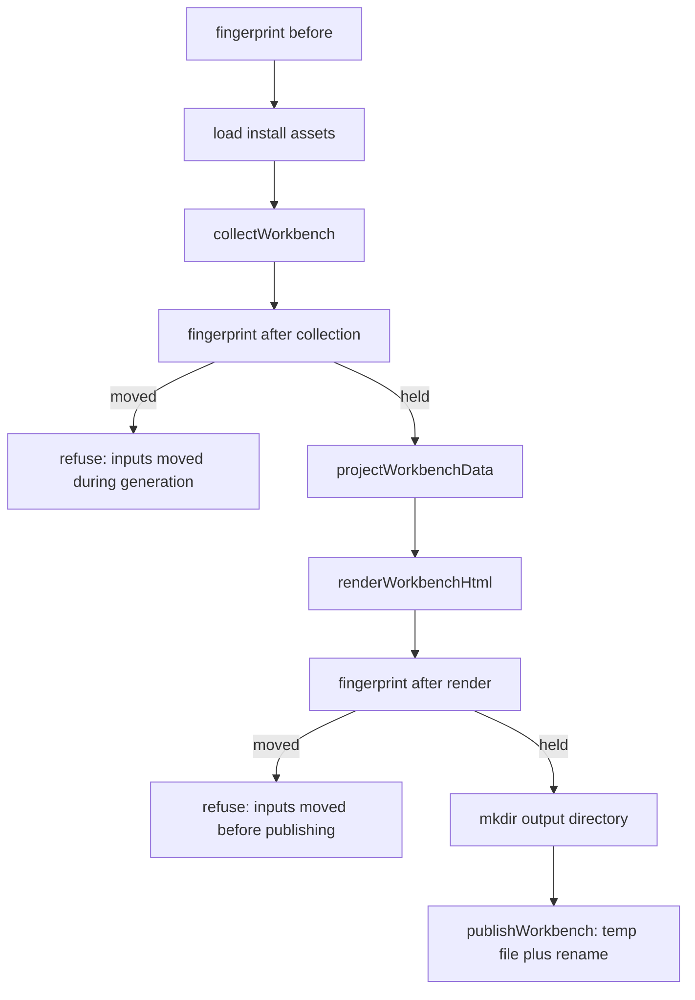

# The offline review workbench

`libs/evidence-visualization` produces the artifact a human reads when the
interview and the API design are done: a single HTML file that opens without a
server, shows the business objects and their formal references, lists the services
the model becomes, and states which checks stand behind it.

The design goal is snapshot integrity. A review page may be mailed to a colleague
weeks after it was written, so it must describe exactly the inputs that existed
when it was generated — and a failed regeneration must never damage the previous
copy.

## Two entry points, one pipeline

| Entry | Who calls it | What it produces |
| --- | --- | --- |
| `evidence-workbench generate` | a developer or a script, from the shell | the page at `--out`, default `.evidence/views/index.html` |
| Desktop export (`exportReview`, `exportDiffReview` IPC) | the review hub | the page at the path chosen in a save dialog |
| Desktop preview (`previewReview` IPC) | the review hub, while editing | the same HTML in memory, never written |

The CLI is a thin wrapper: `runCli` parses the flags and calls `generateWorkbench`
(`repo://libs/evidence-visualization/src/cli.ts#L80-L140`). The desktop also calls
`generateWorkbench` for exports and `renderWorkbenchHtml` directly for previews, so
all three paths share one printer (`repo://apps/desktop/src/main/reviewIpc.ts#L143-L213`).
The review hub UI itself is described in [the review hub](../desktop/review-hub.md).

## Generate: read, render, publish

`generateWorkbench` brackets the whole job with two fingerprints and refuses to
publish when they disagree
(`repo://libs/evidence-visualization/src/generate/generateWorkbench.ts#L58-L91`):



The collector brackets only its own reads, and the generator brackets the collector
plus the render, so a full run fingerprints four times and each window has its own
message. `output` must name a file, not a directory, and the pre-publish failure is
raised as `WorkbenchAssetError` even though nothing about an asset failed — a caller
that switches on the class should read the message
(`repo://libs/evidence-visualization/src/generate/generateWorkbench.ts#L70-L86`).

`collectWorkbench` returns the data together with the reports it was allowed to use
— `{ data, check, suite, projection }` — so a caller can echo the same counts and
verdicts the page prints (`repo://libs/evidence-visualization/src/generate/collectWorkbench.ts#L216-L227`).

## What the fingerprint covers

`workbenchFingerprint(projectRoot, modelRoot?)` hashes inputs, not outputs
(`repo://libs/evidence-visualization/src/generate/collectWorkbench.ts#L156-L196`):

- **The model source.** Either the `.evidence/fm` tree, walked recursively, or —
  when a portable snapshot is passed as `modelRoot` — that one `*.evidence.json`
  file, recorded under its own basename. A replacement source that is not a regular
  file is refused with `替代模型输入必须是普通快照文件`.
- **The API overlay.** `.evidence/api/api.json` is appended when it exists, so
  regenerating after a design edit never looks like a no-op.
- **Exclusions.** Entries whose relative path contains a `__pycache__` segment are
  skipped at any depth; a `generated/` tree is skipped only when it is the first
  segment under the model root
  (`repo://libs/evidence-visualization/src/generate/collectWorkbench.ts#L100-L110`).
  Neither is read by the page, and counting a previous run's output would make the
  run change its own next fingerprint.
- **Symbolic links.** Every entry is `lstat`ed; a link is refused with
  `输入不能链接到项目外部或使用符号链接` rather than followed, because a link would
  let the page carry a file the reader was never given.

The digest is SHA-256 over each file's POSIX relative path and bytes, both
NUL-terminated, in sorted path order.

## Collection enforces the gate

`collectWorkbench` is where the page inherits the model's verdict
(`repo://libs/evidence-visualization/src/generate/collectWorkbench.ts#L230-L401`).
It resolves the model source (tree or portable bundle through `readWorkbenchModel`),
builds the check report, and only then projects anything. The refusals, in order:

| Situation | Result |
| --- | --- |
| an API view is requested (`.evidence/api/api.json` exists or `requireApi`) and `scopeRefs` is empty | `联合审核需要显式 --scope，不能用一致性结果冒充范围完整性` |
| the FM report is not `valid` or `inputChanged` | `FM 未通过，不生成视图` |
| an API view is requested and the check is not `complete` | `FM 范围未闭环，不生成联合审核视图` |
| `loadFmFromDocument` yields no index | `FM 未通过，不生成视图：…` with the loader's diagnostics |
| the overlay cannot be read or fails validation | `无法读取 API 设计：…` / `API 设计不可用：…` |
| the projection's model digest differs from the check's | `FM 在投影期间变化` |
| the projection carries any error diagnostic | `API 投影不可用：…` |
| the fingerprint moved while collecting | `输入在生成期间变化，保留已有视图` |

A consistency-only result is not scope completeness, which is why an API review
must name its scope even when the check itself passes.

**An overlay file is optional.** `requireApi` no longer demands
`.evidence/api/api.json`: the flag asks for the joint API view, and when no file
exists the loader validates `{}` and `buildProjection` derives routes from the
checked model index. The same test pins both halves — a model-driven API review
that needs no overlay, and the scope refusal that follows
(`repo://libs/evidence-visualization/src/generate/generateWorkbench.spec.ts#L237-L253`).
When an overlay *is* present its route summaries are applied to the projection and
therefore reach both the API capability nodes and the delivery sections, and a
malformed overlay stops at `API 设计不可用`
(`repo://libs/evidence-visualization/src/generate/generateWorkbench.spec.ts#L255-L300`).

Every failure is a `WorkbenchInputError` with a sentence a reviewer can act on, not
a partial page.

## The page projection is a whitelist

`projectWorkbenchData` builds nodes and edges from the compiled model, scenarios,
instances, simulation results, the canvas layout, the API projection and the
delivery view. The module header states the rule: every field is selected by name,
so a new key in a source document can never leak into the page by accident
(`repo://libs/evidence-visualization/src/projection/workbenchProjection.ts#L1-L13`).
`select` copies named keys, `scalarValues` copies only scalars, and anything else is
dropped rather than serialized.

The projection produces:

| Part | Contents |
| --- | --- |
| `nodes` | contexts, evidence, participants, roles, rules, attributes, instances, scenarios, resources, capabilities, journeys, services |
| `edges` | ownership, responsibility, contract parties, relationship endpoints, rule reads and targets, API bindings, deployment boundaries |
| `unresolved` | edge targets no node defines, kept visible instead of dropped |
| `counts` | contract contexts, entities, rules, scenarios, capabilities |
| `validation` | `fm`, consistent/complete/scopes/gaps/simulation/API completeness, unresolved timeline order |
| `delivery` | services, cross-boundary links and limitations, or `null` |
| `layout` | the canvas placement of every object the page lists |
| `diff` | present only when a baseline was supplied |

Node ids are formal business ids (`request.payment`,
`request.payment#amount`), so a reader can quote one and find it in the source. A
duplicate object id throws instead of overwriting the first object
(`repo://libs/evidence-visualization/src/projection/workbenchProjection.ts#L270-L280`),
and a dangling reference becomes an `unresolved` entry rather than a silently
missing edge.

`validation.fm` reports the `checked` flag of the projection input: `true` by
default, which is what the formal collector path leaves it at, and `check.valid`
for an authoring preview that may show an unproven model
(`repo://libs/evidence-visualization/src/projection/workbenchProjection.ts#L156-L176`,
`repo://libs/evidence-visualization/src/projection/workbenchProjection.ts#L664-L674`).
The payload carries it for consumers of the JSON; the shipped page prints the
individual verdicts instead, under the standing sentence that a passing machine
check is not a business approval, not an entitlement and not a running service.

### Nothing carries provenance

The header says raw documents, file paths, interview prose, material sources,
commands, input digests and Git history stay out; the projection's input has no
channel for them at all — there is no trace, file or provenance parameter to pass
— and a test asserts that `sourceRefs`, `modelDigest`, `inputFiles`, `executions`,
`locations` and `notes` never appear in the output, even when a source record
carries them
(`repo://libs/evidence-visualization/src/projection/workbenchProjection.spec.ts#L224-L239`).

The page does carry the model's *placement*: `workbenchLayoutOf` computes it from
the same `DomainModelDocument` with the same `createGraphLayout` the desktop canvas
uses, so a reader sees the drawing the modeler saw rather than a second opinion,
and an empty document becomes an empty drawing rather than an invented one
(`repo://libs/evidence-visualization/src/projection/workbenchLayout.ts#L21-L31`).

## The delivery view: what the model becomes

`deliveryViewOf` reduces a `DeliveryBundle` to the three parts a reader who did not
run the projector needs
(`repo://libs/evidence-visualization/src/projection/deliveryView.ts#L13-L54`):

| Part | Fields kept |
| --- | --- |
| `services` | `id`, `name`, `kind`, `lane`, `contextRef`, `supplies`, `consumes`, `notes`, and `routes` as `method`/`path`/`summary` lines sorted by `METHOD path` |
| `links` | `id`, `from`, `to`, `kind`, `mode`, `label`, `viaRef` |
| `limitations` | the projector's sentences, verbatim |

Digests, file paths and the OpenAPI document are dropped, and routes are flattened
to one line each because the page answers "which service answers this business
moment", not "what is the schema".

The input is `projection ?? buildDelivery(bundle)`
(`repo://libs/evidence-visualization/src/generate/collectWorkbench.ts#L366-L381`).
A joint review therefore takes its delivery view from the projection that applied
the overlay, while a model-only page asks `buildDelivery` for the same boundaries —
which is why one overlay edit moves both the API and the delivery tables.

In the graph each service becomes a root node (a service is not a business object
owned by the Context it serves) with a `部署边界` edge to its Context, and each
cross-boundary link becomes an edge labelled with its mode, marked `（异步）` when it
is a callback. `workbench.js` renders them as the `交付边界` card: a service table,
a `跨边界调用` table, and the `尚未闭环的能力` list
(`repo://libs/evidence-visualization/src/projection/workbenchProjection.ts#L620-L638`).

## The baseline diff page

`projectWorkbenchDiff(before, after, current)` builds the optional comparison
(`repo://libs/evidence-visualization/src/projection/workbenchDiff.ts#L40-L113`). It
reads three inputs:

- `before` — an explicitly chosen baseline `DomainModelDocument`, never inferred
  from an undo stack or from Git. The collector accepts it as `baselineDocument` and
  the desktop reads it through a `*.evidence.json` file dialog.
- `after` — the current bundle that was just checked.
- `current` — the `WorkbenchData` already projected for the page, so the comparison
  cannot describe objects the page does not list.

It refuses unrelated models with `基线与当前模型 ID 不一致，不能进行差异审查`,
re-projects the baseline through the same whitelist (with its own layout) and
compares contexts, entities, relationships and rules. Each change records
`changeType`, the fields whose JSON differs between the baseline node and the
current node — so only fields the page already exposes can cross the boundary — and
per-attribute changes that point at `id#name` nodes on both sides.
`baselineFingerprint` is the SHA-256 of the compiled baseline document.

`baseline: { nodes, layout }` is a separate drawing: a removed object keeps its
baseline coordinates, never the current ones, so the reviewer sees where it was when
the snapshot was taken. A test pins that removed objects and their old geometry
survive while a private `notes` value does not
(`repo://libs/evidence-visualization/src/projection/workbenchDiff.spec.ts#L29-L71`).

On the page, `diff` adds a `变更审查对比` card with the added/modified/removed
counts, the baseline fingerprint and an explicit caveat that only FM objects,
relationships, rules and attributes are compared — not scenarios and not the API
design. A second graph (`#baseline-business-graph`) is drawn only when something was
removed; added objects are green, modified blue, removed red and dashed, and
`data-diff` marks each drawn object
(`repo://libs/evidence-visualization/assets/business-graph.js#L396-L404`).

## The page is self-contained and inert

`renderWorkbenchHtml` fills a template with four parts: the joined application
script (`business-graph.js` + `workbench.js`), the stylesheet, the escaped JSON
payload, and a Content-Security-Policy
(`repo://libs/evidence-visualization/src/render/workbenchRenderer.ts#L79-L101`).

Three protections are enforced by `WorkbenchRenderError`:

- **Escaped payload.** `embeddedJson` replaces `<`, `>`, `&`, U+2028 and U+2029 with
  escapes, so a business label containing `</script>` cannot close the tag
  (`repo://libs/evidence-visualization/src/render/workbenchRenderer.ts#L35-L37`).
- **Exactly one inline script.** `inlineScriptOf` refuses a template with zero or
  more than one script (`工作台只允许一个内联脚本`); the CSP is computed over the
  whole joined script.
- **Hash-pinned policy.** `scriptHashCsp` emits `default-src 'none'`,
  `script-src 'sha256-…'`, `style-src 'unsafe-inline'`, `img-src data:`,
  `connect-src 'none'`, `object-src 'none'`, `base-uri 'none'` and
  `form-action 'none'`. The page cannot make a request even if it tried
  (`repo://libs/evidence-visualization/src/render/workbenchRenderer.ts#L57-L63`).

Assets that themselves contain `</script` or `</style` are rejected with
`资源含有非法结束标签`, so a presentation asset cannot break out of its element.

The first line of every page is `<!-- evidence-object-workbench -->`
(`repo://libs/evidence-visualization/src/render/workbenchRenderer.ts#L16-L17`). That
marker is the publisher's proof of ownership.

## Assets come from the install, not the project

`loadWorkbenchAssets` reads four files and joins the two scripts. A missing asset is
a `WorkbenchAssetError` naming the file, because a page without its graph renderer
loads blank and looks like a broken model
(`repo://libs/evidence-visualization/src/render/workbenchAssets.ts#L116-L135`).

`resolveAssetsDirectory` chooses, in order: an explicit `assetsDirectory`, the
`assets` directory under `process.resourcesPath` (a packaged Electron app), then the
directory beside the package's own module. There is no search up the tree and no
project-local lookup; the assets belong to the install. When nothing is found the
error names the paths that were tried
(`repo://libs/evidence-visualization/src/render/workbenchAssets.ts#L74-L110`).

The desktop applies the same policy in `installAssets.ts`: a packaged run reads only
the directory unpacked beside `app.asar`, a development run reads
`resources/assets` or the workspace package, and `undefined` is returned so the
library — not the app — reports what it tried
(`repo://apps/desktop/src/main/installAssets.ts#L48-L68`).

## Publishing refuses to clobber

`publishRefusal` is the ownership check
(`repo://libs/evidence-visualization/src/publish/workbenchPublisher.ts#L33-L58`):

- a symbolic link is refused;
- an existing file that does not start with `WORKBENCH_MARKER` is refused;
- a missing target is fine.

Both refusals share one sentence, `拒绝覆盖非工作台文件或符号链接`, and surface as a
`WorkbenchPublishError`. `publishWorkbench` then writes a `.workbench-<uuid>.html`
temporary beside the target and renames it into place. The rename keeps the write on
one filesystem and gives a reader either the old page or the new one, never half a
page; a failure removes the temporary
(`repo://libs/evidence-visualization/src/publish/workbenchPublisher.ts#L64-L87`).

This is why a failed generation is uneventful: the previous snapshot stays, the
directory keeps its contents, and the next attempt starts from the same inputs.

## CLI behaviour

The command has one verb:

```bash
npx evidence-workbench generate --project-root "$PWD" [--out FILE] [--scope CONTEXT]... [--require-api] [--assets DIR]
```

Defaults: output `.evidence/views/index.html` (`reviewPagePath`); scopes omitted
means consistency only — which becomes an error as soon as an API review is
requested; `--require-api` requests the joint API view, which the model itself can
drive when no overlay file exists; `--assets` overrides the install directory.

There is no `--baseline` flag: the diff page is produced through the library or the
desktop export, where a baseline can be named explicitly.

Exit `0` when the page was written, `1` when it was not, with the reason on stderr.
The success payload is a stable summary — `output`, `counts`, `validation` — so a
script can read it without parsing HTML
(`repo://libs/evidence-visualization/src/cli.ts#L118-L140`).

## The desktop preview and export paths

`previewReview` answers the review hub while the modeler is still editing. It checks
the in-memory document, projects it with `checked: check.valid`, attaches
`deliveryViewOf(buildDelivery(document))` and fingerprints the sources before and
after the work, throwing `预览期间磁盘输入变化，请重新预览` if they moved
(`repo://apps/desktop/src/main/reviewPreview.ts#L22-L121`). Preview HTML is produced
by `renderWorkbenchHtml` in the main process and never written to disk; the notice
says whether the snapshot was saved and whether the API design was checked. When
the document matches what is on disk and the project is a directory, the preview
upgrades itself to the formal `collectWorkbench` result and appends
`API / 正式审查不可用：…` when that formal path refuses.

The export handlers choose the target and reuse the same generator
(`repo://apps/desktop/src/main/reviewIpc.ts#L143-L213`):

- `exportReview` suggests `<project>/review.html` — beside the project rather than in
  a dot directory — and passes `scopeRefs` derived from the model's entry Contexts
  that are nobody's child, but only when `.evidence/api/api.json` exists, so a
  model-only page is still the consistency view on its own.
- `exportDiffReview` first opens a `*.evidence.json` baseline dialog, then suggests
  `diff-review.html`, and passes `baselineDocument` plus the portable `modelRoot`
  unchanged so a bundle project stays a bundle project.
- Both resolve the asset directory through `resolveReviewAssetsDirectory` and return
  `{ status: 'saved', path, counts }`, `{ status: 'cancelled' }` or
  `{ status: 'failed', error }`; a refusal is reported, never thrown at the renderer.

## Failure behaviour

| Situation | Result |
| --- | --- |
| FM check invalid or input changed | `FM 未通过，不生成视图`; no page |
| API review requested without a scope | `联合审核需要显式 --scope，不能用一致性结果冒充范围完整性` |
| API review requested, scopes incomplete | `FM 范围未闭环，不生成联合审核视图` |
| overlay unreadable or invalid | `无法读取 API 设计：…` / `API 设计不可用：…` |
| digest in projection differs from check | `FM 在投影期间变化` |
| projection has error diagnostics | `API 投影不可用：…` |
| input changed during collection | `输入在生成期间变化，保留已有视图` |
| input changed during rendering | `发布前输入变化，保留已有视图` (a `WorkbenchAssetError`); previous page untouched |
| baseline and current model ids differ | `基线与当前模型 ID 不一致，不能进行差异审查` |
| target is a foreign file or symlink | `拒绝覆盖非工作台文件或符号链接`; nothing overwritten |
| asset missing | `WorkbenchAssetError` naming the file or the paths tried; page not written |
| template with zero or many inline scripts | `工作台只允许一个内联脚本` |
| asset containing a closing tag | `资源含有非法结束标签` |

## Tests that protect this contract

- `generateWorkbench.spec.ts` fixes the fingerprint's exclusions and symlink
  refusal, the "model does not check" stop, the API/scope refusals, the
  model-driven API review, the portable-bundle fingerprint, mid-generation change
  detection, atomic write, and refusal to overwrite a foreign file
  (`repo://libs/evidence-visualization/src/generate/generateWorkbench.spec.ts#L50-L403`).
- `workbenchProjection.spec.ts` covers context nesting without claimed ownership,
  labelled relationship edges, rule/derivation wiring, the privacy assertion,
  dangling references, duplicate ids, counterexamples, services at the root, the
  printed check verdict and the carried layout
  (`repo://libs/evidence-visualization/src/projection/workbenchProjection.spec.ts#L224-L425`).
- `deliveryView.spec.ts` pins one entry per service with its routes in
  `METHOD path` order, the capability service and its async link, and the
  limitations list (`repo://libs/evidence-visualization/src/projection/deliveryView.spec.ts#L243-L279`).
- `workbenchDiff.spec.ts` pins baseline geometry retention, field-level changes,
  the empty comparison and the unrelated-model refusal
  (`repo://libs/evidence-visualization/src/projection/workbenchDiff.spec.ts#L29-L71`).
- `workbenchRenderer.spec.ts` asserts payload escaping, exact round-trip,
  one-script enforcement, the exact CSP hash, refusal of tag-closing assets, and
  atomic replacement without a leftover temporary
  (`repo://libs/evidence-visualization/src/render/workbenchRenderer.spec.ts#L56-L175`).
- `reviewIpc.spec.ts` pins the preview's installed assets, the cancelled dialogs,
  the baseline-before-export order, the derived scopes, and the failure envelope
  (`repo://apps/desktop/src/main/reviewIpc.spec.ts#L74-L262`).
- `tests/node/business-graph.test.mjs` and `tests/node/diff-graph.test.mjs` execute
  the shipped scripts in a VM/JSDOM sandbox, so the page's rendering logic is tested
  as the browser would run it.
- `tests/browser/diff-review-browser.mjs` generates a real diff page and opens it in
  headless Chrome with `http://*` and `https://*` blocked: it asserts the added and
  removed markers, the computed stroke colours, that the removed object sits at its
  baseline `x`, that a private `notes` value never reached the file, that clicking a
  removed object shows its details, and that zero external requests were attempted
  (`repo://libs/evidence-visualization/tests/browser/diff-review-browser.mjs#L44-L194`).
  These harnesses use `node:test` against the built `dist`, so Vitest excludes
  `tests/node` and `tests/browser`
  (`repo://libs/evidence-visualization/vitest.config.mts#L15-L18`).

## Related pages

- [API contract projection](./api-projection.md) — the input this page renders.
- [API diff and evolution](./api-diff-and-evolution.md) — what changing a projection
  means.
- [The review hub](../desktop/review-hub.md) — the desktop surface for preview and
  export.
- [Desktop app shell and IPC surface](../desktop/app-shell.md) — where asset
  resolution and the IPC handlers live.
- [Verification strategy](../testing/verification-strategy.md) — how the VM, JSDOM
  and headless-browser harnesses fit the test layers.
