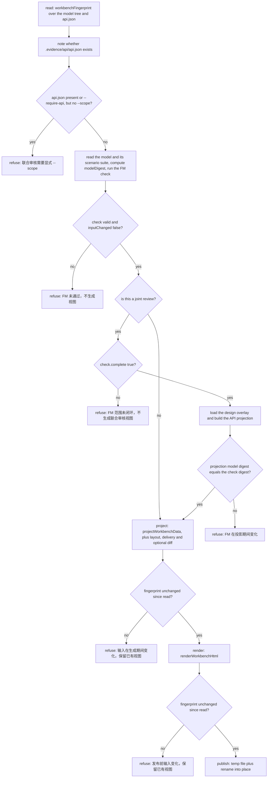
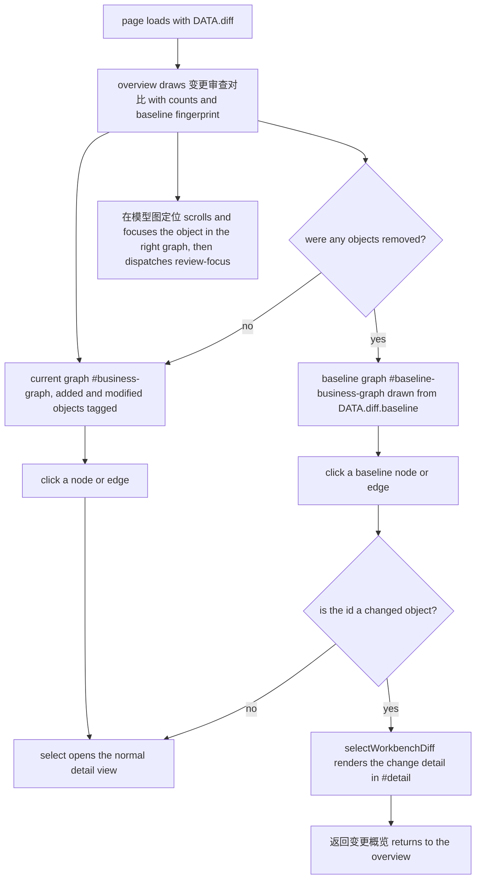

# The offline review workbench

`libs/evidence-visualization` produces the artifact a human reads when the
interview and the API design are done: a single HTML file that opens without a
server, shows the business objects and their formal references, the delivery
boundaries and — on request — what changed since a chosen baseline. It is the
`evidence-workbench` command and the desktop's review hub and "export review page"
actions.

The design goal is snapshot integrity. A review page may be mailed to a colleague
weeks after it was written, so it must describe exactly the inputs that existed
when it was generated — and a failed regeneration must never damage the previous
copy.

## Generate: read, collect, project, publish

`generateWorkbench` names its own three stages "read, render, publish", and the
read stage is where the gate lives
(`repo://libs/evidence-visualization/src/generate/generateWorkbench.ts#L51-L89`):

1. Read the project's inputs as one fingerprint.
2. Collect the checked model, its scenario suite and the API/delivery projection;
   project that into `WorkbenchData` and render the HTML.
3. Fingerprint again. If the digest moved, throw
   `发布前输入变化，保留已有视图` and do not publish.

Only then does it create the output directory and call `publishWorkbench`. The
collector re-reads the fingerprint once more at the end of its own work, so a
mid-generation edit never even reaches the renderer.



The gate ladder the collector and generator enforce, in the order they run.

## What the fingerprint covers

`workbenchFingerprint` walks `.evidence/fm` recursively and appends
`.evidence/api/api.json` when it exists, then hashes each sorted path and its
bytes separated by NUL bytes
(`repo://libs/evidence-visualization/src/generate/collectWorkbench.ts#L158-L198`).

Two exclusions are deliberate: a first-level `generated/` directory and any
`__pycache__` part are not inputs, and counting them would make a previous run
change its own next fingerprint. Symbolic links are refused rather than followed —
`输入不能链接到项目外部或使用符号链接` — because a link would let the page carry a
file outside the project the reader was given
(`repo://libs/evidence-visualization/src/generate/collectWorkbench.ts#L76-L135`).

The fingerprint has a second shape. When a caller passes `modelRoot` for a
portable `*.evidence.json` snapshot instead of the project tree, the digest is
computed over that one file (plus `api.json`), and the file must be a regular
file — a symlink or a directory is refused with
`替代模型输入必须是普通快照文件`
(`repo://libs/evidence-visualization/src/generate/collectWorkbench.ts#L166-L191`).
The project's FM tree is then not fingerprinted at all, so a caller has to pass the
same source it is generating from; the desktop does that by deriving both from
`modelSourceOf(rootPath)`.

## Collection enforces the gate

`collectWorkbench` is where the page inherits the model's verdict
(`repo://libs/evidence-visualization/src/generate/collectWorkbench.ts#L241-L366`):

- With `requireApi` and no `.evidence/api/api.json`, nothing is refused: a joint
  review can be built from the model's own routes. What *is* required is scope.
- With an API design present or `requireApi` set and no `scopeRefs`, it refuses:
  `联合审核需要显式 --scope，不能用一致性结果冒充范围完整性` — a consistency-only
  result is not scope completeness (`#L250-L255`).
- The FM report must be `valid` and not `inputChanged`; otherwise
  `FM 未通过，不生成视图` (`#L277-L279`).
- For a joint review `check.complete` must hold, or
  `FM 范围未闭环，不生成联合审核视图` (`#L281-L284`).
- `loadFmFromDocument` must accept the same check report; a null index stops with
  `FM 未通过，不生成视图：<diagnostics>` (`#L285-L295`).
- The design overlay is read and parsed; an unreadable or invalid overlay stops
  with `API 设计不可用：…`, and error-severity projection diagnostics stop with
  `API 投影不可用：…` (`#L300-L329`).
- After the API projection, the `modelDigest` it recorded must equal the digest
  the check produced, or collection stops with `FM 在投影期间变化`
  (`#L322-L324`).
- Finally the fingerprint is re-read, so a mid-generation edit is caught before
  any data is returned (`#L364-L366`).

Every failure is a `WorkbenchInputError` with a sentence a reviewer can act on,
not a partial page.

## The page projection is a whitelist

`projectWorkbenchData` builds nodes and edges from the compiled model, scenarios,
instances, simulation results, the API projection, the delivery view and the
optional diff. The module header states the rule: every field is selected by name,
so a new key in a source document can never leak into the page by accident
(`repo://libs/evidence-visualization/src/projection/workbenchProjection.ts#L6-L16`).

Three helpers do the work (`#L183-L241`): `select` copies only the keys named in a
space-separated list, `scalarValues` keeps only scalar instance values so a nested
document cannot smuggle structure through, and `fieldRows` picks
`name required fmAttributeRef origin` plus the schema `type` for request and
response fields. `idOf` throws `对象缺少 id，无法投影` for an anonymous object, and a
duplicate id throws `重复对象 ID：…` instead of overwriting the first object
(`#L268-L276`).

The projection produces:

| Part | Contents |
| --- | --- |
| `nodes` | contexts, evidence, participants, roles, attributes, relationships, rules, instances, scenarios, resources, bindings, representations, capabilities, journeys, services |
| `edges` | ownership, responsibility, boundary roots, contract parties, attribute derivation, relationship endpoints, rule bindings and results, API bindings, journey steps, deployment boundaries |
| `unresolved` | edge targets no node defines, kept visible instead of dropped |
| `counts` | contract contexts, entities, rules, scenarios, capabilities |
| `validation` | consistent/complete/scopes/gaps/simulation/API completeness, runtime `false`, unresolved timeline order |
| `delivery` | the service boundaries and crossings, or `null` |
| `layout` | the canvas placement of every object, with no entity records inside it |
| `generatedAt`, optional `diff` | the printed timestamp and the explicitly chosen baseline comparison |

Node ids are formal business ids (`request.payment`,
`request.payment#amount`), so a reader can quote one and find it in the source.
Edges are labelled in business language and de-duplicated by
`from`/`to`/`label`, so a rule that reads the same fact twice does not draw two
lines. `unresolved` is de-duplicated and sorted; a dangling reference stays
visible.

`validation.fm` is the `checked` flag, not a constant: `true` for every page the
collector exports, and the live check verdict for an explicitly labelled authoring
preview, which is why `reviewPreview` can hand the modal a page that says the model
did not check
(`repo://libs/evidence-visualization/src/projection/workbenchProjection.ts#L666-L678`).
`validation.api` is `null` when the page has no API, and `validation.runtime` is
always `false` — a static page cannot claim a service ran.

One detail is worth knowing when reading the page: `counts.entities` is
`model.entities.length`, which includes Context nodes, while the overview stat
card labelled 业务对象 counts the evidence, participant and role nodes instead
(`repo://libs/evidence-visualization/assets/workbench.js#L355-L375`).

### The privacy rule and its single exception

The header says raw documents, file paths, interview prose, material sources,
commands, input digests and Git history stay out, and the projection test asserts
that `sourceRefs`, `modelDigest`, `inputFiles`, `executions`, `locations` and
`notes` never appear (`repo://libs/evidence-visualization/src/projection/workbenchProjection.spec.ts#L222-L239`).

The interview-trace exception that earlier versions of this page described no
longer exists: `interviewTraces` is not written anywhere in the repository, and
`narrative` / `userInput` no longer appear in the model stack. Verified against the
current module, the only name from the test's forbidden list that can still reach a
page is `notes` — and it arrives through a delivery service node, where
`select(service, 'lane supplies consumes notes')` copies the sentence
`buildDeliveryTopology` generates from a fixed taxonomy, never the `notes` field of
a source record
(`repo://libs/evidence-visualization/src/projection/workbenchProjection.ts#L619-L641`,
`repo://libs/evidence-visualization/src/projection/deliveryView.ts#L33-L45`).
Entity `notes` stay out, as the diff fixture with `notes: 'PRIVATE_DO_NOT_EXPORT'`
demonstrates.

The diff view is the one place the page prints a digest, and it is a digest of a
document the reader is already shown (see below), not of the input files.

## The page is self-contained and inert

`renderWorkbenchHtml` fills a template with four assets: the joined application
script (`business-graph.js` + `workbench.js`), the stylesheet, the escaped JSON
payload, and a Content-Security-Policy.

Three protections are enforced: the payload escapes `<`, `>`, `&`, U+2028 and
U+2029 so a business label containing `</script>` cannot close the tag; the
template must carry exactly one inline `<script>` or the render stops with
`工作台只允许一个内联脚本`; and the CSP pins `sha256` of that finished script while
forbidding every request (`default-src 'none'`, `connect-src 'none'`,
`object-src 'none'`, `base-uri 'none'`, `form-action 'none'`). Assets containing
`</script` or `</style` are rejected with `资源含有非法结束标签`, so a presentation
asset cannot break out of its element
(`repo://libs/evidence-visualization/src/render/workbenchRenderer.ts#L16-L102`).

The first line of every page is `<!-- evidence-object-workbench -->`. That marker
is the publisher's proof of ownership.

## Assets come from the install, not the project

`loadWorkbenchAssets` reads four files and joins the two scripts. A missing asset
is an error, because a page without its graph renderer loads blank and looks like a
broken model.

`resolveAssetsDirectory` chooses, in order: an explicit `assetsDirectory`, the
`assets` directory under `process.resourcesPath` (a packaged Electron app), then
the directory beside the package's own module, resolved per call because a bundler
may rewrite `import.meta.url`. There is no search up the tree and no project-local
lookup; when no candidate has `workbench.html` it names every path it tried
(`repo://libs/evidence-visualization/src/render/workbenchAssets.ts#L19-L35`,
`repo://libs/evidence-visualization/src/render/workbenchAssets.ts#L62-L132`).

The desktop mirrors this policy in `installAssets.ts`: a packaged install reads
only the unpacked copy beside `app.asar`, a development run reads
`resources/assets` or the workspace package.

## Publishing refuses to clobber

`publishRefusal` is the ownership check
(`repo://libs/evidence-visualization/src/publish/workbenchPublisher.ts#L33-L58`):
a symbolic link is refused, an existing file that does not start with
`WORKBENCH_MARKER` is refused with `拒绝覆盖非工作台文件或符号链接`, and a missing
target is fine.

`publishWorkbench` then writes a `.workbench-<uuid>.html` temporary beside the
target and renames it into place. The rename keeps the write on one filesystem and
gives a reader either the old page or the new one, never half a page; a failure
removes the temporary (`#L64-L88`). This is why a failed generation is uneventful:
the previous snapshot stays, the directory keeps its contents, and the next attempt
starts from the same inputs.

## The page at runtime

The generated file is one inline JSON payload plus one script. `workbench.js` reads
`#workbench-data`, builds a tree in three sections — 业务结构, 验证场景, API — with
search, breadcrumbs, a back history, "copy id", `⌘/Ctrl K` to focus search and
Escape to clear it, and finally sets `document.body.dataset.ready = 'true'` next to
the notice `只读快照 · <generatedAt> · 服务运行未验证`
(`repo://libs/evidence-visualization/assets/workbench.js#L3-L9`,
`repo://libs/evidence-visualization/assets/workbench.js#L986-L1004`).

The drawing is not re-derived in the browser. `business-graph.js` renders
`DATA.layout` inside a single `<svg>`, so each card sits exactly where the
generator's layout put it and only Context frames and fulfillment frames the layout
declared are drawn (`repo://libs/evidence-visualization/assets/business-graph.js#L385-L420`).
Rule expressions are displayed as text and never evaluated.

## The delivery view

`deliveryViewOf` reduces the delivery projection to what an offline reader needs: one
entry per service with its kind, lane, Context, supplied and consumed slots, notes,
and its routes flattened to `method / path / business summary` lines sorted by
route; the links with `kind`, `mode`, `label` and `viaRef`; and the
`limitations` the model cannot answer yet. Digests, file paths and the whole
OpenAPI document are dropped
(`repo://libs/evidence-visualization/src/projection/deliveryView.ts#L13-L53`).

Collection feeds it from the API projection when one exists and from
`buildDelivery(bundle)` otherwise, so a reviewed route summary and the delivery
view never disagree
(`repo://libs/evidence-visualization/src/generate/collectWorkbench.ts#L381-L391`).

In the page every service becomes a node at the root of the tree — a service is not
a business object owned by its Context, so it carries no `contextRef` and points at
its Context with a `部署边界` edge — and each delivery link becomes a
service-to-service edge, labelled `（异步）` when the mode is async
(`repo://libs/evidence-visualization/src/projection/workbenchProjection.ts#L619-L641`).
The overview prints the 交付边界 table, the 跨边界调用 table and the 尚未闭环的能力
list.

## The diff view

A diff review starts from an explicitly chosen baseline document — a
`*.evidence.json` snapshot a human picked, never an undo stack and never Git.

`projectWorkbenchDiff` projects the baseline separately, with its own layout and an
empty check input, then diffs contexts, entities, relationships and rules through
`diffDomainModels`. Each change keeps only the fields whose projected values
differ plus per-attribute changes; the summary carries `counts`, a
`baselineFingerprint` (sha256 of the compiled baseline), and the baseline
`nodes` + `layout` so removed objects can still be drawn where they used to be
(`repo://libs/evidence-visualization/src/projection/workbenchDiff.ts#L38-L113`).
A baseline whose manifest id differs from the current model is refused with
`基线与当前模型 ID 不一致，不能进行差异审查`, and the current projection is never
mutated: the collector projects the page first and only then attaches
`data.diff`
(`repo://libs/evidence-visualization/src/generate/collectWorkbench.ts#L391-L393`,
`repo://libs/evidence-visualization/src/projection/workbenchDiff.spec.ts#L36-L56`).



How one page serves both readings: added and modified objects on the current graph,
removed objects only on the baseline graph, and a click routed by object identity.

Colours are fixed in the stylesheet — `#16803b` for added, `#2563eb` for modified,
and a dashed `#b42318` for removed — and each changed shape also carries a `+`, `~`
or `−` badge (`repo://libs/evidence-visualization/assets/workbench.css#L1-L9`). The
baseline graph is drawn from `DATA.diff.baseline`, so a removed object keeps its
baseline coordinates rather than any current one, and the 在模型图定位 action
scrolls and focuses the matching element in the right graph and dispatches
`review-focus`, which the graph turns into a highlight
(`repo://libs/evidence-visualization/assets/workbench.js#L337-L405`,
`repo://libs/evidence-visualization/assets/business-graph.js#L664-L668`).

## Desktop: preview and export IPC

The app never generates the page in the renderer. Three channels live in the main
process: `evidence:project:preview-review`, `evidence:project:export-review` and
`evidence:project:export-diff-review`.

`previewReview` checks the in-memory document the canvas holds, without saving it:
it reads the scenario suite from disk, derives scopes from the entry Contexts that
are nobody's child, builds the FM check, the strict schema validation and the
sensor report, projects with `checked: check.valid`, and returns issues plus a
notice that says whether this is an unsaved snapshot. When the snapshot equals what
is on disk, the live check passed and the project is a directory project, it
retries through `collectWorkbench` so the preview shows the official page,
appending the API unavailability to the notice if that fails. A fingerprint taken
before and after refuses with `预览期间磁盘输入变化，请重新预览`, and the spec asserts
that a preview writes no files
(`repo://apps/desktop/src/main/reviewPreview.ts#L30-L121`,
`repo://apps/desktop/src/main/reviewPreview.spec.ts#L44-L82`).

The IPC handler then renders that data with the install's assets and returns the
HTML, and `ReviewHubModal` shows it in
`<iframe sandbox="allow-scripts" srcDoc={result.html}>` — the page keeps its own CSP
but gains no access to the app. The modal captures one snapshot per opening, marks
the result stale when the model revision moved, and disables locate/prompt until a
refresh
(`repo://apps/desktop/src/main/reviewIpc.ts#L112-L135`,
`repo://apps/desktop/src/renderer/components/review/ReviewHubModal.tsx#L28-L187`).

The export handlers differ only in the baseline step:

- the diff export first shows a `*.evidence.json` picker and reads the chosen
  document; a cancelled picker returns `{status: 'cancelled'}` without generating;
- the save dialog defaults to `review.html` beside the project, or
  `diff-review.html` for a diff;
- scopes are inferred from `reviewScopeRefs` — the entry Contexts that are nobody's
  child — only when `.evidence/api/api.json` exists, and a model that declares none
  gets the collector's refusal instead of a guess;
- generation receives `projectRoot`, `modelRoot` from `modelSourceOf` (so a bundle
  project works), the optional baseline, the chosen output and the install's asset
  directory;
- the result is `{status: 'saved', path, counts}`, `{status: 'cancelled'}`, or
  `{status: 'failed', error}` with the domain message
  (`repo://apps/desktop/src/main/reviewIpc.ts#L64-L80`,
  `repo://apps/desktop/src/main/reviewIpc.ts#L143-L214`).

The renderer side is only state: `useReviewExport` keeps one export in flight,
turns `saved` into `已导出审查页：<path>`, `failed` into `导出失败：<error>`, and a
cancelled dialog into no notice at all
(`repo://apps/desktop/src/renderer/state/useReviewExport.ts#L19-L78`).

## CLI behaviour

The command has one verb:

```bash
npx evidence-workbench generate --project-root "$PWD" [--out FILE] [--scope CONTEXT]... [--require-api] [--assets DIR]
```

Defaults: output `.evidence/views/index.html`; scopes omitted means consistency
only; `--require-api` turns the review into a joint one, so it requires a scope even
though the model can supply the routes itself; `--assets` points the compiler at a
different copy of the four assets.

Exit `0` when the page was written, `1` when it was not, with the reason on stderr.
The success payload is a stable summary — `output`, `counts`, `validation` — so a
script can read it without parsing HTML
(`repo://libs/evidence-visualization/src/cli.ts#L84-L133`).

## Failure behaviour

| Situation | Result |
| --- | --- |
| joint review without scope | `联合审核需要显式 --scope，不能用一致性结果冒充范围完整性`; no page (`repo://libs/evidence-visualization/src/generate/collectWorkbench.ts#L250-L255`) |
| FM check invalid or input changed | `FM 未通过，不生成视图` (`repo://libs/evidence-visualization/src/generate/collectWorkbench.ts#L277-L279`) |
| joint review of an incomplete model | `FM 范围未闭环，不生成联合审核视图` (`repo://libs/evidence-visualization/src/generate/collectWorkbench.ts#L281-L284`) |
| check report rejected by `loadFmFromDocument` | `FM 未通过，不生成视图：<diagnostics>` (`repo://libs/evidence-visualization/src/generate/collectWorkbench.ts#L285-L295`) |
| design overlay unreadable or invalid | `API 设计不可用：…` (`repo://libs/evidence-visualization/src/generate/collectWorkbench.ts#L300-L316`) |
| digest in projection differs from check | `FM 在投影期间变化` (`repo://libs/evidence-visualization/src/generate/collectWorkbench.ts#L322-L324`) |
| projection diagnostics at error severity | `API 投影不可用：…` (`repo://libs/evidence-visualization/src/generate/collectWorkbench.ts#L325-L329`) |
| input changed during collection | `输入在生成期间变化，保留已有视图` (`repo://libs/evidence-visualization/src/generate/collectWorkbench.ts#L364-L366`) |
| input changed during rendering | `发布前输入变化，保留已有视图`; previous page untouched (`repo://libs/evidence-visualization/src/generate/generateWorkbench.spec.ts#L354-L382`) |
| target is a foreign file or symlink | `拒绝覆盖非工作台文件或符号链接`; nothing overwritten |
| symlink inside the model tree | `输入不能链接到项目外部或使用符号链接` |
| `modelRoot` is not a regular file | `替代模型输入必须是普通快照文件` |
| diff baseline from another model | `基线与当前模型 ID 不一致，不能进行差异审查` |
| asset missing | `WorkbenchAssetError` naming the file; page not written |
| template with zero or many inline scripts | `工作台只允许一个内联脚本` |

## Tests that protect this contract

- `generateWorkbench.spec.ts` fixes the fingerprint's exclusions and symlink
  refusal, the portable-snapshot diff, a model-driven API review with no overlay
  file, the route overlay reaching both the API and the delivery view, the
  scope and uncheckable-model refusals, mid-generation change detection, atomic
  replacement, and refusal to overwrite a foreign file
  (`repo://libs/evidence-visualization/src/generate/generateWorkbench.spec.ts#L41-L401`).
- `workbenchProjection.spec.ts` covers context nesting without claimed ownership,
  labelled relationship edges, rule binding and derivation wiring, the privacy
  assertion, dangling references, duplicate ids, counterexamples, delivery services
  at the tree root, and the exact `validation` block. `workbenchDiff.spec.ts`,
  `deliveryView.spec.ts` and `workbenchLayout.spec.ts` pin the diff boundary, the
  flattened routes and the carried layout.
- `workbenchRenderer.spec.ts` asserts payload escaping, one-script enforcement, the
  exact CSP hash, refusal of tag-closing assets, and a publisher that refuses a
  foreign file or symlink while replacing the page it wrote
  (`repo://libs/evidence-visualization/src/render/workbenchRenderer.spec.ts#L56-L175`).
- `tests/browser/review-browser.mjs` drives a real headless Chrome over CDP and
  asserts the page has one SVG, that every card is drawn at its layout coordinates,
  that the legend covers exactly the drawn types, that text is never parsed as
  markup, that no `sourceRefs`/`modelDigest`/`inputFiles` token appears in the file,
  that there are zero console errors and zero HTTP requests, and that the HTML file
  is byte-identical after the run
  (`repo://libs/evidence-visualization/tests/browser/review-browser.mjs#L130-L180`,
  `repo://libs/evidence-visualization/tests/browser/review-browser.mjs#L1626-L1680`).
- `tests/browser/diff-review-browser.mjs` generates a diff page with blocked
  network, then checks the added/removed tags, the computed stroke colours, that a
  removed object keeps its baseline `x` and is absent from the current graph, and
  that clicking it opens the change detail
  (`repo://libs/evidence-visualization/tests/browser/diff-review-browser.mjs#L60-L183`).
- `tests/node/business-graph.test.mjs`, `diff-graph.test.mjs` and
  `request-detail.test.mjs` execute the shipped scripts in a VM sandbox, so the
  page's rendering logic is tested as the browser would run it.
- `reviewIpc.spec.ts` and `reviewPreview.spec.ts` pin the scope inference, the
  cancelled dialogs, the portable baseline and `modelRoot` hand-off, installed
  assets for the preview, unsaved-snapshot checks that write nothing, and an
  authoring preview that reports `validation.fm === false`
  (`repo://apps/desktop/src/main/reviewIpc.spec.ts#L48-L240`).

## Related pages

- [API contract projection](./api-projection.md) — the projection this page renders.
- [Delivery topology, routes and the model-to-model diff](./delivery-routes-and-diff.md)
  — where services, links and route summaries come from.
- [Desktop app shell and IPC surface](../desktop/app-shell.md) — the review hub, the
  export actions and asset resolution.
- [Workspace, build and packaging](../operations/build-and-package.md) — how the
  four assets reach a packaged install.
- [Sensors, stage gate and the dependency frontier](../agents/sensor-orchestration.md)
  — what "checked" means here.
- [Verification strategy](../testing/verification-strategy.md) — how the browser
  suites fit the wider test plan.
