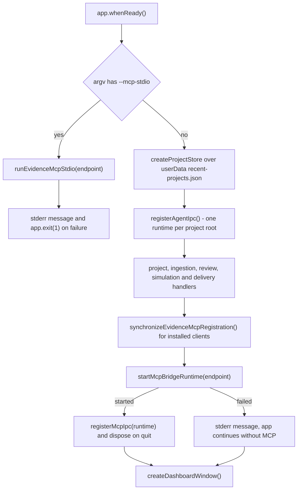

# Desktop app shell and IPC surface

`apps/desktop` is the only runnable application, and it is deliberately thin as a
*product*: almost every decision belongs to a library. What the shell owns is
process boundaries — where the filesystem lives, where the live model lives, and
which of the two may talk to the other.

The split is stated in one place and enforced by the runtime:
`contextIsolation: true`, `nodeIntegration: false`, and a preload script that
exposes a typed `evidenceAPI` object
(`repo://apps/desktop/src/main/windows.ts#L29-L48`,
`repo://apps/desktop/src/preload/index.ts#L37-L192`). The renderer never receives
`ipcRenderer`, `fs` or any Node module. The three folders mirror that rule: `main/`
may import `node:*`, `preload/` talks to `electron` and `shared/` only, and
`renderer/` reaches the main process exclusively through `window.evidenceAPI`.

## Startup order

`main.ts` makes one decision before Electron is ready: whether `--mcp-stdio` is in
`process.argv`. Otherwise `startApplication` runs once and assembles the process
graph in a fixed order (`repo://apps/desktop/src/main/main.ts#L58-L130`):

The registrations that actually run, in order:

1. **Project store** — `createProjectStore` pointed at `recent-projects.json`
   under Electron's `userData`.
2. **Agent IPC** — `registerAgentIpc()` owns one agent runtime per project root
   and returns a `dispose` handle.
3. **Project IPC** — `registerProjectIpc({ projectStore, openEditorWindow })`.
4. **Ingestion IPC** — `registerIngestionIpc` with a model-backed reader
   (`createModelIngestionReader()`) and the editor-window opener.
5. **Review IPC** — `registerReviewIpc()`.
6. **Simulation IPC** — `registerSimulationIpc()`.
7. **Delivery IPC** — `registerDeliveryIpc()`.
8. **Quit hook** — `app.once('before-quit', …)` disposes the agent runtimes.
9. **MCP client config sync** — the endpoint is derived from the `userData` path,
   then `synchronizeEvidenceMcpRegistration` merges a server entry into each
   installed client config. Any failure there is collapsed into an empty result,
   so a broken `~/.cursor/mcp.json` cannot stop the app from starting
   (`repo://apps/desktop/src/main/main.ts#L80-L88`).
10. **MCP bridge** — `startMcpBridgeRuntime` hosts the local socket, publishes
    bridge status to every window, and is given the *first* editor window in the
    `listEditorWindows()` map as the renderer that owns the live model.
11. **MCP renderer IPC** — only when the bridge started: `registerMcpIpc({ runtime })`,
    plus a second `before-quit` hook that disposes the IPC and the runtime.
12. **Dashboard window** — created last, so no window can call a handler that is
    not registered yet.

A failed bridge start is reported to stderr and swallowed (`runtime === null`): the
app continues without external-agent access rather than refusing to open
(`repo://apps/desktop/src/main/main.ts#L90-L129`). Because MCP IPC is registered
inside that success branch, a failed bridge means the `mcp` preload group has no
handler behind it for the rest of the session.

## Headless `--mcp-stdio` mode

External clients start this binary themselves, so the same executable has a second
mode: with `--mcp-stdio` it opens no window, reads no project store and registers
nothing. It resolves one endpoint — `EVIDENCE_MCP_ENDPOINT` when set, otherwise the
derived user-data path — and runs `runEvidenceMcpStdio({ endpoint })`, which
forwards stdin/stdout MCP traffic to the already running app over the local
socket. A failure writes the message to stderr and exits with code 1
(`repo://apps/desktop/src/main/main.ts#L36-L56`,
`repo://libs/evidence-mcp/src/cli.ts#L13-L28`).

The endpoint itself is short and per-user: a 12-hex-character SHA-1 of the
`userData` path, `evidence-mcp-<digest>`, as a named pipe on Windows and
`<tmpdir>/evidence-mcp-<digest>.sock` elsewhere, so two accounts or two checkouts
never share a socket that carries confidential model data
(`repo://libs/evidence-mcp/src/bridge/endpoint.ts#L10-L31`).

That is exactly the entry the app writes into client configs:
`command: process.execPath`, `args: ['--mcp-stdio']`,
`env: { EVIDENCE_MCP_ENDPOINT: endpoint }`
(`repo://apps/desktop/src/main/mcpRegistration.ts#L94-L105`). Only clients whose
config directory already exists are touched (`Cursor` always; `Claude Desktop` on
macOS or Windows), the merge preserves every other server and key, it is
idempotent so restarting the app changes nothing, and a config that fails to parse
is reported in `failed` instead of being overwritten
(`repo://apps/desktop/src/main/mcpRegistration.ts#L25-L55`,
`repo://apps/desktop/src/main/mcpRegistration.spec.ts#L59-L142`).

## Windows

There are two kinds of window (`repo://apps/desktop/src/main/windows.ts#L18-L99`):

- **Dashboard** (`1024×680`, min 900×600) lists recent projects and starter
  templates.
- **Editor** (`1440×900`, min 1180×760) opens one project root.

Both are frameless with a hidden title bar; on macOS the shell also uses vibrancy,
a transparent background and the traffic lights at a fixed position. The preload
path is `preload.js` beside the main bundle — the name `vite.preload.config.mjs`
pins because Forge names the bundle after its entry.

`openEditorWindow` keeps a `Map<rootPath, BrowserWindow>` and focuses the existing
window instead of stacking duplicates for the same tree; a `closed` listener
removes the entry only if the map still holds that window
(`repo://apps/desktop/src/main/windows.ts#L66-L96`). `listEditorWindows` returns the
map's values, which is how the MCP bridge picks the renderer that answers model
calls.

Routing is hash-based so the packaged `file://` build works without a server:
`loadRendererRoute` loads `<dev-server URL>#<hash>` or the bundled `index.html`
with a hash, `/dashboard` for the dashboard and
`/editor?rootPath=<encoded>` for an editor. `parseRoute` in `App.tsx` reads
`window.location.hash`, treats `/editor` as the editor route and everything else as
the dashboard (`repo://apps/desktop/src/main/windows.ts#L18-L36`,
`repo://apps/desktop/src/renderer/App.tsx#L8-L24`).

## The preload surface is the whole renderer API

`EvidenceDesktopApi` declares exactly six groups
(`repo://apps/desktop/src/shared/ipc.ts#L65-L129`):

| Group | Calls |
| --- | --- |
| `projects` | open/create dialogs, create, list templates, open, save, recent, open editor window, external-change subscription, `previewReview`, `exportDiffReview`, `exportReview`, `deliveryPreview`, `exportDelivery` |
| `agent` | prompt, steer, abort, trigger sensors, model-changed notification, latest report, publish canvas context, event/report/patch subscriptions, patch response |
| `mcp` | status (pull and push), request subscription, response, capture-mode subscription |
| `simulation` | replay, drift, trace picker |
| `ingestion` | draft, compile |
| `system` | `platform` |

There is no separate review, delivery or diff group: those channels live under
`projects` (`evidence:project:preview-review`, `evidence:project:export-review`,
`evidence:project:export-diff-review`, `evidence:project:delivery-preview`,
`evidence:project:export-delivery`), because they all answer a question about one
project root (`repo://apps/desktop/src/shared/ipc.ts#L35-L53`).

Channel names live in one place per domain (`evidence:project:*`,
`evidence:agent:*`, `evidence:mcp:*`, `evidence:simulation:*`,
`evidence:ingestion:*`). The preload maps each method to `ipcRenderer.invoke` for
request/response calls, to `ipcRenderer.send` for the two fire-and-forget answers
(`agent.respondPatch`, `mcp.respond`), and to `ipcRenderer.on` for subscriptions —
each of which returns an unsubscribe function that removes the same listener
(`repo://apps/desktop/src/preload/index.ts#L37-L190`).
`contextBridge.exposeInMainWorld('evidenceAPI', api)` is the only global the
renderer gets.

The payoff is a narrow, testable contract: the renderer test support provides a
fake `window.evidenceAPI` (`apps/desktop/src/renderer/test-support/desktopApi.ts`),
so UI tests never boot Electron, and a renderer cannot accidentally read a file.

## Project storage: no hidden model cache

`createProjectStore` is file-backed by design. The store never keeps a model in
memory: `open` parses the current source, `save` writes the document the renderer
holds. That is what lets an external agent or a script keep editing the same files
without fighting a stale cache (`repo://apps/desktop/src/main/projectStore.ts#L175-L181`).

The interface is small: `listRecent`, `open`, `create`, `createFromDocument`,
`save`, `fingerprint`. `createFromDocument` exists for the ingestion flow, which
compiles a document before it knows where it will live, so the caller keeps the
manifest name and id (`repo://apps/desktop/src/main/projectStore.ts#L36-L66`).

### Opening either source form

`open` accepts a folder containing `.evidence/fm/model.json` or a
`*.evidence.json` bundle:

- a bundle is parsed with `readModelBundle` and summarized with `kind: 'file'`,
  where `modelRoot` points at the file itself;
- a folder is required to contain `model.json`, then parsed with
  `readModelDirectory`;
- a freshly created, empty tree is accepted, because the parser's only finding is
  `model.empty`; anything else with no entities is refused.

Those decisions are in `isBlankStart` / `isReadableSource` and the two branches of
`open` (`repo://apps/desktop/src/main/projectStore.ts#L108-L135`,
`repo://apps/desktop/src/main/projectStore.ts#L271-L338`).

### Recent projects

A successful open, create or `createFromDocument` rewrites
`userData/recent-projects.json`: the new entry goes first, previous entries with
the same `rootPath` are dropped, the list is capped at 20, and the file is written
through a temporary file plus rename so a crash cannot leave half a JSON document
(`repo://apps/desktop/src/main/projectStore.ts#L72-L99`,
`repo://apps/desktop/src/main/projectStore.ts#L182-L196`). An unreadable or
missing file reads as an empty list rather than an error.

### Saving without churn

`save` dispatches on the source form:

- a bundle is rewritten through `writeModelBundle`; the in-memory document already
  carries `validation` and `readme`, so the round trip is lossless, and the result
  reports the file name under `written` or `unchanged`;
- a tree is written through `writeModelDirectory`, which reports `written`,
  `unchanged` and `removed` file names.

The result echoes those three lists back to the renderer
(`repo://apps/desktop/src/main/projectStore.ts#L341-L372`). Writing only changed
files is what keeps a save from producing Git churn.

### Creating refuses to overwrite

`writeProject` refuses an existing bundle file and an existing
`.evidence/fm/model.json`, with a message naming the path to open instead
(`repo://apps/desktop/src/main/projectStore.ts#L205-L240`). A new project is
either a starter template or an already-compiled document handed over by the
ingestion flow; `resolveStarterTarget` appends `.evidence.json` when a file target
was given without the suffix (`repo://apps/desktop/src/main/projectStore.ts#L132-L153`).

Templates are built, not stored: `createStarterDocument` builds one of
`blank`, `procurement`, `subscription` or `service_blueprint`, and
`listProjectTemplates()` reports each template's real entity, relationship and
rule counts by building it with a preview id
(`repo://apps/desktop/src/main/templates/starterModels.ts#L1106-L1140`). The
`evidence:project:templates` handler serves that list; a failure returns
`{ success: false, error }` rather than an empty dashboard
(`repo://apps/desktop/src/main/projectIpc.ts#L145-L155`).

### Fingerprinting for external edits

`fingerprint` hashes either the bundle's bytes or every model source file's path
and content with NUL separators
(`repo://apps/desktop/src/main/projectStore.ts#L375-L403`). It returns `null` when
the source cannot be read or holds no files. The renderer uses it to distinguish
its own save from a write it did not make, and the review preview uses it to
refuse a page assembled while the inputs changed underneath.

## Model roots are resolved once

A project root is either a folder holding `.evidence/fm/` or one
`*.evidence.json` bundle. Both forms feed the same readers, so path resolution
lives in one module (`repo://apps/desktop/src/main/modelSource.ts#L8-L26`):

| Function | Tree project | Bundle project |
| --- | --- | --- |
| `isBundleProject` | false | true for a `*.evidence.json` path |
| `projectDirectoryOf` | the project root | the bundle's parent directory |
| `modelSourceOf` | `<root>/.evidence/fm` | the bundle file |

Every caller uses these instead of concatenating paths: the watcher
(`projectIpc`), review preview and export, delivery preview and export, the MCP
sensor and delivery services, the simulation service, and the agent runtime, which
additionally reads a bundle with `readModelBundle` and a tree with
`readModelDirectory` (`repo://apps/desktop/src/main/agentRuntime.ts#L89-L134`,
`repo://apps/desktop/src/main/mcpSensorService.ts#L60-L90`). That is why a bundle
project keeps its `.evidence/` neighbours beside the file rather than inside it.

There is no fixed trace path any more: the drift radar asks for an exported OTLP
JSON file through a dialog and hands the absolute path to the main process
(`repo://apps/desktop/src/main/simulationIpc.ts#L57-L83`).

## Watching external writes

Opening or creating a project starts a watcher keyed by `WebContents` id on the
model source returned by `modelSourceOf`. A newer open stops the previous watcher;
a destroyed window stops its own (`repo://apps/desktop/src/main/projectIpc.ts#L38-L64`).

The watcher itself differs by source form
(`repo://apps/desktop/src/main/modelWatcher.ts#L26-L159`):

- a tree watches `.` plus `entities/`, `relationships/` and `rules/` with
  non-recursive, non-persistent watchers (which keeps Windows working), collects
  changed names and flushes 200 ms after the first event;
- a bundle watches its **directory** and filters events to the file's basename,
  because an editor that saves through a rename would otherwise detach the watcher
  after the first write.

Both debounce, then `projectIpc` emits `evidence:project:changed` with
`{rootPath, changedAt, paths}`. The renderer turns that into a reload prompt rather
than silently replacing the canvas.

## Review: preview, export, diff export

The review page is generated in the main process from the sources on disk, not
from the canvas: a review someone mails to a colleague has to describe what was
saved (`repo://apps/desktop/src/main/reviewIpc.ts#L24-L31`).

- **Preview** (`previewReview`) builds the page for the unsaved snapshot the
  renderer holds, checks the supplied document shape and revision, re-reads the
  on-disk model for scenarios, and throws `预览期间磁盘输入变化，请重新预览` when the
  fingerprint changed underneath. The IPC handler then renders the HTML with
  `loadWorkbenchAssets`/`renderWorkbenchHtml` from the installed assets and returns
  `{ success: false, error }` on failure; it never opens a dialog
  (`repo://apps/desktop/src/main/reviewIpc.ts#L117-L139`,
  `repo://apps/desktop/src/main/reviewPreview.ts#L28-L120`).
- **Export** (`exportReview`) resolves the project directory, model source and
  asset directory, asks for a save path, and returns
  `{ status: 'saved', path, counts }`, `{ status: 'cancelled' }` or
  `{ status: 'failed', error }` rather than throwing across IPC
  (`repo://apps/desktop/src/main/reviewIpc.ts#L141-L214`).
- **Diff export** (`exportDiffReview`) first asks for a portable
  `*.evidence.json` baseline — never Git, never a project script — returns
  `cancelled` if that dialog is dismissed, defaults the page name to
  `diff-review.html`, and passes `baselineDocument` into `generateWorkbench`
  (`repo://apps/desktop/src/main/reviewIpc.ts#L157-L171`).

Two details decide the content of a joint review. The suggested file name puts
`review.html` beside the project rather than in a dot directory, and when
`.evidence/api/api.json` exists the export derives `scopeRefs` from the manifest's
entry Contexts that are nobody's child — the independent Contexts the delivery
actually names (`repo://apps/desktop/src/main/reviewIpc.ts#L53-L80`).

The asset directory comes from `installAssets.ts`: a packaged install reads the
`assets` folder the installer unpacked beside `app.asar` (Forge `extraResource`),
a checkout reads `apps/desktop/resources/assets` after `prepare-resources` copied
it, then the workspace package it came from. Nothing is searched up the tree;
`undefined` is returned so the library can name the paths it tried instead of
compiling an empty page (`repo://apps/desktop/src/main/installAssets.ts#L22-L68`,
`repo://apps/desktop/forge.config.mjs#L18-L31`).

## Delivery: preview and hand-off

Both delivery calls project the model on disk in the main process, through
`readDelivery` → `previewOf`/`deliveryFilesOf`, so the hub cannot describe a
delivery the export would not write. `deliveryIpc` normalizes the root with
`modelSourceOf(projectDirectoryOf(rootPath))` and suggests a `delivery` folder
beside the project (`repo://apps/desktop/src/main/deliveryIpc.ts#L82-L131`).

- `deliveryPreview` returns `{ success: true, preview }` or
  `{ success: false, error }`; the preview carries services with their route
  counts, links, routes and the limitations the model cannot answer yet.
- `exportDelivery` asks for a directory, writes `openapi.json`, `topology.json`,
  `routes.json`, `deployment.compose.json`, `projection.json`,
  `http-journeys.json` and `limitations.md`, then returns `saved` with the file
  names and service/route counts, `cancelled`, or `failed`
  (`repo://apps/desktop/src/main/deliveryProjection.ts#L65-L117`,
  `repo://apps/desktop/src/main/deliveryIpc.spec.ts#L107-L208`).

## Simulation: replay and drift

`registerSimulationIpc` answers the two questions "does the model still hold" and
"does production still match it" from the saved sources. It resolves its service
lazily (`await import('./mcpSimulationService')`) unless a test injects one, so the
MCP-side service is not loaded until the sandbox is used.

- `replay` forwards the root path and optional `scenarioId` to
  `SimulationService.replay`, which reads `modelSourceOf(rootPath)` and reduces the
  model-core replay to frames and per-step checkpoints; an unreadable model becomes
  a `passed: false` result with `errors` rather than a throw
  (`repo://apps/desktop/src/main/mcpSimulationService.ts#L99-L140`).
- `drift` reads the trace file the renderer picked with `readFile`, parses it, and
  throws a message naming the JSON failure (`不是 JSON：…`) instead of reporting a
  drift; the dialog registration and the trace picker keep all filesystem access in
  the main process (`repo://apps/desktop/src/main/simulationIpc.ts#L40-L113`).

## Agent and ingestion handlers

`registerAgentIpc` owns one agent runtime per project root, memoized by root path
and disposed when its owning `WebContents` is destroyed. Patch application is a
round trip: the main process sends `evidence:agent:apply-patch` to the renderer
that holds the live `ModelSession`, waits for `evidence:agent:apply-patch-result`
with a 15 s timeout, and reports a closed window as
`{ success: false, error: '编辑器窗口已关闭。' }`. A request that gets no answer
resolves with a timeout message instead of leaving the agent hanging
(`repo://apps/desktop/src/main/agentIpcHandlers.ts#L42-L150`,
`repo://apps/desktop/src/main/agentIpcHandlers.ts#L203-L255`).

`registerIngestionIpc` keeps both halves of the ingestion flow in the main
process: `draft` reads business text, a contract or a blueprint table into a
draft, and `compile` builds a document, writes it through
`projectStore.createFromDocument`, and opens the editor window for the new project
when the write succeeds (`repo://apps/desktop/src/main/ingestionIpc.ts#L222-L244`).

## Failure behaviour

| Situation | Behaviour |
| --- | --- |
| folder without `.evidence/fm/model.json` | open fails with a message naming the expected path (`repo://apps/desktop/src/main/projectStore.ts#L303-L311`) |
| source parses to no entities and is not a blank start | open fails with every parse finding |
| create target already holds a model | refusal naming the existing path |
| external write | debounced `evidence:project:changed`, renderer decides whether to reload |
| renderer window closed during an agent patch | `{success: false, error: '编辑器窗口已关闭。'}` (`repo://apps/desktop/src/main/agentIpcHandlers.ts#L88-L125`) |
| MCP bridge cannot start | stderr message, app continues, no MCP IPC registered (`repo://apps/desktop/src/main/main.ts#L120-L129`) |
| MCP client config is broken or its folder is missing | `failed` or `skipped` entry, the file is left as it was, startup continues |
| `--mcp-stdio` cannot reach the app | stderr message and exit code 1 |
| review generation fails | `{status: 'failed', error}` instead of throwing across IPC |
| review preview inputs change on disk | preview throws, handler returns `{success: false, error}` |
| trace file is not JSON | drift throws a message naming the parse failure; no audit is reported |
| asset directory not found | `undefined` returned so the library names the paths it tried (`repo://apps/desktop/src/main/installAssets.ts#L38-L67`) |

## Tests that protect this contract

- `projectStore.spec.ts` opens tree and bundle projects, refuses a folder without
  `model.json`, writes only changed files idempotently, fingerprints both forms,
  creates starter trees and bundles, derives a manifest id, refuses overwrite, and
  accepts a blank start (`repo://apps/desktop/src/main/projectStore.spec.ts#L58-L206`,
  `repo://apps/desktop/src/main/projectStore.spec.ts#L207-L490`).
- `modelSource.spec.ts` pins `isBundleProject`, `modelSourceOf` and
  `projectDirectoryOf` for both forms (`repo://apps/desktop/src/main/modelSource.spec.ts#L11-L27`).
- `reviewIpc.spec.ts` asserts a cancelled dialog generates nothing, a successful
  export reports the page counts, scope refs are the non-child entry Contexts, a
  generation failure returns `status: 'failed'`, and the diff export asks for a
  baseline before the save dialog (`repo://apps/desktop/src/main/reviewIpc.spec.ts#L69-L263`).
- `installAssets.spec.ts` pins packaged, development and "nothing found"
  resolution (`repo://apps/desktop/src/main/installAssets.spec.ts#L14-L75`).
- `deliveryIpc.spec.ts` and `simulationIpc.spec.ts` pin the file list of a
  hand-off, a dismissed picker writing nothing, a read failure reported as
  `success: false`, the replay scenario forwarding, and a cancelled trace picker
  (`repo://apps/desktop/src/main/simulationIpc.spec.ts#L77-L151`).
- `mcpRegistration.spec.ts` and `mcpBridgeRuntime.spec.ts` pin the client entry
  shape, the idempotent merge that keeps other servers, the skip for an
  uninstalled client, the round trip through the renderer, and status counting
  (`repo://apps/desktop/src/main/mcpRegistration.spec.ts#L44-L142`,
  `repo://apps/desktop/src/main/mcpBridgeRuntime.spec.ts#L85-L200`).
- `apps/desktop/tests/integration.spec.ts` copies the `product-procurement` fixture
  into a temporary project, opens it through the store, and lays it out through the
  canvas library — an end-to-end check of path resolution plus rendering
  (`repo://apps/desktop/tests/integration.spec.ts#L44-L160`).

## Related pages

- [Canvas layout, viewport and inspector](./canvas-and-inspector.md) — the
  renderer half of the editor window.
- [Ingestion and agent patch review](./ingestion-and-patch-review.md) — the
  assisted write paths behind the `ingestion` and `agent` IPC groups.
- [External agents over MCP](../agents/mcp-integration.md) — the bridge, its tools
  and the stdio mode.
- [Model source formats](../model/source-formats.md) — what `.evidence/fm` and a
  `*.evidence.json` bundle contain.
- [The offline review workbench](../contracts/offline-workbench.md) — what the
  review export produces.
