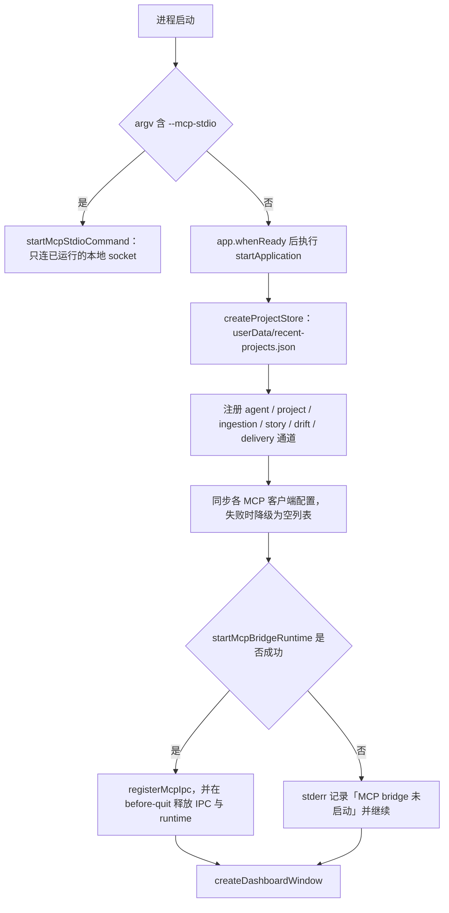
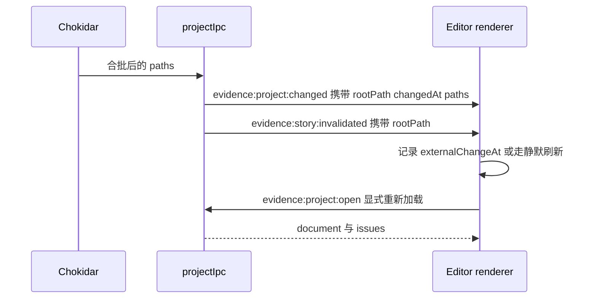

# Electron 宿主、IPC 契约与项目生命周期

`apps/desktop` 是 Electron 可视化宿主（终端侧是 `apps/cli`）。它不实现领域能力，只负责三件事：把文件系统、进程和本地 socket 留在 main；把 `ModelSession` 留在 renderer；用一层窄 IPC 把两侧接起来。因此凡是"读盘、解析、投影、审计、写盘"都在 main 里跑，renderer 只发请求和把结果合并进画布。

## 三层职责与唯一契约源

- **main**（`apps/desktop/src/main`）：窗口、对话框、Chokidar、`ProjectStore`、MCP 本地 socket 与 stdio 代理、Agent runtime、领域服务调用。
- **renderer**（`apps/desktop/src/renderer`）：React 界面 + 每个编辑器窗口一个 `ModelSession`，不含 Node 能力。
- **preload**（`apps/desktop/src/preload/index.ts`）：唯一桥，只做 channel 到方法名的映射与 `invoke`/`send` 包装。

通道名与 DTO 全部集中在 `libs/desktop/contracts/src`：`index.ts` 汇总 `agentIpc`、`delivery`、`drift`、`ingestion`、`ipc`、`mcpIpc`、`projects`、`story` 八个模块。main 的每个 registrar 和 preload 都从同一处导入 `EVIDENCE_*_IPC_CHANNELS` 与类型，所以改一个通道会在两侧同时编译失败；`apps/desktop` 内没有 `shared/` 目录，也没有第二份通道常量。这条约束决定了扩展顺序：先加 contracts 的 channel + DTO，再加 main registrar 与 preload 方法，最后才在界面里接窄 port。

## 启动：两种模式，一条注册顺序

进程顶层只看一个开关：`process.argv.includes('--mcp-stdio')`。命中时走无窗口的 stdio 代理，否则走完整的桌面启动。

正常模式的顺序是有意固定的：先建 store，再注册 `registerAgentIpc`、`registerProjectIpc`、`registerIngestionIpc`、`registerStoryIpc`、`registerDriftIpc`、`registerDeliveryIpc`，然后按 `getEvidenceMcpBridgeEndpoint({ platform, userDataPath })` 推导的本地端点同步各客户端的 MCP 配置、启动 bridge、注册 MCP IPC，最后才开 dashboard。配置同步的失败被 `.catch` 成 `{ updated: [], skipped: [], failed: [] }`，bridge 启动失败写 stderr 后返回 `null`，此时 MCP IPC 不注册、窗口照常打开——缺 MCP 不该等于打不开模型。

退出与平台语义：`before-quit` 只挂三类释放——`storyIpc.dispose()`、`agentIpc.dispose()`、`ipc.dispose()` + `runtime.dispose()`；project/ingestion/drift/delivery 的 handler 与进程同寿命，不单独回收。macOS 强制 `nativeTheme.themeSource = 'light'`，`activate` 在零窗口时重开 dashboard，其他平台 `window-all-closed` 直接 `app.quit()`。

## `--mcp-stdio` 是无窗口代理

外部客户端自己拉起这个 binary，所以这条路径必须对宿主零副作用：它不打开窗口、不创建 `ProjectStore`、不读 recent、不注册任何 IPC handler，只把 stdio 上的工具调用转发给已运行的应用。端点取 `process.env.EVIDENCE_MCP_ENDPOINT`，缺省时用 `getEvidenceMcpBridgeEndpoint`，然后 `runEvidenceMcpStdio({ endpoint })`；失败写 stderr 并 `app.exit(1)`。

这与注册条目是同一套约定：写进各客户端配置的 server entry 就是 `{ command: executablePath, args: ['--mcp-stdio'], env: { EVIDENCE_MCP_ENDPOINT: endpoint } }`。推论是 stdio 模式永远无法单独工作——它只是代理，桌面应用没在跑就没有可转发的 socket。MCP 侧的状态机与工具清单见 [MCP 集成](../agents/mcp-integration.md)。

## 窗口、尺寸与路由

`windows.ts` 用一组共享选项建窗：`frame: false`、`titleBarStyle: 'hidden'`、`autoHideMenuBar`，macOS 额外给红绿灯位置、`vibrancy: 'sidebar'` 与透明背景。dashboard 是 1024×680（min 900×600），editor 是 1440×900（min 1180×760）。

编辑器窗口按 `rootPath` 收在 `Map<string, BrowserWindow>` 里：同一项目根再开会 `focus()` 旧窗而不是叠新窗，`closed` 时只有当前仍指向自己才删除条目。`listEditorWindows()` 暴露这份表，MCP bridge 取其中第一个窗口（不是最后一个获得焦点的窗口）来读模型和截图。

加载走 `loadRendererRoute`：dev 环境拼 `MAIN_WINDOW_VITE_DEV_SERVER_URL#hash`，打包后 `loadFile(__dirname/../renderer/<MAIN_WINDOW_VITE_NAME>/index.html, { hash })`；preload 固定取同目录 `preload.js`。hash 由 renderer 的 `parseRoute` 解析：`/editor?rootPath=...` 进编辑器（缺失时保留空字符串交给编辑器报错），其余一律回 dashboard，未知 hash 不会白屏。

## preload 的唯一暴露面

`contextIsolation: true` + `nodeIntegration: false`，preload 里没有任何 fs、child_process 或 `ipcRenderer` 直通，最后一行只有 `contextBridge.exposeInMainWorld('evidenceAPI', api)`。`api` 标注成 `EvidenceDesktopApi`，所以 preload 少一个方法就编译不过。

`EvidenceDesktopApi` 分为六组加一个常量：

| 组 | 内容 | 形态 |
| --- | --- | --- |
| `projects` | 打开/新建对话框、`create`、`listTemplates`、`open`、`save`、`listRecent`、`openEditorWindow`、`onChanged`、live 与 saved 两条交付出口 | 多为 `invoke`，`onChanged` 返回取消订阅 |
| `story` | `listFlows`、`project`、`whatIf`、`onInvalidated` | `invoke` + 订阅 |
| `agent` | `prompt`、`steer`、`abort`、`triggerSensors`、`notifyModelChanged`、`latestReport`、`publishCanvasContext`、`onEvent`、`onReport`、`onApplyPatch`、`respondPatch` | `invoke` + 订阅，回答用 `send` |
| `mcp` | `getStatus`、`onStatus`、`onRequest`、`respond`、`onCaptureMode` | 一个 `invoke`，其余订阅/单向 |
| `drift` | `drift`、`pickTrace` | `invoke` |
| `ingestion` | `draft`、`compile` | `invoke` |
| `system` | `platform` | 进程内常量 |

三条一致的规则：请求-响应一律 `ipcRenderer.invoke`（主进程 handler 自己 catch 成 `{ success: false }` 或 `status: 'failed'`，不让异常跨 IPC）；每个订阅都返回 `removeListener` 闭包；只有 **main 发起、renderer 回答**的两条链路用单向 `send`——`agent.respondPatch`（回答 `evidence:agent:apply-patch`）和 `mcp.respond`（回答 `evidence:mcp:request`）。通道前缀并不总是等于组名：sensor 相关通道落在 `evidence:sensor:*` 下，仍由 `agent` 组暴露。

旧的 simulation/replay、interview 分支、review/离线导出与 `installAssets` 组都不存在了；交付只保留 live 与 saved 两条路径，没有第三条 review 出口。

## 边界：只有 app shell 读 `window.evidenceAPI`

`window.evidenceAPI` 的类型声明挂在 `apps/desktop/src/renderer/types/global.d.ts`，实际读取点全部落在 `apps/desktop/src/renderer` 里（`DashboardScreen`、`EditorScreen`、`useEditorSession`、`useMcpBridge`、`useSensorsState` 等）。`libs/desktop/feature-*` 的生产代码一次都不引用它，而是接收注入的窄 port：

- `DriftRadar` 要 `api: EvidenceDriftApi`，`StoryDrawer` / `useStoryPlayback` 要 `api: EvidenceStoryApi`；
- `useDeliveryHub` 只取 `Pick<EvidenceDesktopApi['projects'], 'deliveryLivePreview' | 'exportLiveDelivery'>`；
- `useAgentSession` / `useAgentPatchBridge` 接 agent 子 API 与 session，`useEditorSession` 由 shell 传入 project 之外不做全局查找。

这样 feature 包可以在没有 Electron 的 jsdom 里测：要么直接传 fake port，要么用 `libs/desktop/testing` 的 `installDesktopApi` 装一个带调用日志与 mock 控制器的脚本化 `window.evidenceAPI`。feature 包的 spec 里出现 `window.evidenceAPI` 只是拿默认假实现的便捷写法，生产分支仍然只认参数。

## 项目存储：树、Bundle 与 recent

`createProjectStore({ recentProjectsFile: userData/recent-projects.json })` 不缓存任何模型。`open` 每次读盘：先 `isModelBundleFile(rootPath)` 判断是不是 `*.evidence.json`，是就走 `readModelBundle`；否则要求 `<root>/.evidence/fm/model.json` 存在（缺失时直接给出"请选择包含 .evidence/fm 的项目或一个单文件"的明确错误），再走 `readModelDirectory`。可读性判定只有两种通过：有 entity，或者 issues 全是 `EMPTY_MODEL_ISSUE_CODE` 的空白起点；其余情况把 issue 列表拼成错误返回。成功时写入 recent 并回 `{ project, document, issues }`，`summary.modelRoot` 对 Bundle 指向文件本身。

`create` / `createFromDocument` 共用同一套落地逻辑：`file` 目标的路径不以 `.evidence.json` 结尾就补后缀；目标已有 Bundle 文件或 `<root>/.evidence/fm/model.json` 一律拒绝并给出"请直接打开它或换一个位置"的提示，绝不在原地覆盖一个模型；只有 `writeModelBundle` / `writeModelDirectory` 真正成功后才写入 recent。

`save` 按来源分派：Bundle 用 `writeModelBundle`（renderer 手里的 document 已带 readme 与内联 examples，原样写回即无损），树用 `writeModelDirectory`（先 `mkdir`）。返回 `written`/`unchanged`/`removed` 与 `savedAt`；内容没变就不重写、被删对象进 `removed`，以压低 Git 噪声。

recent 独立持久化在 `userData/recent-projects.json`：最多 20 条、按 `rootPath` 去重、临时文件 + `rename` 原子替换；文件缺失或不是数组都退化成空列表而不是启动失败。

`ProjectStore` 还提供一个 `fingerprint(rootPath)`：Bundle 对文件内容、树对每个源文件的 `path` + NUL + `content` 排序后取 sha1，缺失或空源返回 `null`。它没有对应 IPC 通道，renderer 感知外部写入靠的是 watcher 事件；这个函数目前只由 store 自己的 spec 驱动。

## 源路径归一化

`modelSource.ts` 是树与 Bundle 共存的唯一解释点，三个 helper 被所有消费者复用：`isBundleProject` 判断是否为 `*.evidence.json`，`projectDirectoryOf` 对树返回根目录、对 Bundle 返回其父目录，`modelSourceOf` 对树返回 `<root>/.evidence/fm`、对 Bundle 返回文件本身。交付走 `modelSourceOf(projectDirectoryOf(rootPath))` 这种二次归一，所以调用方传树根还是传 Bundle 路径都会落到同一份源；drift 直接 `modelSourceOf(rootPath)` 交给审计器；story 用 `projectDirectoryOf` 作为 projector/agent 的 `projectRoot`。文件里没有 trace 路径 helper：trace 位置由用户在 drift 选择器里显式给出，不再固定在项目目录旁边。

## 外部变更：监控只负责提示

`registerProjectIpc` 持有 `Map<WebContents.id, ModelWatcher>`：`open`/`create` 成功后为发起窗口建 watcher（先关掉该窗口的旧 watcher），`open` 之前不会误建；`destroyed` 时 `stopWatching` 关 watcher 并删条目。

两条通知只发给正在监视的那个 sender，`isDestroyed()` 为真时既不发送也不泄漏 watcher。

`watchModelSource` 用 Chokidar v4 的真实路径（不是 glob）：从 `target` 的父目录向上找到最近存在的祖先作为 watchRoot，从而能看见 `.evidence/fm` 的首次创建、根目录删除与重建；`ignored` 把遍历剪到 `model.json` 与 `entities/relationships/rules` 下的 JSON（可嵌套），Bundle 只接收目标文件、忽略其他兄弟文件；`ignoreInitial` 保证已存在的文件不触发事件，`atomic: true` 与 `awaitWriteFinish: { stabilityThreshold: 150, pollInterval: 50 }` 让 atomic rename 式保存只产生一次稳定事件，之后还有 200ms 合批并按路径排序去重。`ready` 表示初始发现完成，`error` 只 `console.warn` 降级，`close()` 置 `closed`、清 timer 与 pending 并 `await watcher.close()`，之后不再回调。

renderer 侧的行为是"提示而非替换"：`useEditorSession` 的 `onChanged` 只把 `changedAt` 存进 `externalChangeAt` 交给界面提示，`reloadFromDisk` 明确再调一次 `projects.open` 并用 `replaceDocument(resetHistory: true)` 换掉会话。story 面板走更保守的 `reloadFromDiskIfClean`：有未保存改动就直接放弃，读盘过程中 document 变了也放弃，内容与规范化 JSON 相同则保留 undo 历史（因为保存本身也会触发 watcher）。

## 交付：live 与 saved 两条写盘路径

`registerDeliveryIpc` 只注册四个 handler，成对使用：

- **live 对**（`deliveryLivePreview` / `exportLiveDelivery`）：分析 renderer 显式送来的 document revision。导出前先 `validateLiveDeliveryInput`（绝对 `rootPath`、非负整数 `revision`、`document` 与 `baseDocument` 形状），`structuredClone` 冻结入参，再拒绝 `canExportDraft === false`（存在 blocking issue）与 `modelDigest !== expectedModelDigest`（预览已过期）的情况，之后才打开目录选择器。写出 `deliveryFilesOf(bundle)` + `api-changes.md` + `draft-status.json`（`mode: 'draft'`、`releaseAuthorized: false`）。
- **saved 对**（`deliveryPreview` / `exportDelivery`）：从磁盘重新读模型源（`modelSourceOf(projectDirectoryOf(rootPath))`），预览只是投影，导出把同一批文件写进所选目录。

两者都以 `status: 'saved' | 'cancelled' | 'failed'` 收场，预览则以 `{ success, preview }` / `{ success: false, error }` 收场，异常不会穿过 IPC。默认目录是 `<projectDirectory>/delivery`。目前 renderer 只通过 `useDeliveryHub` 使用 live 对，saved 对保留为磁盘端点。投影内容本身见 [交付拓扑与契约演进](../contracts/delivery-routes-and-diff.md)。

## 其它主进程能力

- **Story**（`storyIpc`）：三个 handler 共用 `load`——校验绝对 `rootPath`，有 `document` 就用它（包含未保存的 inspector 改动），否则按树/Bundle 读盘，`buildFmCheckReport` + `collectFlowScenarios` 得到流程清单。projector 按 `WebContents` 缓存，并按 `skipAi` 分两个模式（纯事实模式不需要凭据）；`rootPath` 变化时重建缓存，窗口销毁时清理。`whatIf` 额外校验问题长度、步骤序号与 `stepHash`，步骤变了要求刷新而不是基于过期画面推演。
- **Drift**（`driftIpc`）：在 main 里读 trace 文件并 `JSON.parse`（解析失败抛"不是 JSON"），`DriftService` 懒加载且可注入，审计针对已保存的模型源；返回 `pickTrace` 便于窗口测试直接驱动选择器。`dispose` 会移除 `drift` 与 `trace-dialog` 两个 handler，replay 已不存在。
- **Agent**（`agentIpcHandlers`）：按 `rootPath` 单飞（同时只起一个 runtime，`starting` 表去重）并在首个调用窗口上懒建，记录哪个窗口拥有哪个根；补丁是往返回合——main 生成 `requestId` 发 `evidence:agent:apply-patch`，renderer 用 `respondPatch` 回 `evidence:agent:apply-patch-result`，窗口已销毁立刻失败、15 秒超时给出可重试文案。细节见 [renderer 会话](./renderer-state.md) 与 [Pi harness](../agents/pi-harness.md)。
- **Ingestion**（`ingestionIpc`）：draft 按合同条款、蓝图表格或业务文本读取；业务文本在有配置模型时优先模型，模型失败或回复读不成草稿时回落到内置词表并说明原因；compile 拒绝产出零 entity 的草稿，经 `createFromDocument` 落盘后打开新项目窗口。
- **MCP**（`mcpIpcHandlers` + `mcpBridgeRuntime`）：`status` 既可推送也可拉取，`respond` 按 `requestId` 结算，`captureMode` 在截图前后开关以隐藏选中环与缩放控件。

## 验证入口

桌面测试是单个 vitest 工程（jsdom，覆盖 `src/renderer/**/*.spec.tsx`、`src/main/**/*.spec.ts` 与 `tests/**/*.spec.ts`），workspace 包通过 `@evidence-poc/source` 条件解析，因此 main 侧 spec 可以在 jsdom 里跑 Node API。

- `projectStore.spec.ts` 守住树/Bundle/空白起点、覆盖拒绝、幂等保存、recent 与 fingerprint 的非空/变化语义；`modelSource.spec.ts` 钉住三个 helper 的两种形态。
- `modelWatcher.spec.ts` 覆盖初始静默、嵌套与缺根/重建、合批、atomic Bundle、多余兄弟文件与 close 之后不再通知。
- `projectIpc.spec.ts` 只做一件事但很关键：变更只通知正在监视的窗口，并在 sender 销毁后停止发送、关闭 watcher。
- `deliveryIpc.spec.ts` / `liveDeliveryIpc.spec.ts` / `deliveryProjection.spec.ts` 通过注入对话框与写入函数保护取消、失败与文件清单；`driftIpc.spec.ts`、`ingestionIpc.spec.ts`、`storyIpc.spec.ts`、`agentRuntime.spec.ts`、`mcpBridgeRuntime.spec.ts` 与 `mcpIpcHandlers.spec.ts` 同样以注入依赖驱动生命周期、超时与响应结算。
- `renderer/App.spec.tsx` 保护 hash 路由；`tests/integration.spec.ts` 用真实 `product-procurement` fixture 走 store 往返，`tests/phase-3-loop.spec.ts` 用 stub Pi API 跑通工具循环。

相关：[renderer 会话与外部变更](./renderer-state.md) · [工作区表面](./workspace-surfaces.md) · [源格式：树与 Bundle](../model/source-formats.md) · [构建与打包](../operations/build-and-package.md) · [MCP 集成](../agents/mcp-integration.md)
