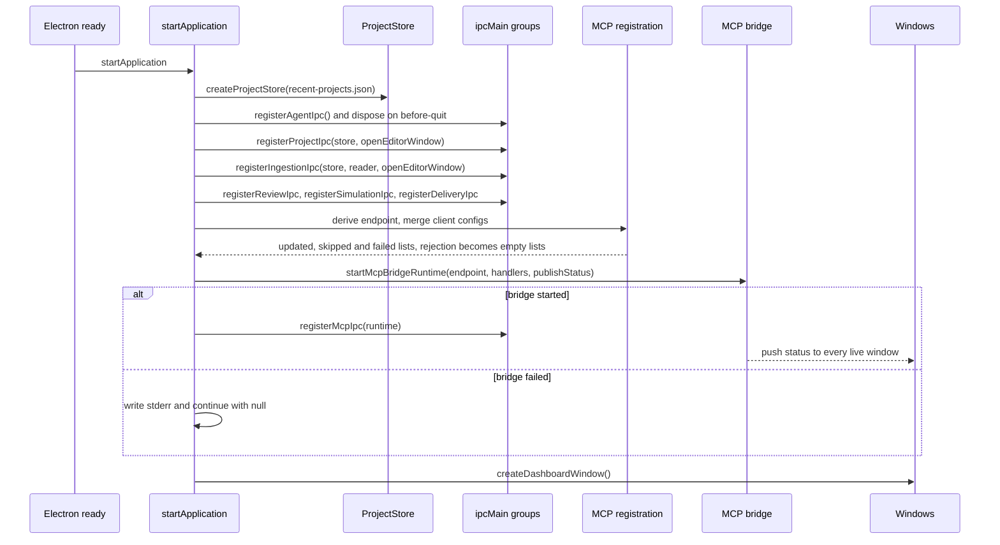
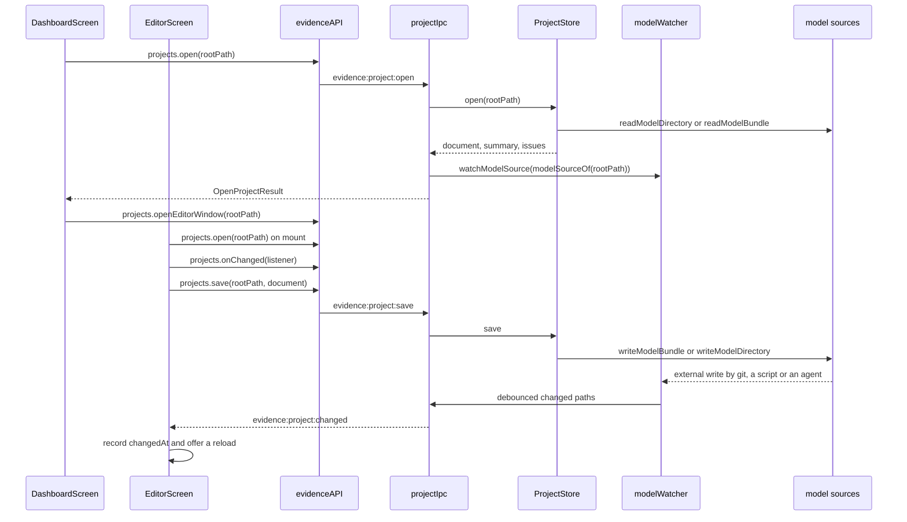

# Desktop shell, windows and project lifecycle

`apps/desktop` is the only runnable application in the workspace, and as a
*product* it is thin: almost every decision belongs to a library. What the shell
owns is process boundaries — where the filesystem is, where the live
`ModelSession` is, and which of the two may talk to the other.

The boundary is stated once in `windows.ts` and enforced by Electron:
`contextIsolation: true`, `nodeIntegration: false`, and a preload script that
exposes a typed `evidenceAPI` object. The renderer never receives `ipcRenderer`,
`fs` or any other Node module — it only reaches the main process through that
object (`repo://apps/desktop/src/main/windows.ts#L28-L49`,
`repo://apps/desktop/src/preload/index.ts#L27-L31`,
`repo://apps/desktop/src/preload/index.ts#L34-L196`).

## Startup order

`startApplication` runs after `app.whenReady()` and assembles the process graph in
a fixed order, because each step hands a dependency to the next
(`repo://apps/desktop/src/main/main.ts#L58-L130`).

The order matters in two places. The agent handlers are registered before any
window exists because their runtimes are created lazily per project root, and the
same module's `dispose` is wired to `before-quit`. The MCP bridge is started
before the dashboard so a window that opens later can pull its status instead of
showing a dead bridge.

Failures are contained rather than fatal:

- Client-config synchronisation (`~/.cursor/mcp.json`, the platform's Claude
  Desktop config) is idempotent and merges the `evidence-desktop` server entry
  while keeping every other server; a rejection is caught into
  `{updated: [], skipped: [], failed: []}`, so a read-only home directory does not
  stop the app (`repo://apps/desktop/src/main/mcpRegistration.ts#L119-L174`,
  `repo://apps/desktop/src/main/main.ts#L80-L88`).
- A bridge that cannot start writes `MCP bridge 未启动：<message>` to stderr and
  yields `null`. The app keeps running without external-agent access, and
  `registerMcpIpc` is skipped entirely, so the renderer has no status or response
  channel to call (`repo://apps/desktop/src/main/main.ts#L89-L128`).

macOS gets `nativeTheme.themeSource = 'light'`; the app re-creates the dashboard
on `activate` when every window is closed, and `window-all-closed` quits only off
macOS (`repo://apps/desktop/src/main/main.ts#L132-L153`).

The same executable has a second, headless mode. With `--mcp-stdio` it opens no
window, reads no project store and registers nothing: it only runs the stdio MCP
server against `EVIDENCE_MCP_ENDPOINT` or the derived socket path, and exits 1 with
a stderr line if that server fails
(`repo://apps/desktop/src/main/main.ts#L40-L52`).

## Windows and routing

Two kinds of window exist, both frameless with a hidden title bar (vibrancy and
transparent traffic lights on macOS):

| Window | Size | Minimum | Content |
| --- | --- | --- | --- |
| Dashboard | 1024×680 | 900×600 | recent projects, starter templates, ingestion entry |
| Editor | 1440×900 | 1180×760 | one project root |

`openEditorWindow` keeps a `Map<rootPath, BrowserWindow>`: an existing window is
focused instead of duplicated for the same tree, and a `closed` listener removes
the entry only if the map still points at that window
(`repo://apps/desktop/src/main/windows.ts#L66-L91`). `listEditorWindows` returns
the map's values, which is how the MCP bridge decides which renderer owns the live
model.

Routing is hash-based so the packaged `file://` build needs no server:
`loadRendererRoute` appends the hash to the Vite dev server URL or passes it to
`loadFile`, and the renderer parses the same string
(`repo://apps/desktop/src/main/windows.ts#L18-L26`,
`repo://apps/desktop/src/renderer/App.tsx#L6-L21`).

- `#/editor?rootPath=<encoded>` selects the editor with that project root.
- Everything else — including an unknown hash — selects the dashboard.
- A missing `rootPath` stays an empty string, so the editor screen can say
  "缺少项目路径：请从仪表盘重新打开项目。" instead of failing silently
  (`repo://apps/desktop/src/renderer/App.spec.tsx#L5-L20`).

`DashboardScreen` reads the first screen in one pass: `projects.listRecent()` and
`projects.listTemplates()` are both issued on mount, and the template cards are
rendered from the second result so a starter card never shows a placeholder count.
Opening a project from a card or the open dialog is two calls — `projects.open`,
then `projects.openEditorWindow(result.project.rootPath)` — and the opened summary
is prepended to the list before the editor window appears
(`repo://apps/desktop/src/renderer/screens/DashboardScreen.tsx#L23-L83`).

Creating a project follows the same shape: `projects.showCreateDialog` picks a
directory (`openDirectory` + `createDirectory`) or, for a single-file model, a
`*.evidence.json` save path; `projects.create` writes the starter document and
starts the watcher for the requesting window; the dashboard's create modal then
calls `openEditorWindow` for the new project
(`repo://apps/desktop/src/main/projectIpc.ts#L88-L152`,
`repo://apps/desktop/src/renderer/screens/DashboardScreen.tsx#L89-L104`).
`listProjectTemplates` builds every starter template to report its real
entity/relationship/rule counts, and the dashboard drops the `blank` template from
the starter cards because an empty canvas is already reachable from the buttons
(`repo://apps/desktop/src/main/templates/starterModels.ts#L1124-L1140`,
`repo://apps/desktop/src/renderer/screens/DashboardScreen.tsx#L93-L95`).

## The preload surface is the whole renderer API

`EvidenceDesktopApi` in `shared/ipc.ts` is the contract, and
`preload/index.ts` implements exactly it — nothing more. Six groups exist
(`repo://apps/desktop/src/shared/ipc.ts#L37-L160`,
`repo://apps/desktop/src/preload/index.ts#L34-L196`):

| Group | Calls | Channel namespace |
| --- | --- | --- |
| `projects` | `showOpenDialog`, `showCreateDialog`, `create`, `listTemplates`, `open`, `save`, `listRecent`, `openEditorWindow`, `onChanged`, `previewReview`, `exportDiffReview`, `exportReview`, `deliveryLivePreview`, `exportLiveDelivery`, `deliveryPreview`, `exportDelivery` | `evidence:project:*` |
| `agent` | `prompt`, `steer`, `abort`, `triggerSensors`, `notifyModelChanged`, `latestReport`, `publishCanvasContext`, `onEvent`, `onReport`, `onApplyPatch`, `respondPatch` | `evidence:agent:*`, `evidence:sensor:*` |
| `mcp` | `getStatus`, `onStatus`, `onRequest`, `respond`, `onCaptureMode` | `evidence:mcp:*` |
| `simulation` | `replay`, `drift`, `pickTrace` | `evidence:simulation:*` |
| `ingestion` | `draft`, `compile` | `evidence:ingestion:*` |
| `system` | `platform` (a plain value, not a call) | — |

Every method is a thin mapping onto `ipcRenderer.invoke`; subscriptions are
`ipcRenderer.on` wrappers that return an `unsubscribe` function; and the two
answer paths (`agent.respondPatch`, `mcp.respond`) are one-way
`ipcRenderer.send`, because they reply to a request the main process started.
Channel names live in one object per domain (`shared/ipc.ts`,
`shared/agentIpc.ts`, `shared/mcpIpc.ts`, `shared/simulation.ts`) so the main,
preload and renderer sides cannot drift.

`contextBridge.exposeInMainWorld('evidenceAPI', api)` is the only global the
renderer gets. The surface has no branch group and no branch channel: nothing
above lists, creates, switches, merges or compares an interview branch.

The payoff is a narrow, testable contract. Renderer tests use a fake
`window.evidenceAPI` (`apps/desktop/src/renderer/test-support/desktopApi.ts`), so
UI tests never boot Electron, and renderer code that tried to read a file would
not compile against the surface.

## Project storage: no hidden model cache

`createProjectStore` is file-backed by design. The store never keeps a model in
memory: `open` parses the current source, `save` writes the document the renderer
holds. That is what lets an external agent or a script keep editing the same files
without fighting a stale cache
(`repo://apps/desktop/src/main/projectStore.ts#L176-L186`,
`repo://apps/desktop/src/main/projectStore.ts#L173-L180`).

### Opening either source form

`open` accepts a folder containing `.evidence/fm/model.json` or a
`*.evidence.json` bundle:

- a bundle is detected with `isModelBundleFile`, parsed with `readModelBundle`,
  and summarized with `kind: 'file'`, where `modelRoot` is the file itself;
- a folder must contain `model.json` — a missing manifest throws a message naming
  `.evidence/fm/model.json` and the bundle alternative — and is then parsed with
  `readModelDirectory`;
- a freshly created, empty tree is accepted, because the parser's only finding is
  `EMPTY_MODEL_ISSUE_CODE`; anything else that yields no entities is refused with
  every parse finding listed.

Those decisions are `isBlankStart` / `isReadableSource` plus the two branches of
`open` (`repo://apps/desktop/src/main/projectStore.ts#L108-L135`,
`repo://apps/desktop/src/main/projectStore.ts#L271-L338`). A successful open
updates the recent list and returns the parse findings alongside the document, so
the UI can show them next to the project rather than hiding them.

Recents live in `recent-projects.json` under Electron's `userData`. The list is
capped at 20 entries, deduplicated by `rootPath`, and every write goes through a
temporary file plus `rename`, so a crash mid-write cannot truncate the list
(`repo://apps/desktop/src/main/projectStore.ts#L28-L32`,
`repo://apps/desktop/src/main/projectStore.ts#L90-L121`,
`repo://apps/desktop/src/main/projectStore.ts#L187-L199`).

### Creating refuses to overwrite

`create` builds a starter document (`createStarterDocument(templateId, {name,
modelId})`, deriving the manifest id from the name when the caller omits it) and
hands it to `writeProject`. `createFromDocument` is the same write with a document
the ingestion flow already compiled.

`resolveStarterTarget` decides the shape: kind `file` appends `.evidence.json`
when the caller's path lacks it, otherwise the resolved folder is the tree root.
`writeProject` then refuses an existing bundle file or an existing
`.evidence/fm/model.json`, with a message naming the path the user should open
instead, because silently overwriting is how a half-written model replaces a real
one (`repo://apps/desktop/src/main/projectStore.ts#L138-L152`,
`repo://apps/desktop/src/main/projectStore.ts#L207-L258`). Only after a successful
write does the project enter the recent list.

### Saving without churn

`save` dispatches on the source form:

- a bundle is rewritten through `writeModelBundle`, and the result reports the
  file as `written` or `unchanged`; the in-memory document already carries
  `validation` and `readme`, so the round trip is lossless;
- a tree is created if missing and written through `writeModelDirectory`, which
  reports the `written`, `unchanged` and `removed` file names.

The three lists are echoed to the renderer with a `savedAt` timestamp
(`repo://apps/desktop/src/main/projectStore.ts#L341-L372`). Writing only changed
files — through a temp file plus atomic rename inside the writer — is what keeps a
save from producing Git churn.

### Fingerprinting for external edits

`fingerprint` returns `null` when the source is missing or holds no files;
otherwise it is a sha1 over either the bundle's bytes or every model source file's
path and content with NUL separators, files sorted by path
(`repo://apps/desktop/src/main/projectStore.ts#L375-L403`).

The shell exposes no fingerprint channel. The renderer learns about external
writes from the watcher event instead, and the review preview uses the
visualization package's own `workbenchFingerprint` over the project directory and
model source. The store's own fingerprint is pinned by tests, so an external write
can still be distinguished from the app's own save at that level.

## Model paths are resolved once

Both source forms appear throughout the shell, so path resolution lives in one
module (`repo://apps/desktop/src/main/modelSource.ts#L11-L24`):

| Function | Tree project | Bundle project |
| --- | --- | --- |
| `isBundleProject` | false | `*.evidence.json` path |
| `projectDirectoryOf` | the project root | the bundle's parent directory |
| `modelSourceOf` | `<root>/.evidence/fm` | the bundle file |

Every watcher, review export, delivery projection and agent runtime calls these
three instead of concatenating paths. That is why a bundle project keeps whatever
sits beside it *next to* the file rather than inside it.

## Open, save and watch

Opening or creating a project starts a watcher keyed by `WebContents` id: a newer
open stops that sender's previous watcher, and a destroyed window stops its own
(`repo://apps/desktop/src/main/projectIpc.ts#L39-L64`).

The watcher itself differs by source form:

- a tree watches `.` plus `entities/`, `relationships/`, `rules/` with
  non-recursive watchers (which keeps Windows working) and debounces 200 ms;
- a bundle watches its **directory**, not the file, because an editor that saves
  through a rename would otherwise detach the watcher after the first write.

Both debounce, then `projectIpc` emits `evidence:project:changed` with
`{rootPath, changedAt, paths}` (`repo://apps/desktop/src/main/modelWatcher.ts#L6-L45`,
`repo://apps/desktop/src/main/modelWatcher.ts#L94-L134`).

The editor subscribes to that event and records only `externalChangeAt`, so an
external write becomes a reload prompt rather than a silent replacement of the
canvas; `reloadFromDisk` re-opens the project through `projects.open`
(`repo://apps/desktop/src/renderer/state/useEditorSession.ts#L108-L118`).

## Review and delivery exports

Both write products belong to the *saved* model, so both are generated in the main
process from the sources on disk. Their output formats are described in
[Offline review workbench](../contracts/offline-workbench.md) and
[Delivery routes and diff](../contracts/delivery-routes-and-diff.md); what this
page owns is where the work happens and what crosses IPC.

**Review.** `projects.previewReview` renders HTML for the *live, unsaved* document:
`previewReview` builds the data and issues, the IPC handler loads the installed
page assets and calls `renderWorkbenchHtml`. It fingerprints the disk inputs
before and after and throws "预览期间磁盘输入变化，请重新预览" when they differ, so a
page is never assembled from mixed revisions
(`repo://apps/desktop/src/main/reviewPreview.ts#L28-L40`,
`repo://apps/desktop/src/main/reviewPreview.ts#L116-L121`,
`repo://apps/desktop/src/main/reviewIpc.ts#L119-L143`).

`projects.exportReview` and `projects.exportDiffReview` share one handler:

1. Resolve the project directory, the model source and the installed asset
   directory.
2. For a diff review, ask for a portable `*.evidence.json` baseline snapshot and
   read it as a file — the shell never executes Git or project scripts.
3. Ask for a save path; a cancel returns `{status: 'cancelled'}`.
4. If `.evidence/api/api.json` exists, derive scope refs from the model's entry
   Contexts that are nobody's child, so a joint review names the Contexts it
   delivers.
5. Call `generateWorkbench`, then return `{status: 'saved', path, counts}` or
   `{status: 'failed', error}` (`repo://apps/desktop/src/main/reviewIpc.ts#L44-L66`,
   `repo://apps/desktop/src/main/reviewIpc.ts#L144-L219`).

The asset directory comes from `installAssets.ts`: a packaged install reads the
`assets` directory unpacked beside `app.asar` (Forge's `extraResource`), while a
development run reads `apps/desktop/resources/assets` after `prepare-resources`
copied it, then the workspace package. `undefined` is returned when nothing is
found so the library can name the paths it tried instead of compiling an empty
page (`repo://apps/desktop/src/main/installAssets.ts#L22-L68`).

**Delivery.** Four channels exist, two per data source:

- `deliveryLivePreview` projects an explicit document revision — unsaved canvas
  edits included — without touching disk;
- `exportLiveDelivery` validates the input, `structuredClone`s it *before* the
  asynchronous directory picker so no later read can change what is written,
  refuses a preview with blocking issues or a stale `modelDigest`, and adds
  `api-changes.md` plus a `draft-status.json` that records
  `mode: 'draft'`, `releaseAuthorized: false` and the digests;
- `deliveryPreview` and `exportDelivery` read the saved model source through
  `modelSourceOf` and write the contract, topology, routes and deployment sketch
  into a chosen directory.

Every path returns `saved`, `cancelled` or `failed` instead of letting an
exception cross IPC (`repo://apps/desktop/src/main/deliveryIpc.ts#L98-L215`).

## The agent, simulation, ingestion and MCP groups

**Agent.** `registerAgentIpc` owns one runtime per project root. A runtime is
created lazily on the first call from a window, tracked per `WebContents`, and
disposed when that window is destroyed or the app quits; every call carries
`rootPath`, which is the only key it needs
(`repo://apps/desktop/src/main/agentIpcHandlers.ts#L48-L148`).

A patch is a round trip, because only the renderer holds the live `ModelSession`
that keeps undo working: the main process sends `evidence:agent:apply-patch` with
a fresh request id and resolves either with the renderer's verdict on
`evidence:agent:apply-patch-result`, immediately with
`{success: false, error: '编辑器窗口已关闭。'}` when the window is gone, or with a
timeout error after 15 s (`repo://apps/desktop/src/main/agentIpcHandlers.ts#L25-L25`,
`repo://apps/desktop/src/main/agentIpcHandlers.ts#L90-L115`,
`repo://apps/desktop/src/main/agentIpcHandlers.ts#L231-L245`).

**Simulation.** `replay`, `drift` and a trace picker answer from the saved model in
the main process; the OTLP/JSON trace is read there and parsed before the audit,
and a parse failure is reported as a message rather than a crash. The service is
imported lazily unless a test injects one, and the registration returns a
`dispose` that removes all three handlers
(`repo://apps/desktop/src/main/simulationIpc.ts#L33-L120`).

**Ingestion.** Both calls run in the main process. `draft` reads a contract by its
clauses, a blueprint table, or business text — preferring a configured model for
text and falling back to the built-in vocabulary when the model fails, saying so in
its issues. `compile` compiles the reviewed draft, refuses a result with no entity
("没有读到可以落地的业务对象…"), writes it through
`createFromDocument`, and opens the new project's editor window
(`repo://apps/desktop/src/main/ingestionIpc.ts#L53-L136`,
`repo://apps/desktop/src/main/ingestionIpc.ts#L171-L244`).

**MCP.** The main process owns the local socket, the client configs and the
screenshot; the renderer owns the live session, so every renderer-bound tool call
is one round trip over `evidence:mcp:request` / `evidence:mcp:response`. The bridge
resolves its renderer through `getActiveContents`, which is the first window from
`listEditorWindows`, and pushes `evidence:mcp:status` to every live window so a
late window is not stuck on "未启动". Only the window that answers
`get_capture_rect` may also answer model calls, so a screenshot cannot come from a
different window than the model the agent just read
(`repo://apps/desktop/src/main/main.ts#L89-L104`,
`repo://apps/desktop/src/main/mcpIpcHandlers.ts#L16-L41`,
`repo://apps/desktop/src/shared/mcpIpc.ts#L18-L42`).

## Failure behaviour

| Situation | Behaviour |
| --- | --- |
| folder without `.evidence/fm/model.json` | open fails with a message naming the expected path and the bundle alternative |
| a source that parses to no entities and is not a blank start | open fails with every parse finding, one per line |
| create target already holds a model or a bundle file | refusal naming the existing path (`repo://apps/desktop/src/main/projectStore.ts#L207-L258`) |
| `userData/recent-projects.json` unreadable | treated as an empty list, never a startup failure |
| external write | debounced `evidence:project:changed`, the editor offers a reload and never replaces the canvas silently |
| renderer window closed during an agent patch | `{success: false, error: '编辑器窗口已关闭。'}` |
| renderer never answers a patch | the pending request times out after 15 s with a retry message |
| MCP client config sync fails | caught into empty `updated`/`skipped`/`failed`, app continues |
| MCP bridge cannot start | stderr line, no MCP IPC registered, the rest of the app runs |
| review generation or export fails | `{status: 'failed', error}` instead of throwing across IPC |
| page assets not found | `undefined` from the resolver so the library names the paths it tried |
| live delivery preview stale or blocking | export refuses with a message; nothing is written |

## Tests that protect this contract

- `projectStore.spec.ts` opens a tree and a bundle (pointing `modelRoot` at the
  file), refuses a folder without `model.json`, writes only changed files
  idempotently, fingerprints both forms, creates starter trees and bundles,
  refuses overwrite, and accepts a blank start
  (`repo://apps/desktop/src/main/projectStore.spec.ts#L78-L126`,
  `repo://apps/desktop/src/main/projectStore.spec.ts#L186-L320`,
  `repo://apps/desktop/src/main/projectStore.spec.ts#L401-L471`).
- `App.spec.tsx` pins hash routing: an empty or unknown hash is the dashboard, an
  encoded editor hash yields the decoded root, and a missing root stays empty
  (`repo://apps/desktop/src/renderer/App.spec.tsx#L5-L20`).
- `reviewIpc.spec.ts` asserts a cancelled dialog generates nothing, a diff export
  chooses a baseline before writing, a successful export reports the page counts,
  scope refs are the non-child entry Contexts, and a failure returns
  `status: 'failed'`
  (`repo://apps/desktop/src/main/reviewIpc.spec.ts#L70-L247`).
- `reviewPreview.spec.ts` and `installAssets.spec.ts` pin the preview/fingerprint
  rule and packaged, development and "nothing found" asset resolution.
- `deliveryIpc.spec.ts` and `liveDeliveryIpc.spec.ts` pin the disk export, the
  preview without a picker, and the frozen-document draft export.
- `ingestionIpc.spec.ts` pins the three readers, the model-then-rules fallback, and
  the refusal to write an empty model.
- `mcpBridgeRuntime.spec.ts`, `mcpIpcHandlers.spec.ts` and
  `mcpRegistration.spec.ts` cover the socket round trip, the status pull, and the
  idempotent config merge.
- `agentRuntime.spec.ts` covers the session lifecycle, sensor debounce and the
  renderer verdict returned to a tool.
- `apps/desktop/tests/integration.spec.ts` opens the industrial fixture through the
  store and saves the edited tree byte-identically on a second pass — an
  end-to-end check of path resolution, storage and rendering
  (`repo://apps/desktop/tests/integration.spec.ts#L47-L169`).

## Related pages

- [Renderer state, hooks and command registry](./renderer-state.md) — the renderer
  half of the editor window and the hooks that call this surface.
- [Workspace surfaces and review, delivery, simulation panels](./workspace-surfaces.md)
  — what the IPC results turn into on screen.
- [Delivery routes and diff](../contracts/delivery-routes-and-diff.md) — what the
  delivery export writes and how the diff is computed.
- [Model source formats](../model/source-formats.md) — the tree and bundle forms
  the store reads and writes.
- [Build and packaging](../operations/build-and-package.md) — Forge targets,
  `extraResource` assets and the `prepare-resources` step.
- [External agents over MCP](../agents/mcp-integration.md) — the stdio mode, the
  bridge protocol and the tool list.
