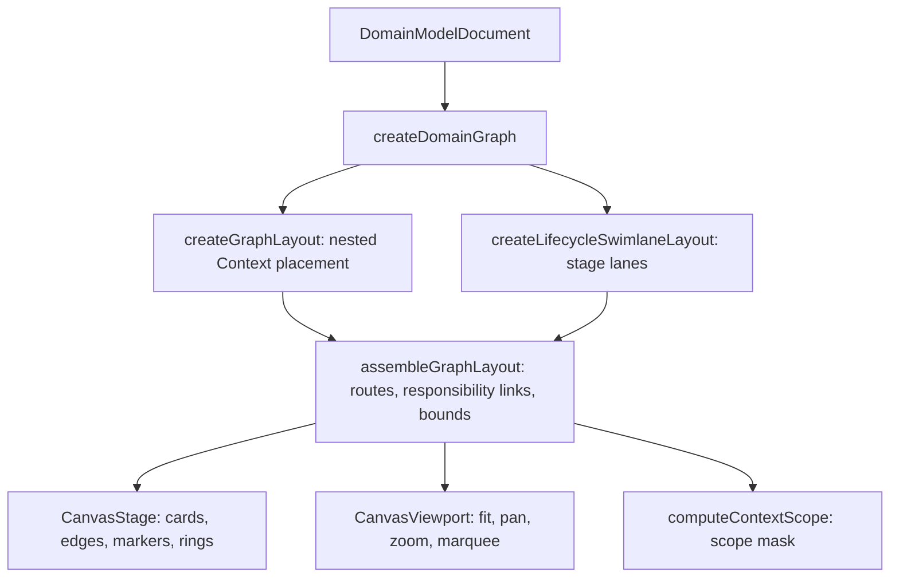

# Canvas layout, inspector and diagnostics

The editor is split into two halves that never share state directly:

- `libs/evidence-canvas-interaction` — framework-free maths: layout, viewport,
  ruler, selection, scope. It imports the schema and the model graph, never React.
- `apps/desktop/src/renderer` — React components that hold gestures, viewport
  state and the live `ModelSession`, and call the maths.

That division is why the layout can be tested without a DOM and why a canvas
gesture bug is not a modelling bug. The right-hand inspector is the mirror image
of the drawing: what the canvas places as a box, the inspector edits as fields
generated from `evidence-schema`.

Both layouts derive edges, responsibility links and bounds through the same
assembly step, which is why the lane board and the nested graph cannot disagree
about a route.

## Two layouts, one placement engine

`createGraphLayout(graph, options)` answers "what is inside this Context": it
buckets objects into Context cards, nests child Contexts, and puts a fulfillment
request in a row with its results
(`repo://libs/evidence-canvas-interaction/src/layout/graphLayout.ts#L238-L620`).

`createLifecycleSwimlaneLayout(graph, options)` answers the workshop's question,
"when does this happen": it runs `createGraphLayout` first, then re-places each
root Context subtree into one of four stage columns and adds a band for the
objects no Context owns
(`repo://libs/evidence-canvas-interaction/src/layout/lifecycleSwimlaneLayout.ts#L80-L280`).
It returns a `DomainGraphLayout` plus `swimlanes`, `headerHeight`, `laneGap` and
`sharedBand`, so every consumer that only knows the plain layout keeps working.

Who uses which matters when reading a bug report:

| Consumer | Layout |
| --- | --- |
| the desktop editor (`useEditorSession`) | `createLifecycleSwimlaneLayout(graph, { viewMode })` — always the lane board |
| the review/visualisation workbench projection | plain `createGraphLayout`, serialised through `toSerializableLayout` |
| most tests and fixtures | plain `createGraphLayout` |

The editor never draws the plain graph: `state.layout` is a
`LifecycleSwimlaneLayout`, and `CanvasStage` only renders the stage banner when
`'swimlanes' in layout`
(`repo://apps/desktop/src/renderer/state/useEditorSession.ts#L50-L70`,
`repo://apps/desktop/src/renderer/components/canvas/CanvasStage.tsx#L66-L106`).

### Layout is deterministic

Given the same document both functions produce the same boxes, in the same order,
with no randomness and no measured text. The constants define the grid
(`repo://libs/evidence-canvas-interaction/src/layout/graphLayout.ts#L31-L46`):

| Constant | Value | Role |
| --- | --- | --- |
| `NODE_WIDTH` | 220 | every object card |
| `NODE_BASE_HEIGHT` | 64 | one label line |
| `NODE_LABEL_LINE_HEIGHT` | 18 | extra label line |
| `NODE_ATTRIBUTE_ROW_HEIGHT` | 16 | one attribute row |
| `MAX_MEASURED_ATTRIBUTE_ROWS` | 3 | height cap |
| `LABEL_CHARS_PER_LINE` | 14 | wrapped label lines |
| `COLUMN_GAP` / `ROW_GAP` / `STACK_GAP` | 72 / 24 / 16 | spacing |
| `CONTEXT_PADDING` / `CONTEXT_TITLE_HEIGHT` / `CONTEXT_GAP` | 24 / 36 / 48 | context card chrome |
| `FULFILLMENT_PADDING` | 14 | room inside a fulfillment frame |
| `MIN_CONTEXT_WIDTH` | 260 | narrowest Context card |
| `FREE_BAND_COLUMNS` | 3 | objects per free row |

`measureNodeHeight` has two contracts. Without a `viewMode` it derives height from
the label's line count (capped at 2) and the attribute count (capped at 3). With a
`viewMode` — which the editor always passes — height is a fixed **156** in
`standard` and **82** in `simplified`, so every card in one board is the same
size. Routes, Context frames, hit testing and patch rings all use that same
rectangle, which is why switching reading level reflows the whole board instead of
leaving half the geometry behind
(`repo://libs/evidence-canvas-interaction/src/layout/graphLayout.ts#L48-L75`).

## The nested graph layout

### Contexts own objects; the layout draws the ownership

Context entities themselves are never nodes. Every other entity is bucketed by
`contextRef`; entities whose context is missing or unknown become **free nodes**.
Contexts are then nested by `parentContextRef`, and each subtree is laid out with
coordinates relative to its own card before being shifted into place
(`repo://libs/evidence-canvas-interaction/src/layout/graphLayout.ts#L238-L330`).

Inside a Context the layout has two bands:

1. **Fulfillment rows.** Each `fulfillment_request` becomes one row: request in
   column 0, its confirmations in column 1, its proofs in column 2, enclosed by
   one `FulfillmentLayoutGroup` with group id `fulfillment:<requestId>`. The frame
   is padded by `FULFILLMENT_PADDING` and is only as wide as the columns that
   actually hold something
   (`repo://libs/evidence-canvas-interaction/src/layout/graphLayout.ts#L355-L429`).
2. **Free band.** Remaining objects fill rows of up to three, with the row height
   taken from the tallest card.

Child contexts are laid out after the parent's band and shifted below it, so
`depth`/`parentContextId`/`childContextIds` describe a genuine containment tree.

Placement is once per object per Context. A confirmation may discharge more than
one request in the same Context; the second row reuses the first row's box and
reports the id in `sharedResultIds` instead of emitting a duplicate node. The
row's frame therefore covers only what it placed, while the pair link still runs
to the shared stamp
(`repo://libs/evidence-canvas-interaction/src/layout/graphLayout.ts#L340-L370`,
`repo://libs/evidence-canvas-interaction/src/layout/types.ts#L62-L80`).

### Empty context shells are dropped

An **empty context is not drawn at all**. A subtree is omitted when it has no own
entities, no drawn child contexts and no placed nodes; the id is recorded in
`omittedContextIds` and no `ContextLayoutGroup` is emitted. Because only surviving
children are counted, a Context whose only children are themselves empty shells is
dropped too. The status bar counts `omittedContextIds` so an invisible shell is
still reportable
(`repo://libs/evidence-canvas-interaction/src/layout/graphLayout.ts#L472-L484`,
`repo://apps/desktop/src/renderer/components/BottomStatusBar.tsx#L160-L175`).

### Fulfillment alignment

A Fulfillment pair is not two equal nodes. The request is a **window** — an
interval bar with two ends, because `started_at` and `expired_at` are both
mandatory — while each confirmation and proof is an **instant**, drawn as a stamp
with one end. `resolveFulfillmentAlignment` reports the request box, the
confirmation and proof boxes, the shared `centerY` and whether the row still reads
as aligned; `resolveFulfillmentBand` goes further and reports, per moment, its
signed `offset` from the request's centre line and `onRequestRow` (the centre line
crosses the moment's own box, which is the reading a workshop needs — "does this
confirmation answer that request on the same row"), plus `alignedMomentIds`
(`repo://libs/evidence-canvas-interaction/src/layout/fulfillmentAlignment.ts#L1-L150`).

Both return `null` when the request is not placed, so a caller can render "unknown
group" instead of an empty band at the origin, and `fulfillmentBoundaryPath` builds
a closed rounded outline that degrades to a square path for degenerate boxes
(`repo://libs/evidence-canvas-interaction/src/layout/fulfillmentAlignment.ts#L157-L177`).

The desktop stage draws the boundary itself as a dashed
`strokeDasharray="6 4"` rect and adds `FulfillmentPairLinks` — dashed
request-to-result polylines from the request's right edge to each result's left
edge. They are a statement that one document discharges the other, not a modelled
relationship, so they never replace a `references` route
(`repo://apps/desktop/src/renderer/components/canvas/CanvasStage.tsx#L160-L180`,
`repo://apps/desktop/src/renderer/components/canvas/CanvasStage.tsx#L383-L450`).

## The lifecycle swimlanes

The board is read left to right as four business moments, and the stage
definitions live in the schema so the canvas, the sidebar and the sensors cannot
invent different orderings: `rfp` (邀请投标, Request for Proposal), `proposal`
(投标), `contract` (合同签约) and `fulfillment` (履约履行), each with a label, a
caption and an English label (`repo://libs/evidence-schema/src/ast/lifecycle.ts#L13-L60`).

### Stage comes from the evidence, not from a field

`lifecycleStageOfContext(context, members)` derives the stage:

- a `contract` Context is always the hinge (`contract`);
- a `domain` Context is where delivery is computed, so it reads as `fulfillment`;
- a `pre_contract` Context takes the **furthest** stage among its own evidence, so
  a pure enquiry sits in `rfp` and one that already holds a quote moves to
  `proposal`;
- a Context with no stage-bearing evidence falls back to `rfp`.

`other_evidence` deliberately has no stage: a receipt or delivery note may
accompany any stage, so it inherits its Context's lane
(`repo://libs/evidence-schema/src/ast/lifecycle.ts#L96-L163`).

### A subtree travels with its root

Only root Contexts are assigned lanes, and only the root's **own** objects decide
its stage. A pre-contract Context that nests a contract Context therefore carries
the child along into the parent's lane instead of splitting one subtree across two
columns — the lanes read stages, they do not cut Contexts in half. A malformed
`parentContextRef` cycle is walked with a visited set so the board cannot hang
(`repo://libs/evidence-canvas-interaction/src/layout/lifecycleSwimlaneLayout.ts#L96-L175`).

Lane geometry is fixed and cheap to reason about: `MIN_LANE_WIDTH` 320,
`LANE_GAP` 56, `LANE_HEADER_HEIGHT` 64, `LANE_PADDING` 20, `SHARED_BAND_GAP` 56
(`repo://libs/evidence-canvas-interaction/src/layout/lifecycleSwimlaneLayout.ts#L61-L65`).
An empty stage keeps a full-width column, so adding the first contract never
reflows the other three. Roots in one lane stack top to bottom without overlap, and
each root is translated with its nodes, fulfillment groups and child Context cards
by `translateLayoutObjects`.

Objects no Context owns — the parties that sign contracts in several stages —
are laid out as a **shared band** under the lanes rather than squeezed into one
stage. `createGraphLayout` already put them on a grid, so the band only moves the
grid's top-left origin; `sharedBand` is `null` when every object belongs to a
Context. Bounds become the union of the assembled content, the four lane boxes and
the shared band, which is what the viewport fits
(`repo://libs/evidence-canvas-interaction/src/layout/lifecycleSwimlaneLayout.ts#L250-L345`).

Edges are re-derived **after** the moves, by calling `assembleGraphLayout` a second
time. A `plays_role` route therefore climbs from the shared band back up into a
Context card instead of ending where the old placement used to be.

`LifecycleBanner` paints the tint, index number, label, English name and caption of
each lane, with pre-contract stages pale, the contract hinge the only saturated
band and fulfillment reading as paper; it also draws the shared band when one
exists (`repo://apps/desktop/src/renderer/components/canvas/LifecycleBanner.tsx#L1-L130`).

## Why a cross-context edge is dashed

A boundary crossing is not one thing. `CrossContextEdgeKind` names the reason, so a
reader can tell a fact another boundary already settled from a capability that can
be replaced from an object two agreements happen to share
(`repo://libs/evidence-canvas-interaction/src/layout/edgeClassification.ts#L1-L22`):

| Kind | Meaning |
| --- | --- |
| `moment_trace` | a settled moment in one Context is cited by another |
| `role_inversion` | a capability role is filled from outside the Context that depends on it |
| `shared_thing` | two Contexts meet through an object they both trade in |
| `standard_cross` | any other permitted boundary crossing |

`classifyCrossContextEdge` resolves them in this order, and returns `null` when the
two ends sit in the same Context:

1. not `crossContext` → `null`;
2. `plays_role` → `role_inversion` (a role is the socket a foreign player
   implements, whatever the role kind);
3. either endpoint is a `thing` participant → `shared_thing`;
4. both endpoints are moment evidence (`fulfillment_confirmation`,
   `other_evidence`, `contract`) → `moment_trace`;
5. the target is an `evidence` role → `role_inversion`;
6. otherwise → `standard_cross`
   (`repo://libs/evidence-canvas-interaction/src/layout/edgeClassification.ts#L42-L72`).

"Cross-context" is strict: both endpoints must have a known Context, and the two
must differ. A free participant has `contextId === null`, so a route from it into a
Context is *not* a boundary crossing and carries `crossContextKind: null` — which is
why the fixture's `plays_role` edge has an arrow and a dash but no reason kind.

### What the renderer does with the kind

`assembleGraphLayout` puts the kind, `crossContext`, `dashed` and `arrow` on every
`LayoutEdge`, skipping any relationship whose endpoint is not laid out. The booleans
stay independent of the kind: dashed when cross-context **or** `plays_role`, arrowed
only for `plays_role`. Responsibility lines are not relationships at all: `roleRefs`
produce `contract_party` links and `responsibleRoleRef` produces a `responsibility`
link, only for objects that were actually placed
(`repo://libs/evidence-canvas-interaction/src/layout/graphLayout.ts#L136-L211`).

`CanvasStage` then reads `CROSS_CONTEXT_EDGE_STYLES`, so each reason keeps its own
stroke, dash pattern and width — blue solid for a moment trace, gold dashed for a
capability slot, green dotted for a shared thing, grey dashed for anything else —
and a `role_inversion` crossing also gets a small white "socket" circle at the route
midpoint. An unclassified edge falls back to `EDGE_STYLES`
(`repo://apps/desktop/src/renderer/components/canvas/colors.ts#L37-L80`,
`repo://apps/desktop/src/renderer/components/canvas/CanvasStage.tsx#L200-L300`).

Reading level changes what is drawn, not what is true:

- `simplified` hides `plays_role` routes until the modeler points at either end
  (`opacity 0`, no pointer events), because a workshop board states who signed in
  the card corner; a `role_inversion` crossing stays visible because that
  replacement is architecture;
- `standard` draws every route, plus cardinality chips (`1..1`, `0..N`) at the
  quarter points of the polyline, the relationship label on hover, ids, attribute
  rows and the rule count on the cards.

### Node cards and the legend

A card is a sticky note rather than a UML box: a tinted sheet, a coloured spine
naming the category, and a shape that says window or instant without reading the
label. `CATEGORY_TOKENS` fixes stroke, fill and corner radius per category —
evidence square, participants and roles rounded — and `entityShape` maps RFP,
proposal and fulfillment request to `interval`, contract and fulfillment
confirmation to `moment`, `other_evidence` to a plain card
(`repo://apps/desktop/src/renderer/components/canvas/colors.ts#L1-L36`,
`repo://apps/desktop/src/renderer/components/canvas/NodeCard.tsx#L120-L263`).

Two corner badges carry facts that would otherwise become lines: `◉` names the
party that signs (derived from `plays_role` relationships into the responsible role,
suppressed for contracts, which are bilateral) and `⚑` names the modelled
responsibility role. `summarizeCards` computes them, plus the first three
attributes, the remaining count, the key-data count and the rule labels, from the
document only
(`repo://apps/desktop/src/renderer/components/canvas/cardSummary.ts#L11-L149`).

`BusinessLegend` is viewport furniture, explicitly excluded from captures
(`data-evidence-capture-hide`) and collapsed behind a `图例说明` toggle whose state
is remembered in `localStorage` under `evidence.canvas.legend.expanded`. It
enumerates the category tokens, the badges, the time bar/stamp, the dashed rule,
the arrow rule and — because it renders `Object.entries(CROSS_CONTEXT_EDGE_STYLES)`
— every boundary-crossing reason the stage can draw, so the legend cannot drift from
the renderer. It also respects the reading level: cardinality is only explained in
`standard`, and `simplified` says that role-playing lines appear on hover. A narrow
canvas (`width < 800`) moves it above the composer
(`repo://apps/desktop/src/renderer/components/canvas/BusinessLegend.tsx#L1-L140`,
`repo://apps/desktop/src/renderer/components/canvas/CanvasViewport.tsx#L464-L477`).

## Scope filtering and the viewport

`computeContextScope(layout, contextId)` is **a mask over the canonical
placement, never a second layout**. It collects the selected Context's subtree, its
core objects, then explicit one-hop neighbours reached through edges and
responsibility links, plus the owners/ancestors of anything included — but an
ancestor is added only as a **frame**, so its other objects do not become
neighbours. `bounds` is the selected card plus neighbour frames plus the boxes of
neighbour objects, which keeps unrelated ancestor space out of the fit. `null` is
returned for a cleared, missing, unknown or omitted Context, and the hierarchy walk
is cycle-safe
(`repo://libs/evidence-canvas-interaction/src/selection/contextScope.ts#L14-L100`).

The interactions that make the mask usable:

- `ScopeFilterControl` lists Context groups with indentation matching `depth` and an
  "全部业务边界（全景）" option to clear the scope;
- out-of-scope Context shells, cards, edges, fulfillment frames and pair links drop
  to `0.15` opacity and lose pointer events, so a faded object cannot be hovered,
  clicked or diagnosed by accident;
- the viewport re-fits to `scope.bounds` (instead of `layout.bounds`) whenever the
  scope or the reading level changes, and clears hover, drag and marquee state;
- the editor clears the selection when it falls out of scope, and a focus request
  from search, sensors or MCP clears the scope rather than selecting something
  invisible;
- marquee selection is filtered to `scope.nodeIds`, so a drag cannot select a faded
  object (`repo://apps/desktop/src/renderer/screens/EditorScreen.tsx#L110-L150`,
  `repo://apps/desktop/src/renderer/components/canvas/CanvasViewport.tsx#L112-L170`,
  `repo://apps/desktop/src/renderer/components/canvas/CanvasViewport.tsx#L358-L372`).

### Viewport maths and the ruler

The transform is `world * zoom + pan`, always measured from the stage origin (the
ruler origin), never the window
(`repo://libs/evidence-canvas-interaction/src/viewport/transform.ts#L1-L30`).

`transform.ts` provides `screenToWorld`, `worldToScreen`, screen-delta scaling,
panning, rectangle conversion, visibility testing and `revealWorldRect` for
centring a selection. Zoom is clamped to `0.25–4` and has twelve discrete stops,
with a 1.25 fallback for values produced by a trackpad pinch. `zoomAtPoint` keeps
the world point under the pointer on the same pixel, which is what makes wheel zoom
feel anchored (`repo://libs/evidence-canvas-interaction/src/viewport/zoom.ts#L1-L69`).

`calculateZoomToFit` centres content with 64 px padding and falls back to
`DEFAULT_VIEWPORT` for empty or degenerate content, so a cold start never produces
`Infinity`/`NaN` (`repo://libs/evidence-canvas-interaction/src/viewport/fit.ts#L12-L49`).

The ruler uses a 1-2-5 ladder (`1, 2, 5, 10, …`). `pickRulerStep` chooses the
smallest step whose on-screen width clears `minMajorStepPx` (80 by default),
extending the ladder by whole multiples when a caller asks for an unusually large
minimum; minor ticks divide a major step by five. Ticks are aligned to the world
grid, so panning moves them without changing their labels
(`repo://libs/evidence-canvas-interaction/src/ruler/math.ts#L1-L84`).

### Selection and highlighting

Hover/focus highlighting is strictly **one hop**, documented at the function:

- a node highlights itself, its formal neighbours, the edges touching it, its
  context and that context's ancestors, plus any responsibility badge pointing at
  it or from it;
- an edge highlights the line and both endpoints' context chains;
- a context highlights its subtree, every object it owns and only the edges with
  both endpoints inside.

Anything unknown returns the empty, undimmed result rather than throwing
(`repo://libs/evidence-canvas-interaction/src/selection/hoverHighlight.ts#L50-L196`).
`isNodeDimmed`, `isEdgeDimmed` and `isContextDimmed` compute the mask from the
same result, so every surface agrees about what is faded. The viewport layers a
selected node's own highlight under the hover highlight, so clicking a card keeps
its neighbourhood readable after the pointer leaves.

Marquee selection intersects boxes, skips a marquee below `minimumSize`, orders
intersecting contexts outermost first, and hit-tests objects before context
backgrounds (`repo://libs/evidence-canvas-interaction/src/selection/boxSelection.ts#L12-L77`).

## Diagnostics: an index from finding to object

Sensor findings arrive as a `SensorReport` (issues plus counts plus the key-data
summary) from the main process. `createDiagnosticIndex` turns them into a
`ReadonlyMap<string, DiagnosticStatus>` keyed by the id of the object the canvas
draws:

- the key is `issue.targetNodeId` truncated at `#`, so `entity#attribute` attaches
  to the entity, and only when that id exists among the document's entities or
  relationships;
- otherwise `issue.contextRef`, and only when it names a Context;
- anything else is dropped — **a message that happens to mention an id is not an
  attachment**;
- duplicates with the same `issueId` are ignored, and an id keeps the worst
  severity seen (`info < warn < block`).

`diagnosticColor` maps severity to red/orange/blue once, so markers, rings and
edge halos agree (`repo://apps/desktop/src/renderer/state/diagnosticIndex.ts#L1-L56`).

The index is fed from disk, not from the live session, and the editor refuses to
paint stale findings as current: while the model is dirty, an external change is
pending, sensors are loading or failing, or the report predates the last save, the
index is built from `null` and the drawer says so.

`DiagnosticMarkers` makes a finding locatable without creating a fake object:

- a node or Context finding gets a dotted ring just outside the box and a badge at
  the box's bottom-right corner;
- an edge finding gets the badge at the polyline midpoint, and `CanvasStage` also
  draws a soft severity-coloured halo under that route;
- the badge shows `i`/`!` plus the number of findings and lists every message as a
  tooltip; clicking it opens the drawer with that group selected;
- markers are siblings of the cards, not children, so they neither nest buttons nor
  disturb the selection ring or the patch rings;
- a marker outside the current scope is not rendered at all
  (`repo://apps/desktop/src/renderer/components/canvas/DiagnosticMarkers.tsx#L9-L82`,
  `repo://apps/desktop/src/renderer/components/canvas/CanvasStage.tsx#L270-L290`).

`focusIssue` in the editor is the jump: `entity#attribute` selects that attribute
row and pans to the node; a Context or relationship finding pans to its geometry
without selecting a made-up object; a jump from outside the scope clears the scope
first. `DiagnosticsDrawer` lists findings with the clicked group sorted to the top,
keeps a stale notice visible, and lists key-data items that still owe a decision
(`repo://apps/desktop/src/renderer/screens/EditorScreen.tsx#L200-L250`,
`repo://apps/desktop/src/renderer/components/sensors/DiagnosticsDrawer.tsx#L30-L130`).

## The pending-patch overlay is not saved state

A patch from the agent is already in the model and in the undo history when the
review appears, because the tool call needs an answer. The overlay exists to make
that change *attributable*: `usePatchReview` diffs before/after and builds
`{ marks: Map<id, 'added' | 'removed' | 'modified'> }`, which `CanvasStage` draws as
`ChangeRing`s outside the card box — dashed for added and removed, solid for
modified, `pointer-events-none`, with an accessible label such as
`本次补丁删除 <label>`
(`repo://apps/desktop/src/renderer/state/usePatchReview.ts#L40-L60`,
`repo://apps/desktop/src/renderer/components/canvas/CanvasStage.tsx#L461-L495`).

Three rules keep a pending patch from reading as an accepted edit:

1. **It rings, it never reflows.** No node is added, removed or moved by the
   overlay; the board stays the model the user is editing, and only objects the
   model already draws get a ring. Context marks travel in the same `marks` map but
   resolve to no card, so a changed Context shell itself stays unmarked.
2. **It is visually distinct from selection and diagnostics.** Selection is
   `ring-2` on the card itself; diagnostics are dotted rings plus badges; a patch
   ring is a separate solid or dashed outline offset three pixels outside the card.
3. **It stays unsettled until the modeler decides.** `PatchReviewBar` reports the
   counts and rationale, and offers 保留 / 撤销补丁; the overlay disappears on
   either. Reverting is offered only while the patched document is still the one on
   screen (`revertable`), because undoing under a later edit would discard work the
   reviewer never asked to lose.

The overlay is also not persistence: the patch reaches disk only through the normal
save path, so until then the editor is `dirty` and a reload from disk discards it
(`repo://apps/desktop/src/renderer/state/useEditorSession.ts#L130-L170`). The
agent-side flow is described in
[Ingestion and patch review](./ingestion-and-patch-review.md).

## The inspector is declarative

The right-hand panel is generated from `evidence-schema`, not hand-built per entity
kind. `INSPECTOR_GROUP_DEFINITIONS` declares five group ids with their headings —
`general` 基础信息, `responsibility` 责任锚定, `attributes` 业务属性与关键数据,
`fulfillment` 履约结构, `rules` 规则与计算 — so a section cannot exist without the
text that names it
(`repo://libs/evidence-schema/src/inspector/groups.ts#L1-L23`).

The registry's `GROUPS` table populates `general`, `responsibility` and `attributes`
for each of the four entity categories. Each property names a field, an editor kind,
optional select options, an optional reference constraint and a business helper
(`repo://libs/evidence-schema/src/inspector/registry.ts#L16-L60`):

| Editor kind | Used for |
| --- | --- |
| `readonly-id` | stable id, never editable |
| `text` | label, notes, description |
| `select` | category kinds, value types |
| `boolean` | flags such as `required` / `keyData` |
| `attribute-table` | the entity's attribute rows |
| `cel-editor` | rule expression |
| `key-data-provenance` | the provider decision for a key data item |
| `reference-picker` / `reference-list` | context, parent context, root and role references |

Only `getInspectorGroups(category)`, `getInspectorGroup(category, id)` and
`getReferenceConstraint(category, field)` are lookup APIs, so the renderer never
carries a field table of its own
(`repo://libs/evidence-schema/src/inspector/registry.ts#L307-L345`).

Two group ids are declared but not filled by `GROUPS`: a fulfillment request's
履约结构 section is rendered by `FulfillmentPairSection`, which reads
`graph.fulfillmentPair` and dispatches `PairFulfillmentCommand` /
`BindBreachRuleCommand`, and there is no desktop rules panel yet —
`INSPECTOR_RULE_FIELDS` is exported for one but no renderer consumes it.

### Reference constraints are the interesting part

`contextPicker` scopes `contextRef` by category (`['context']`). Responsibility
fields declare `{categories: ['role'], kinds: ['party'], sameContext: true}`, so the
picker cannot offer a role from another contract. The renderer applies the
constraint in `referenceOptions`: filter by category, filter by `kinds`, and when
`sameContext` is set compare `contextRef` with the edited entity's own — two
objects without a Context only match each other. A role's own 所属上下文 picker has
no `sameContext`, which is deliberate: a role may be re-bound to another Context
(`repo://libs/evidence-schema/src/inspector/registry.ts#L84-L160`,
`repo://apps/desktop/src/renderer/components/RightInspector.tsx#L20-L48`).

### Editing behaviour

`RightInspector` resolves the selected entity from the graph, shows
`选择画布上的业务对象查看属性。` when nothing is selected, and keys the body by
`entity.id` so a draft never leaks into another object
(`repo://apps/desktop/src/renderer/components/RightInspector.tsx#L70-L150`).

- Text fields keep a local draft and commit on blur or Enter; a select, checkbox or
  reference list commits immediately.
- Every commit is one command — `UpdateEntityCommand` for scalar fields — so a
  rename is a single undo step and the canvas re-lays out on the same event.
- A `reference-picker` writes `undefined` for the empty `未声明` option, so
  "cleared" and "never set" stay one state.
- `cel-editor` rows only point at the attribute table; the actual expression editor
  is `InlineCelEditor`, mounted by the attribute table.
- The attribute table itself is hand-built (`AttributeTableEditor`) with
  `AddAttributeCommand` / `UpdateAttributeCommand` / `RemoveAttributeCommand`, and
  places `KeyDataProvenancePicker` beside each key-data row from
  `buildKeyDataLedger`. `INSPECTOR_KEY_DATA_PROVENANCE_PROPERTY` documents that
  provider column as virtual: nothing is persisted, the ledger derives it from
  modelled facts
  (`repo://apps/desktop/src/renderer/components/inspector/AttributeTableEditor.tsx#L40-L110`,
  `repo://libs/evidence-schema/src/inspector/registry.ts#L282-L305`).

## Edge cases worth knowing

| Situation | Behaviour |
| --- | --- |
| empty context | not drawn; id goes to `omittedContextIds` |
| context whose only children are empty | also omitted |
| entity with a missing/unknown `contextRef` | free node; on the lane board it moves to the shared band |
| relationship with an unlaid endpoint | edge skipped silently |
| one confirmation paired with two requests | placed once; the second row lists it in `sharedResultIds` |
| `plays_role` from a Context-less participant | arrowed and dashed, but `crossContextKind` is `null` |
| `standard` vs `simplified` | card height 156 vs 82; routes and frames follow |
| empty model | bounds `0×0`, fit falls back to the default viewport |
| unknown highlight id, unknown scope id | empty undimmed highlight, `null` scope |
| finding with an unresolvable target | dropped from the index; still readable in the drawer |
| patch touching an unplaced object | no ring |

## Tests that protect this contract

- `graphLayout.spec.ts` asserts determinism, height measurement, mode-specific card
  rectangles and routes, every entity placed once, free participants outside cards,
  child nesting, one fulfillment group per request, a shared confirmation placed
  once, dashed/cross-context/arrow rules, `crossContextKind` reasons,
  explicit-only responsibility links, refusal to draw an empty context shell,
  bounds, and three routing shapes
  (`repo://libs/evidence-canvas-interaction/src/layout/graphLayout.spec.ts#L15-L330`).
- `lifecycleSwimlaneLayout.spec.ts` pins the four lanes in reading order, reserved
  empty columns, non-overlapping lanes, Contexts under their header, stacking within
  a lane, the furthest-stage rule, `other_evidence` inheriting its lane, a nested
  Context travelling with its root, request/confirmation side by side, the shared
  band (and its absence), bounds covering lanes and band, routes recomputed after the
  move, determinism and lane padding.
- `fulfillmentAlignment.spec.ts` pins request/result stack reporting, the
  interval-versus-moment reading, `onRequestRow`, the `null` cases and the boundary
  path (including the degenerate box).
- `contextScope.spec.ts` pins subtree plus one-hop neighbours, ancestor frames
  without their objects, responsibility-only neighbours, exclusion of unrelated
  edges, the null cases, unchanged layout, and cycle termination.
- `transform.spec.ts`, `zoom.spec.ts`, `fit.spec.ts` and `math.spec.ts` pin
  projection order, round trips, anchor-preserving zoom, clamping, discrete stops,
  the empty-content fallback, ladder selection, aligned ticks, pan stability and
  invalid ranges.
- `hoverHighlight.spec.ts` and `boxSelection.spec.ts` pin one-hop expansion, edge
  endpoints, context subtrees, graceful unknown ids, marquee intersection,
  outermost-first ordering and object-over-background hit testing.
- `CanvasStage.spec.tsx`, `LifecycleBanner.spec.tsx`, `NodeCard.spec.tsx` and
  `CanvasViewport.spec.tsx` pin one card per object and per context, muting of
  `plays_role` in the workshop reading, per-kind edge styling and the socket,
  cardinality visibility, pair links, the four stage columns and no banner for a
  plain layout, patch rings without reflow, and the interval/moment shapes.
- `diagnosticIndex.spec.tsx` pins deduplication, severity ranking, the refusal to
  invent references from messages, and locating edge/Context findings.
- `BusinessLegend.spec.tsx` pins that the legend explains only what the current
  reading draws, remembers expansion, survives unavailable storage and stays out of
  captures.
- `RightInspector.spec.tsx` and `registry.spec.ts` pin the generated groups,
  read-only ids, commit-and-undo for a label, the same-context role constraint,
  category-specific fields and the exported attribute/rule tables.

## Related pages

- [Commands, guards and the model session](../model/commands-and-session.md) — the
  transitions that trigger a re-layout.
- [The Fulfillment Modeling DSL (FM v5)](../language/fm-dsl.md) — the categories,
  stages and fields the inspector edits.
- [Sensor orchestration](../agents/sensor-orchestration.md) — where the report that
  feeds the diagnostic index comes from.
- [Ingestion and patch review](./ingestion-and-patch-review.md) — how a patch
  becomes a pending overlay.
<!-- openwiki: broken internal link [./branches-and-lineage.md] file "./branches-and-lineage.md" does not exist. Fix the href or restore the target, then delete this comment. -->
- [Interview branches and lineage](./branches-and-lineage.md) — marks and ghosts on
  the same stage.
- [Desktop app shell and IPC surface](./app-shell.md) — how the document reaches
  the window.
