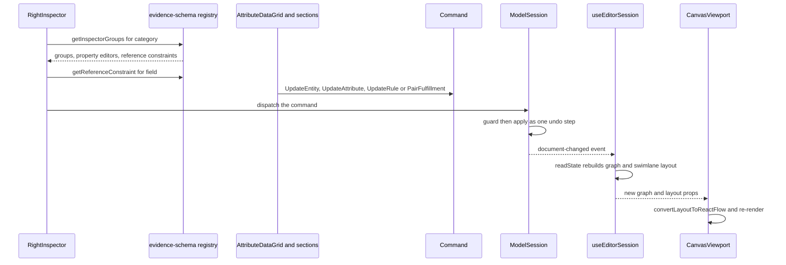

# Canvas and inspector

The editor draws the model with three layers that never share mutable state:

| Layer | Package | Owns |
| --- | --- | --- |
| Layout engine | `libs/evidence-canvas-interaction` | Every rectangle, route, bound, highlight and scope. Pure functions over `DomainModelDocument` / `DomainGraph`; imports no React and no engine. |
| Canvas | `libs/desktop/feature-canvas` | Mounting `@xyflow/react`, the node and edge components, the HUD contract, overlays and diagnostic markers. |
| Inspector | `libs/desktop/feature-inspector` | Schema-driven field rows, the attribute grid, the ledger sheet and the CEL editor. |
| Field registry | `libs/evidence-schema/src/inspector` | Which fields a category has, which widget edits them, which references a picker may offer. |

`apps/desktop/src/renderer` composes the three: `EditorScreen` owns the session, the focused scope and the focus/zoom tokens, and it imports neither `@xyflow/react` nor `@codemirror/*` — those two dependencies belong to `feature-canvas` and to `feature-inspector`/`ui-kit` respectively.

The division of labour on the stage is deliberate and documented at the top of both sides: **Evidence decides what the drawing is** (which Contexts exist, where a card sits, how a route turns) and **React Flow decides how the viewport moves under it** (pan, pinch, marquee, fit animation). World coordinates are identical in both, which is what makes the delegation cheap: a node's position is the box the layout placed, and an edge is the polyline the router returned.

## The layout engine returns geometry

`createGraphLayout(graph, options)` is a pure function of the document. The same model always produces the same boxes in the same order — no randomness, no text measurement, no DOM (`libs/evidence-canvas-interaction/src/layout/graphLayout.ts#L238-L246`, and the determinism test at `libs/evidence-canvas-interaction/src/layout/graphLayout.spec.ts#L16-L21`).

The grid is a set of named constants (`libs/evidence-canvas-interaction/src/layout/graphLayout.ts#L26-L43`):

| Constant | Value | Role |
| --- | --- | --- |
| `NODE_WIDTH` | 220 | every business-object card |
| `NODE_BASE_HEIGHT` | 64 | one label line |
| `NODE_LABEL_LINE_HEIGHT` | 18 | each extra label line |
| `NODE_ATTRIBUTE_ROW_HEIGHT` | 16 | each measured attribute row |
| `MAX_MEASURED_ATTRIBUTE_ROWS` | 3 | attribute rows that influence height |
| `LABEL_CHARS_PER_LINE` | 14 | label wrap width |
| `COLUMN_GAP` / `ROW_GAP` / `STACK_GAP` | 72 / 24 / 16 | column, row and stacked-result spacing |
| `CONTEXT_PADDING` / `CONTEXT_TITLE_HEIGHT` / `CONTEXT_GAP` | 24 / 36 / 48 | Context card chrome and stacking |
| `FULFILLMENT_PADDING` / `MIN_CONTEXT_WIDTH` / `FREE_BAND_COLUMNS` | 14 / 260 / 3 | fulfillment frame inset, minimum card width, free rows |

`measureNodeHeight` has two modes, and the mode matters more than the formula (`libs/evidence-canvas-interaction/src/layout/graphLayout.ts#L66-L85`):

- with a `viewMode`, the card is a fixed rectangle — **156** px in `standard`, **82** px in `simplified` — because routes, frames, hit testing and patch rings all have to agree with what the card actually draws;
- without a `viewMode`, height is derived from the label's line count (capped at 2) plus the attribute count (capped at 3).

Two objects with the same label length and attribute count are therefore always the same height, which is what stops a re-layout from jumping.

## Placement: Contexts own objects

Entities are bucketed by `contextRef`; an entity whose context is missing or unknown becomes a **free node** and is placed above every Context card (`libs/evidence-canvas-interaction/src/layout/graphLayout.ts#L252-L278`, `libs/evidence-canvas-interaction/src/layout/graphLayout.ts#L568-L596`). Contexts are then nested by `parentContextRef` (`libs/evidence-canvas-interaction/src/layout/graphLayout.ts#L280-L305`); each subtree is laid out relative to its own card and shifted into place afterwards.

Inside a Context, `layoutSubtree` has two bands (`libs/evidence-canvas-interaction/src/layout/graphLayout.ts#L306-L528`):

1. **Fulfillment rows.** Each `fulfillment_request` owns one row: the request in column 0, its confirmations stacked in column 1, its proofs stacked in column 2, all enclosed by one `FulfillmentLayoutGroup` frame so a request and the evidence that closes it read as one object (`libs/evidence-canvas-interaction/src/layout/graphLayout.ts#L355-L428`).
2. **Free band.** Remaining objects fill rows of up to `FREE_BAND_COLUMNS` (three), each row as tall as its tallest card.

A result shared by two requests in the same Context is placed **once**: the second row reuses the existing box and reports the id in `sharedResultIds` instead of stacking a second frame on the same stamp (`libs/evidence-canvas-interaction/src/layout/graphLayout.ts#L338-L395`, pinned by `libs/evidence-canvas-interaction/src/layout/graphLayout.spec.ts#L146-L228`).

Child Contexts are laid out after the parent's bands, shifted below them, and the parent card grows to contain them. An **empty Context is not drawn at all**: its id lands in `omittedContextIds` instead of producing an empty shell (`libs/evidence-canvas-interaction/src/layout/graphLayout.ts#L450-L495`).

The layout object is an indexed structure, not a list: `nodeById`, `edgeById`, `contextGroupById` and `fulfillmentGroupByRequest` are what hit testing, the adapter and the scope computation read. `toSerializableLayout` is the JSON-safe reduction of the same drawing — geometry and ids only, no entity records, no maps — so a generated page can carry the canvas placement of the model it describes (`libs/evidence-canvas-interaction/src/layout/serializable.ts#L20-L117`).

## The lifecycle board reuses the same subtrees

The editor's board is `createLifecycleSwimlaneLayout(graph, { viewMode })`, not the bare nested layout. It answers a different question — "when does this happen" instead of "what is inside this Context" — by putting four stage columns in reading order and reusing the nested result as the content of each column (`libs/evidence-canvas-interaction/src/layout/lifecycleSwimlaneLayout.ts#L78-L250`).

- A **root** Context's lane comes from `lifecycleStageOfContext`, decided from the root's own objects only; a nested contract Context travels with its parent rather than splitting a subtree across lanes.
- A stage with nothing in it still keeps a column at least `MIN_LANE_WIDTH` (320) wide, so the board never reflows when a stage empties. Lane gaps are 56, headers 64, inner padding 20.
- A `parentContextRef` cycle cannot hang the board: the root walk stops on the first repeated id.
- Objects no Context owns are moved into a **shared band** under the lanes as one rigid grid, because a party that signs a contract and also pays an invoice cannot sit in a single stage (`libs/evidence-canvas-interaction/src/layout/lifecycleSwimlaneLayout.ts#L282-L346`).
- Bounds are the union of the lanes, the shared band and the assembled layout.

Because the lanes move boxes after placement, the board re-runs `assembleGraphLayout` so every route and responsibility link is computed from the final coordinates. That derived half — edges, links, lookups, bounds — is factored out precisely so a second placement pass does not re-derive routing with a copy of the logic (`libs/evidence-canvas-interaction/src/layout/graphLayout.ts#L100-L232`).

<!-- openwiki: mermaid parse failed and this diagram was converted to a text fence so it does not break rendering. Fix the diagram source and restore the mermaid fence. Parser error: Parse error on line 2: ...ModelDocument"] -> graph["DomainGraph"] Expecting 'AMP', 'COLON', 'PIPE', 'TESTSTR', 'DOWN', 'DEFAULT', 'NUM', 'COMMA', 'NODE_STRING', 'BRKT', 'MINUS', 'MULT', 'UNICODE_TEXT', got 'GRAPH' -->
```text
flowchart TD
    doc["DomainModelDocument"] --> graph["DomainGraph"]
    graph --> nested["createGraphLayout"]
    nested --> bucket["bucket objects by contextRef, free when unresolved"]
    bucket --> rows["fulfillment rows: request, confirmations, proofs"]
    rows --> band["free band: rows of three"]
    band --> children["child Contexts shifted below the bands"]
    children --> assembled["assembleGraphLayout: routes, responsibility links, bounds"]
    assembled --> lanes["createLifecycleSwimlaneLayout: root subtrees into stage lanes"]
    lanes --> shared["shared band for Context-less objects"]
    shared --> adapt["convertLayoutToReactFlow: parentId, handles, edge data"]
    adapt --> stage["React Flow stage"]
```

The pipeline from document to stage: the nested layout places, the lifecycle board moves whole subtrees, and the adapter restates the result in React Flow's vocabulary.

## Edges, routes and boundary reasons

Formal relationships become orthogonal three-segment routes. `routeEdge` reads the relative position of the two boxes and exits right, left, bottom or top, splitting the turn at the halfway point so parallel edges inside one Context never overlap their labels; aligned boxes get a straight two-point line (`libs/evidence-canvas-interaction/src/layout/graphLayout.ts#L662-L711`).

Each `LayoutEdge` carries its rendering semantics (`libs/evidence-canvas-interaction/src/layout/graphLayout.ts#L122-L181`):

- `dashed` when the endpoints sit in different Contexts **or** the kind is `plays_role`;
- `arrow` only for `plays_role`;
- `crossContext` plus a `crossContextKind` naming *why* the boundary is crossed;
- no edge at all when an endpoint was not placed — a relationship is never drawn to a missing box.

The boundary reasons come from `classifyCrossContextEdge` (`libs/evidence-canvas-interaction/src/layout/edgeClassification.ts#L28-L72`):

| `crossContextKind` | Condition | Reading |
| --- | --- | --- |
| `moment_trace` | both ends are evidence of a moment kind (`fulfillment_confirmation`, `other_evidence`, `contract`) | one boundary cites a fact another already settled |
| `role_inversion` | the relationship is `plays_role`, or the target is an evidence role | a capability slot is filled from outside |
| `shared_thing` | either end is a participant `thing` | two boundaries meet around one object |
| `standard_cross` | any other crossing | a plain boundary reference |
| `null` | both ends in one Context | an ordinary reference inside one agreement |

Responsibility lines are separate from relationships and come only from explicit fields: for `evidence` entities, each `roleRefs` entry yields a `contract_party` link and `responsibleRoleRef` yields a `responsibility` link — and only when the role itself is placed (`libs/evidence-canvas-interaction/src/layout/graphLayout.ts#L184-L213`). A mention in prose never becomes a line.

## Selection, scope and highlighting

`computeHighlight` is strictly **one hop**, and the exact expansion is documented at the function (`libs/evidence-canvas-interaction/src/selection/hoverHighlight.ts#L56-L196`):

- a node highlights itself, its formal neighbours, the edges touching it, its Context and that Context's ancestors, plus responsibility badges pointing at it or from it;
- an edge highlights the line and both endpoints' Context chains;
- a Context highlights its subtree, every object it owns, and only the edges with both endpoints inside;
- an unknown id returns the empty, undimmed result rather than throwing.

The canvas feeds it hover ids first, then falls back to the selected object's id when nothing is hovered, which is why a selection stays readable after the pointer leaves the board.

`computeContextScope(layout, contextId)` is the "focus one Context" mask, and it is a **mask over the canonical placement, never a second filtered layout** (`libs/evidence-canvas-interaction/src/selection/contextScope.ts#L17-L100`). It records the selected Context and every nested Context in `subtreeContextIds`, the owned objects plus explicit one-hop neighbours (including free participants) in `nodeIds`, the frames needed to read them in `contextIds`, the touching relationships in `edgeIds`, and a `bounds` that is the selected frame plus neighbour boxes — deliberately not the unrelated ancestor space. Owners and ancestors are added as frames only, so a neighbour of one object does not drag that whole Context's contents into scope. `EditorScreen` recomputes the scope from the layout on every change and clears the selection when the selected object falls out of it.

The library also still exports `selectNodesInBox` / `selectContextsInBox` / `hitTestLayout` and `resolveFulfillmentBand`. The desktop stage does not call them: marquee comes from React Flow's `selectionOnDrag` with `SelectionMode.Partial`, and only the first selected `entityNode` is reported through `onSelect`. They remain the extension point for a headless or exported renderer.

## Viewport maths the engine kept

The stage no longer translates gestures by hand, but the pure maths behind a canvas is still in the interaction library, fully specified and tested — it is the contract for any renderer that does not use React Flow:

- `transform.ts` defines the viewport as `{zoom, panX, panY}` with the projection `world * zoom + pan`, measured from the stage origin rather than the window, plus `screenToWorld` / `worldToScreen`, screen-delta scaling, panning, rectangle conversion, visibility testing and `revealWorldRect` for centring a selection (`libs/evidence-canvas-interaction/src/viewport/transform.ts#L1-L123`).
- `zoom.ts` clamps to `MIN_ZOOM` 0.25 … `MAX_ZOOM` 4 over twelve discrete stops, picks the next stop for a keyboard step, and implements `zoomAtPoint`, which keeps the world point under the anchor on the same pixel — the reason a wheel zoom feels anchored (`libs/evidence-canvas-interaction/src/viewport/zoom.ts#L5-L69`).
- `fit.ts` centres content with `DEFAULT_FIT_PADDING` (64 px) and returns `DEFAULT_VIEWPORT` for empty or degenerate content, so a cold start never produces `Infinity` or `NaN` (`libs/evidence-canvas-interaction/src/viewport/fit.ts#L12-L60`).
- `ruler/math.ts` builds a 1-2-5 ladder, chooses the smallest step whose on-screen width clears `DEFAULT_MIN_MAJOR_STEP_PX` (80), and aligns ticks to the world grid so panning moves them without changing their labels (`libs/evidence-canvas-interaction/src/ruler/math.ts#L1-L84`).

Only `MIN_ZOOM` / `MAX_ZOOM` (as React Flow's bounds) and `computeHighlight` (as the hover mask) cross into the React stage today. Everything else here is library surface with no desktop caller — the point of keeping it is that a headless exporter or a second renderer needs no second opinion about projection.

## The stage delegates to React Flow

`CanvasViewport` wraps a `CanvasSurface` in `ReactFlowProvider` and takes one props object: `graph`, `layout` (either `DomainGraphLayout` or `LifecycleSwimlaneLayout`), `document`, `viewMode` (`simplified` | `standard`), `selection`, an optional `focusRequest`, an optional `zoomCommand`, an optional `hud` render prop, an optional `overlay`, an optional `diagnostics` index, an optional `scope`, and the `onSelect` / `onClearSelection` callbacks.

Two type maps define the whole vocabulary (`libs/desktop/feature-canvas/src/CanvasViewport.tsx#L127-L140`):

- nodes — `entityNode` → `EntityNode` → `NodeCard`; `contextGroup` → `ContextGroupNode`;
- edges — `fulfillmentEdge` → `FulfillmentEdge`; `pairLink` → `PairLinkEdge`.

The engine is configured so the stage can only ever be *read* (`libs/desktop/feature-canvas/src/CanvasViewport.tsx#L390-L445`): `nodesDraggable`, `nodesConnectable` and `selectNodesOnDrag` are off, marquee selection is on, panning is bound to the middle/right buttons and to scroll, wheel zoom is off while pinch zoom stays on, and `minZoom` / `maxZoom` come from the interaction library's `MIN_ZOOM` (0.25) and `MAX_ZOOM` (4). A pane click clears the selection; a context node only reports hover.

Everything the layout draws in world space but does not want a DOM node for is mounted inside a `ViewportPortal`:

- at z-index 0, the fulfillment frames (dashed SVG rectangles, drawn in layout coordinates and faded to 0.15 when their request is outside the scope), the invisible `[data-region="canvas-stage"]` measuring box the MCP capture uses, and the `LifecycleBanner` when the layout is a swimlane board;
- at z-index 3, the diagnostic markers and the patch `ChangeRing`s, which are above the notes they annotate and still receive pointer events.

Contexts carry `zIndex: 0` and cards `zIndex: 2`, so a Context is paper under its notes and can never paint over one.

Framing is driven by tokens, not by effects that fire on every render:

- `fitToContent` calls `fitBounds(boundsOf(layout, scope), { padding: 0.08 })` and skips the animation when `prefers-reduced-motion` is set;
- a change of `scope.contextId` or `viewMode` refits and clears every hover mark, because the object under the pointer may no longer be on screen (`libs/desktop/feature-canvas/src/CanvasViewport.tsx#L268-L287`);
- `zoomCommand` is `in` / `out` / `fit` / `reset` / `selection`, deduplicated by a monotonic `token` so a re-render or a new layout cannot replay a key press (`libs/desktop/feature-canvas/src/CanvasViewport.tsx#L288-L329`);
- `focusRequest` centres a node or Context box, or the midpoint of an edge route, and pre-sets the hover mark for an edge or Context so the target is outlined as well as centred (`libs/desktop/feature-canvas/src/CanvasViewport.tsx#L330-L377`).

The floating controls are the app's, not the canvas's. The `hud` render prop hands out only the viewport maths the canvas owns — current `zoom`, `zoomIn`, `zoomOut`, `resetZoom` (1:1), `fitToContent`, `grid` and `onGridChange`, `minimapOpen` and `onToggleMinimap` — and `CanvasFloatingHud` adds the workspace's own concerns on top: view mode, card density, split target and a pointer that clears the selection (`apps/desktop/src/renderer/components/canvas/CanvasFloatingHud.tsx#L74-L120`). Creating objects is deliberately *not* a HUD button: a request or a contract is only valid once its Context and role bindings exist, so placement stays with the inspector and the agent, which can honour those red lines.

Surrounding furniture uses the same contract: `ScopeFilterControl` (a Context tree select, indented by `depth`), `BusinessLegend` (expanded state persisted in `localStorage`), and the radar pill. Each carries `data-canvas-control` plus `data-evidence-capture-hide` so captures and exports never include them. The minimap is collapsed until asked for and colours thumbnails with `entityColor`, because a reader zoomed into one Context still needs to know where that Context sits.

The background is one of three papers — `dots` (18 px), `lines` (96 px) or `none` — and the choice round-trips through the HUD rather than being stored in the canvas.

## Node and edge vocabulary

`NodeCard` is a sticky note on a workshop board, not a UML box: a tinted sheet, a coloured spine naming the category, and a shape that says how the object relates to the clock (`libs/desktop/feature-canvas/src/colors.ts#L150-L160`). `entityShape` returns `interval` for `rfp`, `proposal` and `fulfillment_request` (both `started_at` and `expired_at` are mandatory, so the card draws a bar with two end stops), `moment` for `contract` and `fulfillment_confirmation` (one timestamp, so it draws a stamp), and `card` for everything else. Corner radius follows the category: square for evidence, rounded for roles and participants.

A card also carries, when the model supports it:

- a **party badge** (`◉ label`, `+n` when more than one) from `summarizeCards`, with the participant ids in the tooltip;
- a **responsibility badge** (`⚑ label`) naming the responsible role;
- an **API chip** from `LiveApiContext`: the primary route (`POST` preferred, else the first), `API 待刷新` while the delivery analysis is stale, `No API Exposure` when nothing covers the object, `+n` for extra routes. The provider is inert until `LiveApiProvider` is mounted, so the chip never appears in a plain canvas test;
- in `standard` density only: the stable id, a business-time line (`开始 → 截止`), the attribute summary with `+n` for hidden rows, and the key-data / rule counts;
- `aria-label` of `label（kind）`, `role="button"`, and keyboard activation. An object outside the scope gets `tabIndex={-1}`, `aria-disabled`, opacity 0.15 and no pointer events, so a scoped stage cannot be clicked into an invisible object.

`ContextGroupNode` is the paper: a dashed frame tinted by `contract` / `domain` / `support`, a title at the top-left, `pointerEvents: none` (a click on empty paper belongs to the pane, which is what clears the selection), and a highlighted border when it is part of the current hop.

`FulfillmentEdge` draws the polyline the router produced, not a spline between two anchors. Its handles exist only so the engine considers the edge attachable; the geometry ignores them. The component layers:

- an optional **diagnostic halo** (a 6 px line at 0.35 opacity in the severity colour) when the indexed report blames that relationship;
- the routed line, styled by `CROSS_CONTEXT_EDGE_STYLES` for a named crossing and by `EDGE_STYLES` otherwise, and highlighted when it is part of the current hop;
- an **end arrow** only for `plays_role`, and a socket circle at the midpoint for `role_inversion`;
- **cardinality chips** at 0.25 and 0.75 of the route, formatted `min..max` with `N` for "many";
- a label above the midpoint, but only while the edge is hovered;
- opacity 0.15 outside the scope and 0 inside the muted state: `simplified` density hides `plays_role` routes until one is hovered or highlighted, so the compact board does not read as a web of role assignments.

`PairLinkEdge` states a delivery claim rather than a modeled relationship: thin, dashed, unarrowed, with no cardinality, routed from the request's right edge to the result's left edge and stepped at the midpoint so it cannot be confused with a `references` route. Pair links are not in `layout.edges` at all — the adapter synthesises one per confirmation and proof from each `FulfillmentLayoutGroup`, with ids of the form `pair:<groupId>:<resultId>` (`libs/desktop/feature-canvas/src/useReactFlowAdapter.ts#L266-L330`).

<!-- openwiki: broken internal link [branches-and-lineage.md] file "branches-and-lineage.md" does not exist. Fix the href or restore the target, then delete this comment. -->
`ChangeRing` marks an object a pending agent patch adds, removes or modifies. It recolours nothing and only rings the object the model already draws, so the picture stays the model the user is editing rather than an unaccepted proposal; it mounts in flow coordinates inside the viewport portal (`libs/desktop/feature-canvas/src/canvasOverlay.tsx#L10-L56`). The review flow around it lives in [Interview branches and lineage](branches-and-lineage.md) and [Ingestion and agent patch review](ingestion-and-patch-review.md).

## Diagnostics are indexed onto objects, not parsed by the canvas

`createDiagnosticIndex(report, document)` turns a sensor report into a map from object id to severity plus issues (`libs/desktop/feature-canvas/src/diagnosticIndex.ts#L18-L56`). Its rules are the interesting part:

- the attachment must be **explicit**: `targetNodeId` is trimmed at `#` (so `entity#attribute` blames the entity) and must name a known entity or relationship; otherwise a `contextRef` that names a real Context is used; a message that merely mentions an id attaches to nothing;
- duplicate `issueId`s are collapsed;
- a bucket keeps the **highest** severity seen (`info` < `warn` < `block`) while retaining every issue, so opening a marker shows all of them.

`DiagnosticMarkers` then places each bucket: a dotted outline around the node or Context box plus a count badge at its bottom-right, or a badge at the midpoint of an edge route. Out-of-scope ids are skipped, `title` lists the messages, and clicking a badge calls `onOpenIssues(status.issues)` — the canvas never navigates by itself, the app decides where a finding goes. Sibling controls avoid nested buttons and leave selection and patch rings intact (`libs/desktop/feature-canvas/src/DiagnosticMarkers.tsx#L7-L79`).

The index is built by the app from the current report and dropped while that report is stale, so a badge can never describe a revision that is no longer on screen; the sensor side is described in [Sensor orchestration](../agents/sensor-orchestration.md).

## The inspector is declarative

The right-hand panel is generated from `evidence-schema`, not hand-built per entity kind. Five group ids with Chinese labels are declared in one place (`libs/evidence-schema/src/inspector/groups.ts#L9-L23`):

| Group id | Label | Meaning |
| --- | --- | --- |
| `general` | 基础信息 | id, label, kind, owning Context |
| `responsibility` | 责任锚定 | Context, responsible role, contract parties, root refs |
| `attributes` | 业务属性与关键数据 | the attribute table and notes |
| `fulfillment` | 履约结构 | pairing and breach conditions, edited by the specialised section |
| `rules` | 规则与计算 | rule bindings and expressions, edited by the attribute grid and ledger |

The palette is wider than any single category uses: the per-category sets in the registry today are built from `general`, `responsibility` and `attributes`, so a participant or a role never grows a responsibility section it cannot honour. `fulfillment` and `rules` are reserved ids whose editing lives in the specialised panels, and `getInspectorGroup` returns `undefined` for a group a category does not have (`libs/evidence-schema/src/inspector/registry.spec.ts#L28-L33`).

Each `InspectorPropertyDefinition` names a `field`, a `label`, an `editor` kind, optional `options`, an optional `reference` constraint and a `helper` string that is business advice rather than a validation rule (`libs/evidence-schema/src/inspector/registry.ts#L14-L52`).

| Editor kind | Used for |
| --- | --- |
| `readonly-id` | the stable id, never editable |
| `text` | label, notes, business meaning |
| `select` | closed vocabularies (kind, category, value type) |
| `boolean` | flags such as `required` / `keyData` |
| `attribute-table` | the entity's attribute grid |
| `cel-editor` | a rule expression |
| `key-data-provenance` | the provider decision for a key data item |
| `reference-picker` / `reference-list` | Context, role, root and binding references |

Reference constraints are where the registry enforces architecture instead of the renderer: `contextPicker` scopes a picker to `context` objects (optionally narrowed by kind), while the evidence responsibility fields declare `{categories: ['role'], kinds: ['party'], sameContext: true}`, so a picker cannot offer a role from another contract. `RightInspector` resolves candidates with the same rule — category, optional kinds, and `sameContext` comparing `contextRef` — and always offers an empty `未声明` choice for a single picker (`libs/desktop/feature-inspector/src/RightInspector.tsx#L29-L54`).

`getInspectorGroups(category)`, `getInspectorGroup(category, groupId)` and `getReferenceConstraint(category, field)` are the only lookup APIs, which keeps the renderer free of field tables (`libs/evidence-schema/src/inspector/registry.ts#L328-L363`). The attribute, rule and key-data column sets are exported separately (`INSPECTOR_ATTRIBUTE_FIELDS`, `INSPECTOR_RULE_FIELDS`, `INSPECTOR_KEY_DATA_PROVENANCE_PROPERTY`) for the panels that edit them.

Every field edit ends in one place: `session.dispatch(new UpdateEntityCommand(entity.id, fields))`. Text inputs hold a local draft and commit on blur (or Enter) only when it differs from the modeled value, so a half-typed label never becomes a document revision; the attribute grid's inputs additionally restore the modeled value on Escape. The body is keyed by entity id, so switching objects remounts the rows instead of carrying a stale draft across.

Two registry editors deliberately do **not** edit in the rail: `cel-editor` renders the hint "在属性台账中编辑。" and `key-data-provenance` renders nothing, because both need the attribute row's binding context. The rail is the index; the ledger is the workbench.

## The inspector's specialised sections

Beyond the generated rows, four surfaces do work a generic property row cannot:

**Fulfillment pair** (`FulfillmentPairSection`) appears above the groups for a `fulfillment_request` and reads everything back from `graph.fulfillmentPair(entity.id)`: completion rules with their CEL editors, the confirmations that answer the request, and the breach conditions (`libs/desktop/feature-inspector/src/inspector/FulfillmentPairSection.tsx#L28-L110`). Pairing candidates are the `fulfillment_confirmation` objects in the same Context that are not already paired; pairing dispatches `PairFulfillmentCommand`, a new breach condition dispatches `BindBreachRuleCommand`. Guards are the authority on red lines, so a rejected command is caught and its message printed in the panel instead of thrown, and the panel never invents follow-up evidence that nobody modeled.

**The attribute grid** (`AttributeDataGrid`) is the entity's key-data ledger as an expandable table: name with an expand toggle, required marker, `ApiFieldBadge` and a `派生` chip; business name and value type; the `keyData` checkbox; a delete action that cascades. The expanded row carries `KeyDataProvenancePicker` and `DerivedRuleSection` side by side under the attribute they belong to, and the header summarises `buildKeyDataLedger(session.getDocument())` as "关键数据 n 项 · 待决 m 项" (`libs/desktop/feature-inspector/src/inspector/AttributeDataGrid.tsx#L56-L120`). All edits are commands — `AddAttributeCommand`, `UpdateAttributeCommand`, `RemoveAttributeCommand(..., { cascade: true })` — so each committed change is one undo step and every badge beside it is recomputed from the document rather than stored.

**`ApiFieldBadge`** answers "may a caller send this field": `fieldFor(attribute, graph, entityRef)` classifies it as `CEL Derived` (locked, the rule reference is in the tooltip), `Service Timestamp` (recorded by the server, not an input) or `Input` (modeled as an input, still subject to routes, roles and rules). Because it is derived, it cannot go stale (`libs/desktop/feature-inspector/src/inspector/ApiFieldBadge.tsx#L5-L41`). `KeyDataProvenancePicker` works the same way on the other axis: the provider verdict comes from the same classification the pinned checker uses, and the two buttons it offers are "bind a derivation rule" or "this is not key data at all" — never a free-text provider (`libs/desktop/feature-inspector/src/inspector/KeyDataProvenancePicker.tsx#L36-L116`). The modelling rules behind both are in [Key data and provenance](../language/key-data-and-provenance.md).

**The ledger sheet** (`KeyDataLedgerSheet`) is the wide version, opened from the grid's `⛶ 台账` button, the inspector footer, or `Alt+L` while an object is selected. It edits the same session — no state has to be reconciled on return — and its header states the field count and either the decision-owed count or "台账已闭合". `Escape` is captured on `window` with `stopPropagation` so closing the sheet does not also clear the selection the rail behind it shows. `CelFormulaBar` sits above the table and edits the expression of whichever row is active (`libs/desktop/feature-inspector/src/inspector/KeyDataLedgerSheet.tsx#L30-L160`).



A committed inspector edit travels the same path as a keyboard edit: one command into the session, one `document-changed` event out, and a fresh graph plus a fresh layout on the next render.

## The CEL editor, and where CodeMirror lives

Two code surfaces exist, and the split is a dependency rule rather than a preference:

- **`ui-kit`'s `CodeEditor`** is the shared code surface for read-only panes — the CEL rules list and the OpenAPI viewer — and it exports its own CEL tokenizer (`celLanguage`, `celStreamParser`) alongside it. The desktop renderer imports no `@codemirror/*` at all; it asks for `language="cel"` and gets highlighting. CodeMirror 6 is chosen over Monaco for weight: a split pane mounts and unmounts this editor on every tab flip.
- **`feature-inspector`'s `CelCodeMirrorEditor`** is the *editing* surface, and it does mount CodeMirror itself (autocomplete, lint, history, keymap) because it needs model-aware completion and commit semantics that only the inspector knows about (`libs/desktop/feature-inspector/src/inspector/cel/CelCodeMirrorEditor.tsx#L100-L260`).

Its pieces are worth knowing when changing rule editing:

- **Highlighting** comes from the inspector's own stream parser, which tracks `afterDot` to colour a member read as a property name; it is a tokenizer, not a grammar — `analyzeCelExpression` and the sensor engine remain the authority on whether an expression holds (`libs/desktop/feature-inspector/src/inspector/cel/celLanguage.ts#L70-L140`).
- **Completion** is model-derived, never a generic CEL vocabulary: `useCelCompletion` asks `collectCelCandidates` for the aliases and attributes a rule may read, and `computeCelCompletions` decides what to offer from the text before the caret (member prefix → attributes, `many` cardinality → `exists` / `all` / `filter` macros). The same function is used by tests and by the editor, so the two cannot drift (`libs/desktop/feature-inspector/src/inspector/cel/celCompletion.ts#L70-L141`).
- **Linting** runs `analyzeCelExpression` 200 ms after typing and renders errors in the gutter and under the field. It is a guard, not the verdict: it buys feedback while typing, the sensor engine still decides what may be saved.
- **Committing** happens on blur and on `Mod+Enter`, exactly once: the current document is compared with the last committed value before the callback, and an external change (undo, selection change, an agent patch) replaces the draft only when the prop actually differs.

Because the two tokenizers are separate files with separate vocabularies, a newly allowed CEL builtin has to be added in both `libs/desktop/ui-kit/src/components/code/celLanguage.ts` and `libs/desktop/feature-inspector/src/inspector/cel/celLanguage.ts`, or the read-only rules pane and the editor will colour the same expression differently.

## Edge cases worth knowing

| Situation | Behaviour |
| --- | --- |
| empty Context | not drawn; id recorded in `omittedContextIds` |
| object with a missing/unknown `contextRef` | free node: a grid above the Context cards, or the shared band under the lifecycle lanes |
| relationship with an unplaced endpoint | skipped by the layout and filtered again by the adapter |
| confirmation shared by two requests in one Context | placed once; later rows list it in `sharedResultIds` and their frame excludes it |
| `parentContextRef` cycle | the lane walk stops at the first repeat instead of hanging |
| `standard` vs `simplified` | fixed card height 156 vs 82; `simplified` mutes `plays_role` edges until hovered or highlighted |
| scope or density change | refit and clear every hover mark |
| repeated `zoomCommand` / `focusRequest` token | ignored, so a re-render cannot replay a key press |
| unknown highlight id | empty, undimmed result |
| diagnostic issue with an unknown target | dropped; never attached from message text |
| more than `MAX_MEASURED_ATTRIBUTE_ROWS` attributes | height capped at 3 rows of measurement |
| empty model | bounds `0×0`, `fitBounds` receives a `1×1` minimum box |

## Tests that protect this contract

- `graphLayout.spec.ts` pins determinism, height measurement, one placement per entity, free participants outside cards, child nesting, one fulfillment group per request, a shared confirmation placed once, dashed/cross-context/arrow rules, boundary reasons, responsibility links from explicit fields only, the omitted empty shell, bounds, and four routing shapes (`libs/evidence-canvas-interaction/src/layout/graphLayout.spec.ts#L16-L353`).
- `lifecycleSwimlaneLayout.spec.ts` pins four stages in reading order, reserved empty lanes, non-overlapping lanes and stacking, the furthest stage of a pre-contract Context, nested Contexts staying in the root lane, the shared band, bounds and post-move routing.
- `edgeClassification.spec.ts`, `fulfillmentAlignment.spec.ts`, `serializable.spec.ts`, `contextScope.spec.ts`, `hoverHighlight.spec.ts` and `boxSelection.spec.ts` pin the decisions each helper makes, plus the JSON round trip of a layout.
- `transform.spec.ts`, `zoom.spec.ts`, `fit.spec.ts` and `ruler/math.spec.ts` keep the pure viewport maths honest: projection order and round trips, anchor-preserving zoom, clamping and discrete stops, the empty-content fallback and the 1-2-5 ruler ladder.
- `CanvasViewport.spec.tsx` renders the real engine over a fixture: placed objects, Contexts and routed edges; dimming and hit-test rejection outside the scope; refit on scope change and back; furniture that does not clear the selection; reveal-by-token; the collapsed radar; the grid switch; zoom-to-selection; patch rings; finding markers; and a fit request that is not replayed on the next layout (`libs/desktop/feature-canvas/src/CanvasViewport.spec.tsx#L93-L348`).
- `useReactFlowAdapter.spec.ts` pins parent-before-child ordering, position folding to the Context origin, absolute free nodes, a card drawn at its own origin, edge binding and retained route, synthesised pair links, skipped ghost edges, z-index discipline, declared handles and scope dimming.
- `diagnosticIndex.spec.tsx`, `NodeCard.spec.tsx`, `LifecycleBanner.spec.tsx` and `BusinessLegend.spec.tsx` cover the projection, the card vocabulary and the furniture.
- `registry.spec.ts` pins the group and field tables the renderer consumes; `RightInspector.spec.tsx`, `AttributeDataGrid.spec.tsx`, `FulfillmentPairSection.spec.tsx`, `KeyDataLedgerSheet.spec.tsx`, `ApiFieldBadge.spec.tsx`, `CelCodeMirrorEditor.spec.tsx`, `celCompletion.spec.ts` and `celLanguage.spec.ts` cover the panel end to end, including undo after a rename, the one-undo-step derivation binding, the ledger sheet's three entry points and the commit-on-blur behaviour.

## Related pages

- [Commands, guards and the model session](../model/commands-and-session.md) — the transitions that trigger a re-layout.
- [The Fulfillment Modeling DSL (FM v5)](../language/fm-dsl.md) — the categories and fields the inspector edits.
- [Key data and provenance](../language/key-data-and-provenance.md) — the rules behind the key-data ledger and the API field badge.
- [Sensor orchestration](../agents/sensor-orchestration.md) — where the diagnostic report comes from.
- [Desktop app shell and IPC surface](app-shell.md) — how the document reaches the window.
- [Ingestion and agent patch review](ingestion-and-patch-review.md) — the patch rings drawn over the board.
