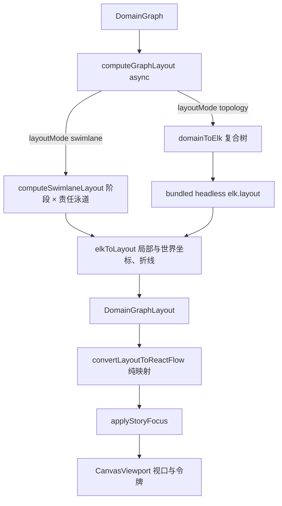

# 画布几何、布局与检查器编辑

职责分三层：`evidence-canvas-interaction` 负责无 DOM/React 的几何与布局（ELK 拓扑投影、权责泳道网格、scope 与 highlight 数学）；desktop `feature-canvas` 负责 React Flow 视口、节点、履约边、诊断与故事高亮；`feature-inspector` 负责属性、关系流、关键数据台账与 CEL 业务公式的无损编辑。app 只做组合：`EditorWorkspace` 持有一份 `ModelSession`、卡片密度和布局模式，把几何与选择交给画布、把同一个 session 交给检查器，自己不导入 React Flow 或 CodeMirror。

## 两种布局投影，都是异步纯计算

`computeGraphLayout(graph,{viewMode,layoutMode})` 返回 Promise，按 `layoutMode` 分派到同一条结果类型 `DomainGraphLayout`：

- `topology`（默认）：`domainToElk` 构 compound 树 → bundled headless `elk.layout` → `elkToLayout`。layered/RIGHT、INCLUDE_CHILDREN、ORTHOGONAL、NETWORK_SIMPLEX、LAYER_SWEEP、固定 randomSeed=1；输入只读，不需要 DOM 或文本测量。卡片固定密度：simplified 220×82、standard 220×156、expanded 240×200。Context children 按 `contextRef`/`parentContextRef` 嵌套，未知父引用留 root；**空 Context 仍有 260×84 边界**；父层次循环显式抛 `Cyclic Context hierarchy`，不静默停或省略。内部 root/edge ID 避免和业务 ID 冲突。
- `swimlane`：`computeSwimlaneLayout` 是纯展示的手排网格，不是第二个模型求解器。它先复用 `transformDomainGraphToElk`，从而共享所有权、环拒绝与悬空引用处理，然后把卡片放进“业务阶段 × 责任泳道”的格子，并在 ELK 节点副本上写 x/y、自己算正交线路。阶段由凭证 kind 决定（rfp→索取方案、proposal→方案、contract→签约，其余凭证与所有非凭证对象→履约与追责）；泳道取自合同的 `roleRefs`、凭证的 `responsibleRoleRef`、party 角色自身，再加固定的“共同约定”“标的物与能力支撑”。阶段宽度按各 Context 的最大列数对齐，嵌套 Context 依次堆在泳道下方，每个 Context 保留自己的边界与角色。

两条路径共用 `elkToLayout` 与同一个 `DomainGraphLayout`，所以视口、scope、诊断和故事高亮都不必区分布局模式。

所有有效 relationship，以及每 fulfillment request→confirmation/proof 成对边都进图；无端点引用交由 schema 报错，布局跳过它，让有效草稿仍可见。已移除旧 fulfillment row/frame、reserved lifecycle lanes、shared band 与 sharedResultIds 算法；同一实体只建一个 compound node。泳道只压平位置，不改变实体数量与归属。

泳道线路是显式几何而非猜线：默认右出、走行下方走廊；若某段会穿过任何卡片，就改走 root 右缘主干，避免刺穿另一个 Context。`swimlaneRegions` 存阶段条/泳道底纸的绝对盒，由 `SwimlaneOverlay` 在 `ViewportPortal` 的 z-index 0 画出来，永不写入业务模型。`elkToLayout` 保留 local box 和累积 worldBox，把 edge.container（或所在 node）的坐标加到 ELK sections 上，按 incoming/outgoing 链连接、去重相接点；缺 route、未知 container、断开的 section 显式拒绝，不用手写 midpoint 猜线。返回节点/Context 的索引、关系正交 routes、独立 fulfillmentPairs、显式 roleRefs/responsibleRoleRef 的责任 links、bounds。

<!-- openwiki: broken internal link [../contracts/offline-workbench.md] file "../contracts/offline-workbench.md" does not exist. Fix the href or restore the target, then delete this comment. -->
跨 Context 或 plays_role 的边为 dashed，plays_role 才有箭头；旧 moment_trace/role_inversion/shared_thing 私有跨界分类已撤除。责任 links 只来自显式 `roleRefs`（`contract_party`）与 `responsibleRoleRef`（`responsibility`），不做语义推断。`toSerializableLayout` 只复制命名几何/ID/路由，不携实体和 Map；离线 HTML 消费的是生成期算好的同一份几何，桌面画布从不读取离线页的预计算布局，两者只是在同一库上得到相同结果，见[离线审查工作台](../contracts/offline-workbench.md)。

## 异步竞态：只发布当前三元组的几何

`useGraphLayout(graph, viewMode, layoutMode)` 在 effect 里启动计算，并用 `cancelled` 标记丢弃迟到结果；对外只在结果属于当前 `(graph, viewMode, layoutMode)` 三元组时才发布，否则返回 `EMPTY_GRAPH_LAYOUT`（空 nodes/contextGroups 与空 Map）并报 `layoutPending`。计算失败同样清空几何并给出 `layoutError`，`EditorScreen` 据此显示“正在计算画布布局…”或“画布布局失败：…”。因此 inspector 或 agent 的连续编辑不会让旧布局覆盖新文档，切换密度或布局模式也不会出现半张旧图。

refit 规则只在视口里，不在布局库：`fitToContent` 调 `fitBounds(boundsOf(layout, scope))`，padding 0.08，`boundsOf` 优先用 scope.bounds、否则 layout.bounds，宽高至少 1px。refit 的 key 是 `scope.contextId : 密度 : swimlane|topology`，key 变化才重新框选并清空节点/边/Context 三种 hover 标记，因为指针下的对象可能已不在屏幕上。`zoomCommand`（in/out/fit/reset/selection）与 `focusRequest` 都按单调 token 去重，重渲染不会重放一次按键；焦点请求保留当前 zoom 居中，故事焦点则用固定的 1.15 倍。

## React Flow 只管理视口

adapter 父 Context 先列，使用 **local box + parentId/extent=parent**，free node 是 root 坐标；另存 worldBox 供范围、诊断与补丁环使用。显式 initialWidth/Height 与 invisible source/target handles 让首次测量前边就能渲染。关系保留世界坐标 polyline；pairLink 直接使用 ELK fulfillmentPairs，不从旧 frame 合成线。

`CanvasViewport` 经 `ReactFlowProvider` 管理 pan、pinch、marquee/fit animation，不是业务模型的拖拽编辑器：节点不可 draggable/connectable，wheel zoom 关闭、`panOnDrag=[1,2]` + `panOnScroll`，缩放范围在 renderer 配置为 **0.1–2**；partial marquee 只回报首个 entity，Context 是不可交互底纸；pane click 清选区。旧 viewport math/fit/boxSelection 模块已不是库 API。

HUD 是 render prop：视口只给 `CanvasHudControls`（zoom、放大/缩小、重置为 1:1、适应内容、底纹、雷达开关），app 的 `CanvasFloatingHud` 在它之上叠加工作区关注点——选取工具（清选区）、卡片密度、拓扑/权责泳道切换、业务场景推演入口、图/表/分屏视图与分屏对照目标、只看总台账。对象创建刻意不在 HUD 里：Context 与角色绑定必须先存在。底纹三态 dots/lines/none、折叠雷达与业务 legend 都是可 capture-hide 的家具，改不了模型。

scope 是 canonical layout 的 mask：目标 Context subtree、拥有对象与一跳邻居、需要的 frame（祖先仅 frame）、触边和 bounds；不重新布局另一张图。`computeHighlight` 只扩一跳，未知 ID 返回空且不 dim，hover 优先、否则选择保持可读。故事播放期间 app 把 scope 传成 null 并撤掉 scope 控件，避免推演画面被范围遮罩裁掉。

## 高亮从哪来：hover/选择、补丁、诊断、故事、违约标记

画布最终呈现按固定顺序叠加，改动其中任何一层都要考虑其它层：

1. **hover/选择**：`computeHighlight` 给当前对象 + 一跳邻居、相关边、所属 Context 链上色并 dim 其余部分；选择在没有 hover 时接管。
2. **补丁 overlay**：`ChangeRing` 只给当前模型已绘制的对象加环，标新增/删除/修改，不改对象本色，也不把未接受的提案画进图。
3. **诊断**：`createDiagnosticIndex` 只用已知 target（`#` 前实体/关系）或真实 Context fallback，不解析消息猜引用；按 issueId 去重、保留最高 severity。`DiagnosticMarkers` 在节点/Context 上画 dotted outline 与计数按钮，忽略 out-of-scope，点击把原 issues 交 app 定位问题面板。报告与当前 revision 不一致时整个 index 被丢弃，规则见[静态门禁与 CEL](../model/checks-and-simulation.md)与[renderer 状态](./renderer-state.md)。
4. **故事焦点**：`applyStoryFocus` 在 `convertLayoutToReactFlow` **之后**运行，覆盖前两层的 dim：involved 节点 opacity 1、无关节点 0.35 且 `dimmed:false`，活动卡片带 `evidence-story-active` 脉冲，只有连接活动实体与其依赖的边（含 pairLink）被动画，方向按 source 是否活动决定 `storyReversed`；它不移动任何节点，也从不改模型。焦点为 null 或实体已消失时原样返回同一对象。
5. **违约/争议标记**：这层不是高亮而是模型事实——关系上的 `flowKind`（`primary`/`breach_compensation`/`escalation`）由边自己画成固定配色、专属 dash 与常显标签，不依赖 hover 或选中，因此“违约补偿”这样的断点不会因为鼠标移开而消失。

故事焦点的来源在 app 侧：`useStoryPlayback` 从当前 flow step 生成 `CanvasStoryFocus`——活动实体、由 `step.basedOn` 解析出的依赖实体、acting/responsible 角色作为 related，`focusKey` 由 flow、step ref、sequence 与 stepHash 组成；画布用 `focusKey` + 活动实体盒作为 key，只有真正换了一步或重排后位置变了才重新居中。推演、what-if 与失效刷新的 IPC 边界见[应用壳与 IPC](./app-shell.md)。

## 节点、边与补丁标记

NodeCard 用 category spine 和 interval/moment/card 表现时段/时刻，显示 party/responsibility/API badges；standard 更多 ID、时间、属性和计数。API 待刷新不伪装覆盖成功。out-of-scope 不可点击/键盘进入。

FulfillmentEdge 绘制 ELK polyline、诊断 halo、plays_role arrow（组件内按末段角度算，避免共享 marker id）、cardinality chips 和 hover label；simplified 隐藏未 hover/highlight 的 plays_role。`flowKind` 非 primary 时改色（违约补偿琥珀、争议升级紫）并加 dash 与标签，story 激活时线条加粗/走动态 dash 并按方向反向。pairLink 是细虚线无箭头，语义为履约声明而非虚构关系。

## 检查器：注册驱动的字段与一次撤销的事务

schema registry 声明 general/责任/attributes，fulfillment/rules 是专用 section；每字段给 editor/options/reference/helper。reference 约束 category/kind/sameContext，责任 picker 只供同合同 party role，单引用允许“未声明”。ID 只读，text/select/boolean/reference-picker/reference-list/attribute-table 等控件由注册信息驱动；`cel-editor` 字段在窄栏只提示去台账编辑。

字段编辑一律 `session.mutate(draft=>...Mutator)`，不再 dispatch Command。文本 local draft 在 blur/Enter 且值改变才提交，Escape 恢复，`InspectorBody` 按 entity ID 做 key 重挂，避免草稿串到另一个对象。`RelationshipFlowSection` 用 `setRelationshipFlowMutator` 改引用路径类型、用一次 mutate 写升级交接说明，并在面板里明确“标记不代表已完成履约或法务批准”。

`FulfillmentPairSection` 从 `graph.fulfillmentPair` 显示完成规则、已配对确认与违约条件；pair/breach 都调 guarded mutator，被拒绝时把原因写在面板里，不凭空补造违约后的流转。`AttributeDataGrid` 的增删改（含 `cascade` 删除）、来源 picker、`DerivedRuleSection` 的绑定都在同一会话事务里，绑定派生规则与 attribute 引用是**一次撤销**。

ApiFieldBadge 复用 browser-safe `fieldFor`：Input、CEL Derived、Service Timestamp；`KeyDataProvenancePicker` 由模型分类，只提供“绑定派生规则/并非关键数据”等真实决议，没有自由文本“供应方”。

## 台账与公式栏：业务公式的无损编辑

宽 `KeyDataLedgerSheet` 从属性网格的“⛶ 台账”、检查器页脚按钮或 Alt+L（仅在已选对象时）打开，宽度 55vw，列出全部字段并用 `buildKeyDataLedger` 报出待决/已闭合计数；它编辑同一个 session，因此返回时没有状态要对账。选中行决定 `CelFormulaBar` 编辑哪条派生规则，公式提交走 `updateRuleMutator`，普通输入字段只提示需要先绑定规则。Escape 在 window 捕获阶段 `stopPropagation` 后关闭，不会连带清掉画布选择。

`CelFormulaBar` 默认展示业务公式，而不是源码：`translateBusinessFormula` 用 native CEL AST 把同一表达式切成 token，每个 token 保存**精确源码切片**的 offset/length 与只用于展示的 label（属性显示为“合同.单价”，`*` 显示为 `×`），所以拼接 token.text 能逐字还原源串，标签永远不会变成标识符。改属性/运算符/常量时 `replaceBusinessFormulaToken` 先校验原切片未变，再用 `translateBusinessFormula` 重新解析结果；不合法就返回 null，界面给出“修改无效，未保存”的 alert 且不提交。表达式含注释、集合绑定、运行时标量、未解析别名或复杂调用时整体回退为 `supported:false` 并显示原因，此时只能切到 CEL 源码编辑。工具栏的“插入计算”把 `(原式) op alias.attr` 交给同一翻译器判定，通过才提交。因此从业务公式插入属性、从公式栏改常量、或在源码编辑器里改表达式，最终都是同一条规则表达式与同一份 ModelSession 历史——一次撤销回到改前。

## CEL 是原生分析，不是 tokenizer 裁判

ui-kit CodeEditor 服务只读 CEL/OpenAPI；feature-inspector `CelCodeMirrorEditor` 管 model-aware completion/lint/history/commit。tokenizer 仅着色；真正语法、作用域和未知标识符来自 model-core 的 cel-js native scoped AST。many bindings 的宏作用域变量不能被误报为模型 alias，源码 offset 诊断定位 gutter。200ms lint 提供输入反馈，不替代全局门禁。

completion 从 rule aliases/实体属性/many 宏上下文生成；blur/Mod+Enter 去重提交，外部 undo/patch 在 prop 真变化时同步 draft。两个呈现 tokenizer 若扩内建词需一致，但不能靠加关键词“修好”原生语法错误。

## 测试地图

`engine/layoutEngine.spec` 覆盖确定性、不改源、local/world 对齐、正交不穿卡、三种密度并发、空图/空 Context/悬空边、共享结果只落一次与 Context 环拒绝；`engine/swimlaneLayout.spec` 覆盖阶段/泳道归属（含 responsibleRoleRef 落在同名泳道）、世界坐标包含关系、线路不穿卡、空模型与仍拒绝环。`adapter/elkToLayout.spec` 覆盖容器坐标、成对边与序列化。feature-canvas 的 adapter/CanvasViewport/storyFocus specs 覆盖父前子、早期 handles、scope/dim、布局模式切换重框、违约标记常显、story 居中和退出还原、token 去重与 overlay；inspector/registry/CEL specs 覆盖字段约束、单次事务撤销、台账打开/关闭、业务公式 token 往返与回退。

<!-- openwiki: broken internal link [../contracts/offline-workbench.md] file "../contracts/offline-workbench.md" does not exist. Fix the href or restore the target, then delete this comment. -->
相关：[模型事务](../model/commands-and-session.md) · [静态门禁与 CEL](../model/checks-and-simulation.md) · [关键数据与来源](../language/key-data-and-provenance.md) · [离线审查工作台](../contracts/offline-workbench.md) · [renderer 状态](./renderer-state.md) · [补丁审查](./ingestion-and-patch-review.md)
