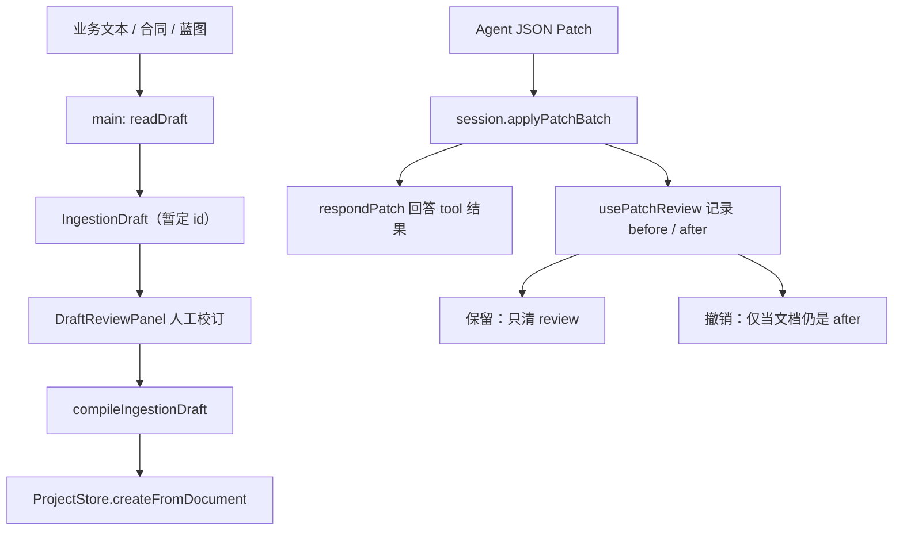

# 资料摄取与补丁审查

两条辅助路径方向相反：**摄取先审后建**，**Agent 补丁先应用再审查**。补丁的审查无法前置，因为 Agent 必须在 tool call 内拿到结果；摄取则相反，读错一句话就该在写盘前被人改掉。两条路径最终都落到普通 FM 文档与普通门禁上，不发明特殊可信格式。

图：左侧先审后建，右侧先应用再审查；只有"撤销"这一步需要"文档仍是最新"的前提。

## 三种输入、四种 reader

通道与 DTO 全在 `libs/desktop/contracts`：`EVIDENCE_INGESTION_IPC_CHANNELS` 只有 `evidence:ingestion:draft` 与 `evidence:ingestion:compile` 两条，`INGESTION_INPUT_KINDS` 是 contract/text/blueprint，`INGESTION_READERS` 是 contract/blueprint/text-rules/text-model。`IngestDraftResult` 成功时必带 `reader`、`issues`，合同的 `annotations` 可选；`CompileDraftOutcome` 失败只有 `error` 与 `issues`。renderer 侧只通过 preload 暴露的 `ingestion.draft/compile`（invoke）触达，读写都在 main。

`readDraft` 的分派是固定的：

| kind | 读法 | reader |
| --- | --- | --- |
| contract | `annotateContractClauses` 先分句，再由 `draftFromContract` 读，从不调用生成器 | `contract` |
| blueprint | `parseBlueprint` 确定性解析；无可用行时返回 `success:false` | `blueprint` |
| text（有生成器） | `buildIngestionPrompt` → 模型 → `readIngestionDraftJson` | `text-model` |
| text（无生成器，或模型失败/回复读不成草稿） | `draftFromBusinessText` | `text-rules` |

回退不是"业务没有内容"：`readDraft` 把模型错误（或"回复无法读成草稿"）与本地读法的问题一起放进 `issues`，面板照原样列出。desktop 的 main 在注册通道时无条件注入 `createModelIngestionReader()`，所以应用里的散文导入**总是**先试模型，本地词表是失败路径而不是可选项；只有直接调用 `readDraft` 且不传 `generate` 时才会跳过模型。

## 条款先分类，再只读业务句

`annotateContractClauses` 把每句放进且只放进一个桶，顺序是有意的：先风险分配/程序性条款（管辖、仲裁、免责），再业务动作动词，最后才是计算。所以「提交仲裁委仲裁」不会因为出现动作动词被读成履约。分句结果（`ClauseReading extends ClauseAnnotation`）保留原句、1-based 句号、`charStart/charEnd`、`category`、`reason` 与 `computesValue`，面板里的 `ClauseSplit` 直接展示这一份分句结果，评审人读的是原句而不是结论。一句话可以同时是义务与算法：`category` 决定它去哪，`computesValue` 说明这个值仍必须由规则算出来。

两种模糊情形只报告、不替人决定：一句既含程序性内容又提到业务动作（按法务处理并提示人工移出），以及一句两边都不匹配（按法务保留并提示确认）。法律文字因此始终可展开阅读，不会被默默丢掉。

`draftFromContract` 只把 business 句交给本地 row reader（`source: 'contract'`），并把分句结果写进 `draft.sourceDocument`。计算类条款走另一条路：`domainNounOf` 命名它是 calculator 还是 checker，生成挂在 domain 上下文上的 thing，`meaning` 保留原句；同名 label 只生成一次，每个组件带"第 N 句"的 provenance。读不出算的是什么就留一条 issue 请人在领域上下文里命名，绝不编一个公式。它还会自己写入（或补全）domain 上下文并用这些组件当 root，因为 row 组装器只在有行命名过 thing 时才写 domain 上下文。整份合约没有业务句时明确报告，而不是产出一个"读完了"的空模型。

## 模型 reader 是临时目录里的无工具会话

`createModelIngestionReader` 是摄取用的读法，不复用项目 Agent 的现场：`mkdtemp` 出来的临时目录当 `projectRoot`（用户还没选的项目不该长出 `.evidence/`），`noTools: 'all'`（这一轮只允许产出文本），只收 `text-delta` 拼回复，`agent-error` 先记录、回合结束后再抛，整轮用 120 秒超时兜底，`finally` 里退订、`dispose` 会话并删掉自己建的临时目录。它返回的是模型的原始回复，把回复变成草稿的逻辑只留在 `readIngestionDraftJson`，模型与本地读法因此汇合成同一种草稿。

随包 prompt（`libs/evidence-agent`）写的是读法规约：先分业务/领域/法务三类，再找合约、拆合约前上下文、把请求时段与确认时刻配成对、把违约读成新的履约对、把标的物归入 domain，最后把算出来的值写成 calculator/checker；硬约束包括不臆造时限金额当事人、每个元素带"第 N 句"出处、法务条款不许改写成义务、合约只有两个角色、时段不能当确认、只输出 JSON。

`readIngestionDraftJson` 负责"回复是建议不是文档"的那一半：从代码围栏或文本里切出对象，缺的集合补空数组，非数组集合记一条 issue 后忽略，短 kind 归一化，未知 evidence kind 保留为 `other_evidence` 并告知，未知 `domainRole` 丢弃并告知。没有 JSON、JSON 解析失败、顶层不是对象、或任一元素缺 id 则整体拒绝并给出错误——这类回复没法在面板里修。

## 一份草稿、一个形状守卫

`IngestionDraft` 是所有 reader（含模型和人手改过的面板状态）唯一写出的中间形状：一个 `modelName`、一个 `source`、八个数组成员（contexts、participants、roles、things、evidences、fulfillmentPairs、breachCompensations、relationships），元素用暂定 id，并可带 `ProvenanceSnippet`。`isIngestionDraftShape` 只校验 `modelName` 非空以及八个集合里每个元素都有 id，不校验可选字段——所以可选字段写错的草稿仍然能进审核面板被人修正，而不是在解析处被拒。

## 蓝图表格读者

`parseBlueprint` 是三条路径里唯一的"两条都不猜"的读法：Markdown 或 CSV 表都行，表头按包含关系匹配 `stage/activity/evidence/kind/party/thing/system` 的中英别名（`阶段 (Stage)` 也算 stage），行内只补那些列能确定的东西——凭证种类与合约双方从名称推断（`inferEvidenceKind`/`inferContractSide`），其余交给 `assembleDraftFromRows`。合约行把上下文切成"合约前 / 合约"，同名文书保留为两条独立 evidence，每张凭证带行号 provenance。配对同样不靠想象：确认没有请求、请求没有确认都各报一条 issue；表头一列都不认识时整体失败（`success:false`），而不是产出一张空草稿。

## 本地 text reader 的可见边界

`draftFromBusinessText` 认的是讲座那套词汇，且把它读不到的东西留成缺口：带时限的句子读成 request，只报告结果的句子读成它的 confirmation，违约句读成另一项义务而不是回滚，一份文本最多确立一份合约（除非另一句用《》点名了新协议），确认函/签收单直接回答同一句里的动作。配对工作在 `assembleDraftFromRows` 里完成：没有确认的请求与没有请求的确认都各出一条 issue 请人到面板补上，而不是配一个想象中的另一端。

## 人工修正与编译

`IngestDraftModal` 拒绝空文本，选 kind、粘贴原文、填模型名，读回后立刻切到 `DraftReviewPanel`。面板给出：reader 标签、凭证/履约对/当事人计数、因删改断开的对数、`ClauseSplit` 的"业务/领域/法务"三类计数与可展开的被过滤法务句、reader 留下的缺口列表。人只能改证据层——重命名、改 kind、移除；合同的角色对不可在此编辑，因为"替编译器补一个缺失的另一方"正是方法禁止的推断。所有改动都只留在本地 state，不写模型、不落盘。

提交时才选目标：先 `showCreateDialog` 取路径与存放形式（目录源树或单文件），再调 `compile`。`compileDraft` 强制使用用户输入的名称（空则回落默认名），从名称推 `modelId` 的 slug。`compileIngestionDraft` 先为每个元素分配唯一 schema id（保留合法且未被占用的原 id，其余由 label 生成并加 `-2` 后缀），再用一个 monotone fixpoint 决定可写集合：上下文需要有可追溯的根（contract/pre_contract 看 evidence，domain 看 thing）、父上下文要落地、role 要落在可写上下文、thing 要落在 domain 上下文、contract 必须正好有两位已落地的当事人角色、其他 evidence 必须有负责角色。删除是传递的——丢掉合同会丢掉它 root 的上下文，再丢掉那个上下文拥有的 evidence——每次删除只报告一次，编译器从不发明缺失的角色或根。

pair 的完成规则需要两端都活下来且同属一个合约上下文，否则跳过并报告；确认端没有指向请求端的 `references` 关系时会显式补写这条关系（并给出 1:1 cardinality），因为"缺引用"是可确定的连接，而"缺事实"不能猜。最后仍由 `strictValidateDomainModel` 判断这份文档能不能存。

一处要看清的边界：编译器只为每个履约对写完成规则，从不读取 `draft.breachCompensations`。reader 组装出来的"触发对 → 补偿对"链接因此只活在草稿里，既不变成规则也不出现在 `droppedIds`；补偿履约本身作为独立履约对正常编译（schema 里虽有 `breach_compensation` 关系种类，当前编译器没有写它）。

main 侧还有一道闸：零 surviving entities 直接失败且不写盘（写空树会让人以为文本没内容，还留下一个解释不清的项目）。成功后 `createFromDocument` 写盘并 `openEditorWindow`；目标已存在由 `ProjectStore.writeProject` 拒绝，绝不覆盖。返回的 `layout` 来自 `layoutDomainModel`，是按模型推出的固定带位（前合同在左、合同居中、履约在右、thing 在下），供首帧直接用，与 renderer 里异步求解的 ELK 几何是两件事，别混为一谈。

## Agent 补丁已经写进模型里

`useAgentPatchBridge` 挂在主进程发起的 `onApplyPatch` 上（`useLayoutEffect` 订阅、卸载即退订）。处理顺序是：取 `before = session.getDocument()` → `ModelPatchRequestSchema.parse(patch)` → 一次 `session.applyPatchBatch(parsed.patches, 'agent:<rationale>')` → `respondPatch({ success: true, appliedCommands })`（只有 op 名）→ 取 `after`，只有 `after !== before` 才把 `before/after/rationale/commands` 交给 `onApplied`。任何异常（schema 拒绝、JSON Pointer 非法、静态门禁抛错、批内 test 失败）都答 `success:false` 加消息，并在 `record` 之前抛出，所以文档不会被写坏；用标准 RFC 6902 走会话，没有旧的 CommandSequence/dispatchAll 通道。

只读 `test` 或结构 no-op 是成功但无变化的补丁：`respondPatch` 照答 `success:true` 与 op 名，但 `session` 因 Immer 没产生 patch 而不入 undo 栈，`after === before` 也不生成 review——不制造一张"什么都没改"的审查卡。

`usePatchReview(session, document)` 是唯一的审查状态持有者，由编辑器屏幕创建并同时交给 Agent rail 与行内 copilot。`record` 存 before/after，`review` 用 `diffDomainModels` 只取 contexts 与 entities 的 added/removed/modified id 与 canvas overlay（不给已删除对象加 ghost，也不宣称列出全部关系/规则 diff），`revertable` 直接比较当前渲染的 document 与 `after`。`InlinePatchCard` 把它渲染成：新增/修改/删除计数（全零时显示"结构未变"）、rationale、可点击定位的对象 chips（已删除的对象只划线不可定位）、一句快捷键提示与保留/撤销按钮。画布拿同一份 overlay 画圈，copilot 抽屉的 badge 也用来提示还有未结算的补丁。

## 为什么撤销不能吞掉后来的工作

`ModelSession` 把整批 `applyPatchBatch` 记成一条历史：Immer 的 forward/inverse patches 与 affectedIds 一起入栈，`undo()` 就是应用该条的 inverse patches，所以一次撤销回的是"这批之前"。这只有在补丁仍是最后一次编辑时才等价于"撤销这次补丁"。

因此 review 的安全条件是引用相等：`session.getDocument() === patched.after`，不是深比较。若之后有人手编辑或另一份补丁落地，`revertable` 变 false，此时按撤销**只关闭 review**、不 undo，卡片改为提示到顶部用 ⌘Z 沿普通历史逐步回退；撤销按钮在这种情况下根本不渲染。保留（accept）永远只清 review，不再触碰模型。

键盘仲裁集中在 `useEditorShortcuts`：编辑器只在 `patchReview.review !== null` 时才把 `acceptPatch/revertPatch` 并入 handler 表，所以没有待决补丁时这两个键不存在，Escape 继续归分屏/选区。存在待决补丁时，Escape→revert 放在 typing guard **之前**（半读的补丁是屏幕上最要紧的事，输入框里按 Esc 也先结算它），Mod+Enter→accept 放在 guard 之后；行内 copilot 的 capture 阶段 Escape 在有 `pending` 时主动退让，避免"关面板"和"撤销补丁"同时发生。`defaultPrevented` 检查仍在最前，任何自己消费了按键的界面优先。

## 验证入口

`ingestionIpc.spec` 与 `ingestionModelReader.spec` 保护三种输入与四种 reader 标签的对应关系、模型失败与不可读回复的回退说明、蓝图表无可用行时的失败、空模型拒绝与名称/布局返回，以及 `noTools`、临时目录、超时与非半截回复。`libs/evidence-model-core` 的 contract/blueprint/text/compile specs 保护来源 locator、条款分类与过滤、传递 drops 与 pair，`textExtractor.spec` 覆盖 `readIngestionDraftJson` 的修复与拒绝（未知 kind/domainRole、错类型集合、缺 id），`clauseTrace.spec` 保护"原句区间在编译、重读与 bundle 往返后仍能对回"，`draft.spec`（`libs/evidence-schema`）保护短 kind 归一化、时刻/时段判定与形状守卫的伸缩边界。

补丁侧：`useAgentPatchBridge.spec` 保护原子应用、门禁拒绝、批内 test 失败回滚、no-op 不生成 review 与"before/after 交给调用方"；`usePatchReview.spec` 保护 overlay 标记、保留、撤销最新、以及后续编辑后 `revertable=false` 且不 undo；`InlinePatchCard.spec` 与 `InlinePatchCopilot.spec` 保护计数/定位/隐藏撤销按钮与行内结算；`EditorScreen.spec` 端到端跑 Escape 撤销与保留两条路径，`useEditorShortcuts.spec` 保护 `defaultPrevented` 让位与 Escape 的优先链（分屏 → 选区）。

相关：[Electron 宿主与 IPC 契约](./app-shell.md) · [渲染会话与实时同步](./renderer-state.md) · [工作区界面](./workspace-surfaces.md) · [模型事务与撤销](../model/commands-and-session.md) · [关键数据与来源](../language/key-data-and-provenance.md) · [Pi 工具](../agents/pi-harness.md)
