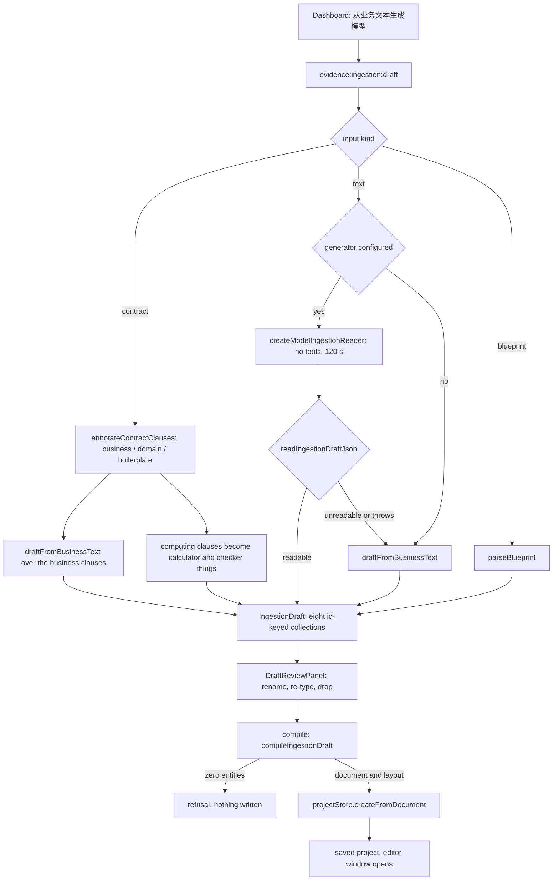
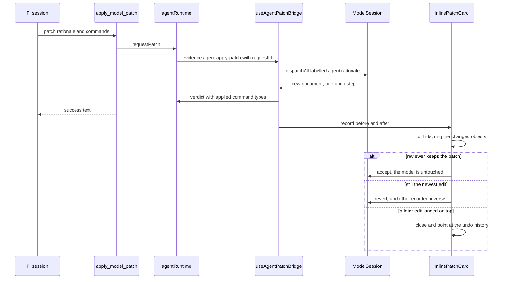

# Ingestion and agent patch review

A model reaches the desktop three ways: a person edits it, an agent patches it, or
a reader turns business text into a first draft. This page covers the two assisted
paths, and they are opposites in one respect worth stating up front.

**Ingestion creates.** Reading prose, an agreement or a workshop table produces a
draft only; a person corrects that draft in a panel and only then compiles it into
a project that did not exist before.

**Patch review settles.** An agent's edit is already in the live session — it has
to be, because the tool needs an answer — so the review is not a gate in front of
the write. It is a one-step way to take the write back.

Both keep the same posture: the machine proposes, the person decides, and what
survives is an ordinary FM model judged by the ordinary checks.

## Ingestion: three input kinds, one draft shape

The main process exposes two channels, `evidence:ingestion:draft` and
`evidence:ingestion:compile`. Both run there because reading uses the model
configuration and compiling writes a source tree; the renderer has neither
(`repo://apps/desktop/src/shared/ipc.ts#L58-L66`,
`repo://apps/desktop/src/main/ingestionIpc.ts#L222-L244`).

| `kind` | Path | Model call |
| --- | --- | --- |
| `contract` | clause split, then the offline row reader plus domain components | never |
| `text` | model reader, offline rules as fallback | yes, when a generator is configured |
| `blueprint` | deterministic table parser | never |

Every result names the reader that produced it — `contract`, `blueprint`,
`text-rules` or `text-model` — because "a model read this" and "the built-in
vocabulary matched this" carry different promises about quality, and the review
panel says which one happened
(`repo://apps/desktop/src/shared/ingestion.ts#L12-L23`).

Two of the three are deliberately model-free. A workshop table already has
columns, so a model reading it back would add a failure mode without adding
information. An agreement is worse than prose to read whole: it mixes obligations,
formulas and jurisdiction in one paragraph, so it is bucketed by clause first and
only the business clauses go on to the row reader
(`repo://apps/desktop/src/main/ingestionIpc.spec.ts#L45-L75`).

Every input form converges on one draft, so the compiler and the review panel each
handle exactly one shape.

### The clause-first contract reader

`annotateContractClauses` splits an agreement into sentences and files each one
into exactly one of three buckets, in a fixed order because the order is the
method: risk allocation and procedure first (jurisdiction, force majeure, notices,
counterparts, fee allocation), then a business action verb, then a computation
(`repo://libs/evidence-model-core/src/ingestion/contractAnnotator.ts#L119-L177`).
The order matters because 「提交仲裁委员会仲裁」 contains an action verb without
obliging the business to deliver anything.

Each annotation carries its 1-based index, the clause verbatim, the bucket, a
reason in business language, and whether the clause also names a value the domain
has to compute. Two cases are reported rather than resolved: a clause the reading
could not place is kept as boilerplate *and* flagged, and a clause that is both
procedural and obligatory is filed as pure legal text with a note asking a person
to move it out
(`repo://libs/evidence-model-core/src/ingestion/contractAnnotator.ts#L140-L175`,
`repo://libs/evidence-model-core/src/ingestion/contractAnnotator.spec.ts#L38-L103`).

`draftFromContract` then reads the business clauses with the same offline row
reader the text path uses, and turns computing clauses into **domain components** —
a `thing` with `domainRole: 'calculator'` or `'checker'`, its `meaning` quoting the
clause and its provenance naming 「第 N 句」. A percentage that stays in the
contract is a number somebody typed in; the same percentage as a calculator is a
rule the model can check. The named component is deduplicated by label, and when a
clause computes something the reader cannot name (`按约定计算`) nothing is
invented: the gap is reported
(`repo://libs/evidence-model-core/src/ingestion/contractReader.ts#L37-L143`).

The Domain Context is written by the reader, not the row assembler, when a thing
exists — the assembler only emits one when a row named a thing — and every
component becomes a root of it. If no business clause was found at all, the draft
comes back with no evidence and one actionable issue asking the reader to find the
sentence that establishes who delivers what to whom (「整份合约没有读到业务条款」).

### The model reader is a reader, not an agent

`createModelIngestionReader` starts an `EvidenceAgentSession` in a fresh temporary
directory with `instructions: [systemPrompt]` and `noTools: 'all'`. Two reasons are
stated at the call site: a project the user has not chosen should not grow
`.evidence/` files, and the only thing this turn may produce is text — a model that
starts editing files while reading a contract clause is not reading a contract
clause (`repo://apps/desktop/src/main/ingestionModelReader.ts#L10-L45`).

The reply is assembled from text deltas, an `agent-error` is recorded and rethrown
after the turn, and the whole call is bounded by a 120-second timeout. The
temporary directory is removed when the reader created it
(`repo://apps/desktop/src/main/ingestionModelReader.ts#L46-L95`).

The prompt is the method, not the schema. It states seven readings in order: split
the document into business, domain and legal clauses; find the contract (one
`signed_at`, two parties who become its two roles); split the pre-contract context
into `rfp` and `proposal` spans sourced to that contract; pair every request span
with the confirmation instant that answers it and leave a missing confirmation
missing; read a breach as a *new* fulfillment pair referenced by
`breachCompensations`; separate the thing into the domain context; and extract
computed values as `calculator` or `checker` things whose meaning names the clause
they come from. The hard constraints forbid inventing facts, require the source
sentence and 「第 N 句」 on every element, forbid rewriting a legal clause into an
obligation, cap the contract at two roles (everyone else is a participant playing
one), forbid a span from serving as a confirmation, and require JSON only. Two
worked readings ship with the prompt because the hard part is the split, not the
JSON shape (`repo://libs/evidence-agent/src/prompts/ingestion.ts#L14-L70`).

### A model failure is not a dead end

If the model returns something unreadable, or the call throws, `readDraft` runs the
deterministic `draftFromBusinessText` reader and says so:

- `reader: 'text-rules'`;
- an issue such as `模型返回的内容无法读成草稿（…），已改用本地读法。` or
  `模型读取失败（…），已改用本地读法。`, followed by the parse issues and the
  fallback's own issues.

It does not return an empty draft, because an empty draft would read as "the text
said nothing", which is a different problem
(`repo://apps/desktop/src/main/ingestionIpc.ts#L79-L118`).

### Reading a model's JSON is repair that reports

A model reply is a suggestion, not a document, so `readIngestionDraftJson`
(`repo://libs/evidence-model-core/src/ingestion/readDraftJson.ts#L21-L203`):

- cuts the JSON body out of a code fence or the surrounding prose;
- treats a missing collection as empty, but ignores a wrong-typed one and reports
  it (`contexts 不是数组，已忽略其内容。`);
- normalises the short kind names the prompt allows (`request` →
  `fulfillment_request`, `document` → `other_evidence`);
- keeps an evidence kind nobody recognises as `other_evidence` **and reports it**,
  telling the reviewer to change it in the panel — the alternative, a silent
  promotion, is what the issue exists to prevent;
- discards a `domainRole` outside the vocabulary and reports that too.

It refuses the whole reply — `success: false` with an error — when there is no JSON
object, when JSON parsing fails, when the top level is not an object, or when a
collection holds items without ids (`草稿结构不完整：每个元素都需要 id，且七个集合都必须存在。`).
The split is deliberate: a reader that got the shape right and one attribute wrong
should still reach the review panel, where a person can fix it; a reply with no
usable draft must fail loudly instead of becoming an empty model.

The draft shape itself guarantees what the compiler dereferences. `IngestionDraft`
is a manifest name, a `source`, and eight arrays — contexts, participants, roles,
things, evidences, fulfillment pairs, breach compensations and relationships — whose
ids are explicitly provisional because the compiler re-keys them; every element may
carry the `ProvenanceSnippet` that produced it. `isIngestionDraftShape` checks
exactly the containers and ids, not every optional field
(`repo://libs/evidence-schema/src/ingestion/draft.ts#L12-L45`,
`repo://libs/evidence-schema/src/ingestion/draft.ts#L186-L232`).

### The offline row reader

`draftFromBusinessText` recognises the lecture's vocabulary and nothing more: an
agreement clause (签订/签署/订阅 with a subject such as 合约, 专栏 or 服务), action
verbs, deadlines, completion verbs, proof documents and the two sides of a
contract. A clause with a deadline is an obligation (`fulfillment_request`); a
clause that only reports a result is its answer (`fulfillment_confirmation`); a
proof document that is itself a result (确认函, 签收单) becomes the confirmation
while a document that merely evidences someone else's action (转账凭证, 银行回单)
stays a separate `other_evidence` the pair can cite. One document signs one
agreement unless another is named in 《…》, otherwise every 「合同签订后」 clause
would become a contract of its own, and a breach clause is read as another
obligation rather than a rollback and reported for confirmation. What it cannot
pair stays unpaired and named as a gap
(`repo://libs/evidence-model-core/src/ingestion/textExtractor.ts#L186-L334`).

### The blueprint reader

`parseBlueprint` accepts Markdown and CSV tables with the seven workshop columns —
`stage`, `activity`, `evidence`, `kind`, `party`, `thing`, `system` — matched by
containment against Chinese and English aliases, so `阶段 (Stage)` and `Stage` both
land on `stage` (`repo://libs/evidence-model-core/src/ingestion/blueprintParser.ts#L10-L52`).

Row assembly infers the evidence kind from the document name, decides which side of
the contract a party is on, keeps duplicate document names as separate evidences,
and carries provenance. It does not invent a partner for a confirmation with no
request; it reports the unmatched row
(`repo://libs/evidence-model-core/src/ingestion/draftAssembly.ts#L60-L120`,
`repo://libs/evidence-model-core/src/ingestion/blueprintParser.spec.ts#L109-L140`).

## Reviewing the draft before anything is written

`IngestDraftModal` asks for one of the three input kinds, the text, and a name, and
refuses an empty textarea locally (`请先粘贴一段业务文本或蓝图表格。`). On success it
switches to `DraftReviewPanel`, which is the only place the reading can be
corrected (`repo://apps/desktop/src/renderer/components/ingestion/IngestDraftModal.tsx#L74-L160`).

The panel shows, in this order:

- who read the text, the evidence count, the surviving pair count and the
  participant count, plus how many pairs broke (`N 组因删改断开`);
- for a contract, the clause split with the three bucket counts and the filtered
  legal sentences still readable in a disclosure — a clause silently dropped is
  the failure a reviewer most needs to catch;
- the reader's gaps under 「读法留下了这些缺口」;
- one row per evidence: an editable label, its kind with a 时刻/时段 hint, its
  context, the source sentence and locator, and a remove control.

Edits are local: the panel re-sends the draft with the corrected evidence list.
Pairs whose request or confirmation was removed stop being counted, which is the
panel agreeing with the compiler rather than hiding a dangling pair
(`repo://apps/desktop/src/renderer/components/ingestion/DraftReviewPanel.tsx#L36-L200`).

The contract's role pair is deliberately **not** editable here: an unbalanced
contract is what the compiler refuses, and inventing the missing side is exactly
the decision an extractor is forbidden to make.

Nothing is written until the person submits. Submit asks for a target path through
the same create dialog the template flow uses, then calls compile; a refusal from
either side is printed inside the panel
(`repo://apps/desktop/src/renderer/components/ingestion/DraftReviewPanel.tsx#L115-L160`).

## Compiling a draft into a saved project

`compileIngestionDraft` is where a draft becomes a document the schema accepts. The
rule is stated at the function: it never repairs a gap by guessing.

- Ids are re-keyed from the draft into schema ids; a duplicate label becomes
  `confirmation.payment-2` rather than overwriting the first
  (`repo://libs/evidence-model-core/src/ingestion/draftSupport.ts#L14-L45`).
- Writability is one **monotone fixpoint** over contexts, roles, things and
  evidences. Dropping is transitive: losing a contract drops the context it rooted,
  which drops the evidences that context owned, which can drop a pair.
- Each removal is reported once in `issues` and recorded in `droppedIds`, so a
  half-kept context never validates while meaning nothing
  (`repo://libs/evidence-model-core/src/ingestion/compileDraft.ts#L103-L290`).
- A fulfilment pair only gets its completion rule when both ends landed, both are
  in the same contract context, and the confirmation references the request — the
  reference is written if the draft did not declare it; otherwise the rule is
  skipped and reported
  (`repo://libs/evidence-model-core/src/ingestion/compileDraft.ts#L588-L670`).

The resulting document is ordinary FM v5; `strictValidateDomainModel` remains the
judge of whether it may be saved.

`compileDraft` in the main process takes the reviewed draft, forces the name the
person typed, and refuses to write when nothing survived:

> 没有读到可以落地的业务对象：先确认文中哪一句确立了合约关系，再重新读取。

Otherwise it calls `projectStore.createFromDocument`, then returns the project, the
document, the compiler issues and a canvas layout
(`repo://apps/desktop/src/main/ingestionIpc.ts#L148-L210`). The layout comes from
`layoutDomainModel`, which derives coordinates from the model (pre-contract left,
contract middle, fulfilment right, things on their own row below) rather than from
the draft, so a model re-read from disk lays out the same way, and each entity
takes exactly one slot
(`repo://libs/evidence-model-core/src/ingestion/layoutDomainModel.ts#L1-L60`).

The compile handler opens the editor window on success, so the first thing the user
sees is the model they just reviewed.

## Agent patch review: the patch is already applied

The agent's `apply_model_patch` tool needs an answer inside the tool call, so the
renderer dispatches the commands immediately — through the same session, on the
same guards, into the same undo history as a human edit — and only then records the
before/after pair
(`repo://apps/desktop/src/renderer/state/useAgentPatchBridge.ts#L20-L72`). The
round trip and the two rejection shapes are described in
[The Pi agent harness and its tools](../agents/pi-harness.md); here what matters is
what the renderer does once the verdict has travelled back.

`usePatchReview` turns one `AppliedPatch` into:

- the rationale and the command types the agent gave;
- added / removed / modified object ids, from `diffDomainModels`;
- a canvas overlay whose marks are the changed objects only — the patch is already
  in the layout, so ringing existing objects is enough and no ghost is added;
- `revertable`, true only while the on-screen document is still the patched one.

### What makes revert safe

`dispatchAll` records the whole patch as **one** history entry: the forward command
sequence and its inverse. `undo` applies that inverse and moves the entry to redo,
which is why taking a patch back is one keystroke and restores exactly the previous
document, not an approximation of it
(`repo://libs/evidence-model-core/src/session/createModelSession.ts#L202-L218`,
[Commands, guards and the model session](../model/commands-and-session.md)).

That is also why the review has to check first. `revert` calls `session.undo()` only
when `session.getDocument() === patched.after` — identity, not deep equality, and
identity is reliable here because every dispatch replaces the document object. If a
human edit or a newer patch landed on top, the review closes *without* undoing and
the card points the modeler at the normal history:

> 模型之后又有改动，撤销已不可用；可在顶部按 ⌘Z 逐步回退

`accept` clears the pending review without touching the model. That asymmetry is
the whole design: the review can always be dismissed, but it can only take work back
while taking it back is still exactly one step
(`repo://apps/desktop/src/renderer/state/usePatchReview.ts#L65-L114`).

### Which surface shows the review, which key settles it

`InlinePatchCard` renders the counts, the rationale, one chip per touched object
(clicking a chip pans the canvas to it; a removed object has no chip because it
cannot be located), and either both actions or the "too late to revert" hint
(`repo://apps/desktop/src/renderer/components/agent/InlinePatchCard.tsx#L20-L145`).

The same card appears in two surfaces — the interview conversation and the inline
canvas copilot — and both receive the same controller, so there is one review state
and no way to accept a patch in one panel while another still offers to revert it
(`repo://apps/desktop/src/renderer/components/agent/AgentCopilot.tsx#L203-L212`,
`repo://apps/desktop/src/renderer/components/agent/InlinePatchCopilot.tsx#L230-L245`).

The keys are not the card's. The editor's window-level shortcut table binds
`acceptPatch` and `revertPatch` only while a review exists, which is why Escape
returns to clearing the selection once the patch is settled; Escape settles by
reverting and is handled ahead of the typing guard, `Mod+Enter` accepts and is
handled after it
(`repo://apps/desktop/src/renderer/screens/EditorScreen.tsx#L549-L596`,
`repo://apps/desktop/src/renderer/state/useEditorShortcuts.ts#L196-L227`).

One surface would otherwise steal that key: the inline copilot listens for Escape
in the capture phase to close itself, and stands down while a patch is pending so
the revert wins
(`repo://apps/desktop/src/renderer/components/agent/InlinePatchCopilot.tsx#L57-L75`).
Which surface owns a key when two of them want it — the `defaultPrevented` rule, the
ledger sheet's capture and the escape chain on the canvas — belongs to the canvas
surfaces, and is documented in
[The canvas and the inspector](./canvas-and-inspector.md).

## Failure behaviour

| Situation | Result |
| --- | --- |
| no model configured, text input | local rules reader; `reader: 'text-rules'` |
| model returns nonsense | local rules reader plus an explanatory issue |
| model call throws / times out | local rules reader plus the error; 120 s cap |
| agreement with no business clause | empty draft evidence plus 「整份合约没有读到业务条款」 |
| computing clause the reader cannot name | no invented calculator; an issue asks for the name |
| blueprint header matches no known column | failure with an issue, no draft |
| model's reply is not a draft shape | `success: false` with the shape error, never an empty model |
| model returns an unknown evidence kind | kept as `other_evidence`, flagged for the panel |
| model returns an unknown `domainRole` | dropped, flagged for the panel |
| compile yields zero entities | refusal with a sentence to act on; nothing written |
| project target already exists | `projectStore` refusal, propagated into the panel |
| agent patch rejected by a guard | `{success: false, error}`, no review recorded |
| later edit after a patch | review still shown, `revertable: false`, revert button gone |

## Tests that protect this contract

- `ingestionIpc.spec.ts` reads a contract by its clauses without a model (bucketing
  includes boilerplate, a calculator exists, no arbitration evidence), reads a
  blueprint without a model, prefers a configured model, falls back on nonsense and
  on a thrown call, fails loudly on an unusable table, compiles to a document plus
  canvas slots, keeps the typed name, refuses an empty model, and reports a refused
  write (`repo://apps/desktop/src/main/ingestionIpc.spec.ts#L28-L255`).
- `ingestionModelReader.spec.ts` asserts one assembled reply, `noTools: 'all'` in
  the caller's scratch directory, surfaced model errors and a timeout
  (`repo://apps/desktop/src/main/ingestionModelReader.spec.ts#L38-L131`).
- `contractAnnotator.spec.ts` pins the clause split, the three buckets, a clause
  that is both procedural and obligatory, an unclassifiable clause, and the refusal
  to name a component the clause did not describe
  (`repo://libs/evidence-model-core/src/ingestion/contractAnnotator.spec.ts#L38-L131`).
- `contractReader.spec.ts` asserts a kept contract with paired obligations, no
  jurisdiction evidence, computing clauses becoming calculators in the domain
  context, one component per noun, an unnamed formula reported, the filtered-legal
  count, clause provenance, and schema acceptance
  (`repo://libs/evidence-model-core/src/ingestion/contractReader.spec.ts#L20-L120`).
- `textExtractor.spec.ts` covers the offline reader (contract first, deadline as
  obligation, gaps kept as gaps, no duplicate obligation from a breach clause) and
  `readIngestionDraftJson` (fence digging, short kind names, kept `domainRole`,
  unknown role dropped, unknown kind reported as `other_evidence`, wrong-typed
  collection, missing ids)
  (`repo://libs/evidence-model-core/src/ingestion/textExtractor.spec.ts#L25-L230`).
- `blueprintParser.spec.ts` covers contract splitting, request/confirmation pairing,
  proof attachment, exactly two contract roles, row provenance, no invented
  partner, unconfirmed requests, breach compensation, CSV, duplicate names and an
  unusable header (`repo://libs/evidence-model-core/src/ingestion/blueprintParser.spec.ts#L12-L205`).
- `compileDraft.spec.ts` asserts schema acceptance, a pre-contract context under the
  contract it sourced, transitive drops, completion rules per pair, kept source
  sentences, written-id mapping, and the four layout rules including "never two
  entities share a coordinate"
  (`repo://libs/evidence-model-core/src/ingestion/compileDraft.spec.ts#L33-L240`).
- `usePatchReview.spec.tsx` pins the added/modified/removed counts and overlay mark,
  revert while newest, accept without touching the model, and refusal to revert
  after a later edit
  (`repo://apps/desktop/src/renderer/state/usePatchReview.spec.tsx#L117-L185`).
- `InlinePatchCard.spec.tsx` pins the counts, the object chips (including that a
  removed object is not clickable), both decisions, the hint after a later edit, and
  the "structure unchanged" case
  (`repo://apps/desktop/src/renderer/components/agent/InlinePatchCard.spec.tsx#L18-L120`).
- `IngestDraftModal.spec.tsx` drives the review panel: who read the text, the source
  sentence per evidence, visible gaps, empty-input refusal, kind correction, rename,
  dropping a wrong element, and the clause split including the filtered sentence
  (`repo://apps/desktop/src/renderer/components/ingestion/IngestDraftModal.spec.tsx#L81-L322`).
- `EditorScreen.spec.tsx` closes the loop: Escape reverts the reviewed patch and
  leaves the scope filter alone, and the 保留 button keeps it
  (`repo://apps/desktop/src/renderer/screens/EditorScreen.spec.tsx#L395-L475`).

## Related pages

- [The Pi agent harness and its tools](../agents/pi-harness.md) — the agent whose
  patch is reviewed here, and the tool round trip that applies it.
- [Desktop shell, windows and project lifecycle](./app-shell.md) — the channels and
  the project store this flow writes through.
- [Commands, guards and the model session](../model/commands-and-session.md) — the
  one-undo-step rule that makes revert safe.
- [The canvas and the inspector](./canvas-and-inspector.md) — the change rings drawn
  from the patch overlay, and how canvas surfaces claim a key.
- [Key data, business time and provenance](../language/key-data-and-provenance.md) —
  the rules a draft is trying to satisfy.
- [The native check and simulation pipeline](../model/checks-and-simulation.md) —
  what judges the compiled model.
