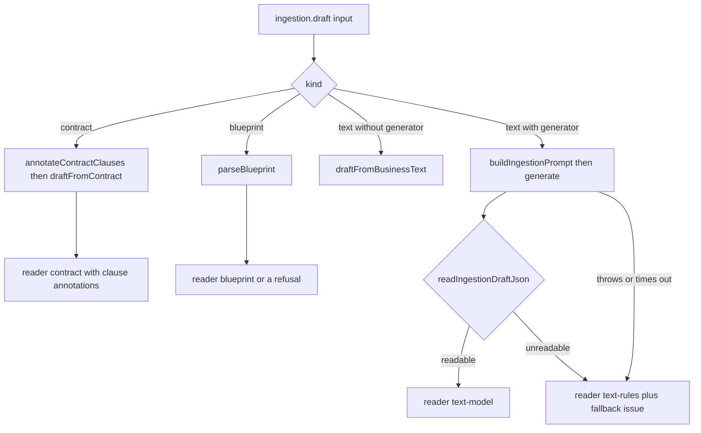
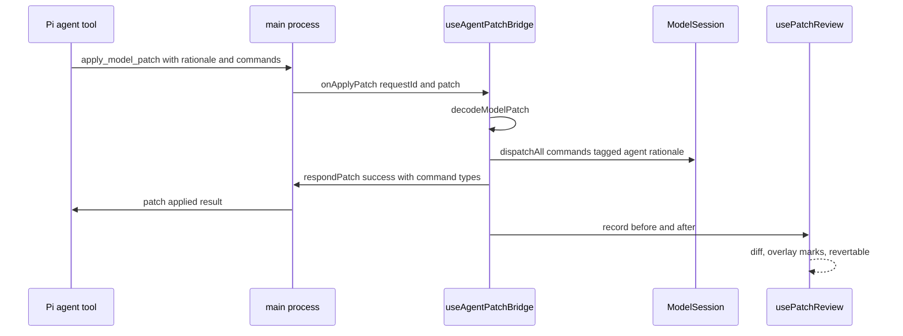

# Ingestion and agent patch review

A model reaches the desktop three ways: a person edits it, an agent patches it, or
a reader turns business text into a first draft. This page covers the two assisted
paths. Both follow the same discipline: the machine proposes, the person reviews,
and the saved result is a normal model that the normal checks judge
([FM DSL](../language/fm-dsl.md), [checks and simulation](../model/checks-and-simulation.md)).

## Two input kinds, one draft shape, four readers

The main process exposes two channels, `evidence:ingestion:draft` and
`evidence:ingestion:compile`. Both run in the main process, because reading uses the
project's model configuration and compiling writes a source tree; the renderer has
neither (`repo://apps/desktop/src/shared/ipc.ts#L55-L62`,
`repo://apps/desktop/src/main/ingestionIpc.ts#L212-L243`,
`repo://apps/desktop/src/main/main.ts#L58-L75`).

Every successful read names the reader that produced it, from exactly four values
in `INGESTION_READERS`, and the review panel prints the matching label so a reviewer
knows what promise the draft carries:

| `reader` | `READER_LABELS` | Produced by | Model call |
| --- | --- | --- | --- |
| `contract` | 读自合同条款 | `annotateContractClauses` + `draftFromContract` | never |
| `blueprint` | 读自服务蓝图 | `parseBlueprint` | never |
| `text-model` | 读自模型 | `buildIngestionPrompt` + `readIngestionDraftJson` | yes, when a generator is configured |
| `text-rules` | 读自本地规则 | `draftFromBusinessText` | never |

`INGESTION_INPUT_KINDS` is `contract`, `text`, `blueprint`
(`repo://apps/desktop/src/shared/ingestion.ts#L8-L26`). The dispatch is the only
place that decides which reader runs, so the contract and blueprint readings cannot
accidentally start calling a model
(`repo://apps/desktop/src/main/ingestionIpc.ts#L55-L152`,
`repo://apps/desktop/src/renderer/components/ingestion/DraftReviewPanel.tsx#L26-L32`).

The dispatch in `readDraft`: only `text` may consult a model, and both failure paths
still return a draft.

The blueprint path is deliberately model-free: a workshop table already has columns,
so asking a model to re-read it would add a failure mode without adding information.
The same holds for the contract path, which splits clauses with a fixed vocabulary.
The tests assert the generator is not called for either kind
(`repo://apps/desktop/src/main/ingestionIpc.spec.ts#L41-L90`).

## The contract reader: split before modelling

A signed agreement is not a model. `annotateContractClauses` cuts it into sentences
and files each one into one of three buckets defined by `CLAUSE_CATEGORY_DEFINITIONS`
in the schema package, together with the English label the prompts use, the one-line
hint the panel prints, and — the field that matters for review — where the clause's
outcome goes:

| `category` | `label` | `hint` | `destination` |
| --- | --- | --- | --- |
| `business` | 业务逻辑 | 谁在什么时刻向谁交付什么，决定盈利与成本 | `evidence` (业务凭证) |
| `domain` | 领域逻辑 | 计价、折算、校验等能写成规则的算法 | `domain-thing` (领域对象) |
| `boilerplate` | 纯法务条款 | 管辖、免责、送达等不由系统承载的条款 | `none` (不进模型) |

The vocabulary lives in the schema rather than in the reader so the extraction prompt,
the review panel and the compiler name the same three buckets, and so the panel cannot
invent a fourth place to put a sentence it did not understand
(`repo://libs/evidence-schema/src/ast/clause.ts#L11-L90`).

### How a clause is classified

`splitContractClauses` splits on sentence punctuation and newlines and strips the
separators, so clause indices match what a reader would point at
(`repo://libs/evidence-model-core/src/ingestion/contractAnnotator.ts#L87-L96`).
The order of decisions is the method's, and it is deliberately not "does it mention a
verb":

1. a **boilerplate** pattern (jurisdiction, confidentiality, notices, force majeure,
   limitation of liability, counterparts, assignment, litigation costs) wins first,
   because 「提交仲裁委仲裁」 contains an action verb without obliging the business to
   deliver anything;
2. otherwise a `BUSINESS_ACTIONS` verb (`支付`, `发货`, `开通`, `开票`, `验收`,
   `退款`, `订阅`, …) makes it **business**;
3. otherwise a `COMPUTATION` pattern (ratios, percentages, rounding, tiers, caps,
   discounts, expiry, eligibility, scoring) makes it **domain**;
4. nothing matched: it stays **boilerplate** *and* is reported, so an unread sentence
   is visible instead of silently dropped or turned into a made-up duty.

`annotateContractClauses` also reports a clause that carries both a procedural pattern
and a business verb, telling the reviewer to move the duty out by hand if it is real
(`repo://libs/evidence-model-core/src/ingestion/contractAnnotator.ts#L106-L160`,
`repo://libs/evidence-model-core/src/ingestion/contractAnnotator.spec.ts#L40-L131`).

### `computesValue`: the formula that rides along

`ClauseReading` extends the persisted `ClauseAnnotation` with `computesValue`, and the
reason is stated in one sentence in the source: 「乙方在次月五日前按销售额的 30%
支付分成」 both obliges the seller and states a formula. The category decides the
bucket; `computesValue` says the same sentence still has to be answered by a rule, so
the percentage never becomes a typed-in number
(`repo://libs/evidence-model-core/src/ingestion/contractAnnotator.ts#L6-L14`,
`repo://libs/evidence-model-core/src/ingestion/contractAnnotator.ts#L116-L154`).

`draftFromContract` therefore reads three overlapping sets from the same annotation
list, not three disjoint ones:

- **business** clauses are re-joined and handed to `draftFromBusinessText` with
  `source: 'contract'`, so contract prose and plain prose share one row reader;
- **boilerplate** clauses never enter the draft; their count is reported as
  `已过滤 N 句纯法务条款（管辖、免责、送达等），它们不进入业务模型。`;
- every clause with `computesValue` becomes a Domain thing under `context.domain`,
  labelled `<noun>计算器` or `<noun>检查器` from `domainNounOf`, carrying the clause as
  provenance (`第 N 句`, `source: 'contract'`).

Naming is the one place the reading has to invent, so it only invents when the clause
already says what it computes: `domainNounOf` returns `undefined` for 「按约定计算」,
and the reader reports `第 N 句描述了需要计算的取值，但没能读出它算的是什么…` rather
than creating a calculator called 约定
(`repo://libs/evidence-model-core/src/ingestion/contractAnnotator.ts#L162-L177`,
`repo://libs/evidence-model-core/src/ingestion/contractReader.ts#L38-L143`,
`repo://libs/evidence-model-core/src/ingestion/contractReader.spec.ts#L60-L100`).

The domain context is created or completed by the contract reader itself, with the
things as its roots, because the row assembler only writes `context.domain` when some
row named a thing — a contract whose only domain content is a formula would otherwise
lose it. An agreement with no business clause at all is refused with a sentence to act
on: `整份合约没有读到业务条款：先确认文本里哪一句约定了谁向谁交付什么。`
(`repo://libs/evidence-model-core/src/ingestion/contractReader.ts#L60-L143`).

### The split is shown, not summarised

`readDraft` returns the annotations alongside the draft, and the review panel renders
`ClauseSplit`: a count per bucket, plus a collapsible list of every filtered boilerplate
sentence. A clause silently dropped is the failure mode a reviewer most needs to catch,
so the panel shows which sentence became evidence, which became domain content and which
was filtered out (`repo://apps/desktop/src/renderer/components/ingestion/ClauseSplit.tsx#L9-L65`,
`repo://apps/desktop/src/renderer/components/ingestion/IngestDraftModal.spec.tsx#L263-L305`).

The same annotator is also exposed to the agent as the read-only
`annotateContractClauses` tool, which returns counts, per-clause `computesValue` and
the component `domainNounOf` would name — read the split before deciding what to build
(`repo://libs/evidence-modeling-orchestrator/src/tools/evidenceTools.ts#L254-L295`).

## Reading business prose offline (`text-rules`)

`draftFromBusinessText` is the offline reading: it recognises the vocabulary the method
uses — deadlines, action verbs, completion verbs, proof documents, the two sides of a
contract — and nothing more. Whatever it cannot see stays missing and is reported, which
is also what keeps the result honest on an install with no model configured
(`repo://libs/evidence-model-core/src/ingestion/textExtractor.ts#L146-L180`).

The clause discipline it does encode:

- a clause that names a deadline is an obligation (`fulfillment_request`); a clause that
  only reports a result is its answer (`fulfillment_confirmation`); a clause that repairs
  a failure is read as another obligation, not a rollback (stage `违约处理`);
- one document signs one agreement: a second `contract` row is only emitted when the
  clause names it with 《…》, otherwise every 「合同签订后」 would become a contract;
- `确认函` / `签收单` are confirmations (`confirms: true`), while `转账凭证` / `银行回单`
  stay `other_evidence` so a pair can cite them as proof;
- an action already emitted is not emitted twice, because a breach clause renames the
  obligation it violated (`repo://libs/evidence-model-core/src/ingestion/textExtractor.ts#L12-L140`,
  `repo://libs/evidence-model-core/src/ingestion/textExtractor.ts#L182-L330`).

`assembleDraftFromRows` is the one place the three structural readings are made, for
both prose and blueprint rows: the contract row divides the `pre_contract` context from
the `contract` context; a confirmation is paired with the request it answers, in order;
and the contract keeps exactly two Party Roles, with every other party playing one of
them. A gap is reported, never repaired — an unpaired confirmation, an unconfirmed
request and a party whose side is unclear all become issues for the review panel
(`repo://libs/evidence-model-core/src/ingestion/draftAssembly.ts#L139-L160`,
`repo://libs/evidence-model-core/src/ingestion/draftAssembly.ts#L330-L430`).

## The model reader is a reader, not an agent

`createModelIngestionReader` starts an `EvidenceAgentSession` in a scratch directory with
`instructions: [systemPrompt]` and `noTools: 'all'`. Two reasons are stated at the call
site: a project the user has not chosen should not grow `.evidence/` files, and the only
thing this turn may produce is text — a model that starts editing files while reading a
contract clause is not reading a contract clause
(`repo://apps/desktop/src/main/ingestionModelReader.ts#L8-L45`).

The reply is assembled from `text-delta` events, an `agent-error` is recorded and rethrown
after the turn, the whole call is bounded by a 120-second timeout that reports
`读取超时（N 秒）。`, and a temporary directory the reader created is removed in `finally`
(`repo://apps/desktop/src/main/ingestionModelReader.ts#L45-L97`,
`repo://apps/desktop/src/main/ingestionModelReader.spec.ts#L45-L130`).

The reader returns the model's raw reply, not a draft: cutting the JSON out, normalising
kinds and reporting issues stay in one place, so a model and the offline reader converge
on the same draft shape
(`repo://apps/desktop/src/main/ingestionIpc.ts#L21-L33`).

The prompt is the method, not the schema — but it now opens with the clause split. It
states seven readings in order: split the agreement into business / domain / boilerplate;
find the contract (exactly two roles, one `signed_at`); split pre-contract `rfp` and
`proposal` into the `pre_contract` context; read fulfilment in pairs; read a breach as a
new pair pointing at the pair it breaks; separate `things`; and finally turn computed
values into `calculator` / `checker` things. Six hard constraints follow: no invented
facts, every element cites its source sentence as `provenance.text` plus 「第 N 句」, legal
clauses are never rewritten into obligations, a contract has exactly two roles,
a moment cannot be the result of a period, and output JSON only
(`repo://libs/evidence-agent-core/src/prompts/ingestion.ts#L14-L58`).

### Reading a model's JSON

A model reply is a suggestion, so `readIngestionDraftJson`:

- cuts the JSON body out of a code fence or out of surrounding prose;
- treats a missing collection as empty, but reports a wrong-typed one
  (`contexts 不是数组，已忽略其内容。`);
- refuses a reply whose shape is incomplete — every element needs an `id` and all eight
  collections must exist;
- normalises short kind names (`request`, `confirmation`, `evidence`, `Fulfillment Request`),
  and when a kind is genuinely unknown it reports
  `凭证「…」的类型无法识别，已按「其它凭证」保留，请在审核面板中修改。` and keeps the
  element as `other_evidence`;
- does the same for an unrecognised `domainRole`, which is dropped with an issue rather
  than guessed.

Everything repaired is reported, because a draft the review panel can open is worth more
than a parse error — and the panel is where a person fixes what the repair guessed
(`repo://libs/evidence-model-core/src/ingestion/readDraftJson.ts#L20-L200`).

### A model failure is not a dead end

If the model returns an unreadable reply, or the call throws, `readDraft` falls back to
`draftFromBusinessText` and says so:

- `reader: 'text-rules'`;
- an issue such as `模型返回的内容无法读成草稿（…），已改用本地读法。` or
  `模型读取失败（…），已改用本地读法。`;
- the fallback's own issues appended.

It does not return an empty draft, because an empty draft would read as "the text said
nothing", which is a different problem (`repo://apps/desktop/src/main/ingestionIpc.ts#L72-L137`,
`repo://apps/desktop/src/main/ingestionIpc.spec.ts#L93-L125`).

## The blueprint reader

`parseBlueprint` accepts Markdown and CSV tables with the seven workshop columns —
`stage`, `activity`, `evidence`, `kind`, `party`, `thing`, `system` — matched by
containment against Chinese and English aliases, so `阶段 (Stage)` and `Stage` both land
on `stage` (`repo://libs/evidence-model-core/src/ingestion/blueprintParser.ts#L18-L65`).

Row assembly infers the evidence kind from the document name, decides which side of the
contract a party is on, keeps duplicate document names as separate evidences, and carries
provenance. It does not invent a partner for a confirmation with no request; it reports
the unmatched row. A contract row that does not name exactly two parties is completed with
placeholder `甲方 / 乙方` roles *and* reported, so the panel can replace them with the real
pair (`repo://libs/evidence-model-core/src/ingestion/draftAssembly.ts#L186-L215`,
`repo://libs/evidence-model-core/src/ingestion/draftAssembly.ts#L320-L430`,
`repo://libs/evidence-model-core/src/ingestion/blueprintParser.spec.ts#L109-L140`).

## Reviewing a draft before anything is written

Reading happens in the main process; what comes back is a draft for review, not a saved
model, because an extraction is a reading and a reading can be wrong
(`repo://apps/desktop/src/renderer/components/ingestion/IngestDraftModal.tsx#L75-L160`).

`DraftReviewPanel` is where the correction happens: every evidence can be renamed, get a
different kind, or be removed; the reader-reported gaps stay in a banner; the header says
which reader produced the draft, how many evidences and pairs it produced, and how many
pairs the reviewer's own deletions broke (`N 组因删改断开`). The contract's role pair is not
editable here — compiling an unbalanced contract is what the compiler refuses, and
inventing the missing side is exactly the decision the method forbids an extractor to make
(`repo://apps/desktop/src/renderer/components/ingestion/DraftReviewPanel.tsx#L46-L240`).

Submitting asks for a location through `projects.showCreateDialog`, then compiles with the
corrected draft, the typed name and the chosen storage kind (`directory` or `file`)
(`repo://apps/desktop/src/renderer/components/ingestion/DraftReviewPanel.tsx#L105-L150`,
`repo://apps/desktop/src/renderer/components/ingestion/IngestDraftModal.spec.tsx#L130-L225`).

## Compiling a draft

`compileIngestionDraft` is where a draft becomes a document the schema accepts. The rule is
stated at the function: it never repairs a gap by guessing.

- Ids are re-keyed from the draft into schema ids; a draft id that is not a valid domain id
  or is already taken is replaced by one minted from the label
  (`repo://libs/evidence-model-core/src/ingestion/compileDraft.ts#L57-L76`).
- Writability is one **monotone fixpoint** over contexts, roles, things and evidences,
  capped at eight passes. Dropping is transitive: losing a contract drops the context it
  rooted, which drops the evidences that context owned, which can drop the pair that
  needed them.
- A context needs at least one root that is still writable (things for a `domain` context,
  evidences otherwise), and a child context needs its parent context. A contract needs
  exactly two writable role refs; every other evidence needs a writable
  `responsibleRoleRef`.
- Each removal is reported once in `issues` and listed in `droppedIds`, so a half-kept
  context never validates while meaning nothing
  (`repo://libs/evidence-model-core/src/ingestion/compileDraft.ts#L151-L305`).
- A fulfilment pair only gets its completion rule when both ends landed, when both ends sit
  in the same context, and when the confirmation references the request — the reference
  relationship is created if the draft did not declare it. Otherwise the rule is skipped
  and reported
  (`repo://libs/evidence-model-core/src/ingestion/compileDraft.ts#L594-L665`).

The result is `CompileDraftResult`: the `document`, a `writtenIds` map from draft id to
written entity/rule id (so a caller can name what a draft element became), `droppedIds`,
and `issues` carrying an optional `draftId` per message. The desktop handler forwards the
document, project, layout and issue messages, not `writtenIds`. The manifest is ordinary FM v5 with
`entryContextRefs` set to the surviving contract contexts; `strictValidateDomainModel`
remains the judge of whether it may be saved
(`repo://libs/evidence-model-core/src/ingestion/compileDraft.ts#L18-L34`,
`repo://libs/evidence-model-core/src/ingestion/compileDraft.ts#L660-L701`).

### Writing the project

`compileDraft` in the main process takes the reviewed draft, forces the name the person
typed (or `文本导入的履约模型` when it is blank), derives a model id from that name, and
refuses to write when nothing survived:

> 没有读到可以落地的业务对象：先确认文中哪一句确立了合约关系，再重新读取。

Otherwise it calls `projectStore.createFromDocument`, then returns the project, the
document, the compiler issues and a canvas layout
(`repo://apps/desktop/src/main/ingestionIpc.ts#L155-L210`). A refusal from the store —
most importantly "this target already holds a model", which exists precisely so a
half-written model cannot replace a real one — comes back with the compiler issues and
without pretending the project exists
(`repo://apps/desktop/src/main/projectStore.ts#L196-L245`,
`repo://apps/desktop/src/main/ingestionIpc.spec.ts#L209-L258`).

The layout travels with the response so the first canvas paint needs no layout pass. It
comes from `layoutDomainModel`, which derives coordinates from the model — pre-contract
left, contract middle, fulfilment right, things on their own row below — rather than from
the draft, so a model re-read from disk lays out the same way. Every entity takes exactly
one slot, so two entities never share a coordinate
(`repo://libs/evidence-model-core/src/ingestion/layoutDomainModel.ts#L1-L60`,
`repo://libs/evidence-model-core/src/ingestion/layoutDomainModel.ts#L60-L117`).

The compile handler opens the editor window on success, so the first thing the user sees is
the model they just reviewed (`repo://apps/desktop/src/main/ingestionIpc.ts#L222-L243`).

## Agent patch review: the patch is already applied

The agent's `apply_model_patch` tool needs an answer inside the tool call, so the renderer
dispatches the commands immediately and records the before/after documents. The review bar
is the honest follow-up, not an approval gate.

The round trip is a main-process promise keyed by `requestId`: the tool calls
`handlers.applyModelPatch`, the main process sends `applyPatch` to the editor window that
owns the live `ModelSession`, and resolves when the renderer answers through
`applyPatchResult`. A renderer that never answers leaves the promise to a 15-second
`PATCH_TIMEOUT_MS` timer that resolves with
`画布没有在时限内应用补丁，请重试或手动编辑。`
(`repo://apps/desktop/src/main/agentIpcHandlers.ts#L24-L122`,
`repo://apps/desktop/src/main/agentIpcHandlers.ts#L218-L232`).

The renderer side of one patch: dispatch first, answer the tool, then record the review.

In the renderer, `dispatchAll` reruns the same guards a human edit goes through, so a
rejected patch answers `{success: false, error}` and **no** review is recorded — there is
nothing to review because nothing was written
(`repo://apps/desktop/src/renderer/state/useAgentPatchBridge.ts#L28-L72`).

`usePatchReview` turns one `AppliedPatch` into a `PatchReview`:

- the rationale and the command types the agent gave;
- `addedIds` / `removedIds` / `modifiedIds`, from `diffDomainModels(before, after)`;
- a canvas `overlay` of `marks` for every context or entity whose `changeType` is not
  `unchanged`. Rings only recolour objects the model already draws, so the picture stays
  the model rather than a proposal — no ghosts are drawn;
- `revertable`, true only while the on-screen document is still the patched one
  (`repo://apps/desktop/src/renderer/state/usePatchReview.ts#L10-L108`,
  `repo://apps/desktop/src/renderer/components/canvas/CanvasStage.tsx#L25-L40`).

`PatchReviewBar` renders `新增 / 修改 / 删除` counts (or `结构未变`), the rationale, and the two
actions, and changes its hint once revert is no longer safe
(`repo://apps/desktop/src/renderer/components/agent/PatchReviewBar.tsx#L10-L74`).

### What makes revert safe

`revert` calls `session.undo()` only when `session.getDocument() === patched.after` —
identity, not deep equality. If a human edit or a newer patch landed on top, the bar closes
without undoing, and the hint points the modeler at the normal undo history:

> 模型之后又有改动，撤销已不可用；可在顶部按 ⌘Z 逐步回退

`accept` clears the pending review without touching the model, and both actions clear the
stored `after` snapshot first, so a stale reference cannot be undone later. That asymmetry
is the whole design: the review can always be dismissed, but it can only take work back
while taking it back is still exactly one step
(`repo://apps/desktop/src/renderer/state/usePatchReview.ts#L69-L100`).

While a review is pending the editor's keyboard belongs to it: `⌘/Ctrl + Enter` accepts,
`Escape` reverts, and the editor's own `Escape` (clear selection) resumes once the review is
settled. The handlers are only registered while `patchReview.review !== null`, which is what
makes `Escape` mean "revert the patch" rather than "clear the selection"
(`repo://apps/desktop/src/renderer/state/useEditorShortcuts.ts#L1-L100`,
`repo://apps/desktop/src/renderer/screens/EditorScreen.tsx#L184-L320`).

## Failure behaviour

| Situation | Result |
| --- | --- |
| no model configured, text input | local rules reader; `reader: 'text-rules'` |
| model returns nonsense | local rules reader plus an explanatory issue |
| model call throws / times out | local rules reader plus the error; 120 s cap |
| contract with no business clause | empty draft plus `整份合约没有读到业务条款…` |
| computing clause that names no computable noun | no calculator invented; clause number reported |
| blueprint header matches no known column | failure with an issue, no draft |
| model returns an unknown evidence kind | kept as `other_evidence` with an issue telling the reviewer to fix it |
| compile yields zero entities | refusal with a sentence to act on; nothing written |
| project target already exists | `projectStore` refusal, propagated |
| agent patch rejected by a guard | `{success: false, error}`, no review recorded |
| renderer never answers a patch | 15 s timeout, tool reports the failure |
| later edit after a patch | review still shown, `revertable: false`, revert closes without undoing |

## Tests that protect this contract

- `ingestionIpc.spec.ts` reads a contract by its clauses and a blueprint without a model,
  prefers a configured model, falls back on nonsense and on a thrown call, fails loudly on
  an unusable table, compiles to a document plus canvas slots, keeps the typed name,
  refuses an empty model, and reports a refused write
  (`repo://apps/desktop/src/main/ingestionIpc.spec.ts#L41-L260`).
- `ingestionModelReader.spec.ts` asserts one assembled reply, `noTools: 'all'` in the
  caller's scratch directory, surfaced model errors and a timeout
  (`repo://apps/desktop/src/main/ingestionModelReader.spec.ts#L45-L130`).
- `contractAnnotator.spec.ts` pins the bucket of jurisdiction, force majeure, counterparts
  and obligation clauses, the survival of a formula inside an obligation, the reported
  unclassifiable clause, and the refusal to name 「按约定计算」
  (`repo://libs/evidence-model-core/src/ingestion/contractAnnotator.spec.ts#L40-L131`).
- `contractReader.spec.ts` asserts the paired obligations, the jurisdiction clause that
  never becomes evidence, the calculators under `context.domain`, one component per noun,
  the reported unnamed formula, the boilerplate count, provenance, and that the compiled
  result passes `strictValidateDomainModel`
  (`repo://libs/evidence-model-core/src/ingestion/contractReader.spec.ts#L24-L125`).
- `blueprintParser.spec.ts` covers contract splitting, request/confirmation pairing, proof
  attachment, exactly two contract roles, row provenance, no invented partner, unconfirmed
  requests, breach compensation, CSV, duplicate names and an unusable header
  (`repo://libs/evidence-model-core/src/ingestion/blueprintParser.spec.ts#L12-L205`).
- `compileDraft.spec.ts` asserts schema acceptance, transitive drops, one completion rule
  per pair with the `request` and `confirmations` bindings, kept source sentences,
  `writtenIds`, and the four layout rules including "never two entities share a
  coordinate" (`repo://libs/evidence-model-core/src/ingestion/compileDraft.spec.ts#L33-L271`).
- `usePatchReview.spec.tsx` pins the added/modified/removed counts and overlay marks, revert
  while newest, accept without touching the model, and refusal to revert after a later edit
  (`repo://apps/desktop/src/renderer/state/usePatchReview.spec.tsx#L117-L189`).
- `IngestDraftModal.spec.tsx` drives the review panel: who read the text, the source
  sentence per evidence, visible gaps, empty-input refusal, kind correction, rename,
  dropping a wrong element, the clause-split summary and the blueprint tab
  (`repo://apps/desktop/src/renderer/components/ingestion/IngestDraftModal.spec.tsx#L84-L322`).

## Related pages

- [The Pi agent harness and its tools](../agents/pi-harness.md) — the agent whose patch is
  reviewed here, and the tool that annotates contract clauses.
- [Desktop app shell and IPC surface](./app-shell.md) — the channels and the project store
  this flow writes through.
- [Key data, business time and provenance](../language/key-data-and-provenance.md) — the
  rules a draft is trying to satisfy.
- [Mutations, commands and the model session](../model/commands-and-session.md) — the
  dispatch, guards and undo history that make revert one step.
- [The native check and simulation pipeline](../model/checks-and-simulation.md) — what
  judges the compiled model.
