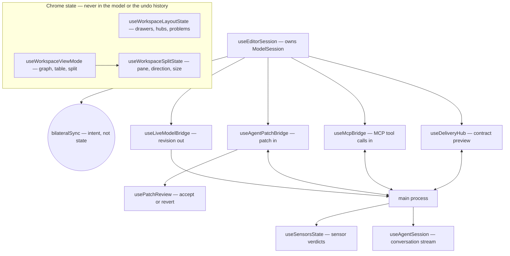
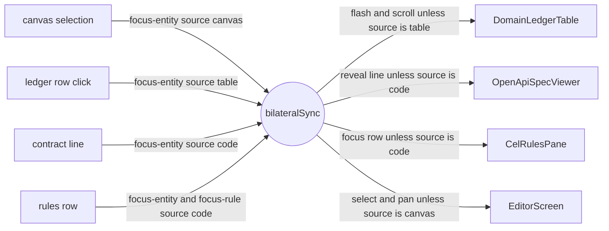
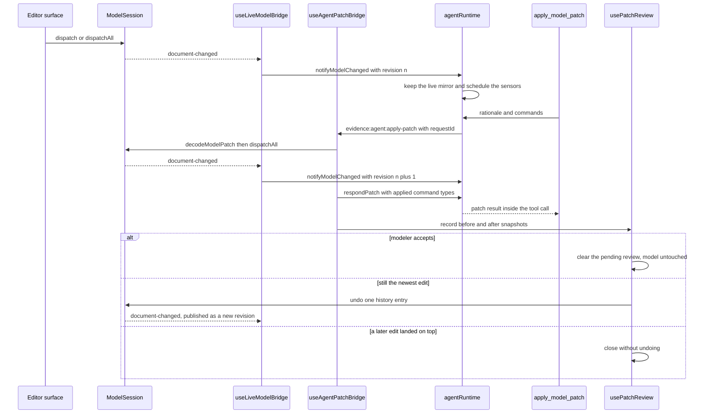

# Renderer state and cross-pane sync

The hooks under `apps/desktop/src/renderer/state` fall into three jobs, and the job
decides where their state lives:

1. **The session** (`useEditorSession`) owns the only `ModelSession` in the
   process. Every document, graph, selection and validation value in the editor is
   derived from it, so there is no second copy of the model to keep in step.
2. **The buses** (`useBilateralSync`, `useWorkspaceLayoutState`,
   `useWorkspaceViewMode`, `useWorkspaceSplitState`, `commandRegistry`) broadcast
   intent. They hold chrome state or nothing at all; a pane learns "show this
   object" from a bus instead of from a callback threaded down from the shell.
3. **The bridges** (`useLiveModelBridge`, `useAgentPatchBridge`,
   `usePatchReview`, `useMcpBridge`, `useDeliveryHub`, `useSensorsState`,
   `useAgentSession`, `useReviewExport`) publish edits outward, absorb edits
   coming in from the main process — the Pi agent, MCP tools, the delivery
   projection, the sensor report — or hold the result of one of those round trips.

`EditorWorkspace` in `EditorScreen.tsx` composes all of them in one component; each
hook returns a controller (`state` plus actions) rather than reading a global store,
which is why the whole editor can be tested with a scripted `window.evidenceAPI`
(`repo://apps/desktop/src/renderer/screens/EditorScreen.tsx#L176-L230`). One hook
sits outside the three jobs: `useEditorShortcuts` owns no state at all — the screen
builds one handler table from the controllers and the hook binds it to window
keydowns (`repo://apps/desktop/src/renderer/screens/EditorScreen.tsx#L550-L601`,
`repo://apps/desktop/src/renderer/state/useEditorShortcuts.ts#L1-L70`).

The diagram shows what each hook is allowed to touch: only the bridges dispatch into
the session, the focus bus carries a selection derived from it, layout state owns
nothing but chrome, and every round trip to the main process goes through one bridge.

## The session is the single source of truth

`useEditorSession` creates the `ModelSession` once, in a ref, from the document the
editor was opened with. `readState` then rebuilds the whole snapshot — `document`,
`graph`, the lifecycle swimlane `layout`, `selection`, `canUndo`, `canRedo`,
`validation` — from that session on every commit, and a `version` counter is bumped
by the session subscription so the memo re-runs after every event
(`repo://apps/desktop/src/renderer/state/useEditorSession.ts#L36-L135`).

The subscription is registered in a **layout effect**, not a passive effect, so it
exists before paint and before an incoming agent patch or MCP call can dispatch:
a first document change can never be missed by the editor
(`repo://apps/desktop/src/renderer/state/useEditorSession.ts#L99-L121`,
`repo://apps/desktop/src/renderer/state/useEditorSession.ts#L122-L140`).

What the hook adds around the session:

| Concern | Behaviour |
| --- | --- |
| `dirty` | set by any `document-changed` event, cleared only by a successful save or reload |
| `save` | `projects.save({rootPath, document: session.getDocument()})`; a failure lands in `saveError` and keeps `dirty` |
| `reloadFromDisk` | `projects.open` then `session.replaceDocument(document, {resetHistory: true})`, clearing `dirty` and the external-change mark |
| `externalChangeAt` | set from `projects.onChanged`, shown as a banner; the canvas is never replaced silently |
| `viewMode` | passed in for the layout calculation only; it is not document state |

Saving, reloading and the external-change mark are implemented in
`repo://apps/desktop/src/renderer/state/useEditorSession.ts#L141-L176`.

Because every edit path funnels through `session.dispatch` / `session.dispatchAll`,
one undo history covers the inspector, the keyboard, an agent patch and an MCP
patch. Each bridge only chooses a different history label: `agent:<rationale>` for
the Pi agent and `mcp-patch` for an external MCP client
(`repo://apps/desktop/src/renderer/state/useAgentPatchBridge.ts#L38-L56`,
`repo://apps/desktop/src/renderer/state/useMcpBridge.ts#L302-L318`). Command
semantics and history live in
[Commands, guards and the model session](../model/commands-and-session.md).

Two snapshots matter to the bridges below: `state.document` is the current,
possibly unsaved model, and `initialDocument` is the document the editor opened
with. The latter is the *baseline* handed to the live model bridge and the delivery
hub, so neither treats a save as an implicit acceptance of every change
(`repo://apps/desktop/src/renderer/screens/EditorScreen.tsx#L183-L196`).

## The bilateral focus bus

`bilateralSync` is one module-level `BilateralSyncBus` per editor window (each
window is its own renderer process, so the bus never crosses a window). Its
contract is deliberately small and worth stating exactly:

- **Two event kinds.** `focus-entity` carries `{entityId, attributeName, source,
  token}` and `focus-rule` carries `{ruleId, entityId, source, token}`. `source` is
  one of `canvas`, `table`, `code`, `command`.
- **The bus stamps the token.** Callers build a `BilateralRequest` (the event
  without `token`); `emit` returns the event with `token: ++this.token`. The counter
  only ever increases, so asking for the object that is already focused is still a
  new request and a pane can react to it again.
- **Nothing is retained.** There is no current value, no replay and no history: a
  listener that mounts late sees nothing. The workspace's own selection is the
  state; the bus carries only the gesture.
- **Fan-out is over a copy.** `emit` iterates `[...this.listeners]`, so a pane that
  unsubscribes while handling an event cannot make the remaining listeners skip.
- **Each pane ignores its own source.** The ledger drops `source === 'table'`, the
  contract viewer and the rules pane drop `source === 'code'`, and the shell drops
  `source === 'canvas'`. That is why no prop-drilled callback chain is needed:
  adding a direction of sync used to touch four files, and now a pane only has to
  say which source it is.

All of that is `repo://apps/desktop/src/renderer/state/useBilateralSync.ts#L1-L109`,
and the token behaviour is pinned by
`repo://apps/desktop/src/renderer/state/useBilateralSync.spec.tsx#L12-L57`.

One request, four independent decisions about how to show it.

**The shell is the resolver, not the relay.** The workspace selection is announced
by an effect keyed on `state.selection.nodeId` / `attributeName`, so the panes
follow *any* selection change — canvas click, inspector edit, sensor jump, MCP call,
undo — without knowing who caused it
(`repo://apps/desktop/src/renderer/screens/EditorScreen.tsx#L411-L421`). The
returning direction is resolved in one place: `focusFromPane` ignores the canvas's
own announcement, refuses an object the layout does not contain, drops a scope that
would hide the target, selects the attribute and issues a pan request; `showRulesPane`
switches an already-open split stage to the CEL pane and does nothing when the stage
is closed or the request came from the pane itself
(`repo://apps/desktop/src/renderer/screens/EditorScreen.tsx#L423-L449`).

Panes use the token to survive repeats: the ledger stores
`{entityId, token}` as a flash that times out, and the contract viewer passes the
requested `{line, token}` pair into the editor's reveal effect, so a second request
for the same object re-reveals it instead of being swallowed by an unchanged value
(`repo://apps/desktop/src/renderer/components/ledger/DomainLedgerTable.tsx#L166-L201`,
`repo://apps/desktop/src/renderer/components/split/OpenApiSpecViewer.tsx#L53-L91`).

Handlers passed to `useBilateralSync` must be `useCallback`s: the hook resubscribes
when the handler identity changes, which is correct but would make every pane a
fresh listener on every render with a stale closure half the time
(`repo://apps/desktop/src/renderer/state/useBilateralSync.ts#L90-L109`).

## Bridges that publish or absorb edits

### The live revision, and why ordering matters

`useLiveModelBridge` subscribes to the session and publishes one
`agent.notifyModelChanged` call per `document-changed` event, plus one on mount so
the main process learns the document the editor opened with. Each call carries
`{rootPath, revision, document: session.getDocument(), baseDocument}` where
`revision` is a per-hook counter incremented *before* the send
(`repo://apps/desktop/src/renderer/state/useLiveModelBridge.ts#L1-L45`).

The ordering rule is stated in the file itself and is the reason the pair of hooks
is split: **the publish happens before the patch acknowledgement**. `dispatchAll`
notifies session subscribers synchronously, so the model-changed IPC is issued
inside the dispatch; the `respondPatch` call in `useAgentPatchBridge` happens after
`dispatchAll` returns. The main process is therefore handed the new document and the
new revision before the agent's tool call can resolve — the next tool the agent
calls reads the edit it just made (`repo://apps/desktop/src/renderer/state/useAgentPatchBridge.ts#L38-L56`,
`repo://apps/desktop/src/renderer/state/useLiveModelBridge.spec.tsx#L14-L36`).

On the main-process side that document becomes the runtime's `live` mirror, which
`loadDocument` and every sensor run read; a revision that is not greater than the
one already held is ignored, and a new revision also clears `latestReport` and
re-arms the debounced sensor run
(`repo://apps/desktop/src/main/agentRuntime.ts#L110-L133`,
`repo://apps/desktop/src/main/agentRuntime.ts#L225-L238`). The editor then treats a
sensor report as stale whenever `report.documentRevision` differs from
`liveModel.revision`, so findings can never describe a different edit than the one
on screen (`repo://apps/desktop/src/renderer/screens/EditorScreen.tsx#L228-L244`;
sensor publication is covered in
[Sensor orchestration and the stage gate](../agents/sensor-orchestration.md)).

Failures are recorded only for the newest revision: a superseded rejection cannot
clear or overwrite the message of the edit that came after it, and the message is
rendered as a `role="alert"` strip above the studio.

The sequence covers edit, publish, patch, acknowledge and both review outcomes:
accepting writes nothing, reverting is a plain session undo, and that undo is
published like any other edit.

Three counters exist in the renderer and they are deliberately independent: the
live-bridge revision (what sensor freshness is compared against), a `revisionRef`
in the editor screen that bumps on every document change and is what MCP
`get_app_state` reports as `documentRevision`, and a delivery `generation` counter.
Each guards its own consumer; nothing orders one against another
(`repo://apps/desktop/src/renderer/screens/EditorScreen.tsx#L266-L279`,
`repo://apps/desktop/src/renderer/state/useMcpBridge.ts#L45-L52`).

### Agent patches: applied first, reviewed after

`useAgentPatchBridge` registers `agent.onApplyPatch` in a layout effect, so the
listener is live before paint. Handling one patch is four steps: snapshot
`session.getDocument()` as `before`, `decodeModelPatch` the wire commands,
`dispatchAll(commands, 'agent:<rationale>')` as one history entry, answer
`respondPatch({success: true, appliedCommands})`, and only then hand
`{rationale, commands, before, after}` to the caller. Decoding or a command guard
throwing answers `{success: false, error}` and calls no `onApplied`, so a rejected
patch never becomes a review and never touches the document
(`repo://apps/desktop/src/renderer/state/useAgentPatchBridge.ts#L1-L72`).

The round trip, the 15 s timeout and the "editor window closed" answer belong to the
main process and are documented in
[Desktop shell, windows and project lifecycle](./app-shell.md).

### Patch review: revert is one step or none

`usePatchReview` turns the recorded `AppliedPatch` into what the review bar shows:
rationale, command types, added / removed / modified ids from `diffDomainModels`,
an overlay whose marks are the changed objects, and `revertable`. `revert` calls
`session.undo()` only while `session.getDocument() === patched.after` — identity,
not deep equality — because a later human edit or newer patch makes taking the
patch back mean discarding work the reviewer did not ask to lose. `accept` clears
the pending review and touches nothing
(`repo://apps/desktop/src/renderer/state/usePatchReview.ts#L59-L114`).

The card, the surfaces that render it and the keys that settle it are covered in
[Ingestion and agent patch review](./ingestion-and-patch-review.md).

### MCP tool calls answered from the live session

`useMcpBridge` subscribes once (`[]` dependencies) and answers from a `latest` ref
that is refreshed on every render, so a long-lived subscription still sees the
current document, graph and sensor report. It answers five renderer-only methods
(`repo://apps/desktop/src/renderer/state/useMcpBridge.ts#L202-L285`):

| Method | Answer |
| --- | --- |
| `get_app_state` | project root, model id and version, `documentRevision`, selection, sensor summary, fixed `mcp` counters |
| `get_domain_model` | the document, optionally narrowed to one context (its entities, the relationships between them, its rules) and optionally without rules |
| `get_selected_entity` | entity plus `attributeName`, owning context, incoming/outgoing relationships, derivation rules, fulfillment pair — or `NO_SELECTION` |
| `get_capture_rect` | the CSS-pixel rectangle to screenshot, or `null` |
| `apply_model_patch` | decode, `dispatchAll(decoded, 'mcp-patch')`, `validate()`, `revision + 1` on success, `undoable`, diagnostics |

An unknown method is answered with an `INTERNAL_ERROR` response instead of being
left hanging.

Two properties of `apply_model_patch` matter operationally: guards run *during*
dispatch, so a red-line violation rejects the batch atomically; `validate()` runs
*after* dispatch and its issues come back as `severity: 'block'` diagnostics without
rolling anything back, which leaves the undo decision to the modeler
(`repo://apps/desktop/src/renderer/state/useMcpBridge.ts#L302-L352`;
the same asymmetry is stated in
[MCP integration](../agents/mcp-integration.md)).

**Capture geometry is the renderer's job.** The renderer knows its own layout, so it
resolves the rectangle and the main process only runs `webContents.capturePage`:
`captureRect` reads `[data-region="canvas-viewport"]`, the stage and the optional
`[data-node-id]`, and `resolveCaptureRect` intersects the target (or the stage) with
the visible viewport, clamps to integer pixels, and returns `null` when the canvas
is not laid out. `VIEWPORT_INSET` is `0` because the rulers that used to own 24 px
are gone (`repo://apps/desktop/src/renderer/state/useMcpBridge.ts#L25-L31`,
`repo://apps/desktop/src/renderer/state/useMcpBridge.ts#L161-L200`,
`repo://apps/desktop/src/renderer/state/mcpCapture.ts#L11-L73`).

Capture mode is also renderer state: `mcp.onCaptureMode` sets
`document.body.dataset.evidenceCapture`, and the main process turns that flag on
before `capturePage` and off again in a `finally`, so hidden chrome never outlives
the screenshot (`repo://apps/desktop/src/renderer/state/useMcpBridge.ts#L291-L299`,
`repo://apps/desktop/src/main/mcpBridgeRuntime.ts#L126-L136`).

### The delivery preview: one debounced subscription for the editor's lifetime

`useDeliveryHub` subscribes to the same session but asks the main process to project
the *unsaved* document into a delivery contract. It debounces 150 ms, increments a
`generation` counter per request, and refuses three things: a reply for an older
generation, a failure result, and an `analysis.revision` that does not match the
revision it asked for (`API 预览版本不匹配。`). A reply that arrives for a
superseded generation is dropped entirely; a failed reply clears `analysis`, sets
`error` and leaves `stale: true`
(`repo://apps/desktop/src/renderer/state/useDeliveryHub.ts#L61-L106`).

The accepted `{input, analysis}` pair is retained so `exportDelivery` writes exactly
the revision that was previewed: the export call re-sends the retained input plus
`expectedModelDigest` from the analysis, and refuses while `busy`, while nothing is
accepted, or while `analysis.canExportDraft` is false
(`repo://apps/desktop/src/renderer/state/useDeliveryHub.ts#L117-L136`). The hook is
mounted once for the editor, not per modal, which is why opening the delivery hub
does not re-request the projection
(`repo://apps/desktop/src/renderer/state/useDeliveryHub.ts#L43-L50`).

### Sensor verdicts

`useSensorsState` is a cache in front of the main process: it asks for
`latestReport`, triggers a run only when there is none, and then updates from the
pushed `report` channel, ignoring payloads for another `rootPath`. `refresh()`
re-runs on demand and is what the problems panel, the command palette and the
post-save effect call, bypassing the main process debounce
(`repo://apps/desktop/src/renderer/state/useSensorsState.ts#L15-L87`).

### The conversation stream

`useAgentSession` folds exactly five stream events — `text-delta`,
`tool-call-started`, `tool-call-completed`, `agent-settled`, `agent-error` — into
one state: transcript text capped at the last 8,000 characters, an activity list
keyed by `toolCallId` with `running` / `completed` / `failed`, the active tool name
for the status line, and an error. `submit` decides from its own `running` flag
whether the text is a `prompt` or a `steer`, clears transcript and activities only
when a new run starts, and ends the run in `finally` so a rejected IPC call cannot
leave a spinner; `rootPath` changing resets the whole state
(`repo://apps/desktop/src/renderer/state/useAgentSession.ts#L32-L190`).

This hook reads events and calls three methods; it never touches the session. The
remaining hook, `useReviewExport`, is the same shape for the offline review page: the
main process owns the dialog and the generation, and the hook only guards against a
second concurrent export with a `pending` ref and maps the result into one notice,
where a cancelled dialog produces no notice at all
(`repo://apps/desktop/src/renderer/state/useReviewExport.ts#L46-L78`).

## Workspace chrome: layout, view mode and split

`useWorkspaceLayoutState` is one object describing everything that covers the
canvas: the open rail tab, whether that drawer is pinned (layout width) or floating
(over the canvas), the problems panel and the issue it was opened on, the inline
copilot, and the single `activeHub` (`delivery`, `simulation` or `review`). Its
rationale is stated in the file: per-panel `useState` inside the screen meant
opening one panel re-rendered the studio and a cross-panel move needed side effects
in two components (`repo://apps/desktop/src/renderer/state/useWorkspaceLayoutState.ts#L63-L110`).

Two asymmetries are deliberate:

- the **diagnostics** rail button toggles the problems panel under the canvas
  instead of a drawer, because a finding is read while looking at the object it
  names — the rail still owns the button, the chord and the highlight;
- **hubs are exclusive**: opening `review` while `delivery` is open replaces it
  rather than stacking.

`Mod+1..4` map to the rail tabs in `RAIL_TABS` order, are read from `event.key`
only for digits, and are ignored when another surface already handled the event, a
text field or CodeMirror has focus, or Alt/Shift is down
(`repo://apps/desktop/src/renderer/state/useWorkspaceLayoutState.ts#L112-L194`).

`useWorkspaceViewMode` owns which surface the centre stage shows and is explicitly
**view state**: it never enters the model, the undo history or a saved file. `V`
flips graph and table, `Alt+1/2/3` names graph, table and split, and the digits are
read from `event.code` because macOS turns `Alt+2` into `™`. The hook bails out on
`defaultPrevented`, on a modifier combination for the letter toggle, and on any
editable target including `.cm-editor`
(`repo://apps/desktop/src/renderer/state/useWorkspaceViewMode.ts#L36-L103`).

The chord split is a rule, not a preference: the rail owns the bare `Mod` digits
because it is the top-level switch, and the three view modes sit one modifier
further out, so a chord never means two things
(`repo://apps/desktop/src/renderer/state/useWorkspaceViewMode.ts#L61-L72`,
`repo://apps/desktop/src/renderer/state/commandRegistry.ts#L84-L91`).

`useWorkspaceSplitState` keeps the secondary stage's pane, direction and size, and
deliberately does **not** keep a second "is split open" boolean: `isSplit` is derived
from the view mode, so the segmented control and the visible column cannot disagree.
`openSplit(pane)` sets the pane and switches the mode; `closeSplit` returns to
`graph` while the pane survives, so reopening lands where the modeler left
(`repo://apps/desktop/src/renderer/state/useWorkspaceSplitState.ts#L59-L112`).

`commandRegistry.ts` is the keyboard surface over all of the above. `buildCommands`
is a pure function of `CommandCapabilities` (`canUndo`, `canRedo`, `dirty`, `busy`,
`viewMode`, `hasSelection`) and `CommandHandlers` (the same handlers the header
buttons call), so a palette row cannot drift from the control it replaced. Disabled
rows stay in the list with a reason — "先保存：正式审查只读取磁盘快照" for a dirty
model, "正在导出，请等待当前导出完成" while busy — because a greyed-out row
explains itself and a missing row only says the feature is gone. `CHORDS` is the one
place the printed key caps come from, and `groupCommands` buckets in
`COMMAND_GROUPS` order, skipping empty categories
(`repo://apps/desktop/src/renderer/state/commandRegistry.ts#L76-L170`,
`repo://apps/desktop/src/renderer/state/commandRegistry.ts#L372-L385`).
`useCommandRegistry` memoizes on those two objects, which the caller must memoize in
turn or the palette would resort mid-typing
(`repo://apps/desktop/src/renderer/state/useCommandRegistry.ts#L8-L25`).

## Testing state without Electron

`installDesktopApi` replaces `window.evidenceAPI` with a scripted implementation and
returns a mock that is both the API and the test harness: `calls` logs every IPC
call by channel, `agentMock` streams events and reports, requests a patch and
collects the patches' answers and published canvas contexts, and `mcpMock` requests
tool calls, collects responses, toggles capture mode and broadcasts status — so no
state hook test needs a socket, a model, or a window
(`repo://apps/desktop/src/renderer/test-support/desktopApi.ts#L99-L171`,
`repo://apps/desktop/src/renderer/test-support/desktopApi.ts#L415-L470`).

The focused specs pin the behaviours that would silently rot:

- `useBilateralSync.spec.tsx` — every request gets a new token, unsubscribing stops
  delivery, a listener that unsubscribes mid-emit does not skip the rest, and the
  hook routes each event kind to its handler
  (`repo://apps/desktop/src/renderer/state/useBilateralSync.spec.tsx#L12-L109`).
- `useLiveModelBridge.spec.tsx` — published once on mount, once per document
  transition and never for a selection change, with the editor-open baseline kept
  across undo/redo and no publish after unmount
  (`repo://apps/desktop/src/renderer/state/useLiveModelBridge.spec.tsx#L14-L45`).
- `useAgentPatchBridge.spec.tsx` — a patch is undoable, a guard rejection and a
  malformed patch are both reported with their message and change nothing, the
  before/after pair reaches the review, and a rejected patch is never reported as
  applied (`repo://apps/desktop/src/renderer/state/useAgentPatchBridge.spec.tsx#L32-L160`).
- `usePatchReview.spec.tsx` — the review names added, removed and modified ids,
  carries the overlay marks, reverts while newest, and refuses to revert after a
  later edit (`repo://apps/desktop/src/renderer/state/usePatchReview.spec.tsx#L104-L189`).
- `useDeliveryHub.spec.tsx` — debounced projection, selection changes ignored,
  baseline retained, an older reply dropped even when it lands during the next
  debounce interval, the frozen snapshot exported, timers cancelled at unmount
  (`repo://apps/desktop/src/renderer/state/useDeliveryHub.spec.tsx#L37-L114`).
- `useMcpBridge.spec.tsx` — app state with the document revision, context filtering,
  `NO_SELECTION`, an undoable external patch, a guard rejection reported instead of
  thrown, `null` geometry without a layout, and an unknown method answered
  (`repo://apps/desktop/src/renderer/state/useMcpBridge.spec.tsx#L57-L243`).
- `useWorkspaceLayoutState.spec.ts`, `useWorkspaceSplitState.spec.ts` and
  `useWorkspaceViewMode.spec.tsx` pin the chords, the exclusive hub, the derived
  split flag and the typing guards.
- `EditorScreen.spec.tsx` is the integration net: drawers, hubs, the patch review
  shown and reverted on Escape, and "scope and view mode stay out of the undo
  history".

## Failure behaviour

| Situation | Result |
| --- | --- |
| a live-revision publish rejects for the newest edit | `liveModel.error` set, an alert strip above the studio, diagnostics forced stale |
| an older revision's publish rejects late | ignored, the newer call's state stands |
| agent patch rejected by a guard | `{success: false, error}` to the main process, no review recorded, document untouched |
| patch never answered by a renderer | main process times out after 15 s with a retry message |
| MCP patch rejected | `success: false` with the guard's code as diagnostic code, nothing dispatched |
| MCP validation issues after dispatch | applied, returned as blocking diagnostics; undo is the modeler's decision |
| undocumented MCP method | `INTERNAL_ERROR` response, caller never hangs |
| no canvas layout for a capture | `get_capture_rect` answers `null` |
| delivery preview failure or revision mismatch | analysis cleared, `error` set, `stale` stays true, export disabled |
| export requested while stale or busy | refused; nothing is written |
| sensor report describes another revision | findings hidden rather than misattributed to the objects on screen |
| agent run fails or is aborted | `error` set, `running` false, no stuck spinner |

## Related pages

- [Desktop shell, windows and project lifecycle](./app-shell.md) — the main process
  side of every IPC channel these hooks use.
- [Canvas layout, viewport and inspector](./canvas-and-inspector.md) — selection,
  scope and the canvas commands that issue the focus requests.
- [Workspace surfaces and drawers](./workspace-surfaces.md) — the rail, hubs and
  panels that this layout state projects onto.
- [Ingestion and agent patch review](./ingestion-and-patch-review.md) — the review
  card, its two hosts and the keys that settle a patch.
- [The Pi agent harness and its tools](../agents/pi-harness.md) — the conversation,
  the tool surface and the patch round trip.
- [MCP integration](../agents/mcp-integration.md) — the socket, the toolset and the
  request routing behind `useMcpBridge`.
- [Sensor orchestration and the stage gate](../agents/sensor-orchestration.md) — how
  a report is produced, stamped with a revision and indexed onto objects.
- [Delivery routes and API diff](../contracts/delivery-routes-and-diff.md) — what the
  live delivery preview projects and diffs.
- [Commands, guards and the model session](../model/commands-and-session.md) — the
  session API every renderer edit goes through.
