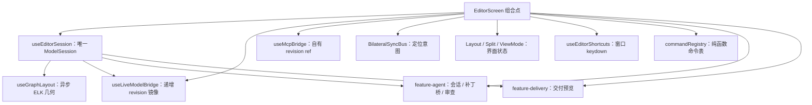

# Renderer 组合、会话与状态所有权

渲染进程没有应用级 store。状态按所有权分三层：`EditorScreen` 只负责打开项目并把各 hook 拼在一起；`apps/desktop/src/renderer/state` 里的 app 级 hook 持 `ModelSession`、实时镜像、定位 bus、workspace chrome 与命令表；`libs/desktop/feature-*` 持自己的 UI、hook 与测试，通过注入的窄 API port 与共享领域对象（session、document、overlay 类型）接入，而不是读全局或共享一份可变状态。

图：会话由 app 级 hook 独占，feature 库只收到 session 与窄 port；几何、界面状态与键盘各自独立。

## 组合点：一个窗口一个工作区

`App` 用 hash 路由（`parseRoute`）在 dashboard 与 editor 之间选择，`EditorScreen` 只做一件事：`projects.open(rootPath)`，`rootPath` 为空时显式报错而不是渲染空画布。成功后以 `key={rootPath}` 渲染 `EditorWorkspace`，所以换项目就是重挂载——上一个窗口的 `ModelSession`、undo 历史、选择与 chrome 都不会跟着走。

`EditorWorkspace` 是唯一的组合点：会话与几何、两个主进程桥接（live model、MCP）与窗口内的双边定位 bus、workspace chrome、命令表、feature controllers（agent、delivery、sensors、story）各拿一份，屏幕本身是这些状态的投影。这里也是跨 feature 协调唯一被允许发生的地方（revision 对账、focus/zoom token、palette handler 表）。

## 会话与异步几何

`useEditorSession` 在 `useRef` 里为每个编辑窗口创建且只创建一份 `ModelSession`；订阅写在 `useLayoutEffect` 里，因此监听在 paint 之前、也在任何到达的 Agent patch 或 MCP 调用之前就位。每次 session 事件只做两件事：`document-changed` 置 dirty，然后递增 `version` 强制重算快照；`readState` 同步读取 document/graph/selection/history/validation，**几何不在 `readState` 里重建**。

几何交 `useGraphLayout(graph, viewMode, layoutMode)`：每次 effect 建 cancellation 标记，且发布前要求 `graph`、`viewMode`、`layoutMode` 与当前输入同一身份，否则返回 `EMPTY_LAYOUT` 并令 `layoutPending=true`；失败的请求发布空布局并写 `layoutError`。迟到的旧成功、旧失败与 unmount 之后的回调都不能污染新输入——宁可让画布显示"正在计算布局"，也不显示上一份模型的几何。

保存与重载的不变量：`save` 先取当前 document 发 `projects.save`，失败只写 `saveError` 并保留 dirty，成功才记 `savedAt`，并且只在 `session.getDocument() === document` 时清 dirty——保存期间又有人编辑，画布仍然是脏的。`reloadFromDisk` 显式 `projects.open` 后 `replaceDocument(..., { resetHistory: true })`，清外部提示与错误。`reloadFromDiskIfClean` 是 watcher 用的静默路径：已脏直接拒；读盘期间出现编辑或文档引用变化就放弃；内容用 `compactCanonicalJson` 比较，相等则不 replace，所以"自己保存触发的那次 watcher 通知"不会顺手毁掉 undo 历史。磁盘 watcher 本身只写 `externalChangeAt`。

## 实时镜像、定位与 revision 所有权

`useLiveModelBridge(rootPath, session, initialDocument)` 在 mount 时发布一次，之后**只**在 `document-changed` 时递增 revision 并发送 `{rootPath, revision, document, baseDocument}`；selection 变化不发模型。`baseDocument` 固定为打开时的文档，保存不被当作"接受全部变更"。发送在一个 ref 计数器里单调递增，只有编号等于最新一次的响应才允许清/写 `error`，因此旧 revision 的迟到失败不会覆盖新状态。session 的 emit 是同步执行的，`applyPatchBatch` 返回前实时镜像已经发出，`respondPatch` 在其后，下一个 tool read 看到的就是刚编辑的镜像（细节见 [Pi 运行时](../agents/pi-harness.md)）。main 侧保留这份 mirror 时只接受同一 root 且 revision 更大的那次发布，新 revision 会清掉旧报告并重新武装 debounce 的传感器运行，所以"单调"是发收两端共同维持的约束。

三个计数器各守自己的消费者，不构成全局事务时钟：

- live bridge 的 `revision` 是给 main 与传感器对账用的模型版本；
- `useMcpBridge` 在自己的 ref 里维护 revision——同一 session 上以 `Math.max` 对齐 prop，并对 `document-changed` 同步 `+1`，所以同一 React commit 之前的连续 IPC 补丁也算得对；它常驻一个 `onRequest` 订阅，每次请求都直接从 session 取最新的 document/graph 而不是信 render 期捕获的 ref，未知方法显式回 `INTERNAL_ERROR`；
- `useDeliveryHub` 用 generation 号，而不是 revision，来丢弃过期预览。

MCP 的编辑走同一个 session：一次 `applyPatchBatch` 原子应用，失败保持 revision 不变，只有真实变更才 `+1`，之后 `session.validate()` 的诊断作为 block 返回但不自动回滚——外部 agent 的修改因此和其他编辑一样是一条可撤销的历史。

消费方负责对账：`EditorScreen` 的 `diagnosticsStale` 在 `liveModel.error !== null`、`sensors.report.documentRevision !== liveModel.revision`、sensors 仍在加载或出错时为真，此时 `createDiagnosticIndex` 收到 `null`，画布与问题条宁可说"报告不可用"也不给过期诊断。

selection 走另一条通道：`agent.publishCanvasContext` 把当前选择与所选实体推给主进程，与模型 revision 无关；窗口内的跨面板定位则由 `BilateralSyncBus` 承担。bus 每窗口一个模块实例，只发 `focus-entity`（`entityId`/`attributeName`）与 `focus-rule`，带 `source` 与自增 token，不存当前值、不 replay；fan-out 复制 listener 集合，处理中退订不会跳过其他人；`source` 让 pane 忽略自己刚发出的请求，同一对象重复定位仍是新请求。shell 从 selection 变化公告 canvas 事件，反向事件集中校验对象存在、必要时解除会隐藏该对象的 scope。

## Chrome：视图模式、分屏与布局对象

`useWorkspaceViewMode` 持 `graph | table | split`：这是呈现状态，不进模型、不进 undo、不写盘。`V` 在非输入目标上翻 graph/table，`Alt+1/2/3` 用 `event.code` 命名模式（macOS 会把 `Alt+2` 变成 `™`，不能读 `key`），`Mod+数字` 留给 rail，先被消费（`defaultPrevented`）或正在编辑（含 CodeMirror 的 `.cm-editor`）的按键一律退让。

`useWorkspaceSplitState(mode, setMode)` 把 `isSplit` 派生自 `mode === 'split'`，不设第二个 boolean——否则分段控件可能一边显示"拓扑图"一边开着分屏列。它只额外持 `activePane`、`splitDirection`、`splitSize`；`closeSplit` 回到 graph 但保留 pane 与尺寸，`openSplit(pane)` 同时设 pane 与模式。

`useWorkspaceLayoutState` 用**一个对象**描述所有 chrome：`activeRailTab`、`isRailPinned`、`isProblemsPanelOpen`、`activeIssueId`、`isInlineCopilotOpen`、`activeHub`。`RAIL_TABS` 当前是 topology、diagnostics、drift、copilot、clauses、workshop 六个；`HubSurface` 只有 `delivery` 与 `drift`，一次只有一个。`toggleRailTab('diagnostics')` 是有意的例外：它不开 drawer，而是开关画布底部的问题条，因为问题要一边看对象一边读；`openProblemsWithIssue` 一次同时开面板并定位到某条 finding。`Mod+1..6` 由这个 hook 自己监听，忽略 `defaultPrevented`、带 Alt/Shift 的组合，以及任何 editable 目标。

## 命令表与键盘仲裁

`buildCommands(capabilities, handlers)` 是 `CommandCapabilities` 与 `CommandHandlers` 的纯函数：不可用的行（无 undo/redo、已是当前视图、无选区）保留在列表里并解释原因，而不是从 palette 里消失；`CHORDS` 是打印在行上的键帽的唯一来源；`COMMAND_GROUPS` 固定分类与顺序，`groupCommands` 按它分桶并跳过空组。`useCommandRegistry` 只对这两个 caller 记忆化过的对象做 `useMemo`——handlers 会随 session 身份变化，若在渲染中重建十几行，palette 就会在打字中途重排。

`EditorWorkspace` 的 `commandHandlers`、`shortcuts` 表与页头复用同一批 handler（save/undo/redo/视图/缩放/hub/rail/problems/agent），palette 不复制业务逻辑。数字键的键帽有两个维护点：`RAIL_TAB_CHORDS` 覆盖全部六个 rail tab，而 `CHORDS` 只给前四个 tab 印键帽，新增 tab 时两边都要改。

键盘的默认 owner 只有 `useEditorShortcuts` 一个 window `keydown`，但裁决主要靠"条件绑定"：只有 `patchReview.review !== null` 时 `EditorWorkspace` 才把 `acceptPatch`/`revertPatch` 放进 handler 表；只有 `split.isSplit` 时才绑 `closeSplit`。顺序是固定且被测试保护的：

1. `defaultPrevented` 最先——已经被界面消费的键不属于编辑器；
2. 无条件 chord：`Mod+S`（输入框里也保存）、`Mod+K` palette、`Mod+F` 搜索、`Mod+Shift+R` 重跑门禁、`Alt+Shift+S` 沙箱；
3. 待决补丁的 `Escape` → revert，**放在 typing guard 之前**：半读的补丁是屏幕上最要紧的事；
4. typing guard（输入框与 contenteditable 保留自己的键）；
5. `Escape` → 关分屏，优先于清选区；`Mod+Enter` → accept patch；`Mod+Z`/`Mod+Shift+Z`/`Mod+Y` → 历史；
6. `Escape` → 清选区，随后是 HUD 印出的缩放 chord。

rail 数字键与 `V`/`Alt+数字` 是两个独立的专门监听器，各只认自己的键，且都先看 `defaultPrevented`：rail 数字还要求不在 editable 目标里，视图模式的 `V` 同样退让、但带修饰键的 `Alt+数字` 允许在输入框内按。补丁审查的键盘语义与撤销安全性在 [资料摄取与补丁审查](./ingestion-and-patch-review.md) 里展开，模型事务与历史在 [模型事务与撤销](../model/commands-and-session.md)。

## Feature 库的注入约定

`libs/desktop/feature-*` 的生产代码不读 `window.evidenceAPI`、不 import 应用目录：渲染能力是作为窄 port 传进去的。

| hook | 注入的 port |
| --- | --- |
| `useAgentSession` | `Pick<EvidenceAgentApi, 'onEvent' \| 'prompt' \| 'steer' \| 'abort'>` + `rootPath` |
| `useAgentPatchBridge` | `Pick<EvidenceAgentApi, 'onApplyPatch' \| 'respondPatch'>` + `session` + `onApplied` |
| `useDeliveryHub` | `Pick<EvidenceDesktopApi['projects'], 'deliveryLivePreview' \| 'exportLiveDelivery'>` + `rootPath` + `session` + `baseDocument` |

`usePatchReview(session, document)` 干脆没有传输层，只读传入的 session 与当前 document。feature 库的 hook 都自带 spec，用 `nx run-many -t test,typecheck,lint -p desktop-feature-agent`（或 `desktop-feature-delivery`）自测。

分工由此确定：

- **留在 apps/desktop**：路由与窗口（`parseRoute`、`openEditorWindow` 之后的挂载）、项目服务（`projects.open/save/onChanged`）、sensors/MCP 通道、`useEditorSession`、`useGraphLayout`、`BilateralSyncBus`、workspace chrome、命令表与快捷键仲裁，以及跨 feature 的协调值（revision 对账、`diagnosticsStale`、focus/zoom token、`revisionRef`）。
- **留在 feature 库**：自己的组件、hook、presentation 与测试。Agent 的补丁原子应用与审查、交付预览的 generation/基线/精确导出都在库里，`EditorWorkspace` 只把 session、document、port 和回调交给它们。

`initialDocument` 同时作为 live bridge 与 delivery hub 的基线，两处都表达同一句话：保存模型不算接受全部变更。打开 hub 不会重新定义基线、也不会另订阅模型——`useDeliveryHub` 在编辑器生命周期内只订一次，弹窗的开关不影响它。

## 失败与过期语义

界面把"不知道"和"知道是坏的"分开表达，而不是用上一份数据兜底：layout pending/error 有独立提示；`liveModel.error` 在顶部作为 alert 出现（只反映最新一次发送）；delivery 在 `document-changed` 立即置 `stale` 并清 `analysis`，失败时清 analysis 并写 error；sensors 的报告版本与 live revision 不等时不给诊断；保存失败保留 dirty 与 `saveError`；磁盘变化只提示，从不静默覆写画布。

`useSensorsState` 也遵循"先问现状再开跑"：先读 `latestReport`，只有在没有任何报告时才触发一次运行，push 的报文按 `rootPath` 过滤，`refresh()` 则绕过主进程 debounce 立即跑一次。

## 测试 seam

`installDesktopApi`（`@evidence-poc/desktop-testing/desktopApi`）装上 scripted `window.evidenceAPI` 并返回调用日志：`calls` 记录 open/save/prompt/steer/modelChanged/delivery 等通道，`agentMock` 提供 `emitEvent`/`emitReport`/`requestPatch`/`patchResponses`/`canvasContexts`，`mcpMock` 提供 `request`/`responses`/`emitStatus`/`setCaptureMode`。UI 与 hook 测试因此不需要 Electron、socket 或真实模型。

hook 级 spec 守各层不变量：`useEditorSession.spec`（静默刷新、读盘期间的编辑、自己保存触发的 watcher 通知保 undo、保存期间编辑仍 dirty）、`useLiveModelBridge.spec`（mount 一次、selection 不发布、同步发布、unmount 后不再发）、`useGraphLayout.spec`、`useBilateralSync.spec`（token 自增、退订、fan-out）、`useWorkspaceLayoutState.spec`（diagnostics 开底部条、一次一个 hub、pin）、`useWorkspaceSplitState.spec`、`useWorkspaceViewMode.spec`（V 与 Alt 数字、rail 数字不被抢）、`useEditorShortcuts.spec`（`defaultPrevented` 让位、Escape 优先链、typing guard）。`EditorScreen.spec` 做集成验证：`Mod+1..4` 开 rail、`Alt+1/2` 与 `V` 换视图、`Alt+4` 契约分屏、`Cmd+J`/`Cmd+K`、agent patch 的 Escape 撤销与保留、`Cmd+0`/`Shift+1` 缩放，以及 scope 与视图模式不写进模型与历史。feature 侧的 `useAgentPatchBridge.spec`、`usePatchReview.spec`、`useAgentSession.spec`、`useDeliveryHub.spec` 随库运行，覆盖原子应用、回滚、后续编辑后不可撤销、debounce 竞态与精确导出。更上层的验证分层见 [验证策略](../testing/verification-strategy.md)。

相关：[Electron 宿主与 IPC 契约](./app-shell.md) · [工作区界面](./workspace-surfaces.md) · [ELK 画布与属性检查器](./canvas-and-inspector.md) · [资料摄取与补丁审查](./ingestion-and-patch-review.md) · [模型事务与撤销](../model/commands-and-session.md) · [MCP 集成](../agents/mcp-integration.md) · [传感器编排](../agents/sensor-orchestration.md)
