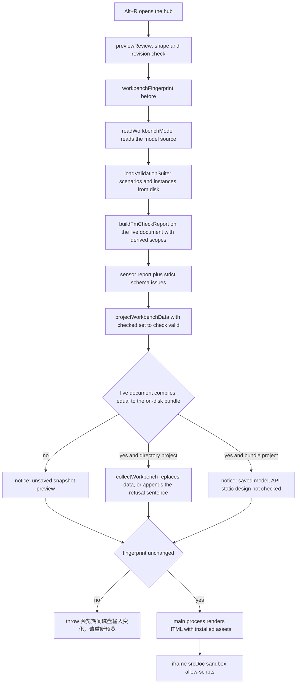
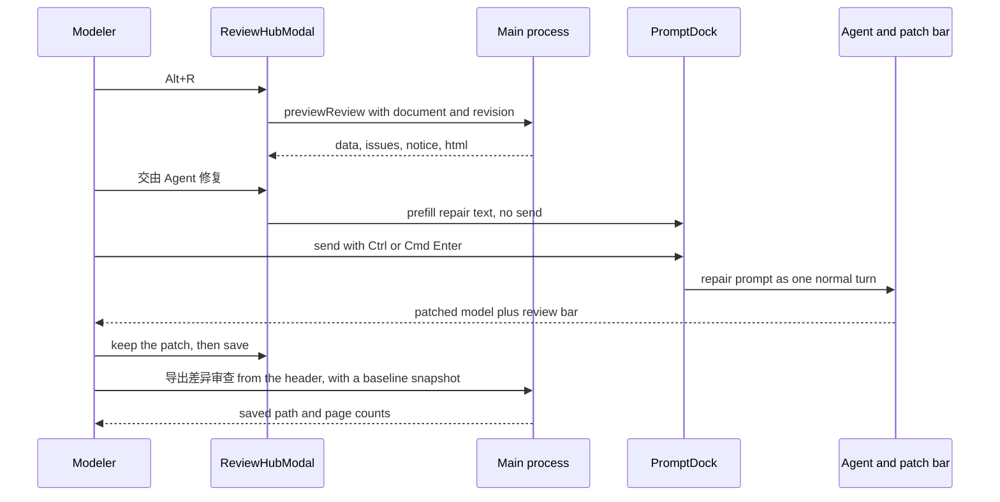

# The review hub and review export

The review hub is the in-app loop that turns "what does the machine say about this
model" into two different artefacts: a **preview** you read while still editing, and
an **exported page** you mail to someone else. `ReviewHubModal` owns the first; the
`exportReview` / `exportDiffReview` IPC calls own the second. They share one printer —
[the offline review workbench](../contracts/offline-workbench.md) — but they read
different sources on purpose.

| | 审查中心 preview (`previewReview`) | 导出审查页 / 导出差异审查 |
| --- | --- | --- |
| source of truth | the live `document` the renderer holds, plus the validation suite read from disk | the model source on disk only |
| allowed while editing | yes, unsaved edits included | no, both buttons are disabled while `dirty` |
| output | HTML built in the main process, shown in a sandboxed `iframe`, never written | a file the user names in a save dialog |
| failure | `{ success: false, error }` shown as an alert in the panel | `{ status: 'failed', error }` shown as a dismissible banner; IPC never throws |
| baseline | none | optional portable `*.evidence.json` for the diff page |

The two halves are also allowed to disagree about the answer, and the page says so:
the preview's notice names whether the snapshot was saved, whether scenarios came
from disk, and whether the API static design was checked.

## Opening the hub

`Alt+R` is a window-level shortcut that fires only when focus is not in a text field
(`isEditable` covers `INPUT`, `TEXTAREA`, `SELECT` and `contenteditable`), so typing
an `R` in the interview composer never opens a review
(`repo://apps/desktop/src/renderer/state/useEditorShortcuts.ts#L28-L56`). The header
carries the same entry as a button titled `审查中心（Alt+R）`
(`repo://apps/desktop/src/renderer/components/TopHeader.tsx#L148-L157`). Both set the
`reviewOpen` state in `EditorWorkspace`, so the hub is per-window UI state, not a
persisted panel (`repo://apps/desktop/src/renderer/screens/EditorScreen.tsx#L160-L180`).

While it is open the modal owns the keyboard: it is a `role="dialog"`
`aria-label="审查中心"` that focuses itself on mount, restores the previously focused
element on unmount, closes on `Escape`, and wraps `Tab` across
`button:not(:disabled), iframe` — the preview itself is in the cycle, so the embedded
page is reachable by keyboard too. `onKeyDown` calls `stopPropagation`, so the
editor's shortcuts do not fire underneath a review the modeler is reading
(`repo://apps/desktop/src/renderer/components/review/ReviewHubModal.tsx#L41-L87`).

### One snapshot per opening

The modal previews once when it mounts and never re-previews itself. The effect's
dependency list is intentionally empty, with the reason in a comment: edits must not
silently replace the review underneath a reader
(`repo://apps/desktop/src/renderer/components/review/ReviewHubModal.tsx#L41-L58`).
`刷新审查` is the only way to pull a new one, and it is disabled while a request is in
flight. A `request` counter is incremented for every call and compared before
`setResult`, so an out-of-order answer is dropped; the cleanup bumps the counter a
last time, which discards a response that arrives after the dialog closed.

## What a preview computes

`previewReview` is explicitly asymmetric: it validates the supplied live document
but *reads the scenario inputs* from disk, because scenarios and instances are part
of the validation suite the model does not carry
(`repo://apps/desktop/src/main/reviewPreview.ts#L29-L43`).



*What `previewReview` does in one request: the live document supplies the model, the
disk supplies the scenarios, and the page is only returned if the fingerprint held.*

Steps in order, with the pieces that matter to a reader of the panel:

1. **Input gate.** A document that fails `isDomainModelDocumentShape`, or a revision
   that is not a safe integer, throws `审查预览输入无效` before anything is read
   (`repo://apps/desktop/src/main/reviewPreview.ts#L33-L37`).
2. **Fingerprint first.** The disk digest is taken before the read and again before
   returning; a mismatch throws `预览期间磁盘输入变化，请重新预览`
   (`repo://apps/desktop/src/main/reviewPreview.ts#L38-L41`,
   `repo://apps/desktop/src/main/reviewPreview.ts#L118-L119`). The preview is bracketed
   even though it writes nothing, because its *inputs* are mixed.
3. **Scopes.** Entry Contexts that are nobody's child are handed to
   `buildFmCheckReport` as `scopeRefs` when any exist, so the preview's completeness
   verdict uses the same scope the export would
   (`repo://apps/desktop/src/main/reviewPreview.ts#L45-L57`).
4. **Findings.** The panel's list is the sensor report's issues plus
   `strictValidateDomainModel` issues, each forced to `severity: 'block'`,
   `source: 'check_fm'`, id `validation:<code>:<path>`, and a `targetNodeId` taken
   from the schema result's `objectId`. The comment states the rule: validation owns
   `objectId`, so the app must not infer a location by parsing prose gaps
   (`repo://apps/desktop/src/main/reviewPreview.ts#L58-L86`). An authoring document
   that fails strict validation therefore prints `validation.fm === false` and lists
   block issues instead of pretending the export gate passed
   (`repo://apps/desktop/src/main/reviewPreview.spec.ts#L63-L84`).
5. **Projection.** The page is projected with `checked: check.valid`, so the preview
   shows the verdict of *this* check rather than the collector's `true`
   (`repo://apps/desktop/src/main/reviewPreview.ts#L87-L97`).
6. **Saved or not.** `saved` means the live document compiles to the same JSON as the
   on-disk bundle. The default notice reads
   `编辑快照预览（未保存）；场景来自磁盘，API 静态设计未检查。机器检查不等于业务批准。`;
   a saved snapshot switches it to `已保存模型预览` and, for a directory project whose
   check is valid, the preview **upgrades itself** to the formal `collectWorkbench`
   result — full API and joint-review sections included — appending
   `API / 正式审查不可用：…` when that formal path refuses. Everything else, including
   every single-file `*.evidence.json` project, gets ` API 静态设计未检查。`
   (`repo://apps/desktop/src/main/reviewPreview.ts#L98-L117`).
7. **Render.** `reviewIpc` loads the install's assets, renders the HTML and merges it
   into the result; a thrown error becomes `{ success: false, error }`. The preview
   handler opens no dialog at all
   (`repo://apps/desktop/src/main/reviewIpc.ts#L119-L140`).

A preview publishes nothing: the test asserts the project directory still holds only
`.evidence/fm` afterwards, the fingerprint is unchanged, and an unsaved title still
reaches the page's `title`
(`repo://apps/desktop/src/main/reviewPreview.spec.ts#L40-L62`).

The panel itself prints the verdict line from `data.validation` — `一致性：通过/未通过`
and `完整性：完整/不完整/未检查`, the last one when `complete === null` — then the
issues, then the page in `<iframe title="业务对象工作台预览" sandbox="allow-scripts"
srcDoc={result.html}>`. `allow-scripts` without `allow-same-origin` is what keeps an
inlined page from reaching the app it is embedded in
(`repo://apps/desktop/src/renderer/components/review/ReviewHubModal.tsx#L116-L167`).

## When a review goes stale

Staleness is a numeric comparison, not a hash: `EditorWorkspace` keeps
`reviewRevision` and bumps it on every `state.document` change and every external
change notification, then passes it as `input.revision`
(`repo://apps/desktop/src/renderer/screens/EditorScreen.tsx#L165-L180`). The modal
computes `stale = result.success && result.revision !== input.revision`
(`repo://apps/desktop/src/renderer/components/review/ReviewHubModal.tsx#L25`).

A stale review is still readable — the notice, the findings and the iframe stay — but
it is no longer actionable: a banner reads
`模型已变更，此审查已过期。刷新后再定位或修复。` and both `画布定位` and
`交由 Agent 修复` are disabled, as is `刷新审查` while busy
(`repo://apps/desktop/src/renderer/components/review/ReviewHubModal.tsx#L109-L158`).
The rule is that acting on findings is a claim about the current model, so the model
and the review have to agree first; refreshing recomputes against the current
document and clears the banner. The component test pins exactly that: after
re-rendering with `revision: 2`, both buttons become disabled
(`repo://apps/desktop/src/renderer/components/review/ReviewHubModal.spec.tsx#L69-L99`).

## Findings become canvas jumps or repair prompts

Each finding row offers two exits, and both are gated:

- `画布定位` additionally requires `canLocate(issue)`. `EditorWorkspace` resolves the
  issue's `targetNodeId` (before any `#attribute`) or its `contextRef` against the
  current layout and returns true only for a node, a context group or a relationship
  edge, so a finding with no mappable target keeps the button disabled
  (`repo://apps/desktop/src/renderer/screens/EditorScreen.tsx#L480-L494`). Accepting
  the jump closes the hub and calls `focusIssue`, which selects the attribute row for
  `entity#attribute` targets and otherwise pans to the Context or edge geometry
  (`repo://apps/desktop/src/renderer/screens/EditorScreen.tsx#L234-L271`).
- `交由 Agent 修复` closes the hub, focuses the target the same way, and pushes a new
  `reviewPrompt` token into `PromptDock`
  (`repo://apps/desktop/src/renderer/screens/EditorScreen.tsx#L495-L504`).

The prompt text is built inline and is deliberately advisory: it names the code, the
message, the target and any `suggestion`, and instructs the agent to explain the
proposed change first rather than assume a business decision
(`repo://apps/desktop/src/renderer/screens/EditorScreen.tsx#L498-L504`). Nothing is
sent at that point — `PromptDock` only appends the text to whatever the modeler was
already writing (a non-empty draft is kept above the finding, separated by a blank
line), moves the caret into the composer, and de-duplicates by token
(`repo://apps/desktop/src/renderer/components/agent/PromptDock.tsx#L91-L100`). The
phase-4 loop test asserts the composer holds both the draft and the finding while the
agent API has recorded zero prompts, and that the prompt is sent only when the
modeler presses `Ctrl+Enter` (`Cmd+Enter` also sends)
(`repo://apps/desktop/tests/phase-4-review-loop.spec.ts#L60-L80`,
`repo://apps/desktop/src/renderer/components/agent/PromptDock.tsx#L214-L221`).

From there the normal patch discipline applies — the patch is already applied when
the agent's tool call returns, and the review bar offers keep-or-revert
([ingestion and agent patch review](./ingestion-and-patch-review.md#agent-patch-review-the-patch-is-already-applied)).



*The repair loop: a finding is prefilled, sent by the modeler, patched, kept, saved,
and only then exported.*

### Accepting a patch requires a save before a diff review

Both export buttons carry `disabled={exportReviewBusy || dirty}`, with tooltips that
say why: `请先保存；正式审查导出只读取磁盘快照` and `请先保存再与基线比较`
(`repo://apps/desktop/src/renderer/components/TopHeader.tsx#L158-L188`). A kept patch
leaves the document dirty, because `accept` only closes the review — it does not
touch the model — so the exit from the review loop is *accept, save, export*. The
phase-4 test walks the whole sequence: the diff export is disabled while the patch
review is pending, enabled after 保留 plus 保存, fires with the project root, and is
disabled again after `Ctrl+Z` re-dirties the model
(`repo://apps/desktop/tests/phase-4-review-loop.spec.ts#L98-L117`).

## Export: renderer side

`useReviewExport(rootPath)` is deliberately thin — it owns busy state, a single-flight
guard and the noticed outcome, nothing else; the renderer never reads the model tree
and a slow generation cannot block the canvas
(`repo://apps/desktop/src/renderer/state/useReviewExport.ts#L41-L78`). A second click
while a request is pending returns immediately (`pending` ref), so the save dialog
cannot stack. Results map to a banner: `saved` becomes `已导出审查页：<path>`,
`failed` becomes `导出失败：<error>`, and `cancelled` produces **no** notice at all,
because a dismissed dialog is not a result worth reporting
(`repo://apps/desktop/src/renderer/state/useReviewExport.ts#L19-L33`). The banner is
rendered above the workspace with a `知道了` dismiss button, and `saved` returns the
`ReviewPageCounts` the page contains so the app can confirm what was written
(`repo://apps/desktop/src/shared/projects.ts#L75-L85`).

## Export: main process

`registerReviewIpc` registers three channels under `projects`:
`evidence:project:preview-review`, `evidence:project:export-review` and
`evidence:project:export-diff-review`
(`repo://apps/desktop/src/shared/ipc.ts#L34-L48`). Both export channels run through one
`registerExport(diff)` closure, which normalizes `projectDirectoryOf(rootPath)` for
the page's surroundings and `modelSourceOf(rootPath)` for the model, resolves the
install's asset directory, and then differs only in the baseline step
(`repo://apps/desktop/src/main/reviewIpc.ts#L143-L213`):

| | `exportReview` | `exportDiffReview` |
| --- | --- | --- |
| first dialog | save dialog, default `<project dir>/review.html` | baseline open dialog, `选择基线模型快照（*.evidence.json）` filtered to `evidence.json` |
| second dialog | — | save dialog, default `<project dir>/diff-review.html` |
| extra input | none | `baselineDocument` read through `readDocument` |
| joint-review scopes | `reviewScopeRefs(...)` when `.evidence/api/api.json` exists | same rule |

`suggestedReviewFileName` puts `review.html` beside the project rather than in a dot
directory, on the reasoning that a page a colleague opens should not live in a hidden
folder (`repo://apps/desktop/src/main/reviewIpc.ts#L52-L54`). The baseline is read via
`readWorkbenchModel` and refused when it reports issues, as
`模型快照不可读：…`; there is no Git command and no project script in that path
(`repo://apps/desktop/src/main/reviewIpc.ts#L81-L91`,
`repo://apps/desktop/src/main/reviewIpc.ts#L109-L116`). The order is baseline **then**
save path, so a cancelled baseline writes nothing and never even asks where to put
the page — a test pins both halves
(`repo://apps/desktop/src/main/reviewIpc.spec.ts#L154-L205`). The current source is
passed through as `modelRoot` unchanged, so a bundle project stays a bundle project
while its baseline is a separate snapshot
(`repo://apps/desktop/src/main/reviewIpc.spec.ts#L180-L185`).

The generator itself decides whether the page may exist at all; every refusal
(FM gate, missing or incomplete scope, API overlay, moved inputs, foreign target file)
returns `{ status: 'failed', error }` carrying the library's sentence
(`repo://apps/desktop/src/main/reviewIpc.ts#L203-L216`,
`repo://apps/desktop/src/main/reviewIpc.spec.ts#L247-L263`). The full refusal table lives
in [the offline review workbench](../contracts/offline-workbench.md#failure-behaviour).

## A joint review needs a named scope

An API design makes the review *joint*: it claims the model delivers independent
Contexts. `reviewScopeRefs` derives exactly those — the manifest's
`entryContextRefs` that no Context claims as its child:

```ts
const parents = new Map(
  document.entities
    .filter((entity) => entity.category === 'context')
    .map((entity) => [
      entity.id,
      'parentContextRef' in entity ? entity.parentContextRef : undefined,
    ]),
);

return (document.manifest.entryContextRefs ?? []).filter(
  (ref) => parents.get(ref) === undefined,
);
```

(`repo://apps/desktop/src/main/reviewIpc.ts#L55-L76`)

Two consequences are visible in the test: a nested Context such as
`context.product-sourcing` (child of `context.product-procurement`) is dropped, so a
sub-context is never mistaken for a delivery boundary of its own, while the two root
Contexts survive (`repo://apps/desktop/src/main/reviewIpc.spec.ts#L77-L85`). The
derivation only looks the ref up in the parent map, so it does **not** re-verify that
the ref names a declared Context — the manifest's own claim is what travels to the
generator, and the collector remains the authority on whether that claim holds.

The reason the scope exists at all is the collector's refusal: once an API view is
requested, an empty scope list stops the run with
`联合审核需要显式 --scope，不能用一致性结果冒充范围完整性`. A consistency result is not
scope completeness, so an invented scope would be worse than a refusal — it would
claim a boundary the model never declared
(`repo://libs/evidence-visualization/src/generate/collectWorkbench.ts#L242-L252`).

The desktop keeps that rule but narrows when it applies: `scopeRefs` is passed only
when `.evidence/api/api.json` exists in the project directory, so a model-only project
exports the consistency view and is never told its scope is missing
(`repo://apps/desktop/src/main/reviewIpc.ts#L177-L185`). The preview derives the same
set inline, with one extra guard — the ref must resolve to a Context entity and have
no `parentContextRef` — so a manifest that names an unknown Context yields no scope
rather than a bogus one
(`repo://apps/desktop/src/main/reviewPreview.ts#L45-L57`).

## The baseline diff review

The diff page answers "what changed since the snapshot someone signed off", and its
baseline is always a file the modeler chose, never an undo stack and never Git. The
dialog title and filter say so, and the whole path is portable: the baseline is parsed
by `readWorkbenchModel`, which accepts a single `*.evidence.json`
(`repo://apps/desktop/src/main/reviewIpc.ts#L81-L91`,
`repo://libs/evidence-visualization/src/generate/readWorkbenchModel.ts#L8-L20`). The
default output name is `diff-review.html` because that is what the file is.

The comparison is then built by the generator, not the app: `projectWorkbenchDiff`
re-projects the baseline through the same whitelist and refuses an unrelated model
with `基线与当前模型 ID 不一致，不能进行差异审查`
(`repo://libs/evidence-visualization/src/projection/workbenchDiff.ts#L40-L47`). What
the page prints — counts, the baseline fingerprint, the separate baseline drawing with
old coordinates — is documented in
[the baseline diff page](../contracts/offline-workbench.md#the-baseline-diff-page).

## Failure behaviour

| Situation | What the modeler sees |
| --- | --- |
| preview input malformed | `审查预览输入无效` as a `role="alert"` line in the panel |
| sources changed during a preview | `预览期间磁盘输入变化，请重新预览` in the same alert line |
| formal review refuses a saved snapshot | the preview data plus a notice appended with `API / 正式审查不可用：…` |
| review opened, then the model edited or reloaded | stale banner; locate and repair disabled until `刷新审查` |
| unsaved edits present | both export buttons disabled, tooltip says to save first |
| baseline dialog dismissed | `{ status: 'cancelled' }`, no save dialog, nothing generated |
| save dialog dismissed | `{ status: 'cancelled' }`; the renderer shows no notice |
| generation refuses (gate, scope, assets, publish) | `{ status: 'failed', error }` rendered as `导出失败：…` |
| baseline from another model | diff generation fails; no page written |
| click while an export is running | ignored by the single-flight guard |

## Tests that protect this loop

- `ReviewHubModal.spec.tsx` — sandboxed `srcDoc` reuse, prefill instead of sending,
  the revision-bound disabling of both actions, the error/retry path, and the
  unlocatable finding
  (`repo://apps/desktop/src/renderer/components/review/ReviewHubModal.spec.tsx#L69-L122`).
- `phase-4-review-loop.spec.ts` — the end-to-end loop: `Alt+R`, repair prompt into the
  composer, a patch that is already applied, diff export disabled until save, and
  disabled again after undo
  (`repo://apps/desktop/tests/phase-4-review-loop.spec.ts#L21-L117`).
- `reviewPreview.spec.ts` — a portable bundle previewed without being treated as a
  directory, an unsaved snapshot that leaves the disk and the fingerprint untouched,
  and invalid authoring diagnostics shown rather than hidden
  (`repo://apps/desktop/src/main/reviewPreview.spec.ts#L30-L84`).
- `reviewIpc.spec.ts` — installed assets and no dialog for a preview, the failure
  envelope, cancelled dialogs generating nothing, the baseline-before-save order, the
  derived scopes, and the saved counts
  (`repo://apps/desktop/src/main/reviewIpc.spec.ts#L69-L263`). Suites and layering are
  described in [verification strategy](../testing/verification-strategy.md).

## Related pages

- [The offline review workbench](../contracts/offline-workbench.md) — the generator,
  projection, CSP and publisher behind both the preview HTML and the exported file.
- [Desktop app shell and IPC surface](./app-shell.md) — registration order, preload
  bridge, asset resolution and the failure envelope conventions.
- [Ingestion and agent patch review](./ingestion-and-patch-review.md) — what happens
  after a repair prompt returns an applied patch.
- [Pi harness](../agents/pi-harness.md) — the agent side of the repair turn.
- [Verification strategy](../testing/verification-strategy.md) — how the component,
  IPC and filesystem layers are tested.
- [Delivery handoff](../workflows/delivery-handoff.md) — the sibling hub that exports
  the contract, topology and deployment sketch.
