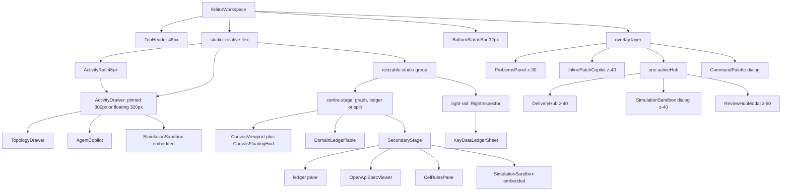
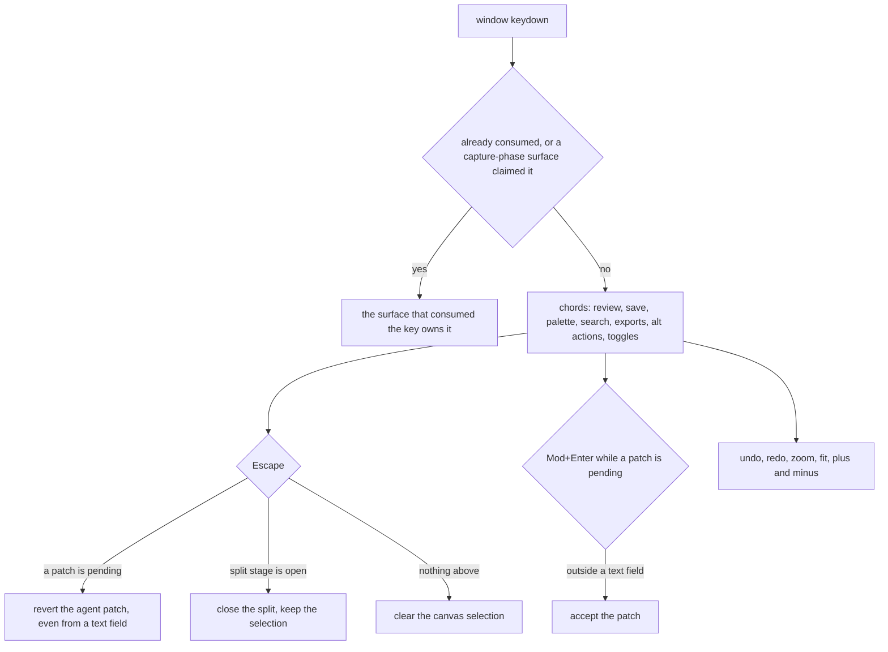

# Workspace surfaces, navigation and chords

One editor window is one studio, and `EditorWorkspace` in `EditorScreen.tsx` is the
only place that decides what is on screen
(`repo://apps/desktop/src/renderer/screens/EditorScreen.tsx#L791-L830`). Its shape is
three chrome rows and one overlay layer:

```
TopHeader                      48px, always present
[ rail 48px ][ drawer? ][ centre stage ][ right inspector ]   flexible
BottomStatusBar                32px, always present
overlay layer                  problems strip, inline copilot, hubs, palette
```

The comment at the top of the studio states the rule the whole layout follows: the
canvas owns every pixel the modeler is not actively using, so the surfaces that used
to be permanent columns — outline, diagnostics, sandbox, copilot — became buttons on a
48px rail that opens one drawer at a time
(`repo://apps/desktop/src/renderer/screens/EditorScreen.tsx#L807-L845`). There is no
left outline column and no bottom console drawer in this shell; the four-tab console
was replaced by the problems strip that slides under the canvas only while it is
asked for (`repo://apps/desktop/src/renderer/components/console/ProblemsPanel.tsx#L33-L40`).

## Surface inventory

"Blocks" means the surface renders as a modal dialog (`role="dialog"` plus
`aria-modal`) over the studio, not merely that it is visually large.

| Surface | Mounts where | Opened by | Blocks | Reads |
| --- | --- | --- | --- | --- |
| `TopHeader` | chrome row above the studio, 48px | always | no | `state.project.name`, `dirty`, `graph` + `selection` for the breadcrumb |
| `McpStatusPill` | inside `TopHeader` | always | no | `mcp.getStatus()` once, then the `mcp.onStatus` push |
| `ActivityRail` | left edge of the studio, `w-12` | always | no | its own `RAIL_ITEMS`; badges from `sensors.report` counts and `patchReview.review` |
| `ActivityDrawer` | studio, in flow (`w-[300px]`) when pinned, `absolute left-12 z-30 w-[320px]` when floating | `Mod+1..4`, a rail button, or a command | no | the drawer shell only (`title`, `pinned`, close/pin callbacks) |
| `TopologyDrawer` | inside the drawer, tab `topology` | `Mod+1`, `Mod+B`, `Mod+F` | no | `graph`, `layout` (`contextGroups`, `freeNodeIds`, `nodes`) and the shell's search term |
| `AgentCopilot` | inside the drawer, tab `copilot` | `Mod+4`, the palette row 「向 AI 建模副驾提问」, or the inline card's 「打开完整访谈」 | no | `useAgentSession` stream, `usePatchReview`, and the current `promptFocus` |
| `SimulationSandbox` (`embedded`) | inside the drawer, tab `simulation` | `Mod+3` | no | `simulation.replay` / `simulation.drift` through IPC |
| `ProblemsPanel` | `absolute inset-x-0 bottom-0 z-30 h-[38%]` over the studio | `Mod+2`, `Alt+X`, the status-bar verdict button, or a canvas diagnostic badge | no | the sensor report plus its stale flag |
| `CanvasFloatingHud` | bottom-centre of the canvas, supplied through the canvas `hud` render prop | always while the graph is visible | no | canvas controls (zoom, grid, minimap) plus the workspace's view mode, density, split target and pointer |
| centre stage | resizable panel `center-stage`, `minSize 35` | always | no | graph, ledger or split, per the view mode |
| `DomainLedgerTable` | the centre stage alone (`table`) or the split pane `ledger` | `V`, `Alt+2`, the HUD's view-mode segmented control, or the HUD's 「只看总台账」 | no | `document`, `session`, diagnostics, selection |
| `SecondaryStage` | resizable panel `split-secondary`, or `fixed inset-0 z-30` while maximised | `Alt+3`, `Alt+4`, the HUD's split popover, palette rows | no | the four panes it is handed as nodes |
| `OpenApiSpecViewer` / `CelRulesPane` | split panes `openapi` / `cel` | the stage's own tab rail | no | `delivery.analysis` (contract) and `document.rules` (rules) |
| `RightInspector` | resizable panel `right-rail`, default 20%, 14–26%, collapsible | always | no | `graph`, `session`, `selection` |
| `KeyDataLedgerSheet` | a `ui-kit` `Sheet` (a `Dialog` portal) opened from inside the inspector, 55vw from the right | `Alt+L` while an object is selected, the grid's 「台账」 button, the inspector footer | yes, as a modal sheet — the canvas stays mounted underneath | one entity, the graph and the session |
| `InlinePatchCopilot` | `absolute inset-x-0 bottom-16 z-40` over the canvas | `Mod+J` | no | the agent controller, the patch review, the selection as `promptFocus` |
| `DeliveryHub` | `fixed inset-0 z-40` dialog | `Alt+D` or the palette row 「打开交付契约（OpenAPI）」 | yes | the accepted `useDeliveryHub` analysis plus the draft preview |
| `SimulationSandbox` (hub) | `fixed inset-0 z-40` dialog | `Alt+Shift+S` or the palette row 「运行场景实例仿真」 | yes | the same simulation IPC, re-requested on mount |
| `ReviewHubModal` | `fixed inset-4 z-50` dialog | `Alt+R` or the palette row 「打开审查预览」 | yes, and it owns `Escape`/`Tab` | one `projects.previewReview` snapshot of the live document |
| `CommandPalette` | a `ui-kit` `CommandDialog` portal at `top-[15%]` | `Mod+K` or the header's 「快速命令」 button | yes (the dialog traps focus and owns `Escape`) | `buildCommands(...)` plus the canvas targets |
| `Toaster` | bottom of the window | the export-notice effect | no | `useReviewExport.notice` |

Two surfaces exist in the window but not in the table because they are not
destinations: the live-sync alert strip (`role="alert"`, rendered between the header
and the studio only while `liveModel.error` is set) and the load/error screens of
`EditorScreen` itself, which replace the workspace entirely when a project path is
missing or `projects.open` fails
(`repo://apps/desktop/src/renderer/screens/EditorScreen.tsx#L804-L806`,
`repo://apps/desktop/src/renderer/screens/EditorScreen.tsx#L126-L152`).

The ingestion modal is not an editor surface at all — `IngestDraftModal` mounts on the
dashboard (`repo://apps/desktop/src/renderer/screens/DashboardScreen.tsx`), which is
the shell's business ([Desktop shell, windows and project lifecycle](./app-shell.md)).



The map of the studio: one rail, one drawer, one centre stage, one inspector, and a
single overlay layer for everything that only appears while it is needed.

Every surface carries a `data-region` (or `data-rail-tab`, `data-pane`,
`data-direction`, `data-pinned`) attribute, which is what the tests query. The MCP
capture resolves its rectangle from `[data-region="canvas-viewport"]`, the stage box and
an optional `[data-node-id]`, and the floating HUD and the inline copilot mark
themselves `data-evidence-capture-hide`, so a screenshot of the model never includes app
controls (`repo://apps/desktop/src/renderer/components/layout/ActivityRail.tsx#L75-L105`,
`repo://apps/desktop/src/renderer/screens/EditorScreen.tsx#L930-L941`).

## The studio resizes, the overlays do not

What matters architecturally is which surfaces compete for width:

- The studio is a horizontal `ResizablePanelGroup` with `autoSaveId="evidence-studio-horizontal-v2"`.
  The centre stage (`id="center-stage"`, `minSize={35}`) and the inspector
  (`id="right-rail"`, `defaultSize={20}`, `minSize={14}`, `maxSize={26}`,
  `collapsible`, `collapsedSize={0}`) are its only two panels
  (`repo://apps/desktop/src/renderer/screens/EditorScreen.tsx#L901-L928`).
- A **pinned** drawer is a third width owner: it renders `h-full w-[300px] shrink-0`
  *before* the resizable pair. An **unpinned** drawer is `absolute inset-y-0 left-12 z-30 w-[320px]`,
  i.e. it starts where the 48px rail ends and covers the canvas instead of narrowing it
  (`repo://apps/desktop/src/renderer/screens/EditorScreen.tsx#L841-L849`).
- The inspector is collapsed from the keyboard through an imperative panel handle,
  because there is no other way to move a panel without a pointer drag
  (`repo://apps/desktop/src/renderer/screens/EditorScreen.tsx#L326-L340`).
- Split geometry is delegated: the stage group uses
  `autoSaveId="evidence-stage-split-<direction>-v1"`, so the dragged ratio is persisted
  per direction, while `useWorkspaceSplitState`'s `splitSize` only seeds
  `defaultSize` (`repo://apps/desktop/src/renderer/screens/EditorScreen.tsx#L746-L772`,
  `repo://apps/desktop/src/renderer/state/useWorkspaceSplitState.ts#L94-L112`).

The split is **a view mode, not a flag**. `isSplit` is derived from
`mode === 'split'`, and `closeSplit` returns to `graph` while the chosen pane survives,
so reopening lands where the modeler left
(`repo://apps/desktop/src/renderer/state/useWorkspaceSplitState.ts#L59-L85`). That is
why the segmented control and the visible column can never disagree.

### The secondary stage is one container with a tab rail

`SecondaryStage` is deliberately not four panels: the selected tab *is* the stage's
identity, and rotate / maximise / close apply to whichever projection is there.
Maximising lifts the pane to `fixed inset-0` without closing the split, and closing a
maximised stage first un-maximises it so the canvas is never left covered
(`repo://apps/desktop/src/renderer/components/split/SecondaryStage.tsx#L33-L60`,
`repo://apps/desktop/src/renderer/components/split/SecondaryStage.spec.tsx#L48-L73`).

It renders `panes[activePane]` only, so **inactive panes are unmounted**, and every tab
flip remounts the pane it opens. That is a real consequence, not an implementation
detail: `OpenApiSpecViewer`'s YAML/JSON choice returns to `yaml`, and
`SimulationSandbox`'s `useSimulationReplay` re-requests the replay on each mount
because `enabled` is true again. A pane added here must tolerate being thrown away
(`repo://apps/desktop/src/renderer/components/split/SecondaryStage.tsx#L126-L152`,
`repo://apps/desktop/src/renderer/state/useSimulation.ts#L92-L100`).

The tab rail prints counts rather than a generic dot: `openapi` shows
`delivery.analysis.preview.routes.length` and `cel` shows `state.document.rules.length`,
so a projection that has nothing to show has no badge
(`repo://apps/desktop/src/renderer/screens/EditorScreen.tsx#L703-L740`).

## Hubs are exclusive and blocking

`useWorkspaceLayoutState` holds one `activeHub: 'delivery' | 'simulation' | 'review' | null`.
Opening a second hub *replaces* the first; it never stacks
(`repo://apps/desktop/src/renderer/state/useWorkspaceLayoutState.ts#L63-L110`,
`repo://apps/desktop/src/renderer/state/useWorkspaceLayoutState.spec.ts#L94-L108`).
The hubs are rendered after the studio `div`, so they are siblings of the chrome rows
and cover them with `fixed` positioning
(`repo://apps/desktop/src/renderer/screens/EditorScreen.tsx#L967-L999`).

Two of the three are plain dialogs and bind no key: `DeliveryHub` and the hub form of
`SimulationSandbox` offer a 「关闭」 button and nothing else, so `Escape` is not consumed
by them and falls through to the workspace listener behind the overlay
(`repo://apps/desktop/src/renderer/components/delivery/DeliveryHub.tsx#L49-L56`,
`repo://apps/desktop/src/renderer/components/simulation/SimulationSandbox.tsx#L48-L56`).
`ReviewHubModal`, by contrast, handles `Escape` itself and traps `Tab`, because it is
the one hub a reader can be deep inside:

- `onKeyDown` calls `stopPropagation()` first, so no window-level handler sees the key;
- `Escape` closes the hub;
- `Tab` / `Shift+Tab` wrap between the first and last focusable control, and only in the
  dialog form — the `embedded` variant leaves focus order to the workspace;
- opening focuses the dialog and closing restores the previously focused element
  (`repo://apps/desktop/src/renderer/components/review/ReviewHubModal.tsx#L44-L110`).

The review hub also demonstrates the cross-surface hand-off pattern: it takes **one
snapshot** on mount, keeps `revision` so a later edit marks the snapshot stale instead
of silently replacing what a reader is looking at, and each finding row offers two ways
out — 「画布定位」 (disabled while stale, busy, or when the shell's `canLocate` cannot find
the target in the current layout) and 「交由 Agent 修复」, which closes the hub, opens the
copilot drawer, focuses the issue on the canvas and writes a prefilled prompt into the
composer through a token-stamped `reviewPrompt`
(`repo://apps/desktop/src/renderer/components/review/ReviewHubModal.tsx#L52-L62`,
`repo://apps/desktop/src/renderer/components/review/ReviewHubModal.tsx#L151-L174`,
`repo://apps/desktop/src/renderer/screens/EditorScreen.tsx#L775-L788`,
`repo://apps/desktop/src/renderer/screens/EditorScreen.tsx#L982-L999`).
That prefill rides on `AgentCopilot`'s `prefill` / `onPrefillConsumed` pair, so the same
text cannot be replayed on a later mount.

## The floating HUD adds workspace concerns to canvas maths

The canvas hands out a narrow control object — `zoom`, `zoomIn`, `zoomOut`,
`resetZoom`, `fitToContent`, `grid`, `onGridChange`, `minimapOpen`,
`onToggleMinimap` — and positions the HUD itself at the bottom centre
(`repo://libs/desktop/feature-canvas/src/CanvasViewport.tsx#L567-L585`).
`CanvasFloatingHud` layers the app's own state on top: the pointer that clears the
selection, card density (`简化图` / `标准图`), the view-mode segmented control, the split
target popover (`⌥3` ledger, `⌥4` contract, 「只看总台账」, 「关闭分屏」), the paper
switch (`点阵` / `网格` / `无底纹`) and the zoom cluster
(`repo://apps/desktop/src/renderer/components/canvas/CanvasFloatingHud.tsx#L74-L120`).

The omission is deliberate and worth keeping when adding controls: creating objects is
*not* a HUD button, because a request or a contract is only valid once its Context and
role bindings exist, so placement stays with the inspector and the agent
(`repo://apps/desktop/src/renderer/components/canvas/CanvasFloatingHud.tsx#L57-L72`).
Drawing the model is the canvas page's subject
([Canvas and inspector](./canvas-and-inspector.md)).

## Navigation: one selection, three mechanisms

The workspace has exactly one selection (`state.selection`), and three different
mechanisms move it. Keeping them apart is what lets a new pane join without touching
four files ([Renderer state and cross-pane sync](./renderer-state.md)).

| Mechanism | Who uses it | What it carries |
| --- | --- | --- |
| focus bus (`bilateralSync`) | canvas, ledger, contract viewer, rules pane | `focus-entity` / `focus-rule` with `source` and a monotonic `token` |
| shell focus request | anything that wants the canvas to *pan* | `{nodeId, token}` into `focusRequest`, `{direction, token}` into `zoomCommand` |
| view-mode switch | the shell itself | the effect that refocuses the selection when the stage changes |

The shell is the resolver, not a relay. `focusNode` clears a scope that would hide the
target, selects the object and bumps the token; `focusIssue` distinguishes an
`entity#attribute` target (select the attribute row and pan) from a Context or
relationship target (pan to its geometry without inventing a selection)
(`repo://apps/desktop/src/renderer/screens/EditorScreen.tsx#L342-L392`). Returning
requests are resolved in one place: `focusFromPane` ignores the canvas's own
announcement, refuses an object the layout does not contain, drops a scope that would
hide the target, and `showRulesPane` only switches an open split stage to the CEL pane
(`repo://apps/desktop/src/renderer/screens/EditorScreen.tsx#L410-L433`).

Three navigation behaviours belong to the surfaces rather than to the bus:

- **A drawer hands the canvas back.** Clicking an object in `TopologyDrawer` focuses it
  and then closes the drawer — unless the drawer is pinned, in which case it stays
  (`repo://apps/desktop/src/renderer/screens/EditorScreen.tsx#L859-L874`). Tests pin
  both halves: the unpinned case loses the search box, the pinned case keeps it
  (`repo://apps/desktop/src/renderer/screens/EditorScreen.spec.tsx#L71-L110`).
- **`Mod+F` opens before it focuses.** The search input only exists while the topology
  drawer is open, so `focusSearch` sets the tab and bumps `searchFocusToken`; an effect
  keyed on `(activeRailTab, searchFocusToken)` moves the caret on the next paint
  (`repo://apps/desktop/src/renderer/screens/EditorScreen.tsx#L292-L304`).
- **Leaving the ledger lands on the object you were reading.** When the stage changes
  and the new mode is not the ledger, the shell issues a focus request for the current
  selection instead of letting the canvas fall back to fit-to-content
  (`repo://apps/desktop/src/renderer/screens/EditorScreen.tsx#L308-L323`).

Findings travel the same way in the other direction: a diagnostic badge on the canvas
calls `layout.openProblemsWithIssue(issue.issueId)` *and* `focusIssue(issue)`, so the
strip and the canvas agree on which finding is active
(`repo://apps/desktop/src/renderer/screens/EditorScreen.tsx#L688-L697`). The status bar
is another entry point — its verdict button toggles the same strip.

## The chord map

`CHORDS` in `commandRegistry.ts` is the single source of the key caps the palette
prints, always as `⌘` regardless of platform — the handlers accept
`metaKey || ctrlKey`, and a chord the UI describes wrongly is worse than one written for
a single platform (`repo://apps/desktop/src/renderer/state/commandRegistry.ts#L76-L105`).

| Key | Handler in `useEditorShortcuts` | Action | Guard |
| --- | --- | --- | --- |
| `⌥+R` | `openReview` | open the review hub | not typing |
| `⌘+S` | `save` | `projects.save` the live document | none |
| `⌘+K` | `openCommandPalette` | open the palette | none |
| `⌥+⇧+S` | `openSandbox` | open the simulation hub | not typing |
| `⌘+⇧+E` | `exportReview` | write the offline review page | none |
| `⌘+⇧+R` | `rerunSensors` | re-run the gate | none |
| `⌘+F` | `focusSearch` | open the topology drawer and focus its search | none |
| `⌥+D` | `openDelivery` | open the delivery hub | not typing |
| `⌥+X` | `toggleProblems` | slide the problems strip | not typing |
| `⌥+S` | `rotateSplit` | flip the split direction | not typing |
| `⌥+3` | `openLedgerSplit` | open the split on the ledger pane | not typing |
| `⌥+4` | `openContractSplit` | open the split on the contract pane | not typing |
| `⌘+J` | `openInlineCopilot` | open the inline copilot | not typing, no `Shift` |
| `⌘+B` | `toggleLeftRail` | toggle the topology drawer | not typing |
| `⌘+I`, `⌘+\` | `toggleRightRail` | collapse or expand the inspector | not typing |
| `Esc` | `revertPatch` | revert the pending agent patch | *bound only while a review exists* |
| `Esc` | `closeSplit` | leave the split stage | bound only while `split.isSplit` |
| `⌘+↵` | `acceptPatch` | accept the pending agent patch | bound only while a review exists, not typing |
| `⌘+Z` / `⌘+⇧+Z` / `⌘+Y` | `undo` / `redo` / `redo` | session history | not typing |
| `Esc` | `clearSelection` | clear the canvas selection | not typing, nothing else claimed it |
| `⌘+0` | `resetZoom` | 1:1 | not typing |
| `⇧+1` | `fitCanvas` | fit the model into the stage | not typing |
| `⇧+2` | `zoomToSelection` | frame the selected object | not typing |
| `+` / `=` , `-` | `zoomIn` / `zoomOut` | one zoom stop | not typing |

The table is the whole dispatch order of `onKeyDown`, in order: the chord branches run
before the `Escape`/history/zoom tail
(`repo://apps/desktop/src/renderer/state/useEditorShortcuts.ts#L78-L283`).

Not every key in it is printed anywhere. `CHORDS` supplies the caps for the palette
rows, the rail's tooltips print `⌘+1..4` from their own table, and the HUD prints `⌘0`
on its zoom button and `⇧1` on its fit button; `⌘+B`, `⌘+I`, `⌘+\`, `⌘+J`, `+`/`-` and
`⌘+Y` are bound but carry no key cap
(`repo://apps/desktop/src/renderer/components/canvas/CanvasFloatingHud.tsx#L196-L245`).

Four bindings live outside that table, each in the hook that owns the state:

| Printed | Bound by | Action | Guard |
| --- | --- | --- | --- |
| `⌘+1`…`⌘+4` | `useWorkspaceLayoutState` | open the rail drawer for `RAIL_TABS[index]`, or the problems strip for `diagnostics` | `!defaultPrevented`, no `Alt`/`Shift`, `mod`, not editable |
| `⌥+1` / `⌥+2` / `⌥+3` | `useWorkspaceViewMode` | name `graph` / `table` / `split` outright | `!defaultPrevented`, read from `event.code` |
| `V` | `useWorkspaceViewMode` | flip `graph` ↔ `table` | no modifier, not editable |
| `⌥+L` | `RightInspector` | open the key-data ledger sheet | an entity is selected |

The splits are deliberate, not stylistic: the rail owns the bare digits because it is
the top-level switch ("where am I in the studio"), the three view modes sit one
modifier further out, and the split's own panes on `⌥3`/`⌥4`, so a chord never means
two things (`repo://apps/desktop/src/renderer/state/useWorkspaceViewMode.ts#L59-L72`,
`repo://apps/desktop/src/renderer/state/commandRegistry.ts#L84-L91`). The rail digits
are matched on `event.key` (a digit), the view-mode digits on `event.code`, because
macOS turns `Alt+2` into `™` and the produced letter is not what the chord means
(`repo://apps/desktop/src/renderer/state/useWorkspaceViewMode.ts#L78-L99`).

`RAIL_TAB_CHORDS` repeats the `⌘+1..4` strings so the rail tooltip can print a shortcut
without the command registry being the source of that one list; `CHORDS` remains what
the palette reads (`repo://apps/desktop/src/renderer/state/useWorkspaceLayoutState.ts#L56-L67`,
`repo://apps/desktop/src/renderer/components/layout/ActivityRail.tsx#L118-L128`).

## Precedence: who owns a key

Four rules, in the order they apply.

1. **A surface that consumed the key owns it.** `onKeyDown` returns immediately on
   `event.defaultPrevented`, and the comment names the case it protects: `Escape` in the
   ledger sheet closes the sheet and must not also clear the selection the inspector
   behind it shows (`repo://apps/desktop/src/renderer/state/useEditorShortcuts.ts#L78-L83`).
   Two surfaces go further and take the key in the **capture** phase with
   `stopPropagation`, so the window handler never runs at all:
   `KeyDataLedgerSheet` (always closes itself) and `InlinePatchCopilot` (closes itself
   only while no patch is pending) (`repo://apps/desktop/src/renderer/components/agent/InlinePatchCopilot.tsx#L57-L75`,
   `repo://libs/desktop/feature-inspector/src/inspector/KeyDataLedgerSheet.tsx#L80-L99`).
2. **A pending agent patch takes `Escape` and `Mod+Enter` first.** `Escape` is checked
   for `revertPatch` *before* the typing guard, so a half-read patch can be taken back
   even from a focused field; `Mod+Enter` for `acceptPatch` is checked *after* the
   typing guard, so accepting never steals the newline a textarea wants. Both handlers
   are spread into the table only while `patchReview.review !== null`, which is why
   `Escape` returns to clearing the selection once the patch is settled
   (`repo://apps/desktop/src/renderer/screens/EditorScreen.tsx#L587-L590`,
   `repo://apps/desktop/src/renderer/state/useEditorShortcuts.ts#L200-L222`).
3. **`Escape` closes the top surface before it clears the selection.** With no patch but
   an open split stage, `closeSplit` runs and returns; only an `Escape` that nothing
   above claimed reaches `clearSelection`
   (`repo://apps/desktop/src/renderer/state/useEditorShortcuts.ts#L210-L240`,
   `repo://apps/desktop/src/renderer/state/useEditorShortcuts.spec.tsx#L120-L131`).
4. **Typing wins over bare keys, not over chords.** Every unmodified key and every
   `Alt` chord is skipped while the target is an `input`, `textarea`, `select`,
   contenteditable, or inside a `.cm-editor`; the layout hooks use the same test, and
   `useWorkspaceLayoutState`/`useWorkspaceViewMode` extend it to `.cm-editor` so the CEL
   editor keeps its characters (`repo://apps/desktop/src/renderer/state/useWorkspaceLayoutState.ts#L68-L86`,
   `repo://apps/desktop/src/renderer/state/useWorkspaceViewMode.ts#L20-L34`).



The escape chain the code implements: patch first, then the split stage, then the
selection; `Mod+Enter` acceptance sits behind the typing guard rather than in front of
it.

## Commands are an index over the surfaces

The palette is not a second implementation. `buildCommands(capabilities, handlers)` is a
pure function of `CommandCapabilities` (`canUndo`, `canRedo`, `dirty`, `busy`,
`viewMode`, `hasSelection`) and of the same handlers the chord table and the header
buttons call — `EditorScreen` builds both from the same controllers — so a palette row
cannot drift from the control it describes; `useCommandRegistry` memoizes on those two
objects, which the caller must memoize in turn or the list re-sorts mid-typing
(`repo://apps/desktop/src/renderer/screens/EditorScreen.tsx#L472-L531`,
`repo://apps/desktop/src/renderer/state/commandRegistry.ts#L168-L385`,
`repo://apps/desktop/src/renderer/state/useCommandRegistry.ts#L8-L25`).

Three properties matter when adding a row:

- **Disabled rows stay and explain themselves.** The two export rows read
  「先保存：正式审查只读取磁盘快照」 while the model is dirty and
  「正在导出，请等待当前导出完成」 while an export is in flight, because a greyed row with a
  reason teaches, and a missing row only says the feature is gone
  (`repo://apps/desktop/src/renderer/state/commandRegistry.ts#L150-L166`).
- **Commands and objects share one list.** `CommandPalette` shows the object targets only
  once the query is non-empty, so an empty palette is a menu of actions rather than a
  wall of entity names; `Enter` commits either kind
  (`repo://apps/desktop/src/renderer/components/command/CommandPalette.tsx#L44-L110`).
- **The palette closes before it performs.** Running a row calls `onOpenChange(false)`
  first, because an export opens a native save dialog and a modal that kept the focus
  trap while the OS took over could not be escaped afterwards
  (`repo://apps/desktop/src/renderer/components/command/CommandPalette.tsx#L54-L61`).

The palette itself is a `ui-kit` `CommandDialog`, and the shell primitives are the
shared layer every surface composes — `ResizablePanelGroup`, `Sheet`, `Dialog`,
`Tooltip` (which prints the chord beside the hint), `CommandDialog`, `KbdChord`,
`ViewModeSegmentedControl`, `CodeEditor`, `Toaster` — so density and focus rings stay
one decision rather than one per surface
(`repo://libs/desktop/ui-kit/src/index.ts#L1-L77`,
`repo://libs/desktop/ui-kit/src/components/dialog/Dialog.tsx#L1-L20`).

## Edge cases worth knowing

| Situation | Behaviour |
| --- | --- |
| `Escape` while the inline copilot is open | the card closes in the capture phase and the selection survives |
| `Escape` while a patch is pending *and* the inline copilot is open | the card stands down, so the patch reverts |
| `Escape` while the key-data ledger sheet is open | the sheet closes in the capture phase; nothing behind it reacts |
| `Escape` while the delivery or simulation hub is open | the hub binds no key, so the event reaches the workspace listener and clears the canvas selection behind the overlay; the hub closes through its own 「关闭」 button or by opening another hub |
| `Escape` while the palette is open | the dialog owns it, and the palette reopens with an empty query |
| a drawer picks an object while unpinned | the drawer closes; the selection, breadcrumb and inspector keep the object |
| the selected object leaves the current scope | the scope resets rather than leaving an invisible object inspected |
| a hub is opened twice, or a second one is opened | hubs are exclusive; `openHub` replaces rather than stacks |
| the review hub's snapshot is older than the model | the hub says so and refuses to locate until refreshed |
| a rail chord pressed inside the CEL editor | ignored, because `.cm-editor` counts as editable |
| `Mod+1` with `Shift` or `Alt` held | ignored: the rail only answers a bare `mod`-digit |
| `Alt+2` on macOS | read from `event.code`, so the view mode still switches |
| view mode at start-up | always `graph`; the mode, the scope and the card density never enter the document, the undo history or a saved file |

## Tests that protect this contract

- `useEditorShortcuts.spec.tsx` pins the `defaultPrevented` rule, an unconsumed `Escape`
  clearing the selection, undo kept out of text fields, the layout chords, the two
  chords the floating island prints, `⌘K` versus `⌘F`, the export/gate chords (including
  `⌘⇧Z` staying redo), `Escape` closing the split before the selection, and `Alt` chords
  left to a text field (`repo://apps/desktop/src/renderer/state/useEditorShortcuts.spec.tsx#L31-L160`).
- `useWorkspaceLayoutState.spec.ts` pins the closed initial state, `Mod+1` toggling,
  diagnostics landing under the canvas, drawers switching instead of stacking, pinning,
  `openProblemsWithIssue`, the digits left to a text field, and one hub at a time
  (`repo://apps/desktop/src/renderer/state/useWorkspaceLayoutState.spec.ts#L14-L108`).
- `useWorkspaceViewMode.spec.tsx` pins the `V` flip, the `Alt+1/2/3` names, the digits
  left to the rail, the letter left to a field and an already-consumed key ignored
  (`repo://apps/desktop/src/renderer/state/useWorkspaceViewMode.spec.tsx#L14-L72`).
- `EditorScreen.spec.tsx` is the integration net across surfaces: loading and drawing,
  the problems strip on `Alt+X`, the outline drawer on `⌘B`, a drawer handing the canvas
  back (and staying when pinned), `Mod+1..4`, the palette reaching the copilot and the
  outline search, `Alt+D` opening the delivery hub, `⌘J` opening the inline copilot
  without clearing its focus, the ledger via `Alt+2`/`V`, the split keeping both
  surfaces mounted, the pane tabs and `Alt+4`, and both directions of the ledger↔canvas
  trip (`repo://apps/desktop/src/renderer/screens/EditorScreen.spec.tsx#L42-L180`,
  `repo://apps/desktop/src/renderer/screens/EditorScreen.spec.tsx#L500-L730`,
  `repo://apps/desktop/src/renderer/screens/EditorScreen.spec.tsx#L733-L850`).
- Component specs cover the pieces in isolation: `ActivityRail.spec.tsx` (four buttons,
  `aria-pressed`, counts over dots —
  `repo://apps/desktop/src/renderer/components/layout/ActivityRail.spec.tsx#L6-L48`),
  `ActivityDrawer.spec.tsx`/`TopologyDrawer.spec.tsx` (shell and tree),
  `SecondaryStage.spec.tsx` (one projection at a time, badges, rotate / maximise /
  close), `ProblemsPanel.spec.tsx`, and `DeliveryHub.spec.tsx` /
  `SimulationSandbox.spec.tsx` / `ReviewHubModal.spec.tsx` for the hubs, including the
  review hub's `Escape` in both dialog and embedded form. `InlinePatchCopilot.spec.tsx`
  pins the other half of the `Escape` contract — the card closes while no patch is
  waiting (`repo://apps/desktop/src/renderer/components/agent/InlinePatchCopilot.spec.tsx#L125-L136`).

## Related pages

- [Desktop shell, windows and project lifecycle](./app-shell.md) — the IPC channels
  behind the review, delivery and simulation hubs and the MCP pill.
- [Canvas and inspector](./canvas-and-inspector.md) — what the centre stage draws, the
  canvas scope/highlight machinery, and the inspector's own sheets.
- [Renderer state and cross-pane sync](./renderer-state.md) — the hooks that hold this
  chrome state, the focus bus and the bridges that feed the surfaces.
- [Ingestion and agent patch review](./ingestion-and-patch-review.md) — the patch card,
  its two hosts and the review's revert rule.
<!-- openwiki: broken internal link [./branches-and-lineage.md] file "./branches-and-lineage.md" does not exist. Fix the href or restore the target, then delete this comment. -->
- [Interview branches and lineage](./branches-and-lineage.md) — the review outcomes the
  hubs report.
- [Delivery routes and diff](../contracts/delivery-routes-and-diff.md) and
  [the offline review workbench](../contracts/offline-workbench.md) — what the delivery
  hub previews and what the review export writes.
- [The native check and simulation pipeline](../model/checks-and-simulation.md) — the
  findings the problems strip lists and the frames the sandbox steps through.
- [Sensor orchestration and the stage gate](../agents/sensor-orchestration.md) — where
  the badge counts come from.
