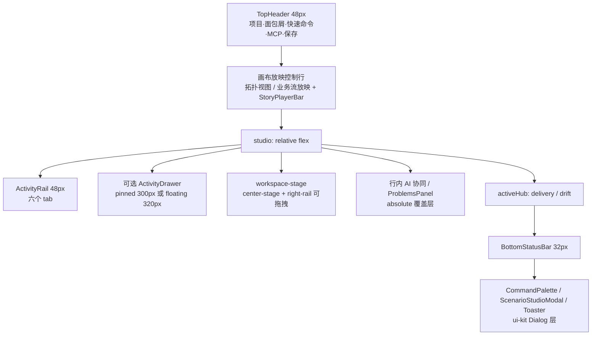

# 工作区界面与交互入口

`EditorWorkspace`（`EditorScreen` 内层组件）是界面组合点：它不实现面板，只决定谁在屏幕上、谁盖住谁、按键归谁。面板实现属于 `libs/desktop/feature-*`，组合件属于 `apps/desktop/src/renderer/components`。所有呈现状态（rail、drawer、hub、视图模式、分屏）都不进模型、不进 undo、不写 `.evidence/fm`；状态所有权与持久化细节见 [渲染器状态与数据流](./renderer-state.md)。

## 外壳：48px 页头、studio、32px 状态栏

- **TopHeader**（`h-12`）：项目名与 dirty 星号、`context 路径 / 对象名` 面包屑、唯一广告出来的快捷键入口「快速命令」（⌘+K）、`McpStatusPill`、保存按钮。页头没有第二排功能按钮——搜索、历史、交付都走命令面板。
- **画布放映控制行**：`data-canvas-control` 一行，`拓扑视图` 与 `业务流放映` 二选一（`storyActive = split.isSplit && split.activePane === 'story'`）；放映态下同一位置换成 `StoryPlayerBar`。
- **studio**（`relative flex min-h-0 flex-1`）：48px `ActivityRail`、可选 `ActivityDrawer`、`workspace-stage` 里 `autoSaveId="evidence-studio-horizontal-v2"` 的横向面板组（`center-stage` 最小 35%，`right-rail` 默认 20%、14–26%、可折到 0）。同层另有两个 absolute 覆盖件：行内 AI 协同（`bottom-16 z-40`）与门禁问题条（`bottom-0 h-[38%] z-30`）。
- **BottomStatusBar**（`h-8`，32px）：FM 一致性结论、传感器门禁摘要、`业务对象 / 履约连线 / 上下文` 计数，以及保存态与外部修改提示。
- **覆盖层**：两个 hub、`CommandPalette`、`ScenarioStudioModal`、`Toaster` 都排在 studio 之后渲染，因此能盖住 header/status。

这个外壳没有永久大纲列，也没有常驻底部控制台：问题条只在被要求时占据画布底部 38%，其余时间画布拿满全部宽度。

## 六项 ActivityRail

`RAIL_TABS` 当前是 **topology（业务结构）、diagnostics（门禁与诊断）、drift（生产漂移）、copilot（AI 协同）、clauses（条款审计）、workshop（共创工作坊）**，`RAIL_TAB_CHORDS` 给出 `⌘+1…⌘+6`，tooltip 在右侧显示。数字键由 `useWorkspaceLayoutState` 自己监听（要求 `metaKey||ctrlKey`、无 alt/shift、目标不是 input/textarea/select/contenteditable/`.cm-editor`），`⌘+数字` 因此与视图模式的 `Alt+数字`/`V` 不抢同一个键。

badge 由屏幕投影进来：`diagnostics` 打 `blockCount + warnCount`（有阻塞为 error 色、否则警告色、否则素色），`copilot` 只画一个裸点表示仍有未结算的 agent patch。`diagnostics` 是唯一不抽屉化的 tab：它清空 `activeRailTab` 而切换画布底部的问题条，因为一条 finding 是盯着被点名的对象读的。

一个 `ActivityDrawer` 壳服务所有 tab：一行标题、pin 开关、关闭按钮、可选 footer。pin 时占 `w-[300px]` 的行内宽度并把画布压窄；未 pin 时是 `absolute inset-y-0 left-12 z-30 w-[320px]` 浮在画布上，`data-region="activity-drawer"` 与 `data-pinned` 供测试和 MCP 几何读取。内容按 `activeRailTab` 选择，所以换 tab 是替换而不是叠加：

| tab | 内容（所有者） |
| --- | --- |
| topology | `TopologyDrawer`（搜索框、上下文树；拾取对象后回画布） |
| drift | `DriftRadar embedded`（feature-drift） |
| copilot | `AgentCopilot`（feature-agent，接 patchReview 与 token 预填） |
| clauses | `ClauseTraceDrawer`（合同原文 ↔ 对象双向定位） |
| workshop | `WorkshopWizardDrawer`（七步提问；「交 AI 复核」把文本预填进 copilot 并切 tab） |
| diagnostics | 无（改为 problems 条） |

两条与「抽屉只是手段，画布才是目的」有关的规则：未 pin 的抽屉里定位到对象后立即关闭（pin 的保留），`⌘F` 先打开 topology 再在下一 paint 用 token 把光标放进搜索框。问题条与 rail 共享 `activeIssueId`：点击 rail badge 或状态栏摘要只是展开/收起问题条，而从画布 finding 进入（`onOpenIssues`）或问题列表内换行时会调用 `openProblemsWithIssue`，同时展开问题条并把那一行设为活动项。

## 三种主舞台与五个副视口

`useWorkspaceViewMode` 持 `graph | table | split`；`isSplit` 从 `mode === 'split'` 派生，没有第二个布尔值。`V` 在 graph/table 之间翻，`Alt+1/2/3` 用 `event.code` 直接命名模式（macOS 会把 `Alt+2` 变成 `™`）。split 下用 `autoSaveId=evidence-stage-split-<direction>-v1` 的 `ResizablePanelGroup`，`splitSize` 只作为面板的 `defaultSize` 传入、从不从拖拽回写，几何由面板库按方向分别记忆。

`SecondaryStage` 是「一个容器 + 一条 tab 轨」，不是并排五个面板：`SPLIT_PANES` = **ledger、openapi、cel、drift、story**，只挂 `panes[activePane]`，未选中的 pane 会被卸载，因此 `CodeEditor` 里的 YAML/JSON 选择等本地状态会重置——不要把隐藏 pane 当常驻缓存。最大化是 `fixed inset-0 z-30` 盖住画布但**不关闭** split；关闭按钮先取消最大化再 `onClose`；方向按钮在左右/上下之间翻转（`⌥S`）。

badge 只给两处：`openapi` = `delivery.analysis.preview.routes.length`，`cel` = `document.rules.length`。`OpenApiSpecViewer` 只读、带「待刷新」徽标、行与对象双向定位（契约是投影，改契约只能改模型）；`CelRulesPane` 同样只读，画布当前选择优先于用户 pin 的规则行。`story` pane 一挂上就成为 `storyActive`，此时画布关闭 scope 过滤（`scope={null}`、`onScopeChange` 不传），避免放映时被上下文过滤吞掉场景。

画布浮动 HUD（`CanvasFloatingHud`）是工作区控制岛，画布只提供缩放/底纹/minimap 数学并把条带定位在底部中央：指针（清除选择）、卡片密度、权责泳道/拓扑布局、业务场景推演入口、视图分段控件、分屏对照选择、「只看总台账」、底纹、缩放与 `适应内容`。它刻意不提供新建对象：Contract/请求/确认只有在 Context、根与角色绑定齐备时才成立，创建留在 inspector 与 agent。

## 一份 DriftRadar，三种摆放

`DriftRadar` 在 rail 抽屉、split 的 `drift` pane、以及 hub 三处是同一个组件；`embedded` 只决定 `role` 是 `region` 还是 `dialog`。`useDriftAudit` 选择 trace 后经 main 读**已保存**模型 + OTLP JSON，显示 span/commit 计数、是否「存在阻塞漂移」、findings（等级、证据引用、remediation）与解析错误；未审计时明确说「还没有比对过任何 trace」而不是用空表冒充绿灯，`loading` 期间禁止重复选择，取消文件选择保留上一次结果。漂移不会自动回放历史，必须由人显式选文件。

## 覆盖层：两个 hub 与场景工作台

`HubSurface` 只有 `'delivery' | 'drift'`，`activeHub` 是单一互斥值：打开第二个替换第一个，`⌥D` / `⌥⇧S` 与命令面板的行都走 `openHub`。两者都渲染在 studio 之后：

- **DeliveryHub**（feature-delivery）自己是覆盖层：`fixed inset-0 z-40` 遮罩 + 860px 卡片、`role="dialog"`、`aria-modal`，内含「契约全览 / 本次增量变更」两个 tab 与导出按钮。基线是窗口打开时的 `initialDocument`（保存不重置差异），live preview 走 150ms debounce + revision 校验，`stale` 时旧预览不可导出，导出携带 `expectedModelDigest`。契约投影与差异语义见 [交付路由与增量差异](../contracts/delivery-routes-and-diff.md)。
- **DriftRadar hub** 没有额外的 fixed 包装：它的根就是 `flex-1` 区域，因此是占据 shell 剩余高度的整块面板（虽然 `role="dialog"`），不像 DeliveryHub 那样盖住页头与状态栏。

键盘也值得注意：两个 hub 内部只有「关闭」按钮，没有 Tab 陷阱，也不自己消费 Escape；Escape 仍会落到窗口级 handler，按 pending patch → split → 清除选择的顺序生效。对比之下 `CommandPalette` 与 `ScenarioStudioModal` 用 ui-kit `Dialog`（Radix 提供 focus trap、Escape 与 portal），后者还在 content 上 `stopPropagation`，所以「看起来是模态」不等于「真的接管键盘」。

**ScenarioStudioModal** 从 HUD 的「业务场景推演」按钮打开，是本地推演而非后端执行：mount 时取一份 `session.getDocument()` 快照为 base，所有编辑只改本地 items，一旦 document 变化（含 undo 与外部修改）就标 stale 并禁用保存；保存走 `session.mutate(replaceScenarioExamples(...))`（进 undo 历史，仍需 ⌘S 落盘），「保存并放映」额外 `selectFlow` + `setSkipAi(true)` + `openSplit('story')` 并关闭弹窗。场景只写回既有的 `entity.examples[].test` 通道，放映链路与故事高亮见 [画布几何、布局与检查器编辑](./canvas-and-inspector.md)。

## 命令面板、键帽与快捷键

`buildCommands(capabilities, handlers)` 是纯函数，行里的 `perform` 闭包就是页头、HUD 与快捷键用的同一批 handler，所以面板是既有行为的索引而不是第二个实现。不可用的行（撤销/重做栈为空、已在该视图、没有选区）保留在列表里解释当前状态；查询为空时只列命令，查询非空才追加「业务对象」分组；选中一行先关闭面板再执行，避免原生保存对话框悬在 focus trap 背后。`useCommandRegistry` 用 memo 稳定顺序，`groupCommands` 固定七个分组。

键帽有两个维护点：`CHORDS` 是面板印键帽的唯一来源，且一律写 `⌘`（handler 同时接受 meta 与 ctrl，因为桌面壳先面向 macOS）；`RAIL_TAB_CHORDS` 才是 rail tooltip 的来源并覆盖全部六项——目前 `CHORDS` 只给前四个 tab 定义了 `railTopology…railCopilot`，加 tab 时两边都要改。HUD 的 `⌘0`、`⇧1` 是字面量 title。

当前实际绑定的键：`⌘S` 保存、`⌘K` 命令、`⌘F` 结构搜索、`⌘Z`/`⌘⇧Z`/`⌘Y` 撤销重做、`⌘B` 业务结构抽屉、`⌘I` 或 `⌘\` 折 inspector、`⌘J` 行内协同、`⌘0`/`⇧1`/`⇧2` 缩放、`⌥D` 交付 hub、`⌥⇧S` 漂移 hub、`⌥X` 问题条、`⌥S` 旋转 split、`⌥3` 台账分屏、`⌥4` 契约分屏、`⌘⇧R` 重跑传感器。旧的 review hub、它的 `Alt+R` 入口与 `⌘⇧E` 导出都已不存在；宽屏台账仍只由 inspector 内的按钮或 `Alt+L` 打开。`⌥3` 同时出现在 `useWorkspaceViewMode`（切 split）和 `useEditorShortcuts`（开台账分屏）里，两个监听器都先看 `defaultPrevented`，最终以注册顺序为准，不能只凭键帽表承诺单一含义。

Escape 的归属同样是组合问题：台账 Sheet 与行内协同在 capture 阶段消费 Escape 并 `stopPropagation`（后者只在没有 pending patch 时这样做），窗口级 handler 排在 typing guard 之后才轮到 split 与清选择，而 pending patch 的撤销被放在 typing guard 之前以便从输入框里撤回。逐条语义与测试见 [渲染器状态与数据流](./renderer-state.md) 与 [资料摄取与补丁审查](./ingestion-and-patch-review.md)。

## Dashboard 是入口，不是第二个工作区

`App` 用 hash 路由分流：`#/editor?rootPath=…` 渲染 `EditorScreen`，其余渲染 `DashboardScreen`；两者通常是不同窗口（`projects.openEditorWindow`）。Dashboard 只负责「进哪个项目」，读 `projects.listRecent()` 与 `projects.listTemplates()`，提供三个入口：**从业务文本生成**（`IngestDraftModal`，编译成功后记住项目并开窗）、**新建模型**（`CreateProjectModal`，默认 `procurement` 模板）、**打开本地项目…**（`showOpenDialog` → `projects.open` → `openEditorWindow`）。空状态把 starter 卡片当作模板来源（过滤掉 `blank`），卡片显示模板自带的业务对象与规则数量；打开失败时把错误留在页面上并不开窗。项目持久化与 `.evidence/fm` 源树属 [Electron 宿主与项目生命周期](./app-shell.md) 的范围，不在这里复述。

## 面板实现与组合件的边界

| 面板实现（`libs/desktop/feature-*`） | 组合件（`apps/desktop/src/renderer`） |
| --- | --- |
| `DeliveryHub` / `useDeliveryHub`（feature-delivery） | `ActivityRail` / `ActivityDrawer` |
| `DriftRadar` / `useDriftAudit`（feature-drift） | `SecondaryStage` / `OpenApiSpecViewer` / `CelRulesPane` |
| `StoryDrawer` / `StoryPlayerBar` / `useStoryPlayback`（feature-story） | `TopologyDrawer` / `ClauseTraceDrawer` / `WorkshopWizardDrawer` |
| `RightInspector` / `KeyDataLedgerSheet`（feature-inspector） | `CanvasFloatingHud` / `ProblemsPanel` |
| `AgentCopilot` / `InlinePatchCopilot`（feature-agent） | `BottomStatusBar` / `McpStatusPill` / `CommandPalette` / `ScenarioStudioModal` |
| `CanvasViewport`（feature-canvas） | `EditorScreen` / `DashboardScreen`（窗口与路由） |

ui-kit 统一提供 `Dialog` / `Sheet` / `Resizable*` / `Tooltip` / `CodeEditor`，所以 focus、portal、density 语义不在每个 surface 各写一份；需要自定义键盘语义时（两个 hub、capture 阶段的 Escape）必须在页面里显式说明，而不是假设视觉模态自动带来完整焦点管理。

## 验证地图

`EditorScreen.spec` 做端到端联测：`Mod+1..4` 开抽屉、`Cmd+B` 开关业务结构、未 pin 抽屉拾取对象后交还画布而 pin 的保持、`Alt+2`/`V`/`Alt+1` 换视图、`Alt+4` 契约分屏与 `Alt+S` 翻方向、`Cmd+J`/`Cmd+K`、agent patch 的 Escape 撤销与保留、`Cmd+0`/`Shift+1` 缩放、`Alt+X` 问题条、workshop→copilot 预填、条款↔画布双向定位，以及 scope 与视图模式不进模型/历史。`ActivityRail`/`ActivityDrawer`/`SecondaryStage`/`OpenApiSpecViewer`/`CelRulesPane`/`WorkshopWizardDrawer`/`ClauseTraceDrawer`/`CanvasFloatingHud` 各自单测标记、badge、只有一个 pane 挂载、最大化与关闭顺序。`DashboardScreen.spec` 覆盖空状态、recents 计数、新窗口打开、解析失败与模板卡创建；`useWorkspaceLayoutState.spec`、`useWorkspaceSplitState.spec`、`useWorkspaceViewMode.spec`、`useEditorShortcuts.spec` 守布局状态与按键仲裁，`useDeliveryHub.spec`/`DriftRadar.spec` 守过期与空/错状态。

相关：[画布几何、布局与检查器编辑](./canvas-and-inspector.md) · [渲染器状态与数据流](./renderer-state.md) · [Electron 宿主与项目生命周期](./app-shell.md) · [补丁审查](./ingestion-and-patch-review.md) · [交付路由与增量差异](../contracts/delivery-routes-and-diff.md) · [传感器编排](../agents/sensor-orchestration.md) · [验证策略](../testing/verification-strategy.md)
