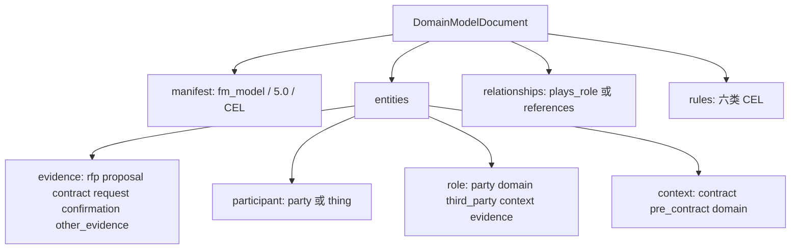

# FM v5 语言与建模红线

FM 以权责、请求/确认、事实与边界建模，不是 CRUD 表清单。`libs/evidence-schema` 是语言入口：AST 的 **Zod schemas 是运行时权威，类型由 `z.infer` 推导**；随包 JSON Schemas（`schemas/*.json`）是外部合同，`src/inspector/registry.ts` 由此派生编辑元数据，不再以手写 validator 维护另一套字段集合。

上图是文档的顶层形状：一个 manifest、三平集合，实体按 category 判别。

## 文档、manifest 与标识符

DomainModelDocument = manifest + entities/relationships/rules 三平集合。manifest strict：`type=fm_model`、`schemaVersion=5.0`、`ruleLanguage=CEL`、非空 `name`、semver `version`、非空且唯一的 `entryContextRefs`（每项必须是 Context 实体）、可选 `description`，以及可选的 `sourceDocument`（合同原文与逐句阅读，见下）。单文件源可携 envelope `type=fm_bundle`、`schemaVersion=5.0`、`readme`；`DomainModelBundleSchema` 把这三者变成必填，序列化器总是写出 envelope，因此同一文件在会话、检查与打包之间无需换形。未知顶层键、旧 `validation`/`scenario`/`instance` 顶层都不是兼容扩展，strict 拒绝；`evidence-model-io` 另有 legacy 拒绝与"不产出半成品文件"的保证。

`manifest.sourceDocument` 是**私有创作材料**（schema 注释明确它不进对外投影）：`text` 加 `clauses[]`，每句带 1-based `index`、逐字 `text`、三分类 `category`、`reason`、UTF-16 `charStart`/`charEnd`。refinement 要求 index 连续、按原文顺序、`charEnd > charStart` 且 `text.slice(charStart, charEnd)` 与 `text` 逐字相等——条款偏移一旦和原文不对齐就整体报错，而不是留下无法复核的引用。

ID 为小写字母开头的点/横线分段（`^[a-z][a-z0-9]*(?:[.-][a-z0-9]+)*$`）；属性 lower_snake_case；CEL alias 为字母/下划线开头；version 按 semver grammar。ID 跨实体/关系/规则全局唯一，重复对象报 `id.duplicate` 且不替换首次索引。VALUE_TYPES 十六类：CEL scalar（bool/int/uint/double/string/bytes/timestamp/duration）加 decimal/date/money/enum/id/list/map/dynamic 等业务便利类型。

`src/vocabulary.ts` 是词表机制的单一来源：每个 closed vocabulary 按落盘 key 声明一次，`vocabularyIds`/`vocabularyLabels`/`vocabularyField`/`isVocabularyId` 派生 id 联合、有序 id 列表、标签/字段表与守卫。声明顺序是阅读顺序，也是 inspector select 的顺序（option 值即落盘 id，标签取词表声明的 label）。

## 四类实体与业务时间

| category | kinds | 关键语义 |
| --- | --- | --- |
| evidence | rfp、proposal、contract、fulfillment_request、fulfillment_confirmation、other_evidence | 责任与事实，不是任意记录 |
| participant | party、thing | 实际参与方或领域对象 |
| role | party、domain、third_party、context、evidence | 能力/责任插槽，不是实现者 |
| context | contract、pre_contract、domain | 唯一所属与依赖边界 |

阶段归属是被校验的，不只是命名习惯：rfp/proposal 必须在 pre_contract Context；fulfillment_request/fulfillment_confirmation 必须在 contract Context；contract 必须在 contract Context 并列入其 `rootRefs`；thing 必须在 domain Context；other_evidence 只需落在某个 Context（合同、前合同、领域皆可）。除 contract 外的每类 Evidence 都必须有 `responsibleRoleRef` 指向合法 Party Role，且该角色属于本 Context——pre_contract 的凭证借 parent contract 的双方，owner 为合同 Context 时角色还必须列在该合同的 `roleRefs` 里。contract 恰有两个不同且同 Context 的 Party Role；实际 participant 可以尚未确定，角色不能少一方。

participant.party 不得 `contextRef`，允许跨合同扮演；thing 必须 domain Context，可选 `domainRole=calculator/checker`，且该标记只允许 thing 带。Role 必须所属 Context，不可携 Evidence 的 `responsibleRoleRef`/`roleRefs`。Context 不得 `contextRef`，可有 `parentContextRef` 但不得循环；contract/domain 须真实 `rootRefs` 且 root 必须属于该 Context，contract Context 恰一 owned `evidence.contract` 根。

rfp/proposal/request 必须 `started_at`+`expired_at`，contract 为 `signed_at`，confirmation 为 `confirmed_at`，other 为 `created_at`；所有认出的业务时间都需 `required`/`keyData`/`timestamp`。时段不是确认时刻。

attribute 要求 `name`/`label`/`meaning`、可选合法 `valueType`、boolean `required`/`keyData`，实体内名称唯一，未知字段拒绝。`derivedByRuleRef` 必须指向同 Context、target 精确 entity+attribute 的 derivation，反向 target 也必须被属性回指。实体内 example label 唯一，且**只有 evidence 实体的 example 可以带 `test`**。

## 两类关系与跨界白名单

关系只有 plays_role/references，端点须存在，不允许 self 或 Contract-Contract；可选 `flowKind`（primary/breach_compensation/escalation）区分正常、补偿与升级边，缺省按 primary 读取且不写默认值。cardinality `min`≥0 整数、`max` 正整数或 many、`min≤max`。

plays_role 允许 party→party/third_party role、thing→domain role、Context→context role，以及跨 Context moment Evidence→evidence role。moment 只含 contract/confirmation/other_evidence，rfp/proposal/request 时段不够资格，给 `relationship.playsRole.momentOnly`。Evidence Role 作为 socket 的实现必须隔离在另一 Context。

references 同 Context 也有端点规则（Evidence 只能指向 Thing、Evidence 或 evidence role），跨界仅：contract 引用其 pre_contract 子 Context 的 proposal（且该 Context 的 `parentContextRef` 必须指向该合同 Context）；Evidence 引用 thing；Evidence 引用 confirmation/other_evidence 事实。跨界引用 evidence role、Context 链、跨 Context contract 等不合法。

## 六类CEL规则

derivation 可产生任意合法 `resultType` 且必须 `target`；precondition/invariant/eligibility/completion/breach 必须 bool 且禁止 `target`。`label`/`description`/`expression` 非空，`contextRef` 必须解析到 Context 实体。binding 为 `{ref, cardinality?: one|many}` 或 `{type}` 的严格互斥形态，alias 须是 CEL 标识符，`ref` 须解析实体。schema 只校验形态/图语义，不执行 CEL；作用域、lineage 和表达式求值在 model-core。

## 内联 examples 是验收输入

实体 examples 可带 test：`flow`、`tags`、必填 `actingRoleRef`、显式 offset 的 RFC3339 `asOf`、`basedOn`、`expectedStatus`（200–599）、`inputs`、`pathParameters`（`exampleRef` + 以 `$` 开头的 jsonpath）、`expect`（JSONPath → 期望）。对象 strict、JSON 值须真实可序列化（拒绝 Date/Infinity/循环），tags/basedOn 唯一；**inputs 覆盖只允许显式 ≥400 负向测试**。静态图级检查补充 example 标签/归属约束；唯一 POST 映射、角色、依赖隔离/排序、捕获和 CEL oracle 属于 API projector，不把投影条件塞进 schema。

没有 test 的 example 仍是示例，不臆造业务流程。AcceptanceFlow 是 `evidence-acceptance` 的临时编译 IR，`examples[].test` 是唯一场景载体，不是旧 Scenario 文件格式的复活；Step CI/Hurl 运行时 HTTP 验收另见 [CLI](../workflows/cli-governance.md)。

## 严格校验的实际流水线

`DomainModelDocumentSyntaxSchema` strict 对象 + category discriminatedUnion 定义语法；`DomainModelDocumentSchema=...superRefine(refineDomainModel)` 负责已类型化图语义：至少一实体 → 建唯一索引（id.duplicate）→ manifest entry 解析 → entities（examples/attributes/context/ownership/time/roots）→ relationships → rules → derivation symmetry。错误使用 custom params 保留 FM code/objectId。

`strictValidateDomainModel` safeParse → mapZodIssues → dedupeIssues；成功不归一化/修改调用者输入。映射器优先取 refinement 的 `validationCode`，其余按路径结构回落成既有 closed ValidationCode（如 `id.invalid`、`entity.unknownField`、`relationship.cardinality`），产出 pointer-like path（`entities[3].attributes[1].name`）、message、可选 objectId，并按 code/path/message 去重。`assertValidDomainModel` 抛携同 issues 的 `DomainModelValidationError`。

旧 ENTITY_KEYS/validateNonContextEntity 大函数已移除，category-specific 结构键限制直接在 Zod branch 表达，再由 documentSemantics 补跨引用检查。语法错误时不保证继续遍历所有不安全图对象；不要要求旧手写 validator 的执行顺序作为公开契约。

静态 gate 被 FM check、bundle/source-files 的 `validate` 选项、compile/lineage、API projection、review preview 复用；`session.createModelSession` 只在 `validateOnDispatch` 打开时于提交处抛错，`projectStore.save` 也不等同门禁。用户可以保存半建模型，但正式交付拒绝。scope 完整性、key-data provider、CEL、HTTP 实现为独立问题。

## 阅读词表不是模型状态

schema 里另有一组共享词表：它们决定界面与提示怎么称呼一件事，不是可写盘的模型字段。

**生命周期**四阶段 rfp/proposal/contract/fulfillment，各带 label/caption/englishLabel。`lifecycleStageOf` 按 evidence kind 推导（other_evidence 返回 null，role/participant 也返回 null，随所属 Context 读）；`lifecycleStageOfContext` 中 contract Context 恒为 contract、domain Context 读作 fulfillment、pre_contract 取其所持 evidence 的最远阶段，缺省 rfp。没有实体 `stage` 字段。画布的 swimlane 展示布局自带一套相位标签（索取方案/方案/签约/履约与追责）并按 kind 计算，不由该词表驱动——阅读顺序不是布局契约。

**条款三分类与去向**：business/domain/boilerplate，每桶带 label、englishLabel、hint 与固定 destination——business→evidence、domain→domain-thing、boilerplate→none。`ClauseAnnotation` 为 `{index, text, category, reason}`，`countClausesByCategory` 保留空桶为 0。合同阅读器先滤法务、再看动作动词、最后才单独看公式；归不了类的句子按 boilerplate 保留并报 issue。`ClauseReading` 另加 `computesValue` 与 `charStart`/`charEnd`，一句话可以既是义务又声明一个必须由规则算出的值。这些阅读结果经编译写入 `manifest.sourceDocument`（私有创作材料），**不是实体字段，也不是第四类模型对象**；条款审计面板与 Agent prompt 用同一批 id/标签，因此不会出现第四个桶。`entity.sourceSnippet` 靠精确文本（可附 `clauseIndex` 与偏移）回溯到句，匹配不到就报未定位，绝不模糊匹配。

**工作坊七步**：anchor-contract、pair-fulfillment、name-things、invert-dependency、close-breach、trace-key-data、connect-flow，每步带 label、businessPrompt、hint；`workshopStepRank` 给 1-based 序号，`workshopStepFocus` 打印 `【第 N 步 · label】`；`REVERSE_CONTRACT_MODE`（无合同逆推）带自己的 focus 前缀。消费方各自取同一份词表：`WorkshopStepSelector` 用 `WORKSHOP_STEPS` 生成 pills（序号+label，hint 作 title）；`AgentCopilot` 在发送前把选中步骤的 focus 或逆推模式前缀拼到消息前，因为会话不保存"当前步骤"；`WORKFLOW_PROMPT` 按同样顺序复述七个标签（prompts spec 断言顺序一致）；`WorkshopWizardDrawer` 用 `inspectWorkshop` 逐步显示结构就绪/待补充/待人工核对，并把当前问题作为 prefill 交给 Agent。七步与模式都不落盘：没有 workshop 实体，也没有当前步骤字段。

`inspectWorkshop` 只报可观察结构事实：锚定合约=恰一合同、两个不同且同 Context 的 party role、合同列入 rootRefs；成对履约=每个角色都有以它为责任方的请求、每个请求都有确认；让每个数字有来源=ledger 无待决项；其余步骤固定 review。结构就绪不等于业务确认。

`sourceSnippet` 可选保存 `text` 与 `locator`、`source`（contract/prd/interview/blueprint/unknown）、`clauseIndex`、`charStart`/`charEnd`；字符区间必须成对且长度等于文本长度（UTF-16）。它供人复核来源，不是运行时授权，也不是 key-data provider 的证据（见 [关键数据与来源](./key-data-and-provenance.md)）。

## 验证入口

AST/strictValidate/zodPipeline specs 覆盖语法 strict、category unions、FM codes/objectId、图 refinement 与无输入突变；exampleTest specs 保护 clock、负向覆盖与 JSON shape。golden `tests/fixtures/product-procurement` 模型作为稳定基线，每 case clone 后破坏一条红线。vocabulary/lifecycle/clause/workshop/inspector specs 验证共享词表与展示合同；`evidence-agent` 的 prompts spec 断言七步标签在提示里按同一顺序出现。

相关：[源格式](../model/source-formats.md) · [关键数据与来源](./key-data-and-provenance.md) · [检查与CEL](../model/checks-and-simulation.md) · [事务与命令](../model/commands-and-session.md) · [导入与补丁审阅](../desktop/ingestion-and-patch-review.md)
