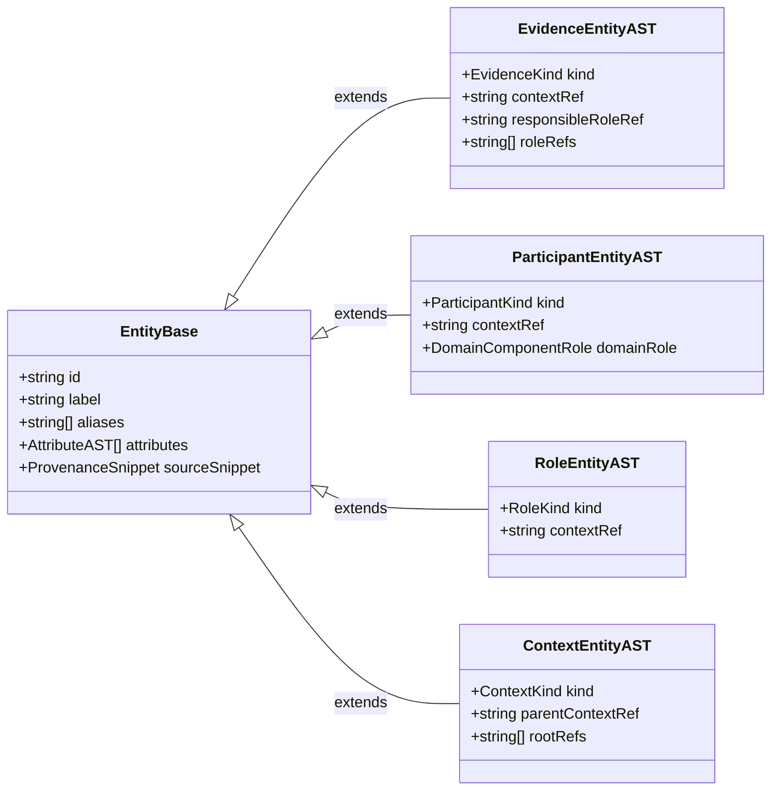
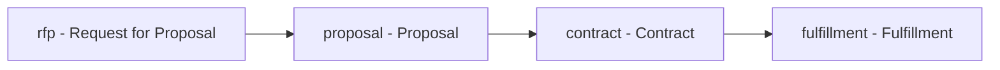
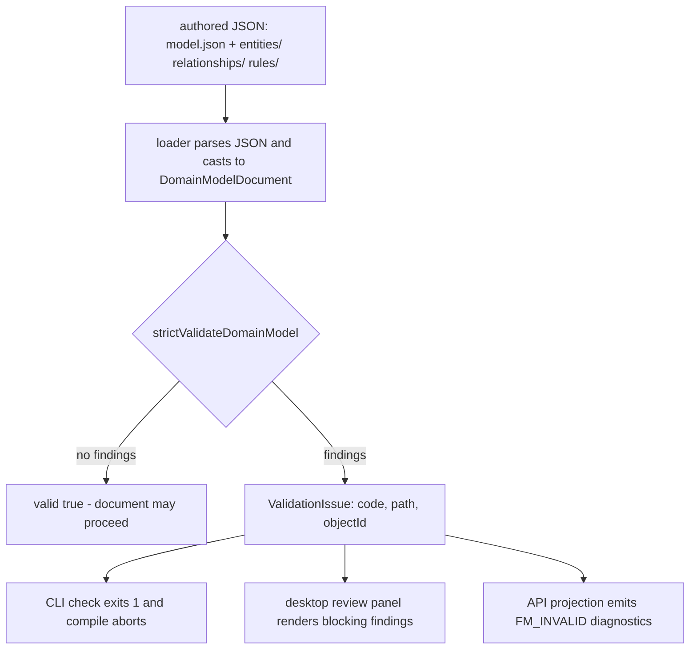

# The FM model language (FM v5)

Fulfillment Modeling describes a business as responsibilities that are claimed
and discharged, not as tables and endpoints. A model is a small graph of
**Contexts**, **Evidence**, **Participants** and **Roles**, joined by typed
relationships, judged by CEL rules, and read through a fixed lifecycle and a
fixed workshop order.

## Where the language lives

`libs/evidence-schema` is the whole language. It publishes three artifacts, and
they have three different jobs:

| Artifact | Path | Job |
| --- | --- | --- |
| AST types, closed vocabularies, narrow guards | `libs/evidence-schema/src/ast/` | the executable form of the language |
| JSON Schemas | `libs/evidence-schema/schemas/` | the published contract, field for field beside the types |
| Static validator | `libs/evidence-schema/src/validation/strictValidate.ts` | the gate that decides whether a document is acceptable |

The README states the relationship: the types mirror `schemas/*.json` field for
field, and those JSON Schemas ship beside the code as the published contract
while the types are the executable form of them
(`repo://libs/evidence-schema/README.md#L1-L16`). Nothing in the runtime parses
the JSON Schemas — the package has no runtime dependencies — so the schemas
document the vocabulary and `strictValidateDomainModel` enforces it. When you
change a shape, both copies move in the same commit.

`libs/evidence-schema/src/index.ts` is the only public surface: it re-exports
every vocabulary, guard, type, the validator and its error type, so callers in
`evidence-model-core`, the desktop main process, the agent and `evidence-api`
never reach into `src/ast/` directly.

## The vocabulary registry

Every closed vocabulary in the language is declared exactly once, keyed by the
string that is written to disk, with the text a surface prints for it stored in
the same entry (`repo://libs/evidence-schema/src/vocabulary.ts#L1-L61`):

```ts
export const PARTICIPANT_KIND_DEFINITIONS = {
  party: { label: '参与方' },
  thing: { label: '业务对象' },
} as const satisfies Record<string, { readonly label: string }>;

export const PARTICIPANT_KINDS = vocabularyIds(PARTICIPANT_KIND_DEFINITIONS);
export const PARTICIPANT_KIND_LABELS = vocabularyLabels(PARTICIPANT_KIND_DEFINITIONS);
```

`vocabularyIds` gives the ordered id union, `vocabularyLabels` the label map,
`vocabularyField` one field of every entry (that is how
`REQUIRED_EVIDENCE_TIME_ATTRIBUTES` is derived from the same declaration that
names the evidence kinds), and `isVocabularyId` the guard — the declaration
already knows its own keys, so no validator spells the list a second time.

Two conventions follow from that registry and matter when reading the rest of
this page:

- **Declaration order is reading order.** `LIFECYCLE_STAGES` is the lane order
  left to right, and `RULE_KINDS` is the order an editor lists them in.
- **Labels are carried, not looked up elsewhere.** The canvas, the inspector, the
  review panel and the prompts all import the same label map, which is why a kind
  renamed in one place cannot drift on one surface.

## Document shape

A document is a manifest plus three flat collections
(`repo://libs/evidence-schema/src/ast/document.ts#L7-L32`):

```jsonc
{
  "manifest": {
    "type": "fm_model",
    "schemaVersion": "5.0",
    "id": "product-procurement-full-lifecycle",
    "name": "商品采购协议完整履约模型",
    "version": "1.1.0",
    "ruleLanguage": "CEL",
    "entryContextRefs": ["context.product-procurement"]
  },
  "entities": [],
  "relationships": [],
  "rules": []
}
```

The manifest is strict (`repo://libs/evidence-schema/schemas/model.schema.json#L1-L40`,
`repo://libs/evidence-schema/src/validation/strictValidate.ts#L265-L376`):

- `type` must be `fm_model`, `schemaVersion` exactly `5.0`, `ruleLanguage`
  exactly `CEL`;
- `id` must match the FM identifier grammar, `name` must be non-empty, `version`
  must be semver-shaped;
- `entryContextRefs` must be non-empty and unique, and every entry must resolve
  to a `context` entity (code `manifest.entryContextRef`);
- `description` is the only optional field, and the JSON Schema sets
  `additionalProperties: false`.

The validator keeps one flat allowed-key set per collection
(`ENTITY_KEYS`, `RELATIONSHIP_KEYS`, `RULE_KEYS`, `MANIFEST_KEYS`) and reports
anything else as `manifest.field`, `entity.unknownField` or `attribute.shape`.
That is deliberate: a typo is a finding, never a silently ignored field. Because
the key set is flat, category-specific rules such as "a Role must not declare
`roleRefs`" cannot be expressed structurally — they are semantic checks inside
`validateNonContextEntity`. A model with no entities is refused
(`$.entities`, `model must contain at least one entity`); a document whose shape
is wrong is reported as `document.shape` and validation stops there without
inspecting the collections.

## Identifiers and value types

Four grammars keep ids stable and machine-readable
(`repo://libs/evidence-schema/src/ast/id.ts#L1-L35`):

| Kind | Pattern | Example |
| --- | --- | --- |
| domain id | `^[a-z][a-z0-9]*(?:[.-][a-z0-9]+)*$` | `request.payment` |
| attribute name | `^[a-z][a-z0-9]*(?:_[a-z0-9]+)*$` | `confirmed_at` |
| model version | semver | `1.1.0-rc.1` |
| CEL alias | `^[A-Za-z_][A-Za-z0-9_]*$` | `confirmations` |

Ids are unique **across** entities, relationships and rules, not within each
collection. A duplicate is reported as `id.duplicate` and the second object is not
indexed, so later reference checks never see it
(`repo://libs/evidence-schema/src/validation/strictValidate.ts#L380-L446`).

`VALUE_TYPES` covers the CEL scalar set plus business conveniences: `bool`, `int`,
`uint`, `double`, `decimal`, `string`, `bytes`, `timestamp`, `duration`, `date`,
`money`, `enum`, `id`, `list`, `map`, `dynamic`
(`repo://libs/evidence-schema/src/ast/values.ts#L1-L19`). The same list types
attribute values, rule `resultType` and the runtime half of a rule binding.

## The four entity categories

`ENTITY_CATEGORIES` is the whole ontology: `evidence`, `participant`, `role`,
`context`. Each category has its own kind vocabulary, and the four AST interfaces
share one `EntityBase` (`repo://libs/evidence-schema/src/ast/entity.ts#L11-L145`):



The four entity AST kinds and the fields each category adds on top of `EntityBase`.

A fifth category does **not** exist. Lifecycle stages, clause categories and
workshop steps (below) are vocabularies for reading and navigating a model; none
of them is a field on disk.

### Evidence: six kinds, each tied to a business moment

| Kind | Required time attributes | Context it must live in |
| --- | --- | --- |
| `rfp` | `started_at`, `expired_at` | `pre_contract` |
| `proposal` | `started_at`, `expired_at` | `pre_contract` |
| `contract` | `signed_at` | `contract`, and listed in its `rootRefs` |
| `fulfillment_request` | `started_at`, `expired_at` | `contract` |
| `fulfillment_confirmation` | `confirmed_at` | `contract` |
| `other_evidence` | `created_at` | contract, pre-contract or domain |

The required-time table is `REQUIRED_EVIDENCE_TIME_ATTRIBUTES`, derived from
`EVIDENCE_KIND_DEFINITIONS`, and every recognised time attribute —
`started_at`, `expired_at`, `signed_at`, `confirmed_at`, `created_at` — must be
declared as a **required `keyData` timestamp** wherever it appears
(`repo://libs/evidence-schema/src/ast/entity.ts#L24-L80`,
`repo://libs/evidence-schema/src/validation/strictValidate.ts#L580-L630`).

Why so strict: a period and a moment are different claims. Signing happens at an
instant, an offer is valid over a window, and a model that records a window for a
confirmation cannot say when the obligation was discharged. The finding says so:
`attribute.time.missing` for the required name, `attribute.time.notKeyTimestamp`
for a recognised time attribute declared with the wrong type or flags.

Every non-contract Evidence must name a `responsibleRoleRef` that is a Party Role
owned by its Context — and, for a Contract Context, bound by the root Contract.
A pre-contract stage borrows the parties of its parent Contract
(`repo://libs/evidence-schema/src/validation/strictValidate.ts#L763-L852`).

A Contract is a bilateral agreement, so it is saved together with **exactly two
distinct Party Roles** from its own Context, and must be the Context's root
(`repo://libs/evidence-schema/src/validation/strictValidate.ts#L854-L942`).
Actual players may still be unknown; the two roles are the invariant, not the
people.

### Participant: a party outside contexts, a thing inside one

`participant.party` represents a concrete business actor and **must not** declare
`contextRef`: the same buyer participates in many contracts, so pinning it to one
Context would duplicate the entity. `participant.thing` is the subject of a trade
and must live in a `domain` Context
(`repo://libs/evidence-schema/src/validation/strictValidate.ts#L944-L1090`).

A `thing` may additionally carry `domainRole: "calculator" | "checker"`. That is
how a model says the object is not what the business trades but the computation
the domain owes — a pricing band, a ratio, an eligibility test — so a rule can own
the number instead of a typed-in value. `domainRole` is refused on a Party
(`entity.domainRole.thingOnly`) and an unknown role is refused as `entity.kind`
(`repo://libs/evidence-schema/src/ast/entity.ts#L93-L118`,
`repo://libs/evidence-schema/src/ast/entity.ts#L307-L327`).

### Role: responsibility, never a player

`role.party`, `role.domain`, `role.third_party`, `role.context` and
`role.evidence` describe what a participant or object may act as. A Role must
belong to a Context and must **not** carry `responsibleRoleRef` or `roleRefs` —
those are Evidence responsibility fields, and letting a Role declare them would
create a second responsibility chain
(`repo://libs/evidence-schema/src/ast/entity.ts#L120-L132`,
`entity.roleResponsibility.forbidden`).

A **role socket** is this: the Role names a slot, and a `plays_role` relationship
supplies the player. The socket does not know who fills it.

### Context: contract, pre-contract or domain

A Context must not have `contextRef`; it may have `parentContextRef`, and
`contract` / `domain` contexts must declare `rootRefs` with real content. A
Contract Context has exactly one root, and it must be an `evidence.contract` owned
by that Context. Parent chains may not cycle
(`repo://libs/evidence-schema/src/validation/strictValidate.ts#L633-L761`,
`repo://libs/evidence-schema/src/validation/strictValidate.ts#L1091-L1119`).

Ownership is the load-bearing concept: `ownerContextOf` returns a Context's own id
and every other object's `contextRef`, and the cross-boundary relationship rules
are written in terms of it.

## Attributes

An attribute is the unit of business meaning:

```jsonc
{
  "name": "confirmed_at",
  "label": "确认时间",
  "meaning": "卖方确认收款到账时的业务时间。",
  "valueType": "timestamp",
  "required": true,
  "keyData": true
}
```

`name` must be lower snake_case and unique inside the entity; `label` and
`meaning` are mandatory non-empty strings; `valueType`, when present, must be one
of the declared types; `required` and `keyData` must be booleans; unknown keys are
findings (`repo://libs/evidence-schema/src/ast/entity.ts#L168-L186`,
`repo://libs/evidence-schema/src/validation/strictValidate.ts#L447-L580`).

`derivedByRuleRef` is the pointer from an attribute to the derivation that computes
it. It must resolve to a rule, and — enforced in both directions — that rule must
be a `derivation` whose `target` is exactly this entity and attribute in the same
Context (`repo://libs/evidence-schema/src/validation/strictValidate.ts#L1740-L1850`).
The symmetry is the point: an attribute cannot claim a formula, and a formula
cannot write an attribute that does not point back. See
[key data, business time and provenance](../language/key-data-and-provenance.md)
for how `keyData` becomes a provider ledger.

## Relationships

Only two kinds exist: `plays_role` and `references`
(`repo://libs/evidence-schema/src/ast/relationship.ts#L1-L59`).

Both endpoints must resolve, and self-relationships are refused
(`relationship.self`). Contract-to-Contract connections are refused outright:
a chain of contracts is not a responsibility, it is a missing Context
(`relationship.contractPair`,
`repo://libs/evidence-schema/src/validation/strictValidate.ts#L1357-L1445`).

### `plays_role` is direction-checked

Allowed pairs are explicit in `PLAYS_ROLE_PAIRS` plus two named exceptions
(`repo://libs/evidence-schema/src/validation/strictValidate.ts#L1305-L1355`):

- `participant.party` → `role.party`
- `participant.party` → `role.third_party`
- `participant.thing` → `role.domain`
- any Context → `role.context` (an external Context can play an Other Context Role)
- a **moment** Evidence → `role.evidence`

"moment" has a precise meaning here: `fulfillment_confirmation`,
`other_evidence` and `contract`. An interval Evidence (`rfp`, `proposal`,
`fulfillment_request`) that points at `role.evidence` is rejected with its own
code, `relationship.playsRole.momentOnly`, because a window that has not closed
has not discharged anything. Any other wrong pairing is
`relationship.playsRole.endpoints`.

A moment playing an Evidence Role must come from **another** Context: the Role is
the socket, and the player is the implementation that sits behind it. Note the two
spellings in the code: `isEvidenceMoment` in `entity.ts` covers confirmation and
`other_evidence`, while the validator's `MOMENT_EVIDENCE_KINDS` adds `contract` —
a signed contract is a settled moment too.

### `references` is cross-context only by whitelist

Same-context references are ordinary. Crossing a Context boundary is allowed only
for (`repo://libs/evidence-schema/src/validation/strictValidate.ts#L1491-L1545`):

1. a Contract referencing a Proposal, where the Proposal's Context declares the
   Contract's Context as its `parentContextRef`;
2. Evidence referencing a Thing;
3. Evidence referencing a moment Evidence whose kind is
   `fulfillment_confirmation` or `other_evidence`.

Everything else — including a cross-context reference to an Evidence Role, a
Context referencing a Context, or Evidence referencing a Contract across
boundaries — is `relationship.references.crossContext`. Endpoint *types* are
checked separately (`relationship.references.endpoints`): an Evidence may only
reference a Thing, another Evidence or an Evidence Role.

Cardinality is optional but validated when present: `min ≥ 0` integer, `max` a
positive integer or `"many"`, and `min ≤ max`.

## Rules are CEL, and their kind decides their shape

`RULE_KIND_DEFINITIONS` carries the six kinds together with whether the CEL result
is a decision (`repo://libs/evidence-schema/src/ast/rule.ts#L19-L40`):

| Kind | Result |
| --- | --- |
| `derivation` | any value type; writes one attribute |
| `precondition`, `invariant`, `eligibility`, `completion`, `breach` | must be `bool` |

A `derivation` **must** declare a `target` (`entityRef` + `attribute`) and no other
kind **may**. A rule requires non-empty `label`, `description`, `expression` and a
`contextRef` pointing at a Context. Bindings are either a modeled reference
(`{ "ref": "...", "cardinality": "one" | "many" }`) or a runtime type
(`{ "type": "money" }`), the alias must be a CEL identifier, and every `ref` must
resolve to an entity (`repo://libs/evidence-schema/src/ast/rule.ts#L42-L111`,
`repo://libs/evidence-schema/src/validation/strictValidate.ts#L1549-L1740`).

```jsonc
{
  "type": "rule",
  "id": "rule.payment-completed",
  "kind": "completion",
  "label": "付款完成判断",
  "description": "付款确认在请求有效期内形成时，付款请求履约完成。",
  "contextRef": "context.product-procurement",
  "bindings": {
    "request": { "ref": "request.payment" },
    "confirmations": { "ref": "confirmation.payment", "cardinality": "many" }
  },
  "expression": "confirmations.exists(c, c.confirmed_at >= request.started_at && c.confirmed_at <= request.expired_at)",
  "resultType": "bool"
}
```

The static validator never parses or evaluates the expression — that is the CEL
pass in `evidence-model-core`, described in
[the native check and simulation pipeline](../model/checks-and-simulation.md).

## Reading order: the four lifecycle stages

`LIFECYCLE_STAGE_DEFINITIONS` names four stages in reading order — `rfp`,
`proposal`, `contract`, `fulfillment` — with a caption and an English label so the
canvas lane, the sidebar and the review page cannot disagree
(`repo://libs/evidence-schema/src/ast/lifecycle.ts#L1-L80`):



The four lifecycle stages in reading order. "Contract signed" is the hinge:
everything to its left is pre-contract and has no legal force, everything to its
right is obligated delivery.

The stage is **derived, never declared**:

- `rfp`, `proposal`, `fulfillment_request` and `fulfillment_confirmation` each map
  to one stage in `EVIDENCE_STAGE`; `other_evidence` is deliberately absent, so a
  receipt or delivery note inherits its Context's lane;
- Roles, Participants and Things have no stage (`lifecycleStageOf` returns
  `null`) and inherit their Context's;
- a `contract` Context is always the hinge, a `domain` Context reads as
  `fulfillment`, and a `pre_contract` Context takes the furthest stage among its
  own Evidence (`rfp` when it holds none).

The swimlane layout calls `lifecycleStageOfContext` on each root Context, so a
nested Contract Context stays in its own lane instead of moving its parent
(`repo://libs/evidence-canvas-interaction/src/layout/lifecycleSwimlaneLayout.ts#L130-L160`).
Nothing about a stage is stored on disk or accepted by the validator — it is a
pure function of the graph.

## The three clause readings

Before anything is modeled, an agreement has to be split into three buckets.
`CLAUSE_CATEGORY_DEFINITIONS` declares them once, each with the label the review
panel prints, a one-line hint, and where its outcome goes
(`repo://libs/evidence-schema/src/ast/clause.ts#L1-L135`):

| Category | Hint | Destination |
| --- | --- | --- |
| `business` | who delivers what to whom and when — this is what decides profit and cost | `evidence` |
| `domain` | pricing, conversion, validation — algorithms that can be written as rules | `domain-thing` |
| `boilerplate` | jurisdiction, force majeure, notices — not carried by any system | `none` |

`CLAUSE_DESTINATIONS` is the closed set (`evidence`, `domain-thing`, `none`), so a
review panel cannot invent a fourth place to put a sentence it does not
understand. `ClauseAnnotation` records the clause verbatim with its category and a
business-language reason, and `countClausesByCategory` summarizes a reading. The
ingestion side extends it: `ClauseReading` adds `computesValue`, because one
sentence can both oblige the seller and state a formula
(`repo://libs/evidence-model-core/src/ingestion/contractAnnotator.ts#L1-L18`).

Reading a contract straight into evidence produces a document list with no
responsibilities in it; reading boilerplate into the model produces obligations no
system can discharge. The vocabulary lives in `evidence-schema` rather than in a
reader so the extraction prompt, the review panel and the ingestion compiler name
the same three buckets.

## The workshop order

`WORKSHOP_STEPS` names the seven moves a modeling workshop walks, in the method's
own terms (`repo://libs/evidence-schema/src/ast/workshop.ts#L1-L100`):

| # | id | Move |
| --- | --- | --- |
| 1 | `anchor-contract` | anchor the contract and its two sides |
| 2 | `pair-fulfillment` | mine fulfillment items in pairs — the right holder's request is an interval, the obligor's confirmation is a moment |
| 3 | `name-things` | add the traded Thing and the domain components |
| 4 | `invert-dependency` | invert volatile dependencies (payment channel, logistics, invoicing) |
| 5 | `close-breach` | give breach a compensation path |
| 6 | `trace-key-data` | give every number a source |
| 7 | `connect-flow` | connect the business macro-flow |

The order is deliberate: a contract before its obligations, obligations before the
things they trade in, the things before the computations over them, the happy path
before its failures, and key data after the failures because most amounts only
become decidable once the compensation path is known.

Nothing on disk records a step — the language only provides the shared names,
`workshopStepRank` (one-based, for the "step 3" the interface prints) and
`workshopStepFocus`, which renders the `【第 3 步 · …】` prefix that travels with a
prompt so the agent knows which move the modeler picked
(`repo://apps/desktop/src/renderer/components/agent/AgentCopilot.tsx#L107-L120`).
`REVERSE_CONTRACT_MODE` is the second way in: with no contract to read, model
backwards from the evidence that must be retained and from who is liable when
something arrives late.

## Provenance

`sourceSnippet` is optional on every entity and carries the verbatim sentence an
ingested element came from, a human-readable `locator` (a sentence number, `row 4`,
a stage) and the input kind — `contract`, `prd`, `interview`, `blueprint` or
`unknown` (`repo://libs/evidence-schema/src/ast/provenance.ts#L1-L54`).
Hand-written models may omit it; ingested ones keep it so a reviewer can re-read
the clause instead of trusting the extraction.

## The strict validator is the single gate

`strictValidateDomainModel(input)` is the only place that decides whether a
document is acceptable. Both the command line and the desktop call it; neither
carries a second opinion.



Where the one validator is called, and what a rejection does downstream.

Call sites that matter:

- **CLI.** `evidence-model check` builds the same report the desktop and the agent
  tool read — `buildFmCheckReport` folds `strictValidateDomainModel(...).issues`
  into `errors` — and exits `1` when the report is not valid. `compile` and
  `lineage` run `ensureCheckable` first and abort with "模型未通过一致性检查"
  instead of writing an artifact (`repo://libs/evidence-model-io/src/cli.ts#L380-L555`,
  `repo://libs/evidence-model-core/src/validation/fmCheck.ts#L170-L185`).
- **Desktop.** The review preview validates the live document it was handed and
  maps each issue to a `block`-severity finding with `targetNodeId` taken from
  `objectId` (`repo://apps/desktop/src/main/reviewPreview.ts#L50-L80`). A cheap
  `isDomainModelDocumentShape` guard runs first so a malformed payload never
  reaches the validator.
- **Agent / session.** `createModelSession` exposes `validate()` and, when
  `validateOnDispatch` is on, throws `ModelSessionValidationError` before applying
  a command whose result would be invalid
  (`repo://libs/evidence-model-core/src/session/createModelSession.ts#L132-L160`).
  The option is off by default: an authoring surface must be able to hold a
  half-built document. The gate that refuses to hand it over is the check, not the
  keystroke — `projectStore.save` writes the document the renderer holds without
  re-validating (`repo://apps/desktop/src/main/projectStore.ts#L341-L372`).
- **API projection.** `buildProjection` re-validates the model part and turns each
  issue into an `FM_INVALID` diagnostic, so a projection can never be greener than
  the model (`repo://libs/evidence-api/src/projector.ts#L51-L64`).
- **Source adapters.** `parseModelSourceFiles` and `parseModelBundleText` accept a
  `validate` option; when set they append the static findings to the file-level
  issues, and bundle extras are stripped first so the validator only ever sees the
  four model keys (`repo://libs/evidence-model-core/src/adapters/modelBundle.ts#L380-L404`).

### What it checks, in order

`strictValidateDomainModel` runs one pipeline
(`repo://libs/evidence-schema/src/validation/strictValidate.ts#L1859-L1920`):

1. `readDocument` — object shape; `manifest` present; the three collections are
   arrays.
2. `indexCollection` × 3 — `type` per collection, unknown fields, id grammar,
   cross-collection id uniqueness.
3. `validateManifest` — the manifest contract above.
4. `validateEntities` — label and kind per category, `aliases`, Context cycles,
   then attributes, Context roots, and either the Context or the non-Context branch
   (responsibility, Contract pairs, evidence/context kind fit, participant and Role
   constraints).
5. `validateRelationships` — shape, endpoints, `plays_role` pairs, moment rule,
   cross-context whitelist.
6. `validateRules` — kind/result/target shape, Context, binding refs, derivation
   target resolution.
7. `validateDerivedAttributes` — the reverse direction of derivation symmetry.

The result is deduplicated by `code | path | message`, so one mistake produces one
finding even when two passes notice it.

### Failure semantics

A rejection is an **authoring error**, not an engine bug. The contract is
(`repo://libs/evidence-schema/src/validation/errors.ts#L1-L134`):

```ts
interface ValidationIssue {
  code: ValidationCode;   // e.g. 'entity.roleRefs.count'
  path: string;           // 'entities[3].attributes[1].name'
  message: string;
  objectId?: string;      // stable id of the owning object
}
interface ValidationResult { valid: boolean; issues: ValidationIssue[]; }
```

Codes are a closed union, so a caller can branch on them instead of matching prose
— the empty-model code `model.empty` in the adapters exists precisely so a reader
that tolerates a blank project can filter it and keep every other finding fatal.
`assertValidDomainModel` is the throwing form:

```ts
assertValidDomainModel(input); // throws DomainModelValidationError with .issues
```

The validator never mutates its input, and a spec asserts that on a document that
already contains a derivation.

### What the static validator deliberately does not do

Scope is document shape, identifier grammar, category/kind contracts, reference
resolution, Context ownership, responsibility, relationship endpoints and
derivation symmetry. Traceability, key-data providers, scope completeness and CEL
evaluation are separate passes in `evidence-model-core`, not re-implemented here
(`repo://libs/evidence-schema/src/validation/strictValidate.ts#L1846-L1858`).
Lifecycle stages, clause categories and workshop steps are reading aids and are not
validated fields at all.

That boundary is why a model can be **structurally valid** and still fail a check:
structure is necessary, not sufficient. It is also why an authoring session may
tolerate a document the CLI would refuse.

## What the language forbids, in one list

| Forbidden | Code | Why |
| --- | --- | --- |
| unknown manifest / entity / relationship / rule / attribute key | `manifest.field`, `entity.unknownField`, `attribute.shape` | a typo must be a finding, not silence |
| duplicate ids across collections | `id.duplicate` | references must be unambiguous |
| `contextRef` on a Context, or on a `participant.party` | `entity.contextRef.forbidden`, `entity.participantParty.contextRef` | ownership belongs to objects, not to the roles they play |
| Contract without exactly two distinct Party Roles | `entity.roleRefs.missing`, `entity.roleRefs.count` | a contract is bilateral |
| Role carrying `responsibleRoleRef` / `roleRefs` | `entity.roleResponsibility.forbidden` | one responsibility chain only |
| `rfp`/`proposal` outside a pre-contract Context | `entity.evidenceContext.kind` | the phase is part of the claim |
| `fulfillment_request`/`confirmation` outside a contract Context | `entity.evidenceContext.kind` | obligations arise from a contract |
| Thing outside a domain Context | `entity.evidenceContext.kind` | the subject of trade is not an obligation |
| `domainRole` on anything but a Thing | `entity.domainRole.thingOnly` | computation lives in the domain, not in a party |
| a non-contract Evidence without a responsible Party Role | `entity.responsibleRole.*` | every obligation has an owner |
| a recognised time attribute that is not a required keyData timestamp | `attribute.time.notKeyTimestamp` | a moment is not a window |
| `derivedByRuleRef` without the matching rule target | `rule.derivation.mismatch`, `rule.derivation.context` | a formula must be traceable both ways |
| `plays_role` in the wrong direction or between wrong kinds | `relationship.playsRole.endpoints` | roles are sockets, players are implementations |
| interval Evidence behind an Evidence Role | `relationship.playsRole.momentOnly` | an open window has discharged nothing |
| Contract → Contract relationship | `relationship.contractPair` | responsibility is not a contract chain |
| Context parent cycle | `entity.parentContextRef.cycle` | the graph would be unbounded |
| unsupported cross-context reference | `relationship.references.crossContext` | only three crossings are meaningful |
| non-boolean decision rule | `rule.resultType` | a decision must decide |
| `target` on a non-derivation, or none on a derivation | `rule.target.forbidden`, `rule.target.required` | only derivations write values |

## Tests that protect this contract

`strictValidate.spec.ts` loads the `tests/fixtures/product-procurement/` model and
mutates a **clone** per case — fixture baseline, document shape, manifest,
identifiers, attributes, contexts, responsibility, evidence context, domain
components, relationships, rules, and `assertValidDomainModel` — so each rule is
exercised against a real model and the fixture stays a stable snapshot
(`repo://libs/evidence-schema/README.md#L18-L24`). The AST modules carry their own
specs: `entity`, `id`, `keyData`, `document`, `clause`, `lifecycle`, `workshop`,
`rule`. The vocabulary specs pin the properties this page relies on — every
declared clause category has a label and a hint and exactly three destinations,
every workshop step has a label and a hint and a unique id, `workshopStepRank` is
one-based, and the lifecycle stage order is stable.

## Related pages

- [Key data, business time and provenance](../language/key-data-and-provenance.md) —
  what `keyData` means once structural validation has passed.
- [The native check and simulation pipeline](../model/checks-and-simulation.md) —
  the passes that run after structural validation, including CEL.
- [Commands and session](../model/commands-and-session.md) — how the desktop mutates
  a document and when the guard fires.
- [Source tree and bundle adapters](../model/source-formats.md) — how a document is
  stored and parsed.
- [Canvas layout, viewport and inspector](../desktop/canvas-and-inspector.md) — how
  these categories and lanes are drawn and edited.
